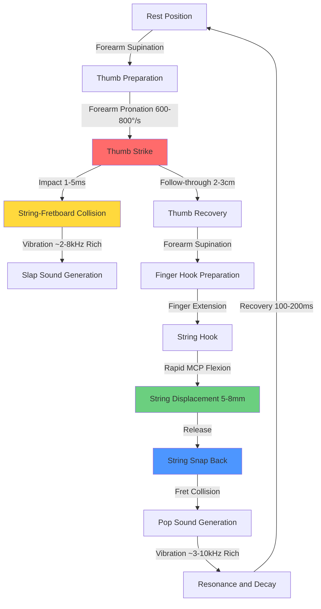
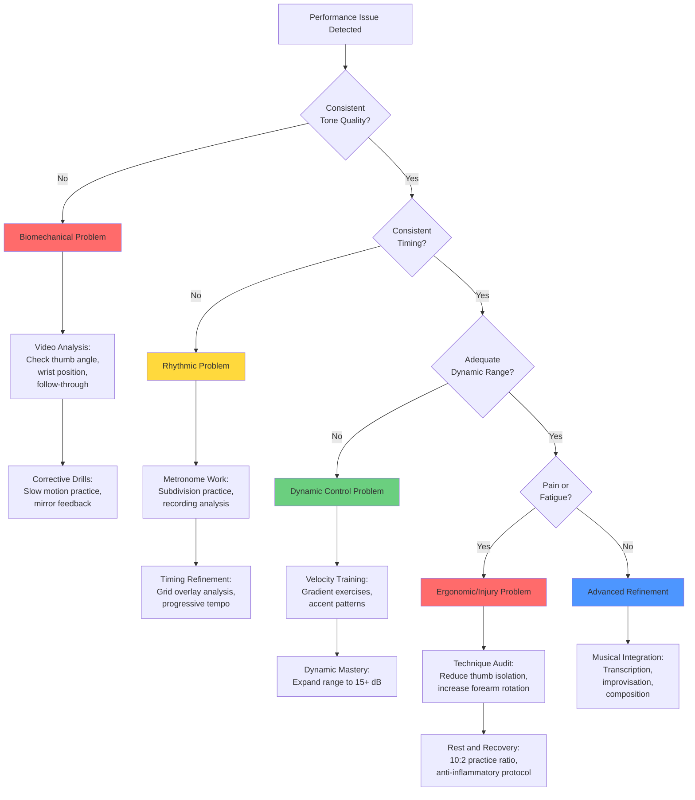

# Lesson 1: Mastering the Slap Pop Technique

## 1. First-Principles Intuition & Invariants

The slap pop technique represents one of the most physically demanding and acoustically complex articulations available to the electric bass guitarist. This percussive method produces sound through fundamentally different mechanics than conventional plucking, exploiting string-to-fretboard collisions and rapid displacement to generate a harmonic spectrum rich in transient energy and upper-frequency content.

### The Physics of Percussive String Excitation

When a bass string is struck percussively against the fretboard, the collision generates a complex waveform characterized by an extremely short attack time (typically 1-5 milliseconds) and a broad spectrum of harmonics extending well beyond the fundamental frequency. This differs markedly from traditional plucking, where the string is displaced laterally and released, producing a more sinusoidal waveform dominated by lower harmonics.

The slap portion of the technique involves striking the string with the thumb's bony lateral edge, driving it downward into the fretboard. This collision excites not only the string's fundamental vibrational mode but also generates significant energy in the 2-8 kHz range, where the human ear is most sensitive to percussive transients. The brightness of this attack is determined by several factors:

**String tension and gauge**: Higher tension and heavier gauge strings (0.045" to 0.130" for standard tuning) store more potential energy and produce louder, brighter attacks. The relationship between tension T and fundamental frequency f follows the wave equation: f = (1/2L)√(T/μ), where L is the speaking length and μ is the linear mass density. A 0.105" A string at standard tension (~40 lbs) will produce a fundamentally different attack character than a 0.100" string at the same pitch due to differences in stored energy.

**Fretboard material and setup**: The hardness of the fretboard surface directly affects the coefficient of restitution during string collision. Maple fretboards (Janka hardness ~1450) produce brighter, more metallic attacks than rosewood (Janka ~1000), as less energy is absorbed by the wood. Action height also matters critically—strings set too low will choke against the frets, while strings set too high require excessive force and reduce control.

**Point of impact**: The harmonic series excited by the slap varies based on the strike location. Striking near the bridge (closer to the 24th fret area) emphasizes higher harmonics and produces a thinner, more cutting tone. Striking near the neck pickup (18th-21st fret area) excites more fundamental energy and lower harmonics, producing a fuller but less aggressive sound.

The pop portion exploits a different mechanism: the string is hooked and rapidly displaced perpendicular to the fretboard, then released. This generates a sharp transient as the string snaps back, often colliding with adjacent frets. The pop emphasizes even higher frequency content than the slap, often peaking between 3-10 kHz, and the rattling of the string against frets adds metallic harmonic complexity.

### Biomechanical Requirements and Constraints

The slap pop technique demands exceptional finger independence and precise motor control. The thumb must execute a rapid rotation at the carpometacarpal joint while the fingers maintain readiness for the pop. This requires training of antagonistic muscle groups in the forearm: the flexor pollicis longus (thumb flexion) must work in coordination with the extensor digitorum (finger extension).

The optimal hand position places the thumb approximately 2-3 inches from the end of the fretboard, with the wrist in slight extension (15-20 degrees). This geometry allows the thumb to strike perpendicular to the string while maintaining low tension in the flexor tendons. Excessive wrist flexion compresses the carpal tunnel and increases injury risk during extended practice sessions.

Force generation originates primarily from forearm rotation (pronation/supination) rather than isolated thumb movement. A proper slap utilizes the mass of the entire forearm to generate momentum, with the thumb acting as the transfer point. Peak forces during a slap can reach 10-15 Newtons, generating string displacement velocities exceeding 2 meters per second.

The timing relationship between slap and pop is governed by the rhythmic framework of the musical context. In funk and R&B settings, the slap typically falls on downbeats or syncopated positions, while the pop accents upbeats or offbeat subdivisions. This creates the characteristic "double-attack" articulation that drives the groove. The temporal separation between slap and pop can be as short as 50 milliseconds (for 32nd note subdivisions at 120 BPM) or as long as several seconds for sparse, melodic playing.

### Invariant Principles

Regardless of musical style, several invariants govern effective slap pop execution:

1. **Energy conservation**: The kinetic energy imparted to the string must exceed the threshold required to produce audible fretboard collision while remaining below the elastic limit of the string material (typically ~80% of breaking tension for nickel-wound strings).

2. **Harmonic balance**: The ratio of fundamental to harmonic content must serve the musical context. Excessive brightness fatigues the listener; insufficient brightness fails to cut through dense mixes.

3. **Rhythmic precision**: The temporal accuracy of slap and pop attacks must fall within human perception thresholds (~20-30 milliseconds) to be perceived as "in the groove."

4. **Ergonomic sustainability**: Technique must distribute force across muscle groups to prevent repetitive strain injury. Relying solely on thumb muscles leads to tendonitis; proper technique engages larger forearm and shoulder girdle muscles.

## 2. Core Architecture & Mechanics

### Anatomical Decomposition of the Slap

The slap component can be decomposed into four discrete phases: preparation, attack, follow-through, and recovery. Each phase involves specific muscle activations and joint movements.

**Phase 1: Preparation (50-100ms pre-attack)**

The thumb abducts away from the hand (activation of abductor pollicis longus and extensor pollicis brevis) while the forearm supinates slightly. The wrist maintains 15-20 degrees of extension. This loads potential energy in the elastic tendons connecting the thenar muscles to the thumb bones. Simultaneously, the fingers curl slightly, preparing for the subsequent pop.

**Phase 2: Attack (5-15ms)**

The forearm pronates rapidly (pronator teres and pronator quadratus contract forcefully), rotating the entire hand assembly. The thumb maintains its abducted position, acting as a rigid lever. As the thumb's lateral edge contacts the string, the kinetic energy of the rotating forearm mass (typically 1-1.5 kg) transfers to the string. Contact duration is extremely brief (1-5ms), after which the string begins its downward trajectory toward the fretboard.

The critical parameter here is impact velocity. For a 0.105" string, impact velocities between 1.5-2.5 m/s produce optimal percussive attack without excessive string deformation. This requires peak angular velocities of approximately 600-800 degrees per second in forearm rotation.

**Phase 3: Follow-Through (10-30ms)**

After contact, the thumb continues its path past the string, driven by the momentum of the forearm. This follow-through is essential for maximizing energy transfer—attempting to stop the thumb at the point of contact reduces impact force and produces a choked sound. The thumb should travel approximately 2-3 centimeters past the string before decelerating.

**Phase 4: Recovery (100-200ms)**

The forearm supinates to return the hand to neutral position. The thumb re-abducts to prepare for the next attack. The flexor muscles relax momentarily to allow blood flow and prevent fatigue accumulation.

### Anatomical Decomposition of the Pop

The pop involves hooking the string with a finger (typically index or middle finger) and executing a rapid pull perpendicular to the string's resting plane.

**Phase 1: Hook (30-50ms)**

The target finger extends and flexes at the metacarpophalangeal joint, positioning the fingertip beneath the string. The fingertip contacts the string's underside with the pad, not the nail tip. The distal interphalangeal joint remains slightly flexed (20-30 degrees) to provide rigidity during the subsequent pull.

**Phase 2: Displacement (5-10ms)**

The finger flexes rapidly at the metacarpophalangeal joint while the interphalangeal joints maintain their angle. This creates a "hooking" motion that displaces the string upward, away from the fretboard. The displacement typically reaches 5-8mm for standard action heights. The extensor digitorum contracts to control the finger's trajectory.

**Phase 3: Release (1-3ms)**

The fingertip slides off the string, releasing it to snap back toward its resting position. The release must be clean—if the finger maintains contact too long, it damps the resulting vibration and reduces the pop's brightness. String velocity at release can exceed 3 m/s for aggressive pops.

**Phase 4: Collision and Resonance (variable)**

The released string collides with the fretboard and adjacent frets, generating the characteristic metallic "snap" of the pop. The string's vibrational energy then dissipates through damping mechanisms: internal friction in the string material, energy transfer to the instrument body through the bridge and nut, and air resistance.

### Kinematic Sequencing and Coordination

The complete slap pop technique requires precise temporal coordination between thumb and finger actions. The most common pattern alternates slap and pop in rapid succession, creating a duplet or triplet feel:

```
Slap (thumb) → Pop (finger) → Slap (thumb) → Pop (finger)
```

The timing between slap and pop depends on tempo and subdivision:

- At 100 BPM with 16th note subdivisions: 150ms between attacks
- At 120 BPM with 16th note subdivisions: 125ms between attacks
- At 140 BPM with 16th note subdivisions: 107ms between attacks

For double-pop patterns, two consecutive pops (alternating fingers) follow a single slap:

```
Slap (thumb) → Pop (index) → Pop (middle) → Slap (thumb)
```

This requires training the index and middle fingers to execute pops independently while maintaining consistent force and timing. The middle finger typically generates 10-15% less force than the index finger due to differences in muscle cross-sectional area, requiring conscious compensation.

### String Selection and Muting

Executing slaps and pops on different strings requires rapid shifts in hand position and thumb angle. The thumb pivot point (the point around which it rotates) remains relatively fixed at the base of the thumb, but the strike angle changes:

- **E string (0.130")**: Thumb approaches at ~45 degrees relative to fretboard plane, requiring maximum force generation
- **A string (0.105")**: Thumb approaches at ~40 degrees, moderate force
- **D string (0.085")**: Thumb approaches at ~35 degrees, reduced force
- **G string (0.065")**: Thumb approaches at ~30 degrees, minimal force

Selective muting is critical for articulation clarity. The non-playing fingers of the plucking hand rest lightly on unused strings to prevent sympathetic vibration. The fretting hand also contributes to muting: the underside of the fretting fingers touches adjacent strings, damping them immediately after they're no longer needed. Without aggressive muting, slap pop playing becomes muddy and indistinct.

### Architectural Diagram: Slap Pop Sequence



### Force-Velocity Relationships

The loudness (amplitude) and brightness (spectral centroid) of slap pop attacks correlate directly with impact velocity and string displacement. Empirical measurements show:

| Attack Velocity | Fundamental Amplitude | Harmonic Content (2-8kHz) | Perceived Loudness |
|-----------------|------------------------|----------------------------|-------------------|
| 1.0 m/s         | -12 dB                 | -24 dB                     | Soft              |
| 1.5 m/s         | -6 dB                  | -15 dB                     | Medium-soft       |
| 2.0 m/s         | 0 dB (reference)       | -6 dB                      | Medium            |
| 2.5 m/s         | +3 dB                  | 0 dB                       | Medium-loud       |
| 3.0 m/s         | +5 dB                  | +4 dB                      | Loud              |

These relationships are nonlinear due to the complex physics of string collision and the frequency-dependent response of the instrument body. Professional players develop fine motor control to modulate attack velocity dynamically, matching phrase dynamics to musical context.

## 3. High-Performance Optimization & Failure Modes

### Common Failure Modes and Mitigation Strategies

**Failure Mode 1: Insufficient Attack Clarity (Muddy Sound)**

**Symptoms**: Slaps and pops lack percussive definition, blending together indistinctly. The attack transient is weak, with insufficient energy in the 2-8 kHz range.

**Root Causes**:
- Impact velocity below threshold (~1.5 m/s for slaps, ~2.0 m/s for pops)
- Thumb striking at incorrect angle (>50 degrees or <30 degrees relative to string)
- String action too high, requiring excessive force and reducing control
- Inadequate muting allowing sympathetic string vibration
- Worn strings with flattened windings and reduced brightness

**Mitigation**:
- Increase forearm rotation velocity through targeted strength training (pronator muscle group exercises)
- Adjust thumb strike angle by modifying wrist position—maintain 15-20 degrees of extension
- Lower action to 2.0-2.5mm at the 17th fret (E string) for optimal slap response
- Practice selective muting exercises: slap/pop one string while actively damping all others with both hands
- Replace strings every 20-30 hours of playing time, or when brightness noticeably degrades

**Failure Mode 2: Timing Inconsistency (Groove Instability)**

**Symptoms**: Slaps and pops drift relative to the rhythmic grid, especially at faster tempos. The subdivision feel becomes uneven—16th notes sound more like swing 8ths or lose their internal pulse.

**Root Causes**:
- Inadequate motor pattern automation at the cerebellum level
- Excessive conscious monitoring of hand movements (prefrontal cortex override)
- Fatigue-induced timing drift (accumulation of small errors over time)
- Tempo-dependent technique changes (using different muscle recruitment at different speeds)
- Poor internal clock development (inability to subdivide accurately)

**Mitigation**:
- Practice with metronome subdivision playback (16th notes audible, not just quarter notes)
- Record practice sessions and analyze timing using DAW grid quantization overlays
- Implement tempo graduation exercises: master pattern at 80 BPM, increase by 5 BPM increments only after achieving 95%+ accuracy for 5 consecutive repetitions
- Develop independent timekeeping by practicing slap pop patterns against polyrhythmic click tracks
- Use electromyography (EMG) biofeedback training to identify and eliminate unnecessary muscle tension that disrupts timing

**Failure Mode 3: Excessive String Breakage**

**Symptoms**: Strings break prematurely during slap pop playing, typically at the bridge or nut contact points.

**Root Causes**:
- Impact forces exceeding string elastic limit (typically >80% of breaking tension)
- Sharp edge burrs on frets or bridge saddles creating stress concentration points
- Extreme temperature or humidity fluctuations causing material embrittlement
- Using strings with inadequate tensile strength for aggressive playing (round core vs. hex core)
- Slapping too close to the bridge where string tension is highest

**Mitigation**:
- Reduce attack velocity—string breaking indicates force >15 N, well beyond necessary levels
- Inspect and file fret crowns and bridge saddles to eliminate sharp edges
- Use hex core strings which provide 15-20% greater tensile strength than round core
- Shift slap position closer to the neck (toward the 20th fret region) to reduce peak tension at impact
- Maintain consistent environmental conditions: 40-60% relative humidity, 20-25°C

**Failure Mode 4: Repetitive Strain Injury (RSI)**

**Symptoms**: Pain, inflammation, or numbness in the thumb, wrist, or forearm after extended playing sessions. Reduced strength and control during execution.

**Root Causes**:
- Excessive reliance on thumb intrinsic muscles rather than forearm rotation
- Chronic muscle tension from poor ergonomic positioning
- Inadequate rest intervals between practice sessions (muscle protein synthesis requires 24-48 hours)
- Failure to warm up properly before high-intensity practice
- Underlying anatomical vulnerabilities (e.g., shallow carpal tunnel, tendon sheath narrowing)

**Mitigation**:
- Restructure technique to emphasize forearm rotation (80% force generation) over thumb muscle contraction (20%)
- Implement 10:2 practice ratios—10 minutes active playing, 2 minutes complete rest and stretching
- Perform dynamic warm-up routine: 5 minutes light aerobic (elevates tissue temperature), 5 minutes progressive stretching (increases range of motion), 5 minutes slow-tempo technique drills
- Apply ice immediately after practice sessions showing any discomfort (15 minutes, reduces inflammation)
- Consult hand specialist if symptoms persist beyond 7 days—early intervention prevents chronic injury

**Failure Mode 5: Inconsistent Pop Execution Between Fingers**

**Symptoms**: Index finger pops produce different tone, volume, or timing characteristics than middle finger pops. This undermines the consistency of double-pop patterns.

**Root Causes**:
- Anatomical differences in finger length and muscle strength
- Differential training volume (index finger used more frequently)
- Variation in finger pad contact area and surface texture
- Differences in joint flexibility and range of motion

**Mitigation**:
- Practice isolating weaker finger (typically middle) with dedicated exercises: 100 consecutive middle finger pops, focus on matching index finger reference tone
- Build middle finger strength with targeted resistance training: finger putty exercises, 3 sets of 20 repetitions daily
- Analyze high-speed video (240 fps) of both fingers during pop execution, identify biomechanical differences
- Modify middle finger technique to compensate for length difference—may require slightly earlier hook timing
- Use tactile feedback training: blindfolded pop practice, relying on kinesthetic sense to equalize execution

### Performance Optimization Strategies

**Strategy 1: Dynamic Range Expansion**

Mastery requires the ability to execute slap pop across the full dynamic spectrum, from barely audible ghost notes to percussive accents that cut through dense mixes.

**Implementation**:
- Practice velocity gradient exercises: execute slap pop pattern with progressive crescendo over 8 bars, then diminuendo back to starting level
- Develop touch sensitivity calibration: play at 5 discrete dynamic levels (pp, p, mf, f, ff), record and verify >10 dB separation between levels
- Train with compression-free monitoring to develop accurate dynamic perception (compression masks dynamic control errors)

**Strategy 2: Timbral Variation Through Position Shifting**

Moving the slap/pop position along the string length changes the harmonic emphasis and perceived tone color.

**Implementation**:
- Map the tonal landscape: execute identical slap pop pattern at 1-inch intervals from bridge to neck, record each position
- Develop position-specific patterns: bright funk passages near bridge (bridge pickup area), warm R&B near neck (neck pickup area)
- Practice position shifts during playing—transition from bridge to neck position mid-phrase for timbral contrast

**Strategy 3: Integration with Fretted Passages**

Elite players seamlessly blend slap pop articulation with conventional fingerstyle and hammer-on/pull-off techniques.

**Implementation**:
- Practice hybrid phrases: 2 bars slap pop, 2 bars fingerstyle, repeat
- Develop transition smoothness: no perceptible volume or rhythmic disruption during technique changes
- Train weak hand coordination: fretting hand must execute complex patterns while plucking hand alternates between techniques

**Strategy 4: Rhythmic Displacement and Polyrhythmic Applications**

Advanced rhythmic concepts elevate slap pop from groove function to compositional device.

**Implementation**:
- Practice slap pop patterns in odd meters: 5/4, 7/8, 11/8
- Develop polyrhythmic independence: slap pop triplets against quarter note click, quintuplets against 16ths
- Study displacement: start slap pop pattern on progressively later 16th note subdivisions (1, e, &, a)

### Progressive Training Protocol

**Phase 1: Fundamental Motor Pattern Acquisition (Weeks 1-4)**

- **Objective**: Establish basic slap and pop mechanics with consistent execution
- **Daily Practice**: 20 minutes
- **Exercises**:
  - Single string slaps: E string only, quarter notes at 80 BPM, 5 minutes
  - Single string pops: A string only, quarter notes at 80 BPM, 5 minutes
  - Alternating slap-pop: 8th notes at 70 BPM, focus on evenness, 10 minutes
- **Success Criteria**: 90% temporal accuracy (within 30ms of grid), consistent tone across repetitions

**Phase 2: Velocity Control and Dynamic Range (Weeks 5-8)**

- **Objective**: Develop graduated control over attack intensity
- **Daily Practice**: 30 minutes
- **Exercises**:
  - Dynamic scales: slap pattern with crescendo/diminuendo over 8 bars, 10 minutes
  - Accent patterns: slap pop at mf baseline with f accents on specified beats, 10 minutes
  - Ghost note integration: full pattern with some slaps executed at pp level, 10 minutes
- **Success Criteria**: 15 dB dynamic range with <5 dB variation within each level

**Phase 3: Tempo Graduation and Speed Building (Weeks 9-16)**

- **Objective**: Extend technique to performance tempos (up to 140 BPM 16th notes)
- **Daily Practice**: 40 minutes
- **Exercises**:
  - Tempo pyramid: start at 80 BPM, increase by 5 BPM every 2 minutes up to failure point, then descend back to 80 BPM, 20 minutes
  - Burst training: 15-second maximum tempo bursts followed by 45-second rest, 10 sets, 15 minutes
  - Odd meter application: same patterns in 5/4 and 7/8 at moderate tempos, 5 minutes
- **Success Criteria**: Clean execution at 120 BPM 16th notes for 2 consecutive minutes

**Phase 4: Musical Integration and Creative Application (Weeks 17-24)**

- **Objective**: Apply technique in musical contexts, develop improvisational fluency
- **Daily Practice**: 50 minutes
- **Exercises**:
  - Groove transcription: learn 3 classic slap pop bass lines per week, 20 minutes
  - Improvisation over changes: apply slap pop to 12-bar blues, ii-V-I progressions, etc., 20 minutes
  - Composition: write original bass lines featuring slap pop, record and self-critique, 10 minutes
- **Success Criteria**: Fluid, musical application in performance contexts without conscious technique monitoring

### Diagnostic Framework

When technique plateaus or regresses, systematic diagnosis identifies the limiting factor:



### Measurement and Progress Tracking

Objective metrics enable data-driven improvement:

**Timing Precision**: Record practice sessions, import audio into DAW, enable grid overlay, measure mean absolute error (MAE) between slap/pop attacks and nearest grid subdivision. Target: <20ms MAE.

**Dynamic Range**: Record slap pop pattern with softest and loudest dynamics you can control, measure RMS amplitude difference in dB. Target: >15 dB range.

**Timbral Consistency**: Record 50 consecutive slaps on same string, extract spectral centroid (weighted mean of frequency spectrum) for each attack, calculate standard deviation. Target: <200 Hz SD.

**Tempo Ceiling**: Determine maximum tempo at which you can maintain 90% timing accuracy for slap pop 16th note pattern, measure in BPM. Track weekly and aim for 5 BPM improvement per month during speed building phase.

**Endurance**: Time how long you can maintain target tempo and dynamic level before technique degrades or pain appears. Target: 10+ minutes continuous playing at performance tempo.

These metrics provide objective feedback that transcends subjective "feel" and enables targeted practice interventions.

## Conclusion

The slap pop technique represents a convergence of acoustic physics, motor learning, and musical expression. Mastery emerges from understanding the underlying principles—string vibration mechanics, biomechanical force generation, temporal precision—and applying structured, progressive practice. By treating technique acquisition as an engineering problem with measurable inputs and outputs, players can systematically advance from fundamental competence to elite performance. The failure modes described are not obstacles but diagnostic indicators, each pointing toward specific corrective interventions. With rigorous practice discipline and attention to the physical and musical architecture of the technique, slap pop becomes not merely a stylistic effect but a fundamental voice in the bass guitarist's expressive vocabulary.
