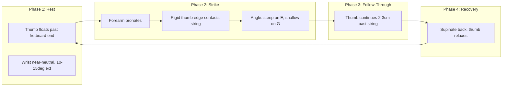
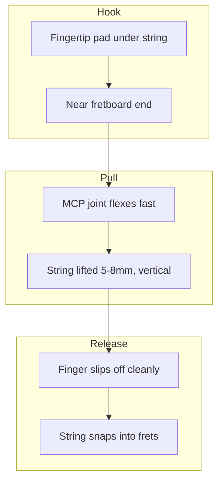
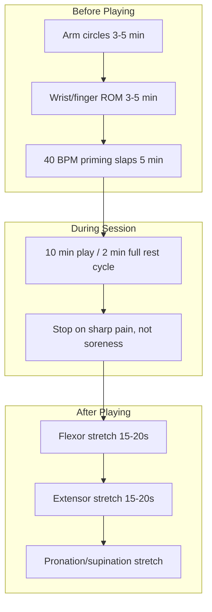
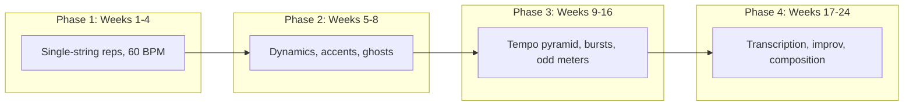

# Lesson 1: Mastering the Slap & Pop Technique

## 1. Why It Sounds Like That (First-Principles, Brief)

Slapping drives the string into the fretboard with the side of the thumb, producing a percussive collision rich in upper harmonics (2–8 kHz) — a completely different excitation from plucking, which mostly favors the fundamental and low overtones. Popping snaps the string away from the fretboard with a finger and lets it rebound into the frets, adding a sharp metallic transient (3–10 kHz) on top of the plucked fundamental. Three things govern how that attack sounds:

1. **Strike speed sets brightness.** A faster thumb motion drives the string harder against the fret, exciting more high harmonics. You don't need brute force — a quick, relaxed strike at a controlled angle beats a hard, stiff one every time, and it's easier on the joints.
2. **Strike location sets tonal color.** Hit the string near the end of the fretboard (over where a bridge pickup would sit) for cutting brightness; move toward the neck for warmth and fundamental weight. You're changing where along its length the string first gets disturbed, which changes which harmonics get emphasized the most strongly.
3. **String gauge and action set feel.** Heavier strings (.105 A, .130 E) store more energy and punch louder but take more force to drive. Lower action (2.0–2.5 mm at the 12th fret) makes slapping easier but increases buzz risk — there's a real tradeoff here, not a universal "lower is better."

The motion itself comes from **forearm rotation (pronation/supination)**, not thumb-joint bending. The thumb is a rigid striking surface; the forearm supplies the swing. Treat the thumb like a drumstick tip and the forearm like the arm swinging it — that mental model fixes most slap technique problems before you even touch dynamics or speed.

---

## 2. Hand Mechanics & Physical Execution

### Slap: Four-Phase Breakdown

**Phase 1 — Rest position.** Thumb floats 2–3 inches past the end of the fretboard, knuckle relaxed, not cocked. Wrist stays close to straight — a slight 10–15° extension is fine, more than that starts loading the carpal tunnel. Forearm sits in a neutral, slightly palm-in rotation, ready to pronate.

**Phase 2 — The strike.**
1. Rotate the forearm inward (pronation) — this is the power source, not the thumb muscles.
2. Keep the thumb joint rigid. The lateral bony edge (the side facing the index finger) makes contact, not the pad or the nail.
3. Contact point: over or just past the end of the fretboard (roughly the 20th–24th fret zone on a 24-fret neck, or just past the neck heel on a 20-fret bass).
4. Strike angle relative to the string: steeper (closer to 45°) for the fat E string, shallower (closer to 30°) for the thin G — a steep angle on a light string chokes it before it can vibrate.
5. Contact is brief — think "bounce," like a drumstick off a drumhead, not "push through."

**Phase 3 — Follow-through.** Let the thumb continue 2–3 cm past the string after contact. Stopping the thumb at the string kills the transfer of energy and deadens the tone — this is the single most common beginner error.

**Phase 4 — Recovery.** Supinate back to rest position, relax the thumb completely between strikes. Tension that doesn't release between hits is what causes fatigue and eventually strain.



### Pop: Hook, Pull, Release

1. **Hook** — Slide the fingertip pad (index or middle, never the nail) under the target string near the end of the fretboard, in roughly the same zone where you slap.
2. **Pull** — Flex rapidly at the knuckle (MCP joint), lifting the string 5–8 mm straight up, perpendicular to the fretboard. This is a vertical pull, not a lateral pluck — if you pull sideways, the string won't snap back into the frets cleanly.
3. **Release** — Let the fingertip slip off cleanly so the string whips back down into the frets on its own. Don't chase it with your finger or damp it on the way down.



### Strike Angle Cheat Sheet by String

| String | Gauge | Strike angle | Force needed |
|---|---|---|---|
| E | .130" | ~45° | Highest |
| A | .105" | ~40° | High |
| D | .085" | ~35° | Moderate |
| G | .065" | ~30° | Lightest |

Lighter strings need a shallower, gentler strike — hit the G string like you hit the E and it'll choke or buzz out.

### Muting Is Not Optional

Four strings ring sympathetically unless you actively kill them:

- **Plucking-hand fingers** rest lightly on strings you're not currently playing.
- **Fretting-hand fingers** lie across adjacent strings after releasing a note.
- **Floating thumb mute**: after slapping the E, park your thumb on the A string. After slapping the A, park it on the D. This single habit does more to clean up your slap sound than any gear change.

Skip muting and even a technically perfect slap pattern sounds like mud.

---

## 3. Coordination Patterns

Work these with a metronome, not by feel. Each pattern lists a starting tempo — don't skip ahead until it's clean.

### Pattern 1 — Alternating Slap-Pop (the foundation)
```text
T  i  T  i
E  A  E  A
```
Start at **60 BPM quarter notes**. Move to 8th notes at 70 BPM once even, then 16ths at 80 BPM.

### Pattern 2 — Double-Pop
```text
T  i  m  T  i  m
E  A  A  E  A  A
```
(T = thumb slap, i = index pop, m = middle pop)

The middle finger is anatomically weaker — it'll sound 10–15% quieter unless you compensate. Isolate it: 100 consecutive middle-finger pops at 60 BPM, matching the index finger's volume by ear.

### Pattern 3 — Triplet Feel (funk staple)
```text
T  i  T | T  i  T |
1  &  a | 2  &  a |
```
Slap on the numbered beats, pop on the "&". Start at **80 BPM** with the metronome set to click triplet subdivisions.

### Pattern 4 — Syncopated 16ths
```text
-  i  T  - | i  T  i  - |
e  &  a    | &  a  e    |
```
Leaving the downbeat empty forces you to feel the subdivision instead of defaulting to it. Start at **70 BPM**, progress to 100 BPM.

---

## 4. Fretboard Integration

Fret with the tip of the finger just behind the fretwire, perpendicular to the neck — standard left-hand posture doesn't change just because the right hand is slapping. After releasing a fretted note, let the finger flatten slightly onto the adjacent strings to mute.

**E minor pentatonic box (open to 5th fret), Simandl 1-2-4 fingering below the 5th fret:**
```text
G|--0-2-3------------|
D|--0-2-3------------|
A|--0---2-3----------|
E|--0-----3-5--------|
```
Index (1) covers frets 1–2, middle (2) covers fret 3, pinky (4) covers frets 4–5. Ring finger stays in reserve for fret 4 passages — don't improvise fingerings here, the 1-2-4 system exists specifically to keep tendon strain off the lower frets where the stretch is widest.

**Sample groove, E minor pentatonic:**
```text
E|--S-------0-P-3-0----|
A|-----S----------------|
       1 &  2  &  3  & 4 &
```
S = slap (open E), P = pop. Slap E on 1, pop A on &, slap open E on 2, pop fretted 3rd-fret E on &, and so on — the point of the exercise is switching cleanly between open-string slaps and fretted pops without losing the pocket.

**Extended box, 7th–10th fret zone (same key, octave up):**
```text
G|--------9-10-----------|
D|--------9-10-----------|
A|-----7--9--------------|
E|--7--9-----------------|
```
Use this box once the open-position groove is solid at 100 BPM — the 1-2-4 rule relaxes above the 7th fret because the frets are narrower, so one-finger-per-fret (OFPF) becomes the natural choice: index on 7, middle on 8 (if needed), ring on 9, pinky on 10.

---

## 5. Ergonomics & Injury Prevention

**Force budget**: aim for roughly 80% forearm rotation, 20% thumb. If your thumb hurts within five minutes, you're muscling the strike with the thumb joint instead of letting the forearm do the work — stop and check your rotation in a mirror.

**Practice ratio**: 10 minutes playing, 2 minutes full rest. Use the rest to shake out your hands, not to scroll your phone with a clenched fist.

**Warm-up (10–15 min before any slap session):**
1. Arm circles / light aerobic movement, 3–5 min, to raise tissue temperature.
2. Wrist circles and finger extensions, 3–5 min, for range of motion.
3. Slow slap drills at 40 BPM quarter notes, 5 min, to prime the motor pattern before pushing tempo.

**Stretches (hold 15–20 sec each, after playing):**
1. Wrist flexor stretch — arm forward, palm up, gently pull fingers back toward you.
2. Wrist extensor stretch — arm forward, palm down, gently pull fingers down.
3. Forearm pronation/supination with a light weight (or none), slow full-range rotation.

Stop immediately on sharp pain — not soreness, pain. Ice for 15 minutes if discomfort shows up after a session, and if it persists more than a week, see a hand specialist before it becomes chronic. Tendons don't negotiate.



---

## 6. Progressive Training Plan

### Phase 1 — Motor Patterns (Weeks 1–4), 20 min/day

- Single-string slaps, E string, quarter notes at **60 BPM**: 20 consecutive clean reps, even volume.
- Single-string pops, A string, quarter notes at **60 BPM**: 20 consecutive clean reps.
- Alternating slap-pop (Pattern 1), 8ths at **60 BPM** → **70 BPM** once you hold a clean minute.

Daily check: no pain, all unused strings muted, consistent tone slap-to-slap.

### Phase 2 — Dynamic Control (Weeks 5–8), 30 min/day

- **Dynamic scaling**: Pattern 1 at 80 BPM 16ths, crescendo pp→ff over 8 bars, decrescendo back over 8 bars. Smooth, no sudden jumps.
- **Accents**: baseline at mf, accent beats 1 and 3 to f.
  ```text
  T   i   T   i   T   i   T   i
  f   mf  mf  mf  f   mf  mf  mf
  1   &   2   &   3   &   4   &
  ```
- **Ghost notes**: same pattern, with some slaps dropped to barely-audible pp (notate as lowercase `t`):
  ```text
  T   i   t   i   T   i   t   i
  f   mf  pp  mf  f   mf  pp  mf
  ```

If you have a phone recorder or DAW, record a pass and eyeball the waveform — ghost notes should sit noticeably lower than accents, roughly a 12–15 dB gap on the meter. You're listening for a clear gradient, not hitting an exact number.

### Phase 3 — Speed Building (Weeks 9–16), 40 min/day

- **Tempo pyramid**: start 70 BPM 16ths, play 2 minutes, bump 5 BPM, repeat until accuracy breaks down, then step back down the same way.
- **Burst training**: metronome at 130 BPM 16ths, play flat-out for 15 seconds, rest 45 seconds, repeat 10 times. The goal is clean execution in the burst, not grinding through sloppy reps.
- **Odd meters**, 90 BPM:
  ```text
  5/4:  T  i  T  i  T | i  T  i  T  i |
        1  &  2  &  3 | &  1  &  2  & |
  7/8:  T  i  T | i  T  i  T |
        1  &  2 | &  3  &  4 |
  ```
  Odd meters break autopilot and force you to actually count, which exposes weak subdivision fast.

**Self-check at 100 BPM**: film yourself from the side. You should see the forearm visibly rotating, not just the thumb bending; wrist should stay near-neutral; thumb should bounce off the string, not dig in.

### Phase 4 — Musical Integration (Weeks 17–24), 50 min/day

- **Transcribe** one classic slap line per week (see repertoire list below) — learn it to tempo, not just the notes. Pay attention to where the original player slaps vs. pops and where the ghost notes sit.
- **Improvise** over a 12-bar blues in E, a ii–V–I (Dm7–G7–Cmaj7), and a one-chord funk vamp, using only slap-pop articulation.
- **Compose** an original 8- or 16-bar slap line weekly, record it, and critique: is it locked to the groove, does it serve the harmony, is the tone consistent bar to bar?



---

## 7. Troubleshooting

### Muddy, indistinct attacks
Usually one of: strike too soft, strike angle wrong for the string, inadequate muting, or dead strings. Fix order: tighten muting first (it's the cheapest fix and usually the real culprit), then check strike angle against the table in Section 2, then check string age — nickel or stainless roundwounds lose top end after 20–30 hours of hard slap use.

### Timing drifts at speed
Record yourself over a 16th-note click (not just quarter notes — a quarter-note click hides subdivision errors). If hits wander noticeably off the grid, you've jumped tempo too fast. Go back to the last tempo where it was clean, and only move up after five consecutive clean passes. Don't try to "push through" instability — it reinforces the sloppy timing as muscle memory.

### Middle finger pops sound weaker than index
Normal — the middle finger is anatomically weaker and gets less daily use. Isolate it with 100 consecutive reps at slow tempo until it matches the index finger's volume by ear, then reintroduce it into alternating patterns.

### Thumb or wrist pain
Stop immediately. Film yourself slapping at a moderate tempo: if the forearm looks static and only the thumb joint is moving, you're isolating the thumb instead of using forearm rotation — that's almost always the cause. Fix the mechanics before adding more practice volume; more reps with bad mechanics just builds the injury faster.

### Ghost notes too loud or inaudible
You need a deliberately shallower strike angle (20–25°) with minimal forearm rotation for ghosts — they're a different gesture, not just "slap softer" with the same motion. Practice four force levels deliberately (25/50/75/100%) until you can recall each one on demand.

### Thumb nail clicking against the string
The nail is catching the string on the way past instead of the bony edge making first contact. Trim the thumbnail short and check your contact angle — the bony edge should lead, not the nail corner.

### Pop finger buzzing instead of snapping cleanly
Usually a shallow pull (less than 5mm lift) or a lateral rather than vertical pull. Exaggerate the vertical lift in slow practice (10–12 mm at 50 BPM) until the string-to-fret snap is audible and consistent, then dial the lift back down to normal size once the vertical path is locked in.

---

## 8. Advanced Techniques

### Position shifting for tone color
- Near the bridge (last few frets): bright, cutting — funk, solos.
- Mid-fretboard: balanced — groove playing.
- Near the neck pickup: warm, round — ballads, R&B.

Play the same 4-bar groove in all three zones and listen to how much the tone changes without a single note changing — this is the cheapest "new sound" you have available before touching a pedal or EQ.

### Double-thumb technique
The thumb strikes on both the downstroke (pronation, standard slap) and the upstroke (supination, catching the string with the thumbnail-side edge on the way back). This doubles your articulation rate without involving the fingers.
```text
T  t  T  t
1  &  2  &
```
(T = downstroke slap, t = upstroke thump) Start at 50 BPM quarters, move to 70 BPM 16ths. The upstroke tends to come out quieter than the downstroke — consciously push it to match.

### Left-hand slap (dead notes)
Flatten the fretting hand across all strings and slap it down onto the fretboard without pressing to pitch — produces a percussive thud, useful as a rhythmic ghost texture independent of the plucking hand.

### Harmonics with slap
Rest a fretting fingertip lightly over the 12th fret wire (no pressure), slap the string, then lift the finger immediately — produces a chiming natural harmonic an octave above the open string. Works at the 7th and 5th frets too, for different intervals.

### Chord slaps
Fret a full chord shape (e.g., Em: E string 7th fret, A string 7th fret, D string 9th fret) and strike all three strings simultaneously with the broad side of the thumb, then slightly release finger pressure right after to mute. Used as rhythmic/harmonic punctuation in funk and gospel bass lines.

---

## 9. Gear & Tone Notes

**Setup for slap:**
- Action at the 12th fret: roughly 2.0–2.5 mm on the E, 1.8–2.2 mm on the G. Lower eases effort but raises buzz risk — dial in the lowest action that stays clean.
- Neck relief: measure the gap at the 7th fret with the E string fretted at the 1st and 17th frets; target 0.010"–0.012" (0.25–0.30 mm).
- String gauge: .045"–.105" is the standard slap set. Heavier gauges punch harder but demand more force; lighter gauges are easier to control but thinner-sounding.
- Stainless steel roundwounds are brighter and more aggressive than nickel — the obvious choice for funk and fusion tones; nickel is the more forgiving, all-purpose choice.

**Amp EQ starting point:** bass around the midpoint, mids scooped slightly around 200–400 Hz to cut boxiness, treble and presence pushed up for attack definition. Adjust from there by ear — this is a starting point, not a rule.

**Recording basics:** a dynamic mic (SM57-type) close to the strike zone captures bite and string noise; a DI box run in parallel gives you a clean signal to reamp or blend later. A fast compressor (1–5 ms attack, 4:1–6:1 ratio, a few dB of gain reduction on peaks) evens out the transient spikes without squashing the groove.

---

## 10. Repertoire by Level

**Foundational** — straightforward grooves to build clean mechanics:
- "Thank You (Falettinme Be Mice Elf Agin)" — Sly & the Family Stone (Larry Graham)
- "Higher Ground" — Stevie Wonder
- "Brick House" — Commodores

**Intermediate** — adds speed, ghost notes, syncopation:
- "What Is Hip?" — Tower of Power (Francis "Rocco" Prestia)
- "Can't Stop" — Red Hot Chili Peppers (Flea, Drop D)
- "Forget Me Nots" — Patrice Rushen (Freddie Washington)

**Advanced** — double-thumb, odd meters, harmonics:
- "Tommy the Cat" — Primus (Les Claypool)
- "Classical Thump" — Victor Wooten
- "Power" — Marcus Miller

Learn these by ear from the recording before looking up tab — transcribing by ear trains the exact listening skill that makes slap bass sound musical instead of mechanical.

---

## 11. Mastery Checklist

- [ ] Clean slaps and pops at 120 BPM 16th notes, 5 minutes, no timing drift or tone inconsistency
- [ ] Clear, controlled dynamic range from ghost notes to accents
- [ ] All four coordination patterns solid at performance tempo
- [ ] Reflexive muting — no conscious effort required
- [ ] Comfortable improvising slap-pop lines over 12-bar blues, ii–V–I, and modal vamps
- [ ] 5–10 classic slap lines learned by ear and performable from memory
- [ ] No pain after extended practice sessions
- [ ] Can explain and diagnose the four-phase slap mechanic for another player

When these are all true, the technique has become transparent — you're thinking about the music, not the mechanics.
