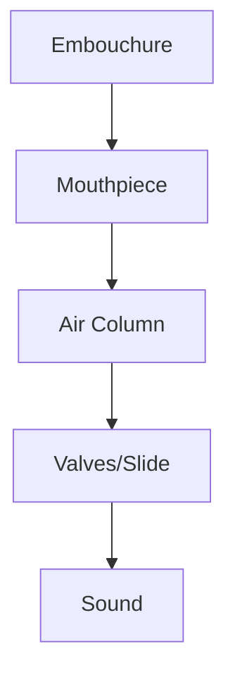

# Beginner Foundation: Brass
## 1. Everyday Intuition & First Principles
Imagine a brass instrument as a musical megaphone. Just as a megaphone amplifies your voice, a brass instrument amplifies the sound produced by your breath and embouchure (the way you shape your mouth and lips around the mouthpiece). The more you control your breath and embouchure, the clearer and more powerful your sound will be.

## 2. Foundational Vocabulary & Glossary
- **Embouchure:** The way you position your lips, teeth, and facial muscles around the mouthpiece. Think of it as the "mouth grip" that creates the initial sound.
- **Mouthpiece:** The part of the instrument you put in your mouth. It's the starting point for sound production.
- **Valves:** Mechanisms on the instrument that change the pitch by altering the length of the air column. They are like the keys on a piano, but for brass instruments.
- **Air Column:** The air inside the instrument that vibrates to produce sound. The length of this column determines the pitch.
- **Slide:** A mechanism on some brass instruments (like the trombone) that changes the length of the air column by moving a section of the instrument in and out.
- **Vibrato:** A technique where the pitch of a note wavers slightly, giving it a richer, more expressive sound. It's like a gentle shaking of the note.

## 3. Visual System Flow
### ASCII Diagram
```
[Embouchure] -> [Mouthpiece] -> [Air Column] -> [Valves/Slide] -> [Sound]
```

### Mermaid Flowchart


## 4. Common Beginner Misconceptions & Mental Traps
- **Misconception:** Playing a brass instrument is all about blowing hard. **Reality:** While breath control is crucial, it's also about directing the air efficiently and using the embouchure correctly.
- **Misconception:** You need to have perfect lip shape from the start. **Reality:** Lip shape and embouchure will develop over time with practice. Start with what feels comfortable and natural.
- **Misconception:** Valves and slides are difficult to master. **Reality:** They are tools to help you play different notes. Start with simple exercises to get comfortable with them.

## 5. Socratic Discussion Starters
- How does the way you blow into the mouthpiece affect the sound?
- Can you describe the difference between a tight and a loose embouchure?
- How do you think the length of the air column affects the pitch of the note?
- What are some exercises you can do to improve your breath control?
- How do you think using the valves or slide changes the sound of the instrument?
