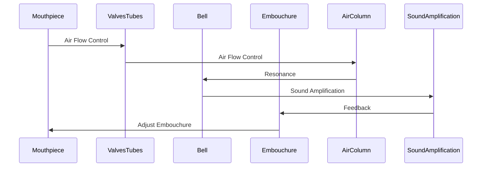

# Intermediate Foundation: Brass
## 1. Architectural Mental Model
In the realm of brass instruments, the architectural mental model involves understanding the interplay between the physical design, acoustics, and performance techniques. For intermediate musicians, it's crucial to delve into the nuances of how these elements interact to produce a rich, resonant sound.

### Key Components:
- **Valves/Tubes:** Mechanisms that control the flow of air and determine pitch.
- **Bell:** The resonator that amplifies and shapes the sound.
- **Mouthpiece:** The interface between the player's lips and the instrument, crucial for tone and control.

### Production Architecture:
- **Design for Sound Quality:** Focus on the material composition and craftsmanship of the instrument to achieve optimal acoustics.
- **Ergonomics:** Design considerations for player comfort and ease of use, including the shape and weight distribution of the instrument.
- **Customization:** Options for tailoring the instrument to individual player preferences, such as adjustable valves or interchangeable bells.

## 2. Systems Taxonomy & Component Protocols
Understanding the standard interfaces, protocols, and data models in brass instruments is essential for both musicians and engineers. This section outlines the key components and their interactions.

### Standard Interfaces:
- **Valve Mechanism:** Standardized interfaces for valves, including rotary valves, piston valves, and slide mechanisms.
- **Mouthpiece:** Standardized dimensions and materials for mouthpieces, such as brass, nickel silver, and plastic.
- **Bell:** Standardized bell designs and materials, including yellow brass, rose brass, and silver.

### Protocols:
- **Air Flow Control:** Protocols for controlling air flow through the instrument, including valve operation and embouchure technique.
- **Tone Production:** Protocols for producing a consistent and desirable tone, including mouthpiece placement and embouchure pressure.

### Data Models:
- **Acoustic Models:** Models that describe the acoustic properties of the instrument, including resonance and frequency response.
- **Performance Models:** Models that describe the performance capabilities of the instrument, including range, intonation, and dynamic range.

## 3. Multi-Component Interaction Flow
Detailed diagrams illustrate the interaction between the various components of a brass instrument.

### ASCII Diagram:
```
+-------------------+     +-------------------+     +-------------------+
|   Mouthpiece      |     |   Valves/Tubes    |     |       Bell        |
+-------------------+     +-------------------+     +-------------------+
         |                           |                           |
         | Air Flow Control            | Air Flow Control            | Resonance
         |                           |                           |
         v                           v                           v
+-------------------+     +-------------------+     +-------------------+
|   Embouchure      |     |   Air Column      |     |   Sound Amplification |
+-------------------+     +-------------------+     +-------------------+
```

### Mermaid Sequence Diagram:


## 4. Architectural Trade-offs & Production Pitfalls
Exploring the trade-offs and potential pitfalls in brass instrument design and performance is crucial for achieving optimal results.

### Trade-offs:
- **Material Composition:** Choosing between materials that offer better sound quality versus durability.
- **Design Complexity:** Balancing the complexity of the instrument with ease of use and maintenance.
- **Customization Options:** Providing customization options while maintaining consistency in sound quality.

### Production Pitfalls:
- **Poor Quality Control:** Ensuring consistent quality in manufacturing processes to avoid defects.
- **Improper Maintenance:** Providing guidelines for proper maintenance to extend the life of the instrument.
- **Inadequate Training:** Ensuring that musicians receive adequate training to maximize the potential of the instrument.

## 5. Socratic Discussion Starters
Questions that bridge the architecture of brass instruments to low-level implementation can foster deeper understanding and innovation.

- **How do the materials used in the construction of a brass instrument affect its sound quality?**
- **What are the trade-offs between different valve mechanisms in terms of sound quality and ease of use?**
- **How does the design of the bell influence the resonance and projection of the sound?**
- **What are the key factors in designing a mouthpiece that provides optimal tone and control?**
- **How can the interaction between the player and the instrument be optimized for maximum performance?**

By exploring these questions, musicians and engineers can gain a deeper understanding of the architectural principles underlying brass instruments and develop innovative solutions to enhance performance and sound quality.
