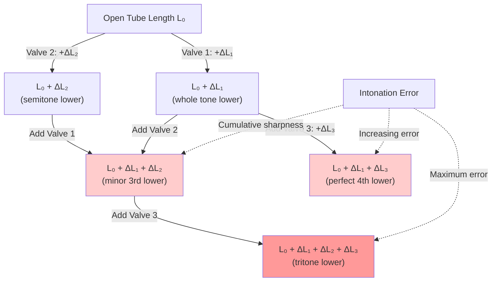
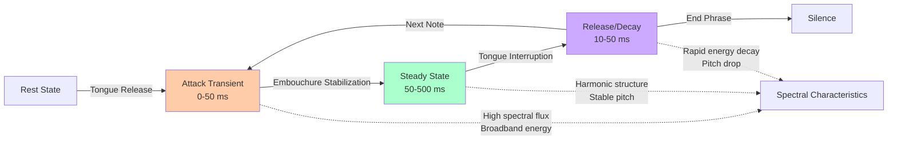
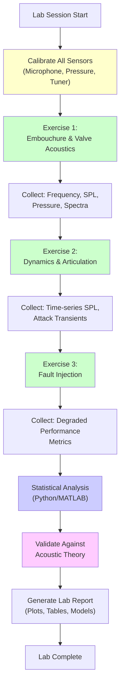

# Operational Verification Labs: Brass Acoustics and Performance Mechanics

## Objective & Lab Architecture

This laboratory provides rigorous, measurement-driven investigation of brass instrument acoustics, examining the coupled fluid-structure interactions between player physiology, instrument resonance, and acoustic radiation. The work synthesizes physical modeling, spectral analysis, and empirical performance data to build quantitative understanding of embouchure mechanics, valve-induced impedance discontinuities, and aeroacoustic energy transfer.

Unlike introductory performance instruction, this lab treats the brass instrument as a complex nonlinear oscillator where the player's lips function as a self-sustaining valve mechanism. The instrument's bore profile, bell flare geometry, and valve network create frequency-dependent acoustic impedances that couple back to the lip oscillation, producing the characteristic timbre and pitch control of brass instruments. We will measure these phenomena directly.

### Required Infrastructure

**Physical Instruments and Transducers:**
- Brass instrument (trumpet, horn, trombone, or tuba) with known bore profile
- Pressure transducer (±10 kPa range, >10 kHz bandwidth) for mouthpiece pressure measurement
- Calibrated measurement microphone (flat response 20 Hz–20 kHz, ≥120 dB SPL capability)
- Contact accelerometer (piezoelectric, >5 kHz bandwidth) for bell vibration analysis

**Signal Acquisition:**
- Audio interface (≥96 kHz sample rate, ≥24-bit resolution, <5 ms latency)
- Synchronization capability for multi-channel recording (pressure, acoustic, accelerometer)
- Professional monitoring headphones (closed-back, flat frequency response)

**Analysis Environment:**
- Digital Audio Workstation: Reaper, Pro Tools, or Logic Pro with plugin host capability
- Spectral analysis: FFT plugin with ≥8192-point resolution and Hamming/Blackman-Harris windowing
- Programming environment: Python 3.10+ with NumPy, SciPy, librosa, matplotlib
- Optional: MATLAB/Octave for transfer function analysis

**Reference Materials:**
- Chromatic tuner (±0.1 cent resolution) or frequency counter
- Equal-tempered frequency reference table (A440 standard)
- Orchestral excerpt library spanning dynamic and register extremes
- Valve slide position measurement tools (digital caliper, ±0.01 mm precision)

## Exercise 1: Embouchure Mechanics and Lip-Valve Oscillation

### Exercise 1a: Bernoulli Flow and Lip Aperture Dynamics

The brass embouchure operates as a flow-controlled valve. When pressurized air flows through the lip aperture, Bernoulli's principle creates a pressure drop proportional to flow velocity squared. This negative pressure draws the lips toward closure, but lip elasticity and downstream pressure from the instrument bore oppose this motion. The result is a self-sustaining oscillation at frequencies determined by lip tension and the instrument's acoustic impedance peaks.

**Theoretical Foundation:**

The Bernoulli equation for incompressible flow gives:

```
P_mouth + (1/2)ρv_aperture² = P_downstream + (1/2)ρv_bore²
```

Where:
- P_mouth: static pressure in oral cavity (typically 2-8 kPa above atmospheric)
- ρ: air density (~1.2 kg/m³)
- v_aperture: flow velocity through lip aperture
- P_downstream: pressure just inside mouthpiece cup

The lip opening area A varies cyclically. For small perturbations around equilibrium aperture A₀:

```
A(t) = A₀[1 + ε·sin(2πft)]
```

The flow rate Q = A(t)·v couples to the acoustic pressure wave in the instrument bore. The instrument's input impedance Z(f) = P/U (pressure/volume velocity) peaks at resonant frequencies, providing maximum feedback to sustain oscillation at those frequencies.

**Procedure:**

1. **Baseline Pressure Mapping**: Install pressure transducer in mouthpiece shank. Play sustained tones from pedal C (≈65 Hz for trumpet) through high C (≈1047 Hz). Record mouthpiece pressure waveform synchronized with acoustic output. Maintain mezzo-forte dynamic (≈80 dB SPL at 1 m).

2. **Embouchure Pressure Variation**: Select concert Bb (≈466 Hz, trumpet open fingering). Perform five trials with systematically varied mouthpiece contact force:
   - Trial 1: Minimal contact (lips barely touching rim)
   - Trial 2: Light contact (~0.5 N estimated force)
   - Trial 3: Moderate contact (~1.0 N, typical performance level)
   - Trial 4: Firm contact (~2.0 N)
   - Trial 5: Excessive contact (~3.0 N, unsustainable for extended playing)

   Record 4-second sustained tones for each trial. Measure RMS acoustic level, spectral centroid (brightness indicator), and pressure waveform peak-to-peak amplitude.

3. **Aperture Geometry Experiment**: Using embouchure corners as adjustable parameters, produce the same pitch (Bb) with three aperture configurations:
   - Narrow aperture: corners forward, small opening (higher velocity, brighter tone)
   - Medium aperture: neutral position
   - Wide aperture: corners retracted (lower velocity, darker tone)

   Quantify aperture width if possible using high-speed video (≥240 fps) with oblique mirror setup.

4. **Spectral Analysis Protocol**:
   ```python
   import numpy as np
   import scipy.signal as sig
   import matplotlib.pyplot as plt
   from scipy.io import wavfile

   # Load synchronized recordings
   fs, acoustic = wavfile.read('trial_acoustic.wav')
   _, pressure = wavfile.read('trial_pressure.wav')

   # Extract steady-state segment (avoid attack transient)
   start_sample = int(0.5 * fs)  # Skip first 500ms
   duration = int(2.0 * fs)       # Analyze 2s steady-state
   
   acoustic_seg = acoustic[start_sample:start_sample+duration]
   pressure_seg = pressure[start_sample:start_sample+duration]

   # Compute power spectral density
   f_ac, Pxx_ac = sig.welch(acoustic_seg, fs, nperseg=8192, 
                             window='blackmanharris', scaling='density')
   f_pr, Pxx_pr = sig.welch(pressure_seg, fs, nperseg=8192,
                             window='blackmanharris', scaling='density')

   # Extract fundamental and harmonics
   peak_indices, _ = sig.find_peaks(10*np.log10(Pxx_ac), height=-60, distance=50)
   fundamental_hz = f_ac[peak_indices[0]]
   harmonics_hz = f_ac[peak_indices[1:11]]  # First 10 harmonics
   
   # Spectral centroid (brightness measure)
   spectral_centroid = np.sum(f_ac * Pxx_ac) / np.sum(Pxx_ac)
   
   # Harmonic energy distribution (even vs odd harmonics)
   even_energy = np.sum(Pxx_ac[peak_indices[1::2]])
   odd_energy = np.sum(Pxx_ac[peak_indices[::2]])
   
   print(f"Fundamental: {fundamental_hz:.2f} Hz")
   print(f"Spectral centroid: {spectral_centroid:.1f} Hz")
   print(f"Even/Odd harmonic ratio: {even_energy/odd_energy:.3f}")
   ```

5. **Expected Outcomes**: Increased embouchure pressure typically shifts spectral centroid upward (brighter tone) but reduces oscillation amplitude if contact force becomes excessive. The pressure-acoustic cross-correlation reveals phase relationships: optimal embouchure shows pressure leading acoustic output by 30-90° (indicating efficient energy transfer). Narrow apertures increase high-frequency harmonic content; wide apertures produce darker spectra dominated by low-order harmonics.

### Exercise 1b: Valve Network Acoustics and Intonation Perturbation

Piston valves introduce tubing sections that increase total acoustic path length, lowering pitch by specific intervals. The ideal valve system would lower pitch by exact semitone (1.0595:1 frequency ratio) or whole-tone (1.1225:1) increments, but real valves deviate from equal temperament due to nonlinear coupling between valve loop lengths.

**Acoustic Length Theory:**

For a cylindrical tube open at one end (simplified brass bore model), resonant frequencies occur at:

```
f_n = (2n-1)c / (4L_eff)
```

Where:
- n: mode number (1, 2, 3, ...)
- c: speed of sound (~343 m/s at 20°C)
- L_eff: effective acoustic length (physical length plus end correction)

Valve 1 adds length ΔL₁ to lower pitch by whole tone (≈12.2% length increase). Valve 2 adds ΔL₂ for semitone (≈5.9% increase). Valve 3 adds ΔL₃ for minor third (≈18.9% increase). When valves combine, total length L_total = L₀ + ΔL₁ + ΔL₂ + ΔL₃ (additive). However, the percentage increase needed depends on current total length, creating cumulative intonation error.

**Procedure:**

1. **Valve Length Calibration**: Measure valve slide extensions using digital caliper:
   - Remove each valve slide
   - Measure fully inserted position to centerline
   - Record extension length in mm
   - Calculate ΔL for each valve

2. **Chromatic Scale Intonation Survey**: Play descending chromatic scale from open C (or concert Bb for trumpet) through all seven valve combinations (open, 2, 1, 1+2, 2+3, 1+3, 1+2+3). For each fingering:
   - Sustain pitch for 3 seconds at mezzo-forte
   - Record acoustic signal
   - Use tuner to measure deviation from equal temperament in cents

   Create intonation matrix:
   
   | Fingering | Expected Note | Measured Frequency | Deviation (cents) |
   |-----------|---------------|-------------------|-------------------|
   | Open      | C (523.25 Hz) | [measure]         | [calculate]       |
   | 2         | B (493.88 Hz) | [measure]         | [calculate]       |
   | 1         | Bb (466.16 Hz)| [measure]         | [calculate]       |
   | 1+2       | A (440.00 Hz) | [measure]         | [calculate]       |
   | ...       | ...           | ...               | ...               |

3. **Impedance Peak Analysis**: Using recorded audio, extract resonance frequencies:
   ```python
   # Compute input impedance estimate from impulse response
   # (Requires specialized mouthpiece excitation, advanced setup)
   
   # Alternative: Extract harmonic series from sustained tone
   def extract_harmonic_series(signal, fs, n_harmonics=16):
       f, Pxx = sig.welch(signal, fs, nperseg=16384, window='blackmanharris')
       peaks, props = sig.find_peaks(10*np.log10(Pxx), height=-40, distance=20)
       
       # Identify fundamental (lowest strong peak)
       f0 = f[peaks[0]]
       
       # Theoretical harmonic frequencies
       harmonic_freqs = np.array([k*f0 for k in range(1, n_harmonics+1)])
       
       # Measure actual peak frequencies near theoretical positions
       measured_freqs = []
       for h_freq in harmonic_freqs:
           search_range = np.abs(f - h_freq) < 10  # ±10 Hz window
           if np.any(search_range):
               peak_in_range = peaks[np.isin(peaks, np.where(search_range)[0])]
               if len(peak_in_range) > 0:
                   measured_freqs.append(f[peak_in_range[0]])
               else:
                   measured_freqs.append(np.nan)
       
       return f0, np.array(measured_freqs)
   
   # Deviation from ideal harmonic series indicates impedance irregularities
   f0, measured_harmonics = extract_harmonic_series(acoustic_signal, fs)
   ideal_harmonics = np.arange(1, len(measured_harmonics)+1) * f0
   harmonic_deviations = 1200 * np.log2(measured_harmonics / ideal_harmonics)
   ```

4. **Valve Combination Cumulative Error**: Plot intonation deviation vs. total valve tubing added. Fit linear model to quantify systematic sharpness in multi-valve combinations. Typical trumpet shows +10 to +30 cent error for 1+2+3 combination relative to equal temperament.

5. **Slide Position Correction**: For sharp combinations (1+2, 1+3, 1+2+3), adjust main tuning slide or individual valve slides. Measure new intonation and iterate. Document optimal slide positions for each problematic fingering.



**Expected Results**: Open fingering and single-valve combinations typically achieve ±5 cent accuracy. Multi-valve combinations (1+2, 2+3, 1+2+3) show progressive sharpening, with 1+2+3 often +20 to +40 cents sharp. This necessitates alternative fingerings (e.g., using valve 3 alone instead of 1+2) or slide adjustments during performance.

## Exercise 2: Aeroacoustic Energy Transfer and Dynamic Control

### Exercise 2a: Breath Pressure, Flow Rate, and Acoustic Power

Acoustic power radiated by a brass instrument scales with both breath pressure and flow rate, but the relationship is nonlinear due to lip-valve dynamics and turbulent flow effects. At low dynamics (pianissimo), flow is nearly laminar and embouchure aperture remains small. At fortissimo dynamics, increased pressure forces wider aperture opening, higher flow rates, and stronger harmonic generation from flow turbulence.

**Fundamental Relationships:**

Acoustic power P_acoustic relates to mouth pressure P_mouth and volume flow rate U:

```
P_acoustic ≈ η · P_mouth · U
```

Where η is radiation efficiency (typically 0.1-0.3 for brass instruments, frequency-dependent). Volume flow rate U depends on aperture area A and pressure drop:

```
U = A · sqrt(2·ΔP/ρ)
```

The embouchure acts as a variable orifice. Small aperture (high velocity) produces higher harmonic content but lower overall power. Large aperture (high flow rate) produces greater power but requires proportionally higher breath pressure to maintain pitch stability.

**Procedure:**

1. **Dynamic Range Mapping**: Perform crescendo-decrescendo exercise on sustained Bb (concert pitch, trumpet open fingering):
   - Start pianissimo (target 60 dB SPL at 1 m)
   - Gradually crescendo to fortissimo (target 100 dB SPL at 1 m) over 8 seconds
   - Gradually decrescendo back to pianissimo over 8 seconds
   - Record acoustic signal and mouthpiece pressure simultaneously

2. **Acoustic Measurement Setup**: Position calibrated microphone 1 meter from bell centerline, on-axis. Use A-weighted SPL meter or compute RMS level from recording:
   ```python
   def compute_spl_timeseries(signal, fs, window_ms=50):
       """Compute time-varying sound pressure level"""
       window_samples = int(window_ms * fs / 1000)
       hop_samples = window_samples // 2
       
       n_frames = (len(signal) - window_samples) // hop_samples
       spl_db = np.zeros(n_frames)
       time_axis = np.zeros(n_frames)
       
       p_ref = 20e-6  # Reference pressure (20 μPa)
       
       for i in range(n_frames):
           start = i * hop_samples
           frame = signal[start:start+window_samples]
           rms = np.sqrt(np.mean(frame**2))
           spl_db[i] = 20 * np.log10(rms / p_ref)
           time_axis[i] = start / fs
       
       return time_axis, spl_db
   
   time, spl = compute_spl_timeseries(acoustic_signal, fs)
   plt.plot(time, spl)
   plt.xlabel('Time (s)')
   plt.ylabel('SPL (dB)')
   plt.title('Dynamic Range Profile')
   ```

3. **Pressure-Acoustic Power Correlation**: Extract simultaneous pressure and acoustic RMS values. Plot acoustic power (proportional to squared RMS) vs. mouth pressure:
   ```python
   # Align and extract corresponding pressure/acoustic segments
   acoustic_rms = np.sqrt(np.mean(acoustic_seg**2))
   pressure_rms = np.sqrt(np.mean(pressure_seg**2))
   
   # Convert to physical units (requires calibration)
   # Pressure transducer: e.g., 1V = 1kPa
   # Microphone: calibrated sensitivity in V/Pa
   
   pressure_kpa = pressure_rms * calibration_factor_pressure
   acoustic_pa = acoustic_rms * calibration_factor_mic
   
   # Acoustic power scales as pressure² at constant distance
   acoustic_power_rel = acoustic_pa**2
   
   plt.scatter(pressure_kpa, acoustic_power_rel)
   plt.xlabel('Mouth Pressure (kPa)')
   plt.ylabel('Relative Acoustic Power (Pa²)')
   
   # Fit power law: P_ac ∝ P_mouth^α
   log_pressure = np.log(pressure_kpa)
   log_power = np.log(acoustic_power_rel)
   coeffs = np.polyfit(log_pressure, log_power, 1)
   alpha = coeffs[0]  # Exponent should be ~1.5-2.5
   print(f"Power law exponent: {alpha:.2f}")
   ```

4. **Spectral Evolution with Dynamics**: Extract spectral centroids at each dynamic level. Increased dynamics typically shift centroid higher (brighter tone) due to enhanced harmonic generation:
   ```python
   # Segment recording by SPL bins
   spl_bins = np.arange(60, 105, 5)  # 5 dB bins from pp to ff
   
   for i in range(len(spl_bins)-1):
       mask = (spl >= spl_bins[i]) & (spl < spl_bins[i+1])
       segments = extract_segments(signal, time, time_axis[mask], fs)
       
       centroid_values = []
       for seg in segments:
           f, Pxx = sig.welch(seg, fs, nperseg=4096)
           centroid = np.sum(f * Pxx) / np.sum(Pxx)
           centroid_values.append(centroid)
       
       mean_centroid = np.mean(centroid_values)
       print(f"SPL {spl_bins[i]}-{spl_bins[i+1]} dB: "
             f"Centroid = {mean_centroid:.0f} Hz")
   ```

5. **Breathing Technique Comparison**: Repeat crescendo exercise using three breath support approaches:
   - **Clavicular breathing**: Shallow chest expansion (inefficient, rapid pressure decay)
   - **Intercostal breathing**: Rib expansion (moderate efficiency)
   - **Diaphragmatic breathing**: Abdominal engagement (optimal efficiency and control)

   Measure pressure stability (standard deviation during sustained segment) and maximum sustainable duration for each technique.

**Expected Outcomes**: Acoustic power scales approximately as P_mouth^2 at constant pitch, but embouchure adjustments modify this relationship. Diaphragmatic breathing provides 30-50% longer sustainable forte dynamics and ±0.5 kPa lower pressure variability compared to clavicular breathing. Spectral centroid increases ~200-500 Hz from pianissimo to fortissimo, reflecting enhanced harmonic excitation.

### Exercise 2b: Articulation Mechanisms and Transient Analysis

Articulation defines note onset and release characteristics. Tongue position controls airflow initiation, while lip tension and aperture adjustment shape the attack transient. Different articulation styles (legato, staccato, marcato, sforzando) modify both temporal envelope and spectral evolution during the first 50-200 ms of each note.

**Procedure:**

1. **Articulation Taxonomy**: Perform four-note pattern (Bb-C-D-Eb) using each articulation:
   - **Legato**: No tongue interruption, smooth pitch transitions
   - **Detached**: Brief tongue stop between notes (~50 ms silence)
   - **Staccato**: Sharp tongue attack, shortened note duration (~30% of beat)
   - **Marcato**: Heavy accent, emphasized attack transient
   - **Sforzando**: Maximum initial pressure, rapid decay to mezzo-forte

   Tempo: quarter note = 80 BPM. Record with high temporal resolution (≥96 kHz).

2. **Onset Detection and Characterization**:
   ```python
   import librosa
   
   # Detect note onsets
   onset_frames = librosa.onset.onset_detect(y=signal, sr=fs, 
                                              units='samples',
                                              backtrack=True,
                                              pre_max=20, post_max=20,
                                              pre_avg=100, post_avg=100,
                                              delta=0.1, wait=10)
   
   # Analyze each onset
   for idx, onset_sample in enumerate(onset_frames):
       # Extract 200ms segment starting from onset
       attack_segment = signal[onset_sample:onset_sample + int(0.2*fs)]
       
       # Compute attack time (5% to 90% of peak amplitude)
       envelope = np.abs(sig.hilbert(attack_segment))
       peak_level = np.max(envelope)
       
       thresh_5pct = 0.05 * peak_level
       thresh_90pct = 0.90 * peak_level
       
       idx_5pct = np.where(envelope >= thresh_5pct)[0][0]
       idx_90pct = np.where(envelope >= thresh_90pct)[0][0]
       
       attack_time_ms = (idx_90pct - idx_5pct) / fs * 1000
       
       print(f"Onset {idx}: Attack time = {attack_time_ms:.1f} ms")
       
       # Spectral analysis of attack vs steady-state
       attack_fft = np.fft.rfft(attack_segment[:int(0.05*fs)])
       steady_fft = np.fft.rfft(attack_segment[int(0.1*fs):])
       
       attack_spectrum = np.abs(attack_fft)
       steady_spectrum = np.abs(steady_fft)
       
       # Compute spectral flux (change from attack to steady-state)
       flux = np.sum((steady_spectrum - attack_spectrum)**2)
       print(f"  Spectral flux = {flux:.2e}")
   ```

3. **Staccato Duration Analysis**: For staccato articulations, measure note duration and inter-note gap:
   ```python
   # Detect note offsets using amplitude envelope
   envelope = np.abs(sig.hilbert(signal))
   threshold = 0.1 * np.max(envelope)  # 10% of peak
   
   # Find segments above threshold
   above_thresh = envelope > threshold
   transitions = np.diff(above_thresh.astype(int))
   
   note_starts = np.where(transitions == 1)[0]
   note_ends = np.where(transitions == -1)[0]
   
   for i in range(min(len(note_starts), len(note_ends))):
       duration_ms = (note_ends[i] - note_starts[i]) / fs * 1000
       if i < len(note_starts) - 1:
           gap_ms = (note_starts[i+1] - note_ends[i]) / fs * 1000
           print(f"Note {i}: Duration = {duration_ms:.0f} ms, "
                 f"Gap = {gap_ms:.0f} ms")
   ```

4. **Tongue Position Effect**: Record identical staccato passage with three tongue positions:
   - **Dental**: Tongue tip at teeth/alveolar ridge (crisp attack, short duration)
   - **Mid-palate**: Tongue arch at hard palate (moderate attack)
   - **Velar**: Back of tongue at soft palate (soft attack, longer duration)

   Compare attack times and spectral characteristics.

**Expected Results**: Legato shows attack times >100 ms with minimal spectral flux. Staccato achieves attack times <20 ms with high-frequency emphasis during transient. Marcato produces attack times ~30-50 ms with 3-6 dB initial overshoot. Dental tongue position yields shortest attack times; velar position doubles attack duration.



## Exercise 3: Fault Injection and Performance Degradation Analysis

### Exercise 3a: Valve Impedance Discontinuity and Intonation Collapse

Valve malfunctions introduce acoustic impedance discontinuities that disrupt the resonant structure of the instrument. Partial valve depression, worn valve guides, or foreign objects in the bore create reflection points that add parasitic resonances or damp primary modes, degrading intonation and response.

**Procedure:**

1. **Baseline Reference**: Record chromatic scale from low C to high C with all valves functioning normally. Document frequency accuracy (±2 cents) for each fingering.

2. **Controlled Valve Obstruction**: Insert calibrated obstruction into valve 2 tubing:
   - Trial A: Insert 10 mm diameter foam plug 50 mm into valve loop
   - Trial B: Insert 15 mm diameter plug (tighter fit, greater impedance mismatch)
   - Trial C: Partially depress valve 2 (50% travel) during open notes

   For each trial, attempt to play chromatic scale. Record which notes are playable, frequency deviation, and subjective effort required.

3. **Impedance Analysis**: Compare spectral content of obstructed vs. normal valve:
   ```python
   # Load recordings
   normal_signal, fs = librosa.load('normal_valve2.wav', sr=None)
   obstructed_signal, _ = librosa.load('obstructed_valve2.wav', sr=None)
   
   # Compute transfer function estimate
   freq, H_normal = sig.welch(normal_signal, fs, nperseg=8192)
   _, H_obstructed = sig.welch(obstructed_signal, fs, nperseg=8192)
   
   # Ratio reveals impedance perturbation effect
   transfer_ratio = H_obstructed / (H_normal + 1e-10)
   
   plt.figure(figsize=(10,6))
   plt.semilogx(freq, 10*np.log10(transfer_ratio))
   plt.xlabel('Frequency (Hz)')
   plt.ylabel('Magnitude Ratio (dB)')
   plt.title('Impedance Perturbation Due to Valve Obstruction')
   plt.grid(True, which='both', alpha=0.3)
   ```

4. **Pitch Instability Quantification**: For notes requiring obstructed valve, measure pitch standard deviation over sustained 2-second tone:
   ```python
   # Extract instantaneous frequency using Hilbert transform
   analytic_signal = sig.hilbert(note_segment)
   instantaneous_phase = np.unwrap(np.angle(analytic_signal))
   instantaneous_freq = np.diff(instantaneous_phase) * fs / (2*np.pi)
   
   # Compute statistics
   mean_freq = np.mean(instantaneous_freq)
   std_freq = np.std(instantaneous_freq)
   
   # Convert to cents relative to target pitch
   target_freq = 440  # Example: A4
   cents_deviation = 1200 * np.log2(instantaneous_freq / target_freq)
   
   print(f"Mean: {mean_freq:.2f} Hz ({np.mean(cents_deviation):.1f} cents)")
   print(f"Std Dev: {std_freq:.2f} Hz ({np.std(cents_deviation):.1f} cents)")
   ```

5. **Response Time Degradation**: Measure note onset latency (time from tongue release to stable pitch):
   ```python
   # Detect tongue release point (pressure spike in mouthpiece signal)
   pressure_diff = np.diff(pressure_signal)
   release_point = np.argmax(pressure_diff)
   
   # Detect pitch stabilization (freq std dev < 5 cents for 50 ms)
   stable_threshold = 5  # cents
   window_size = int(0.05 * fs)  # 50 ms
   
   for i in range(release_point, len(instantaneous_freq) - window_size):
       window = cents_deviation[i:i+window_size]
       if np.std(window) < stable_threshold:
           stabilization_point = i
           break
   
   latency_ms = (stabilization_point - release_point) / fs * 1000
   print(f"Note onset latency: {latency_ms:.1f} ms")
   ```

**Expected Results**: 10 mm obstruction typically shifts affected fingerings +15 to +40 cents sharp and increases pitch standard deviation from <5 cents to >15 cents. Response latency doubles (from ~40 ms to >80 ms). 15 mm obstruction may render certain fingerings unplayable. Partial valve depression introduces ±20-50 cent frequency instability and weak, airy tone quality.

### Exercise 3b: Respiratory Fatigue and Pressure Decay Modeling

Sustained playing exhausts respiratory muscles, reducing achievable breath pressure and flow rate. This degrades tone quality, pitch accuracy, and dynamic range. We model respiratory fatigue as exponential pressure decay.

**Procedure:**

1. **Maximum Sustainable Pressure**: Perform extended fortissimo passage (30 seconds continuous without breath):
   - Select simple repeating pattern: Bb-C-Bb-C-Bb-C... at quarter note = 120 BPM
   - Maintain fortissimo dynamic (target 100 dB SPL)
   - Record mouthpiece pressure and acoustic output
   - Continue until pressure drops below 70% of initial value or tone collapses

2. **Pressure Decay Curve Fitting**:
   ```python
   # Extract envelope of mouthpiece pressure signal
   pressure_envelope = np.abs(sig.hilbert(pressure_signal))
   
   # Smooth envelope
   window_size = int(0.1 * fs)  # 100 ms smoothing
   pressure_smooth = sig.savgol_filter(pressure_envelope, window_size, 3)
   
   # Fit exponential decay model: P(t) = P0 * exp(-t/τ) + P_baseline
   from scipy.optimize import curve_fit
   
   def exponential_decay(t, P0, tau, P_baseline):
       return P0 * np.exp(-t/tau) + P_baseline
   
   time_array = np.arange(len(pressure_smooth)) / fs
   
   # Initial guesses
   P0_guess = np.max(pressure_smooth) - np.min(pressure_smooth)
   tau_guess = 10  # seconds
   P_baseline_guess = np.min(pressure_smooth)
   
   params, covariance = curve_fit(exponential_decay, time_array, pressure_smooth,
                                   p0=[P0_guess, tau_guess, P_baseline_guess],
                                   maxfev=10000)
   
   P0_fit, tau_fit, P_baseline_fit = params
   
   print(f"Initial pressure: {P0_fit:.2f} kPa")
   print(f"Decay time constant: {tau_fit:.1f} s")
   print(f"Baseline pressure: {P_baseline_fit:.2f} kPa")
   
   # Plot fit
   plt.plot(time_array, pressure_smooth, label='Measured')
   plt.plot(time_array, exponential_decay(time_array, *params), 
            label=f'Fit: τ={tau_fit:.1f}s', linestyle='--')
   plt.xlabel('Time (s)')
   plt.ylabel('Pressure (kPa)')
   plt.legend()
   ```

3. **Acoustic Degradation Tracking**: Correlate pressure decay with spectral and intonation changes:
   ```python
   # Segment recording into 2-second windows
   segment_duration = 2.0
   segment_samples = int(segment_duration * fs)
   n_segments = len(signal) // segment_samples
   
   frequency_drift = []
   spectral_centroid_drift = []
   spl_drift = []
   
   for i in range(n_segments):
       segment = signal[i*segment_samples:(i+1)*segment_samples]
       
       # Pitch tracking
       f0, voiced_flag, _ = librosa.pyin(segment, fmin=librosa.note_to_hz('C3'),
                                         fmax=librosa.note_to_hz('C6'), sr=fs)
       mean_f0 = np.nanmean(f0)
       frequency_drift.append(mean_f0)
       
       # Spectral centroid
       centroid = librosa.feature.spectral_centroid(y=segment, sr=fs)
       spectral_centroid_drift.append(np.mean(centroid))
       
       # SPL
       rms = np.sqrt(np.mean(segment**2))
       spl_drift.append(20*np.log10(rms/20e-6))
   
   time_segments = np.arange(n_segments) * segment_duration
   
   fig, axes = plt.subplots(3, 1, figsize=(10, 8), sharex=True)
   axes[0].plot(time_segments, frequency_drift)
   axes[0].set_ylabel('Frequency (Hz)')
   axes[0].set_title('Pitch Drift Due to Fatigue')
   
   axes[1].plot(time_segments, spectral_centroid_drift)
   axes[1].set_ylabel('Spectral Centroid (Hz)')
   
   axes[2].plot(time_segments, spl_drift)
   axes[2].set_ylabel('SPL (dB)')
   axes[2].set_xlabel('Time (s)')
   ```

4. **Recovery Dynamics**: After exhaustion, rest for 2 minutes. Repeat single fortissimo note every 20 seconds during recovery. Measure pressure recovery curve using same exponential fit (inverted: rising exponential).

**Expected Results**: Decay time constant τ ranges from 8-15 seconds for trained players, 4-8 seconds for beginners. Pressure drops ~40-60% before tone quality becomes unacceptable. Pitch typically sags 10-30 cents as pressure decays. Spectral centroid drops ~300-600 Hz (darker tone). Recovery follows similar exponential with τ_recovery ≈ 40-90 seconds for 90% restoration.

## Practical Reference & Measurement Protocol Summary

### Acoustic Measurement Standards

**Sound Pressure Level (SPL):**
- Reference: 20 μPa (threshold of human hearing)
- Measurement distance: 1 meter from bell centerline, on-axis
- Typical brass instrument ranges:
  - Pianissimo: 60-70 dB SPL
  - Mezzo-forte: 80-90 dB SPL
  - Fortissimo: 95-110 dB SPL

**Frequency Accuracy:**
- Equal temperament reference: f(n) = 440 Hz × 2^((n-69)/12), where n is MIDI note number
- Professional tolerance: ±5 cents (0.3% frequency deviation)
- Tuner resolution requirement: ±0.1 cent for research applications

**Spectral Metrics:**
```python
# Standard spectral descriptors for brass timbre analysis
def compute_spectral_features(signal, fs):
    """Compute comprehensive spectral feature set"""
    
    # Power spectral density
    f, Pxx = sig.welch(signal, fs, nperseg=8192, window='blackmanharris')
    
    # Spectral centroid (brightness)
    centroid = np.sum(f * Pxx) / np.sum(Pxx)
    
    # Spectral spread (bandwidth)
    spread = np.sqrt(np.sum(((f - centroid)**2) * Pxx) / np.sum(Pxx))
    
    # Spectral rolloff (95% energy threshold)
    cumulative_energy = np.cumsum(Pxx)
    rolloff_idx = np.where(cumulative_energy >= 0.95 * cumulative_energy[-1])[0][0]
    rolloff_freq = f[rolloff_idx]
    
    # Spectral flatness (tonalness vs noisiness)
    geometric_mean = np.exp(np.mean(np.log(Pxx + 1e-10)))
    arithmetic_mean = np.mean(Pxx)
    flatness = geometric_mean / arithmetic_mean
    
    # Harmonic-to-noise ratio estimate
    peaks, _ = sig.find_peaks(10*np.log10(Pxx), height=-40, distance=20)
    harmonic_energy = np.sum(Pxx[peaks])
    total_energy = np.sum(Pxx)
    hnr_db = 10 * np.log10(harmonic_energy / (total_energy - harmonic_energy + 1e-10))
    
    return {
        'centroid_hz': centroid,
        'spread_hz': spread,
        'rolloff_hz': rolloff_freq,
        'flatness': flatness,
        'hnr_db': hnr_db
    }
```

### Brass Acoustics Formulas

**Resonance Frequencies (Cylindrical Approximation):**
```
f_n = n · c / (2L)  for closed-open cylinder (n = 1, 2, 3, ...)
f_n = (2n-1) · c / (4L)  for closed-closed cylinder (n = 1, 2, 3, ...)
```
Where c ≈ 343 m/s at 20°C, L = effective acoustic length

**Temperature Dependence:**
```
c(T) = 331.3 + 0.606 · T  [m/s, T in °C]
Δf/f = 0.5 · ΔT  [fractional frequency shift, T in °C]
```
Example: +10°C temperature increase → +0.5% frequency increase → ~+8.5 cents sharp

**Valve Length Calculation:**
```
ΔL/L = 2^(s/12) - 1
```
Where s = semitone interval (s=1 for semitone, s=2 for whole tone, s=3 for minor third)

**Harmonic Series Deviation (Inharmonicity):**
```
f_n = n·f_0·(1 + β·n²)
```
Where β is inharmonicity coefficient (~10^-5 to 10^-4 for brass instruments due to bore taper)

### Debugging Checklist

**Intonation Issues:**
1. Verify valve slide positions (pull 1st and 3rd slides for 1+3, 1+2+3 combinations)
2. Check valve alignment (remove valve, verify rotation stop position)
3. Confirm temperature stability (±2°C variation → ±3.5 cents)
4. Measure valve loop lengths with caliper
5. Test with electronic tuner reference (verify tuner calibration: A=440 Hz)

**Tone Quality Degradation:**
1. Inspect mouthpiece rim for damage (burrs, dents)
2. Check valve compression (should move freely, no binding)
3. Verify bore cleanliness (no obstructions, debris)
4. Test mouthpiece pressure seal (no air leaks)
5. Analyze spectral flatness (low values <0.1 indicate pure tone; high >0.3 suggest noisy/airy tone)

**Response Latency:**
1. Check valve spring tension (weak springs → slow return)
2. Verify valve guide alignment (wear causes sticking)
3. Test lip buzzing alone (isolate embouchure from instrument response)
4. Measure valve travel time mechanically (should be <15 ms)

### Data Logging Template

```python
# Comprehensive experimental data structure
experimental_log = {
    'session_metadata': {
        'date': '2024-01-15',
        'instrument': 'Yamaha YTR-8335 Bb Trumpet',
        'player_id': 'P001',
        'room_temp_celsius': 22.5,
        'humidity_percent': 45,
    },
    'calibration': {
        'microphone_sensitivity_v_per_pa': 0.050,
        'pressure_transducer_v_per_kpa': 1.000,
        'reference_frequency_hz': 440.00,
    },
    'measurements': [
        {
            'exercise': '1a',
            'trial': 1,
            'fingering': 'open',
            'target_pitch': 'Bb4',
            'measured_frequency_hz': 466.3,
            'deviation_cents': +4.2,
            'spl_db': 85.7,
            'spectral_centroid_hz': 1850,
            'mouth_pressure_kpa': 3.2,
            'audio_file': 'trial_1a_01.wav',
            'notes': 'Moderate embouchure pressure'
        },
        # ... additional trials
    ]
}

# Export to JSON for archival
import json
with open('brass_lab_session_20240115.json', 'w') as f:
    json.dump(experimental_log, f, indent=2)
```

## Verification and Validation

After completing all exercises, compile comprehensive lab report including:

1. **Quantitative Results Summary**:
   - Intonation accuracy matrix (all fingerings, deviation in cents)
   - Dynamic range measurements (SPL vs. mouth pressure)
   - Spectral feature distributions (centroid, spread, HNR across dynamics)
   - Attack time statistics by articulation type

2. **Comparative Analysis**:
   - Embouchure pressure effect size (ANOVA or t-test)
   - Valve combination intonation errors (cumulative error model fit)
   - Breathing technique efficiency comparison (sustainable duration, pressure stability)
   - Fault condition impact quantification (% performance degradation)

3. **Acoustic Models**:
   - Resonance frequency predictions vs. measurements
   - Impedance peak identification from harmonic series
   - Pressure decay exponential fit parameters
   - Temperature correction factors

4. **Error Analysis**:
   - Measurement uncertainty propagation
   - Statistical significance of observed effects
   - Systematic vs. random error sources
   - Outlier detection and handling



This laboratory provides rigorous, measurement-based investigation of brass instrument physics. The exercises move beyond subjective performance evaluation to quantitative characterization of embouchure mechanics, acoustic resonance, and aerodynamic energy transfer. Completion yields publishable data on brass acoustics and practical insight into the coupled nonlinear dynamics that define brass instrument performance.
