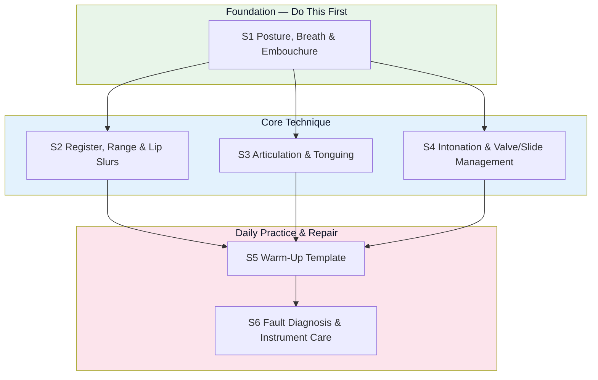
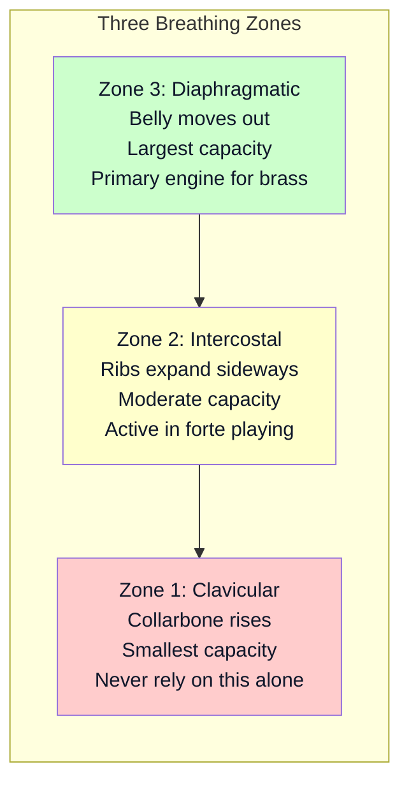
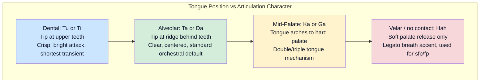
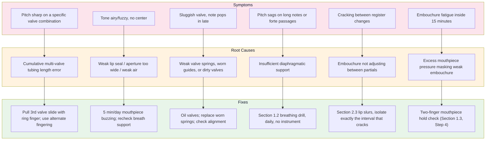

# Brass Masterclass: Embouchure, Range, Articulation & Intonation

## Overview & How to Use This Material

This is a playing-first masterclass. Everything here is meant to be done with the horn in your hands, a tuner running, and a metronome clicking — not read passively. Section 5 (Troubleshooting) is written to be consulted the moment something goes wrong at a rehearsal, not studied cover to cover.

Work through Section 1 before anything else. Every high-register, articulation, and intonation technique later in this document depends on the postural and embouchure foundation built there. If you skip ahead and your lip slurs are inconsistent, the fix is almost always back in Section 1, not in the lip slur drill itself.



**Instruments covered:** Bb trumpet, F/Bb double horn, tenor trombone (with Bb/F attachment), and Bb tuba/euphonium. Written pitches are for Bb trumpet unless stated otherwise; concert pitch (C.P.) is marked where transposition matters.

---

## Section 1: Foundation — Posture, Breath Support & Embouchure

### 1.1 Seated and Standing Posture

Poor posture is the single biggest limiter of breath support and tone quality. Fix it before you touch the horn.

**Seated position (orchestra/band chair):**
- Sit on the front half of the chair. Do not lean back into the seatback — it collapses your lower back and chokes diaphragmatic movement.
- Both feet flat on the floor, hip-width apart, weight even.
- Spine long and neutral: imagine a string pulling the crown of your head toward the ceiling.
- Trumpet/tuba bell faces forward and slightly down (5–10°). Horn bell points backward and down at roughly 45°.
- Shoulders dropped and loose. Rolled-forward "computer shoulders" measurably compress your rib cage expansion — you will feel the difference in breath capacity within four bars.

**Standing position (soloist/jazz):**
- Weight slightly forward onto the balls of the feet.
- Knees unlocked. A locked knee sends tension straight up through the hip into the lower back and diaphragm.
- The instrument comes to your face. Your face does not duck down to the mouthpiece.

**Common fault:** craning the neck forward to meet the mouthpiece because the music stand is too low. This kinks the airway exactly where you need it most open. Raise the stand until your neck stays neutral.

---

### 1.2 Breathing Mechanics

Brass playing needs two things from your breath: a large, fast-filling reservoir, and a controlled, steady release. Here's what each part of your torso contributes.



**Filling sequence on the inhale:**
1. Let the belly release forward first. The diaphragm drops, and the organs below it get pushed out of the way — that's the bulge you feel.
2. Ribcage expands sideways, ideally all the way around the torso, not just the front.
3. Upper chest rises last, and only slightly.
4. A full breath should take 1–2 seconds. Anything faster turns shallow and clavicular — you'll feel it in your shoulders instead of your gut.

**Support while playing:**
- Your abdominal wall doesn't go slack the moment the breath is in. Keep a gentle inward squeeze on the belly throughout the phrase — that steady pressure is what musicians mean by "support."
- Think air *speed*, not air *pressure*. Pressure is a side effect of air meeting a narrowed lip aperture — it should never come from squeezing your throat.
- Keep the throat open the whole time. Test it: hiss "haahhh" with a fully open throat — that's correct. Hissing "heee" or "tsss" closes the throat down. If you can feel your throat closing while you play, stop and reset with the "haahhh" shape before the next note.

**Breathing drill — 4-count cycle (no instrument):**

| Count | Action |
|-------|--------|
| 1–2 | Inhale, belly first, ribs second |
| 3 | Hold briefly, throat open |
| 4 | Release air freely, as if sounding a supported tone |

Do 20 reps. Watch for tension creeping into the jaw, neck, or shoulders — if you see it in a mirror, that's the thing to fix next, not the breath itself.

---

### 1.3 Building the Embouchure

The embouchure is a valve, not a seal. Its job is to vibrate at controlled frequencies through aperture size, lip tension, and air speed — not through gripping or pressing the mouthpiece into your face.

**Step 1 — Find neutral lip position.**
Say "M" and freeze the instant your lips touch. No pucker, no smile, no grimace. Upper and lower lip centers line up vertically. That's home base.

**Step 2 — Form the aperture.**
From neutral, say "mmm-PUHHH" and freeze the instant the lips part for the "P." A small oval opening, roughly 3–5 mm wide, forms on its own. That's your low/mid register aperture on trumpet. Tuba needs it wider; horn, slightly narrower.

**Step 3 — Place the mouthpiece.**
- Trumpet/trombone/tuba: roughly 2/3 upper lip, 1/3 lower lip inside the cup. This ratio is anatomy-dependent — don't force an even split if your lips don't naturally sit that way.
- Horn: closer to centered (50/50), though placement shifts more than other brass because of the small rim diameter.
- Resting contact is enough to seal the mouthpiece. Pressing hard crushes the lip tissue, kills vibration efficiency, and bruises you over time.

**Step 4 — Check for pressure dependence.**
Hold the mouthpiece using only your left thumb (behind the shank) and left index finger (under it) — no right hand on the valves or horn body for support. Play a one-octave scale. If your tone collapses the moment the right hand lets go, you're leaning on pressure instead of embouchure strength. Note it and come back to this check monthly.

**Common faults:**

| Fault | Symptom | Fix |
|-------|---------|-----|
| Smiling (corners pulled back) | Thin, pinched tone, weak high register | Bring corners forward/inward, as if saying "PUHHH" |
| Puckering (lips pushed too far forward) | Weak core tone, sluggish response | Flatten lips slightly, keep corners anchored |
| Chin bunching | Stuffy, resistant low register | Think "long chin," flatten the chin muscle deliberately |
| Off-center placement | Mouthpiece visibly rotated | Check in a mirror; both lips should sit evenly in the cup |
| Mouthpiece too high or low | Upper or lower partials collapse easily | Adjust until the aperture center lines up with the cup center |

---

### 1.4 Mouthpiece Buzzing (Before Every Session)

Buzzing removes the instrument's acoustic feedback, so your embouchure has to do all the work unaided. Five minutes of buzzing roughly matches twenty minutes of on-instrument embouchure benefit — it's the highest-leverage five minutes in your routine.

**Drill 1 — Free buzz (no mouthpiece):**
Press lips loosely together, blow a "BRRR," aim for a steady recognizable pitch. If you can hold 5 seconds at a consistent pitch, your embouchure is engaged correctly. New players often can't do this for the first few weeks — normal, keep going.

**Drill 2 — Mouthpiece long tones:**
On the mouthpiece alone (concert pitches below, trumpet mouthpiece; scale proportionally for horn/tuba):

```text
Low G (sounds like C below the staff)   → 60 BPM, 8 counts
Middle C (middle of the staff)          → 60 BPM, 8 counts
G above the staff                       → 60 BPM, 8 counts
High C (top of the staff)               → 60 BPM, 4 counts (target)
```

Wavering or drift means your air support dropped mid-tone — reconnect the belly before the next pitch.

**Drill 3 — Mouthpiece glissando:**
Sustain a mid-range tone, slide smoothly up a perfect 5th, back down. Legato only, no tongue. 10 reps. This trains continuous embouchure adjustment instead of discrete jumps.

---

## Section 2: Tone Production, Register & Lip Slurs

### 2.1 Long Tones

Long tones are non-negotiable at any skill level — they're the fastest diagnostic for embouchure, breath support, and instrument response on a given day.

**Daily protocol:** quarter note = 60 BPM, 8 counts per pitch, rest 2 counts between. Tuner running throughout. Target: every pitch within ±5 cents.

**Trumpet sequence (written pitch), one octave down then back up:**
```text
G4 - F#4 - F4 - E4 - Eb4 - D4 - Db4 - C4 - (ascend back to G4)
```

**Run the full sequence at four dynamics:**
1. **pp** — barely audible. Hardest dynamic; demands total embouchure control, zero pressure crutch.
2. **mp** — relaxed, natural tone.
3. **mf** — full core sound.
4. **ff** — maximum resonance. The tone should bloom outward, not go harsh or edgy.

**Listen for:**
- Is the tone's core round and stable, or wobbling thin at the edges?
- Does pitch drift flat by count 8 (breath support fading)?
- Do neighboring partials ring sympathetically? They should.

Skip vibrato entirely during this drill — it masks the exact pitch and tone problems you're trying to catch.

---

### 2.2 The Harmonic Series — Why Fingerings and Slurs Work the Way They Do

Every note on a brass instrument belongs to a harmonic series set by your tube's effective length. This single fact explains valve fingerings, lip slur targets, and why the high register behaves differently from the low register.

Bb trumpet, open (no valves):

```text
Partial:    1     2     3     4     5     6     7     8
Concert:    Bb1   Bb2   F3    Bb3   D4    F4    Ab4*  Bb4
Written:    C2    C3    G3    C4    E4    G4    Bb4*  C5

(* 7th partial sits ~30 cents flat of equal temperament naturally)
```

This is the literal map of your horn. Every lip slur jumps between adjacent rungs of this ladder. Every register shift is a move up or down a row.

**Why high notes get easier to "miss":** as the series climbs, partials bunch closer together. G4-Ab4-A4-Bb4 (written) can all sit under the exact same fingering — you reach each one purely by adjusting air speed and lip tension, not by changing valves. That's also why cracked high notes are an embouchure problem, not a fingering problem.

---

### 2.3 Lip Slur Progressions

Lip slurs move between partials with no tongue — the core tool for building flexibility and the foundation under all fast technical playing.

**Trumpet fingering → partial reference (written pitch):**

| Fingering | Partials available |
|-----------|---------------------|
| Open (0) | C, G, C, E, G, Bb*, C ... |
| 1 | B, F#, B, D#, F#, A, B |
| 2 | Bb, F, Bb, D, F, Ab*, Bb |
| 1+2 | A, E, A, C#, E, G, A |
| 2+3 | Ab, Eb, Ab, C, Eb, Gb, Ab |
| 1+3 | G, D, G, B, D, F, G |
| 1+2+3 | F#, C#, F#, A#, C#, E, F# |

**Drill 1 — Two-partial slur, open fingering:**
```text
C4 — G4 — C4 — G4 — C4
Tempo: 60 BPM, 1 beat per note
Tongue the first note only ("Tu"), slur everything after
4 reps, then transpose down a whole step to fingering 2 and repeat
```
Keep the air moving continuously — the only change between the two notes is a small bump in lip tension and air speed going up.

**Drill 2 — Three-partial slur, open fingering:**
```text
C4 — G4 — C5 — G4 — C4   (2nd -> 3rd -> 4th -> 3rd -> 2nd partial)
Tempo: 60 -> 80 -> 100 BPM, 4 reps per fingering
Run on all 7 fingerings before moving to Drill 3
```

**Drill 3 — Four-partial slur with valve changes:**
```text
Bar 1 (open):    C4 — G4 — C5 — E5
Bar 2 (valve 2): Bb3 — F4 — Bb4 — D5
Bar 3 (valve 1): B3 — F#4 — B4 — D#5
Bar 4 (1+2):     A3 — E4 — A4 — C#5

Slur throughout, no pause between bars.
Tempo: 60 -> 80 -> 100 BPM
```
This is the real skill: coordinating a valve change with a partial shift without a break in the air stream.

**Watch for:**
- "Bumping" — a pop between notes — means the air momentarily stopped. Keep it as one continuous stream whose direction/speed changes, not a stop-start sequence.
- The face stays still. No chin bob, no jaw thrust. Only internal lip tension and air speed move.

---

### 2.4 Building Range — A Six-to-Eight-Week Plan

There's no shortcut to a reliable high register, but there is a repeatable path. This protocol typically extends usable range by a 4th–5th over 6–8 weeks of daily, non-skipped practice.

**Governing idea:** you cannot force high notes with pressure. High register comes from faster air through a smaller aperture — "fast and narrow" up, "slow and wide" down. If you catch yourself pressing the mouthpiece harder as you ascend, that's the fault to fix, not the note to force.

**Step 1 — Find your current ceiling.**
Play a chromatic scale up from the middle register. Mark the note where tone starts to thin, spread, or crack. For most intermediate trumpet players that's around A5–C6 (written). That's today's working ceiling, not a permanent limit.

**Step 2 — Pedal tones.**
Counterintuitively, pedal tones (below the fundamental, below the staff) build the strength needed up top. They force full, slow aperture control under low resistance.
```text
F#2 — F2 — E2 — Eb2 — D2 — Db2 — C2 (written trumpet)
Tempo: 60 BPM, 4 counts each, full centered tone — not airy
Play once before every high-register session
```

**Step 3 — Extend one half step at a time.**
Don't lunge for the top of the range. Add exactly one note per week.
```text
Example, ceiling = Bb5 (written):
Week 1: lip slur C5 — G5 — C6 (stop here)
Week 2: add D6 → C5 — G5 — C6 — D6
Week 3: add E6 → C5 — G5 — C6 — D6 — E6
...continue one note at a time
Tempo: 60 BPM. If a note cracks, rest 2 minutes before trying again — do not force it.
```

**Step 4 — Respect fatigue.**
When the tone goes thin, buzzy, or pressed, stop for the day. Fatigued lip tissue doesn't build strength, it just gets abused. Cap active technical work at 20–30 minutes per session, with 5-minute rests between exercises.

---

### 2.5 Register Notes by Instrument

**French Horn.** The narrower mouthpiece and conical bore make the high register less forgiving — partials sit closer together, so a small embouchure error jumps you to the wrong note.
- Right-hand position in the bell fine-tunes pitch continuously: deeper hand flattens pitch (up to a half step); opening the hand raises it.
- Fully stopped horn (hand closing the bell) raises pitch roughly a half step — compensate with fingering or hand position for "stopped (+)" passages.
- 1st-line F uses thumb valve (Bb side) + 1+2+3. Lowest practical note on the F side is pedal C, an octave below middle C.

**Trombone.** No valves (barring the F attachment trigger) — all pitch comes from slide position plus partial choice.

| Position | Open pitch (Bb tenor) | Approx. extension |
|----------|------------------------|---------------------|
| 1st | Bb | Fully retracted |
| 2nd | A | ~1.5 cm |
| 3rd | Ab | ~3 cm |
| 4th | G | ~5 cm |
| 5th | Gb | ~7 cm |
| 6th | F | ~10 cm |
| 7th | E | ~12 cm |

The F attachment trigger adds F-trombone tubing, extending the low range and providing alternate slide positions for fast passages that would otherwise require large slide moves. Bb/F pedal: 1st position with trigger engaged.

**Tuba/Euphonium.** The large mouthpiece needs more air *volume*, not more pressure. The classic beginner error is pushing harder from the chest to compensate for underdeveloped abdominal support — it produces a thin, strained sound instead of the big, centered tone the horn is built for. Lead with volume; let the embouchure respond.

Euphonium fingerings match trumpet fingerings, plus a compensating 4th valve that lowers pitch a perfect 4th — used to fix the chronic sharpness of 1+3 and 1+2+3 on a non-compensating horn.

---

## Section 3: Articulation — Tonguing and Stylistic Control

### 3.1 Tongue Mechanics

The tongue interrupts or starts airflow at the attack. It does not generate the sound — the embouchure and air column do that. Think of the tongue strictly as a gate.



**Syllable guide:**

| Style | Syllable | Register | Character |
|-------|----------|----------|-----------|
| Orchestral staccato | "Ti" | High (above written G5, trumpet) | Very crisp, short |
| Orchestral staccato | "Tu" | Mid/low | Crisp, centered |
| Legato/slurred | none | all | No interruption |
| Soft legato attack | "Du" | all | Gentle onset |
| Marcato accent | "Tah!" | all | Heavy, weighted |
| Sforzando | "Tahff" (burst) | all | Explosive onset |
| Double tongue | "Tu-Ku" | fast 16ths, 120+ BPM | Rapid repeated notes |
| Triple tongue | "Tu-Tu-Ku" / "Tu-Ku-Tu" | triplets | 3-note groupings |

---

### 3.2 Single-Tongue Speed Building

**Drill 1 — Tongue speed on a single pitch:**
```text
Pitch: Bb4, repeated staccato notes
Week 1: 60 BPM (2 tongues/beat)
Week 2: 80 BPM
Week 3: 100 BPM
Week 4: 120 BPM (target)
8 beats per breath, rest 4 beats, repeat 8x
Focus: perfectly even spacing — resist the urge to rush ("machine-gunning")
```

**Drill 2 — Accent patterns on a scale (musical tonguing):**
```text
Bb major scale, up and down, 4/4, 60 -> 100 BPM

Pattern A (downbeat accent): > . . .  > . . .
Pattern B (backbeat accent): . . > .  . . > .
Pattern C (syncopated):      . > . >  . > . >
```

---

### 3.3 Double and Triple Tonguing

Essential for fast repeated-note passages: the Haydn Trumpet Concerto's finale, Mahler symphony excerpts, big band shakes and lead lines.

**The real problem is the K, not the T.** Most players' "K" attack is noticeably weaker because the back-of-tongue mechanism gets far less daily practice than the front. Isolate it directly.

**K isolation drill (mouthpiece only):**
```text
Day 1-3:   Buzz "Ka Ka Ka Ka" only, no T. 60 BPM, 4 K's/beat, 2 min.
Day 4-7:   Steady "Ka" stream at 80 BPM, 4 K's/beat, 2 min.
Day 8-14:  Alternate "Tu-Ku Tu-Ku Tu-Ku Tu-Ku" at 80 BPM.
           T and K must sound identical in clarity and weight.
Day 15+:   Move to the instrument — scales and arpeggios, double tongue.
           Start at 80 BPM, target 160 BPM over 4 weeks.
```

**Triple tongue, Pattern 1 (T-T-K), for triplets:**
```text
Quarter = 60 BPM, triplet subdivision
"Tu-Tu-Ku / Tu-Tu-Ku / Tu-Tu-Ku / Tu-Tu-Ku"
Bb arpeggio: Bb4-D5-F5 / Bb4-D5-F5 / ...
```

**Triple tongue, Pattern 2 (T-K-T), for continuous runs:**
```text
"Tu-Ku-Tu / Ku-Tu-Ku / Tu-Ku-Tu / Ku-Tu-Ku"
Scale run: Bb4-C5-D5 / Eb5-F5-G5 / ...
```

---

### 3.4 Articulation in Repertoire

**Stravinsky, Petrushka (Bb trumpet, fig. 1):** aggressive, dry staccato in the upper register. Use "Ti." Hold each note to exactly 50% of its written value, no decay, clean cutoff.
```text
Target tempo: 126 BPM. Build: 80 -> 100 -> 116 -> 126 BPM.
Isolate bars 1-4 on a single pitch (Bb5) in staccato rhythm before adding real pitches.
```

**Mahler, Symphony No. 5 (Bb trumpet opening solo):** funeral-march weight, not staccato. Use "Tah" with full note value. The opening D (concert Db) needs gravitas, not brightness — keep the aperture slightly wider than your normal forte setting to darken the tone.
```text
Key: D minor written (Db minor concert). Tempo: 76 BPM.
Practice bars 1-8 alone. Felt attack length per note: roughly 30-50 ms, not metered — judged by ear and feel.
```

**Brahms, Symphony No. 1 (Horn in F, mvt. IV solo):** lyrical and legato, articulated only on the first note of each phrase. Breath support must stay rock-steady through the whole slurred line — any dip and the pitch sags audibly.
```text
Isolate bars 1-4 at half tempo first.
Sing the passage, then match your instrumental tone to the sung version — that's the target color and phrasing.
Return to full tempo: 72 BPM.
```

---

## Section 4: Intonation, Valve & Slide Management

### 4.1 Why Brass Instruments Are Never Perfectly in Tune

Knowing the mechanism stops you from fighting the wrong problem.

**The additive-tubing issue:** each valve adds a fixed length of tubing to lower pitch by a set interval. That fixed length is calculated to be correct starting from open tubing. When you stack a second or third valve, the added tubing is still sized as if starting from open — but the horn is now already longer because of the first valve. The result is that combined fingerings come out systematically sharp, and the sharper the combination, the worse it gets.

```text
Bb trumpet, typical cumulative sharpness:
  Open            -> ~2 cents (excellent)
  Valve 2 alone   -> +2 to +5 cents
  Valve 1 alone   -> +2 to +5 cents
  1+2             -> +10 to +20 cents SHARP
  2+3             -> +10 to +20 cents SHARP
  1+3             -> +15 to +30 cents SHARP
  1+2+3           -> +20 to +40 cents SHARP
```

This isn't a manufacturing flaw, it's geometry. You compensate with alternate fingerings, slide pulls, and embouchure micro-adjustment — in that order of preference.

---

### 4.2 Slide Management

**Trumpet:**

| Combination | Problem | Correction |
|-------------|---------|------------|
| 1+3 (G#3/Ab area) | +20 to +30 cents sharp | Pull 3rd valve slide ~1 cm with right ring finger |
| 1+2+3 (D3/Eb area) | +30 to +40 cents sharp | Pull 1st slide ~2 mm AND 3rd slide ~1.5 cm |
| 1+2 (A3) | +10 to +20 cents sharp | Lip down slightly, or pull 1st slide a touch |

**Technique:**
- Right ring finger hooks the saddle/ring on the 3rd valve slide.
- Roughly 1 mm of pull lowers pitch 2–3 cents (varies by horn).
- Drill pulling and returning the slide during scale passages until it's automatic and silent.
- Mark the slide's "home" and "pulled" positions with a dot of paint pen so you can find them by feel, without looking, mid-performance.

**Trombone:** every slide position is unique to the note — the real skill is locating "exact" by ear, not by remembering a position number off a chart.

**Horn:** right-hand bell position gives continuous fine-tuning — push deeper to flatten, open the hand to sharpen. Treat this as constant micro-correction, not an occasional fix.

---

### 4.3 Alternate Fingerings (Trumpet) — Memorize Before You Need Them

| Note (concert) | Standard | Alternate | Why |
|----------------|----------|-----------|-----|
| F#4/Gb4 | 2+3 | 1+2+3, slide pulled | 2+3 runs sharp; pulled 1+2+3 can land cleaner |
| G#4/Ab4 | 1+2+3 | 2+3 | 2+3 plays slightly flat here — useful as the alternate |
| A4 | 1+2 | none good | Pull 1st slide 1–2 mm instead |
| Bb4 | 1 or 2+3 | Open (upper partial, instrument-dependent) | Response varies by horn |
| D5 | 1+3 | 1+2+3, slide pulled | Standard D runs sharp — keep ring finger ready |
| C#5/Db5 | 1+2 | — | Pull slides, no clean alternate |
| Low F#2/Gb2 | 2+3 | 1+2+3 | Weak register, 1+2+3 sometimes responds more reliably |

---

## Section 5: Warm-Up Routine — Full 20-Minute Template

Covers embouchure activation, flexibility, intonation, and articulation in one efficient run. Use before every practice session and before every performance.

```text
0-2 min   Mouthpiece buzzing
          Long tones, C4-G4 range (mouthpiece pitch reference)
          Glissando up a 5th and back, 10 reps

2-6 min   Long tones on the instrument
          pp -> ff on G4, F4, Eb4, C4 (written trumpet)
          8 counts each, tuned against a drone (A=440 Hz)

6-10 min  Lip slurs
          2-partial slur, all 7 fingerings
          3-partial slur, 72 BPM

10-14 min Tonguing
          Single tongue repeated notes: 60 -> 80 -> 100 BPM
          Scale with accent patterns A and B (Section 3.2)

14-17 min Scales
          Bb major, one octave, legato, 72 BPM quarters
          Chromatic scale, C to C, staccato, 80 BPM

17-20 min Intonation check
          Play against a tuner drone
          Identify and correct the day's sharp fingering combinations
          Note any recurring intonation problem for focused practice later
```

---

## Section 6: Fault Diagnosis & Instrument Care



### 6.1 Intonation Troubleshooting Checklist

1. Confirm tuner reference is A = 440 Hz exactly.
2. Play the open note (no valves). If this is already out of tune, adjust the main tuning slide first — nothing else will fix a bad baseline.
3. Play each single-valve note. More than 10 cents sharp means that valve's individual slide may need a small permanent adjustment.
4. Play multi-valve combinations. More than 15 cents sharp: pull the 3rd slide for 1+3/1+2+3, pull the 1st slide for 1+2.
5. Mind the room temperature. A cold instrument plays flat; as it warms toward room temperature it sharpens — expect meaningful drift during the first 10 minutes on a cold stage, and retune after warm-up, not before.

### 6.2 Tone Quality Troubleshooting

1. Inspect the mouthpiece rim. Even a small dent or burr changes lip contact and wrecks tone consistency — check it under a bright light, run a finger around the rim.
2. Check valve oil. Dry valves cause sluggish response and sometimes leaks that add hiss/noise to the tone.
3. Check the bore. Pull all slides, run a cleaning snake through each section — buildup narrows the bore and deadens response over months of use.
4. Isolate with mouthpiece buzzing. If the buzz alone is centered and clear but the instrument tone isn't, the problem is in the horn (valves, slides, dents). If the buzz itself is poor, the problem is embouchure, and no amount of horn maintenance will fix it.

### 6.3 Valve Response Troubleshooting

1. Pull the valve, wipe it down, re-oil, reinsert aligned to its rotation stop (the numbered guide should drop straight into its slot).
2. Check spring return speed — a healthy valve returns in well under a beat at any practical tempo. If it feels mushy or slow, replace the spring; they're cheap and should be swapped every few years of regular playing.
3. Check for valve guide wear. A worn guide lets the piston rock slightly off-axis, which creates a brief seal failure right as the valve bottoms out — this reads as a "fuzzy" attack on fast valve changes even when the embouchure is fine.

---

## Quick Reference

### Practical Constants Worth Knowing

| Fact | Value | Why it matters |
|------|-------|-----------------|
| Temperature pitch shift | roughly +0.85 cents per °C | A cold horn plays flat; warm it up before trusting the tuner |
| Professional intonation tolerance | ±5 cents | The bar for a passage to sound "in tune" in an ensemble |
| Harmonic-to-noise sense check | clean tone rings; airy tone hisses | Trust your ear here over any gadget — if it sounds airy, it is |
| Mouthpiece buzz-to-practice ratio | ~5 min buzzing ≈ 20 min embouchure benefit on the horn | Justifies never skipping the buzzing warm-up |

### Daily Practice Priority Ladder

```text
Every day, non-negotiable:
  Mouthpiece buzzing        5 min
  Long tones with tuner     5 min
  Lip slurs, 3-4 fingerings 5 min

Three times per week:
  Articulation drills: single tongue speed, accent patterns
  Scales/arpeggios: all 12 keys, legato and tongued
  Repertoire: target the specific passage that's giving trouble

Weekly, or the moment a problem appears:
  Full intonation survey across all valve combinations, tuner running
  Register extension: one note added, never more
  K-tongue isolation, then T-K pairing
```

### Troubleshooting at a Glance

| Problem | Check first | Check second |
|---------|-------------|----------------|
| Sharp on multi-valve notes | Pull the 3rd slide | Try the alternate fingering |
| Airy, unfocused tone | Mouthpiece buzz quality | Breath support (belly engagement) |
| High notes crack | Lip slurs just below the crack point | Are you pressing instead of adjusting aperture? |
| Sluggish valve | Oil and clean it | Spring tension |
| Pitch sags on long notes | Diaphragmatic support | Main tuning slide position |
| Embouchure tires under 20 min | Two-finger mouthpiece hold check | Reduce daily volume, add rest between drills |
| Attacks sound inconsistent | Tongue syllable ("Tu" vs "Ti") | Tongue contact point (dental vs alveolar) |
