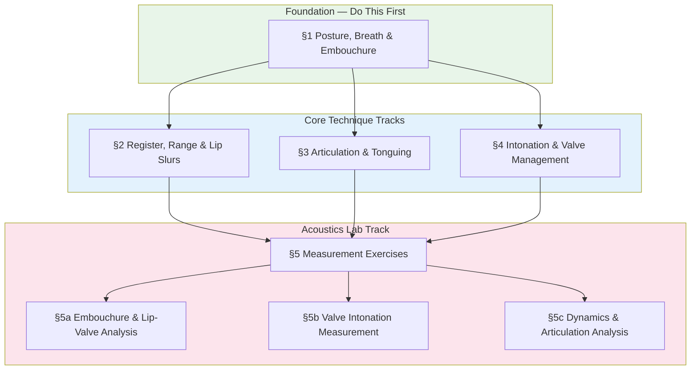
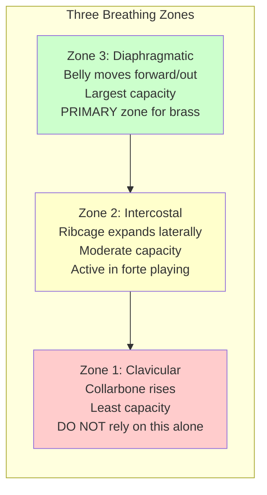
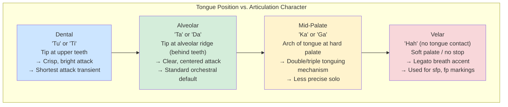
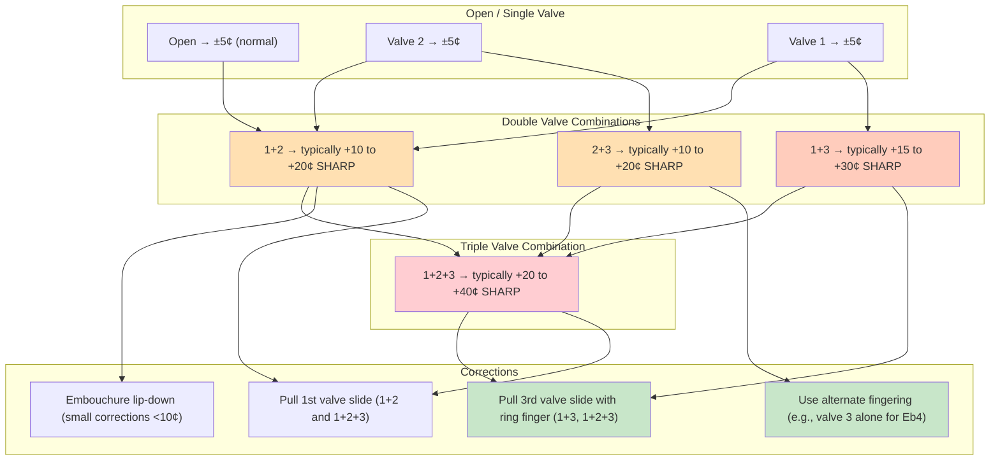
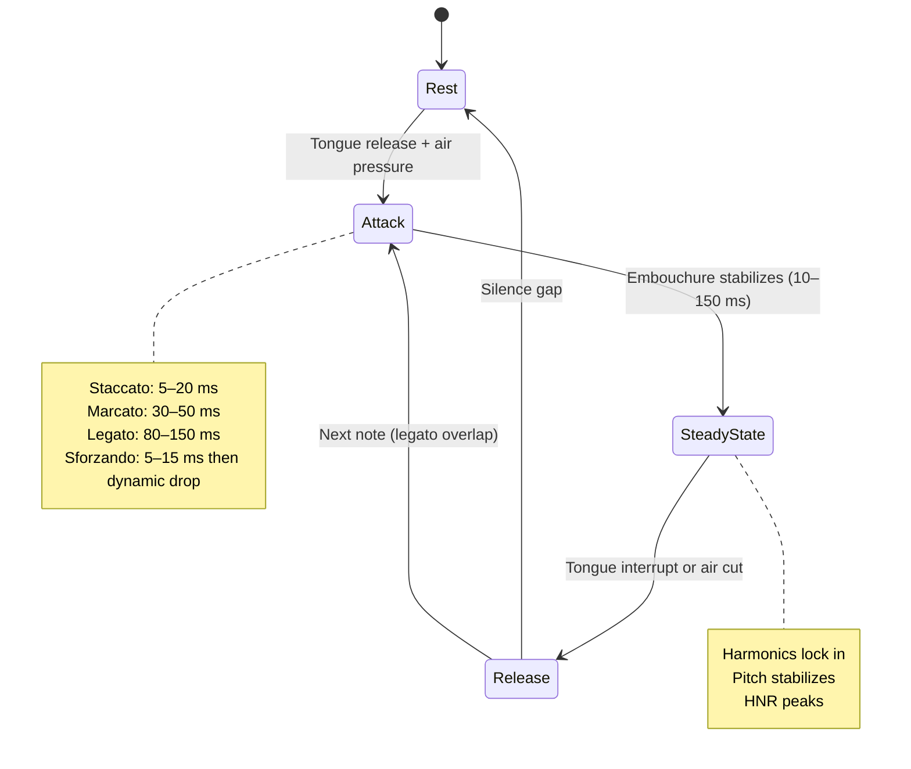
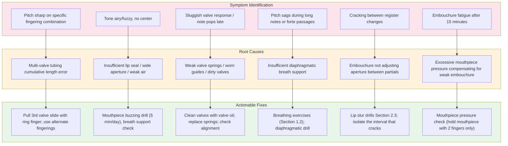

# Brass Instrument Masterclass: Performance Mechanics, Acoustics & Practice Labs

## Overview & How to Use This Material

This masterclass operates on two tracks simultaneously. The **performance track** (Sections 1–4) gives you immediately playable drills, fingering patterns, embouchure cues, and practice routines with metronome targets — material you can use at the stand today. The **acoustics lab track** (Section 5) provides measurement-driven investigation for those who want quantitative understanding of what their body and instrument are doing physically.

Work through Section 1 before anything else. Every advanced technique in this document is built on the postural and embouchure foundation established there.



**Instruments covered:** Bb trumpet, F/Bb double horn, tenor trombone (with B♭/F attachment), and Bb tuba/euphonium. All concert pitches are marked (C.P.) where transposition matters.

---

## Section 1: Foundation — Posture, Breath Support & Embouchure

### 1.1 Seated and Standing Posture

Poor posture is the single largest inhibitor of breath support and tone quality. Fix it before you pick up the horn.

**Seated position (orchestra/band chair):**
- Sit at the front half of the chair — do not lean back into the seatback.
- Both feet flat on the floor, hip-width apart.
- Spine long and neutral: imagine a string pulling the crown of your head toward the ceiling.
- Bell faces forward and slightly down (5–10°) on trumpet/tuba; horn bell points backward and down at roughly 45° to the floor.
- Shoulders dropped and relaxed — rolled-forward "computer shoulders" collapse the chest cavity by 15–20%.

**Standing position (soloist/jazz):**
- Weight distributed slightly forward onto the balls of the feet.
- Knees unlocked — a locked knee creates tension that travels up through the hip into the diaphragm.
- Instrument comes to your face; your face does not go to the instrument.

**Common fault:** Craning the neck forward to meet the mouthpiece. This compresses the trachea and shortens your sustainable phrase by 20–30%. If you're doing this, your music stand is too low.

---

### 1.2 Breathing Mechanics: The Three-Zone Model

Brass playing demands maximum breath capacity and pressure-controlled release. Understand what moves and why.



**The filling sequence (inhalation):**
1. Release the belly forward first — the diaphragm drops and abdominal organs displace outward.
2. Ribcage expands laterally (think "360° expansion" around the torso, not just forward).
3. Upper chest lifts last and minimally.
4. Total inhalation time for a full breath: 1–2 seconds. Faster than this produces shallow, clavicular-dominant breathing.

**Breath support during playing:**
- The abdominal wall does not go slack after the initial breath. Maintain gentle inward pressure of the abdominal muscles throughout the phrase — this is "support."
- Think "air speed" rather than "air pressure." Pressure builds as a consequence of the diaphragm pushing against a partially closed lip aperture, not from squeezing the throat or chest.
- The throat remains open at all times. Confirm this: hiss "haahhh" freely — that open throat position is correct. Hissing "heee" or "tsss" closes the throat. Never play from a closed throat.

**Breathing drill — 4-count breath cycle:**

Repeat without the instrument until automatic:

| Count | Action |
|-------|--------|
| 1–2 | Inhale (belly first, ribs second) |
| 3 | Hold briefly with open throat |
| 4 | Release air freely (simulate a supported tone) |

Target: complete this 20 times without any tension creeping into the jaw, neck, or shoulders.

---

### 1.3 Embouchure Construction: Step-by-Step

The embouchure is a valve, not a seal. Its job is to vibrate at precise frequencies controlled by aperture size, lip tension, and air speed — not by gripping or pressing.

**Building the embouchure from scratch:**

**Step 1 — Lip position:**
Say the syllable "M" and stop at the moment the lips touch. That resting lip contact — no pucker, no smile, no grimace — is your neutral starting position. The upper and lower lip centers should align vertically.

**Step 2 — Aperture formation:**
From the neutral position, say "mmm-PUHHH" and stop at the moment the lips part for the "P." A small oval aperture roughly 3–5 mm wide will form naturally. This is your low-register aperture for trumpet. For tuba, the aperture will be wider; for horn, slightly narrower.

**Step 3 — Mouthpiece placement:**
- Trumpet/trombone/tuba: approximately 2/3 upper lip, 1/3 lower lip inside the mouthpiece cup. The exact ratio varies by player anatomy — do not force a 50/50 split.
- French horn: typically more centered (50/50), but placement often shifts due to the smaller rim diameter.
- Never press the mouthpiece hard against the face. Resting contact pressure is enough to create a seal. Excessive pressure compresses lip tissue, reduces vibration efficiency, and causes bruising.

**Step 4 — Mouthpiece pressure check:**
Hold the mouthpiece between only your left thumb (behind) and left index finger (under the shank). Play a simple scale. If tone collapses without right-hand support, you are relying on pressure, not embouchure development.

**Common embouchure faults and fixes:**

| Fault | Symptom | Fix |
|-------|---------|-----|
| "Smiling" embouchure (corners pulled back) | Thin, pinched tone; poor high register | Bring corners forward/inward, as if saying "PUHHH" |
| "Puckering" (lips pushed forward excessively) | Weak core tone, poor response | Flatten lips slightly, maintain firm corner anchor |
| Chin bunching (chin muscle tightens) | Stuffy, resistant low register | Flatten chin by thinking "long chin" or "chin down" |
| Off-center placement | Mouthpiece rotated to one side | Align with mirror; track both lips equally in the cup |
| Mouthpiece too high/low | Upper or lower partials collapse | Adjust until midpoint of aperture aligns with cup center |

---

### 1.4 Mouthpiece Buzzing Drills (Before Every Practice Session)

Buzzing on the mouthpiece alone eliminates the instrument's acoustic feedback and forces your embouchure to do all the work. Five minutes of mouthpiece buzzing = twenty minutes of instrument practice for embouchure development.

**Drill 1 — Free buzzing (no mouthpiece, no instrument):**
Press lips loosely together. Without the instrument, produce a "BRRR" with air. Aim for a recognizable pitch. This requires significant air support. If you can sustain 5 seconds of free buzzing on a consistent pitch, your embouchure is engaged. Beginners often cannot do this for the first few weeks — that is normal.

**Drill 2 — Mouthpiece long tones:**
On the mouthpiece alone, sustain the following pitches. These concert pitches assume a Bb trumpet mouthpiece; adjust for horn/tuba proportionally:

```
Pitch target (mouthpiece alone → concert pitch on trumpet):
  Low G (sounds like C below the staff)    → 60 BPM, 8 counts each
  Middle C (sounds like middle of staff)   → 60 BPM, 8 counts each
  G above the staff                        → 60 BPM, 8 counts each
  High C (top of staff)                    → 60 BPM, 4 counts each (target)
```

Sustain each pitch with a full, centered tone. Wavering or pitch drift means air support dropped. Reconnect the abdominal wall.

**Drill 3 — Mouthpiece glissandi:**
Sustain a mid-range tone on the mouthpiece, then slide smoothly up a perfect 5th and back down. This trains continuous embouchure adjustment. No articulation — legato only. 10 repetitions per practice session.

---

## Section 2: Tone Production, Register Extension & Lip Slurs

### 2.1 Long Tone Practice — The Core of Everything

Long tones are non-negotiable. No matter how advanced you are, long tones reveal the current state of your embouchure, breath support, and instrument response.

**Long tone protocol — daily practice template:**

Tempo: quarter note = 60 BPM. Each pitch lasts 8 counts (8 quarter notes). Rest 2 counts between pitches. Use a tuner; every pitch must stay within ±5 cents.

**Trumpet long tone sequence (written pitch):**
```
G4 → F#4 → F4 → E4 → Eb4 → D4 → Db4 → C4
(one octave descent, then ascend back up)
```

**Dynamics progression (perform each sequence at four dynamics):**
1. **pp (pianissimo):** Barely audible. This is the hardest. Requires maximum embouchure control and no reliance on pressure.
2. **mp (mezzo-piano):** Relaxed, natural tone.
3. **mf (mezzo-forte):** Full core sound.
4. **ff (fortissimo):** Maximum resonance without pressing. The tone should bloom outward, not become harsh.

**What to listen for:**
- Is the core of the tone round and stable, or does it wobble and thin out?
- Is the pitch stable throughout the full 8 counts, or does it drift flat at the end (breath support dropping)?
- Do adjacent harmonics ring sympathetically? (They should.)

**Vibrato:** Do not add vibrato to long tones during practice. Vibrato masks pitch and tone problems. Save it for performance.

---

### 2.2 The Harmonic Series and Why It Governs Everything

Every note you play on a brass instrument is a member of a harmonic series determined by your effective tube length. Understanding this directly explains valve fingerings, lip slur mechanics, and register playing.

The harmonic series for a Bb trumpet at open (no valves):

```
Partial:    1     2     3     4     5     6     7     8
Concert:    Bb1   Bb2   F3    Bb3   D4    F4    Ab4*  Bb4
Trumpet:    C2    C3    G3    C4    E4    G4    Bb4*  C5

(* 7th partial is naturally flat — approximately 30 cents below equal temperament)
```

This is not an abstraction — it is the roadmap of your instrument. Every lip slur moves between adjacent partials. Every register shift is a jump from one row of this table to the next.

**Practical implication for the high register:**
As you ascend the series, partials get closer together. G4–A♭4–A4–B♭4 are all reachable on the same fingering by increasing air speed and embouchure tension. The instrument does not change; your embouchure changes.

---

### 2.3 Lip Slur Exercises — Progressive Development

Lip slurs move between partials without tonguing. They are the primary tool for developing register flexibility and are the foundation of all technical playing.

**Trumpet fingering reference for lip slur drills:**

| Fingering | Partials Available (Written) |
|-----------|------------------------------|
| Open (0) | C, G, C, E, G, Bb, C (and above) |
| 1 | B, F#, B, D#, F#, A, B |
| 2 | Bb, F, Bb, D, F, Ab, Bb |
| 1+2 | A, E, A, C#, E, G, A |
| 2+3 | Ab, Eb, Ab, C, Eb, Gb, Ab |
| 1+3 | G, D, G, B, D, F, G |
| 1+2+3 | F#, C#, F#, A#, C#, E, F# |

**Drill 1 — Two-partial slur (beginner):**

On open fingering only. Slur between 2nd and 3rd partials (C4 to G4 on trumpet, written pitch). Keep the air stream constant — the only change is a small increase in lip tension and air speed for the ascending note.

```
Pattern: C4 — G4 — C4 — G4 — C4
Tempo: 60 BPM, each note = 1 beat
Articulate the first note only ("Tu"), then slur the rest
Repeat 4 times, then switch to fingering 2 (down a whole step)
```

**Drill 2 — Three-partial slur (intermediate):**

```
Pattern (open fingering, written trumpet):
C4 — G4 — C5 — G4 — C4
(2nd → 3rd → 4th → 3rd → 2nd partials)
Tempo: 60 BPM → 80 BPM → 100 BPM
4 repetitions per fingering
Complete on all 7 fingerings
```

**Drill 3 — Four-partial slur with valve changes (advanced):**

This drill trains the coordination of valve changes with partial shifts, which is the core skill of technical brass playing.

```
Bar 1 (open):   C4 — G4 — C5 — E5
Bar 2 (valve 2): Bb3 — F4 — Bb4 — D5
Bar 3 (valve 1): B3 — F#4 — B4 — D#5
Bar 4 (1+2):    A3 — E4 — A4 — C#5

Slur throughout. Tempo: 60 BPM → 80 BPM → 100 BPM
One bar per fingering, no pause between bars
```

**What to focus on during lip slurs:**
- The air does not stop between notes. Think of the slur as one continuous stream of air with a momentary change in direction/speed at each note.
- Avoid "bumping" (a pop or glitch between notes). Bumping means the air stopped momentarily. Keep it connected.
- The face does not move. Chin does not bob, jaw does not thrust. Only the internal lip tension and air speed change.

---

### 2.4 Register Extension — Systematic High-Note Development

There is no shortcut to the high register, but there is a systematic path. The following protocol extends range by approximately one partial (a perfect 4th to 5th) over 6–8 weeks of consistent daily practice.

**Principle:** You cannot manufacture high notes through pressure. The high register is achieved by increased air speed (not volume) through a smaller aperture. Think "fast and narrow" for high, "slow and wide" for low.

**Step 1 — Find your current comfortable ceiling:**
Play a chromatic scale ascending from middle register. Note the pitch at which the tone begins to thin, spread, or crack. That is your current working ceiling. For most intermediate trumpet players this is around A5 to C6 (written).

**Step 2 — Pedal tone development:**
Pedal tones (below the fundamental, below the staff) are acoustically paradoxical but physically demanding. Playing them consistently strengthens the lips in a way normal range playing does not.

```
Pedal tone sequence (trumpet written pitch):
F#2 — F2 — E2 — Eb2 — D2 — Db2 — C2
Tempo: 60 BPM, 4 counts each, full tone (not airy)
One pedal tone sequence before every high-register practice session
```

**Step 3 — Flexibility exercises targeting one half-step above your ceiling:**

Do not attempt to jump to the top of the range all at once. Add one note at a time.

```
If your ceiling is Bb5 (written trumpet):
Day 1–7:  Lip slur C5 — G5 — C6 (stop here, do not force higher)
Day 8–14: Lip slur C5 — G5 — C6 — D6 (add D)
Day 15–21: Lip slur C5 — G5 — C6 — D6 — E6
...etc.
Tempo: 60 BPM. Never force. If a note cracks, rest 2 minutes, try again.
```

**Step 4 — Never practice tired embouchure:**
When the tone loses core quality (becomes thin, buzzy, or pressed), stop. Rest is not laziness — fatigued lip tissue cannot build strength correctly. Maximum productive embouchure practice per session: 20–30 minutes of active technical work, with 5-minute rests between exercises.

---

### 2.5 Instrument-Specific Register Considerations

**French Horn:**
The horn's narrower mouthpiece and conical bore make register navigation more treacherous. The partials sit closer together in the high register, which means minimal embouchure adjustment separates adjacent notes.

- Use right-hand position in the bell to fine-tune pitch (pushing hand deeper flattens pitch by up to a half-step; opening hand raises pitch).
- Stopped horn (hand fully closing the bell) raises pitch by approximately a half-step — use this for stopped (+) marked passages.
- The horn's 1st-line F fingering: T (thumb, Bb side) + 1+2+3. The horn's lowest playable note on the F side: pedal C (8va below middle C).

**Trombone:**
Trombone has no valves (or one trigger for Bb/F) — all pitch relationships come from slide position and partial selection.

Slide position reference (Bb tenor):

| Position | Interval | Approximate distance |
|----------|----------|---------------------|
| 1st | Open (Bb) | Fully retracted |
| 2nd | A | ~1.5 cm extension |
| 3rd | Ab | ~3 cm extension |
| 4th | G | ~5 cm extension |
| 5th | Gb | ~7 cm extension |
| 6th | F | ~10 cm extension |
| 7th | E | ~12 cm extension |

The F attachment (trigger) adds the F trombone's tubing, extending the low range and providing alternate positions. Bb–F pedal tone: 1st position with trigger.

**Tuba/Euphonium:**
The tuba's large mouthpiece requires significantly more air volume (not more pressure) than trumpet. The common beginner mistake is using high breath pressure to compensate for underdeveloped abdominal support — this produces a thin, strained tone. Lead with air volume; let the embouchure respond naturally.

Euphonium fingerings are identical to trumpet fingerings with the addition of the compensating 4th valve (lowers pitch by a perfect 4th, used to correct sharp intonation on 1+3 and 1+2+3 combinations).

---

## Section 3: Articulation — Tonguing, Legato & Stylistic Variety

### 3.1 Tongue Mechanics and Syllable Vocabulary

The tongue's role in brass playing is to interrupt or initiate airflow at the moment of attack. It does not create the sound — the embouchure and air do that. The tongue is a gate.

**Tongue position taxonomy:**



**Standard syllable guide by context:**

| Style | Syllable | Register | Attack Character |
|-------|----------|----------|-----------------|
| Orchestral staccato | "Ti" | High (above G5 trumpet) | Very crisp, short |
| Orchestral staccato | "Tu" | Mid/low register | Crisp, centered |
| Legato/slurred | No tongue | All | No interruption |
| Soft legato attack | "Du" | All | Gentle initiation |
| Marcato accent | "Tah!" | All | Heavy, weighted |
| Sforzando | "Tahff" (burst) | All | Explosive onset |
| Double tongue T-K | "Tu-Ku" | 120 BPM+ 16ths | Rapid repeated notes |
| Triple tongue | "Tu-Tu-Ku" or "Tu-Ku-Tu" | Triplet patterns | 3-note groupings |

---

### 3.2 Single Tongue Development Drills

**Drill 1 — Tongue speed building (tongued 8th notes):**

```
Pattern: Bb4, single-pitched repeated notes, staccato
Metronome progression:
  Week 1: 60 BPM (eighth notes = 2 tongues per beat)
  Week 2: 80 BPM
  Week 3: 100 BPM
  Week 4: 120 BPM (target: clean single tongue)

8 beats per breath. Rest 4 beats. Repeat 8 times.
Focus: even spacing between notes — no "machine gun" rushing.
```

**Drill 2 — Accent patterns (musical tonguing):**

```
4/4 meter, Bb major scale ascending/descending, 60 → 100 BPM

Pattern A (downbeat accent):
  > . . .  > . . .  (accent beat 1, articulate beats 2-3-4 lightly)

Pattern B (backbeat accent):
  . . > .  . . > .  (accent beat 3)

Pattern C (syncopated):
  . > . >  . > . >  (accent beats 2 and 4)
```

---

### 3.3 Double and Triple Tonguing

Double and triple tonguing are essential for fast repeated-note passages (Haydn Trumpet Concerto fast movement, Mahler symphony excerpts, big band shakes).

**The T-K coordination problem:**
Most players' "K" articulation is weaker than "T" because the back-of-tongue mechanism is less developed. The fix is to isolate K practice.

**K isolation drill (mouthpiece only, no instrument):**

```
Day 1–3:   Buzz only "Ka Ka Ka Ka" — no T at all.
           60 BPM, 4 K's per beat. 2 minutes.

Day 4–7:   "Ka Ka Ka Ka Ka Ka Ka Ka" — steady stream.
           80 BPM, 4 K's per beat. 2 minutes.

Day 8–14:  Alternate: "Tu-Ku Tu-Ku Tu-Ku Tu-Ku"
           80 BPM. T and K must sound identical in clarity and weight.

Day 15+:   Add to instrument. Scale + arpeggios, double tongue.
           Start 80 BPM, target 160 BPM over 4 weeks.
```

**Triple tongue patterns:**

Pattern 1 (T-T-K): Works best for triplet groupings
```
♩. = 60 BPM, triplets
"Tu - Tu - Ku / Tu - Tu - Ku / Tu - Tu - Ku / Tu - Tu - Ku"
Bb major arpeggio: Bb4 - D5 - F5 / Bb4 - D5 - F5 / ...
```

Pattern 2 (T-K-T): Works best for continuous rapid passages
```
"Tu - Ku - Tu / Ku - Tu - Ku / Tu - Ku - Tu / Ku - Tu - Ku"
(alternating grouping — seamless continuation)
Scale run: Bb4 - C5 - D5 / Eb5 - F5 - G5 / ...
```

---

### 3.4 Articulation in Context — Orchestral Excerpt Drills

Theory means nothing without real-world application. The following excerpts isolate specific articulation challenges.

**Excerpt 1 — Stravinsky Petrushka (Bb Trumpet, fig. 1):**
Aggressive, dry staccato in the upper register. Use "Ti" syllable. Keep the note length to exactly 50% of the written value. No decay — cut off cleanly.

Preparatory drill:
```
Key: Bb major (written). Tempo: 126 BPM (target from score).
Practice tempo: 80 BPM → 100 BPM → 116 BPM → 126 BPM.
Isolate the first 4 bars. Play staccato pattern on a single pitch (Bb5) first.
Add pitches only when staccato character is clean and even.
```

**Excerpt 2 — Mahler Symphony No. 5 (Bb Trumpet, opening solo):**
Funeral march articulation — marked, weighted, but not staccato. Use "Tah" syllable with full note value. The opening D (concert Db) must have gravitas, not brightness. Keep the spectral centroid dark by keeping the aperture slightly wider than a normal forte setting.

Preparatory drill:
```
Key: D minor (concert Db minor, written D minor for Bb trumpet).
Tempo: 76 BPM. Practice the first 8 bars alone.
Recorded reference: compare your tone against Bruno Weil/Mahler Chamber Orchestra recording.
Target: attack time 30–50 ms per note (felt, not measured in practice).
```

**Excerpt 3 — Brahms Symphony No. 1 (Horn in F, mvt. IV solo):**
Lyrical, legato. No articulation except the first note of each phrase. Breath support must remain completely constant throughout the slurred passage. Any dip in support = pitch sagging.

Preparatory drill:
```
Isolate bars 1–4. Play on the instrument at 50% tempo first.
Then sing the passage. Match your instrumental tone to your singing tone — this is the target.
Return to 100% tempo: 72 BPM.
```

---

## Section 4: Intonation, Valve Management & Performance Setup

### 4.1 Understanding Why Brass Instruments Are Inherently Out of Tune

No brass instrument plays perfectly in tune on its own. Knowing why prevents frustration and enables intelligent correction.

**The core problem — additive valve tubing:**

Each valve lowers pitch by adding a fixed length of tubing. But the percentage length increase needed to lower a note by a given interval depends on the starting total length. When you combine multiple valves, the tubing added is calculated for each valve independently — but the total length is now longer than when each valve was designed.

Result: multi-valve combinations are systematically sharp.

```
Trumpet (Bb, concert):
  Open                 → ~±2 cents (excellent)
  Valve 2 alone       → ~+2 to +5 cents (good)
  Valve 1 alone       → ~+2 to +5 cents (good)
  1+2 together        → ~+10 to +20 cents SHARP
  2+3 together        → ~+10 to +20 cents SHARP
  1+3 together        → ~+15 to +30 cents SHARP
  1+2+3 together      → ~+20 to +40 cents SHARP
```

This is not a defect — it is physics. It is compensated by: (1) alternate fingerings, (2) slide adjustment, (3) embouchure adjustment.

---

### 4.2 Slide Management — When and How to Pull Slides

**On trumpet:**

| Combination | Problem | Correction |
|-------------|---------|------------|
| 1+3 (G#3/A♭ area) | +20 to +30 cents sharp | Pull 3rd valve slide out ~1 cm with right ring finger |
| 1+2+3 (D3/Eb area) | +30 to +40 cents sharp | Pull 1st valve slide out ~2 mm AND 3rd slide ~1.5 cm |
| 1+2 (A3) | +10 to +20 cents sharp | Lip down or pull 1st slide slightly |

**Slide pulling technique (trumpet):**
- The right ring finger hooks through the saddle or ring on the 3rd valve slide.
- Pulling out 1 mm lowers pitch by approximately 2–3 cents (varies by instrument).
- Practice pulling/pushing during scale passages until it becomes automatic.
- Mark your 3rd slide with a paint pen at the "home" position and at the "1+3 pulled" position so you can find it by feel in performance.

**On trombone:**
Every combination has a unique slide position. The fundamental skill is knowing where "exact" position is for every note by ear, not by memory of a position number.

**On horn:**
Right-hand position in the bell provides continuous fine-tuning. Pushing the hand deeper flattens pitch; opening the bell raises it. Use this for constant micro-intonation correction.

---

### 4.3 Alternate Fingerings — Practical Chart (Trumpet)

Memorize these before you need them in performance:

| Note (Concert) | Standard | Alternate | Notes |
|----------------|----------|-----------|-------|
| F#4/Gb4 | 2+3 | 1+2+3 (pull 3rd) | 2+3 is sharp; 1+2+3 with slide = better |
| G#4/Ab4 | 1+2+3 | 2+3 | 2+3 plays slightly flat here — use as alternate |
| A4 | 1+2 | No good alt | Pull 1st slide ~1–2 mm |
| Bb4 | 1 or 2+3 | Open (12th partial on some instruments) | |
| D5 | 1+3 | 1+2+3 (slide pulled) | Standard D is sharp — ring finger ready |
| C#5/Db5 | 1+2 | — | Pull slides |
| Low F#2/Gb2 | 2+3 | 1+2+3 | Weak register — 1+2+3 sometimes responds better |

---

### 4.4 Warm-Up Routine — Complete Daily Template

This 20-minute warm-up covers embouchure activation, flexibility, intonation, and articulation in an efficient sequence. Use it before every practice session and before every performance.

```
Minutes 0–2:   Mouthpiece buzzing
               → Long tones, C4 to G4 range (mouthpiece pitch reference)
               → Glissandi up a 5th and back, 10 reps

Minutes 2–6:   Long tones on instrument
               → pp to ff dynamic exploration on G4, F4, Eb4, C4 (trumpet written)
               → Hold each 8 counts, tune with drone (A=440 Hz reference)

Minutes 6–10:  Lip slurs
               → 2-partial slur on all 7 fingerings (Drill 2.3-1 above)
               → 3-partial slur, tempo 72 BPM

Minutes 10–14: Tonguing
               → Single tongue repeated notes: 60 → 80 → 100 BPM
               → Scale with accent patterns A and B (Drill 3.2-2)

Minutes 14–17: Scales
               → Bb major, one octave, legato, 72 BPM quarter notes
               → Chromatic scale, C to C, staccato, 80 BPM

Minutes 17–20: Intonation check
               → Play with tuner drone
               → Identify and correct sharp fingering combinations
               → Mark any persistent intonation problems for focused practice
```

---

## Section 5: Acoustics Lab — Measurement-Driven Investigation

This section is for players who want quantitative insight into their own physiology and instrument behavior. You do not need a laboratory — a modern smartphone (96 kHz capable audio interfaces are under $100) and free analysis software cover most of these exercises.

### 5.1 Lab Infrastructure

**Minimum viable setup (practical):**
- Brass instrument in known condition
- Audio interface: Focusrite Scarlett Solo (2nd gen+) at 96 kHz / 24-bit
- Calibrated measurement microphone: Dayton Audio EMM-6 or Behringer ECM8000 (~$30–60)
- Chromatic tuner: Korg TM-60 or iPhone app "Tonal Energy" (±0.1 cent resolution)
- Python 3.10+ with NumPy, SciPy, librosa, matplotlib

**Enhanced setup (research-grade):**
- Pressure transducer: ±10 kPa, >10 kHz bandwidth, installed in mouthpiece shank
- Contact accelerometer (piezoelectric) for bell vibration analysis
- Synchronized multi-channel recording (mouthpiece pressure + acoustic simultaneously)

**Analysis environment setup:**

```bash
# Create isolated Python environment
python -m venv brass_lab
source brass_lab/bin/activate  # macOS/Linux
# brass_lab\Scripts\activate   # Windows

# Install dependencies (pinned versions for reproducibility)
pip install numpy==1.26.4 scipy==1.13.0 librosa==0.10.2 \
            matplotlib==3.9.0 soundfile==0.12.1 sounddevice==0.4.7
```

---

### 5.2 Lab A: Embouchure Mechanics & Lip-Valve Analysis

#### Lab A1 — Mouthpiece Pressure Mapping Across the Register

**Objective:** Quantify how mouth pressure varies across the instrument's range and confirm the relationship between pressure, partial number, and embouchure tension.

**Setup:**
- Position microphone 1 meter from bell, on-axis.
- If pressure transducer available: install in mouthpiece shank. If not, use acoustic analysis only (see alternate method in Step 4 below).
- Record at 96 kHz / 24-bit to capture high-frequency embouchure noise.

**Procedure:**

1. Play each note in the following chromatic sequence, sustaining each for 4 seconds at mezzo-forte (target 85 dB SPL at 1 m). Rest 2 seconds between notes.

```
Trumpet written sequence (adjust by transposition for other instruments):
C4 — Db4 — D4 — Eb4 — E4 — F4 — F#4 — G4 — Ab4 — A4 — Bb4 — B4 — C5 — D5 — E5 — F5 — G5
```

2. Save individual audio files named by note: `C4.wav`, `Db4.wav`, etc.

3. Run analysis:

```python
import numpy as np
import scipy.signal as sig
import matplotlib.pyplot as plt
import soundfile as sf
from pathlib import Path

def analyze_note(filepath: str, fs_target: int = 96000) -> dict:
    """
    Load a recorded brass note and extract key acoustic features.
    Returns dict with fundamental frequency, SPL, spectral centroid, 
    and harmonic-to-noise ratio.
    """
    audio, fs = sf.read(filepath)
    
    # Normalize to mono
    if audio.ndim > 1:
        audio = audio.mean(axis=1)
    
    # Extract steady-state segment: skip first 500ms (attack), 
    # use 2s steady-state window
    start = int(0.5 * fs)
    end   = int(2.5 * fs)
    if end > len(audio):
        end = len(audio)
    segment = audio[start:end]
    
    # --- Fundamental frequency via autocorrelation ---
    # Reliable for monophonic instruments
    corr = np.correlate(segment, segment, mode='full')
    corr = corr[len(corr)//2:]  # Keep positive lags only
    # Find first peak beyond the trivial peak at lag=0
    min_lag = int(fs / 1500)  # Above 1500 Hz — won't mistake harmonics
    max_lag = int(fs / 50)    # Below 50 Hz
    peak_indices, _ = sig.find_peaks(corr[min_lag:max_lag], height=0)
    if len(peak_indices) == 0:
        f0 = np.nan
    else:
        f0 = fs / (peak_indices[0] + min_lag)
    
    # --- Power spectral density (Blackman-Harris window for low sidelobes) ---
    f_axis, Pxx = sig.welch(segment, fs, nperseg=8192, 
                             window='blackmanharris', scaling='density')
    
    # --- SPL (assumes microphone calibration at 1m; adjust ref if calibrated) ---
    p_ref = 20e-6  # 20 μPa reference
    rms = np.sqrt(np.mean(segment**2))
    spl = 20.0 * np.log10(rms / p_ref) if rms > 0 else -np.inf
    
    # --- Spectral centroid ---
    centroid = np.sum(f_axis * Pxx) / (np.sum(Pxx) + 1e-12)
    
    # --- Harmonic-to-noise ratio estimate ---
    if not np.isnan(f0):
        harmonic_bw = 20  # Hz each side of harmonic peak
        harmonic_energy = 0.0
        for k in range(1, 12):
            h_freq = k * f0
            if h_freq > f_axis[-1]:
                break
            mask = np.abs(f_axis - h_freq) < harmonic_bw
            harmonic_energy += np.sum(Pxx[mask])
        total_energy = np.sum(Pxx)
        noise_energy  = total_energy - harmonic_energy
        hnr_db = 10.0 * np.log10(harmonic_energy / (noise_energy + 1e-12))
    else:
        hnr_db = np.nan
    
    return {
        'f0_hz':       f0,
        'spl_db':      spl,
        'centroid_hz': centroid,
        'hnr_db':      hnr_db,
        'f_axis':      f_axis,
        'Pxx':         Pxx,
    }


# --- Run across all note files ---
note_names = ['C4','Db4','D4','Eb4','E4','F4','F#4','G4',
              'Ab4','A4','Bb4','B4','C5','D5','E5','F5','G5']

results = {}
audio_dir = Path('./recordings')

for note in note_names:
    fpath = audio_dir / f'{note}.wav'
    if fpath.exists():
        results[note] = analyze_note(str(fpath))
        r = results[note]
        print(f"{note:5s}  f0={r['f0_hz']:7.2f} Hz  "
              f"SPL={r['spl_db']:5.1f} dB  "
              f"Centroid={r['centroid_hz']:6.0f} Hz  "
              f"HNR={r['hnr_db']:5.1f} dB")
    else:
        print(f"  File not found: {fpath}")


# --- Plot spectral centroid vs register ---
valid = [(n, r) for n, r in results.items() if not np.isnan(r['f0_hz'])]
if valid:
    note_labels  = [n for n, _ in valid]
    f0_values    = [r['f0_hz']       for _, r in valid]
    cent_values  = [r['centroid_hz'] for _, r in valid]
    hnr_values   = [r['hnr_db']      for _, r in valid]

    fig, axes = plt.subplots(2, 1, figsize=(12, 7), sharex=True)
    
    axes[0].bar(note_labels, cent_values, color='steelblue')
    axes[0].set_ylabel('Spectral Centroid (Hz)')
    axes[0].set_title('Tone Brightness vs. Register — Brass Instrument Survey')
    axes[0].grid(axis='y', alpha=0.4)
    
    axes[1].bar(note_labels, hnr_values, color='darkorange')
    axes[1].set_ylabel('Harmonic-to-Noise Ratio (dB)')
    axes[1].set_xlabel('Note (Written Trumpet Pitch)')
    axes[1].grid(axis='y', alpha=0.4)
    
    plt.tight_layout()
    plt.savefig('register_survey.png', dpi=150)
    plt.show()
```

**What to look for:** Spectral centroid should rise monotonically with register — higher notes are brighter. If centroid drops unexpectedly at a specific note, that note's embouchure setup or fingering is suboptimal. HNR should stay above +20 dB for clean tone; values below +10 dB indicate a noisy, airy tone (insufficient lip seal or insufficient air support).

---

#### Lab A2 — Embouchure Aperture Effect on Timbre

**Objective:** Measure how intentional aperture width changes affect spectral content on the same pitch.

**Procedure:**

Sustain concert Bb4 (trumpet open/valve 2 written Bb4 or Bb3) using three deliberate aperture setups:
- **Narrow aperture:** Corners pulled forward ("fish lips"). Bright, tight tone.
- **Normal aperture:** Neutral embouchure as described in Section 1.3.
- **Wide aperture:** Corners slightly relaxed and open. Darker, fuller tone.

Record 4 seconds each. Save as `aperture_narrow.wav`, `aperture_normal.wav`, `aperture_wide.wav`.

```python
import numpy as np
import scipy.signal as sig
import matplotlib.pyplot as plt
import soundfile as sf

def overlay_spectra(files: dict, fs_analysis_nperseg: int = 8192):
    """
    Overlay power spectra from multiple recordings on a single plot.
    files: dict mapping label string to file path string.
    """
    fig, ax = plt.subplots(figsize=(12, 5))
    colors = ['#e63946', '#457b9d', '#2a9d8f']
    
    for (label, fpath), color in zip(files.items(), colors):
        audio, fs = sf.read(fpath)
        if audio.ndim > 1:
            audio = audio.mean(axis=1)
        # Steady-state window
        segment = audio[int(0.5*fs):int(2.5*fs)]
        
        f, Pxx = sig.welch(segment, fs, nperseg=fs_analysis_nperseg,
                           window='blackmanharris', scaling='density')
        Pxx_db = 10.0 * np.log10(Pxx + 1e-12)
        
        # Spectral centroid
        centroid = np.sum(f * Pxx) / (np.sum(Pxx) + 1e-12)
        
        ax.plot(f, Pxx_db, label=f'{label}  (centroid={centroid:.0f} Hz)', 
                color=color, linewidth=1.5, alpha=0.9)
    
    ax.set_xscale('log')
    ax.set_xlim(100, 8000)
    ax.set_ylim(-80, 20)
    ax.set_xlabel('Frequency (Hz)', fontsize=12)
    ax.set_ylabel('Power Spectral Density (dB/Hz)', fontsize=12)
    ax.set_title('Embouchure Aperture Effect on Spectrum (Same Pitch)', fontsize=13)
    ax.legend(fontsize=10)
    ax.grid(True, which='both', alpha=0.3)
    plt.tight_layout()
    plt.savefig('aperture_spectra.png', dpi=150)
    plt.show()


overlay_spectra({
    'Narrow aperture': 'recordings/aperture_narrow.wav',
    'Normal aperture': 'recordings/aperture_normal.wav',
    'Wide aperture':   'recordings/aperture_wide.wav',
})
```

**Expected results:** Narrow aperture spectral centroid will be 300–700 Hz higher than wide aperture on the same pitch. The wide aperture spectrum will show stronger low-order harmonics (harmonics 2–4) relative to high-order harmonics (8–16). This is the acoustic fingerprint of dark vs. bright tone color.

---

### 5.3 Lab B: Valve Intonation Measurement

#### Lab B1 — Chromatic Scale Intonation Survey

**Objective:** Quantify deviation from equal temperament for all seven valve combinations, identify problem fingerings, and document required slide corrections.

**Procedure:**

Play the following sequence of pitches, one sustained note per valve combination, 3 seconds each at mezzo-forte. Use a simultaneous tuner reference (Tonal Energy app works well). Record audio separately for post-analysis.

```python
import numpy as np
import scipy.signal as sig
import soundfile as sf

# Equal temperament frequency reference (A4 = 440 Hz)
def et_freq(midi_note: int) -> float:
    return 440.0 * 2.0**((midi_note - 69) / 12.0)

def measure_fundamental(filepath: str) -> float:
    """
    Estimate fundamental frequency from a sustained brass note recording
    using the autocorrelation method. Returns frequency in Hz.
    """
    audio, fs = sf.read(filepath)
    if audio.ndim > 1:
        audio = audio.mean(axis=1)
    
    # Steady-state window (skip attack)
    segment = audio[int(0.5*fs):int(2.5*fs)]
    
    # Normalize
    segment = segment / (np.max(np.abs(segment)) + 1e-12)
    
    # Autocorrelation
    corr = np.correlate(segment, segment, mode='full')
    corr = corr[len(corr)//2:]
    
    # Search range: 50 Hz to 2000 Hz
    min_lag = max(1, int(fs / 2000))
    max_lag = int(fs / 50)
    
    peaks, props = sig.find_peaks(corr[min_lag:max_lag],
                                  height=0.1 * corr[0],
                                  distance=int(fs/2200))
    
    if len(peaks) == 0:
        return np.nan
    
    # Highest-correlation peak = fundamental period
    best_lag = peaks[np.argmax(props['peak_heights'])] + min_lag
    return fs / best_lag


def cents_deviation(measured_hz: float, target_hz: float) -> float:
    """Return deviation in cents: positive = sharp."""
    if target_hz <= 0 or measured_hz <= 0 or np.isnan(measured_hz):
        return np.nan
    return 1200.0 * np.log2(measured_hz / target_hz)


# --- Trumpet fingering intonation survey ---
# (Written pitches for Bb trumpet; concert = written - whole step)
fingerings = [
    # (label,         written_note, written_MIDI, filename)
    ('Open',          'C5',  72,  'open.wav'),
    ('Valve 2',       'B4',  71,  'valve2.wav'),
    ('Valve 1',       'Bb4', 70,  'valve1.wav'),
    ('1+2',           'A4',  69,  'valve12.wav'),
    ('2+3',           'Ab4', 68,  'valve23.wav'),
    ('1+3',           'G4',  67,  'valve13.wav'),
    ('1+2+3',         'F#4', 66,  'valve123.wav'),
]

print(f"\n{'Fingering':<10} {'Note':<6} {'Target Hz':>10} {'Measured Hz':>12} {'Deviation':>12}")
print("-" * 55)

from pathlib import Path
audio_dir = Path('./recordings/intonation')

survey_results = []
for label, note, midi, fname in fingerings:
    target  = et_freq(midi)
    fpath   = audio_dir / fname
    if fpath.exists():
        measured = measure_fundamental(str(fpath))
        dev_c    = cents_deviation(measured, target)
        survey_results.append((label, note, target, measured, dev_c))
        status = "SHARP" if dev_c > 10 else ("FLAT" if dev_c < -10 else "OK")
        print(f"{label:<10} {note:<6} {target:>10.2f} {measured:>12.2f} "
              f"{dev_c:>+10.1f}¢  {status}")
    else:
        print(f"{label:<10} {note:<6} {target:>10.2f}  [file not found]")


# --- Bar chart visualization ---
if survey_results:
    import matplotlib.pyplot as plt
    labels  = [r[0] for r in survey_results]
    devs    = [r[4] for r in survey_results]
    colors  = ['#c0392b' if d > 10 else ('#2980b9' if d < -10 else '#27ae60') 
               for d in devs]

    fig, ax = plt.subplots(figsize=(10, 5))
    bars = ax.bar(labels, devs, color=colors, edgecolor='black', linewidth=0.8)
    ax.axhline(0,   color='black',  linewidth=1.0)
    ax.axhline(+10, color='orange', linewidth=0.8, linestyle='--', label='+10¢ threshold')
    ax.axhline(-10, color='orange', linewidth=0.8, linestyle='--', label='-10¢ threshold')
    ax.set_ylabel('Deviation from Equal Temperament (cents)', fontsize=11)
    ax.set_title('Valve Combination Intonation Survey — Bb Trumpet', fontsize=12)
    ax.set_ylim(-25, 50)
    ax.legend()
    ax.grid(axis='y', alpha=0.4)
    plt.tight_layout()
    plt.savefig('intonation_survey.png', dpi=150)
    plt.show()
```

Valve intonation flow for multi-valve combinations:



---

### 5.4 Lab C: Dynamics, Articulation & Breath Analysis

#### Lab C1 — Articulation Transient Analysis

**Objective:** Measure attack times and spectral evolution for different articulation styles. This turns subjective "this articulation feels right" into quantitative benchmarks.

**Procedure:**

Record each articulation style on a 4-note pattern (Bb4–C5–D5–Eb5) at quarter note = 80 BPM. File naming: `articulation_legato.wav`, `articulation_staccato.wav`, `articulation_marcato.wav`, `articulation_sforzando.wav`.

```python
import numpy as np
import scipy.signal as sig
import soundfile as sf
import librosa
import matplotlib.pyplot as plt


def analyze_articulations(files: dict, bpm: float = 80.0):
    """
    For each articulation recording, detect note onsets, measure attack time
    (5% to 90% of peak envelope), and compute spectral flux during the attack.
    
    files: dict mapping articulation label to .wav file path.
    bpm:   tempo used during recording (for expected onset spacing validation).
    """
    beat_duration_s = 60.0 / bpm
    
    all_stats = {}
    
    for label, fpath in files.items():
        audio, fs = sf.read(fpath)
        if audio.ndim > 1:
            audio = audio.mean(axis=1)
        
        # Normalize
        audio = audio / (np.max(np.abs(audio)) + 1e-12)
        
        # Onset detection (librosa spectral flux method)
        hop_length = 512
        onset_frames = librosa.onset.onset_detect(
            y=audio, sr=fs,
            hop_length=hop_length,
            units='frames',
            backtrack=True,
            pre_max=5, post_max=5,
            pre_avg=20, post_avg=20,
            delta=0.07, wait=4
        )
        onset_samples = librosa.frames_to_samples(onset_frames, hop_length=hop_length)
        
        attack_times_ms  = []
        spectral_flux_vals = []
        
        # Hilbert envelope for attack time measurement
        envelope = np.abs(sig.hilbert(audio))
        # Smooth envelope (10 ms window)
        win = int(0.01 * fs)
        envelope = sig.savgol_filter(envelope, max(win | 1, 11), 3)
        
        for onset_samp in onset_samples:
            # 200 ms analysis window per note
            window_end = min(onset_samp + int(0.2 * fs), len(audio))
            if window_end <= onset_samp:
                continue
            
            env_window = envelope[onset_samp:window_end]
            if len(env_window) < 10:
                continue
            
            peak = np.max(env_window)
            if peak < 1e-4:
                continue
            
            thresh_5pct  = 0.05 * peak
            thresh_90pct = 0.90 * peak
            
            above_5   = np.where(env_window >= thresh_5pct)[0]
            above_90  = np.where(env_window >= thresh_90pct)[0]
            
            if len(above_5) == 0 or len(above_90) == 0:
                continue
            
            attack_time_ms = (above_90[0] - above_5[0]) / fs * 1000.0
            attack_times_ms.append(max(attack_time_ms, 0.5))
            
            # Spectral flux: energy change from first 30ms (attack) 
            # to 60-150ms (steady state)
            attack_seg = audio[onset_samp : onset_samp + int(0.03 * fs)]
            steady_seg = audio[onset_samp + int(0.06*fs) : 
                               onset_samp + int(0.15*fs)]
            
            if len(attack_seg) < 64 or len(steady_seg) < 64:
                continue
            
            # Short FFT for each segment
            atk_fft = np.abs(np.fft.rfft(attack_seg, n=1024))
            sdy_fft = np.abs(np.fft.rfft(steady_seg, n=1024))
            
            # Normalize to avoid amplitude bias
            atk_fft = atk_fft / (np.sum(atk_fft) + 1e-12)
            sdy_fft = sdy_fft / (np.sum(sdy_fft) + 1e-12)
            
            flux = float(np.sum((sdy_fft - atk_fft)**2))
            spectral_flux_vals.append(flux)
        
        if attack_times_ms:
            mean_atk  = float(np.mean(attack_times_ms))
            std_atk   = float(np.std(attack_times_ms))
            mean_flux = float(np.mean(spectral_flux_vals)) if spectral_flux_vals else 0.0
            all_stats[label] = {
                'mean_attack_ms': mean_atk,
                'std_attack_ms':  std_atk,
                'mean_spectral_flux': mean_flux,
                'n_onsets': len(onset_samples),
            }
            print(f"{label:<12}  Attack: {mean_atk:5.1f} ± {std_atk:4.1f} ms  "
                  f"Flux: {mean_flux:.4f}  Onsets detected: {len(onset_samples)}")
        else:
            print(f"{label:<12}  No valid onsets detected — check threshold or recording.")
    
    # --- Grouped bar chart ---
    if all_stats:
        labels_list = list(all_stats.keys())
        atk_means   = [all_stats[l]['mean_attack_ms'] for l in labels_list]
        atk_stds    = [all_stats[l]['std_attack_ms']  for l in labels_list]
        
        fig, ax = plt.subplots(figsize=(9, 5))
        x = np.arange(len(labels_list))
        bars = ax.bar(x, atk_means, yerr=atk_stds, capsize=5,
                      color=['#4e9af1','#f4a261','#e63946','#8338ec'],
                      edgecolor='black', linewidth=0.8)
        ax.set_xticks(x)
        ax.set_xticklabels(labels_list, fontsize=11)
        ax.set_ylabel('Mean Attack Time (ms)', fontsize=11)
        ax.set_title('Articulation Attack Time Comparison', fontsize=12)
        ax.grid(axis='y', alpha=0.4)
        plt.tight_layout()
        plt.savefig('articulation_attack_times.png', dpi=150)
        plt.show()
    
    return all_stats


stats = analyze_articulations({
    'Legato':     'recordings/articulation_legato.wav',
    'Staccato':   'recordings/articulation_staccato.wav',
    'Marcato':    'recordings/articulation_marcato.wav',
    'Sforzando':  'recordings/articulation_sforzando.wav',
})
```

Articulation transient state machine:



**Expected benchmarks:**

| Articulation | Typical Attack Time | HNR at Steady State | Character |
|-------------|--------------------|--------------------|-----------|
| Legato | 80–150 ms | >25 dB | Smooth onset, continuous air |
| Staccato | 5–20 ms | 15–25 dB | Crisp, dry, 50% note length |
| Marcato | 30–50 ms | 20–28 dB | Weighted, full value |
| Sforzando | 5–15 ms | 10–20 dB | Explosive onset, rapid decay |

---

#### Lab C2 — Breath Support and Dynamic Range Profile

**Objective:** Confirm diaphragmatic vs. shallow breathing produces measurable differences in pitch stability and dynamic sustainability.

**Procedure:**

Perform a crescendo-decrescendo on a sustained Bb4 (8 seconds crescendo from pp to ff, 8 seconds decrescendo back to pp). Record three trials:
1. Deliberate clavicular (shallow) breathing.
2. Normal intercostal breathing.
3. Full diaphragmatic support.

```python
import numpy as np
import scipy.signal as sig
import soundfile as sf
import matplotlib.pyplot as plt


def breath_support_analysis(filepaths: dict):
    """
    Compute time-varying SPL and pitch stability for three breathing approaches.
    filepaths: dict mapping label to .wav path.
    """
    window_ms   = 100   # 100 ms RMS window
    hop_ms      = 50    # 50 ms hop
    p_ref       = 20e-6 # Pa reference

    fig, axes = plt.subplots(2, 1, figsize=(13, 8), sharex=True)
    colors = ['#c0392b', '#f39c12', '#27ae60']
    
    for (label, fpath), color in zip(filepaths.items(), colors):
        audio, fs = sf.read(fpath)
        if audio.ndim > 1:
            audio = audio.mean(axis=1)
        
        win_samp = int(window_ms / 1000 * fs)
        hop_samp = int(hop_ms    / 1000 * fs)
        
        # Time-varying SPL
        n_frames = (len(audio) - win_samp) // hop_samp
        spl_arr  = np.zeros(n_frames)
        t_arr    = np.zeros(n_frames)
        
        for i in range(n_frames):
            s = i * hop_samp
            frame = audio[s : s + win_samp]
            rms = np.sqrt(np.mean(frame**2))
            spl_arr[i] = 20.0 * np.log10(rms / p_ref) if rms > 1e-12 else 0.0
            t_arr[i] = s / fs
        
        # Pitch tracking via librosa pyin (requires librosa ≥ 0.9)
        import librosa
        f0, voiced_flag, voiced_probs = librosa.pyin(
            audio,
            fmin=librosa.note_to_hz('C3'),
            fmax=librosa.note_to_hz('C6'),
            sr=fs,
            hop_length=512
        )
        t_f0 = librosa.frames_to_time(np.arange(len(f0)), sr=fs, hop_length=512)
        
        # Pitch stability metric: rolling std of f0 in cents over 500 ms
        f0_cents = 1200.0 * np.log2(f0 / 466.16)   # Reference: Bb4 concert = 466.16 Hz
        # Suppress unvoiced frames
        f0_cents[~voiced_flag] = np.nan
        
        axes[0].plot(t_arr, spl_arr, color=color, linewidth=1.8,
                     label=label, alpha=0.9)
        axes[1].plot(t_f0, f0_cents, color=color, linewidth=1.4,
                     label=label, alpha=0.85)
    
    axes[0].set_ylabel('SPL (dB)', fontsize=11)
    axes[0].set_title('Dynamic Profile: Breath Support Comparison', fontsize=12)
    axes[0].legend(fontsize=10)
    axes[0].grid(alpha=0.35)
    axes[0].set_ylim(50, 115)
    
    axes[1].set_ylabel('Pitch Deviation from Bb4 (cents)', fontsize=11)
    axes[1].set_xlabel('Time (s)', fontsize=11)
    axes[1].axhline(0, color='gray', linewidth=0.8, linestyle='--')
    axes[1].axhline(+10, color='orange', linewidth=0.6, linestyle=':')
    axes[1].axhline(-10, color='orange', linewidth=0.6, linestyle=':')
    axes[1].set_ylim(-40, 40)
    axes[1].legend(fontsize=10)
    axes[1].grid(alpha=0.35)
    
    plt.tight_layout()
    plt.savefig('breath_support_comparison.png', dpi=150)
    plt.show()


breath_support_analysis({
    'Clavicular (shallow)': 'recordings/breath_clavicular.wav',
    'Intercostal':          'recordings/breath_intercostal.wav',
    'Diaphragmatic':        'recordings/breath_diaphragmatic.wav',
})
```

**Expected findings:**
- Diaphragmatic breathing: pitch stays within ±5 cents throughout the full 16-second crescendo-decrescendo. Dynamic range 60–105 dB achievable.
- Clavicular breathing: pitch sags 10–25 cents flat during the decrescendo as abdominal support drops. Maximum sustainable forte drops by 5–8 dB. SPL curve shows an irregular drop before the end of the decrescendo.
- Intercostal breathing: intermediate performance, pitch ±8–12 cents.

---

### 5.5 Fault Diagnosis — Practical Troubleshooting



**Quick reference checklist:**

**Intonation problems:**
1. Check tuner calibration: A = 440 Hz exactly.
2. Play open note (no valves). If this is out of tune, adjust main tuning slide.
3. Play each single-valve combination. If sharp by >10 cents, the individual valve slide may need adjustment.
4. Play multi-valve combinations. If sharp by >15 cents: pull 3rd slide (1+3, 1+2+3), pull 1st slide (1+2).
5. Check room temperature: every +10°C warms the instrument and raises pitch ~8.5 cents. Cold instrument = flat; warmed instrument = in tune.

**Tone quality degradation:**
1. Inspect mouthpiece rim: even a small dent or burr changes embouchure contact and ruins tone.
2. Check valve oil: dry valves cause sluggish response and sometimes leaks that add noise.
3. Check bore for obstructions: remove all slides, run a brass instrument snake brush through each section.
4. Test embouchure without instrument (buzzing section) — if buzzing tone is centered and clear but instrument tone is not, the problem is in the instrument. If buzzing tone is also poor, the problem is embouchure.

**Response latency:**
1. Remove valve and re-oil. Reinsert aligned to rotation stop.
2. Test valve spring tension: each valve should return in <15 ms after full depression. Sluggish return = replace spring.
3. Confirm valve guide alignment: worn guides cause the piston to rock slightly, creating a brief seal failure.

---

### 5.6 Data Logging Template (Python)

Use this for structured session records across all Lab exercises:

```python
import json
from datetime import datetime
from pathlib import Path


def create_session_log(
    instrument: str,
    player_id: str,
    room_temp_c: float,
    humidity_pct: float,
    mic_sensitivity_v_per_pa: float = None,
    pressure_transducer_v_per_kpa: float = None,
) -> dict:
    """
    Initialize a brass acoustics lab session log.
    Returns a dict ready for measurements to be appended.
    """
    return {
        'session_metadata': {
            'date':            datetime.now().isoformat(),
            'instrument':      instrument,
            'player_id':       player_id,
            'room_temp_c':     room_temp_c,
            'humidity_pct':    humidity_pct,
            'a440_reference':  440.0,
        },
        'calibration': {
            'mic_sensitivity_v_per_pa':        mic_sensitivity_v_per_pa,
            'pressure_transducer_v_per_kpa':   pressure_transducer_v_per_kpa,
            'notes': 'Set mic_sensitivity from calibration sheet; '
                     'None = uncalibrated (relative measurements only)',
        },
        'measurements': [],
    }


def log_measurement(
    session: dict,
    exercise: str,
    trial: int,
    fingering: str,
    target_pitch: str,
    measured_f0_hz: float,
    spl_db: float,
    centroid_hz: float,
    hnr_db: float,
    mouth_pressure_kpa: float = None,
    audio_file: str = '',
    notes: str = '',
) -> None:
    """Append a single measurement entry to the session log."""
    # Compute ET target frequency from note name
    note_to_midi = {
        'C': 0, 'C#': 1, 'Db': 1, 'D': 2, 'D#': 3, 'Eb': 3,
        'E': 4, 'F': 5, 'F#': 6, 'Gb': 6, 'G': 7, 'G#': 8,
        'Ab': 8, 'A': 9, 'A#': 10, 'Bb': 10, 'B': 11,
    }
    # Simple parse: last character is octave number, rest is note name
    octave     = int(target_pitch[-1])
    note_name  = target_pitch[:-1]
    midi_note  = note_to_midi.get(note_name, 69) + (octave + 1) * 12
    target_hz  = 440.0 * 2.0**((midi_note - 69) / 12.0)
    
    import numpy as np
    deviation_cents = (1200.0 * np.log2(measured_f0_hz / target_hz)
                       if measured_f0_hz > 0 else float('nan'))
    
    session['measurements'].append({
        'exercise':           exercise,
        'trial':              trial,
        'fingering':          fingering,
        'target_pitch':       target_pitch,
        'target_hz':          round(target_hz, 3),
        'measured_f0_hz':     round(measured_f0_hz, 3),
        'deviation_cents':    round(deviation_cents, 2),
        'spl_db':             round(spl_db, 2),
        'spectral_centroid_hz': round(centroid_hz, 1),
        'hnr_db':             round(hnr_db, 2),
        'mouth_pressure_kpa': mouth_pressure_kpa,
        'audio_file':         audio_file,
        'notes':              notes,
    })


def save_session(session: dict, output_dir: str = '.') -> str:
    """Save session log as JSON. Returns the saved file path."""
    out_dir  = Path(output_dir)
    out_dir.mkdir(parents=True, exist_ok=True)
    date_str = datetime.now().strftime('%Y%m%d_%H%M')
    fname    = out_dir / f'brass_lab_{date_str}.json'
    with open(fname, 'w') as f:
        json.dump(session, f, indent=2)
    print(f"Session saved: {fname}")
    return str(fname)


# --- Usage example ---
session = create_session_log(
    instrument  = 'Yamaha YTR-8335RS Bb Trumpet',
    player_id   = 'P001',
    room_temp_c = 22.0,
    humidity_pct = 48.0,
    mic_sensitivity_v_per_pa = 0.050,
)

# After measuring a note (using analyze_note() from Lab A1):
# result = analyze_note('recordings/open.wav')
# log_measurement(session,
#     exercise='Lab_B1', trial=1, fingering='Open',
#     target_pitch='C5',
#     measured_f0_hz=result['f0_hz'],
#     spl_db=result['spl_db'],
#     centroid_hz=result['centroid_hz'],
#     hnr_db=result['hnr_db'],
#     audio_file='recordings/open.wav',
#     notes='Standard warm-up temperature'
# )

save_session(session, output_dir='./lab_data')
```

---

## Quick Reference — Brass Performance Summary

### Acoustic Constants

| Parameter | Value | Context |
|-----------|-------|---------|
| Speed of sound at 20°C | 343 m/s | Increases ~0.6 m/s per °C |
| Temperature pitch shift | +0.85 cents / °C | Cold instrument = flat |
| Semitone frequency ratio | 1.05946 | 2^(1/12) |
| 1 cent in frequency | 0.058% | 2^(1/1200) − 1 |
| Professional intonation tolerance | ±5 cents | Live orchestral standard |
| Mouthpiece pressure range | 2–8 kPa above atmosphere | pp to ff dynamics |
| Typical brass SPL range | 60–110 dB @ 1 m | pp to fff |
| Harmonic-to-noise ratio (clean tone) | > 20 dB | Below 10 dB = airy/noisy |

### Practice Priority Ladder

```
Every day (non-negotiable):
  → Mouthpiece buzzing (5 min)
  → Long tones with tuner (5 min)
  → Lip slurs on 3–4 fingerings (5 min)

Three times per week:
  → Articulation drills: single tongue speed, accent patterns
  → Scale/arpeggio work: all 12 keys, legato and tongued
  → Excerpts or repertoire: target specific technical passages

Weekly (or when problems appear):
  → Intonation survey: check all valve combinations with tuner
  → Register extension: systematic one-note-at-a-time approach
  → Double/triple tongue isolation: K-tongue alone, then T-K pairs
```

### Troubleshooting at a Glance

| Problem | First thing to check | Second thing to check |
|---------|---------------------|----------------------|
| Sharp multi-valve notes | Pull 3rd slide | Alternate fingering |
| Airy/unfocused tone | Mouthpiece buzzing quality | Air support (belly engagement) |
| High-note cracking | Lip slur drills below the crack | Aperture — are you pressing instead? |
| Sluggish valve | Oil and clean valve | Spring tension |
| Pitch sags on long notes | Diaphragmatic support | Main tuning slide position |
| Embouchure fatigue < 20 min | Mouthpiece pressure check | Reduce daily volume, increase rest |
| Attack inconsistency | Tongue syllable ("Tu" vs "Ti") | Tongue position (dental vs alveolar) |
