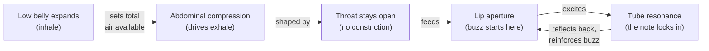
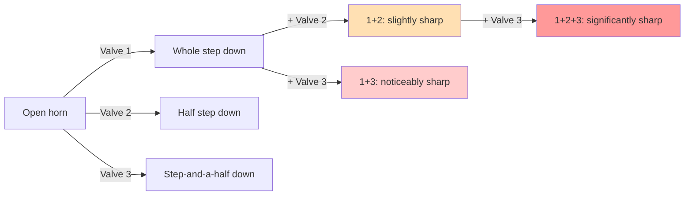

# Lesson 1: Mastering Basic Brass Techniques

## 1. The Physical Engine: Buzz, Air, and Resonance (Read Once, Apply Daily)

Your lips are the sound source. No reed, no string, no key mechanism intervenes between your body and the note. Lung pressure forces your lips open; airflow drops the pressure between them (Bernoulli effect); lip elasticity snaps them shut; the cycle repeats hundreds of times per second. This is the same flow-driven oscillation that runs your vocal folds and a clarinet reed, except you control tension, aperture, and air speed directly and simultaneously — that's what gives brass players such precise command over pitch and color.

The lip buzz alone produces a weak, indefinite pitch. The instrument's tubing acts as a resonant amplifier: when your buzz frequency lands near one of the tube's natural resonances, reflected pressure waves from the bell reinforce your lip vibration and "lock in" a stable note. The same fingering/slide position supports several different lip-buzz frequencies because the tube resonates at a whole family of related frequencies (the harmonic/overtone series) — you choose which one speaks by how fast you buzz.

**Two numbers worth knowing, then forgetting the math and feeling them instead:**
- Your lip frequency has to land within roughly 2% of a tube resonance (looser for beginners, tighter — under 0.5% — for pros) or the note won't speak cleanly; this is why notes "crack" when you're almost right but not quite.
- Minimum air pressure to keep the lips oscillating at all is low, comparable to gently blowing out a candle from a few inches away. Below that threshold, nothing buzzes no matter how you hold your face.

Real tubes aren't perfect harmonic resonators. Mouthpiece cup shape, bore taper (cylindrical vs. conical), and bell flare all bend the upper partials slightly flat compared to the ideal series. You correct this in real time by "lipping" — nudging embouchure tension to pull a note into tune. That correction ability is a trained skill, not a flaw to eliminate.

### The Breath Engine

The diaphragm is an **inhale** muscle only — it contracts to pull air in and cannot push air out. All of your controlled exhale pressure (fortissimo playing can require mouth pressure equivalent to blowing up a stiff balloon) comes from:

1. **Abdominal muscles** (lower belly, obliques) compressing the abdominal cavity, pushing the diaphragm back up.
2. **Internal intercostals** pulling the ribcage down and in.
3. **Elastic recoil** of the lungs themselves, strongest when the lungs are fairly full and weakest near the bottom of a breath — which is exactly why phrases get harder to control as you run low on air. You must consciously increase abdominal effort as a breath empties just to hold a steady dynamic.

Advanced players keep a trace of inhale-muscle tension active *during* exhale (antagonistic co-contraction) — it acts like a shock absorber, letting the abdominal muscles push against something stable instead of an unresisted, collapsing bellows. Practically: you feel like your ribs stay "open" and wide even as you blow out.

**Practical takeaway:** tone production is 80% air engine, 20% lip fine-tuning. If you're straining your face to get a sound, the problem is almost always insufficient air support, not insufficient lip effort.

---

## 2. Embouchure: Setup, Placement, and the Muscles That Matter

You don't need to memorize facial anatomy to play well, but three muscle groups explain every embouchure correction you'll ever make:

- **Orbicularis oris** — the ring of muscle around your lips. This is your central compressor; it closes the aperture and adds tension for higher pitches.
- **Buccinator** (cheek muscle, pulls corners in sideways) — firms the corners without spreading the lips into a smile. Think "drawstring pouch," not "grin."
- **Mentalis** (chin muscle) — anchors and flattens the chin, supporting the lower lip. A bunched, "orange peel" chin means this muscle is overactive and choking the lower lip's vibration.

**Setup procedure, step by step:**

1. **Resting position.** Teeth slightly apart (a pencil-width gap), lips gently touching, tongue resting with its tip behind the lower front teeth. No tension yet.
2. **Form the aperture.** Engage the orbicularis oris to create a small central opening — roughly a pencil-lead's width for trumpet/horn, slightly larger for trombone/euphonium, a pea-sized opening for tuba. Corners pull in and slightly forward ("pucker"), never back ("smile"). Flatten the chin down and forward.
3. **Place the mouthpiece.**
   - Trumpet/horn: roughly 2/3 on the upper lip, 1/3 on the lower.
   - Trombone/euphonium/tuba: closer to 50/50, sometimes slightly more lower lip.
   - Center it horizontally on your face. Off-center placement is the #1 hidden cause of uneven tone and fatigue — check in a mirror.
   - Pressure should be just enough to seal, not to compress. The rim rests on the lips; it doesn't dig in. **No visible red ring after a few minutes of playing** is your target.
4. **Buzz-test without the instrument.** Hum a comfortable pitch (trumpet: middle line G; trombone/euphonium: middle C; tuba: an octave below that) through your lips alone. Hold 5 seconds, then slide the pitch up and down by relaxing/firming the aperture. If no buzz happens, you're too tight — relax the corners and add air before adding tension.

**Setup error checklist:**

| Symptom | Cause | Fix |
|---|---|---|
| Red ring on lips after playing | Too much mouthpiece pressure | Rely on air support, not arm force; the horn should feel light against the face |
| Thin, unstable tone, corners pulled back | "Smiling" embouchure | Pull corners inward, think pucker |
| Lower lip won't vibrate, muffled low notes | Bunched/overactive chin | Consciously flatten chin, point it down |
| Resonance feels choked, jaw tired | Clenched teeth | Keep a visible gap between upper and lower teeth |

---

## 3. Valves and Slides: How Pitch Actually Changes

### Piston and rotary valves (trumpet, horn, tuba, euphonium)

Each valve routes air through extra tubing, lengthening the air column and lowering pitch by a fixed interval when used alone:

- **Valve 1** → down a whole step (2 semitones)
- **Valve 2** → down a half step (1 semitone)
- **Valve 3** → down a step and a half (3 semitones)

Rotary valves (French horn, some tubas) do the same job through a spinning rotor instead of a sliding piston — faster mechanical action, but they need precise linkage adjustment to stay snappy. If a rotary valve feels "mushy," the string/cork linkage likely needs a technician's adjustment, not more oil.

### Trombone slide

Seven positions, roughly evenly spaced, each one lowering pitch by a half step from fully closed (1st position, slide all the way in) to fully extended (7th position, slide almost off the instrument — tenor trombone slide travel is a bit under a meter one-way). There's no valve combination math on trombone; your entire intonation challenge is **slide placement accuracy**, which is a pure muscle-memory and ear-training problem (Drill 13 below).

### Why valve combinations go sharp — and what to actually do about it

Each valve's added tubing length is built as a fraction of the *open* horn's length. When you stack valves, the second valve's length boost should technically be a fraction of the *already-lengthened* horn, but the tubing is fixed, so you get slightly less added length than physics calls for. The combination ends up a bit short — which means **sharp**:

- 1+2 is slightly sharp (a few cents)
- 1+3 is more noticeably sharp
- 1+2+3 is the worst offender — sharp enough to hear clearly, especially on low C♯ (trumpet) or equivalent notes on other valved brass

**What you actually do about it, by instrument:**

- **Trumpet (B♭):** Low C♯ and low C (both using 1+2+3) are the classic trouble notes. Pull the third-valve slide out while holding the note — most trumpets have a ring or saddle on the 3rd slide specifically for this. Low D (1+3) needs a smaller pull on the same slide.
- **French horn (F/B♭ double):** Use the B♭ side above the staff — it's shorter, more in tune, and less resistant. Learn the "off" fingerings: many notes have both an F-horn and B♭-horn fingering, and switching between them is how professionals dodge bad intonation spots rather than lipping every note into place.
- **Trombone:** No valve math, but the overtone series itself compresses slightly in the upper register, so high partials in a given position tend to run sharp. Flatten the aperture slightly (relax, don't tighten) on high notes in 1st through 3rd position.
- **Tuba:** Four (or five) valves give you several alternate fingerings for the same note — use them. The worst combinations (1+2+3, 2+4) need active slide-pulling; this is routine, not a sign anything is broken.

**Daily fix that solves 90% of combination-valve intonation problems:** pull your main tuning slide to center the open horn first, then check 1+2, 1+3, and 1+2+3 against a drone and physically mark (pencil dot, rubber band) where your 1st and 3rd valve slides need to sit for those combinations. Muscle memory takes over within a few weeks.

---

## 4. Tone Color: Why a Horn Sounds Different from a Trumpet

Cylindrical-bore instruments (trumpet, trombone) favor the odd-numbered overtones strongly — that's the acoustic root of their bright, cutting edge. Conical-bore instruments (French horn, euphonium, tuba) support both odd and even partials more evenly, giving the smoother, rounder sound. The bell's flare rate matters too: a fast flare (trumpet) radiates high overtones efficiently, emphasizing brightness; a gradual flare (French horn) holds those overtones back, which is why a horn in a relatively high key (F) still sounds darker than a B♭ trumpet.

Material and plating differences (silver vs. lacquer, bell thickness) are real but small — well under what a change in your air support or embouchure firmness does to the sound. Don't chase gear before chasing fundamentals: a good player on a student-line horn will out-sound a weak player on a $10,000 custom instrument every time.

---

## 5. Practice Protocols

Every drill below lists a concrete starting tempo/dynamic and a progression target. Use a metronome and a tuner app (TonalEnergy, Tonal Pitch, or similar) for every session — ears alone lie to you when you're tired.

### Phase 1 — Foundation (Weeks 1–4, 30 min/day)

**Drill 1 — Mouthpiece Buzzing**
- No instrument. Buzz a comfortable middle-register pitch (trumpet: G4; trombone: C3) for 10 seconds, rest 30 seconds.
- 3 sets of 10 reps.
- Target: a steady, unwavering pitch — no "siren" drift up or down.

**Drill 2 — Long Tones, Pedal to Middle**
- Trumpet: low F♯3 up to C5. Trombone: pedal B♭ up to F3. Tuba: pedal E♭ up to B♭2.
- Hold each note 8 beats at ♩ = 60, mezzo-forte, moving up chromatically.
- 2 sets daily. Watch the tuner needle — it should sit still, not wobble.

**Drill 3 — Breath Control Isometric**
- One comfortable pitch (trumpet C5 / trombone B♭2 / tuba F2).
- Crescendo pppp→ffff over 16 counts, decrescendo back over 16 counts, zero pitch drift.
- 5 reps, 1 minute rest between. This is the single best drill for exposing a weak air engine — if pitch rises during crescendo, you're tightening the lips instead of pushing more air.

### Phase 2 — Consolidation (Weeks 5–12, 45 min/day)

**Drill 4 — Range Extension**
- Find your current comfortable range. Add one semitone at the top and bottom per week only.
- Daily: ascend chromatically through full range, 4 beats per note at ♩ = 80, then descend.
- Hard rule: if the embouchure collapses (tone turns to air, pitch won't form), stop that direction for the day. Forcing it builds bad habits, not range.

**Drill 5 — Lip Slurs (Flexibility)**
- Same fingering/slide throughout — only the lips and air move the pitch between overtones.
- Trumpet (open/no valves): C4–E4–G4–C5–G4–E4–C4
- Trombone (1st position): B♭2–F3–B♭3–F3–B♭2
- Tuba (open): B♭1–F2–B♭2–D3–F2–B♭1
- Start ♩ = 60, build to ♩ = 120 over the eight weeks. 10 minutes daily, non-negotiable — this is the drill that builds real flexibility, not raw range.

**Drill 6 — Articulation Integration**
- "Tu" syllable, tongue tip to the ridge just behind the upper front teeth.
- Repeated quarter notes at ♩ = 80 on one comfortable pitch, then eighth notes at ♩ = 100.
- Feel check: the tongue releases the air stream like opening a valve — it does not stop lip vibration or "spit" the note.

### Phase 3 — Refinement (Months 4–12, 60 min/day)

**Drill 7 — Endurance Building**
- Play simple scales/melodies in the comfortable middle register, no stopping, for 5–10 minutes straight.
- If tone quality collapses before 5 minutes, that's your current ceiling — rebuild by adding 30 seconds per week, not by pushing through.

**Drill 8 — Full Dynamic Range**
- One pitch (trumpet C5 / trombone B♭2 / tuba F2), 8 counts per dynamic step: pppp→ppp→pp→p→mp→mf→f→ff→fff→ffff, then reverse.
- No pitch drift, no embouchure repositioning — dynamics come entirely from air speed and volume.

**Drill 9 — Interval Precision**
- Major/minor scales in thirds, sixths, octaves.
- Trumpet: C major in octaves, C4–C5, D4–D5, etc. Trombone: B♭ major in sixths.
- Clean attacks only — no scooping up to pitch. Start ♩ = 80, build to ♩ = 132.

### Breath Training (parallel track, every phase)

**Drill 10 — Capacity Expansion**
- Inhale 4 counts (♩ = 60, low belly expansion — hand on abdomen to check, not shoulders rising), hold 4, exhale 8.
- Progress exhale length weekly: 8 → 12 → 16 → 20 counts, same inhale/hold.
- 5 minutes daily.

**Drill 11 — Phrase Breath-Mapping**
- Take a real passage from your repertoire. Mark breath points in pencil.
- Practice the breathing pattern alone, away from the instrument, speaking or humming the rhythm, to confirm each mark allows a genuinely full breath before the next phrase — not a panicked half-breath.

**Drill 12 — Resistance Breathing**
- Inhale through a coffee straw (or a breathing-trainer device), exhale normally through the mouth.
- 3 sets of 10 reps daily. Builds inhale-muscle strength, which indirectly improves exhale control via the co-contraction mechanism from Section 1.

### Intonation Training

**Drill 13 — Drone Tuning**
- Set a drone (TonalEnergy app or similar) on your instrument's home key (trumpet/trombone: B♭).
- Play long tones against it through the scale, adjusting embouchure tension until the "beating" (wavering) disappears.
- 10 minutes daily. This trains your ear far faster than staring at a tuner needle alone — you're learning to *hear* in tune, not just *see* it.

**Drill 14 — Harmonic Series Mapping**
- One fingering/slide position only. Play every overtone you can access, bottom to top.
- Trumpet (open): C3 (pedal) up through C6. Trombone (1st position): B♭1 up through B♭5. Horn (F side, open): F2 up through F6.
- Note against a tuner which partials run sharp or flat by nature (usually the 7th and 11th partials are noticeably off) — then practice lipping each one to center. This builds the "automatic correction" reflex you'll use in real repertoire.

**Drill 15 — Beatless Chord Tuning**
- Record yourself holding a root (e.g., trumpet B♭4).
- Play the third against the recording and adjust until the pulsing "beat" in the combined sound disappears — this is pure (just) intonation, which sits slightly different from equal temperament (major thirds sit a bit flatter, fifths a touch wider).
- Do this for root-third and root-fifth pairings across your common keys.

### Articulation Training

**Drill 16 — Single Tonguing**
- "Tu," minimal tongue travel (a few millimeters), quick release.
- Quarter notes ♩ = 60 → 80 → 100 → 120 → 132 on one comfortable pitch, then repeat the tempo ladder with eighth notes.
- Realistic ceiling for single tonguing is around 8–10 notes/second — beyond that, move to double tonguing rather than forcing speed.

**Drill 17 — Double Tonguing**
- Syllables "tu-ku," alternating front-of-tongue and back-of-tongue contact.
- Start eighth notes at ♩ = 80, one pitch, focus entirely on making "ku" as strong and clear as "tu" (it's almost always the weak link — isolate it by practicing "ku-ku-ku-ku" alone before combining).
- Build to ♩ = 120, then 132.

**Drill 18 — Triple Tonguing**
- "Tu-tu-ku" (or "tu-ku-tu" — pick one pattern and stay consistent) for triplet subdivisions.
- Start triplet eighths at ♩ = 60, build to ♩ = 100.

**Drill 19 — Mixed Articulation**
- Slur 2, tongue 2 through a scale; then try all-slurred vs. all-tongued versions of the same scale back to back.
- This decouples tongue timing from embouchure stability — a common weak point when players switch articulation mid-phrase in real music.

---

## 6. Troubleshooting Field Guide

| Symptom | Most Likely Cause | Fix |
|---|---|---|
| Chops give out mid-session, red ring, numbness | Too much mouthpiece pressure, or blowing harder than the embouchure can resist | Reduce arm/pressure force, increase air support instead, stop and ice 10 min if numb, rest 24–48 hrs |
| Low notes crack upward unexpectedly | Embouchure too tight for the note | Relax lips slightly, widen aperture a touch, slow the air |
| High notes crack downward / won't speak | Embouchure too loose | Firm the corners (not a smile), narrow aperture, speed up the air |
| Pitch wavers even on a held note | Inconsistent air support | More abdominal compression, check for shoulder-breathing instead of belly-breathing |
| Articulation sounds heavy or slow | Tongue motion too large, tongue tense | Whisper-tongue drill: articulate silently with no instrument, feel the minimal motion, then reapply with sound |
| Tone is thin, airy, doesn't project | Air speed too slow, or oral cavity too closed | Push more air, drop the jaw slightly (think "yawn" space inside the mouth), relax the throat |
| Everything plays sharp | Main tuning slide too far in, or cold instrument | Pull main slide 2–5 mm, warm up instrument 5–10 min before tuning |
| Everything plays flat | Main tuning slide too far out | Push main slide 2–5 mm in, recheck once warm |
| Can't access high register | Low lip tension, aperture too open, slow air | Firm corners, narrow aperture, more air speed; drill lip slurs upward |
| Can't access low register | Excess lip tension, aperture too tight, air too fast | Relax lips, drop jaw, slow warm air; drill pedal tones |
| Valve sluggish or sticks | Dry valve, dirt, bent casing | Oil valve (2–3 drops, work it in by pumping), monthly full clean with warm soapy water; persistent sticking needs a tech |
| Slide binds or feels gritty | Old grease, dirt | Remove, clean old grease off completely, reapply thin layer, check for dents if binding continues |

---

## 7. Daily Practice Template (60 min, intermediate level)

| Segment | Time | Content |
|---|---|---|
| Warm-up | 15 min | Mouthpiece buzzing (3 min) → long tones pedal-to-middle (5 min) → lip slurs (5 min) → single tonguing patterns (2 min) |
| Technical | 20 min | Scales/arpeggios through the keys (10 min) → interval studies, thirds/sixths/octaves (5 min) → range extension (5 min) |
| Repertoire | 20 min | Current pieces: half-tempo with metronome (10 min) → full tempo, musical focus (10 min) |
| Cool-down | 5 min | Soft long tones in the comfortable middle register — lets the embouchure recover gradually instead of stopping cold |

Recovery matters as much as the practicing itself: embouchure muscles need roughly 48–72 hours to fully recover from a heavy session. Two shorter sessions a day (morning/evening) with real rest between beats one marathon session of the same total length, and avoid continuous playing past 90 minutes without a break — that's where fatigue starts costing you more than it's building.

---

## 8. Repertoire and Style Notes

**Classical/orchestral** — prioritize tone purity and blend over individual flash. Vibrato is sparing, mostly reserved for exposed solo passages. Reference excerpts: Mahler Symphony No. 5 (trumpet opening), Ravel's Boléro (trombone solo), Strauss's Till Eulenspiegel (horn), Wagner's Ring (tuba).

**Jazz** — tone color variation is part of the vocabulary: cup mute for warmth, Harmon mute for a nasal, "talking" quality, plunger for vowel-shaped wah effects. Vibrato is wider and more active than classical use. Study Miles Davis's phrasing on *So What* or J.J. Johnson's trombone lines on *Lament* for articulation variety — ghost notes, falls, scoops.

**Lead/commercial trumpet** — built around high-register endurance and power; many lead players use a shallower mouthpiece cup for efficiency up high, paired with crisp, aggressive articulation.

**British brass band tradition** — nearly the whole section (cornets instead of trumpets, plus horns, baritones, euphoniums, tubas) is conical-bore, giving a famously blended, warm sound; phrasing leans heavily legato.

**Vibrato technique when used:** jaw vibrato (small, controlled jaw oscillation) is generally preferred over hand/instrument-shake vibrato because it doesn't disturb pitch centering. Practice it isolated on long tones before adding it to repertoire — start at a slow, even pulse and resist speeding it up reflexively under performance nerves.

---

## 9. The Long Arc

**Months 0–6:** stable embouchure, two-octave range with consistent tone, comfortable long tones without wavering.
**Months 6–24:** three-plus octave range, 30-minute continuous endurance, secure intonation across valve combinations/slide positions, first scales from memory, double tonguing solid at ♩ = 120.
**Years 2–5:** triple tonguing, full dynamic control, stylistic fluency (classical phrasing vs. jazz inflection), standard orchestral/band excerpts under the fingers.
**Years 5+:** technical facility that no longer requires conscious attention, freeing all your focus for musical shaping — phrasing, color, interpretation.

Every single note you play is a live negotiation between air pressure, lip tension, tongue placement, and valve or slide position. That negotiation becomes automatic through repetition — thousands of hours of exactly the drills above — and once it's automatic, what's left is the music itself.
