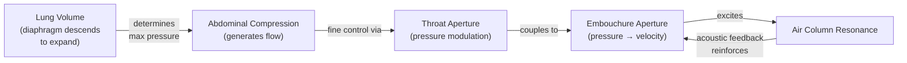
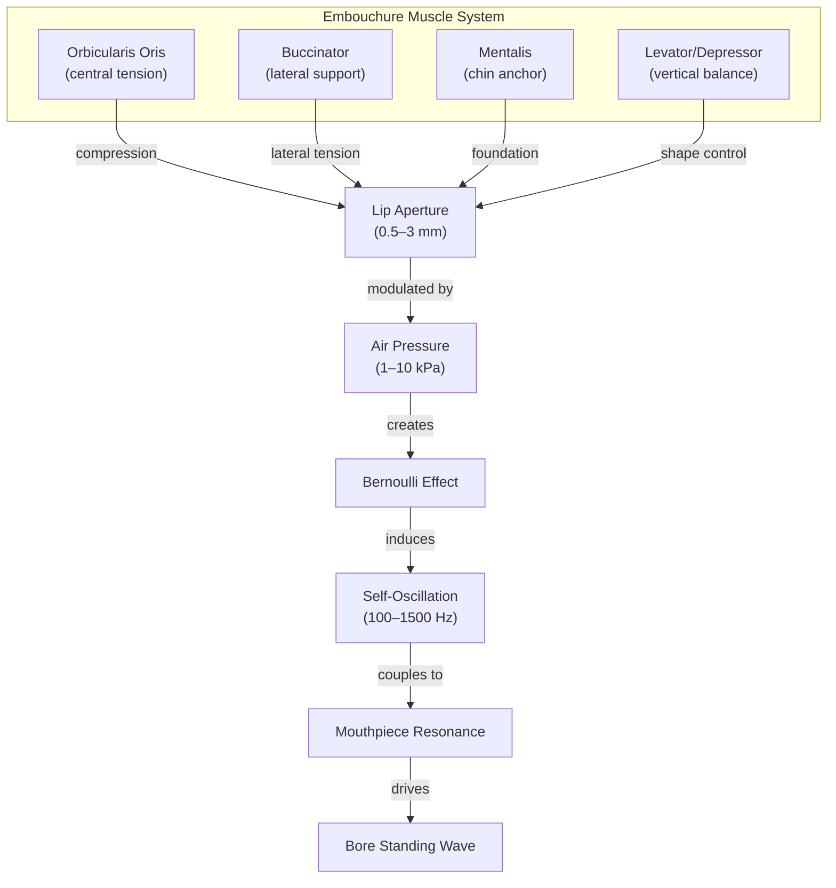
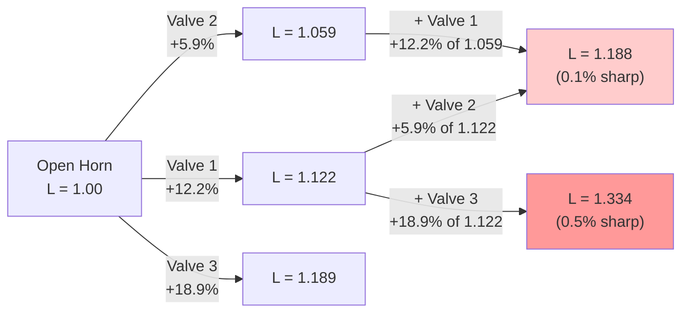

# Lesson 1: Mastering Basic Brass Techniques

## 1. First-Principles Intuition & Invariants

The brass family—trumpet, trombone, French horn, tuba, euphonium—represents the most direct human-instrument interface in acoustics. Your lips are the sound source. No reed, no string, no key mechanism intervenes. This creates an intimate coupling between your physiology and the instrument's acoustic response. Mastering brass means mastering this coupling.

### The Embouchure as a Self-Oscillating System

Your embouchure functions as a pressure-controlled valve. Lung pressure pushes your lips apart. Air rushes through. Pressure drops. The Bernoulli effect (faster air = lower pressure) and lip elasticity snap them shut. The cycle repeats. This is **flow-controlled oscillation**—the same mechanism driving vocal folds and clarinet reeds.

The difference: you control lip tension, aperture size, and air velocity continuously and independently. This gives brass players extraordinary control over pitch, timbre, and articulation.

Your lip vibration must match one of the instrument's resonant frequencies (determined by tube length). When matched, reflected pressure waves from the bell reinforce your lip vibration, creating a stable standing wave. This coupling is why the same fingering produces multiple pitches (the overtone series)—your embouchure locks onto different resonant modes.

**Invariant 1: Resonance Matching**  
Your lip frequency must match the air column resonance within ±2% (amateur) to ±0.5% (professional). Outside this window, the note cracks or doesn't speak.

**Invariant 2: Pressure Threshold**  
Minimum embouchure pressure: 1–2 kPa to sustain oscillation. Below this, lip vibration stops regardless of tension.

### The Harmonic Series in Practice

Brass instruments approximate a pipe closed at one end (mouthpiece) and open at the other (bell). The resonant frequencies follow the harmonic series, but real instruments deviate due to:

1. **Mouthpiece and bell effects**: The mouthpiece cup and throat lower impedance peaks. The bell flare matches the bore's high impedance to free air's low impedance, but shifts upper partial frequencies.

2. **Bore geometry**: Cylindrical bores (trumpet, trombone) emphasize odd harmonics and produce bright, cutting tones. Conical bores (French horn, euphonium, tuba) emphasize even harmonics and produce mellow, rounded tones.

3. **Wall compliance**: The tubing vibrates sympathetically, absorbing energy and shaping timbre.

Result: the overtone series is slightly compressed compared to the ideal harmonic series, especially in the upper register. You compensate through "lipping" or "bending"—adjusting embouchure tension to center the pitch.

### Breathing Mechanics: The Power System

Brass playing requires sustained, controlled air pressure far exceeding normal breathing. Fortissimo passages may require 8–10 kPa (60–75 mmHg) oral pressure.

**The Diaphragm Reality**: The diaphragm is the primary inhalation muscle. It contracts downward to expand lung volume. **The diaphragm cannot force air out**—it is not an expiratory muscle. Exhalation and pressure control depend on:

1. **Abdominal muscles** (rectus abdominis, obliques, transversus abdominis): Compress the abdominal cavity, pushing the diaphragm upward and forcing air from the lungs.

2. **Internal intercostals**: Depress the ribcage, decreasing thoracic volume.

3. **Elastic recoil**: The lungs' natural tendency to collapse provides passive expiratory force, especially at high lung volumes.

Professional technique uses **antagonistic co-contraction**: maintaining partial diaphragmatic tension during exhalation to resist upward displacement. This creates a stable "air column" against which your abdominal muscles push, providing fine-grained pressure control—a hydraulic damper for your breath.

**Invariant 3: Pressure-Volume Relationship**  
Available pressure from respiratory muscles decreases linearly as lung volume decreases. You must increase muscular effort throughout a phrase to maintain constant embouchure pressure.

## 2. Core Architecture & Mechanics

### Embouchure Formation: Biomechanical Setup

The embouchure involves over 40 facial muscles. Primary contributors:

1. **Orbicularis oris**: Circumferential sphincter surrounding your lips. Provides central compression and aperture control.

2. **Buccinator**: Pulls mouth corners laterally, tightening the embouchure and thinning the vibrating surface.

3. **Mentalis**: Raises and protrudes the lower lip, affecting aperture shape and chin anchor.

4. **Levator anguli oris, zygomaticus minor/major**: Control upper lip position. Excessive activation (smiling) spreads the embouchure and weakens it.

5. **Depressor anguli oris**: Pulls mouth corners downward, counteracting smile muscles.

Balance is critical: sufficient compression for high-frequency vibration, but not so much that blood flow is restricted or lip flexibility is lost. Photoplethysmography studies show excessive embouchure pressure reduces lip blood flow by 70–80%, causing fatigue.

**Mouthpiece Placement and Pressure**  
Standard placement (2/3 upper lip, 1/3 lower lip for trumpet; reversed for low brass) reflects asymmetric muscle mass and vibration characteristics. The upper lip, thinner and more mobile, vibrates more readily at higher frequencies. The lower lip provides stability and mass for lower register.

Pressure-sensitive film studies reveal professionals use 2–4 N mouthpiece pressure versus 6–10 N for amateurs, while producing greater dynamic range. Efficiency comes from muscular control and breath support, not force.

### Embouchure Setup Procedure

**1. Natural Resting Position**
- Close your mouth naturally, teeth slightly apart (1–2 mm).
- Lips touching but not compressed.
- Tongue resting on the floor of your mouth, tip behind lower teeth.

**2. Form the Aperture**
- Bring lips together with light pressure.
- Engage orbicularis oris to create a small opening in the center (1–2 mm diameter for trumpet/horn, 2–3 mm for trombone/euphonium, 3–4 mm for tuba).
- Corners firm but not pulled back—think "pucker" not "smile."
- Chin flat, not bunched. Mentalis engaged to anchor lower lip.

**3. Mouthpiece Placement**
- Center the mouthpiece horizontally on your lips.
- Trumpet/horn: 2/3 upper lip, 1/3 lower lip.
- Trombone/euphonium/tuba: 1/2 upper, 1/2 lower (or slightly more lower lip).
- Use minimal pressure—the mouthpiece should rest on your lips, not press into them.

**4. Test Vibration Without Mouthpiece**
- Buzz your lips alone (no instrument).
- Start with a comfortable middle register pitch (G4 for trumpet, C3 for trombone).
- If you cannot buzz, reduce lip tension or increase air pressure.
- Sustain for 5 seconds, then vary pitch up and down.

**Common Setup Errors**:
- **Excessive mouthpiece pressure**: Creates red ring, restricts blood flow, causes fatigue. Reduce pressure, rely on breath support.
- **Smile embouchure**: Corners pulled back, thin tone, unstable pitch. Engage corners inward, pucker slightly.
- **Bunched chin**: Mentalis overactive, restricts lower lip vibration. Flatten chin, think "point down."
- **Teeth clenched**: Jaw tension restricts resonance. Keep teeth apart, jaw relaxed.

### Valve and Slide Mechanics: Acoustic Length Control

Brass instruments change pitch by altering effective tube length.

**Piston Valves** (trumpet, French horn, tuba):
- **Valve 1**: Lowers pitch 2 semitones (~12.2% length increase)
- **Valve 2**: Lowers pitch 1 semitone (~5.9% length increase)
- **Valve 3**: Lowers pitch 3 semitones (~18.9% length increase)

**Rotary Valves** (French horn, some tubas):
- Same pitch relationships as piston valves.
- Faster action, less airflow disruption.
- Mechanically complex, requires precise string/lever adjustment.

**Slide Mechanism** (trombone):
- Continuously variable length via telescoping slides.
- 7 standard positions from closed (1st) to fully extended (7th).
- Each position lowers pitch by approximately one semitone.
- ~2.5 meters total slide travel (tenor trombone).

### The Intonation Problem: Valve Combination Mathematics

Valve combinations are inherently out of tune. When you press valves 1+2 together, the added length is calculated from the original bore length, not the length after valve 2. This makes combinations sharp.

Example:
- Valve 1: 12.2% length increase
- Valve 2: 5.9% length increase
- Combined: 1.122 × 1.059 = 1.188 (18.8% increase)
- Valve 3 alone: 18.9% increase

Valve 1+2 is 0.1% too short, making it sharp. The error compounds:
- 1+3: ~0.5% sharp
- 1+2+3: ~1% sharp (~17 cents, audibly out of tune)

**Compensation Strategies**:
1. **Alternate fingerings**: Use different valve combinations for the same pitch (e.g., 1+2 instead of 3, or vice versa depending on context).
2. **Lip bending**: Adjust embouchure tension to pull pitch down.
3. **Valve slide adjustment**: Main tuning slide and individual valve slides (especially 1st and 3rd) are adjusted during playing.
4. **Trigger mechanisms**: Third valve slide on trumpet, first valve slide on horn—extend mid-phrase for low register notes.

**Practical Fingering Adjustments by Instrument**:

**Trumpet (B♭)**:
- Low C♯ (1+2+3): Pull 3rd valve slide ~5 mm
- Low D (1+3): Pull 3rd valve slide ~3 mm
- Low C (1+2+3): Pull both 1st and 3rd valve slides

**French Horn (F/B♭ double)**:
- Use B♭ side for high register (better intonation, less resistance)
- Low C (1+2+3 on F horn): Extend 1st valve slide, lip down aggressively
- Alternate fingerings: Learn both F and B♭ fingerings for every note in the middle register

**Trombone**:
- No valve intonation issues (continuous slide).
- Intonation issues from overtone series compression in upper register (flatten embouchure for upper partials).

**Tuba**:
- Extensive alternate fingerings (4 valves provide many options).
- Low register notes (1+2+3, 2+4, 1+4): Significant slide adjustments required.

### Acoustic Impedance and Tone Color

Tone color (timbre) is determined by the relative strengths of overtones, which depend on the **acoustic impedance curve**—how much the air column resists oscillation at different frequencies.

**Cylindrical bore** (trumpet, trombone):
- Strong impedance peaks at odd harmonics (1st, 3rd, 5th, 7th).
- Weaker even harmonics.
- Result: brilliant, penetrating, cutting tone.

**Conical bore** (French horn, euphonium, tuba):
- Strong impedance peaks at both odd and even harmonics.
- Broader, smoother peaks.
- Result: mellow, rounded, warm tone.

The **bell flare profile** critically affects this. A rapid flare (trumpet) efficiently radiates high frequencies, emphasizing upper partials. A gradual flare (French horn) emphasizes lower partials. This is why the French horn, despite being pitched in F (relatively high), sounds darker than the B♭ trumpet.

**Material Effects**: Brass versus silver plating, different alloys, bell thickness—the debate is contentious. Controlled studies show measurable but small differences (typically <3 dB variation in specific harmonics). Your technique overwhelms material effects. A professional on a student instrument sounds far better than a beginner on a professional instrument.

## 3. Hands-On Drills & Practice Protocols

### Embouchure Development: Progressive Resistance Training

Building embouchure strength and endurance follows skeletal muscle training principles, with critical differences.

**Week 1–4: Foundation (30 min/day)**

**Drill 1: Mouthpiece Buzzing**
- Buzz mouthpiece alone, no instrument.
- Start: Middle register pitch (G4 trumpet, C3 trombone), 10 seconds sustained.
- Rest 30 seconds between repetitions.
- 10 reps, 3 sets.
- Goal: Stable, consistent pitch without wavering.

**Drill 2: Long Tones (Pedal to Middle Register)**
- Trumpet: Low F♯ to C5 (staff).
- Trombone: Pedal B♭ to F3 (staff).
- Tuba: Pedal E♭ to B♭2.
- Hold each pitch 8 counts at ♩ = 60 (8 seconds).
- Mezzo-forte dynamic, steady air stream.
- Chromatic progression upward.
- 2 sets daily.

**Drill 3: Breath Control Isometrics**
- Sustain a single comfortable pitch (trumpet C5, trombone B♭2, tuba F2).
- Start at pianissimo, crescendo to fortissimo over 16 counts, decrescendo back to pianissimo over 16 counts.
- No pitch deviation allowed.
- Goal: Embouchure stability under varying pressure.
- 5 reps, rest 1 minute between reps.

**Week 5–12: Consolidation (45 min/day)**

**Drill 4: Range Extension (Gradual Increments)**
- Establish your current comfortable range (e.g., trumpet G3–G5).
- Add one semitone above and below per week.
- Daily sequence: Start at bottom of range, long tones ascending chromatically to top, descending back to bottom.
- Hold each pitch 4 counts at ♩ = 80.
- Do NOT force high notes—if embouchure collapses, stop and rest.

**Drill 5: Flexibility (Lip Slurs)**
- Practice slurring between adjacent overtones without changing fingering/slide position.
- Trumpet: C–E–G–C–G–E–C (valves open).
- Trombone: B♭–F–B♭–F–B♭ (1st position).
- Tuba: B♭–F–B♭–D–F–B♭ (open).
- Start slow (♩ = 60), gradually increase to ♩ = 120.
- 10 minutes daily.

**Drill 6: Articulation Integration**
- Combine long tones with articulation patterns.
- Single note, repeated: ♩ ♩ ♩ ♩ at ♩ = 80.
- Tonguing: "tu" syllable, tongue tip to alveolar ridge.
- Focus: Tongue releases air stream, does NOT stop embouchure vibration.
- Progress to faster subdivisions: ♪ ♪ ♪ ♪ ♪ ♪ ♪ ♪ (eighth notes) at ♩ = 100.

**Month 4–12: Refinement (60 min/day)**

**Drill 7: Endurance Building**
- Sustained playing without rest for 5–10 minutes.
- Play simple, comfortable melodies or scales in the middle register.
- Goal: Maintain consistent tone quality without fatigue.
- If embouchure fails before 5 minutes, reduce intensity and rebuild gradually.

**Drill 8: Dynamic Control**
- Single pitch across full dynamic range (pppp to ffff).
- Trumpet C5, Trombone B♭2, Tuba F2.
- 8-count gradations: pppp (8 counts) → ppp (8) → pp (8) → p (8) → mp (8) → mf (8) → f (8) → ff (8) → fff (8) → ffff (8).
- Then reverse back to pppp.
- No pitch deviation, no embouchure adjustment—all dynamic change via air pressure and velocity.

**Drill 9: Interval Precision**
- Practice wide intervals to develop embouchure coordination.
- Major and minor scales in thirds, sixths, octaves.
- Trumpet: C major scale in octaves (C4–C5, D4–D5, etc.).
- Trombone: B♭ major scale in sixths.
- Clean attacks, no scooping or sliding into pitch.
- ♩ = 80, gradually increase to ♩ = 132.

### Breathing Optimization: Maximizing Efficiency

**Drill 10: Breath Capacity Expansion**
- Inhale for 4 counts (♩ = 60), hold for 4, exhale for 8 counts.
- Focus on low, abdominal expansion—not shoulder lift.
- Place hand on abdomen to monitor expansion.
- Progress: Inhale 4, hold 4, exhale 12. Then 16. Then 20.
- 5 minutes daily.

**Drill 11: Phrase Simulation**
- Practice breathing in context.
- Select a challenging passage from repertoire.
- Mark optimal breath points.
- Practice passage without instrument, only breathing at marked points.
- Goal: Confirm breath marks are practical and allow full inhalation.

**Drill 12: Resistance Breathing**
- Use a breathing trainer device (e.g., PowerBreathe, Breather) or improvise by inhaling through a straw.
- Inhale against resistance, exhale normally.
- 10 reps, 3 sets daily.
- Strengthens diaphragm and intercostal muscles.

### Intonation Mastery: Compensatory Strategies

**Drill 13: Drone Tuning**
- Use electronic tuner or drone app (e.g., Tonal Energy).
- Play long tones against drone, adjusting embouchure to center pitch.
- Trumpet: Drone on B♭, play all notes in B♭ major scale against it.
- Trombone: Drone on B♭, F, and E♭ (common tonal centers).
- Visual feedback from tuner, aural feedback from beats (when you're out of tune, you hear wavering).
- 10 minutes daily.

**Drill 14: Harmonic Series Exploration**
- Without changing fingering/slide position, play as many overtones as possible.
- Trumpet: Open (no valves), play C3–C6 (pedal C to high C).
- Trombone: 1st position, play B♭1–B♭5.
- French Horn: Open (F horn), play F2–F6.
- Note which partials are sharp or flat (compare to tuner).
- Practice lipping each partial into tune.

**Drill 15: Chord Tuning in Ensemble Context**
- Record yourself playing one voice of a chord (e.g., root, third, fifth).
- Play the other voices against the recording.
- Adjust intonation to create beatless intervals (pure major thirds are 14 cents flatter than equal temperament, perfect fifths are 2 cents wider).
- Trumpet example: Record B♭4 (root), play D5 (major third) 14 cents flat for pure tuning.

### Articulation and Tonguing: Precision Control

**Drill 16: Single Tonguing Development**
- Syllable: "tu" (tongue tip to alveolar ridge, just behind upper teeth).
- Start: Quarter notes at ♩ = 60.
- Single pitch (trumpet C5, trombone B♭2, tuba F2).
- Focus: Minimal tongue motion (2–3 mm), quick release.
- Progress: ♩ = 80 → 100 → 120 → 132.
- Then eighth notes at same tempo progression.
- Speed limit: Most players max out at 8–10 notes/second.

**Drill 17: Double Tonguing**
- Syllables: "tu-ku" (alternating alveolar and velar contact).
- Start: Eighth notes at ♩ = 80 (effectively 16 articulations/measure in 4/4).
- Single pitch, focus on evenness between "tu" and "ku."
- Common error: "ku" is weaker than "tu." Strengthen by practicing "ku-tu" patterns.
- Progress to ♩ = 120, then 132.
- Speed limit: 12–16 notes/second.

**Drill 18: Triple Tonguing**
- Syllables: "tu-tu-ku" or "tu-ku-tu" (choose one and be consistent).
- For triplet subdivisions.
- Start: Triplet eighths at ♩ = 60.
- Progress to ♩ = 100.

**Drill 19: Mixed Articulation Patterns**
- Combine slurred and tongued notes.
- Pattern: Slur 2, tongue 2 (legato-staccato contrast).
- Scale exercises with varied articulation (all slurred, all tongued, mixed).
- Develops independent control of tongue and embouchure.

### Environmental and Physiological Factors

**Temperature Compensation**:
- Cold instrument (15°C) plays ~17 cents flat compared to warmed (25°C).
- Always warm up instrument before tuning: blow warm air through, or let sit in warm room.
- During performance, monitor tuning as instrument warms.

**Altitude Effects**:
- Above 2500 m, reduced air density lowers resistance.
- High register easier, endurance reduced (less oxygen).
- Adjust tuning slide slightly sharper to compensate for reduced density.

**Humidity and Condensation**:
- Water accumulates in tubing during play.
- Affects valve action (increases friction) and bore profile.
- Empty water keys every 10–15 minutes during practice/performance.
- Valve oil: 2–3 drops per valve, once per week (or daily if heavily used).

**Fatigue and Recovery**:
- Embouchure muscles require 48–72 hours for full recovery after intense sessions.
- Optimal practice structure: Two 45-minute sessions per day, morning and evening, with 8+ hours rest between.
- Avoid marathon sessions (>90 minutes continuous playing)—diminishing returns and injury risk.

### Performance Anxiety Management

Stage fright induces sympathetic nervous system activation:
- Increased heart rate, respiratory rate.
- Fine motor control degradation.
- Dry mouth.

**Non-Pharmacological Approaches**:

**1. Systematic Desensitization**
- Graduated exposure to performance situations.
- Start: Play for one trusted friend.
- Progress: Small informal gatherings → studio class → recital.

**2. Breathing Techniques**
- Slow, diaphragmatic breathing activates parasympathetic response.
- Before performance: 4 counts inhale, 8 counts exhale, 5 reps.

**3. Cognitive Reframing**
- Interpret physiological arousal (increased heart rate) as excitement and energy, not threat.
- Self-talk: "I am ready" not "I am nervous."

**4. Over-Preparation**
- Practice performance pieces until automatic (minimal cognitive load).
- Run through entire program without stopping, simulating performance conditions.
- Goal: 90% of mental bandwidth available for musicality, not mechanics.

## 4. Troubleshooting & Common Failure Modes

### Embouchure Dysfunction

**Symptom: "Chops giving out" mid-session**
- Sudden loss of endurance, inability to center pitches, visible swelling.

**Root Causes**:
1. Excessive mouthpiece pressure restricting blood flow.
2. Breath pressure exceeding embouchure resistance capacity (you're "blowing through" the embouchure).
3. Misalignment creating uneven stress distribution.

**Corrections**:
- Reduce mouthpiece pressure. The instrument should rest on your lips, not press into them. If you see a red ring after playing, pressure is too high.
- Increase breath support. Your air should drive tone production, not embouchure muscular force.
- Check mouthpiece placement. Horizontal centering is critical—off-center placement creates asymmetric stress.
- Rest. If swelling or numbness occurs, stop immediately. Ice lips for 10 minutes, rest 24–48 hours.

### Unstable Pitch (Cracking, Wavering)

**Symptom: Notes crack, shift pitch unexpectedly, or won't lock in.**

**Root Causes**:
1. Embouchure tension not matched to pitch (too tight or too loose).
2. Air speed insufficient or inconsistent.
3. Instrument acoustics (valve alignment, slide position) not matching embouchure.

**Corrections**:
- For low notes cracking up: Embouchure too tight. Relax lips, increase aperture size, slow down air speed.
- For high notes cracking down: Embouchure too loose. Increase lip tension, decrease aperture size, increase air speed.
- For wavering pitch: Insufficient air support. Increase abdominal compression, maintain steady pressure.
- Check valve alignment (valves should depress fully and return quickly). Oil valves if sluggish.
- Check slide position (trombone): Ensure slide is exactly in position, not between positions.

### Sluggish Articulation

**Symptom: Articulation sounds heavy, imprecise, or slow.**

**Root Causes**:
1. Tongue moving too far (excessive motion).
2. Tongue too tense.
3. Airflow interrupted completely by tongue (should be subtle valve action).

**Corrections**:
- Minimal tongue motion: 2–3 mm. Tongue tip stays close to alveolar ridge, only breaks contact briefly.
- Relaxed tongue: Think "light tap" not "hammer blow."
- Whisper tonguing drill: Articulate while whispering air through embouchure (no sound). Develops minimal motion patterns.
- Isolate syllable: Practice "tu" alone without instrument, feeling minimal tongue motion.

### Poor Tone Quality (Thin, Airy, Unfocused)

**Symptom: Tone lacks resonance, sounds thin or airy, or doesn't project.**

**Root Causes**:
1. Insufficient air speed or volume.
2. Embouchure too loose or aperture too large.
3. Oral cavity too constricted (tongue position, throat tension).

**Corrections**:
- Increase air speed: Use more abdominal compression to drive air faster.
- Firm up embouchure: Engage orbicularis oris and buccinator for more compression.
- Open oral cavity: Drop jaw slightly, lower back of tongue (think "yawn" position), relax throat.
- Mouthpiece buzzing: Practice buzzing a focused, resonant pitch on mouthpiece alone. Transfer that buzz feel to full instrument.

### Intonation Consistently Sharp or Flat

**Symptom: All notes are sharp or flat relative to tuner.**

**Root Causes**:
1. Main tuning slide position incorrect.
2. Instrument temperature not stabilized.
3. Embouchure systematically too tight (sharp) or too loose (flat).

**Corrections**:
- Sharp overall: Pull main tuning slide out 2–5 mm, recheck.
- Flat overall: Push main tuning slide in 2–5 mm, recheck.
- Cold instrument: Warm up before tuning. Blow warm air through, or let sit in warm room for 5–10 minutes.
- Embouchure adjustment: If slide is correctly positioned and instrument is warm, adjust embouchure. Relax slightly for flat notes, firm up slightly for sharp notes.

### Range Limitations (Can't Play High or Low Notes)

**Symptom: Unable to access upper or lower register.**

**Root Causes (High Register)**:
1. Insufficient lip tension.
2. Aperture too large.
3. Air speed too slow.

**Root Causes (Low Register)**:
1. Excessive lip tension.
2. Aperture too small.
3. Air speed too fast.

**Corrections (High Register)**:
- Increase lip tension: Engage orbicularis oris more firmly.
- Decrease aperture size: Pucker slightly, bring corners inward.
- Increase air speed: More abdominal compression, faster air stream.
- Lip slur drills: Practice slurring from middle to upper register (e.g., trumpet C5–E5–G5–C6) to develop coordination.

**Corrections (Low Register)**:
- Decrease lip tension: Relax orbicularis oris.
- Increase aperture size: Drop jaw slightly, allow lips to relax.
- Decrease air speed: Slower, warmer air stream.
- Pedal tone exercises: Practice notes below the normal playing range (pedal tones) to develop low register flexibility.

### Valve or Slide Sticking

**Symptom: Valves don't return quickly, or slide motion is sluggish.**

**Root Causes**:
1. Insufficient lubrication.
2. Dirt or debris in valve casing or slide.
3. Valve alignment or slide dent.

**Corrections**:
- Oil valves: Remove each valve, apply 2–3 drops valve oil, reinsert, depress several times to distribute oil. Do this weekly or daily if heavily used.
- Clean valves: Monthly, remove valves, wash with warm soapy water, dry thoroughly, oil before reinserting.
- Slide grease: Remove slide, clean old grease, apply thin layer of slide grease, reinsert. Check alignment (slide should move smoothly with no binding).
- Professional repair: If sticking persists, valve alignment or slide dent requires professional repair.

## 5. Repertoire Integration & Musical Context

### Practice Routine Structure (60 min/day intermediate level)

**Warm-Up (15 min)**:
- Mouthpiece buzzing: 3 minutes.
- Long tones (pedal to middle register): 5 minutes.
- Lip slurs (flexibility): 5 minutes.
- Articulation patterns (single tonguing): 2 minutes.

**Technical Development (20 min)**:
- Scales and arpeggios (all major and minor keys): 10 minutes.
- Interval studies (thirds, sixths, octaves): 5 minutes.
- Range extension exercises: 5 minutes.

**Repertoire (20 min)**:
- Work on current performance pieces.
- Slow practice (half tempo) with metronome: 10 minutes.
- Full tempo with musicality focus: 10 minutes.

**Cool-Down (5 min)**:
- Long tones in middle register, pianissimo dynamic.
- Allows embouchure to recover gradually.

### Style-Specific Techniques

**Classical/Orchestral**:
- Emphasis on tone purity, blend, and intonation.
- Vibrato: Optional, used sparingly (mostly in solo literature).
- Articulation: Legato predominates, clean but not overly detached staccato.
- Key excerpts by instrument:
  - Trumpet: Mahler Symphony No. 5 opening, Brahms Academic Festival Overture, Stravinsky Rite of Spring.
  - Trombone: Bolero, Mahler Symphony No. 3 posthorn solo, Ravel Piano Concerto in G.
  - French Horn: Brahms Symphony No. 1, Strauss Till Eulenspiegel, Tchaikovsky Symphony No. 5.
  - Tuba: Berlioz Symphonie Fantastique, Wagner Ring Cycle, Mahler Symphony No. 1.

**Jazz**:
- Emphasis on tone color variation, expressivity, and rhythmic flexibility.
- Vibrato: More pronounced, varies in speed and width for expressive effect.
- Articulation: Wide range from legato to harsh, aggressive accents. Ghost notes, falls, doits, and scoops common.
- Mutes: Cup mute (warm, mellow), Harmon mute (nasal, vocalized), plunger (vowel-like articulations).
- Key repertoire:
  - Trumpet: Miles Davis So What, Clifford Brown Joy Spring, Dizzy Gillespie A Night in Tunisia.
  - Trombone: J.J. Johnson Lament, Curtis Fuller Five Spot After Dark.

**Commercial/Lead Playing** (trumpet-specific):
- High register emphasis, power, and endurance.
- Mouthpiece: Shallower cup for high register efficiency.
- Articulation: Crisp, aggressive attacks.
- Training: Focus on range extension exercises, high register endurance drills.

**Brass Band** (British tradition):
- Homogeneous timbral blend (all conical bore instruments except trombone).
- Emphasis on legato phrasing and rich, warm tone.
- Cornets (not trumpets) used for soprano voices.

### Musicality and Interpretation

Beyond technique, brass mastery requires musical decision-making:

**1. Phrase Shape**:
- Identify phrase climax (highest pitch, longest note, or harmonic tension point).
- Build dynamic intensity toward climax, release after.
- Use subtle tempo flexibility (rubato) in solo contexts, strict time in ensemble.

**2. Dynamic Contrast**:
- Use full dynamic range (pppp to ffff).
- Avoid "playing in the middle"—make deliberate dynamic choices.
- Crescendos and decrescendos should be gradual and controlled, not sudden.

**3. Vibrato** (when appropriate):
- Jaw vibrato (subtle jaw motion, 5–7 Hz oscillation) preferred over hand vibrato (which can affect pitch).
- Use vibrato to enhance sustained notes, not rapid passages.
- Classical: Minimal or none. Romantic solo literature: Moderate. Jazz: Wide and expressive.

**4. Historical Performance Practice**:
- Baroque (pre-1750): Natural trumpets (no valves), limited to overtone series. Modern performance often uses piccolo trumpet for agility.
- Classical (1750–1820): Clarino register playing (high, florid trumpet parts). Clean, precise articulation.
- Romantic (1820–1900): Valves introduced. Greater chromaticism, expressive vibrato, wider dynamic range.
- 20th Century: Extended techniques (flutter tonguing, multiphonics, extreme range), avant-garde notation.

## Summary: The Brass Player's Journey

Brass mastery integrates acoustic physics, biomechanics, motor learning, and musicality. The path:

**Foundation (Months 0–6)**:
- Stable embouchure formation, basic breath support, consistent tone production across two octaves.
- Key Milestones: Buzzing without instrument, long tones without wavering, basic scales and articulations.

**Consolidation (Months 6–24)**:
- Extended range (3+ octaves), endurance (30+ minutes continuous playing), secure intonation, basic repertoire.
- Key Milestones: All major/minor scales from memory, double tonguing at ♩ = 120, first solo recital.

**Refinement (Years 2–5)**:
- Advanced articulation (triple tonguing), flexible dynamic control, stylistic interpretation, ensemble awareness.
- Key Milestones: Orchestral/band excerpts learned, jazz improvisation fundamentals, consistent performance quality.

**Expertise (Years 5+)**:
- Effortless technical facility, refined tonal palette, compensatory strategies automatic, advanced repertoire.
- Key Milestones: Professional auditions, advanced solo literature, stylistic versatility across genres.

Every note requires real-time calibration: embouchure tension, air pressure, tongue position, valve/slide action. This sensorimotor feedback loop, refined through thousands of hours, is the essence of virtuosity. The physical mechanism is learnable. The musical imagination you bring to it is what makes you an artist.
