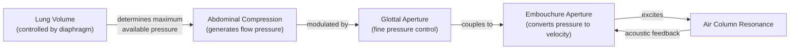
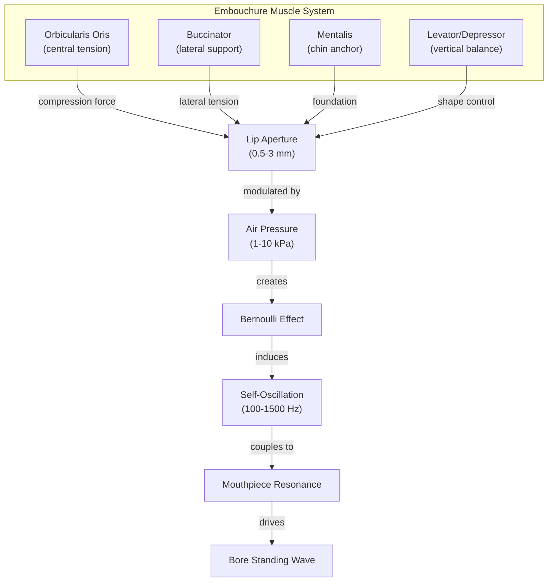
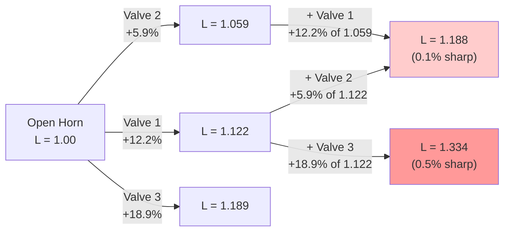
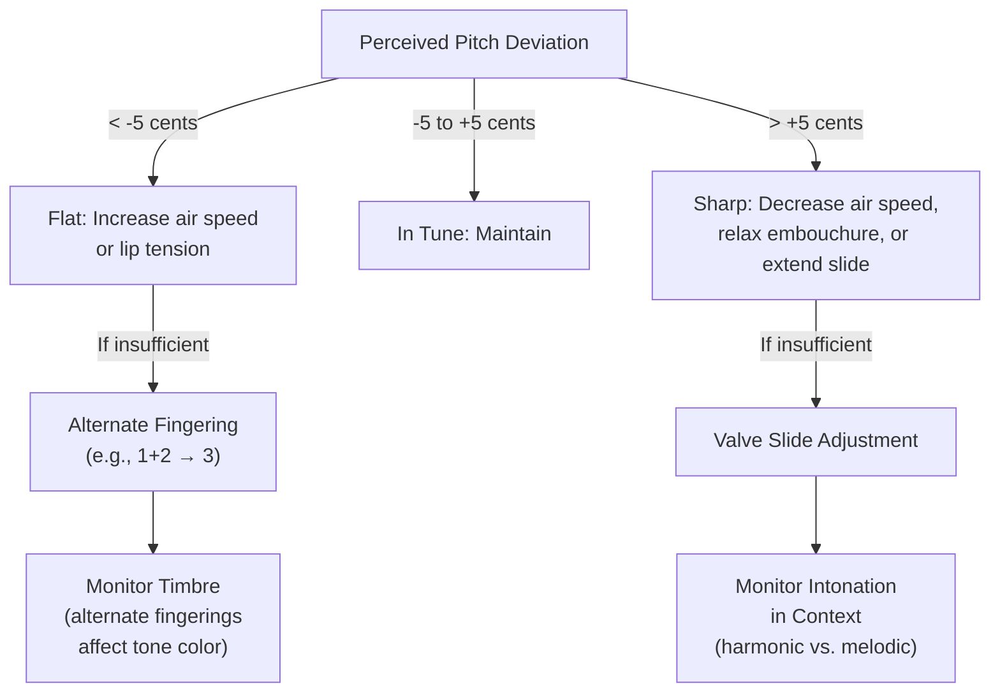

# Lesson 1: Mastering Basic Brass Techniques

## 1. First-Principles Intuition & Invariants

The brass family—trumpet, trombone, French horn, tuba, and their variants—represents one of the most direct human-instrument interfaces in acoustics. Unlike reed or string instruments, brass instruments require no intermediary vibrating element: the player's lips themselves become the sound generator. This fundamental architecture creates a uniquely intimate coupling between human physiology and acoustic physics.

### The Embouchure as a Self-Oscillating System

The embouchure functions as a pressure-controlled valve operating in an unstable flow regime. When air pressure from the lungs exceeds the muscular tension holding the lips together, the lips separate momentarily, releasing a pulse of air into the mouthpiece. This pressure drop causes the Bernoulli effect to draw the lips back together, assisted by their natural elasticity. The cycle repeats at a frequency determined by lip mass, tension, and the acoustic impedance presented by the instrument's bore.

This is a classic example of a **flow-controlled valve oscillator**, similar to the mechanism in human vocal folds or the reed in a woodwind instrument. The critical difference: brass players can continuously modulate lip tension, aperture size, and air velocity in real-time, providing extraordinary control over pitch, timbre, and articulation.

The frequency of lip vibration must match one of the instrument's natural resonances (determined by tube length and bore profile). When properly matched, the instrument's acoustic feedback reinforces the lip vibration through pressure waves reflected from the bell, creating a stable standing wave pattern. This coupling is why the same fingering can produce multiple pitches (the overtone series) depending on embouchure tension—the lips lock onto different resonant modes of the air column.

**Invariant 1: Resonance Matching**  
Stable tone production requires the lip vibration frequency to match a resonant mode of the air column within approximately ±2% (for amateur players) to ±0.5% (for professionals). Outside this window, the tone breaks or does not speak.

**Invariant 2: Pressure Threshold**  
Minimum dynamic pressure (approximately 1-2 kPa for most brass instruments) must be maintained across the embouchure aperture to sustain oscillation. Below this threshold, lip vibration ceases regardless of tension.

### The Harmonic Series and Acoustical Reality

Brass instruments approximate a cylindrical or conical pipe closed at one end (the mouthpiece) and open at the other (the bell). For an ideal cylindrical pipe, the resonant frequencies follow:

```
f_n = n × c / (2L)
```

Where:
- `f_n` is the nth resonant frequency
- `n` is the mode number (1, 2, 3, ...)
- `c` is the speed of sound (~343 m/s at 20°C)
- `L` is the effective acoustic length of the tube

However, real brass instruments deviate significantly from this ideal due to:

1. **Mouthpiece and bell effects**: The mouthpiece cup and constricted throat introduce inertial and compliant reactances that lower the effective impedance peaks. The flared bell acts as an impedance transformer, matching the high acoustic impedance of the bore to the low impedance of free air, but also affects the frequency of upper partials.

2. **Conical vs. cylindrical bores**: Instruments with predominantly cylindrical bores (trumpet, trombone) emphasize odd harmonics in their timbre and have sharper impedance peaks. Conical instruments (French horn, tuba) have broader impedance peaks and emphasize even harmonics, producing a mellower sound.

3. **Non-rigid walls**: The brass tubing vibrates sympathetically, absorbing energy from the air column and introducing frequency-dependent losses that shape the timbre.

The practical result: the overtone series of a brass instrument is slightly compressed compared to the ideal harmonic series, particularly in the upper register. Professional players compensate for this "inharmonicity" through embouchure adjustments called "lipping" or "bending."

### Breathing Mechanics: The Respiratory Power System

Brass playing requires sustained, controlled air pressure far exceeding normal respiratory demands. During fortissimo passages, players may generate oral pressures of 8-10 kPa (60-75 mmHg), requiring coordinated activation of multiple muscle groups.

**The Diaphragm Myth**: The diaphragm is the primary muscle of inhalation, contracting downward to expand lung volume. However, **the diaphragm cannot actively force air out**—it is not an expiratory muscle. Exhalation and pressure control during playing depend primarily on:

1. **Abdominal muscles** (rectus abdominis, external obliques, internal obliques, transversus abdominis): These compress the abdominal cavity, pushing the diaphragm upward and forcing air from the lungs.

2. **Internal intercostal muscles**: These depress the ribcage, decreasing thoracic volume.

3. **Elastic recoil**: The lungs' natural tendency to collapse provides passive expiratory force, particularly at high lung volumes.

Professional brass technique involves **antagonistic co-contraction**: maintaining partial diaphragmatic contraction during exhalation to resist upward displacement. This creates a stable "air column" against which the abdominal muscles push, providing fine-grained pressure control analogous to a hydraulic damper.



**Invariant 3: Pressure-Volume Relationship**  
The pressure available from respiratory muscles decreases linearly with decreasing lung volume (Relaxation Pressure Curve). Players must increase muscular effort proportionally throughout a phrase to maintain constant embouchure pressure.

## 2. Core Architecture & Mechanics

### Embouchure Formation: Biomechanical Analysis

The embouchure is a complex system involving over 40 facial muscles, but the primary contributors are:

1. **Orbicularis oris**: The circumferential sphincter muscle surrounding the lips. Provides central compression and aperture control.

2. **Buccinator**: Pulls the corners of the mouth laterally, tightening the embouchure and thinning the vibrating surface.

3. **Mentalis**: Raises and protrudes the lower lip, affecting aperture shape and chin position.

4. **Levator anguli oris, zygomaticus minor/major**: Control upper lip position and smile muscles; excessive activation creates unwanted embouchure spread.

5. **Depressor anguli oris**: Pulls mouth corners downward, counteracting smile muscles.

Optimal embouchure formation requires a balance: sufficient compression to create the necessary tension for high-frequency vibration, but not so much that blood flow is restricted or lip pliability is lost. Research using photoplethysmography has shown that excessive embouchure pressure can reduce lip blood flow by 70-80%, contributing to fatigue and endurance limitations.

**Mouthpiece Placement and Pressure Distribution**  
The standard recommendation (2/3 upper lip, 1/3 lower lip for trumpet; reversed for low brass) is not arbitrary—it reflects the asymmetric muscle mass and vibrating characteristics of the upper and lower lips. The upper lip, being thinner and more mobile, vibrates more readily at higher frequencies. The lower lip provides stability and mass for lower register playing.

Measured embouchure pressure using pressure-sensitive films reveals that professionals use significantly less mouthpiece pressure than amateurs (average 2-4 N vs. 6-10 N) while producing greater dynamic range. This efficiency comes from superior muscular control and breath support, not increased force.



### Valve and Slide Mechanics: Acoustic Length Manipulation

Brass instruments change pitch by altering the effective acoustic length of the bore. This is accomplished through:

1. **Piston valves** (trumpet, French horn, tuba): Cylindrical pistons redirect airflow through additional tubing loops. Most common configurations:
   - Valve 1: lowers pitch by 2 semitones (extends length by ~12.2%)
   - Valve 2: lowers pitch by 1 semitone (extends length by ~5.9%)
   - Valve 3: lowers pitch by 3 semitones (extends length by ~18.9%)

2. **Rotary valves** (French horn, some tubas): Rotating cylinders redirect airflow. Mechanically more complex but provide faster action and less airflow disruption.

3. **Slide mechanism** (trombone): Continuously variable tubing length via telescoping slides. Provides infinite pitch gradation within the slide's range (~2.5 meters travel on tenor trombone).

**The Intonation Problem**  
A fundamental mathematical issue: valve combinations are inherently out of tune. When valves 1 and 2 are used together, the added length is calculated from the original bore length, not the extended length after valve 2. This creates a pitch that is slightly sharp relative to the equal-tempered scale.

For example, valves 1+2 should produce a pitch 3 semitones below open (like valve 3 alone). However:
- Valve 1 adds 12.2% length
- Valve 2 adds 5.9% length
- Combined: 1.122 × 1.059 = 1.188 (18.8% length increase)
- Valve 3 alone: 18.9% length increase

The combination is **0.1% too short**, making the pitch sharp. This error compounds with more valve combinations: 1+3 is sharper still, and 1+2+3 is noticeably sharp.

Players compensate through:
- **Alternate fingerings**: Using different valve combinations for the same pitch (e.g., 1+2 vs. 3)
- **Lip bending**: Adjusting embouchure tension to pull pitch down
- **Valve slide tuning**: Main tuning slide and individual valve slides are adjusted
- **Trigger mechanisms**: Third and first valve slides on professional instruments can be extended mid-phrase



### Acoustic Impedance and Tone Color

The tone color of a brass instrument is determined by the relative strengths of its overtones, which in turn depend on the **acoustic impedance curve**—how much the air column resists oscillation at different frequencies.

For a **cylindrical bore instrument** (trumpet):
- Strong impedance peaks at odd harmonics (1st, 3rd, 5th...)
- Weaker peaks at even harmonics
- Result: brilliant, penetrating tone with strong high harmonics

For a **conical bore instrument** (French horn):
- Strong impedance peaks at both odd and even harmonics
- Broader, smoother peaks
- Result: mellow, rounded tone with less high-frequency energy

The **bell flare profile** critically affects this curve. A rapid flare (trumpet) acts as an efficient high-frequency radiator, emphasizing upper partials. A gradual flare (French horn) emphasizes lower partials. This is why the French horn, despite being pitched in F (relatively high), sounds darker than the trumpet.

**Material effects**: The debate over brass vs. silver plating, different alloys, and bell thickness is contentious. Controlled studies show measurable but small differences in timbre (typically <3 dB variation in specific harmonics). The player's technique overwhelms material effects—a professional on a student instrument sounds far better than a beginner on a professional instrument.

## 3. High-Performance Optimization & Failure Modes

### Embouchure Development: Progressive Resistance Training

Building embouchure strength and endurance follows principles similar to skeletal muscle training, but with critical differences:

1. **High-rep, low-intensity work**: Long tones at comfortable dynamics build muscular endurance without fatigue. Target: 20-30 minutes daily of sustained tones.

2. **Isometric holds**: Sustaining a single pitch at various dynamics trains pressure control and resistance to fatigue.

3. **Range extension**: Systematically working the upper and lower extremes recruits fast-twitch muscle fibers and improves coordination.

4. **Active recovery**: Embouchure muscles recover slower than large skeletal muscles (48-72 hours for full recovery after intense work). Overtraining leads to embouchure dysfunction.

**Critical Failure Mode: Overuse Injury**  
"Chops giving out" is not weakness—it's acute fatigue or microtrauma. Symptoms include:
- Sudden loss of endurance mid-session
- Inability to center pitches (excessive "cracking")
- Numbness or tingling in lips
- Visible swelling or blanching

Root causes:
- Excessive mouthpiece pressure restricting blood flow
- Breath pressure exceeding embouchure's resistance capacity
- Misalignment creating uneven stress distribution

Correction requires reducing practice intensity, improving breath support, and potentially adjusting mouthpiece placement.

### Breathing Optimization: Maximizing Efficiency

Elite brass players demonstrate:

1. **High tidal volume**: 4-6 L per breath vs. 0.5 L at rest
2. **Controlled exhalation**: Maintain constant pressure for 10-20 seconds per breath
3. **Minimal accessory muscle recruitment**: Reduced neck and shoulder tension

**Training protocol**:
- **Breathing gym exercises**: Expanding lung capacity through resistance breathing devices
- **Phrase simulation**: Practicing musical phrases with exaggerated breath marks to identify optimal breathing points
- **Pressure monitoring**: Using manometers to develop accurate pressure perception

**Failure Mode: Hyperventilation**  
Rapid, shallow breathing during performance leads to hypocapnia (excessive CO₂ elimination), causing:
- Dizziness and lightheadedness
- Tingling in extremities
- Paradoxical air hunger despite adequate oxygenation

Prevention: Focus on complete exhalation (CO₂ elimination is more important than O₂ intake at normal activity levels) and breath pacing.

### Intonation Mastery: Compensatory Strategies

Professional intonation requires:

1. **Pitch discrimination training**: Developing the ability to hear <5 cent pitch deviations (0.5% frequency error)
2. **Memorizing instrument tendencies**: Every note has characteristic sharp/flat tendencies
3. **Real-time compensation**: Adjusting embouchure tension, air speed, and valve slides dynamically

**Tuning system awareness**:
- Equal temperament: All semitones exactly 100 cents
- Just intonation: Pure intervals (5:4 major third = 386 cents, not 400)
- Pythagorean tuning: Pure fifths (3:2 ratio)

Brass ensembles typically use just intonation for chords (playing major thirds 14 cents flat of equal temperament) and melodic adjustments for horizontal lines. This requires different pitch adjustments depending on harmonic context.



### Articulation and Tonguing: Transient Control

Articulation defines note beginnings and endings through tongue position and motion. The tongue acts as a valve, momentarily interrupting airflow.

**Single Tonguing**: Tongue tip contacts alveolar ridge (roof of mouth behind teeth). Speed limit: ~8-10 notes/second for most players.

**Double Tonguing**: Alternating "ta-ka" (alveolar and velar contact points). Speed: 12-16 notes/second.

**Triple Tonguing**: "ta-ta-ka" or "ta-ka-ta" pattern. Used for subdivisions of three.

**Failure Mode: Sluggish Tongue**  
Heavy, imprecise articulation results from:
- Tongue moving too far (should be minimal, ~2-3 mm motion)
- Excessive tongue tension
- Interrupting airflow completely (should be subtle valve action)

Correction: Practice "whisper tonguing" (articulating while whispering air through embouchure) to develop minimal motion patterns.

### Environmental and Physiological Factors

**Temperature effects**:
- Air column resonance frequency: Δf/f = 0.17% per °C
- Playing a cold instrument (15°C) vs. warmed (25°C): pitch drops ~17 cents
- Compensation: Allow warm-up time, adjust tuning slide

**Altitude effects**:
- Speed of sound unchanged, but air density decreases
- Less acoustic resistance, easier high register
- Reduced oxygen availability affects endurance (becomes noticeable >2500 m)

**Humidity effects**:
- Condensation in tubing changes effective bore profile
- Affects valve action (water in valve casings increases friction)
- Solution: Regular water key drainage, valve oil maintenance

**Fatigue and recovery**:
- Muscular: 48-72 hour recovery for intense sessions
- Neural: Coordination and fine motor control degrade after 45-60 minutes of intense practice
- Optimal practice structure: Multiple short sessions (45 min) with rest intervals

### Performance Anxiety and Physiological Response

Stage fright induces:
- Increased heart rate and blood pressure
- Respiratory rate increases (but tidal volume may decrease)
- Fine motor control degradation
- Dry mouth (reduced salivation)

These responses are mediated by sympathetic nervous system activation. While beta-blockers (propranolol) are controversially used by some professionals to blunt these responses, non-pharmacological approaches include:

1. **Systematic desensitization**: Graduated exposure to performance situations
2. **Breathing techniques**: Slow, diaphragmatic breathing activates parasympathetic response
3. **Cognitive reframing**: Interpreting arousal as excitement rather than threat
4. **Over-preparation**: Automaticity through extensive practice reduces cognitive load

---

## Summary: The Path to Mastery

Mastering brass technique requires integrating multiple systems—acoustic physics, biomechanics, respiratory physiology, and motor learning. The key progression:

1. **Foundation** (Months 0-6): Establish stable embouchure formation, basic breath support, and fundamental tone production across two octaves.

2. **Consolidation** (Months 6-18): Extend range, develop endurance, master fundamental fingerings and slide positions with secure intonation.

3. **Refinement** (Years 2-5): Advanced articulation, flexible dynamic control, stylistic interpretation, and ensemble awareness.

4. **Expertise** (Years 5+): Effortless technical facility, refined tonal palette, compensatory strategies internalized as automatic responses.

The brass instrumentalist is engaged in continuous calibration—matching mental intent to physical execution through a complex sensorimotor feedback loop. Every note requires real-time adjustment of embouchure tension, air pressure, tongue position, and valve/slide action. This integration of conscious planning and automatic execution is the hallmark of virtuosity.
