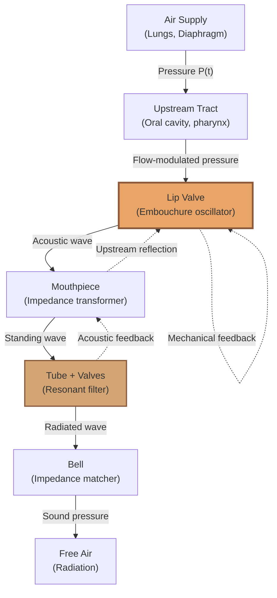
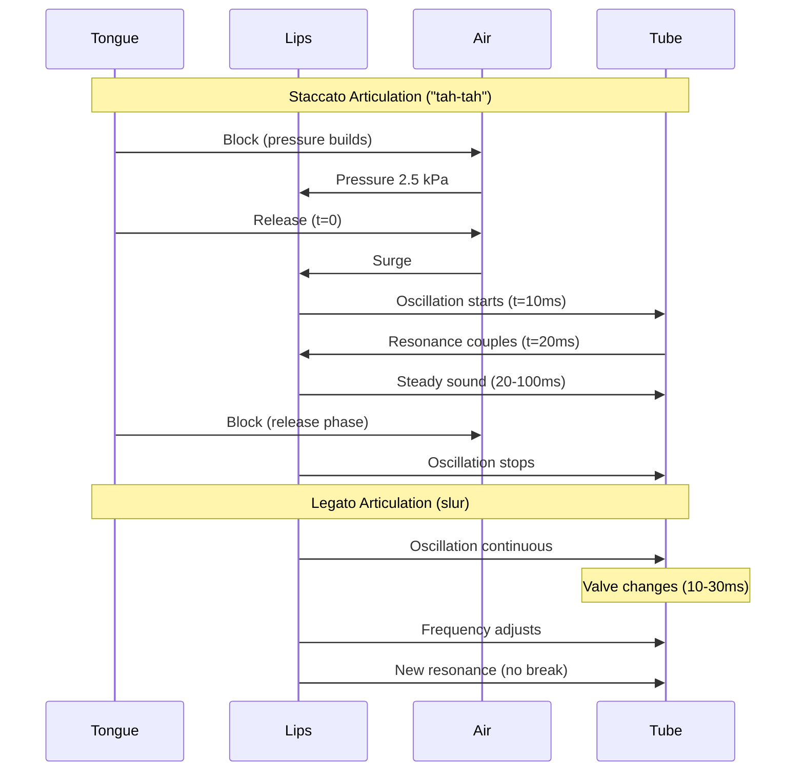
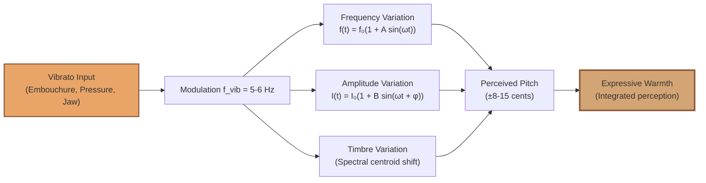

# Lesson 2: Articulation and Vibrato Techniques

## First-Principles Intuition & Invariants

Articulation and vibrato represent the intersection of fluid dynamics, acoustic resonance, and neuromuscular control in brass performance. Understanding these techniques demands examining the physical constraints and invariant relationships that govern sound production in brass instruments.

A brass instrument operates as a coupled oscillator system. The player's lips function as a flow-controlled valve, periodically interrupting the air stream to generate a Bernoulli force that sustains oscillation. This lip oscillation couples with the acoustic resonances of the air column, which acts as a selective amplifier favoring specific frequencies determined by the tube's effective length. The relationship between lip frequency and tube resonance is non-linear: small changes in embouchure tension, aperture size, or air velocity can shift the system between adjacent resonant modes.

The fundamental invariant in articulation is the attack transient—the initial 20-100 milliseconds when the coupled system transitions from silence to steady-state oscillation. During this period, the acoustic impedance at the mouthpiece must match the mechanical impedance of the lip-valve system. Staccato articulation deliberately shortens this steady-state phase, creating a percussive onset followed by rapid decay. Legato articulation maintains continuous energy input across note transitions, preserving the oscillation envelope while the tube resonance shifts via valve actuation.

Vibrato emerges from periodic modulation of one or more system parameters: lip tension (affecting the reed frequency), oral cavity volume (affecting upstream impedance), or air pressure (affecting oscillation amplitude and nonlinearity). The critical insight is that vibrato is not simply pitch modulation—it simultaneously modulates amplitude, spectral centroid, and formant structure. The human auditory system integrates these correlated variations as expressive warmth rather than instability.

The frequency range of musical vibrato (4-8 Hz) is non-arbitrary. Below 3 Hz, the modulation is perceived as unstable intonation. Above 9 Hz, the ear's temporal integration (roughly 100-150 ms) begins averaging the variations, reducing expressive impact. The optimal vibrato rate coincides with the natural tremor frequency of the respiratory and orofacial musculature, allowing sustainable modulation without conscious micro-corrections.

The amplitude of vibrato—typically ±5-15 cents (where 100 cents = 1 semitone)—must remain below the just-noticeable difference for melodic intervals (roughly 25-30 cents) to avoid ambiguity in pitch identity. This amplitude couples to the instrument's acoustic resistance: instruments with higher resistance (small bore trumpets, natural horns) support smaller vibrato amplitudes than low-resistance instruments (large bore euphoniums, bass trombones).

## Core Architecture & Mechanics

### The Brass Instrument as a Nonlinear Dynamical System

The brass instrument comprises four coupled subsystems: the source (lips), the upstream tract (oral cavity and pharynx), the downstream resonator (tubing and bell), and the radiation impedance (how sound couples to free air). Each subsystem exhibits frequency-dependent impedance, and their interaction determines the emergent acoustic behavior.

The lip valve operates through self-sustained oscillation driven by the Bernoulli effect. As air flows through the lip aperture, the dynamic pressure drop creates an inward force. When this force overcomes the mechanical restoring force of the lip tissue, the aperture closes. Airflow ceases, pressure builds, and the elastic recoil reopens the aperture. This cycle repeats at a frequency determined by the balance between mechanical properties (mass, stiffness, damping) and aerodynamic forces.

The critical dimensionless parameter governing this oscillation is the **blowing pressure ratio**: the ratio of mouth pressure to the threshold pressure required to initiate oscillation. Below threshold (ratio < 1), oscillation cannot sustain. Just above threshold (ratio ≈ 1.1-1.3), oscillation is sinusoidal with low amplitude. At higher ratios (1.5-2.5), oscillation becomes highly nonlinear, generating rich harmonic content essential for brass timbre.

### Articulation Mechanics: Transient Control

Articulation governs the onset, sustain, and release phases of each note. The tongue's role is not to create sound but to control the transient coupling between the lip oscillator and the resonant tube.

**Staccato articulation** employs a rapid tongue motion (typically the tip or blade) to momentarily obstruct airflow at the roof of the mouth or behind the upper teeth. The articulation syllable "tah" or "tut" represents this gesture. The sequence unfolds as follows:

1. **Pre-articulation (t=0)**: Tongue blocks airflow. Mouth pressure builds to 1.5-3 kPa above atmospheric. Embouchure is pre-tensioned but not oscillating.

2. **Release (t=5-15 ms)**: Tongue releases. Airflow surges through the lip aperture. The sudden pressure gradient initiates lip oscillation with a sharp attack transient rich in high-frequency energy.

3. **Steady-state (t=20-100 ms)**: Coupled oscillation stabilizes. The spectrum develops the characteristic brass formants determined by tube geometry.

4. **Termination (t=100-150 ms for short staccato)**: Either the tongue returns to block airflow ("tut-tut") or embouchure tension drops, decoupling the oscillator from the resonance.

The sharpness of staccato depends on the speed of tongue release (faster = more percussive), the pre-articulation pressure (higher = louder attack), and the embouchure damping (lower = longer ring after tongue release).

**Legato articulation** maintains continuous lip oscillation across pitch changes. The tongue may provide gentle attacks ("dah" syllable, softer than "tah") or be absent entirely in true slurs. The challenge in legato lies in valve coordination: the tube resonance must shift from one frequency to another while the lip oscillator remains coupled. 

During a valve transition, there is a brief interval (10-30 ms) when the tube presents a changing impedance landscape. Skilled players anticipate this shift by adjusting embouchure tension and air velocity synchronously with valve motion, ensuring the lip frequency tracks the moving resonance peak. Failure to coordinate results in pitch instability or cracking (jumping to an unintended harmonic).

### Vibrato Mechanics: Modulation Strategies

Musical vibrato in brass playing arises from three primary modulation sources, often used in combination:

**1. Embouchure (Lip) Vibrato**: Periodic variation in lip tension modulates the mechanical resonance frequency of the lip valve. This is analogous to varying the effective mass or stiffness of the oscillator. A sinusoidal tension modulation at 5 Hz produces a corresponding frequency modulation of ±6-12 Hz around a base frequency of 440 Hz (A4), corresponding to ±8-13 cents. This technique is common in trumpet and French horn playing.

**2. Air-Pressure Vibrato**: Periodic variation in lung pressure modulates the blowing pressure ratio. Since the lip oscillation amplitude and frequency both depend nonlinearly on blowing pressure, this creates a complex modulation of pitch, amplitude, and timbre. The modulation is typically achieved through abdominal muscle pulsation ("belly vibrato"). This technique produces a broader, warmer sound and is favored on euphonium and tuba.

**3. Jaw (Oral Cavity) Vibrato**: Vertical jaw motion modulates the volume of the upstream oral cavity, changing its resonant properties and the acoustic impedance presented to the lips. This indirectly affects lip oscillation frequency. The motion is subtle (1-3 mm) but perceptible. This technique is often used in trombone playing, where the embouchure must remain stable for slide control.

The mathematical model of vibrato represents pitch as:

f(t) = f₀ [1 + A sin(2πf_vib t)]

where f₀ is the nominal pitch, A is the fractional amplitude (typically 0.005-0.015 for ±0.5-1.5% deviation), and f_vib is the vibrato rate (4-8 Hz). In reality, the modulation is not purely sinusoidal; players often employ a slightly asymmetric waveform with faster rise than fall, creating a more dynamic character.

The phase relationship between pitch and amplitude modulation distinguishes expressive vibrato from tremolo (amplitude-only) or trill (discrete pitch alternation). In musical vibrato, amplitude and pitch are positively correlated: higher pitch coincides with louder amplitude. This correlation arises naturally from embouchure or pressure modulation, as increased tension or pressure raises both frequency and oscillation amplitude.

### Acoustic Measurement and Analysis

Quantitative analysis of articulation and vibrato employs several measurement techniques:

**Attack Time Measurement**: Using a calibrated microphone and waveform analysis, the attack time is defined as the interval from 10% to 90% of steady-state amplitude. Staccato attacks measure 15-40 ms; legato attacks (soft tongue or slurred) measure 40-100 ms. The attack spectral centroid (brightness) is typically 2-4 kHz for staccato, 1-2 kHz for legato.

**Vibrato Rate and Extent**: Pitch tracking algorithms (autocorrelation, cepstral analysis, or phase vocoder) extract the fundamental frequency contour f(t). Fourier analysis of this contour reveals the dominant modulation frequency (vibrato rate). The peak-to-peak variation, converted to cents, gives the vibrato extent. Professional brass players typically exhibit 5.5-6.5 Hz vibrato with ±10-15 cent extent.

**Spectral Analysis**: The interaction of articulation and vibrato with the instrument's resonance produces characteristic spectral signatures. Staccato notes show rapid buildup of high harmonics (3rd-6th) in the first 20 ms, then decay to a stable spectrum. Vibrato modulates not only the fundamental but also the formant structure—the peaks in the spectral envelope determined by tube resonances. This formant modulation contributes to the perceived warmth.

## High-Performance Optimization & Failure Modes

### Training Protocols for Precision Control

Achieving elite-level articulation and vibrato requires deliberate practice targeting the neuromuscular coordination of tongue, embouchure, and respiratory systems.

**Articulation Precision Drills**:

1. **Metronome-Synchronized Tonguing**: Practice scales or arpeggios with precisely timed attacks at tempos from 60-200 BPM (quarter notes). Use a contact microphone or recording to measure attack consistency. Variation should remain below ±10 ms.

2. **Dynamic Articulation**: Practice the same phrase with varying attack intensities (pp staccato to ff marcato) while maintaining consistent pitch and tone quality. This develops independent control of tongue speed and air pressure.

3. **Mixed Articulation Sequences**: Alternate staccato and legato patterns within a single phrase (e.g., two staccato notes, two legato, repeat). This trains rapid switching between articulation modes.

**Vibrato Development Drills**:

1. **Frequency Calibration**: Using a tuner with real-time pitch display, practice sustaining a note with vibrato while observing the pitch modulation. Target a specific rate (e.g., 5.5 Hz) and extent (e.g., ±12 cents). Gradually increase duration from 4 seconds to 30+ seconds.

2. **Vibrato Initiation Control**: Practice starting notes with straight tone, introducing vibrato after 1-2 seconds, then returning to straight tone. This develops on/off control and prevents involuntary vibrato.

3. **Multi-Parameter Independence**: Combine vibrato with dynamic swells (crescendo-decrescendo) while maintaining constant pitch center. This ensures vibrato doesn't couple unintentionally to other parameters.

### Common Failure Modes and Diagnostics

**Failure Mode 1: Inconsistent Attack (Articulation Slop)**

*Symptoms*: Attack timing varies by ±30+ ms. Some attacks are soft or delayed. Sound quality varies between attacks.

*Root Cause*: Insufficient pre-articulation pressure, inconsistent tongue release speed, or embouchure not pre-tensioned.

*Remedy*: Increase breath support to establish stable 2.5-3 kPa mouth pressure before tongue release. Practice tongue release as a ballistic motion (fast, not gradual). Ensure embouchure is "set" before tongue moves.

**Failure Mode 2: Legato Cracking or Pitch Instability**

*Symptoms*: Notes crack (jump to wrong harmonic) during slurs. Pitch sags or spikes during valve transitions. Audible discontinuities in legato passages.

*Root Cause*: Embouchure and air velocity not tracking the changing tube resonance during valve transitions.

*Remedy*: Slow down valve transitions and practice exaggerated embouchure adjustments. Use a tuner to verify pitch stability during slurs. Gradually increase speed as coordination improves. For difficult slurs, practice the embouchure motion without the instrument (lip buzzing through the pitch change).

**Failure Mode 3: Uncontrolled or Absent Vibrato**

*Symptoms*: Vibrato is involuntary (appears on all notes) or unachievable (notes remain flat/straight). Vibrato rate is too fast (>8 Hz, sounds nervous) or too slow (<4 Hz, sounds like pitch drift). Vibrato extent is excessive (>20 cents, sounds out of tune).

*Root Cause*: Lack of neuromuscular differentiation between steady-state embouchure and modulation. Excessive tension preventing modulation, or excessive laxity preventing stability.

*Remedy*: For involuntary vibrato, practice long tones with focus on absolute embouchure stability. Use biofeedback (visual tuner) to detect and suppress micro-variations. For absent vibrato, practice exaggerated jaw or pressure pulsations at 2-3 Hz, gradually increasing frequency and reducing amplitude. Record and analyze to calibrate rate and extent.

**Failure Mode 4: Tension-Induced Fatigue**

*Symptoms*: Embouchure fatigues rapidly (<5 minutes). Tone quality degrades. Vibrato becomes forced or disappears.

*Root Cause*: Excessive muscular force in embouchure or tongue. Breath support inadequate, causing compensation through embouchure tension.

*Remedy*: Practice "minimal viable embouchure"—find the lowest tension that sustains stable oscillation. Develop core breath support (diaphragmatic breathing) to reduce reliance on embouchure force. Use relaxation techniques (progressive muscle relaxation) between practice sessions.

### Adaptation to Musical Context

Elite performance requires adapting articulation and vibrato to stylistic and acoustic contexts:

**Stylistic Adaptation**: Baroque and Classical repertoire typically employs lighter, more detached articulation and minimal or no vibrato (straight tone aesthetic). Romantic and 20th-century repertoire favors heavier articulation contrast and continuous vibrato. Jazz emphasizes rhythmic precision in articulation and flexible vibrato application. Each style demands internalization of its expressive norms.

**Acoustic Adaptation**: In resonant halls with long reverberation times (>2.5 seconds), articulation must be more detached to prevent blurring. Vibrato extent can be slightly reduced, as the hall's natural resonance adds warmth. In dry acoustic environments (studios, outdoor venues), articulation can be more connected, and vibrato extent may be increased to compensate for lack of ambient resonance.

**Ensemble Adaptation**: In sections (e.g., trumpet section in orchestra or big band), vibrato usage must be coordinated. Desynchronized vibrato creates phase interference and muddiness. Either all players use matched vibrato (rate and phase-aligned, difficult) or all use straight tone. Solo passages permit individual vibrato expression. Articulation must be precisely synchronized, often led by the principal player's attack.

### Quantitative Performance Metrics

Advanced players can benchmark their technique against professional standards:

| Metric | Amateur | Intermediate | Professional |
|--------|---------|--------------|--------------|
| Attack consistency (stdev, ms) | ±25 | ±15 | ±8 |
| Max tonguing rate (notes/sec) | 4-6 | 7-9 | 10-14 |
| Vibrato rate control (Hz) | 4-7 | 5-6.5 | 5.2-6.2 ±0.3 |
| Vibrato extent control (cents) | ±8-20 | ±10-15 | ±10-14 ±2 |
| Legato slur accuracy (cents) | ±20 | ±10
