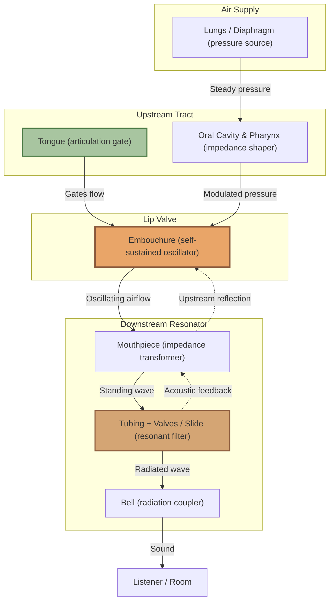
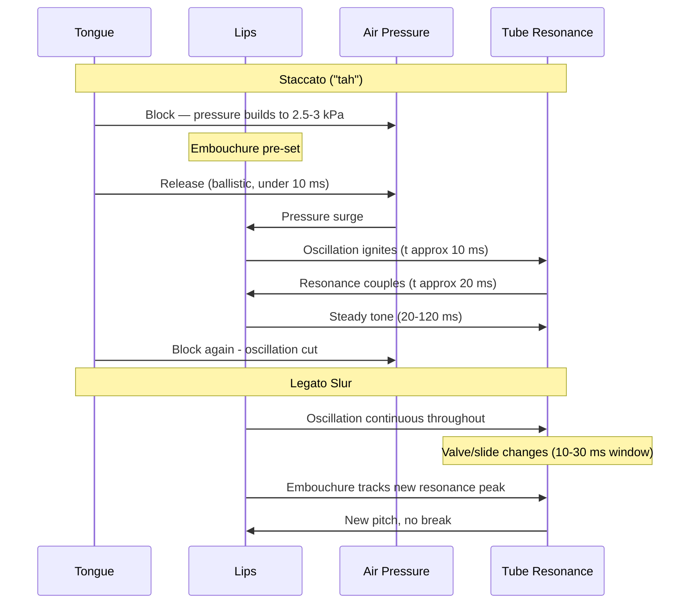
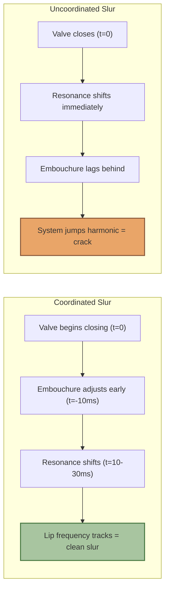
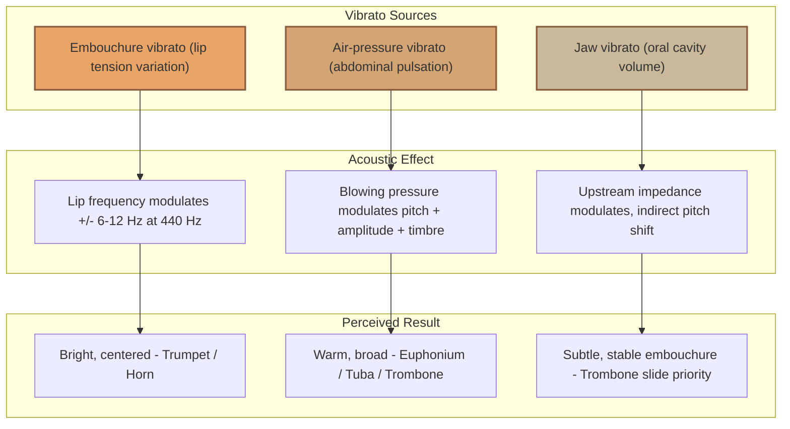

# Lesson 2: Articulation and Vibrato Techniques for Brass Instruments

## First-Principles Intuition (Read Once, Apply Forever)

A brass instrument is a coupled oscillator: your lips act as a pressure-controlled valve, your oral tract shapes the upstream impedance, and the tubing acts as a resonant amplifier that selects which pitch the lips lock onto. Articulation controls *how* that oscillation starts and stops. Vibrato controls *how* it breathes once sustained.

**The tongue never makes sound — it gates it.** Air pressure and embouchure create the oscillation; the tongue shapes its onset and release. Vibrato is not pitch wandering — it is deliberate, correlated modulation of pitch, amplitude, and timbre that the ear integrates as expressive warmth, not instability.

Two numbers matter more than any formula: vibrato lives at **4–8 Hz** (below 3 Hz it reads as bad intonation; above 9 Hz the ear's ~100–150 ms integration window smears it flat), and pitch deviation should sit around **±10–15 cents** — wide enough to feel, narrow enough to stay unambiguous. Everything below is about hitting those numbers reliably, on command, at any dynamic.

---

## Instrument Mechanics & System Architecture



The lip valve runs on the Bernoulli cycle: air rushing through the narrow aperture drops in pressure, pulling the lips together; flow stops, pressure recovers, elastic recoil reopens the gap, repeat. This locks onto whichever tube resonance is nearest to your buzzed pitch — which is why a sloppy embouchure "finds" the wrong harmonic. The ratio of mouth pressure to oscillation-threshold pressure governs timbre: near threshold the tone is thin and nearly sine-like; at 1.5–2.5× threshold the waveform goes sharply nonlinear and you get the bright, harmonically rich brass tone players actually want. Practical translation: a note played too softly, with too little air behind it, will always sound thin and unfocused no matter how "correct" your embouchure shape is — push more air through a smaller aperture, don't just purse harder.

---

## Part I: Articulation

### How Articulation Shapes the Attack Transient

The first 20–100 ms of a note — the attack transient — is the most acoustically informative moment in a phrase. It carries articulation character, dynamic level, and style intent. Everything a listener uses to tell "staccato trumpet" from "legato horn" lives in that window. The tongue's only job is controlling **when** and **how abruptly** that transient begins.



### Articulation Syllables by Style

| Articulation | Syllable | Tongue Contact | Attack Character | Use |
|---|---|---|---|---|
| Hard staccato | "tut" / "tit" | Tip behind upper teeth | Percussive, bright | Fanfares, marches, Baroque |
| Standard accent | "tah" | Tip at alveolar ridge | Clean, full | General playing |
| Soft legato | "dah" | Tip relaxed | Rounded onset | Romantic melody |
| True slur | (none) | No tongue contact | Seamless | Lyrical passages |
| Double tongue | "tuh-kuh" | Alternating tip/back | Rapid, even | Fast passages, >4 notes/sec |
| Triple tongue | "tuh-kuh-tuh" | Alternating | Triplet bursts | 6/8, triplet runs |

**Staccato rule:** think of the tongue release as a ballistic snap, not a gradual pull-away. Build sub-embouchure air pressure first (the "compressed air behind a closed door" feeling), then release instantly. The speed of release — not the force of the airstream afterward — determines how sharp the attack sounds.

**Legato rule:** the tongue may add a gentle "dah" ghost at each valve change, or nothing at all. What can never happen is a gap in the air column. A 15 ms drop in airflow collapses the oscillation and produces a crack or a gap, even if your fingers moved correctly.

### Legato Cracking: What Actually Happens

When you slur across a valve change, the tube's resonant landscape shifts under you. If your embouchure's buzzing frequency drifts off the moving resonance peak, the system snaps to the nearest available harmonic instead — that snap is the crack you hear. The fix is anticipation: begin adjusting the embouchure 10–20 ms *before* the valve fully seats, so the lip frequency is already tracking the resonance as it moves, not chasing it afterward.



### Articulation Practice Drills

**Drill 1 — Metronome-Anchored Single Tonguing**

Play a concert Bb major scale, one note per click, using "tah."

- 60 BPM: identical attack weight on every note. Record on your phone.
- 100 BPM: maintain evenness, don't let the pre-articulation pressure get rushed or skipped.
- 132 BPM: tongue stays relaxed and light; the air does the work, the tongue just gates it.

Check the waveform in any voice-memo app or DAW: attack transients should line up as sharp vertical spikes of similar height. Smeared or short spikes mean pressure wasn't built before the release — slow back down and rebuild the habit before speeding up again.

**Drill 2 — Dynamic Articulation Ladder**

On one pitch (concert Bb, comfortable middle register), eight repetitions at 72 BPM:

```
pp-staccato -> p-staccato -> mp-staccato -> mf-staccato
mp-accent   -> mf-accent   -> f-marcato   -> ff-sforzando
```

Keep tongue speed and syllable identical throughout — only air pressure and embouchure firmness change between steps. This isolates dynamic control from articulation control so you don't accidentally "accent" by tonguing harder.

**Drill 3 — Mixed Articulation Sequences**

```
Pattern: [ tah tah | dah -- | tah tah | dah -- ]
Rhythm:  [ ♩   ♩   | ♩.  ♪ | ♩   ♩   |  𝅗𝅥     ]
```

Alternate staccato pairs and legato pairs within one phrase, applied to a scale or arpeggio. Target: clean at 80 BPM, then 108 BPM.

**Drill 4 — Double Tonguing Activation**

1. Speak "tuh-kuh-tuh-kuh" out loud until "kuh" matches "tuh" in weight and rhythm.
2. Transfer to the horn on one mid-register pitch, 60 BPM (each syllable = an eighth note). Specifically check that "kuh" is not quieter.
3. 80 BPM — stay relaxed in the throat, no tightening to compensate for speed.
4. 108 BPM — apply to a Bb major scale in eighth notes.

The universal failure mode is a weaker "kuh." Fix: isolate "kuh-kuh-kuh" alone at any comfortable tempo until it matches "tuh" in loudness and attack sharpness (use your palm on the bell to feel the pulse), then reintegrate the alternating pattern.

---

## Part II: Vibrato

### Three Modulation Sources

Brass vibrato is three distinct physical mechanisms, not one technique, and the idiomatic choice depends on the instrument.



**Embouchure vibrato** (trumpet, French horn): a slight, symmetric undulation in lip tension — a gentle rocking, not a wobble. Keep the motion even on both sides of center; too much jaw involvement drags it toward jaw vibrato and loses the centered brightness trumpet and horn playing depend on.

**Air-pressure vibrato** (euphonium, tuba, bass trombone): abdominal pulsation at 5–6 Hz, driven from the diaphragm, not the throat. Put a hand on your sternum while practicing — you should feel a pulse, not a pump. This produces the warmest, most organ-like modulation and holds up best at loud dynamics, which is why it's the default on the larger low brass.

**Jaw vibrato** (tenor trombone, some horn players): 1–3 mm of vertical jaw motion changes oral cavity volume and shifts the upstream resonance slightly, which in turn nudges pitch. The payoff: the embouchure itself stays rock stable — essential on trombone where your other arm is simultaneously controlling pitch with the slide and you can't afford embouchure drift on top of slide drift. Depth is narrower (±6–10 cents) but still musically sufficient.

### Vibrato Rate and Extent Targets

| Player Level | Rate (Hz) | Extent (cents peak-to-peak) | Consistency |
|---|---|---|---|
| Developing | 3–8 (variable) | ±5–20 (inconsistent) | Poor onset control |
| Intermediate | 5–7 | ±10–18 | Can start/stop reliably |
| Professional | 5.2–6.5 | ±10–14 | ±0.3 Hz rate variation |

**Target zone: 5.5–6.0 Hz, ±12 cents.** This matches the natural oscillation frequency of trained respiratory/orofacial musculature and sits dead center in the window where the ear reads it as expressive warmth rather than instability.

### Vibrato Practice Drills

**Drill 5 — Pulse Activation (Starting from Zero)**

1. Sustain concert Bb, comfortable mf, straight tone.
2. Speak "yah-yah-yah" into the horn at 60 BPM (one pulse per quarter note), exaggerating the jaw drop.
3. Notice the pitch bending slightly on each "yah" — that's the vibrato mechanism switching on.
4. Speed the pulse up through 80, 100, 120 BPM. By 120 BPM you're near 2 pulses/second on quarters — switch to eighth notes to climb into the 5–6 Hz range.
5. As the motion becomes automatic, shrink the jaw excursion until it's nearly invisible but the acoustic effect remains.

**Drill 6 — Rate Calibration with a Tuner**

Use a real-time chromatic tuner (TonalEnergy, Peterson iStroboSoft, or similar strobe app).

1. Metronome at 72 BPM.
2. Play concert A4 (440 Hz), starting straight.
3. On beat 2, start vibrato. Watch the needle swing symmetrically above and below center.
4. Try to land exactly 5 cycles of swing in 5 seconds (5 Hz), then try 6 cycles in 5 seconds (6 Hz).
5. Hold 15 seconds. Stop cleanly on a chosen beat.

Success condition: the pitch *center* stays glued to A440 — the needle oscillates symmetrically around zero, never drifting sharp or flat as a whole.

**Drill 7 — On/Off Control**

```
Bar 1: Straight tone (4 beats)
Bar 2: Vibrato (4 beats, enters cleanly on beat 1)
Bar 3: Straight tone (4 beats, exits cleanly on beat 1)
Bar 4: Vibrato on beat 1, off on beat 3
```

At 60 BPM. Any volume blip or swell at a transition point means vibrato is coupled to your breath support instead of being an independent mechanism. Fix: keep air volume absolutely constant and modulate only the chosen mechanism — jaw, embouchure, or abdomen, never a mix born of imprecision.

**Drill 8 — Vibrato + Dynamic Independence**

```
pp (4 beats) -> mp (4 beats) -> f (4 beats) -> mp (4 beats) -> pp (4 beats)
Vibrato continuous throughout - same rate, same extent
```

Record and check with a pitch-tracking plugin or DAW pitch automation lane that the vibrato envelope doesn't widen at forte or vanish at piano — a very common unconscious habit.

---

## Part III: Failure Modes and Diagnostics

**FM-1: Inconsistent Attack (Articulation Slop)**
*Symptoms:* some attacks soft, delayed, or missing; waveform shows attack transients varying by more than ±25 ms in onset time.
*Cause:* mouth pressure not pre-built before tongue release, or the release itself is gradual rather than ballistic.
*Fix:* isolate the motion — build sub-embouchure pressure, ballistic release, stop — at 60 BPM only, with no rushing, until it's automatic. Then reattach to a scale.

**FM-2: Legato Crack on Valve Change**
*Symptoms:* notes crack to the wrong harmonic (often a 5th away) during slurs; pitch sags through the transition.
*Cause:* embouchure frequency lags the tube's shifting resonance peak.
*Fix:* lip-buzz the interval off the horn first, feeling the lip tension shift *before* you'd expect the pitch to change. Reattach to the horn at 40 BPM with an exaggeratedly early embouchure adjustment. Speed up only once 5 clean repetitions in a row are achieved.

**FM-3: Double Tongue Inequality ("kuh" weaker than "tuh")**
*Symptoms:* passages sound like "TUH-kuh-TUH-kuh," alternating loud/soft.
*Cause:* the back-tongue (velar) stroke is under-practiced and fires with less velocity than the front-tongue stroke.
*Fix:* isolate "kuh-kuh-kuh" at 60 BPM on a mid-register pitch until it matches "tuh" in volume and sharpness (palm-on-bell feedback helps), then reintegrate.

**FM-4: Vibrato Rate Drift**
*Symptoms:* vibrato speeds up at forte, disappears at piano; rate drifts above 8 Hz (nervous) or below 4 Hz (sounds like bad intonation).
*Cause:* vibrato is being driven passively by dynamic level or breathing rhythm instead of running as its own stable, internally generated pulse.
*Fix:* Drill 6 with a visual tuner. Externalize the rate first against a click (metronome at 165 BPM, one vibrato cycle per beat = 5.5 Hz). Once the rate holds steady for 20+ seconds across all dynamics, the coupling to breath fades.

**FM-5: Involuntary Vibrato on Every Note**
*Symptoms:* long tones, entrances, held notes all wobble; a straight tone is impossible to produce on demand.
*Cause:* chronically low embouchure tension — the lips sit in a semi-unstable state that defaults into vibrato.
*Fix:* long tones with a strobe tuner, needle must stay motionless. Any deviation: increase embouchure firmness slightly and retry. The goal is more *stability*, not more overall tension.

**FM-6: Tension-Induced Fatigue**
*Symptoms:* tone collapses after 5–10 minutes; vibrato turns involuntary then disappears; upper register becomes unreachable.
*Cause:* excess embouchure force compensating for insufficient air support.
*Fix:* find the minimum embouchure tension that still sustains a clear pitch on steady air — usually far less than players assume. Build support with long-tone crescendo/decrescendo work where the air does the work and the embouchure only shapes it. Rest 10 minutes per 20 minutes of demanding playing.

---

## Part IV: Stylistic and Ensemble Adaptation

| Style | Articulation | Vibrato Use |
|---|---|---|
| Baroque (Handel, Purcell) | Light, detached, minimal legato | None, or ornamental only |
| Classical (Haydn, Mozart) | Clean, speech-like, varied | None or very sparing |
| Romantic (Brahms, Mahler) | Heavy legato, dramatic accents | Continuous, warm, wide |
| 20th-Century / Contemporary | Full range, including multiphonics | As marked; often straight tone |
| Jazz big band | Rhythmically crisp, smeared falls | Flexible — wide and slow for ballads |
| Mariachi / Latin brass | Bright, punchy staccato | Moderate, style-specific |

**Acoustic context:** in a hall with over 2.5 seconds of reverberation, favor more detached articulation — the room supplies the legato connection for you. In a dry studio or outdoors, lean into more legato connection and vibrato warmth to compensate for the missing natural resonance.

### Ensemble Vibrato Coordination

Unsynchronized vibrato across a section creates phase interference — multiple players wavering at slightly different rates produces a muddy shimmer instead of a warm blend. Three working solutions:

1. **Straight tone** for the section as default; vibrato reserved for designated solo or exposed moments.
2. **Principal-led vibrato**: the section matches the principal's rate and depth by ear. Matching within ±0.3 Hz reads as cohesive; wider than that reads as smear.
3. **Full solo vibrato** when playing exposed, expressive lines — no restriction needed.

**Articulation synchronization:** section attacks need to land within ±5–8 ms of each other to sound unified. This is too tight to achieve by listening and reacting — you must watch the principal's breath intake and bell angle *before* the attack. By the time you hear it, you're already late.

---

## Quantitative Performance Benchmarks

| Metric | Developing | Intermediate | Professional |
|---|---|---|---|
| Attack consistency (std dev) | ±25 ms | ±15 ms | ±5–8 ms |
| Max single-tongue rate | 4–5 notes/sec | 6–8 notes/sec | 9–12 notes/sec |
| Max double-tongue rate | — | 8–10 notes/sec | 12–16 notes/sec |
| Vibrato rate control | 4–8 Hz (variable) | 5–7 Hz (semi-stable) | 5.2–6.5 Hz ±0.3 Hz |
| Vibrato extent control | ±5–20 cents | ±10–18 cents | ±10–14 cents ±2 cents |
| Vibrato onset latency | >500 ms | 200–400 ms | <100 ms |
| Legato slur accuracy | ±20 cents | ±10 cents | ±5 cents |
| Dynamic range (single pitch) | pp to mf | pp to f | pp to fff |

---

## Weekly Practice Structure

Applies to trumpet, French horn, trombone, euphonium, or tuba — adjust register to your instrument. Assumes 60-minute sessions.

```
Day 1 (Technical Foundation - 60 min)
  :00-:10  Long tones, straight tone, biofeedback tuner
  :10-:25  Single tongue drills - Drill 1 (60 -> 100 -> 132 BPM)
  :25-:40  Legato slur work - problem intervals, FM-2 anticipation fix
  :40-:55  Double tongue activation - Drill 4 isolation + integration
  :55-:60  Rest + mental review

Day 2 (Vibrato Focus - 60 min)
  :00-:10  Long tones + straight tone stability
  :10-:20  Pulse activation - Drill 5 (jaw-initiated, then internalize)
  :20-:35  Rate calibration - Drill 6 with tuner, 5.5 Hz target
  :35-:50  On/Off control - Drill 7, all registers
  :50-:60  Dynamic independence - Drill 8

Day 3 (Musical Application - 60 min)
  :00-:10  Warm-up: scales with mixed articulation
  :10-:40  Repertoire - apply articulation and vibrato in musical context
  :40-:55  Record a phrase, listen back, identify one articulation and one vibrato issue
  :55-:60  Targeted fix of identified issue

Day 4: Rest, or light long tones only
Day 5-7: Repeat cycle, raising metronome targets 4-6 BPM where applicable
```

---

## Quick-Reference Summary

```
ARTICULATION CORE RULES
  Staccato  -> Build pressure first. Tongue = ballistic release. Embouchure pre-set.
  Legato    -> Air never stops. Embouchure anticipates valve change by 10-20 ms.
  Double    -> "kuh" must match "tuh". Isolate before integrating.
  Dynamic   -> Air pressure changes. Tongue speed stays constant.

VIBRATO CORE RULES
  Mechanism    -> Trumpet/Horn = embouchure. Euph/Tuba = diaphragm. Trombone = jaw.
  Target rate  -> 5.5-6.0 Hz. Match metronome at quarter=165 (one cycle per beat).
  Target extent-> +/-10-14 cents. Visible on strobe tuner. Symmetric above/below center.
  On/Off       -> Vibrato starts and stops on a designated beat. No drift.
  Ensemble     -> Section = straight tone or principal-matched rate. Solo = expressive.
