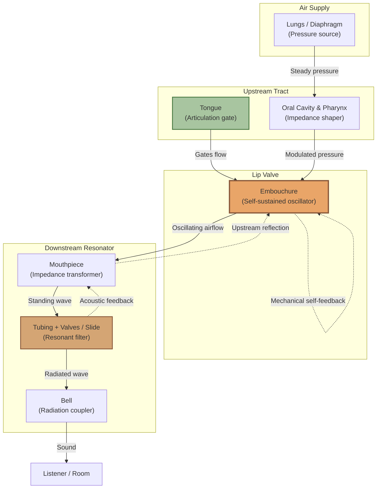
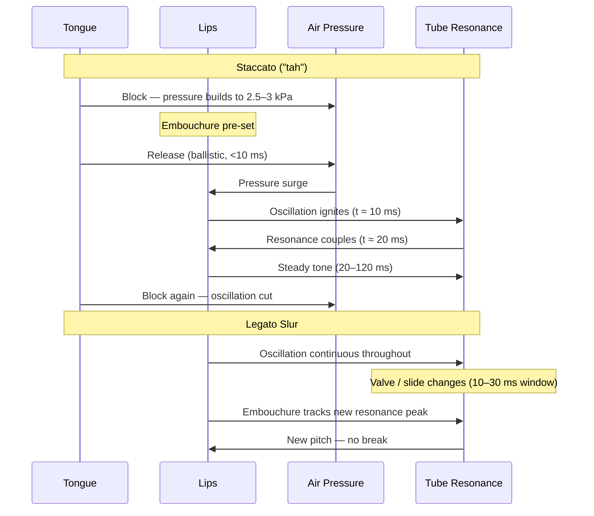
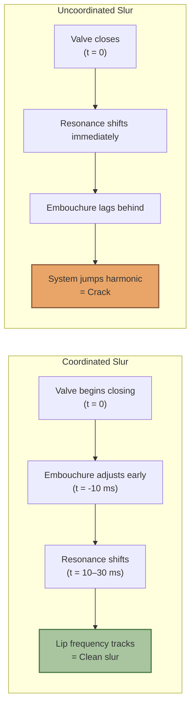
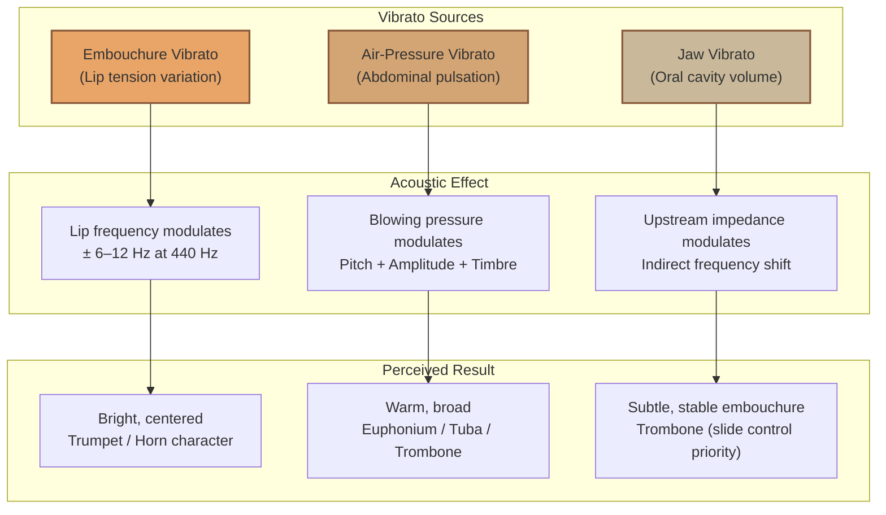

# Lesson 2: Articulation and Vibrato Techniques for Brass Instruments

## First-Principles Intuition

A brass instrument is a **coupled oscillator**: your lips act as a pressure-controlled valve, your oral tract shapes the upstream impedance, and the tubing acts as a selective resonant amplifier. Articulation controls *how* that oscillation starts and stops. Vibrato controls *how* it breathes once sustained.

The critical insight for a practitioner is this: **the tongue never makes sound — it gates it.** Air pressure and embouchure create the oscillation; the tongue shapes its onset and release. Similarly, vibrato is not pitch wandering — it is a deliberate, correlated modulation of pitch, amplitude, and timbre that the ear integrates as expressive warmth.

Vibrato sits in the 4–8 Hz window because that coincides with the natural resonant frequency of the respiratory and orofacial musculature. Below 3 Hz it sounds like unsteady intonation. Above 9 Hz the ear's ~100–150 ms temporal integration window averages it out, flattening the effect. Aim for ±10–15 cents of pitch deviation — wide enough to feel, narrow enough to stay unambiguous.

---

## Instrument Mechanics & System Architecture



The lip valve operates through the **Bernoulli cycle**: air rushing through the narrow aperture drops in pressure, pulling the lips together. Flow stops, pressure recovers, elastic recoil reopens the aperture — repeat. This cycle locks onto the nearest tube resonance. The blowing pressure ratio (mouth pressure ÷ oscillation threshold pressure) governs timbre: near threshold the waveform is nearly sinusoidal and thin; at 1.5–2.5× threshold it goes highly nonlinear, generating the rich harmonic content that defines brass tone.

---

## Part I: Articulation

### How Articulation Shapes the Attack Transient

The attack transient — the first 20–100 ms of a note — is the most acoustically informative moment. It carries articulation character, dynamic level, and style intent. Everything a listener uses to identify "staccato trumpet" vs. "legato horn" lives in that window.

The tongue's job is to control **when** and **how abruptly** that transient begins.



### Articulation Syllables by Style

| Articulation | Syllable | Tongue Contact | Attack Character | Use |
|---|---|---|---|---|
| Hard staccato | "tut" / "tit" | Tip behind upper teeth | Percussive, bright | Fanfares, march, Baroque |
| Standard accent | "tah" | Tip at alveolar ridge | Clean, full | General |
| Soft legato | "dah" | Tip relaxed | Rounded onset | Romantic melody |
| True slur | (none) | No tongue contact | Seamless | Lyrical passages |
| Double tongue | "tuh-kuh" | Alternating tip/back | Rapid, even | Fast passages >4 notes/sec |
| Triple tongue | "tuh-kuh-tuh" | Alternating | Triplet bursts | 6/8, triplet runs |

**Key rule for staccato**: think of tongue release as a *ballistic snap*, not a gradual pull-away. The speed of release determines the sharpness of the attack transient. Pre-build pressure first, then fire.

**Key rule for legato slurs**: the tongue may add a gentle "dah" ghost at each valve change, or stay out entirely. What must never be absent is **continuous air column** — if the air drops for even 15 ms, the oscillation collapses and you get a crack.

---

### Legato Cracking: What Actually Happens

When you slur across a valve change, the tube's resonant landscape shifts. If your embouchure frequency drifts off the moving resonance peak, the system jumps to the nearest available harmonic — that is the crack. The fix is **anticipation**: begin the embouchure adjustment 10–20 ms *before* the valve fully closes. This keeps the lip frequency tracking the resonance as it moves.



---

### Articulation Practice Drills

**Drill 1 — Metronome Anchored Single Tonguing**

Play a concert Bb major scale, one note per click, using "tah" articulation. Record yourself.

- Start: ♩= 60 BPM — focus on identical attack weight on every note
- Target: ♩= 100 BPM — maintain evenness, do not rush pre-articulation pressure
- Advanced: ♩= 132 BPM — tongue remains relaxed, air does the work

Listen back and check that attack transients are visually aligned in your DAW or voice memo waveform. If some attacks look short or smeared, slow back down and rebuild the pressure habit.

**Drill 2 — Dynamic Articulation Ladder**

On a single pitch (concert Bb, comfortable middle register), perform eight repetitions:

```
pp-staccato → p-staccato → mp-staccato → mf-staccato
mp-accent → mf-accent → f-marcato → ff-sforzando
```

Each repetition same tongue speed. Only air pressure and embouchure weight change. This isolates dynamic control from articulation control. ♩= 72 BPM.

**Drill 3 — Mixed Articulation Sequences**

```
Pattern: [tah tah | dah — | tah tah | dah — ]
Rhythm:   [♩  ♩   | ♩.  ♪  | ♩  ♩   | 𝅗𝅥       ]
```

Alternate between staccato pairs and legato pairs within the phrase. Apply to a simple scale or arpeggio. Target: ♩= 80 BPM clean, then ♩= 108 BPM.

**Drill 4 — Double Tonguing Activation**

Start by speaking "tuh-kuh-tuh-kuh" aloud until the "kuh" matches the "tuh" in weight and rhythm. Then transfer to the horn on a single mid-register pitch.

- ♩= 60 BPM (each syllable = eighth note) — verify "kuh" is not softer
- ♩= 80 BPM — stay relaxed in throat
- ♩= 108 BPM — apply to a Bb major scale in eighth notes

The "kuh" being weaker than the "tuh" is the universal failure mode. Isolate the back-tongue stroke alone ("kuh-kuh-kuh") at any tempo until it matches, then reintegrate.

---

## Part II: Vibrato

### Three Modulation Sources

Brass vibrato is not a single technique — it is three distinct physical mechanisms, each with a different character and idiomatic instrument association.



**Embouchure vibrato** (trumpet, French horn): slight cyclic variation in lip tension, like a gentle undulation rather than a wobble. Keep the variation symmetric — too much jaw involvement makes it sound like jaw vibrato, which loses the centered brightness.

**Air-pressure vibrato** (euphonium, tuba, bass trombone): diaphragmatic or abdominal pulsation at 5–6 Hz. Place a hand on your sternum — feel it pulse, not pump. This creates the warmest, most organ-like modulation and handles best at loud dynamics.

**Jaw vibrato** (tenor trombone, some horn players): 1–3 mm of vertical jaw motion changes the oral cavity volume, shifting the upstream resonance. The advantage is that the embouchure remains stable — critical on trombone where your left arm is simultaneously controlling pitch via the slide. The vibrato depth is therefore narrower (±6–10 cents) but sufficient.

### Vibrato Rate and Extent: What to Aim For

| Player Level | Rate (Hz) | Extent (cents peak-to-peak) | Consistency |
|---|---|---|---|
| Developing | 3–8 (variable) | ±5–20 (inconsistent) | Poor onset control |
| Intermediate | 5–7 | ±10–18 | Can initiate and stop |
| Professional | 5.2–6.5 | ±10–14 | ±0.3 Hz rate variation |

Target zone: **5.5–6.0 Hz, ±12 cents**. This sits in the sweet spot of the perceptual vibrato window and matches the natural oscillation frequency of well-trained respiratory musculature.

---

### Vibrato Practice Drills

**Drill 5 — Pulse Activation (Starting from Zero)**

If you have no vibrato yet, start here:

1. Play a sustained concert Bb, comfortable mf, straight tone.
2. Speak "yah-yah-yah" into the horn at ♩= 60 BPM (quarter = one pulse). Exaggerate the jaw drop.
3. Notice the pitch bends slightly on each "yah" — that is vibrato mechanism engaging.
4. Gradually speed up to ♩= 80, 100, 120 — by 120 BPM quarter notes you are approaching 2 pulses/second; switch to eighth notes to reach the 5–6 Hz range.
5. As the motion becomes internalized, reduce the jaw excursion until it disappears and only the acoustic effect remains.

**Drill 6 — Rate Calibration with Tuner**

Use a chromatic tuner that shows pitch in real-time (Tonal Energy, Peterson iStroboSoft, or similar).

1. Set a metronome to ♩= 72 BPM.
2. Play concert A4 (440 Hz) sustained, beginning with straight tone.
3. At beat 2, begin vibrato. Watch the tuner needle — it should swing symmetrically above and below center at the target rate.
4. Each tick = 1 beat = 72 BPM. Try to fit exactly 5 cycles of pitch swing into 5 seconds (= 5 Hz). Then try 6 cycles.
5. Hold for 15 seconds. Stop vibrato cleanly on a designated beat.

**Goal**: pitch center stays glued to A440. The needle oscillates symmetrically, not drifting sharp or flat overall.

**Drill 7 — On/Off Control**

Vibrato onset/release control separates expressive players from mechanical ones.

```
Bar 1: Straight tone (4 beats)
Bar 2: Vibrato (4 beats — enters cleanly on beat 1)
Bar 3: Straight tone (4 beats — exits cleanly on beat 1)
Bar 4: Vibrato on beat 1, off beat 3
```

♩= 60 BPM. Any blip, swell, or volume change at the transition point means the vibrato is coupled to breath support. Fix: keep air volume absolutely steady and modulate only the chosen mechanism (jaw, embouchure, or abdominal).

**Drill 8 — Vibrato + Dynamic Independence**

The hardest vibrato skill: maintaining a steady vibrato rate and extent while the dynamic changes.

```
pp (4 beats) → mp (4 beats) → f (4 beats) → mp (4 beats) → pp (4 beats)
Vibrato continuous throughout — same rate, same extent
```

Record yourself. Import into Audacity or a DAW and use a pitch-tracking plugin (or pitch automation lane) to verify the vibrato envelope does not expand at forte or disappear at piano.

---

## Part III: Failure Modes and Diagnostics

### Articulation Failure Modes

**FM-1: Inconsistent Attack (Articulation Slop)**

*Symptoms*: Some attacks are soft, delayed, or absent. Waveform shows attack transients of varying height and onset time (variance >±25 ms).

*Root cause*: Mouth pressure is not pre-built before tongue release, or tongue release is gradual rather than ballistic.

*Fix*: Before every note, consciously build sub-embouchure pressure (think "compressed air behind the door"). Then release as a snap, not a slide. Practice this as an isolated motion: build pressure — ballistic release — stop. At slow tempos (♩= 60) only. No rushing the drill.

---

**FM-2: Legato Crack on Valve Change**

*Symptoms*: Notes crack to wrong harmonic (usually a 5th above or below) during slurs. Pitch sags during transition.

*Root cause*: Embouchure frequency lags behind the tube's shifting resonance peak.

*Fix*: Practice slurred intervals without the instrument first — lip buzz through the interval change, feeling the tension shift *before* the pitch arrives. Then re-add the horn. Work the problem interval at ♩= 40 BPM with an exaggerated, early embouchure adjustment. Speed up only when you can slur cleanly 5 times in a row.

---

**FM-3: Double Tongue Inequality ("kuh" weaker than "tuh")**

*Symptoms*: Double-tongued passages sound like "TUH-kuh-TUH-kuh" with alternating loud/soft notes.

*Root cause*: Back-tongue (velar) closure is less practiced and fires with less velocity.

*Fix*: Isolate "kuh-kuh-kuh" on a mid-register pitch at ♩= 60 BPM until it matches the "tuh" in volume and attack character. Use a contact mic or even just your palm on the bell — feel the pulse of each attack. Reintegrate only after they match.

---

**FM-4: Vibrato Rate Drift (Too Fast or Too Slow)**

*Symptoms*: Vibrato speeds up at forte, disappears at piano. Rate is >8 Hz (nervous) or <4 Hz (sounds like unsteady pitch).

*Root cause*: Vibrato is not an autonomous oscillation — it is being driven by dynamic level or breathing rhythm rather than a stable internal pulse.

*Fix*: Drill 6 above with the visual tuner. Externalize the rate first (match a 5.5 Hz click track or metronome at ♩= 165 BPM treating each beat as one vibrato cycle). Once the rate can be held steady for 20+ seconds at all dynamics, the coupling to breath will diminish.

---

**FM-5: Vibrato on Every Note (Involuntary)**

*Symptoms*: Long tones, entrances, and held notes all wobble. Cannot produce a straight tone.

*Root cause*: Embouchure tension is chronic and low — the lips are in a permanently semi-unstable state that falls into vibrato by default.

*Fix*: Long tone practice with biofeedback. Play a sustained note watching a strobe tuner — the needle must be absolutely motionless. Any deviation: consciously increase embouchure firmness slightly and re-attempt. The goal is not more tension overall, but more *stability* at your base embouchure setting.

---

**FM-6: Tension-Induced Fatigue**

*Symptoms*: Tone collapses after 5–10 minutes. Vibrato goes involuntary then disappears. Upper register notes become impossible.

*Root cause*: Excessive embouchure force compensating for insufficient air support.

*Fix*: Practice "minimum viable embouchure" — find the lowest tension that still sustains a clear pitch with steady air. This is usually far less force than players think. Build diaphragmatic breath support with long-tone crescendo-decrescendo exercises (breath does the work, embouchure just shapes). Allow 10-minute rest breaks for every 20 minutes of demanding playing.

---

## Part IV: Stylistic and Ensemble Adaptation

### Articulation and Vibrato by Era and Genre

| Style | Articulation | Vibrato Use |
|---|---|---|
| Baroque (Handel, Purcell) | Light detached, minimal legato | None or ornamental only |
| Classical (Haydn, Mozart) | Clean, speech-like, varied | None or very sparing |
| Romantic (Brahms, Mahler) | Heavy legato, dramatic accents | Continuous, warm, wide |
| 20th-Century / Contemporary | Full range including multiphonics | As marked; often straight tone |
| Jazz big band | Rhythmically crisp, smeared falls | Flexible — wide, slow for ballads |
| Mariachi / Latin brass | Bright, punchy staccato | Moderate, style-specific |

**Acoustic context**: In a hall with >2.5 seconds of reverberation, more detached articulation prevents blurring — the room adds the legato. In a dry studio or outdoor venue, increase legato connection and vibrato warmth to compensate for missing ambient resonance.

### Ensemble Vibrato Coordination

In a section (trumpet section, brass choir), **unsynchronized vibrato creates phase interference** — the wavering of multiple players at different rates produces a muddy shimmer rather than ensemble warmth. The professional solutions are:

1. **Straight tone**: All players use no vibrato. The blend is naturally clean. Add vibrato only in designated solo or exposed moments.
2. **Principal-led vibrato**: Section follows the principal's rate and depth cues, ideally matched by ear. Rate matching within ±0.3 Hz is audible as cohesion.
3. **Solo context**: Full individual expressive vibrato is appropriate and expected.

**Articulation synchronization**: In a section, attacks must be within ±5–8 ms of each other to sound unified. This requires watching the principal player's body language (breath intake before attack, bell angle), not just listening. By the time you hear the attack, it is too late — you are reacting rather than synchronizing.

---

## Quantitative Performance Benchmarks

| Metric | Developing | Intermediate | Professional |
|---|---|---|---|
| Attack consistency (std dev) | ±25 ms | ±15 ms | ±5–8 ms |
| Max single-tongue rate | 4–5 notes/sec | 6–8 notes/sec | 9–12 notes/sec |
| Max double-tongue rate | — | 8–10 notes/sec | 12–16 notes/sec |
| Vibrato rate control | 4–8 Hz (variable) | 5–7 Hz (semi-stable) | 5.2–6.5 Hz ±0.3 Hz |
| Vibrato extent control | ±5–20 cents | ±10–18 cents | ±10–14 cents ±2 cents |
| Vibrato onset latency | >500 ms | 200–400 ms | <100 ms |
| Legato slur accuracy | ±20 cents | ±10 cents | ±5 cents |
| Dynamic range (single pitch) | pp to mf | pp to f | pp to fff |

---

## Weekly Practice Structure

This schedule assumes 60-minute practice sessions and applies to trumpet, French horn, trombone, euphonium, or tuba. Adjust register accordingly.

```
Day 1 (Technical Foundation — 60 min)
  :00–:10  Long tones, straight tone, biofeedback tuner
  :10–:25  Single tongue drills — Drill 1 (60→100→132 BPM)
  :25–:40  Legato slur work — problematic intervals, Drill 4 anticipation
  :40–:55  Double tongue activation — Drill 4 isolation + integration
  :55–:60  Rest + mental review

Day 2 (Vibrato Focus — 60 min)
  :00–:10  Long tones + straight tone stability
  :10–:20  Pulse activation — Drill 5 (jaw-initiated, then internalize)
  :20–:35  Rate calibration — Drill 6 with tuner, 5.5 Hz target
  :35–:50  On/Off control — Drill 7 (all registers)
  :50–:60  Dynamic independence — Drill 8

Day 3 (Musical Application — 60 min)
  :00–:10  Warm-up: scales with mixed articulation
  :10–:40  Repertoire — apply articulation and vibrato in musical context
  :40–:55  Record a phrase, listen back, identify one articulation and one vibrato issue
  :55–:60  Targeted fix of identified issue

Day 4: Rest or light long tones only
Day 5–7: Repeat cycle, increasing metronome targets by 4–6 BPM where applicable
```

---

## Quick-Reference Summary

```
ARTICULATION CORE RULES
  Staccato    →  Build pressure first. Tongue = ballistic release. Embouchure pre-set.
  Legato      →  Air never stops. Embouchure anticipates valve change by 10–20 ms.
  Double      →  "kuh" must match "tuh". Isolate before integrating.
  Dynamic     →  Air pressure changes. Tongue speed stays constant.

VIBRATO CORE RULES
  Mechanism   →  Trumpet/Horn = embouchure. Euph/Tuba = diaphragm. Trombone = jaw.
  Target rate →  5.5–6.0 Hz. Match metronome at ♩= 165 (one cycle per beat).
  Target extent → ±10–14 cents. Visible on strobe tuner. Symmetric above/below center.
  On/Off      →  Vibrato must start and stop on a designated beat. No drift.
  Ensemble    →  Section = straight tone or principal-matched rate. Solo = expressive.
