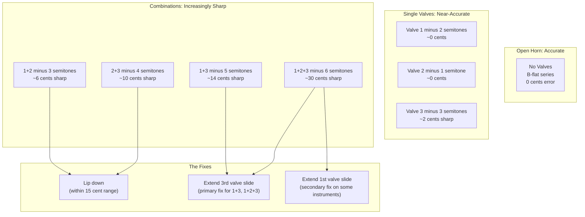
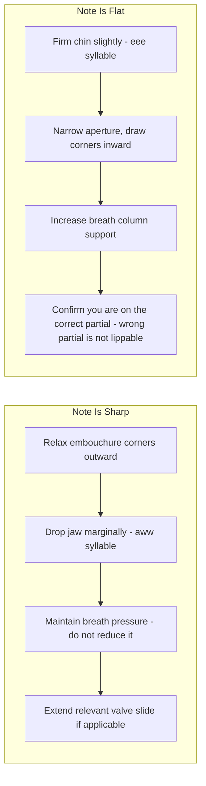
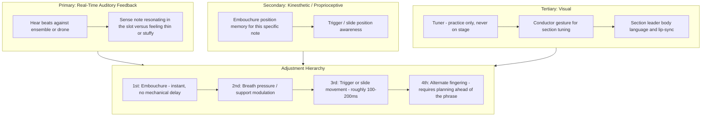
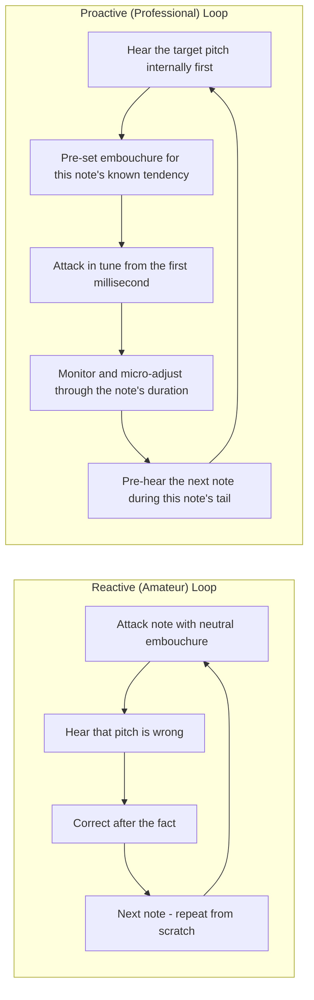

# Lesson 3: Intonation and Tuning Strategies for Brass Players

## Overview

This lesson turns the acoustics of brass instruments into real-time playing skill. You will learn exactly why certain notes are stubbornly sharp or flat, how to fix them mid-phrase, and how to drill your ears and embouchure until a section locks into tune without thinking about it. Theory here exists to serve the hands and the ear — not the other way around.

---

## 1. First-Principles Intuition (The 15%)

### Why Brass Intonation Is Different From Every Other Instrument

A pianist's C is fixed by a tuner before the concert starts. A guitarist's fretted note is fixed by the fret slot. Yours is not fixed by anything external — you are the tuning mechanism. Lips, breath pressure, and embouchure shape sit *inside* the acoustic system, coupled to it in both directions, not controlling it from outside.

The bore is a standing-wave resonator with specific resonant peaks. When your lip frequency matches a peak, the horn reinforces your buzz and the pitch "locks" — it gets louder and easier to hold with less effort. Between peaks, the horn resists you, and the tone goes thin and unstable. This is why the same fingering plays differently on a cold horn versus a warm one, or in a dead room versus a resonant hall. You are not driving an inert tube. You are one half of a feedback loop.

**The one fact you need, no more math than this:** sound travels faster as air warms, and faster sound speed means every resonant peak in the bore shifts upward in pitch. A horn that reads perfectly in tune cold will read noticeably sharp 10 minutes into a warm gig. That's why you always warm up *before* you check tuning, not after, and why professional players quietly nudge the main tuning slide out as a rehearsal progresses.

### The Harmonic Series: Your Map and Your Problem

Playing open horn (no valves), the instrument resonates at integer multiples of a fundamental. On a B♭ trumpet, the usable partials and their deviation from equal temperament (ET) are:

| Partial | Concert Pitch (B♭ Trumpet) | ET Deviation | Playing Reality |
|---------|---------------------------|--------------|-----------------|
| 2nd | B♭3 | 0 ¢ | Reference — your open low B♭ |
| 3rd | F4 | +2 ¢ | Slightly sharp — lip it down a hair |
| 4th | B♭4 | 0 ¢ | Accurate |
| 5th | D5 | **−14 ¢** | Noticeably flat — push to brighten |
| 6th | F5 | +2 ¢ | Slightly sharp |
| 7th | A♭5 | **−31 ¢** | Very flat — essentially never used except as a deliberate "blue" harmonic |
| 8th | B♭5 | 0 ¢ | Accurate |

**Actionable rule:** the 5th partial (D on B♭ trumpet, E on F horn, A on F tuba/euphonium) is *always* flat by about a seventh of a semitone. The 7th partial is unusable as written pitch. The moment you know which partial a note sits on, you know which direction to lean before you even check a tuner.

---

## 2. The Valve Combination Problem (Why Those Notes Are Always Sharp)

This is the single most practically important fact in brass playing. When you combine valves, the added tubing is geometrically too short. Each individual valve slide is cut to lengthen an *open* horn correctly — but stacking valves means the air is already traveling through a longer tube, so the same slide lengths now under-compensate. The deeper you are into combination fingerings, the worse it gets.

**Sharpness of common combinations on B♭ trumpet:**

| Valve Combination | Semitones Down | Nominal Notes | Approximate Error |
|-------------------|---------------|---------------|-------------------|
| 1 alone | 2 | A/B♭ | Accurate |
| 2 alone | 1 | A♯/B | Accurate |
| 3 alone | 3 | A♭ | Slightly sharp |
| 1+2 | 3 | A♭ | ~5–8 ¢ sharp |
| 2+3 | 4 | G | ~10 ¢ sharp |
| 1+3 | 5 | G♭ | **~14 ¢ sharp** |
| 1+2+3 | 6 | F | **~25–35 ¢ sharp** |

This is not a manufacturing flaw. It is geometrically unavoidable, and every modern trumpet, euphonium, and tuba is built with a third-valve slide trigger (or ring) specifically to fix it. If your horn has one and you're not using it, you're leaving a built-in tool unused.



### Trigger and Slide Mechanics: Exact Adjustments

**Third-valve slide (most important):** push it out roughly 1.5–2.5 cm for 1+3 and 1+2+3. Don't treat this as optional fine-tuning — it's the mechanical fix the horn was designed to receive. Drill it until your hand deploys it automatically the instant those valves go down, before the note even speaks.

**First-valve slide saddle:** on many trumpets, pulling it out ~0.5–1 cm corrects 1+2. Less critical on B♭ trumpet, but essential on E♭/F soprano instruments where 1+2 is a workhorse chromatic fingering.

**French horn specifics:** the double horn routes air through separate F and B♭ sides. The B♭ side tends to read truer in the upper register; the F side dominates and plays more stably below the staff. Knowing which side a passage is voiced on is core horn technique, not an afterthought — many stopped or sharp notes on one side have a cleaner alternate on the other.

---

## 3. Practical Tuning Reference: Note-by-Note Tendencies

Memorize these. They are consistent across players and instruments of the same design — this is physics, not individual variation.

### B♭ Trumpet: Chronic Intonation Tendencies

| Written Note | Valve Combo | Tendency | Fix |
|---|---|---|---|
| G4 | 0 | Slightly sharp (3rd partial) | Lip down 2¢, or nudge main slide in slightly |
| F♯4 / G♭4 | 2+3 | 10¢ sharp | Lip down firmly |
| F4 | 1 | Accurate | — |
| E4 | 1+2 | 6¢ sharp | Lip down |
| E♭4 | 2+3 | 10¢ sharp | Lip down, or sub in 1+2+3 with trigger |
| D4 | 1+3 | 14¢ sharp | **Extend 3rd valve slide** |
| D♭4 / C♯4 | 1+2+3 | 25–35¢ sharp | **Extend 3rd valve slide fully + lip down** |
| C4 | 0 | Accurate (4th partial) | — |
| High B♭5 | 0 | Accurate (8th partial) | — |
| A5 | 1+2 | Flat tendency | Lip up, add support |

### Trombone: The Seven Positions

Trombone is conceptually the cleanest brass instrument — slide position directly sets pitch, with no valve geometry to fight. But positions are not evenly spaced because each successive position has to add proportionally more tube length to drop the same semitone, so the slide gaps get wider as you move outward.

| Position | Semitones Below 1st | Nominal Pitches (B♭ Tenor) | Approx. Slide Extension |
|----------|--------------------|-----------------------------|------------------------|
| 1st | 0 | B♭, F, B♭, D, F, A♭, B♭ | Closed |
| 2nd | 1 | A, E, A, C♯, E, G, A | ~6–7 cm |
| 3rd | 2 | A♭, E♭, A♭, C, E♭, G♭, A♭ | ~12–13 cm |
| 4th | 3 | G, D, G, B, D, F, G | ~18–20 cm |
| 5th | 4 | G♭, D♭, G♭, B♭, D♭, E, G♭ | ~24–26 cm |
| 6th | 5 | F, C, F, A, C, E♭, F | ~30–33 cm |
| 7th | 6 | E, B, E, A♭, B, D, E | ~37–40 cm |

**Critical trombone intonation notes:**
- **B♭3 in 1st position** (fundamental series): the 5th partial (D) sits ~14¢ flat. Push the slide marginally outward from "closed" and lip up, or finger an alternate position where available.
- **Low F3:** bass trombonists with an F-attachment use the trigger instead of 6th position for low F — the trigger version is more stable and far easier to center than the long, unsupported slide extension.
- **E4 (4th position):** often reads slightly sharp. Nudge toward a "4-and-a-half" position rather than lipping alone.

### French Horn in F: The Notorious Tendencies

| Written Note | Partials / Valve | Tendency | Fix |
|---|---|---|---|
| F4 (open) | 4th partial | Accurate | — |
| B3 (1) | — | Often flat | Add support, lip up |
| B♭3 (1+2) | — | Sharp | Lip down or use alternate |
| A3 (2+3) | — | Sharp | Lip down |
| A♭3 (1+2+3) | — | Very sharp | Lip down significantly, or try right-hand bell insertion |
| E5 (F side, open) | 5th partial | **14¢ flat** | Lip up, increase breath support |
| B♭5 (B♭ side, open) | Upper partials | Generally accurate | — |

**Right-hand technique as a tuning tool:** the hand cupped inside the bell isn't just tradition — it changes the effective bore length and resonance in real time. Deeper insertion flattens the pitch (up to a full stopped-horn semitone with a tight hand position); shallower insertion sharpens it. Think of your right hand as a continuously variable slide you carry with you on every note.

---

## 4. Embouchure Control: Lipping and Bending

Lipping is pitch correction through embouchure shape alone, with zero mechanical delay. It is your fastest tool, and the one you'll use on every single note you play.

### Lipping Up (Raising Pitch)
- Firm the chin muscles gently — think the syllable "eee"
- Narrow the aperture slightly, corners drawing in toward center
- Increase breath support — push more air column, without squeezing the throat
- **Effective range: +10 to +20 cents** before tone quality starts to choke

### Lipping Down (Lowering Pitch)
- Relax the corners slightly outward
- Drop the jaw a small amount — think the syllable "ohh" or "aww"
- Keep breath pressure constant — do **not** back off the air, that produces flat and airy, not flat and centered
- **Effective range: −10 to −25 cents** before the tone loses its core

### The Embouchure-Breath Interaction

The most common beginner error: flattening pitch by easing off the air. That produces a dead, breathy tone, not a controlled lip-down. When lipping down, keep the air moving at full pressure — the embouchure opens, the air engine stays at full throttle. Picture opening a valve while the pump behind it keeps running at the same speed.



---

## 5. Ensemble Intonation: Just Intonation in Chords

In a brass section, equal temperament is a starting point, not the destination. When a chord locks with no audible wobble, it rings with an almost organ-like purity. That's just intonation in action, and it's the difference between a section that sounds "fine" and one that sounds professional.

### Target Adjustments Within a Chord

| Chord Degree | Adjustment from ET | Why |
|---|---|---|
| Root (1) | 0¢ | Anchor — set by the conductor's or bass player's reference pitch |
| Perfect Fifth (5) | +2¢ | Pure 5th (3:2 ratio) is 2¢ wider than ET |
| Major Third (3) | **−14¢** | Pure major 3rd (5:4 ratio) is 14¢ narrower than ET |
| Minor Third (♭3) | +16¢ | Pure minor 3rd (6:5 ratio) is wider than ET |
| Minor Seventh (♭7) | −31¢ | 7th-harmonic seventh, rarely used this pure outside of blues/jazz color |

**Practical rule:** if you're sitting on the major third of the chord, flatten it 14 cents and listen until the wavering disappears. This single adjustment, more than any other, is what separates an amateur section sound from a professional one.

### Hearing Beats: The Real-Time Feedback Signal

Two slightly mismatched pitches produce a periodic swell in volume — the beat.

> Beat frequency = |f₁ − f₂|

At 1 Hz you hear roughly one pulse per second — clearly out of tune. At 0.3 Hz it's nearly imperceptible. At 0 Hz the sound locks and rings evenly. Train your ear to track the *speed* of the beat, not just whether it's present. As you adjust, the beat should visibly slow down before it stops — that deceleration is your real-time feedback signal.

**Beat-listening drill:** have a partner hold a sustained concert B♭. You play the major third above it (D on a B♭ instrument). Listen for the wobble. Slowly lip down. The beat decelerates. Keep going until it fully stops — you're now 14 cents flat of ET, which is acoustically correct. Memorize exactly how that embouchure position feels so you can return to it without a tuner.

---

## 6. Active Practice Drills

Drills are sequenced fundamental to advanced. Use a clip-on or strobe tuner, and a drone source (a tuning app, a sustained pedal tone from a keyboard, or a looped recording of your own held note).

---

### Drill 1: Harmonic Series Mapping (10 min daily, first 2 weeks)

**Goal:** internalize each partial's natural tendency before valves add complexity on top.

1. Set a drone to your instrument's fundamental (B♭ for trumpet/trombone/euphonium, F for French horn, B♭ or C for tuba depending on instrument).
2. Play open horn, ascending through partials: 2nd → 3rd → 4th → 5th → 6th → 8th.
3. Hold each partial for 4 beats with zero correction. Read the tuner. Write the number down.
4. Then correct to ET using embouchure only. Note and memorize that embouchure adjustment.
5. Re-attack the same partial, aiming to produce the corrected pitch from the very first instant of sound.

**Metronome:** ♩ = 60, one partial per measure, slow whole notes.

| Week | Target |
|---|---|
| Week 1 | Document each partial's natural tendency in writing |
| Week 2 | Land the corrected pitch within one beat of attack, no mid-note correction |

---

### Drill 2: Valve Combination Tuning (10 min daily, weeks 2–4)

**Goal:** automate trigger use and lip corrections for the chronically sharp combinations.

**Setup:** tuner in view. Descend chromatically, one valve combination at a time.

**Sequence (B♭ Trumpet):**

```
Open -> 2 -> 1 -> 1+2 -> 3 -> 2+3 -> 1+3 -> 1+2+3
Pitches: Bb -> A -> Ab -> G -> Gb -> F -> E -> Eb
```

> ⚠️ Watch for register: on B♭ trumpet, "1 alone" plays A♭ in the lower octave — confirm you're reading the correct partial, not jumping registers by accident.

For each note:
1. Play it with no correction.
2. Check the tuner. For 1+3 and 1+2+3, engage the trigger to bring it down. Tune to ET.
3. Release the trigger. Now tune the same note with embouchure alone. Feel the difference in lip effort.
4. Alternate: trigger-only correction → embouchure-only correction → both combined.

**Metronome:** ♩ = 60, one note per 2 beats. Advance to ♩ = 80 once the motion is automatic.

---

### Drill 3: Long Tone Resonance Lock (15 min daily, all levels)

**Goal:** develop the physical sensation of "slotting" a pitch — feeling the horn resonate fully under your tone.

1. Play any comfortable pitch (G4 on trumpet works well).
2. Sustain at a steady forte for 8–12 seconds.
3. While sustaining, slowly glide the pitch downward using embouchure alone — no valve or slide change.
4. Feel the point where the instrument "gives" and the tone suddenly deepens and steadies. That's the resonance peak.
5. Hold there. Read the tuner. This is your slot for that note.
6. Release, re-attack, and try to find the slot within the first beat.

**Key sensation:** the horn vibrates more strongly under your lips when you're centered in the slot, and the note becomes easier to hold, not harder. Players often describe it as the instrument "coming alive." That's a real physical effect — you're sitting on the peak of the bore's resonant response, where it reinforces your buzz most efficiently.

**Progression:**
- Weeks 1–2: G4, C4, F4 (stable, well-centered pitches)
- Weeks 3–4: D4 (sharp combination, requires trigger + slot alignment together), E♭4, D♭4

---

### Drill 4: Interval Tuning Against a Drone (20 min, 3×/week)

**Goal:** train the ear to hear pure intervals and prepare for just-intoned ensemble playing.

**Setup:** hold a B♭ drone (keyboard, app, or loop pedal). Tune your open note to it first. Then play these intervals above the drone, aiming for the pure version each time:

| Interval | Your Note (B♭ instrument) | Target Adjustment from ET |
|---|---|---|
| Unison | B♭ | 0¢ |
| Major Third | D | −14¢ |
| Perfect Fifth | F | +2¢ |
| Octave | B♭ | 0¢ |
| Major Sixth | G | +16¢ (pure 5:3 ratio) |
| Minor Seventh | A♭ | −31¢ (7th harmonic — notice how "bluesy" this sounds) |

For each interval:
1. Play the note at straight ET (whatever your default fingering/embouchure gives).
2. Listen for beats against the drone.
3. Adjust slowly until the beats stop. That's just intonation.
4. Alternate ET → just → ET repeatedly until your ear clearly distinguishes the two.

**Metronome:** none. This drill is about listening, not rhythm.

---

### Drill 5: Chorale Tuning in Section (20–30 min, ensemble rehearsal)

**Goal:** transfer individual tuning skill into live ensemble context.

**Setup:** 4-part brass section (or any 4 players). Sustain this B♭ major chord in root position:

```
Soprano (Trumpet 1):            B-flat5  - Root, 8th partial - 0 cents
Alto (Trumpet 2 / Flugel):      D5       - Major 3rd - target -14 cents
Tenor (Trombone / Horn):        F4       - Perfect 5th - target +2 cents
Bass (Tuba / Bass Trombone):    B-flat2  - Root - 0 cents
```

**Procedure:**
1. Everyone sustains forte. Listen to the whole sound before adjusting anything.
2. Bass anchors first — holds pitch and dynamic rock steady.
3. Fifth-player adjusts +2¢ (a slight sharpening from ET).
4. Third-player adjusts −14¢ (the biggest single move in the chord).
5. Soprano confirms octave purity against the bass (0¢).
6. Hold until beats vanish and the chord rings.
7. Release, re-attack, and try to find the resonant chord within 2 seconds.

**Progression:**

| Week | Target |
|---|---|
| Week 1 | Find the resonant chord after 5–8 seconds of adjustment |
| Week 2 | Find it within 3 seconds |
| Week 3 | Find it within 1–2 seconds (lock on the attack) |
| Week 4 | Move through I → IV → V → I maintaining just intonation at every chord |

---

### Drill 6: Slide Trigger Reflex Training (Trumpet/Euphonium/Tuba) (10 min daily)

**Goal:** make third-valve (and first-valve) trigger extension an unconscious reflex tied to specific fingerings, not a correction you remember to apply after the fact.

**Method:** slow chromatic scale, descending.

```
Scale:   Bb4 -> A4 -> Ab4 -> G4 -> Gb4 -> F4 -> E4 -> Eb4 -> D4 -> Db4 -> C4 -> B3 -> Bb3
Valves:  0   -> 1+2 -> 2  -> 0  -> 1+2 -> 1  -> 1+2 -> 2+3 -> 1+3* -> 1+2+3* -> 0 -> 1+2 -> 0
                                                             ^TRIGGER   ^TRIGGER+LIP
```

On each asterisked fingering, deploy the trigger the instant the valves go down — before the note fully speaks, not after you hear it's sharp. The goal is for trigger and valve motion to become one single gesture.

**Metronome:** ♩ = 50 for week one. Advance to ♩ = 70 once the trigger deploys consistently without conscious thought.

---

## 7. The Feedback Loop: How to Self-Monitor in Performance

In practice you have a tuner. On stage you have your ears, your section, and your own proprioception. This is the monitoring hierarchy, fastest tool to slowest:



**Key principle:** embouchure reacts fastest but has the smallest range. Trigger and slide movement are slower but cover larger corrections. Decide on alternate fingerings before the phrase starts, never mid-phrase — there's no time to plan once the passage is moving.

---

## 8. Environmental Compensation Checklist

| Situation | Effect | Immediate Fix |
|---|---|---|
| Cold horn (first 5–10 min) | Flat — slower sound speed, low pitch | Blow warm air through the bore before tuning; warm the mouthpiece in your hand first |
| Hot stage lighting / warm room | Sharp — pitch climbs roughly 1–2 cents per °C above baseline | Push the main slide in 1–3 mm as the horn warms; re-check after 15 minutes |
| Outdoor performance, wind/cold | Highly variable — instrument cools rapidly and unevenly | Keep the bell covered between entrances; expect continuous small slide moves mid-set |
| High altitude (above ~1500m) | Less dense air — pitch reads flatter, high notes feel easier to produce | Pull the main slide out 1–3 mm; add slightly more breath support |
| High humidity | ~1–2¢ flat versus dry air | Minor — a small lip-up adjustment, usually negligible in practice |
| Mute inserted | Raises pitch 10–40¢ depending on mute design | Practice intonation with every mute you own individually; straight mutes read sharp, harmon mutes (stem out) can read very sharp — pull slide or lip down hard |

---

## 9. Alternate Fingerings Reference

Memorize these. Reach for them when tempo or hand position makes a trigger impractical mid-phrase.

### B♭ Trumpet Alternates

| Note | Standard Fingering | Problem | Alternate Fingering | Trade-off |
|---|---|---|---|---|
| D4 | 1+3 | 14¢ sharp | 1+3 + trigger (best option), or open 0 (6th partial) | Open D demands precise embouchure control |
| C♯4 / D♭4 | 1+2+3 | 25–35¢ sharp | 1+3 + full trigger | Tone is slightly thinner |
| G4 | 0 | 2¢ sharp (3rd partial) | 1+2+3 in the lower register | Avoid in fast passages, slow response |
| A4 | 1+2 | Accurate | 3 alone | "3 alone" runs sharp; keep 1+2 as the default |
| F♯4 | 1+2+3 or 2+3 | 2+3 sharp, 1+2+3 very sharp | 2+3 + trigger + lip | No clean fingering exists; compensation is mandatory |

### French Horn (F Horn) Alternates

| Note | Standard | Problem | Alternate | Trade-off |
|---|---|---|---|---|
| B2 | 1 | Flat | 1+2+3 on B♭ side | Brighter tone color |
| A♭3 | 1+2+3 | Very sharp | Right-hand bell insertion (stopped), lowers ~half step | Changes timbre to a stopped-horn color — only valid where the score permits it |
| E5 | 0 (F side) | 14¢ flat (5th partial) | 1 (B♭ side, 4th partial) | B♭ side E is slightly brighter in color |

### Trombone Alternates

| Note | Standard Position | Problem | Alternate | Trade-off |
|---|---|---|---|---|
| F3 | 6th position (B♭ side) | Slide very extended, hard to center | F-attachment trigger + 1st position | Requires an F-attachment horn; markedly better intonation |
| E3 | 7th position | Extreme extension, unstable | F-attachment + 2nd position | Same trade-off as above |
| B♭3 | 1st position | Accurate | — | — |
| E♭4 | 4th position | Often sharp | Lip down + "4-and-a-half" position | Minimal slide adjustment needed |

---

## 10. The Mental Model: Intonation as Navigation, Not Correction

The most important idea in this lesson isn't technical, it's cognitive. Weaker players correct intonation after the note has already sounded. Strong players navigate to the in-tune pitch *before* the attack.

That requires three things:
1. Knowing your tendencies by note (the reference tables above)
2. Pre-loading the embouchure — setting lip tension before the air starts moving
3. Hearing the pitch internally before you play it, the way you'd hum it silently in your head first

The sequence is: **hear it internally → set the embouchure → play it correctly on the attack.**

Not: **play it → hear that it's wrong → correct it.** That's always a beat too late, and the audience hears the correction.



The proactive loop is the destination every drill in this lesson builds toward. Long tones build embouchure memory. Harmonic series drills build the expectation of where each partial naturally sits. Chorale drills build the skill of monitoring several pitches simultaneously. Trigger drills automate the mechanical half of the job so conscious attention is left free for musical decisions.

---

## 11. Practice Schedule Integration

| Session Type | Duration | Drills | Focus |
|---|---|---|---|
| Morning warm-up | 15 min | Drill 1 (partials) + Drill 3 (long tones) | Wake up the embouchure, find the slots |
| Technique session | 20–30 min | Drill 2 (valve combos) + Drill 6 (trigger reflex) | Automate mechanical corrections |
| Musical practice | 30–60 min | Repertoire, tuner nearby but not stared at | Apply skills to real passages, flag problem spots |
| Ensemble prep | 20 min | Drill 4 (drone intervals) + Drill 5 (chorale) | Transfer skills into group context |
| Performance cooldown | 10 min | Slow long tones, no tuner | Listen purely, rebuild trust in your own ear |

**Metronome progression summary:**

| Drill | Starting BPM | Target BPM | Advance When |
|---|---|---|---|
| Harmonic partials | ♩ = 50 (whole notes) | ♩ = 60 | You land in tune within 1 beat of attack |
| Chromatic combinations | ♩ = 50 | ♩ = 80 | Trigger deploys with the valve, not after |
| Chorale section tuning | No metronome | No metronome | Chord rings clean within 2 seconds |
| Chromatic scale with triggers | ♩ = 50 | ♩ = 80 | Trigger motion is a pure reflex |

---

## Summary

Brass intonation is a live navigation problem, not a one-time setup. The harmonic series gives you a map of known deviations before you add a single valve. Valve combinations introduce predictable sharpness that your horn was built to compensate for with triggers and slides. Your embouchure gives fast, fine control across roughly a ±20 cent range. Ensemble playing demands you move deliberately away from equal temperament toward pure intervals, above all the major third at −14 cents.

Work the drills in order — partial awareness, mechanical compensation, embouchure control, ensemble listening, proactive targeting — with a tuner in the practice room and pure listening on stage. Four to eight weeks of consistent daily work turns the sharp C♯ and the flat high D from accidents into events you've already corrected before the audience ever hears them.
