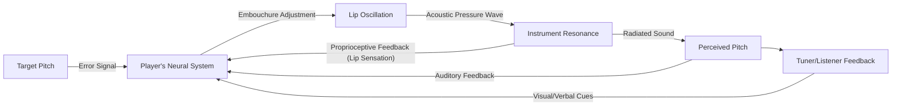
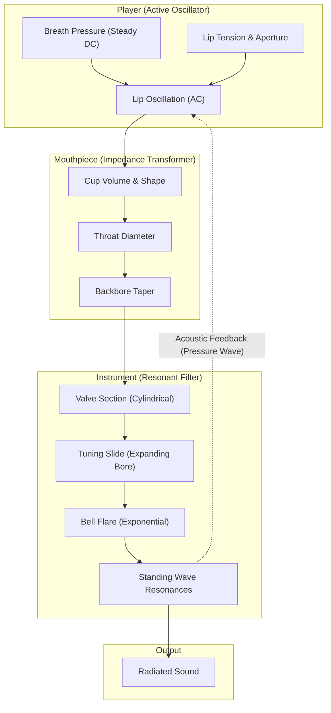

# Lesson 3: Intonation and Tuning Strategies

## 1. First-Principles Intuition & Invariants

### The Physical Foundation of Brass Intonation

Brass instruments operate through a fundamentally different mechanism than fixed-pitch instruments. While a piano's pitch emerges from pre-tuned strings of specific lengths and tensions, and a guitar's pitch is determined by fret positions that mathematically divide the string, brass instruments require the player to become an active component in the acoustic system. The player's lips function as a pressure-controlled oscillator, the mouthpiece as an impedance-matching transformer, and the instrument's bore as a complex acoustic filter and resonator.

The governing physics begins with the wave equation for pressure waves in a cylindrical tube:

$$\frac{\partial^2 p}{\partial t^2} = c^2 \frac{\partial^2 p}{\partial x^2}$$

where *p* is acoustic pressure, *c* is the speed of sound, *t* is time, and *x* is position along the tube. For a tube of length *L* that is open at the bell and effectively closed at the mouthpiece, the boundary conditions force the resonant frequencies to follow:

$$f_n = \frac{nc}{2L}$$

where *n* is the harmonic number (1, 2, 3, ...). This produces the harmonic series: a fundamental frequency and integer multiples thereof.

For a B♭ trumpet with an effective tube length of approximately 148 cm (including valve tubing in the neutral position), the fundamental frequency is:

$$f_1 = \frac{343 \text{ m/s}}{2 \times 1.48 \text{ m}} \approx 116 \text{ Hz}$$

This corresponds to B♭1, though in practice this pedal tone is rarely used. The playable range begins with the second harmonic at 232 Hz (B♭2), followed by the third at 348 Hz (F3), the fourth at 464 Hz (B♭3), and so forth. The trumpet is nominally pitched in B♭, meaning that when no valves are depressed, the instrument resonates at harmonics of B♭.

### The Intonation Problem: Imperfect Harmonic Series

The critical challenge in brass intonation stems from a mismatch between the natural harmonic series and the equal-tempered chromatic scale used in Western music. In equal temperament, the octave is divided into 12 equal semitones, each separated by a frequency ratio of $2^{1/12} \approx 1.0595$. However, the natural harmonic series produces intervals that deviate significantly from these ratios.

Consider the deviations (in cents, where 100 cents = 1 semitone):

| Harmonic | Frequency Ratio | Interval Name | ET Equivalent | Deviation (cents) |
|----------|-----------------|---------------|---------------|-------------------|
| 1 | 1/1 | Fundamental | Unison | 0 |
| 2 | 2/1 | Octave | Octave | 0 |
| 3 | 3/2 | Perfect Fifth | P5 | +2 |
| 4 | 4/3 (relative to 3rd) | Perfect Fourth | P4 | 0 |
| 5 | 5/4 (relative to 4th) | Major Third | M3 | **-14** |
| 6 | 6/5 (relative to 5th) | Minor Third | m3 | +2 |
| 7 | 7/6 (relative to 6th) | Sub-minor Third | — | **-31** |
| 11 | 11/8 (relative to 8th) | Super-fourth | — | **-49** |
| 13 | 13/8 (relative to 8th) | Super-sixth | — | **+41** |

The seventh, eleventh, and thirteenth harmonics are particularly problematic, falling significantly outside equal temperament. The seventh harmonic produces a pitch nearly a third of a semitone flat relative to the equal-tempered minor seventh. The eleventh harmonic sits between F and F♯, about halfway flat of F♯. The thirteenth harmonic is sharp of A by nearly half a semitone.

These deviations are not defects but inherent properties of the physics. No amount of instrument design can eliminate them; they are consequences of the integer-ratio nature of standing waves. The player must compensate through three primary mechanisms: embouchure adjustment (lip tension and aperture), breath pressure modulation, and the strategic use of alternate fingerings.

### Acoustic Invariants and the Role of Bore Geometry

The bore profile—the internal diameter as a function of position along the tube—profoundly affects intonation. A cylindrical bore (constant diameter) produces a harmonic series that closely approximates the ideal ratios. A conical bore (linearly expanding diameter) emphasizes odd harmonics and produces a darker, more mellow tone but complicates intonation.

Most brass instruments employ a compound bore: cylindrical in the valve section, gradually expanding through the tuning slide, and flaring dramatically at the bell. This hybrid design balances the need for clear harmonic definition with tonal richness.

The input impedance *Z* of a brass instrument, viewed from the mouthpiece, exhibits peaks at the resonant frequencies. The player's lips vibrate most readily at frequencies where *Z* is high. The sharpness of these peaks—the *Q factor*—determines how forgiving the instrument is. A high-Q instrument (narrow peaks) provides precise pitch definition but demands exacting control. A low-Q instrument (broad peaks) is more forgiving but offers less clarity.

The Q factor is influenced by:
- **Bore taper**: Gradual tapers broaden peaks; abrupt changes sharpen them
- **Bell flare rate**: Exponential flares (common in modern instruments) produce a balanced response
- **Internal surface finish**: Roughness introduces damping, lowering Q

Temperature also affects tuning. The speed of sound in air is:

$$c = 331.3 + 0.606T$$

where *T* is temperature in Celsius. A 10°C increase raises pitch by approximately 3 Hz at A440, or about 12 cents—just over a tenth of a semitone. Professional players compensate by adjusting tuning slide positions and embouchure tension as the instrument warms during performance.

### Embouchure as a Nonlinear Control Surface

The embouchure functions as a pressure-controlled reed oscillator. Lip tension, aperture size, and the contact area with the mouthpiece rim form a three-dimensional control surface. Increasing tension raises pitch; increasing aperture lowers resistance and can flatten pitch; moving the mouthpiece contact point higher on the lips brightens tone and raises pitch.

This control is highly nonlinear. Small changes in embouchure near the center of the range produce proportional pitch changes, but at the extremes of range, the same physical adjustments produce larger or smaller effects. This nonlinearity arises because the lips' resonant frequency depends on tension in a power-law relationship, approximately:

$$f \propto T^{0.5}$$

where *T* is tension. Doubling tension does not double frequency but increases it by only $\sqrt{2} \approx 1.41$.

The feedback loop between player and instrument operates at millisecond timescales. The player continuously adjusts embouchure in response to auditory feedback, proprioceptive sensation (how the lips feel), and visual cues (from a tuner or conductor). This real-time optimization resembles a proportional-integral-derivative (PID) controller in control theory:

The player learns, through thousands of hours of practice, to internalize this control loop, developing muscle memory that encodes the embouchure adjustments required for each pitch in each register.

## 2. Core Architecture & Mechanics

### The Brass Instrument as a Coupled Oscillator System

A brass instrument is most accurately modeled as a coupled oscillator: the player's lips and the air column interact bidirectionally. The lips do not simply drive the air column; the air column's resonances feed back to stabilize and entrain the lip oscillations. This mutual coupling is essential to understanding why brass instruments behave differently than simple sound-producing devices.

The system can be represented as:

The feedback path from the instrument's resonances back to the lips is crucial. When the player attempts to sound a note, initial lip vibrations generate a pressure wave that travels through the instrument. At each discontinuity (valve transitions, tuning slide bends, bell flare), part of the wave reflects back toward the mouthpiece. These reflections arrive back at the lips and either reinforce or oppose the ongoing vibrations.

If the player's lip frequency matches a resonant mode of the instrument, reflections arrive in phase, reinforcing vibrations and stabilizing the pitch. If the frequency is mismatched, reflections arrive out of phase, damping vibrations and making sustained tone difficult. This is why certain notes "speak" easily while others require careful control: the resonances are more or less forgiving depending on the harmonic alignment.

### Valve Systems and Length Perturbations

Modern brass instruments use valves to extend the chromatic range. Each valve adds a length of tubing, lowering pitch by a specific interval:

- **Valve 1**: Lowers pitch by 2 semitones (major second)
- **Valve 2**: Lowers pitch by 1 semitone (minor second)
- **Valve 3**: Lowers pitch by 3 semitones (minor third)

Combinations allow access to all chromatic pitches:
- **Valves 1+2**: 3 semitones (minor third)
- **Valves 2+3**: 4 semitones (major third)
- **Valves 1+3**: 5 semitones (perfect fourth)
- **Valves 1+2+3**: 6 semitones (tritone)

However, this system introduces intonation problems. When valves are used in combination, the added lengths are insufficient. Consider the trumpet in B♭ with an open (no valves) effective length *L₀*. Valve 1 should add a length to produce a pitch 2 semitones lower:

$$L_1 = L_0 \left( 2^{2/12} - 1 \right) \approx 0.1225 L_0$$

Valve 2 should add:

$$L_2 = L_0 \left( 2^{1/12} - 1 \right) \approx 0.0595 L_0$$

Valve 3 should add:

$$L_3 = L_0 \left( 2^{3/12} - 1 \right) \approx 0.1892 L_0$$

For the combination of valves 1+3 (lowering pitch by 5 semitones), the required total length is:

$$L_{1+3} = L_0 \left( 2^{5/12} - 1 \right) \approx 0.3348 L_0$$

But the actual added length is only:

$$L_1 + L_3 \approx 0.1225 L_0 + 0.1892 L_0 = 0.3117 L_0$$

This is about 7% short, causing the combination to be sharp by approximately 14 cents. The discrepancy worsens with more valves: the 1+2+3 combination can be 30-40 cents sharp.

Manufacturers address this through **valve slide triggers** and **compensating systems**. Triggers allow the player to extend the third valve slide (or first valve slide on some instruments) mid-performance, lengthening the tubing to correct sharpness. Compensating systems (common on double horns and some tubas) automatically route air through additional tubing when certain valve combinations are depressed, providing the necessary extra length.

The mathematics of valve tuning requires solving:

$$\sum_{i} L_i = L_0 \left( 2^{n/12} - 1 \right)$$

where *n* is the total number of semitones lowered and the sum runs over active valves. Perfect solutions exist only for the individual valves; combinations necessitate compromise or active compensation.

### Alternate Fingerings and Practical Workarounds

Professional players exploit alternate fingerings to improve intonation on problematic notes. For example, on trumpet:

- **D4** (open + 1 or 3): The standard fingering is 1+3, but this is often sharp. Using the alternate fingering 0 (open, relying on the 6th partial of the B♭ harmonic series) allows for better intonation but requires precise embouchure control.
- **C♯4** (1+2+3 or 1+3): The 1+2+3 combination is notoriously sharp. Substituting 1+3 while lipping down may improve intonation, though it sacrifices some tonal stability.

These alternates trade fingering complexity and embouchure demand for improved tuning. The choice depends on tempo, dynamics, and tonal requirements.

### Breath Pressure and the Bernoulli Effect

Breath pressure affects pitch through multiple mechanisms. Higher pressure increases the speed of the air stream passing through the lip aperture. According to Bernoulli's principle, increased flow velocity decreases static pressure, which can paradoxically lower pitch by reducing the effective tension on the lips. However, higher breath pressure also increases the energy supplied to the oscillating system, tending to raise pitch.

The net effect is context-dependent. In the low register, increased breath pressure generally raises pitch. In the high register, excessive pressure can cause the pitch to break upward to the next partial or crack entirely. Skilled players learn to modulate pressure continuously across phrases, maintaining consistent pitch despite dynamic changes.

The relationship between pressure *P*, flow *Q*, and impedance *Z* follows:

$$P = Z \cdot Q$$

The acoustic impedance *Z* varies with frequency and depends on bore geometry. At resonances, *Z* peaks, and small changes in *Q* produce large pressure changes, enhancing the feedback to the lips.

### Intonation in Ensemble Contexts

In ensemble performance, brass players must tune not to an abstract equal-tempered standard but to the instantaneous harmonic context. When playing a major third in a brass choir, the player may intentionally flatten the pitch by 14 cents to match the pure just-intonation interval (frequency ratio 5:4) rather than the equal-tempered major third (ratio $2^{4/12} \approx 1.2599$). This creates beatless, resonant chords that ring with clarity.

This practice, called **just intonation tuning**, requires the player to:
1. Identify the harmonic function of their note (root, third, fifth, seventh)
2. Adjust pitch based on the target interval purity
3. Monitor beats (amplitude fluctuations caused by slight frequency mismatches) and adjust in real time to minimize them

The beat frequency *f_beat* between two tones of frequencies *f₁* and *f₂* is:

$$f_{\text{beat}} = |f_1 - f_2|$$

A beat frequency of 1-2 Hz is perceptible and distracting; 0.5 Hz or slower is acceptable; zero beats indicate perfect tuning. Players train themselves to hear and eliminate beats.

### The Role of the Mouthpiece

The mouthpiece serves as an acoustic impedance transformer, matching the high impedance of the lips to the low impedance of the instrument bore. The geometry of the cup, throat, and backbore critically affects intonation, response, and tone color.

- **Cup diameter and depth**: Larger, deeper cups produce darker tone and lower resistance, favoring low register and flexibility. Shallow cups produce brighter tone, higher resistance, and clearer high register but can fatigue the embouchure.
- **Throat diameter**: Smaller throats increase resistance, raising pitch and providing more control but limiting airflow. Larger throats ease airflow, lowering pitch and enabling louder dynamics but reducing precision.
- **Backbore taper**: Gradual tapers smooth the transition to the instrument bore, balancing tone and intonation across registers. Abrupt tapers create bright, focused sound but can cause instability.

Players select mouthpieces based on the demands of the repertoire, personal physiology, and desired tonal aesthetic. Switching mouthpieces requires relearning embouchure adjustments, as the pitch tendencies and resistance characteristics change.

### Temperature, Humidity, and Environmental Effects

Environmental conditions introduce systematic tuning drifts. Beyond temperature's effect on the speed of sound, humidity affects the density of air and thus the effective acoustic mass within the bore. High humidity slightly lowers pitch (typically 1-2 cents at 80% relative humidity compared to dry air). Altitude also lowers air density, flattening pitch and reducing resistance, making high notes easier but low notes less stable.

Professional orchestras tune to a standard pitch (often A440 or A442) before performance, but tuning drifts during the performance as instruments warm from breath heat and ambient temperature changes. Brass players must continuously micro-adjust throughout the performance, monitoring intonation against the ensemble and adjusting tuning slides, embouchure, and breath support as needed.

### Advanced Tuning Techniques: Lipping and Slide Adjustments

**Lipping** refers to pitch adjustment via embouchure alone, without changing fingering or slide position. Lipping up (raising pitch) involves tightening the embouchure, narrowing the aperture, and increasing breath support. Lipping down (lowering pitch) involves relaxing tension, widening the aperture, and reducing breath pressure. Effective lipping range is typically ±20-30 cents before tone quality degrades significantly.

**Slide adjustments** (on instruments with movable slides, like trombone or trumpet tuning slides) provide coarse tuning. The main tuning slide adjusts overall pitch; individual valve slides correct specific valve combinations. For instance, extending the third valve slide by 1-2 cm corrects the sharpness of 1+3 and 1+2+3 combinations.

On trombone, slide positions define pitch directly. The seven positions correspond to progressively longer tube lengths:

| Position | Approximate Length Added | Pitch Lowering |
|----------|--------------------------|----------------|
| 1 | 0 cm | 0 semitones |
| 2 | ~7 cm | 1 semitone |
| 3 | ~14 cm | 2 semitones |
| 4 | ~21 cm | 3 semitones |
| 5 | ~28 cm | 4 semitones |
| 6 | ~35 cm | 5 semitones |
| 7 | ~42 cm | 6 semitones |

The positions are not evenly spaced in physical distance due to the exponential relationship between length and pitch. Trombonists must memorize precise positions for each note in each register, adjusting continuously for intonation within each position.

### Practical Training and Ear Development

Achieving reliable intonation requires systematic training:

1. **Long-tone practice**: Sustaining single pitches with a tuner, observing pitch stability and making micro-adjustments. This builds embouchure strength and control.
2. **Harmonic series exercises**: Playing through the natural harmonic series on open fingerings, internalizing the relationships between partials and developing awareness of intonation tendencies.
3. **Interval practice**: Playing scales, arpeggios, and interval patterns slowly with a drone or backing track, training the ear to recognize pure intervals and adjust accordingly.
4. **Ensemble tuning drills**: Playing chorales or sustained chords with other players, listening for beats and adjusting to eliminate them. This develops the skill of tuning in real time within a harmonic context.

Advanced players develop **relative pitch memory**, the ability to hear a pitch and immediately know its relationship to a reference (typically A440 or the tonic of the current key). This skill, combined with kinesthetic awareness of embouchure positions, allows for rapid, accurate pitch production even in demanding passages.

### Summary: Intonation as an Active, Multivariate Control Problem

Brass intonation is not a passive result of instrument design but an active, continuous process. The player must integrate knowledge of the harmonic series, valve combinations, embouchure control, breath management, and environmental factors, all while monitoring auditory feedback and adjusting in real time. This is a high-dimensional control problem requiring years of training to master.

The invariants—the physics of standing waves, the integer ratios of the harmonic series, the nonlinear response of the embouchure—are fixed. The player's task is to navigate these invariants, exploiting alternate fingerings, slide adjustments, and micro-adjustments of embouchure and breath to produce accurate, expressive intonation across all registers, dynamics, and ensemble contexts. This synthesis of physics, physiology, and perceptual skill distinguishes brass performance as both an art and a science.
