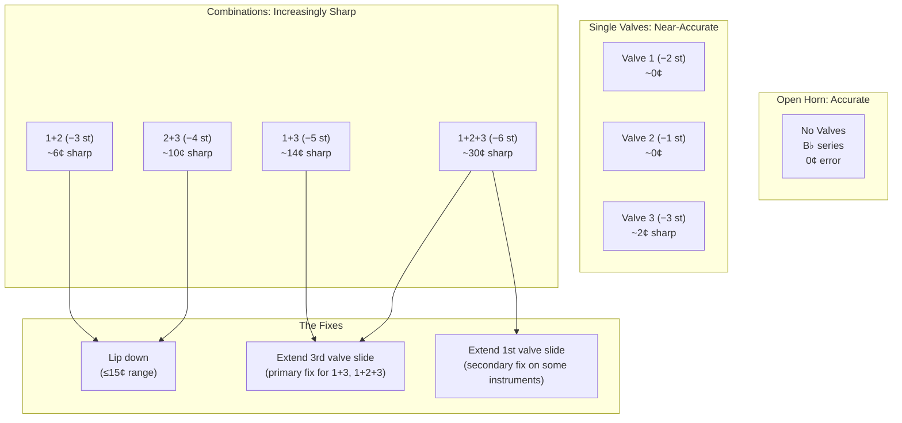
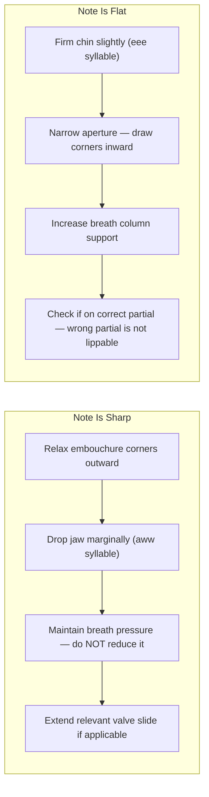
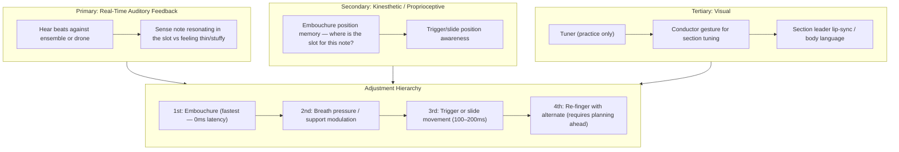
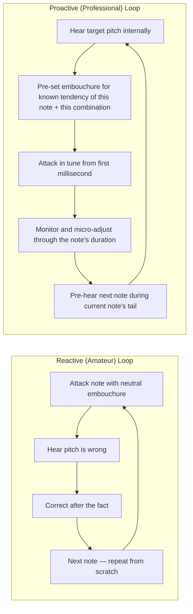

# Lesson 3: Intonation and Tuning Strategies for Brass Players

## Overview

This lesson transforms the physics of brass acoustics into immediately actionable playing skills. You will learn exactly why certain notes are stubbornly sharp or flat, how to fix them in real time, and how to train your ears and embouchure to hold a section in tune. The theory here is a tool for playing, not an end in itself.

---

## 1. First-Principles Intuition (The 15%)

### Why Brass Intonation Is Different From Every Other Instrument

A pianist's C is locked in. A guitarist's fretted note is locked in. Yours is not. You are the tuning mechanism. Your lips, breath pressure, and embouchure shape are actively inside the acoustic system at all times — not driving it from outside, but coupled to it bidirectionally.

Your instrument contains a standing-wave resonator (the bore) that has specific resonant peaks. When your lip frequency matches a resonant peak, the instrument reinforces your vibration and locks the pitch. When you're between peaks, the instrument resists you. This coupling is why the same valve combination on a cold horn versus a warm horn, in a dry hall versus a resonant one, feels and plays differently. You are part of the instrument.

**The one equation you need:** The speed of sound determines your pitch.

> c ≈ 331 + 0.6 × T (m/s), where T is temperature in Celsius

At 20°C: c ≈ 343 m/s. At 30°C: c ≈ 349 m/s. That 10°C rise sharpens pitch by roughly 12 cents — over a tenth of a semitone. This is why you must warm the horn before tuning and why pitch drifts upward in the first 10 minutes of playing.

### The Harmonic Series: Your Map and Your Problem

When you play open horn (no valves), your instrument resonates at integer multiples of a fundamental. On a B♭ trumpet, the accessible partials and their deviations from equal temperament are:

| Partial | Concert Pitch (B♭ Trumpet) | ET Deviation | Playing Reality |
|---------|---------------------------|--------------|-----------------|
| 2nd | B♭3 | 0 ¢ | Reference — your open low B♭ |
| 3rd | F4 | +2 ¢ | Slightly sharp — lip it down |
| 4th | B♭4 | 0 ¢ | Accurate |
| 5th | D5 | **−14 ¢** | Significantly flat — push to brighten |
| 6th | F5 | +2 ¢ | Slightly sharp |
| 7th | A♭5 | **−31 ¢** | Very flat — rarely used as written |
| 8th | B♭5 | 0 ¢ | Accurate |

**Actionable rule:** The 5th partial (D on B♭ trumpet, E on F horn) is always flat. The 7th partial is unusably flat unless you are deliberately playing it as a natural tone. Knowing which partial you are on tells you immediately which direction to adjust.

---

## 2. The Valve Combination Problem (Why Those Notes Are Always Sharp)

This is the most practically important theory in this lesson. When you combine two or more valves, the tubing added is geometrically insufficient. Each valve slide was cut to work from open horn length, but combination fingerings require a longer starting point.

**The sharpness of common combinations on B♭ trumpet:**

| Valve Combination | Semitones Down | Nominal Notes | Approximate Error |
|-------------------|---------------|---------------|-------------------|
| 1 alone | 2 | A/B♭ | Accurate |
| 2 alone | 1 | A♯/B | Accurate |
| 3 alone | 3 | A♭ | Slightly sharp |
| 1+2 | 3 | A♭ | ~5–8 ¢ sharp |
| 2+3 | 4 | G | ~10 ¢ sharp |
| 1+3 | 5 | G♭ | **~14 ¢ sharp** |
| 1+2+3 | 6 | F | **~25–35 ¢ sharp** |

These are not instrument defects. They are physical inevitabilities. Your instrument was built knowing this. Your third-valve slide trigger and first-valve saddle exist for exactly this reason.



### Trigger and Slide Mechanics: Exact Adjustments

**Third-valve slide** (most important): Extend approximately 1.5–2.5 cm for 1+3 and 1+2+3 combinations. This is not a suggestion — it is the mechanical fix the instrument was designed to receive. Practice deploying it as a reflex.

**First-valve slide saddle**: On many trumpets, extending ~0.5–1 cm corrects 1+2 combinations. Less commonly used but valuable on E♭ and F instruments where 1+2 is a primary chromatic fingering.

**French horn-specific**: The F/B♭ double horn routes air differently on each side. The B♭ side is generally more in tune in the upper register; the F side dominates the lower. Knowing which side you are on for each passage is part of horn technique, not an afterthought.

---

## 3. Practical Tuning Reference: Note-by-Note Tendencies

Learn these tendencies by instrument. They are consistent across players and instruments of the same design.

### B♭ Trumpet: Chronic Intonation Tendencies

| Written Note | Valve Combo | Tendency | Fix |
|---|---|---|---|
| G4 | 0 | Slightly sharp (3rd partial) | Lip down 2¢, or push main slide in slightly |
| F♯4 / G♭4 | 2+3 | 10¢ sharp | Lip down aggressively |
| F4 | 1 | Accurate | — |
| E4 | 1+2 | 6¢ sharp | Lip down |
| E♭4 | 2+3 | 10¢ sharp | Lip down or use alternate 1+2+3 and trigger |
| D4 | 1+3 | 14¢ sharp | **Extend 3rd valve slide** |
| D♭4 / C♯4 | 1+2+3 | 25–35¢ sharp | **Extend 3rd valve slide fully + lip down** |
| C4 | 0 | Accurate (4th partial) | — |
| B♭5 (high) | 0 | Accurate (8th partial) | — |
| A5 | 1+2 | Flat tendency | Lip up, increase support |

### Trombone: The Seven Positions

Trombone is conceptually cleaner — slide position directly controls pitch. But positions are not evenly spaced in centimeters because the relationship between tube length and pitch is exponential, not linear.

| Position | Semitones Below 1st | Nominal Pitches (B♭ Tenor) | Approx. Slide Extension |
|----------|--------------------|-----------------------------|------------------------|
| 1st | 0 | B♭, F, B♭, D, F, A♭, B♭ | Closed (no extension) |
| 2nd | 1 | A, E, A, C♯, E, G, A | ~6–7 cm |
| 3rd | 2 | A♭, E♭, A♭, C, E♭, G♭, A♭ | ~12–13 cm |
| 4th | 3 | G, D, G, B, D, F, G | ~18–20 cm |
| 5th | 4 | G♭, D♭, G♭, B♭, D♭, E, G♭ | ~24–26 cm |
| 6th | 5 | F, C, F, A, C, E♭, F | ~30–33 cm |
| 7th | 6 | E, B, E, A♭, B, D, E | ~37–40 cm |

**Critical trombone intonation notes:**
- **B♭3 in 1st position** (the fundamental series): The 5th partial (D) will be ~14¢ flat. Push the slide slightly sharp and lip up, or use alternate position.
- **F3 (6th position)** vs **F3 (1st position, trigger)**: Bass trombone players with F-attachment use the trigger for low F rather than 6th position in the low register, as it is more stable and the intonation is easier to control.
- **E4 (4th position)**: Often slightly sharp. Extend slightly toward 4th-and-a-half position.

### French Horn in F: The Notorious Tendencies

| Written Note | Partials / Valve | Tendency | Fix |
|---|---|---|---|
| F4 (open) | 4th partial | Accurate | — |
| B3 (1) | — | Often flat | Increase support, lip up |
| B♭3 (1+2) | — | Sharp | Lip down or use alternate |
| A3 (2+3) | — | Sharp | Lip down |
| A♭3 (1+2+3) | — | Very sharp | Lip down significantly, or right-hand bell insertion |
| E5 (open F side) | 5th partial | **14¢ flat** | Lip up, increase breath support |
| B♭5 (open B♭ side) | Upper partials | Generally accurate | — |

**French Horn right-hand technique and intonation:** The right hand cupped inside the bell is not just a historical habit — it actively adjusts resonance, affects pitch, and can lip notes up to a semitone flat (stopped horn) or fine-tune by opening/closing the bell aperture. Deeper insertion flattens; shallower insertion sharpens. This is a continuous, real-time tuning tool built into your technique.

---

## 4. Embouchure Control: Lipping and Bending

Lipping is pitch adjustment through embouchure alone. It is your fastest, most responsive tuning tool.

### Lipping Up (Raising Pitch)
- Firm the chin muscles gently — visualize the syllable "eee"
- Narrow the lip aperture slightly (bring corners toward center)
- Increase breath support — push more column of air, do not squeeze the throat
- **Effective range: +10 to +20 cents** before tone quality degrades

### Lipping Down (Lowering Pitch)
- Relax the embouchure corners slightly outward
- Drop the jaw minimally — think syllable "ohh" or "aww"
- Maintain breath pressure (do NOT reduce support — this causes flat, airy tone)
- **Effective range: −10 to −25 cents** before tone loses core

### The Embouchure-Breath Interaction

A common error: flattening pitch by reducing breath support. This produces a flat, dead tone — not the same as controlled lipping down. When you lip down, **keep the air moving**. The embouchure relaxes; the breath column remains pressurized. Think of it as opening a valve while keeping the pump running.



---

## 5. Ensemble Intonation: Just Intonation in Chords

In a brass ensemble, equal temperament is a starting point, not a destination. When your section locks onto a resonant chord — a chord with no beats — the sound rings with an almost organ-like quality. This is just intonation in practice.

### Target Adjustments Within a Chord

| Chord Degree | Adjustment from ET | Why |
|---|---|---|
| Root (1) | 0¢ | Anchor — set by conductor's reference |
| Perfect Fifth (5) | +2¢ | Pure 5th (3:2 ratio) is 2¢ wider than ET |
| Major Third (3) | **−14¢** | Pure major 3rd (5:4 ratio) is 14¢ narrower than ET |
| Minor Third (♭3) | +16¢ | Pure minor 3rd (6:5 ratio) is slightly wider |
| Minor Seventh (♭7) | −31¢ | 7th harmonic — very rarely used as a just 7th |

**Practical ensemble rule:** If you are on the major third of the chord, flatten by 14 cents and listen for beats to disappear. This is the single most impactful adjustment a brass section can make. A section that plays pure thirds sounds professional; one that doesn't, doesn't.

### Hearing Beats: The Real-Time Feedback Signal

When two players are slightly out of tune, you hear a wavering — a periodic amplitude fluctuation. That is the beat frequency.

> Beat frequency = |f₁ − f₂|

At 1 Hz, you hear one "wah" per second — obviously out of tune. At 0.3 Hz, it's nearly undetectable. At 0 Hz, the sound locks and rings. Train yourself to hear the speed of beats, not just their presence. As you adjust your pitch, feel and hear the beat slow down. When it stops, you are there.

**Beat-listening drill:** Have a partner hold a sustained B♭ at concert pitch. You play the major third above (D on B♭ instrument). Listen for the beat. Gradually lip down. The beat slows. Keep going until it stops. You are now 14 cents flat of ET — which is acoustically in tune. Mark how that embouchure position feels.

---

## 6. Active Practice Drills

These drills are sequenced from fundamental to advanced. Work with a clip-on tuner or a strobe tuner, and a drone application (iDrone, PitchDrone, or a held pedal note from a keyboard).

---

### Drill 1: Harmonic Series Mapping (10 min daily, first 2 weeks)

**Goal:** Internalize the intonation tendency of each partial before valves add complexity.

1. Set drone to your instrument's fundamental (B♭ for trumpet/trombone/euphonium, F for French horn, E♭ for alto sax doubling context, etc.)
2. Play open horn, ascending through partials: 2nd → 3rd → 4th → 5th → 6th → 8th
3. For each partial, play for 4 beats without correcting. Observe tuner reading. Write it down.
4. Then correct to ET with embouchure only. Observe and memorize the embouchure adjustment.
5. Repeat the partial with intention — produce the correct pitch from the first attack.

**Metronome:** 60 BPM, one partial per measure, slow whole notes.

| Week | Target |
|---|---|
| Week 1 | Identify and document each partial's natural tendency |
| Week 2 | Arrive at the correct pitch within 1 beat of attack, no correction |

---

### Drill 2: Valve Combination Tuning (10 min daily, weeks 2–4)

**Goal:** Automate slide trigger use and lip corrections for the sharp combinations.

**Setup:** Tuner in view. Use a chromatic scale descending by half steps, one valve combination at a time.

**Sequence (B♭ Trumpet):**

```
Open → 2 → 1 → 1+2 → 3 → 2+3 → 1+3 → 1+2+3
Pitches: B♭ → A → A♭(!) → G → G♭ → F → E → E♭
```

> ⚠️ Note: On B♭ trumpet, 1 alone = A♭ in the lower register — verify you are in the correct partial.

For each note:
1. Play the pitch with no correction.
2. Check tuner. For 1+3 and 1+2+3, engage trigger to bring pitch down. Tune to ET.
3. Then release trigger. Tune with embouchure only. Feel the difference in lip tension.
4. Practice alternating: trigger correction → embouchure correction → combined.

**Metronome:** 60 BPM. One note per 2 beats. Build to 80 BPM once automaticity sets in.

---

### Drill 3: Long Tone Resonance Lock (15 min daily, all levels)

**Goal:** Develop the proprioceptive sensation of "slotting" a pitch — feeling the instrument resonate fully under your tone.

1. Play any comfortable pitch (G4 on trumpet is good).
2. Sustain for 8–12 seconds with steady forte dynamics.
3. While sustaining, very slowly glide the pitch down with embouchure alone — no valve or slide change.
4. Feel the moment the instrument "gives" slightly and the tone gains depth. That is the resonance peak.
5. Hold there. Note the tuner reading. This is your slot.
6. Release. Re-attack. Find the slot within the first beat.

**Key sensation:** The instrument vibrates more under your lips when you are in the slot. It becomes slightly easier to hold the note. Some players describe it as the instrument "coming alive." This is real — you are matching the Q peak of the bore's input impedance.

**Progression:**
- Week 1–2: G4, C4, F4 (stable, centered pitches)
- Week 3–4: D4 (sharp combination — requires conscious trigger + slot alignment), E♭4, D♭4

---

### Drill 4: Interval Tuning Against a Drone (20 min, 3×/week)

**Goal:** Train ears to hear pure intervals and lock in a just-intoned ensemble context.

**Setup:** Hold a B♭ drone on a keyboard, app, or loop. Tune your open note to it first. Then play these intervals above the drone, aiming for the pure (just) version:

| Interval | Your Note (B♭ instrument) | Target Adjustment from ET |
|---|---|---|
| Unison | B♭ | 0¢ |
| Major Third | D | −14¢ |
| Perfect Fifth | F | +2¢ |
| Octave | B♭ | 0¢ |
| Major Sixth | G | +16¢ (pure major 6th = 5:3) |
| Minor Seventh | A♭ | −31¢ (7th harmonic — hear how "bluesy" it sounds) |

For each interval:
1. Play the note at ET (what your fingers alone produce).
2. Listen for beats against the drone.
3. Adjust until beats stop. That is just intonation.
4. Play the interval back and forth: ET → just intonation → ET. Train your ear to hear the difference clearly.

**Metronome:** No metronome. This drill is about listening, not rhythm.

---

### Drill 5: Chorale Tuning in Section (20–30 min, ensemble rehearsal)

**Goal:** Transfer individual tuning skills into real-time ensemble context.

**Setup:** 4-part brass section (or any 4 players). Play the following B♭ major chord in root position:

```
Soprano (Trumpet 1): B♭5 — Root, 8th partial — 0¢
Alto (Trumpet 2 / Flugel): D5 — Major 3rd — aim −14¢
Tenor (Trombone / Horn): F4 — Perfect 5th — aim +2¢
Bass (Tuba / Bass Trombone): B♭2 — Root — 0¢
```

**Procedure:**
1. Everyone sustains forte. Listen globally.
2. Bass player anchors — holds pitch and dynamics steady.
3. Fifth player adjusts +2¢ (slight sharpening from ET).
4. Third player adjusts −14¢ (significant flattening — this is always the biggest move).
5. Root player in soprano confirms octave purity (0¢).
6. Hold until the chord rings and beats disappear.
7. Release. Re-attack. Try to find the resonant chord within 2 seconds of the attack.

**Progression:**

| Week | Target |
|---|---|
| Week 1 | Find the resonant chord after 5–8 seconds of adjustment |
| Week 2 | Find it within 3 seconds |
| Week 3 | Find it within 1–2 seconds (attack the chord in tune) |
| Week 4 | Move through I → IV → V → I progressions maintaining just intonation between chords |

---

### Drill 6: Slide Trigger Reflex Training (Trumpet/Euphonium/Tuba) (10 min daily)

**Goal:** Make third-valve (and first-valve) trigger extension an unconscious reflex tied to specific fingering patterns.

**Method:** Slow chromatic scale, hands free except for valves and trigger.

```
Scale pattern: B♭4 → A4 → A♭4 → G4 → G♭4 → F4 → E4 → E♭4 → D4 → D♭4 → C4 → B4 → B♭3
Valve sequence: 0 → 1+2 → 2 → 0 → 1+2 → 1 → 1+2 → 2+3 → 1+3* → 1+2+3* → 0 → 1+2 → 0
                                                                     ↑TRIGGER  ↑TRIGGER+LIP
```

For each asterisked (*) fingering, deploy trigger immediately as the valves depress. Build the motor pattern so the trigger moves with the valve, not after the note speaks.

**Metronome:** ♩ = 50 BPM for first week. Push to ♩ = 70 when trigger deployment is consistent.

---

## 7. The Feedback Loop: How to Self-Monitor in Performance

In practice, you have a tuner. In performance, you have your ears, your ensemble, and your proprioception. Here is the monitoring hierarchy:



**Key principle:** Embouchure is fastest and most responsive. Slide/trigger movement is slower but provides larger corrections. Plan alternate fingerings before the phrase, not during.

---

## 8. Environmental Compensation Checklist

| Situation | Effect | Immediate Fix |
|---|---|---|
| Cold horn (first 5–10 min) | Flat — c is slower, pitch is low | Blow warm air through bore before tuning. Warm your mouthpiece in hand. |
| Hot stage lighting / high room temp | Sharp — pitch rises 1–2 cents per °C above baseline | Push main slide in 1–3 mm as horn warms. Re-check after 15 min. |
| Outdoor performance (wind, cold) | Wildly variable — instrument cools rapidly | Keep bell covered when not playing. Expect to push/pull mid-phrase constantly. |
| High altitude (>1500m) | Air is less dense — pitch flatter, high notes easier | Pull main slide out 1–3 mm. Increase breath support slightly. |
| High humidity | 1–2¢ flat vs dry air | Minor — small lip-up adjustment. Usually negligible. |
| Mute inserted | Raises pitch 10–40¢ depending on mute type | Practice with each mute. Straight mutes typically sharp; harmon (stem out) can be very sharp. Pull slide or lip down aggressively. |

---

## 9. Alternate Fingerings Reference

Commit these to memory. Use them when tempo or position makes slide triggers impractical.

### B♭ Trumpet Alternates

| Note | Standard Fingering | Problem | Alternate Fingering | Trade-off |
|---|---|---|---|---|
| D4 | 1+3 | 14¢ sharp | 1+3 + trigger (best), or 0 (open, 6th partial) | Open D requires precise embouchure control |
| C♯4 / D♭4 | 1+2+3 | 25–35¢ sharp | 1+3 + full trigger | Tone slightly thinner |
| G4 | 0 | 2¢ sharp (3rd partial) | 1+2+3 (lower register G) | Avoid in fast passages |
| A4 | 1+2 | Accurate | 3 alone | 3 alone is slightly sharp; use 1+2 as default |
| F♯4 | 1+2+3 or 2+3 | 2+3 is sharp; 1+2+3 is very sharp | 2+3 + trigger + lip | No clean fingering; must compensate |

### French Horn (F Horn) Alternates

| Note | Standard | Problem | Alternate | Trade-off |
|---|---|---|---|---|
| B2 | 1 | Flat | 1+2+3 on B♭ side | Brighter tone |
| A♭3 | 1+2+3 | Very sharp | Right hand insertion (bell stop) lowers ~half step | Changes timbre to stopped sound — only valid if score allows |
| E5 | 0 (F side) | 14¢ flat (5th partial) | 1 (B♭ side, 4th partial) | B♭ side E is slightly brighter |

### Trombone Alternates

| Note | Standard Position | Problem | Alternate | Trade-off |
|---|---|---|---|---|
| F3 | 6th position (B♭ side) | Slide very extended, intonation tricky | F-attachment trigger + 1st position | Requires F-attachment; superior intonation |
| E3 | 7th position | Extreme extension, unstable | F-attachment + 2nd position | Same trade-off |
| B♭3 | 1st position | Accurate | — | — |
| E♭4 | 4th position | Often sharp | Lip down + 4th-and-a-half position | Minimal slide adjustment |

---

## 10. The Mental Model: Intonation as Navigation, Not Correction

The most advanced concept in this lesson is not technical — it is cognitive. Weak players correct intonation after the note speaks. Strong players navigate to the in-tune note before the attack.

This requires three things:
1. **Knowing your tendencies by note** (the reference tables in this lesson)
2. **Pre-loading your embouchure** — set the lip tension before the air moves
3. **Listening ahead in your mental score** — hearing the pitch internally before playing it

The sequence is: **hear it internally → set embouchure → play it correctly on attack.**

Not: **play it → hear it's wrong → correct it.** That is always late.



The proactive loop is what all the drills in this lesson are building toward. Long tones build the embouchure memory. Harmonic series drills build the expectation of each partial's location. Chorale drills build the listening skill to monitor multiple pitches simultaneously. Trigger drills automate the mechanical compensation so your conscious attention is free for musical decisions.

---

## 11. Practice Schedule Integration

| Session Type | Duration | Drills | Focus |
|---|---|---|---|
| Morning warm-up | 15 min | Drill 1 (partials) + Drill 3 (long tones) | Activate embouchure, find slots |
| Technique session | 20–30 min | Drill 2 (valve combos) + Drill 6 (trigger reflex) | Automate mechanical corrections |
| Musical practice | 30–60 min | Repertoire with tuner nearby | Apply to real passages, identify problem spots |
| Ensemble prep | 20 min | Drill 4 (drone intervals) + Drill 5 (chorale) | Transfer to ensemble context |
| Performance cooldown | 10 min | Slow long tones, no tuner | Listen purely, trust your ear |

**Metronome progression summary:**

| Drill | Starting BPM | Target BPM | Advance When |
|---|---|---|---|
| Harmonic partials | ♩ = 50 (whole notes) | ♩ = 60 | Arrive in tune within 1 beat |
| Chromatic combinations | ♩ = 50 | ♩ = 80 | Trigger deploys with valve, not after |
| Chorale section tuning | No metronome | No metronome | Chord rings within 2 seconds |
| Chromatic scale (triggers) | ♩ = 50 | ♩ = 80 | Trigger is unconscious reflex |

---

## Summary

Brass intonation is an active, real-time navigation problem. The physics of standing waves gives you a map — the harmonic series with its characteristic deviations. Valve combinations introduce systematic sharpness that your instrument was designed to compensate for with triggers and slides. Your embouchure provides fast, fine-grained control within a ±20 cent range. Ensemble intonation demands that you adjust away from equal temperament toward just intervals, particularly the major third at −14 cents.

The drills in this lesson build these skills layer by layer: partial awareness → mechanical compensation → embouchure control → ensemble listening → proactive pitch targeting. Work them in order, with a tuner in practice and pure listening in performance. Within 4–8 weeks of consistent daily practice, you will find that the sharp C♯ and the flat high D are no longer accidents but predictable events you have already corrected before the audience hears them.
