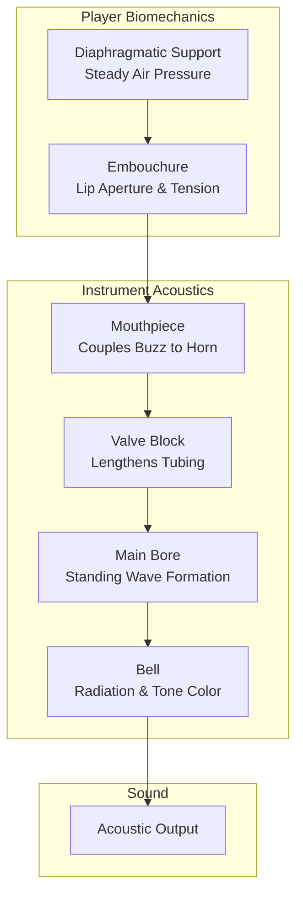
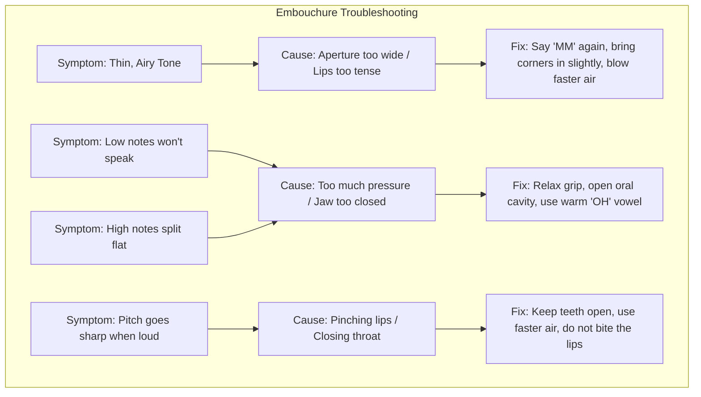
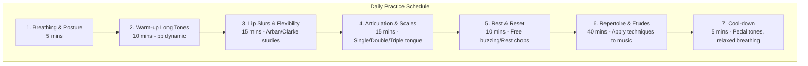

# Lesson 4: Practical Brass Performance and Interpretation

## First-Principles Intuition & Invariants

A brass instrument is effectively an amplifier for your lips. You create a buzzing sound by forcing high-pressure air through tightly compressed lips, and the instrument's tubing amplifies and shapes that buzz into a resonant tone. The physical invariants of brass performance stem from three coupled systems: aerodynamic flow, biomechanical embouchure control, and acoustic resonance. 

Unlike a piano where pressing a key mechanically strikes a string, a brass instrument requires the player to physically manufacture the pitch. The harmonic series dictates that longer tubing produces lower fundamental pitches, and the player must constantly adjust lip tension and air speed to "slot" the correct note within that tubing. Phrasing is directly tied to respiratory capacity and mechanical efficiency. You cannot play a 30-second phrase on an empty tank, and you cannot play in tune if your air velocity fluctuates. 

The "feel" of the instrument—resistance—is tactile feedback. High resistance means the air hits a wall, which is useful for extreme upper registers but fatiguing over time. Low resistance requires massive air volume to fill the horn. Your goal is to find the sweet spot where the air flows freely and the lips vibrate efficiently.

## Core Architecture & Mechanics

The brass instrument functions as a resonator. Your air column, lip aperture, mouthpiece, valves, and bell form a continuous acoustic system. The valves alter the effective length of the instrument to lower the pitch, while the bell helps radiate the sound and shape the tone color.

## Performance Practice: Breath Management and Support

Efficient breath management relies on diaphragmatic breathing and intercostal expansion. The diaphragm flattens during inhalation to draw air in, and the abdominal muscles engage during exhalation to maintain steady subglottic pressure. "Support" means maintaining optimal air pressure while minimizing extraneous tension in the throat and face.

### Practical Breathing Drills

- **The Spine Stretch (Posture):** Stand tall. Imagine a string pulling the crown of your head upward. Shoulders drop and relax. This opens the thoracic cavity for maximum lung volume.
- **The "HOAH" Intake:** Open the mouth and inhale silently. Think the vowel "HOAH." The stomach should expand outward, and the ribs should expand laterally. Do not raise the shoulders.
- **The "SSS" Hiss (Control):** Inhale fully. Exhale on a silent "SSS" hiss. Use a metronome at 60 BPM. Start with 4 beats of exhale. Expand to 8, then 12, then 16 beats. Keep the air pressure constant—do not let the hiss get quieter as you run out of air.
- **The Breath Builder (Phrasing):** Inhale for 2 beats, exhale for 6. Inhale for 1 beat, exhale for 7. The goal is to take a massive, instant intake of air and release it with frictionless control over a long duration.

## Embouchure Formation and Resonance Coupling

The embouchure is a biomechanical oscillator. The orbicularis oris and buccinator muscles create a stable structure, while the center of the lips vibrate. The Bernoulli effect draws the lips together as air passes through, and the air pressure forces them apart, creating the buzz.

### Actionable Embouchure Mechanics

1. **Say "MM":** Freeze the facial posture. The corners of the mouth are firm (slightly pulled back, not smiling), and the chin is flat. 
2. **Placement:** Place the mouthpiece on the lips. Generally, aim for a 2/3 upper lip, 1/3 lower lip ratio, but adjust slightly for your dental anatomy. The upper lip must have enough mass inside the cup to vibrate freely.
3. **The Aperture:** Keep the center relaxed. You are blowing air through a small, flat opening, not a round hole. 
4. **Pressure:** Use only enough pressure to seal the air. Excessive pressure cuts off circulation, kills the high register, and causes lips to bruise and fatigue.

## Articulation Mechanics and Tongue Position

Articulation in brass playing is achieved through rapid tongue movements that interrupt or initiate airflow. The tongue does not create the sound; it gates the air. The embouchure buzz must be continuously maintained at the correct tension for the desired pitch.

### Articulation Styles & Syllables

- **Standard (Tah):** The tongue tip touches the alveolar ridge (behind upper teeth). Produces a clear, balanced attack.
- **Legato (Dah):** Softer tongue contact. Produces a smooth attack.
- **Marcato (TAC):** Forceful, rapid tongue release with increased air pressure.
- **Staccato (Tut):** The tongue stops the sound at the end of the note. 

### Multiple Tonguing Drills

Double and triple tonguing employ alternating tongue positions to achieve rapid articulation rates. Double tonguing alternates "tah-kah" (tip-back of tongue). Triple tonguing uses "tah-kah-tah" or "tah-tah-kah".

**Drill: Arban-style Scale Study**
1. Set metronome to 60 BPM.
2. Play a one-octave scale in 8th notes using single "tah" articulation. Ensure clarity.
3. Switch to 16th notes using "tah-kah" double tonguing. Keep the "kah" syllable forward in the mouth to match the "tah" clarity.
4. Increase tempo by 5 BPM daily until you reach 120 BPM. Target speed: 140 BPM for 16th notes.

## Intonation Physics and Compensation Strategies

Brass instruments inherently deviate from equal temperament due to the harmonic series and valve tubing length errors. The first and third valve combination is sharp because the combined tubing length is slightly too short. Temperature sensitivity also affects pitch—a cold horn plays flat, a warm horn plays sharp.

### Practical Intonation Adjustments

**Valve Slide Compensation:**
- **1-3 Valve Combo (e.g., low D on trumpet):** This is inherently sharp. You must pull the third valve slide out with your ring finger. Do not rely on your lip to bend it down.
- **1-2-3 Valve Combo:** Extremely sharp. Pull both the first and third slides.
- **Tuning Slide:** Pull out (flatten) if the horn is warm and playing sharp.

**Lip and Air Adjustment:**
- **To lower pitch:** Relax the embouchure slightly, lower the tongue arch (say "OH"), and slow the air. 
- **To raise pitch:** Firm the embouchure slightly, raise the tongue arch (say "EE"), and speed up the air.
- **Drone Practice:** Play a concert B-flat drone from a tuner app. Play your open B-flat and match it (zero beats). Then play 1-3 (low D) and actively pull the 3rd slide until the beats disappear. Memorize the physical distance you pulled the slide.

## Dynamic Control and Spectral Balance

Dynamic range in brass performance is not just about amplitude; it is about spectral balance. At soft dynamics, the fundamental dominates. At loud dynamics, upper partials dominate, creating a brilliant tone. However, extreme dynamics risk "overblowing," where pitch destabilizes and tone becomes harsh.

### Dynamic Control Drill

- **The Long Tone Pyramid (Metronome 60 BPM):**
  1. Play a concert B-flat (open) for 4 beats at pianissimo (pp). Keep the tone steady and centered.
  2. Crescendo over 4 beats to fortissimo (ff). To get louder, push faster air, but do not bite the lips. Open the teeth and lower the jaw slightly to prevent the pitch from going sharp.
  3. Diminuendo over 4 beats back to pp. 
  4. Maintain the pitch center throughout. If the note goes sharp when loud, your throat is closing. Think "AH" to keep the throat open.

## Range Development and Flexibility

High notes are not achieved by mashing the mouthpiece into your face. They require firm corners, a relaxed center, and extremely fast air. Lip slurs build the strength and flexibility needed to navigate registers.

### Lip Slur Drill

- **Arban Lip Slur #1 (1st Valve Down):**
  1. Play C (concert Bb) to G (concert F) back and forth in quarter notes at 60 BPM.
  2. Think "OH" for the low C and "EE" for the high G. The tongue arch acts as a valve, directing the air stream faster for the high note.
  3. Do not press harder for the high note. Firm the corners and blow faster air.
  4. Expand the pattern: C-G-C-G, then C-E-G-E (arpeggio). Move the metronome up to 80 BPM, then 110 BPM.

## Stylistic Interpretation Across Historical Periods

Performance practice is deeply informed by historical context. Modern brass instruments differ fundamentally from their historical counterparts, necessitating informed interpretation.

- **Baroque (1600-1750):** Bright, focused tone with minimal vibrato. Crisp articulation. Do not overplay; think of the natural trumpet's lighter sound.
- **Classical (1750-1820):** Clear, balanced tone. Vibrato is reserved for sustained solo passages, used sparingly. Precise, light articulation.
- **Romantic (1820-1900):** Darker, more covered sound. Continuous vibrato (5-7 Hz). Singing legato lines and dramatic dynamic contrasts. 
- **Modern/Jazz (1900-present):** Extreme upper register, falls, shakes, half-valve effects. Vibrato is often delayed—enter the note straight, then add vibrato. Jazz articulation emphasizes the "doo-dat" and "bwa" shapes.

## Vibrato: Acoustic Physics and Aesthetic Application

Vibrato is a periodic modulation of pitch, typically varying ±10-30 cents at 4-7 Hz. Brass vibrato can be produced through jaw movement or hand movement (horn). It masks small intonation errors and enhances perceived warmth.

### Practical Vibrato Mechanics

- **Jaw Vibrato (Trumpet/Trombone):** Move the jaw slightly up and down in a chewing motion. This varies lip tension. Start on a sustained note at 60 BPM. Move the jaw down on the beat (pitch drops slightly) and up off the beat (pitch rises). The motion is subtle; do not let the pitch center drift flat.
- **Hand Vibrato (Horn):** Oscillate the right hand position in the bell. This produces a coupled pitch and timbral modulation characteristic of French horn playing.

## Ensemble Considerations: Blend, Balance, and Intonation

Ensemble playing requires matching pitch, timbre, and articulation. Individual pitch must align to the ensemble's real-time harmonic context, not an abstract tuner.

- **Intonation:** Perfect fifths must be 2 cents wider than equal temperament; major thirds must be 14 cents narrower. Listen for "beats" (pulsing interference patterns) and eliminate them by adjusting your slide or lip.
- **Timbral Blend:** Match the vowel shape and tongue position of the principal player. A bright, focused tone may project a melody, but within the section, timbral homogeneity is essential. 
- **Rhythmic Precision:** A section playing eighth notes must attack with identical tongue speed and release with matched air cutoff. Small timing discrepancies (±10-20ms) create perceived sloppiness. Agree on the exact length of the note (e.g., "short but not clipped").
- **Hierarchical Balance:** Background players must recalibrate their "forte" to sit beneath the principal voice. Play your part with conviction but at a dynamic level that supports the melody.

## Mutes and Timbral Modification

Mutes alter brass timbre by modifying the bell's acoustic termination, changing radiation pattern and impedance. 

- **Straight Mute:** Conical insert. Produces a focused, nasal tone. Raises overall pitch slightly—pull the main tuning slide out a bit. 
- **Cup Mute:** Straight mute with an additional cup. Produces a darker, distant sound. Standard in ballad playing.
- **Harmon Mute (Wah-Wah):** Two-chamber design with an adjustable stem. Stem out for "wah" effects. Practice moving the stem smoothly with your pinky while maintaining a steady tone.
- **Plunger Mute:** Rubber cup held over the bell. Coordinate the plunger with your breath. "Doo" = closed (covering bell, muffled sound). "Wah" = open (lift away, bright sound). 

## Fatigue Management and Performance Endurance

Brass performance fatigue arises from respiratory muscle fatigue, embouchure muscle fatigue, and central nervous system fatigue.

- **Embouchure Fatigue:** Manifests as rising pitch (over-tightening compensation) and unstable tone. 
  - *Prevention:* Rest as much as you play. 5-10 minute breaks every 45-60 minutes. Avoid excessive mouthpiece pressure.
- **Respiratory Fatigue:** Manifests as shortened phrases and shoulder tension. 
  - *Prevention:* Complete exhalation between phrases to reset the diaphragm. Core strengthening exercises.
- **Central Nervous System Fatigue:** Prolonged concentration depletes cognitive resources. 
  - *Prevention:* Mindful practice with full attention rather than mindless repetition. Adequate sleep (7-9 hours) to consolidate motor learning.

## Daily Routine Structure

A structured daily routine ensures technical maintenance and prevents injury. 

### Actionable Warm-up Sequence

1. **Mouthpiece Buzzing:** Buzz simple melodies on the mouthpiece alone. This ensures the embouchure is vibrating efficiently before the horn is engaged. Target: Clean pitch, no air escaping from the corners.
2. **Long Tones:** Play concert B-flat (open) at a pianissimo dynamic. Focus on a steady air stream and centered pitch. Expand outward chromatically. Metronome at 60 BPM.
3. **Lip Slurs:** Play Clarke Technical Studies #1. Move slowly between partials. Ensure the air is doing the work, not the lips. 
4. **Articulation:** Run a two-octave scale using "tah-kah" double tonguing. Target: 100 BPM in 16th notes.

## Conclusion and Integration

Brass performance synthesizes aerodynamic physics, biomechanical control, and interpretive musicianship. Mastery requires technical command—breath support, embouchure stability, articulation precision, intonation accuracy—coupled with deep engagement with the music's expressive content. The principles outlined here provide a practical framework for approaching practice systematically. By focusing on fast air, firm corners, and a relaxed center, the dedicated student can diagnose technical problems with precision and make informed interpretive choices grounded in physical reality.
