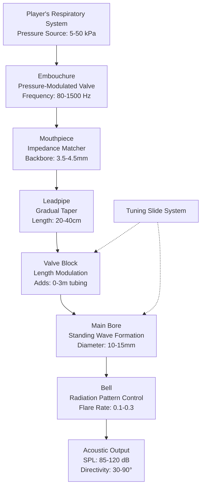
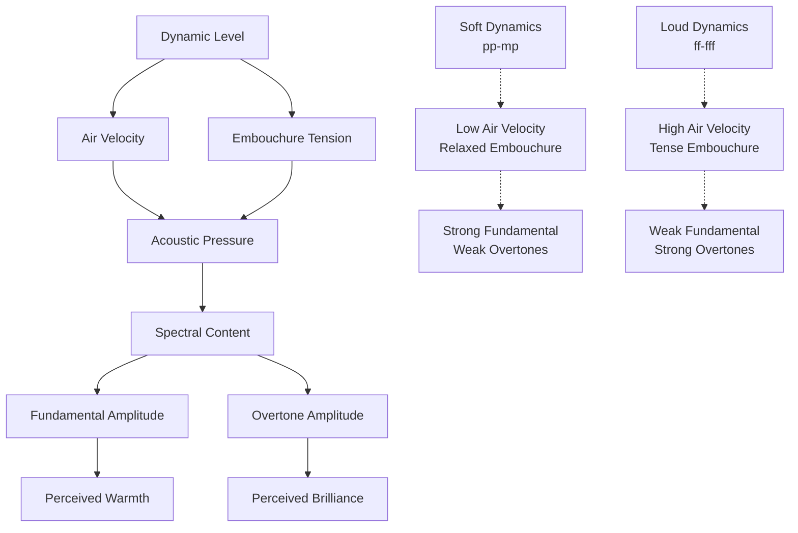

# Lesson 4: Performance Practices and Interpretation

## First-Principles Intuition & Invariants

Brass performance is fundamentally a study in controlled resonance within a cylindrical or conical bore, where the player's embouchure acts as a pressure-modulated valve driving standing waves through the instrument's air column. Unlike string or percussion instruments where energy transfer is discrete and localized, brass instruments create sound through continuous impedance matching between the player's respiratory system and the acoustic resonator of the instrument itself.

The physical invariants governing brass performance stem from three coupled systems: aerodynamic flow dynamics, biomechanical constraints of the embouchure and respiratory apparatus, and acoustic resonance in metallic tubes. The player generates a Bernoulli-effect buzz by forcing air through tensioned lips, creating a periodic oscillation typically between 80 Hz (low pedal tones) and 1,500 Hz (extreme upper register). This oscillation excites resonant modes in the instrument's bore, amplifying frequencies that align with the instrument's harmonic series while suppressing others through destructive interference.

Phrasing in brass performance is not merely an aesthetic choice but a necessary consequence of respiratory mechanics and psychoacoustic perception. Human lung capacity limits continuous airflow to approximately 15-30 seconds at performance dynamics, creating natural phrase boundaries. Beyond this physiological constraint, phrasing serves to articulate musical structure through temporal grouping—a cognitive mechanism by which listeners parse continuous sonic input into hierarchical units. The effective brass performer leverages breath articulation, subtle dynamic shaping, and micro-timing variations to signal phrase boundaries, subordinate clauses, and climactic points within the musical architecture.

Dynamics in brass performance operate through a complex interplay of air velocity, embouchure aperture, and sympathetic resonance. Increasing dynamic level requires exponentially greater air pressure due to the square-law relationship between sound intensity and acoustic pressure. A fortissimo passage at 95 dB SPL demands roughly four times the acoustic power of a mezzo-forte at 85 dB, yet the player must maintain pitch stability and tonal consistency across this range. This requires precise coordination: increasing air velocity while simultaneously tightening the embouchure to maintain the correct vibrational frequency, all while preventing the loss of upper partials that characterize brass timbre.

The concept of "resistance" in brass playing—the back-pressure felt by the player—emerges from acoustic impedance at the bell and mouthpiece interfaces. An optimal resistance profile allows efficient energy transfer from embouchure to air column while providing tactile feedback for pitch and dynamic control. Instruments with excessive resistance fatigue the player prematurely; those with insufficient resistance compromise tone stability and intonation accuracy.

## Core Architecture & Mechanics

The brass instrument functions as a quarter-wave resonator (open-closed pipe) or half-wave resonator (open-open pipe approximation) depending on the specific geometry. The instrument's effective length determines its fundamental frequency and overtone series. Valves or slide positions alter this length, shifting the entire harmonic series downward by specified intervals: second valve (1 semitone), first valve (2 semitones), third valve (3 semitones), or combinations thereof.

The mouthpiece serves as a critical impedance transformer, coupling the high-impedance embouchure (small vibrating mass, high tension) to the low-impedance instrument bore (large air mass, low resistance). The backbore diameter and throat profile determine how efficiently vibrational energy transfers into the instrument. A mouthpiece with a 3.7mm throat paired with a 0.660-inch (16.76mm) bore trumpet creates a specific impedance ratio optimized for lyrical playing, while a 3.9mm throat on the same instrument favors brilliance and projection at the cost of increased fatigue.

The valve mechanism introduces discrete length increments through cylindrical tubing routed in parallel to the main bore. When a valve is depressed, airflow is diverted through additional tubing before rejoining the main bore. The first valve adds approximately 12.2% additional length (lowering pitch by 2 semitones), the second valve adds 6.1% (1 semitone), and the third valve adds 18.9% (3 semitones). These percentages are not strictly additive due to nonlinear acoustic effects: the 1-3 valve combination requires a pull-ring adjustment to compensate for the cumulative length error.

The bell's exponential flare rate governs both tonal color and radiation pattern. A gentle flare (cornet bell) emphasizes fundamental frequency and produces a warmer, more diffuse sound field. A rapid flare (trumpet bell) enhances upper partials and creates a focused, projecting tone with narrower directivity. The cutoff frequency—the point where the bell diameter exceeds one-quarter wavelength—determines which frequencies radiate efficiently versus which reflect back into the instrument. For a trumpet with a 125mm bell diameter, the cutoff frequency is approximately 680 Hz, meaning notes below written C5 (523 Hz) are partially reflected, enriching the internal resonance.

## Performance Practice: Breath Management and Support

Efficient breath management in brass performance relies on diaphragmatic breathing, intercostal expansion, and controlled exhalation through abdominal compression. The diaphragm—a dome-shaped muscle separating thoracic and abdominal cavities—contracts and flattens during inhalation, increasing thoracic volume and creating negative pressure that draws air into the lungs. Intercostal muscles expand the ribcage laterally and anteriorly, further increasing lung volume. Combined, these mechanisms can achieve inspiratory capacities of 4-6 liters in trained brass players, significantly exceeding the 2-3 liter average.

Exhalation for brass playing is not passive but requires active muscular engagement. The abdominal muscles—rectus abdominis, external obliques, internal obliques, and transversus abdominis—compress the abdominal cavity, pushing the diaphragm upward and maintaining consistent subglottic pressure (5-15 kPa for normal playing, 20-50 kPa for fortissimo). This pressure must remain stable across the duration of a phrase; fluctuations cause pitch instability and tonal inconsistency.

The concept of "support" in brass pedagogy refers to maintaining optimal subglottic pressure while minimizing extraneous tension in the throat, neck, and facial muscles. Proper support allows the embouchure to vibrate freely, responding efficiently to aerodynamic forces. Players who collapse chest support during long phrases compensate by tightening the embouchure, which raises pitch, thins tone quality, and accelerates fatigue. Advanced players learn to gauge residual lung volume and plan breath points to avoid playing below 40-50% vital capacity, where respiratory efficiency degrades sharply.

## Embouchure Formation and Resonance Coupling

The embouchure is a biomechanical oscillator formed by orbicularis oris (lip muscles), buccinator (cheek muscles), and mentalis (chin muscles), stabilized by mandibular position and maxillary support. The player positions the mouthpiece against the lips, creating a sealed chamber where increased air pressure forces the lips into oscillation. The vibrational frequency is determined by lip tension (controlled by muscle contraction), lip mass, and the pressure differential across the lip aperture.

The Bernoulli effect plays a central role: as air velocity increases through the lip aperture, local pressure decreases, drawing the lips together. This closure increases back-pressure until it overcomes embouchure tension, forcing the lips apart and restarting the cycle. This self-sustaining oscillation occurs at the instrument's resonant frequency when the acoustic feedback from the bore reinforces the embouchure vibration—a phenomenon called "locking" or "slotting."

Different embouchure types—classifications debated in brass pedagogy—represent distinct mechanical configurations. The "downstream" embouchure directs airflow downward with slightly more upper lip inside the mouthpiece cup, favoring stability in low and middle registers. The "upstream" embouchure directs airflow upward with more lower lip in the cup, facilitating upper register playing but sometimes sacrificing low-register power. Most professional players employ embouchures that shift along this continuum depending on register, dynamic, and tonal demands.

Mouthpiece placement affects not only comfort but also acoustic coupling. Placement that is too high on the upper lip restricts vibration and favors a thin, bright tone; too low reduces flexibility and produces a darker, more resistant sound. Lateral placement affects balance between registers: centered placement provides optimal resonance coupling across the full range, while off-center placement can compensate for anatomical asymmetries but requires greater compensatory tension.

## Articulation Mechanics and Tongue Position

Articulation in brass playing is achieved through rapid tongue movements that interrupt or initiate airflow. The most common articulation, the "tah" or "tee" attack, involves the tongue tip contacting the alveolar ridge (just behind the upper teeth) or the back of the upper teeth themselves, momentarily stopping airflow. Releasing the tongue allows air to resume, exciting the embouchure into oscillation. The tongue does not create the sound—it merely gates the airflow; the embouchure buzz must be continuously maintained at the correct tension for the desired pitch.

Articulation styles span a continuum from harsh to gentle, controlled by tongue velocity and contact duration:

- **Marcato/accented articulation**: Rapid, forceful tongue release combined with increased air pressure, creating a sharp attack transient with strong upper partials. The tongue remains in contact for minimal time (5-10ms), followed by immediate air pulse.

- **Standard articulation**: Moderate tongue velocity with balanced air pressure, producing a clear attack without excessive emphasis. Contact duration of 10-20ms provides definition without harshness.

- **Legato/soft articulation**: Slow tongue release with minimal pressure differential, reducing attack transient. The tongue may remain near (but not touching) the articulatory position, creating a "dah" quality that smooths note transitions.

- **Slurred articulation**: No tongue interruption; continuous airflow with pitch changes achieved solely through embouchure and valve adjustments. This produces the smoothest possible connection between notes but can sound unclear in rapid passages.

Double and triple tonguing employ alternating tongue positions to achieve rapid articulation rates. Double tonguing alternates "tah-kah" (tip-back of tongue), enabling articulation speeds up to 10-12 notes per second. Triple tonguing uses "tah-kah-tah" or "tah-tah-kah" groupings, accommodating passages with triple subdivisions. The velar "kah" articulation is inherently less defined than the alveolar "tah," requiring careful air support and embouchure stability to maintain tonal consistency.

Tongue position during sustained tones affects timbre and pitch through its role in oral cavity resonance. A low, relaxed tongue position enlarges the oral cavity, creating a darker, more diffuse tone. A high, arched tongue (as in the vowel "ee") reduces oral volume, brightening the tone and raising pitch slightly. Advanced players manipulate tongue position dynamically to adjust intonation and color phrase contours, often unconsciously integrating these adjustments into their interpretive vocabulary.

## Intonation Physics and Compensation Strategies

Brass instruments inherently deviate from equal temperament due to the harmonic series' natural structure. The overtone series generated by a cylindrical or conical bore follows the integer multiples of the fundamental frequency: f, 2f, 3f, 4f, 5f, etc. However, equal temperament divides the octave into twelve logarithmically equal intervals, creating discrepancies with the natural harmonic series:

- 7th partial: approximately 31 cents flat of equal-tempered minor seventh
- 11th partial: 51 cents flat of equal-tempered perfect fourth (above the octave)
- 13th partial: 40 cents flat of equal-tempered major sixth (above the octave)
- 14th partial: approximately 31 cents flat of equal-tempered minor seventh (above the octave)

These deviations, combined with valve tubing length errors and temperature-dependent pitch drift (approximately 3 cents per degree Celsius), require constant intonation adjustment. Professional brass players employ three primary compensation mechanisms:

**Embouchure adjustment**: Tightening the embouchure raises pitch; relaxing it lowers pitch. This technique offers approximately ±30 cents of adjustment range before tone quality degrades unacceptably. However, embouchure bending causes timbral changes—tightened embouchures thin the tone and reduce lower partials; relaxed embouchures darken the sound but can introduce instability.

**Slide/valve adjustment**: Main tuning slides, valve slides, and trigger mechanisms provide mechanical length adjustment. The third valve slide, typically equipped with a finger ring or trigger, compensates for the sharp intonation of 1-3 and 1-2-3 valve combinations. The first valve slide trigger adjusts fifth and sixth partials on many trumpet designs. These adjustments must be executed smoothly to avoid audible pitch glides.

**Air velocity modulation**: Increasing air velocity without tightening the embouchure can raise pitch slightly (5-10 cents) while maintaining tonal integrity. This technique proves particularly useful in ensemble settings where blend requires subtle pitch adjustments without altering tone color.

Temperature sensitivity arises from the speed of sound's dependence on air temperature: v = 331.3 + 0.6T m/s, where T is temperature in Celsius. A brass instrument at 15°C has a fundamental frequency approximately 1.5% lower than the same instrument at 25°C—nearly a quarter-step discrepancy. Brass instruments warm during performance through both environmental heat transfer and the player's warm exhaled air, causing pitch to rise gradually. Professional players account for this by tuning slightly flat initially or adjusting the main tuning slide outward as the instrument warms.

## Stylistic Interpretation Across Historical Periods

Performance practice in brass playing is deeply informed by historical context, instrumentation evolution, and aesthetic conventions specific to each musical period. Modern brass instruments—with their sophisticated valve systems, advanced metallurgy, and standardized manufacturing—differ fundamentally from their historical counterparts, necessitating informed interpretation when performing repertoire across centuries.

**Baroque period (1600-1750)**: Natural trumpets and horns, lacking valves, played notes exclusively from the harmonic series. Composers wrote within these constraints, emphasizing the instrument's "clarino" register (partials 8-16) where stepwise motion becomes possible. Modern interpretations must navigate a tension: performing on natural instruments respects historical authenticity but limits dynamic flexibility and intonation control; performing on modern instruments enables greater precision but risks anachronistic tonal quality. Informed modern practice adopts a bright, focused tone with minimal vibrato, crisp articulation, and careful attention to rhetorical phrasing structures derived from Baroque oration principles.

**Classical period (1750-1820)**: The hand horn technique—inserting the right hand into the bell to alter pitch and timbre—expanded harmonic possibilities while creating characteristic "stopped" and "open" tone colors. Though valved horns now dominate, historically informed performances preserve the open/stopped dichotomy through dynamic and timbral variation, emphasizing the brighter open notes and gentler stopped tones. Trumpet parts remained primarily ceremonial and fanfare-based until late in the period. Modern players adopt a clear, balanced tone with moderate vibrato, precise articulation, and attention to Alberti bass-derived accompanimental patterns.

**Romantic period (1820-1900)**: Valve invention (1813-1830s) revolutionized brass capabilities, enabling full chromaticism and expanded registers. Composers exploited these new possibilities with soloistic writing, demanding extreme dynamic ranges and expressive flexibility. Romantic brass performance emphasizes singing legato lines, continuous vibrato (typically 5-7 Hz oscillation width of 10-30 cents), and dramatic dynamic contrasts. Tone production favors a darker, more covered sound with increased use of the instrument's low register. Rubato—subtle tempo flexibility for expressive purposes—becomes appropriate and expected.

**Modern period (1900-present)**: Twentieth-century composition introduced extended techniques, microtonal writing, timbral exploration, and stylistic pluralism. Jazz traditions established new articulation vocabularies (falls, doits, shakes, half-valve effects), alternative embouchure positions, and extreme upper-register playing. Contemporary classical brass playing synthesizes historical awareness with technical advancement: players must command both the pure, straight tone of Baroque practice and the lush, vibrato-laden sound of Romanticism, switching contexts as repertoire demands. Extended techniques—flutter tonguing, multiphonics, singing while playing, mute effects—expand the timbral palette.

## Vibrato: Acoustic Physics and Aesthetic Application

Vibrato in brass performance is a periodic modulation of pitch, typically varying ±10-30 cents at 4-7 Hz. Unlike string vibrato (produced by finger oscillation) or vocal vibrato (primarily laryngeal oscillation), brass vibrato can be produced through multiple mechanisms:

**Diaphragm/air-pulse vibrato**: Rhythmic pressure variations in the air column, controlled by abdominal muscle oscillation. This produces a subtle amplitude modulation coupled with pitch variation, creating a warm, diffuse effect. Frequency range: 4-6 Hz. Most common in orchestral playing.

**Jaw/embouchure vibrato**: Mandibular oscillation varies embouchure tension and lip aperture, creating primarily pitch modulation with minimal amplitude change. This technique offers greater control but can sound artificial if overused. Frequency range: 5-8 Hz. Common in solo and jazz contexts.

**Hand vibrato (horn only)**: Oscillating the right hand position in the bell produces coupled pitch and timbral modulation, characteristic of French horn playing. Frequency range: 4-6 Hz.

The psychoacoustic effect of vibrato extends beyond simple pitch variation. Vibrato masks small intonation errors by distributing pitch energy across a wider frequency band, making the note sound "in tune" despite not being precisely centered. Vibrato also enhances perceived warmth and expressivity: tones without vibrato sound static and mechanical; excessive vibrato sounds uncontrolled and inappropriate.

Period-appropriate vibrato usage is stylistically critical:
- Baroque: minimal to none
- Classical: sparing, reserved for sustained solo passages
- Romantic: continuous, expressive, width increases with dynamic level
- Early 20th century: continuous, moderate width
- Contemporary: context-dependent, ranging from none (Minimalism) to extreme (Expressionism)

Jazz vibrato conventions differ: earlier styles (1920s-1940s) employed fast, narrow vibrato; bebop and modern jazz favor delayed vibrato—entering the note straight, then adding vibrato after initial attack. Width and speed vary with expressive intent: ballads use slower, wider vibrato; uptempo playing uses faster, narrower vibrato or none at all.

## Dynamic Control and Spectral Balance

Dynamic range in professional brass performance spans approximately 40-50 dB, from pianissimo at 60-70 dB SPL to fortissimo at 110-120 dB SPL (measured at 1 meter). However, musical dynamics encompass more than amplitude: spectral balance—the relative strength of fundamental versus overtones—changes dramatically with dynamic level, and this spectral evolution constitutes much of what listeners perceive as dynamic contrast.

At soft dynamics (pp-mp), the fundamental frequency dominates the spectrum, with second and third partials present but attenuated. Higher overtones fall below the noise floor. This creates a dark, warm tone characteristic of intimate musical moments. The player achieves soft dynamics through reduced air velocity while maintaining embouchure stability, a challenging balance: too little air and the embouchure fails to vibrate consistently; too much and the dynamic exceeds the desired level.

At moderate dynamics (mf-f), the spectrum becomes balanced, with fundamental, second, third, and fourth partials nearly equal in amplitude. Fifth through eighth partials are present but subordinate. This creates the characteristic "brassy" timbre that defines the instrument family. Moderate dynamics represent the instrument's optimal acoustic efficiency—the player's energy input converts most effectively into acoustic output.

At loud dynamics (ff-fff), upper partials dominate: fourth, fifth, sixth, and eighth partials can exceed the fundamental in amplitude. This creates a brilliant, penetrating tone that projects through orchestral textures. However, extreme dynamics risk "overblowing"—driving the air column into nonlinear behavior where pitch destabilizes and tone becomes harsh and uncontrolled. The player must maintain embouchure stability through increased lip tension while avoiding excessive pressure against the lips, which restricts vibration.

Dynamic shaping within phrases—crescendo, diminuendo, dynamic peaks and valleys—requires precise coordination of air velocity, embouchure adjustment, and postural support. A gradual crescendo demands steadily increasing air pressure while subtly increasing embouchure tension to prevent pitch rise. A sudden forte-piano requires explosive air release followed by immediate reduction without allowing the embouchure to collapse. These techniques demand months or years of deliberate practice to execute reliably.

## Fatigue Management and Performance Endurance

Brass performance fatigue arises from three primary sources: respiratory muscle fatigue, embouchure muscle fatigue, and central nervous system fatigue. Understanding each mechanism enables strategic fatigue management.

**Respiratory fatigue**: Diaphragmatic and intercostal muscles fatigue through sustained isometric contraction (maintaining thoracic pressure) and repeated concentric contractions (inhalation). Respiratory fatigue manifests as shortened phrases, weakened dynamics, and increased shoulder/neck tension as accessory breathing muscles compensate. Prevention strategies include:
- Interval training: alternating high-intensity and low-intensity passages
- Complete exhalation between phrases to reset diaphragm position
- Core strengthening exercises to enhance abdominal support
- Adequate rest periods during practice sessions

**Embouchure fatigue**: Orbicularis oris and facial muscles fatigue through sustained tension and repetitive oscillation. Embouchure fatigue manifests as rising pitch (over-tightening compensation), unstable tone, and reduced upper register access. Prevention strategies include:
- Lip buzzing exercises to maintain embouchure flexibility
- Strategic rest: 5-10 minute breaks every 45-60 minutes
- Avoidance of excessive mouthpiece pressure
- Gentle lip massage during rest periods to restore circulation

**Central nervous system fatigue**: Prolonged concentration, fine motor control, and auditory processing deplete cognitive resources. CNS fatigue manifests as increased error rates, slowed reaction times, and reduced interpretive awareness. Prevention strategies include:
- Mindful practice with full attention rather than mindless repetition
- Adequate sleep (7-9 hours) to consolidate motor learning
- Nutritional support: hydration, balanced macronutrients
- Structured practice sessions with defined goals and rest intervals

Chronic overuse injuries in brass players include focal embouchure dystonia (involuntary muscle contractions), temporomandibular joint dysfunction, and cervical spine strain. These conditions require medical intervention and often necessitate extended performance breaks, underscoring the importance of preventive practice habits.

## Ensemble Considerations: Blend, Balance, and Intonation

Brass performance rarely occurs in isolation; ensemble contexts introduce additional dimensions of intonation matching, timbral blend, rhythmic synchronization, and hierarchical balance. The acoustic principles governing solo performance extend to ensemble contexts, but with added complexity.

**Intonation in ensemble**: Individual pitch must align not to an abstract equal-tempered standard but to the ensemble's real-time harmonic context. Perfect fifths must be 2 cents wider than equal temperament; major thirds must be 14 cents narrower. This "just intonation" approach maximizes acoustic consonance by aligning overtones. Brass players develop sensitivity to difference tones—the 700 Hz beat frequency produced when two instruments play slightly out of tune at 440 Hz and 441 Hz. Eliminating these beats requires micro-adjustments through embouchure flexibility and slide movement.

**Timbral blend**: Matched articulation, vibrato usage, and dynamic contouring create cohesive section sound. A principal trumpet's bright, focused tone may project a melody above the ensemble, but within the trumpet section, timbral homogeneity is essential. Players match vowel shapes (internal oral cavity configuration), tongue position, and air velocity to achieve uniform tone color. Horn sections exploit this further through careful microphone-like positioning: principal players face forward while interior players angle bells to balance projection.

**Rhythmic precision**: Ensemble rhythm requires shared articulation placement and decay characteristics. A section playing eighth notes must attack each note with identical tongue speed and release each note with matched air cutoff. Small timing discrepancies (±10-20ms) create perceived "sloppiness" despite technically correct note placement. This demands shared conceptual tempo—an internalized pulse that transcends visual conducting cues.

**Hierarchical balance**: Orchestral brass writing often features principal melodic voices supported by harmonic accompaniment. Background players must recalibrate their personal "forte" to sit beneath the principal voice, requiring disciplined dynamic restraint and ego sublimation. Conversely, soloistic passages demand timbral projection and expressive freedom, a shift in mindset from team player to individual voice.

## Mutes and Timbral Modification

Mutes alter brass timbre by modifying the bell's acoustic termination, changing both radiation pattern and impedance characteristics. Different mute types create distinct timbral effects through specific physical mechanisms:

**Straight mute**: A conical insert that fits into the bell, leaving a small air gap around the perimeter. The restricted opening increases back-pressure and reflects high-frequency energy back into the instrument, producing a focused, nasal tone. Straight mutes raise overall pitch by 10-30 cents due to shortened effective acoustic length, requiring embouchure compensation. Common in orchestral playing for passages marked "con sordino."

**Cup mute**: A straight mute with an additional cup extending beyond the cork, creating a resonant chamber that absorbs high frequencies. This produces a darker, more distant sound than a straight mute. Cup mutes are standard in ballad trumpet playing and orchestral passages requiring subdued color.

**Harmon mute (wah-wah)**: A two-chamber design with an adjustable stem. Fully inserted, the stem produces a thin, focused tone; removed, it creates the characteristic "wah" effect through resonant filtering. The Harmon mute is iconic in jazz (Miles Davis) and appears in orchestral scores requiring exotic colors.

**Plunger mute**: Not an inserted mute but a rubber cup held over the bell, manipulated to create vowel-like timbral changes. Plunger technique enables "wah-wah" effects, growls, and expressive inflections central to jazz brass vocabulary. The player varies distance and angle while coordinating with glottal articulation (saying "wah" or "doo-wah" while playing).

**Practice mute**: Heavily damped designs that reduce volume by 20-30 dB for quiet practice. These drastically alter intonation and resistance, making them unsuitable for musical practice but valuable for technical exercises in noise-sensitive environments.

Mute usage introduces additional performance challenges: increased back-pressure fatigues the embouchure faster; altered intonation requires constant adjustment; restricted dynamic range (particularly soft dynamics become difficult). Professional players practice muted passages separately to develop mute-specific embouchure adjustments.

## Conclusion and Integration

Brass performance synthesizes aerodynamic physics, biomechanical control, acoustic resonance, and interpretive musicianship into a unified artistic expression. Mastery requires not only technical command—breath support, embouchure stability, articulation precision, intonation accuracy—but also deep engagement with the music's expressive content, historical context, and ensemble role.

The progression from novice to expert brass player follows a predictable trajectory: initial focus on tone production and basic technique, gradual expansion of range and endurance, development of stylistic awareness and interpretive nuance, and ultimately, the integration of technical facility with authentic musical expression. This journey demands years of deliberate practice, informed listening, and mentorship from experienced performers.

The principles outlined in this lesson—standing wave resonance, embouchure mechanics, respiratory physiology, intonation physics, stylistic conventions—provide a framework for understanding brass performance at a fundamental level. Armed with this knowledge, the dedicated student can approach practice systematically, diagnose technical problems with precision, and make informed interpretive choices grounded in physical reality rather than vague intuition.

The brass performer's ultimate goal is not technical perfection for its own sake but the authentic communication of musical meaning. Technical mastery serves as the foundation upon which expressive interpretation is built, enabling the player to realize the composer's vision while contributing their own artistic voice. This balance between fidelity and creativity, between discipline and expression, defines the art of brass performance.
