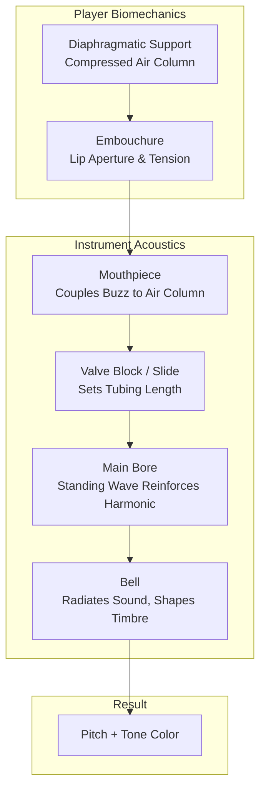
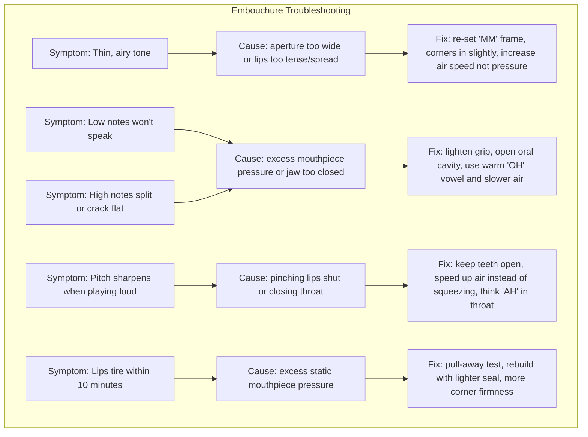
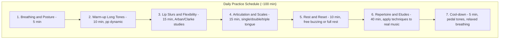

# Lesson 4: Brass Performance Mechanics — Breath, Embouchure, Articulation, and Intonation

## First-Principles Intuition (Read Once, Apply Daily)

A brass instrument amplifies a buzz you manufacture with your own lips. Compressed air forces its way through a small closed aperture, the lips flap open and shut hundreds of times per second, and the tubing selectively reinforces one harmonic of that buzz into a stable musical pitch. This is fundamentally different from a piano or guitar, where the pitch-generating mechanism (string, hammer) is built into the instrument. On brass, **you are the oscillator** — the horn is just a frequency-selective amplifier and megaphone.

Three systems are coupled, and a problem in one always shows up as a symptom in another:

1. **Aerodynamics** — air pressure (how hard you compress the column of air) and air speed (how fast it moves through the aperture) determine volume and partial selection.
2. **Embouchure biomechanics** — lip tension and aperture size determine which harmonic "slots" into tune.
3. **Acoustic resonance** — tubing length (set by valves/slide position) determines which family of harmonics is available at all.

A pitch problem is never "fix the lips" OR "fix the air" in isolation — diagnosing which system is misbehaving is 80% of good brass teaching, and that diagnostic skill is the spine of this lesson.

**One paragraph of physics, no more:** an open brass tube naturally resonates at a stack of harmonics (2nd, 3rd, 4th... multiples of a fundamental) because the air column reflects at the bell and mouthpiece and reinforces standing waves whose length divides evenly into the tube. Valves add extra tubing length, shifting the entire harmonic stack downward by a fixed interval (1st valve = whole step down, 2nd = half step, 3rd = minor third down). Everything else in this lesson is about *how a human operates that system reliably, in tune, for hours, without injury.*

## Core Architecture & Mechanics

Resistance is the tactile feedback of this whole system pushing back on your air. A tight mouthpiece/mute/mandrel combination or a small-bore horn gives high resistance — easier to "feel" the upper register but fatiguing over a long sitting. A large-bore horn is low resistance — comfortable to fill but easy to overblow and spread the tone. Neither is better; you calibrate your air to the horn in your hands.

---

## Part 1: Breath Management — Building the Engine

Everything downstream (tone, pitch, endurance) is rationed by how efficiently you load and release air. The diaphragm is the primary inhalation muscle; it flattens downward, the belly moves *out*, and the ribs expand laterally. Exhalation is driven by the abdominal wall and intercostals compressing that column steadily — not by throat tension, which is the single most common fault in beginning and advanced players alike.

### Drill 1.1 — Posture Check (30 seconds, every practice session)
Stand or sit at the front edge of a chair, feet flat. Imagine a string from the crown of your head to the ceiling, lengthening the spine. Let the shoulders drop and roll back once, then relax forward slightly — don't hold them "military straight," which locks the upper ribs and kills lateral expansion.

### Drill 1.2 — "HOAH" Silent Intake
Open the mouth and throat as if starting the syllable "HOAH." Inhale silently through that open shape in one beat at 60 BPM. Checkpoints:
- Belly moves outward (not upward — that's shoulder breathing, a fault).
- Lower ribs expand sideways, like opening an umbrella.
- No audible gasp or hiss on the inhale — audible inhales mean a constricted throat.

### Drill 1.3 — "SSS" Hiss for Steady Pressure
Inhale fully using Drill 1.2. Exhale on a controlled "SSS" at a *constant* loudness — the hiss should not fade as the air depletes.
- Metronome 60 BPM. Exhale for 4 beats. Rest 4 beats.
- Progress: 8 beats → 12 beats → 16 beats, only advancing once the previous length holds a truly constant hiss volume start to finish.
- This directly trains the muscle recruitment for a sustained musical phrase: constant pressure, not a slow leak.

### Drill 1.4 — The Breath Builder (Phrasing Under Time Pressure)
Simulates the real performance problem of grabbing air fast between phrases without gasping or raising the shoulders.
| Inhale (beats) | Exhale (beats) | Metronome |
|---|---|---|
| 2 | 6 | 60 BPM |
| 1 | 7 | 60 BPM |
| 1 | 7 | 72 BPM |

Goal: an instantaneous, silent, full intake even on 1 beat, followed by frictionless, controlled release. This is literally what happens before every phrase in real repertoire.

---

## Part 2: Embouchure — The Biomechanical Oscillator

The embouchure is a stable muscular frame (orbicularis oris, buccinator, firm corners) surrounding a small, relaxed, vibrating center. The Bernoulli effect pulls the lips together as air accelerates through the gap; air pressure behind them forces them back open; the cycle repeats at audio rate. Your job is to set the *frame* firm and the *center* loose, then let air speed — not muscular squeezing — select the pitch.

### Drill 2.1 — Setting the Frame
1. Say "MM" and freeze that facial shape. Corners pull back and down slightly (think "the corners of a slight frown," not a smile — smiling thins and flattens the lip tissue needed to vibrate).
2. Chin stays flat and pulled down. A bunched, "prune" chin chokes airflow at the aperture.
3. Place the mouthpiece roughly 2/3 upper lip, 1/3 lower lip (adjust ±10% for your dental overbite/underbite — there is no universal rule, only "where it buzzes freely and stays stable").
4. Use only enough mouthpiece pressure to seal air at the rim. Test: play a note, then try to pull the horn away from your face with your air still flowing — if you can do this for a half-second without the pitch collapsing, your pressure is appropriately light.

### Drill 2.2 — Mouthpiece Buzzing (Daily, 3–5 min)
Buzz "Mary Had a Little Lamb" or any simple tune on the mouthpiece alone, no horn.
- Target: clean, centered pitch with no air hiss escaping at the corners.
- This isolates embouchure efficiency from the horn's resonant "crutch" — if you can't buzz a tune cleanly, the horn will mask but not fix the problem.

### Embouchure Troubleshooting Map

---

## Part 3: Articulation — The Tongue as an Air Valve, Not a Sound Source

The tongue never produces tone; it only starts or stops the air column while the embouchure buzz stays correctly tensioned for the target pitch. If the buzz isn't already "set" at the right tension before the tongue releases, you get a scoop, a flat attack, or a delayed response (the classic "it takes a beat to speak" complaint).

### Articulation Syllable Reference

| Style | Syllable | Tongue Action | Musical Use |
|---|---|---|---|
| Standard | "Tah" | Tip touches alveolar ridge (just behind upper teeth), releases cleanly | Default articulate attack |
| Legato | "Dah" | Lighter, softer contact, almost no tongue stop | Slurred-feeling separate notes, singing lines |
| Marcato | "TAC" | Fast, forceful release with an air accent | Accented, strong attacks |
| Staccato | "Tut" | Tongue returns to stop the note at the *end* | Short, detached notes |

### Drill 3.1 — Single Tonguing Clarity Baseline
Metronome 60 BPM. Play a one-octave major scale in straight 8th notes, "Tah" articulation.
- Checkpoint: every note starts with identical attack clarity, no notes "sneaking in" without tongue contact.
- Advance tempo only when all notes are perfectly even in attack and duration.

### Drill 3.2 — Double Tonguing ("Tah-Kah")
Double tonguing alternates tongue-tip ("Tah") and tongue-back-against-soft-palate ("Kah") strokes, doubling your top articulation speed without doubling muscular effort on any one syllable.

1. Metronome 60 BPM. Same scale, now in 16th notes: Tah-Kah-Tah-Kah per beat.
2. Isolate the weak syllable: loop just "Kah-Kah-Kah-Kah" on a single pitch until it matches the clarity of "Tah." This is almost always the bottleneck.
3. Progression table:

| Week | Tempo (16ths) | Pattern |
|---|---|---|
| 1 | 60 BPM | Tah-Kah on single pitch, then scale |
| 2 | 80 BPM | Scale + Arban triplet patterns |
| 3 | 100 BPM | Full etude at tempo |
| 4 | 120 BPM | Full etude, check evenness under tempo |
| Target | 140 BPM | Performance-ready double tonguing |

Triple tonguing uses "Tah-Kah-Tah / Tah-Kah-Tah" (duple feel) or "Tah-Tah-Kah" (triplet feel) — same isolation method: drill the "Kah" alone until it's as crisp as "Tah," then reintegrate.

---

## Part 4: Intonation — Compensating for Real Tubing, Real Temperature

Brass tuning is never "set it and forget it." Valve combinations introduce systematic sharpness because added tubing lengths are physically calculated for a straight line, but your horn's design compromises bend the math slightly short. Temperature changes the speed of sound in the air column: a cold horn (cold brass, cold room) plays flat; a warmed-up horn played in a hot room drifts sharp.

### Known Sharp Combinations and Fixes

| Valve Combo | Example (Trumpet, concert pitch) | Problem | Fix |
|---|---|---|---|
| 1–3 | Low D | Combined tubing is physically too short for true pitch | Pull 3rd slide out with ring finger while holding the combo |
| 1–2–3 | Low C♯ | Worse than 1-3 alone — compounds the shortfall | Pull both 1st and 3rd slides |
| 2–3 | Low F♯ (trombone equivalent on slide position) | Mildly sharp | Slight outward slide adjustment or lip down |

**Procedure — building muscle memory for slide pulls:**
1. Play a concert B♭ against a drone/tuner app. Match it with zero audible "beats" (the pulsing throb you hear from two close-but-not-identical frequencies).
2. Finger 1–3 for low D. It will sound sharp immediately — this is expected, not a flaw in your playing.
3. Slowly pull the 3rd slide outward with the ring finger while sustaining the note, until the beating disappears.
4. Memorize the *physical distance* pulled (many players mark this with a pencil line or rubber O-ring on the slide). This becomes an automatic motion, not a note-by-note guess.

### Lip and Air Adjustments (for fine-tuning within a slotted pitch, not large errors)
- **To lower pitch slightly:** relax embouchure tension marginally, drop tongue arch (say "OH"), slow the air a touch.
- **To raise pitch slightly:** firm corners marginally, raise tongue arch (say "EE"), speed up the air.
- **Never** use lip/air tricks to correct an error that should be fixed with a slide — that's a band-aid that costs endurance and consistency over a performance.

### Ensemble Tuning Reference (Just Intonation Adjustments)
When playing a sustained chord in a section, equal temperament (the piano's tuning) is *not* the target — tune to the overtone series of the chord root:
- Perfect 5ths: tune about 2 cents **wider** than equal temperament.
- Major 3rds: tune about 14 cents **narrower** (flatter) than equal temperament.
- Minor 3rds: tune slightly **wider** than equal temperament.

Practically: if you're playing the 3rd of a major chord, you will feel like you're playing it "flatter" than your tuner's default A440 reference suggests — trust your ears on the beats, not the needle.

---

## Part 5: Dynamics — Spectral Balance, Not Just Volume

As dynamic level rises, the upper harmonics in your tone grow disproportionately louder than the fundamental — this is what makes "ff" sound brilliant and "pp" sound round and pure, even on the same pitch. Push past your horn's natural limit and you get "overblowing": pitch destabilizes, upper partials turn into noise, and the core tone is lost in harshness.

### Drill 5.1 — The Long Tone Pyramid
Metronome 60 BPM, concert B♭ (open/1st partial fingering for your instrument):
1. **4 beats at pp** — steady air, centered pitch, no tone wavering.
2. **Crescendo over 4 beats to ff** — increase air *speed*, not lip pressure. Open the jaw slightly and keep the throat open ("AH" shape) to prevent sharpening.
3. **Diminuendo over 4 beats back to pp** — resist the urge to tighten the embouchure as volume drops; keep the aperture shape constant and simply reduce air speed.
4. **Checkpoint:** record yourself. If pitch rises during the crescendo, the throat is closing — the fix is mental ("AH," not "EE") before it's embouchure.

---

## Part 6: Range Development — Lip Slurs Build the Connective Tissue

High notes come from fast air directed by a raised tongue arch, combined with firm (not squeezed) corners — never from increased mouthpiece pressure, which cuts circulation and kills endurance in minutes. Lip slurs train the muscle coordination to move between harmonics smoothly without re-articulating or re-gripping.

### Drill 6.1 — Arban Lip Slur #1 (1st Valve Depressed)
1. Metronome 60 BPM. Slur quarter notes between C and G (concert B♭ to concert F on trumpet; adjust written pitches for your instrument).
2. Internally think "OH" for the low note, "EE" for the high note — this tongue arch change is what redirects air speed without needing finger/lip pressure changes.
3. **Non-negotiable check:** mouthpiece pressure on the face should feel identical on both notes. If you feel yourself pressing harder for the high G, stop and reset.
4. Expand the pattern as control improves:
   - C–G–C–G (2 partials)
   - C–E–G–E–C (arpeggiated, 3 partials)
5. Tempo progression: 60 BPM → 80 BPM → 110 BPM, advancing only when the slur is seamless with no "glitch" or crack between partials.

---

## Part 7: Vibrato — Controlled Periodic Pitch Modulation

Vibrato is a small, regular oscillation of pitch, roughly ±10–30 cents at 4–7 Hz. It's produced differently depending on instrument family, but the function is the same: mask micro-intonation drift and add perceived warmth to a sustained tone.

### Drill 7.1 — Jaw Vibrato (Trumpet, Trombone, Euphonium, Tuba)
1. Sustain a note at 60 BPM, one pulse per beat.
2. On the beat, drop the jaw very slightly (pitch dips a few cents). Off the beat, return to center (pitch returns to true).
3. Keep the motion subtle — the goal is a "shimmer," not an audible pitch bend. If a listener can name the two pitches you're oscillating between, it's too wide.
4. Common fault: the pitch center drifts flat over the course of the vibrato because players forget to return fully to center. Record and check against a drone.

### Hand Vibrato (French Horn)
Oscillate the right hand position inside the bell in a steady, gentle motion. This simultaneously modulates pitch (changing effective bell resistance) and timbre (changing how "stopped" the horn sounds), producing the characteristic warmth of horn vibrato. Practice slowly at 60 BPM pulses before applying it musically.

---

## Part 8: Mutes — Changing the Bell's Acoustic Load

A mute changes how the bell terminates the air column (its "acoustic impedance"), which changes both the radiated timbre and, often, the pitch center — budget for this in your tuning.

| Mute | Construction | Effect | Tuning Note |
|---|---|---|---|
| Straight | Conical insert, mostly open | Focused, slightly nasal, brighter | Often raises pitch slightly — pull main tuning slide out a touch |
| Cup | Straight mute + outer cup | Darker, more distant, rounder | Standard for ballad/legato passages |
| Harmon (Wah-Wah) | Two-chamber body, adjustable stem | Buzzy, intimate; "wah" effect with stem movement | Practice moving the stem smoothly with the pinky while sustaining steady air |
| Plunger | Rubber cup held near/over bell | "Doo" (closed, muffled) to "Wah" (open, bright) | Coordinate plunger motion with breath support, not just hand speed |

**Plunger drill:** sustain one note, alternate "Doo" (plunger sealed against bell) and "Wah" (plunger pulled 2–3 inches away) on each beat at 60 BPM, keeping air pressure constant through the motion — most beginners accidentally accent the "Wah" by blowing harder instead of just opening the acoustic path.

---

## Part 9: Fatigue Management

| Fatigue Type | Symptom | Prevention |
|---|---|---|
| Embouchure | Pitch creeps sharp (over-tightening to compensate for tired muscles); tone destabilizes | Rest 5–10 min every 45–60 min of playing. Audit mouthpiece pressure regularly with the pull-away test. |
| Respiratory | Phrases shorten; shoulders tense and rise | Fully exhale between phrases to reset the diaphragm. Core/posture conditioning off the instrument. |
| Cognitive/CNS | Concentration lapses, repeated same mistake despite correct technique | Practice with full attention in shorter focused blocks rather than long unfocused ones. 7–9 hours sleep for motor learning consolidation. |

---

## Part 10: Daily Routine

### Warm-up Sequence, Step by Step
1. **Mouthpiece buzz** a simple melody — target clean pitch, zero air escaping at the corners (Drill 2.2).
2. **Long tones** on concert B♭ at pp, 60 BPM, expanding chromatically outward a half-step at a time.
3. **Lip slurs** — Clarke Technical Studies #1, slow tempo, air doing the work (Drill 6.1 technique).
4. **Articulation** — two-octave scale, "Tah-Kah" double tonguing, target 100 BPM in 16ths before moving to repertoire.

---

## Part 11: Stylistic Interpretation by Period

| Period | Tone | Vibrato | Articulation |
|---|---|---|---|
| Baroque (1600–1750) | Bright, focused, light — think natural trumpet | Minimal to none | Crisp, light, never heavy |
| Classical (1750–1820) | Clear, balanced | Reserved for sustained solo moments only | Precise, light |
| Romantic (1820–1900) | Darker, more covered | Continuous, 5–7 Hz | Singing legato, dramatic dynamic range |
| Modern/Jazz (1900–present) | Extreme register use; falls, shakes, half-valve color | Often delayed — enter straight, add vibrato partway through the note | "Doo-dat," "bwa" jazz syllables; ghosted notes |

---

## Conclusion

Brass performance is three coupled systems — air, embouchure, resonance — operated under conscious control. Every technical fault traces back to one of them: thin tone traces to aperture/air speed, sharp loud notes trace to a closing throat, cracked high notes trace to pressure substituting for air speed. Diagnose before you drill. Fast air, firm corners, relaxed center, open throat — hold these four as your default troubleshooting checklist, and build daily routine discipline (Part 10) so technique becomes automatic under the pressure of real performance.
