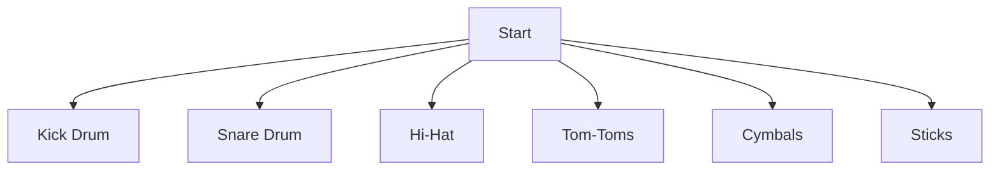

# Beginner Foundation: Drums

## 1. Everyday Intuition & First Principles
Imagine you're at a party, and everyone is clapping along to the beat of the music. The drums are like the heartbeat of the music, providing the rhythm that keeps everyone moving and grooving. Just as your heart keeps a steady beat to keep you alive, drums keep the music alive by providing a foundation that other instruments and voices can build upon. Drums are essential because they set the tempo and mood, making sure that everyone is in sync.

## 2. Foundational Vocabulary & Glossary
- **Kick Drum:** The largest drum in a drum set, often played with a foot pedal. It provides the low, thumping sound that drives the rhythm.
- **Snare Drum:** A mid-sized drum that produces a sharp, crisp sound when struck. It's often used to mark the beats.
- **Hi-Hat:** A pair of cymbals mounted on a foot pedal that can be opened and closed. It provides a variety of sounds, from a sharp "click" to a sustained "shhh."
- **Tom-Toms:** Smaller drums that sit on stands and produce a deeper sound than the snare but higher than the kick drum. They add depth and texture to the rhythm.
- **Cymbals:** Circular metal plates that produce a variety of sounds when struck with sticks. They are used for accents and fills.
- **Sticks:** The tools used to hit the drums and cymbals. They come in different sizes and weights, each producing a unique sound.

## 3. Visual System Flow
### ASCII Diagram
```
+-------------------+
|   Kick Drum       |
+-------------------+
|   Snare Drum      |
+-------------------+
|   Hi-Hat          |
+-------------------+
|   Tom-Toms        |
+-------------------+
|   Cymbals         |
+-------------------+
|   Sticks          |
+-------------------+
```

### Mermaid Flowchart


## 4. Common Beginner Misconceptions & Mental Traps
- **Misconception:** Drums are only for loud, aggressive music.
  - **Reality:** Drums are versatile and can be used in a wide range of music styles, from soft jazz to heavy metal.
- **Misconception:** You need to be naturally talented to play drums.
  - **Reality:** Like any instrument, playing drums can be learned with practice and dedication.
- **Misconception:** You need expensive equipment to start playing.
  - **Reality:** You can start with a simple practice pad and sticks, and gradually build up to a full drum set.
- **Misconception:** Playing drums is all about speed.
  - **Reality:** While speed is important, control, timing, and feel are equally crucial for creating good rhythm.

## 5. Socratic Discussion Starters
- What is the primary role of the kick drum in a song?
- How does the snare drum contribute to the rhythm?
- Can you describe the difference between open and closed hi-hat sounds?
- How do tom-toms add depth to a drum pattern?
- What are some common mistakes beginners make when starting to play drums?
- How can you practice effectively without a full drum set?
