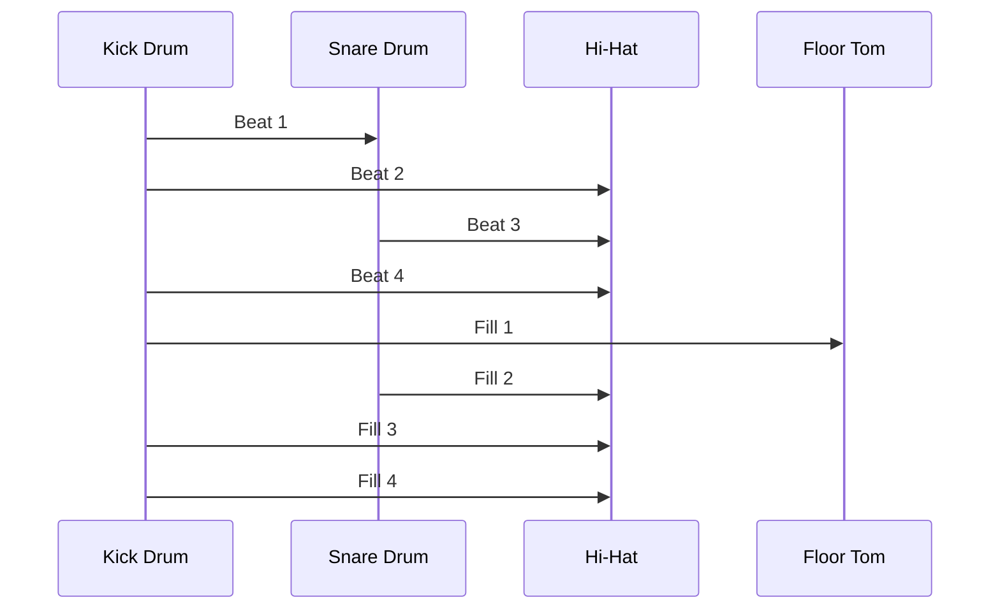

# Intermediate Foundation: Drums
## 1. Architectural Mental Model
### Overview
Building on the foundational skills of drumming, this section delves into the architectural mental model of drumming, focusing on production architecture. This involves understanding the role of each drum component, how they interact, and how to design a drumming setup that supports complex musical arrangements and performances.

### Key Components
- **Kick Drum:** The foundation of the rhythm section, responsible for the low-frequency pulse.
- **Snare Drum:** Provides the accent and drive, often used to mark the beats.
- **Tom Toms:** Mid-range toms add depth and texture, while floor toms provide additional low-frequency support.
- **Hi-Hat:** Controls the ride and fills, adding complexity and dynamics to the rhythm.
- **Cymbals:** Crash, ride, and splash cymbals add color and texture, enhancing the overall sound.

### Production Architecture
In production architecture, the drummer's role is to create a cohesive and dynamic rhythmic foundation that supports the entire band. This involves:
- **Timekeeping:** Maintaining a consistent tempo and feel.
- **Dynamic Range:** Varying the volume and intensity to match the song's dynamics.
- **Pattern Design:** Crafting patterns that complement the melody and harmony.
- **Interaction:** Coordinating with other musicians to create a seamless and engaging performance.

## 2. Systems Taxonomy & Component Protocols
### Standard Interfaces
Standard interfaces in drumming refer to the common techniques and patterns used across different styles and genres. These include:
- **Basic Beats:** Common rhythms like the rock beat, funk beat, and swing beat.
- **Fills:** Short, accentuated patterns used to transition between beats or to add interest.
- **Rides:** Continuous patterns played on the hi-hat or ride cymbal to maintain the flow.

### Protocols
Protocols in drumming are the rules and conventions that govern how different components interact. These include:
- **Timing:** Consistent timing is crucial for maintaining the rhythm.
- **Volume Control:** Adjusting the volume of each component to create a balanced sound.
- **Technique:** Proper technique ensures clarity and control.

### Data Models
Data models in drumming refer to the conceptual frameworks used to organize and understand drumming patterns. These include:
- **Pattern Charts:** Visual representations of drumming patterns, often using notation systems like drum tablature.
- **Drum Maps:** Diagrams that show the layout of the drum kit and the corresponding sounds.

## 3. Multi-Component Interaction Flow
### Detailed ASCII and Mermaid Sequence Diagram
#### ASCII Sequence Diagram
```
Kick Drum -> Snare Drum: Beat 1
Kick Drum -> Hi-Hat: Beat 2
Snare Drum -> Hi-Hat: Beat 3
Kick Drum -> Hi-Hat: Beat 4
Kick Drum -> Floor Tom: Fill 1
Snare Drum -> Hi-Hat: Fill 2
Kick Drum -> Hi-Hat: Fill 3
Kick Drum -> Hi-Hat: Fill 4
```

#### Mermaid Sequence Diagram


## 4. Architectural Trade-offs & Production Pitfalls
### Trade-offs
- **Complexity vs. Clarity:** More complex patterns can add interest but may be harder to follow.
- **Volume vs. Balance:** Higher volume can be more impactful but may overpower other instruments.
- **Speed vs. Control:** Faster tempos can be exciting but require precise control.

### Pitfalls
- **Overplaying:** Adding too many fills or complex patterns can distract from the overall performance.
- **Inconsistent Timing:** Lack of precision can disrupt the rhythm and flow.
- **Poor Volume Control:** Inconsistent volume can make the drumming sound unbalanced or overwhelming.

## 5. Socratic Discussion Starters
### Questions Bridging Architecture to Low-Level Implementation
- **How do you balance complexity and clarity in your drumming patterns?**
- **What techniques do you use to maintain consistent timing and volume?**
- **How do you design patterns that complement the melody and harmony of a song?**
- **What are some common pitfalls to avoid in drumming, and how do you address them?**
- **How do you coordinate with other musicians to create a seamless and engaging performance?**

By exploring these questions, drummers can deepen their understanding of the architectural principles underlying drumming and improve their performance skills.
