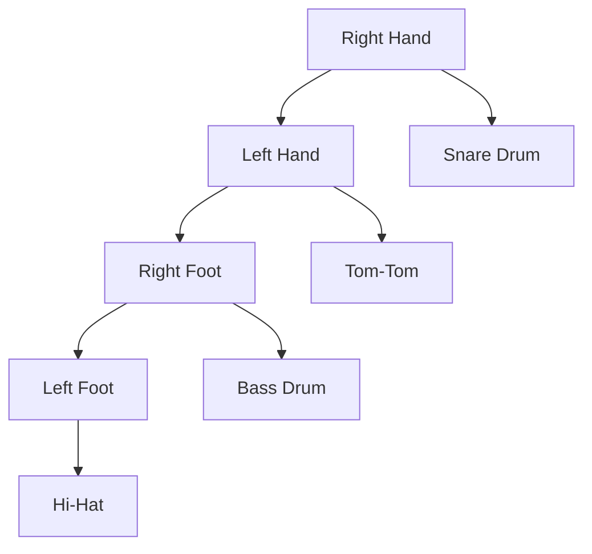

# Beginner Foundation: Drums 02 Four Limb Independence

## 1. Everyday Intuition & First Principles
Imagine you're a chef in a bustling kitchen. Each of your hands and feet is a different tool—your hands are knives and spoons, and your feet are the gas pedals of the stove. Just like a chef needs to use each tool independently and in harmony to create a delicious meal, a drummer needs to use each limb independently and in harmony to create a compelling rhythm. Four-limb independence is the skill that allows you to control each of your limbs separately, enabling you to play complex and intricate drum patterns.

## 2. Foundational Vocabulary & Glossary
- **Four Limb Independence:** The ability to control each limb (right hand, left hand, right foot, left foot) independently of the others.
- **Sticking:** The pattern of which hand plays a note, e.g., R-L-R-L (right-left-right-left).
- **Bass Drum:** The largest drum in a drum kit, typically played with the right foot.
- **Hi-Hat:** A cymbal that opens and closes with a foot pedal, often played with the left foot.
- **Snare Drum:** The middle-sized drum in a drum kit, usually played with the right hand.
- **Tom-Toms:** Smaller drums that sit on the rack, played with the left hand.

## 3. Visual System Flow
### ASCII Diagram
```
+-------------------+       +-------------------+       +-------------------+       +-------------------+
|   Right Hand      |  ---> |   Left Hand       |  ---> |   Right Foot      |  ---> |   Left Foot       |
+-------------------+       +-------------------+       +-------------------+       +-------------------+
       |                           |                           |                           |
       v                           v                           v                           v
+-------------------+       +-------------------+       +-------------------+       +-------------------+
|   Snare Drum      |  ---> |   Tom-Tom         |  ---> |   Bass Drum       |  ---> |   Hi-Hat          |
+-------------------+       +-------------------+       +-------------------+       +-------------------+
```

### Mermaid Flowchart


## 4. Common Beginner Misconceptions & Mental Traps
- **Misconception:** Four-limb independence is only for advanced drummers.
  - **Truth:** It's a foundational skill that beginners should practice to build a strong base.
- **Misconception:** You need to practice all limbs at once to develop independence.
  - **Truth:** Start with two limbs at a time and gradually add more as you improve.
- **Misconception:** It's about playing as fast as possible.
  - **Truth:** Focus on accuracy and control before increasing speed.

## 5. Socratic Discussion Starters
- How do you think using each limb independently can enhance your drumming?
- Can you think of a simple pattern that uses two limbs, and how you might add a third?
- What are some common mistakes beginners make when trying to develop four-limb independence?
- How can you practice four-limb independence without a drum kit?
