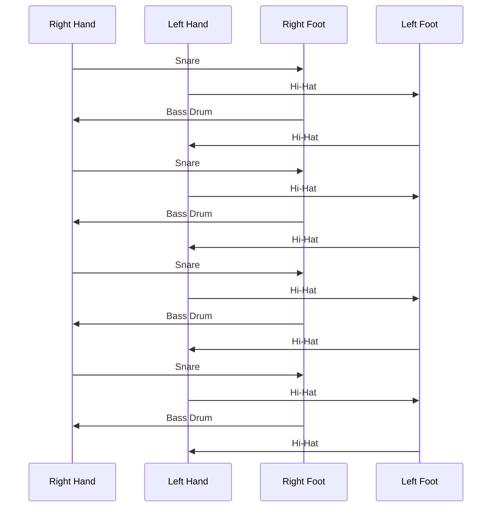

# Intermediate Foundation: Drums 02 Four Limb Independence

## 1. Architectural Mental Model
In the realm of drumming, Four Limb Independence is akin to a well-architected system where each limb operates as a distinct component, yet they work harmoniously to produce a cohesive and complex rhythm. This architectural mental model assumes a foundational understanding of basic drumming techniques and focuses on the production architecture of drumming, emphasizing the independent control and coordination of each limb.

### Key Components:
- **Right Hand (RH):** Typically responsible for the snare drum, but can also play the hi-hat or ride cymbal.
- **Left Hand (LH):** Often assigned to the hi-hat or ride cymbal, but can also play the snare drum.
- **Right Foot (RF):** Primarily controls the bass drum.
- **Left Foot (LF):** Usually operates the hi-hat pedal, but can also be used for additional bass drum strokes or other cymbals.

### System Design:
The system design involves the strategic placement and timing of each limb's actions to create a rhythmic pattern. This requires a deep understanding of timing, coordination, and the interplay between different drumming techniques.

## 2. Systems Taxonomy & Component Protocols
To achieve Four Limb Independence, it is essential to establish a taxonomy of drumming techniques and protocols that define how each limb interacts with the drum set.

### Standard Interfaces:
- **Snare Drum Interface:** Techniques such as rim shots, buzz rolls, and ghost notes.
- **Hi-Hat Interface:** Techniques including open, closed, and splash hits.
- **Ride Cymbal Interface:** Techniques such as crashes, chokes, and rolls.
- **Bass Drum Interface:** Techniques including double strokes, ghost notes, and rim clicks.

### Protocols:
- **Timing Protocol:** Ensures that each limb plays at the correct time relative to the overall rhythm.
- **Volume Protocol:** Controls the dynamics of each limb's strokes to maintain balance and clarity.
- **Technique Protocol:** Specifies the specific techniques each limb should use to execute the desired sound.

### Data Models:
- **Rhythm Data Model:** Represents the timing and placement of each stroke within a measure.
- **Pattern Data Model:** Defines the sequence of strokes for each limb over a series of measures.

## 3. Multi-Component Interaction Flow
To visualize the interaction between the limbs, we can use ASCII and Mermaid sequence diagrams.

### ASCII Sequence Diagram:
```
Time: 1 2 3 4 5 6 7 8
RH:   X   X   X   X
LH:     X   X   X   X
RF: X   X   X   X
LF:   X   X   X   X
```

### Mermaid Sequence Diagram:


## 4. Architectural Trade-offs & Production Pitfalls
Achieving Four Limb Independence involves several trade-offs and potential pitfalls:

### Trade-offs:
- **Complexity vs. Clarity:** More complex rhythms can be harder to execute but can add depth and interest to the music.
- **Speed vs. Precision:** Faster rhythms require more precision, which can be challenging to maintain.

### Pitfalls:
- **Overcomplicating Patterns:** Creating overly complex patterns can lead to confusion and mistakes.
- **Ignoring Timing:** Poor timing can disrupt the flow and coherence of the rhythm.
- **Neglecting Dynamics:** Failing to control the volume and dynamics of each limb can result in an unbalanced sound.

## 5. Socratic Discussion Starters
To deepen understanding and foster critical thinking, consider the following questions:

- How can you balance the complexity of a rhythm with the need for clarity and precision?
- What strategies can you use to improve your timing and coordination between limbs?
- How do you control the dynamics of each limb to maintain a balanced sound?
- Can you identify common patterns in successful Four Limb Independence exercises and apply them to your own practice?
- How does the choice of techniques and interfaces for each limb affect the overall rhythm and feel of the music?
