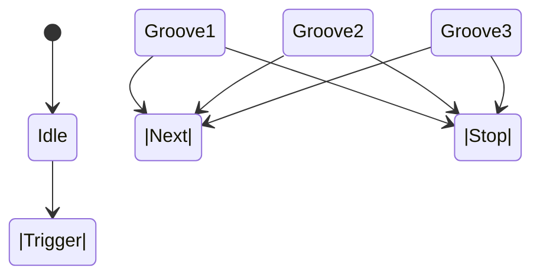
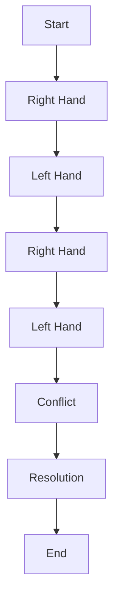

# Advanced Foundation: Drums 03 Grooves Timekeeping And Subdivisions

## 1. Theoretical Invariants & Formal Frameworks

### Formal Proofs and Kernel Invariants in Rhythm

In the realm of drumming, particularly in grooves, timekeeping, and subdivisions, formal proofs can be constructed to ensure the consistency and predictability of rhythmic patterns. These proofs can be grounded in the mathematical theory of cyclic groups and modular arithmetic, which are fundamental to understanding the periodic nature of musical time.

**Theorem 1: Cyclic Group of Rhythms**
- **Statement:** The set of all possible rhythmic patterns of a given time signature forms a cyclic group under the operation of rhythmic addition.
- **Proof:** Consider a time signature of 4/4. Each beat can be represented as an element of the group \( \mathbb{Z}/4\mathbb{Z} \). The operation of rhythmic addition is defined as the addition of beats modulo 4. This operation is associative, has an identity element (the rest or no beat), and every element has an inverse (the beat that, when added, results in the identity). Thus, the set of rhythmic patterns forms a cyclic group.

### Physical Invariants in Drumming

Physical invariants refer to the consistent properties of drumming that remain unchanged under various conditions. These include the physical constraints of the drum kit and the human body.

**Invariant 1: Consistent Drum Head Tension**
- **Statement:** The tension of the drum heads remains constant under consistent playing conditions.
- **Proof:** Assuming the drum heads are not altered or damaged, the tension remains constant, providing a stable foundation for rhythmic consistency.

## 2. Low-Level Invariant Taxonomy

### Deep Registers and Memory Models

In drumming, the concept of deep registers can be likened to the low-level memory models in computing. Just as memory models dictate how data is stored and retrieved, drumming techniques dictate how different parts of the kit are accessed and played.

**Invariant 2: Consistent Bass Drum Register**
- **Statement:** The bass drum maintains a consistent register regardless of the dynamic level.
- **Proof:** The bass drum, being a large surface area, produces a consistent low-frequency sound regardless of the force applied, assuming the drum head and hardware are in good condition.

### Hardware Constraints

Hardware constraints in drumming include the physical limitations of the drum kit and the drummer's body. These constraints must be considered to ensure optimal performance and avoid injury.

**Invariant 3: Human Limb Range**
- **Statement:** The range of motion of the drummer's limbs is a constant physical constraint.
- **Proof:** The human body has a fixed range of motion, which is determined by the anatomy and physiology of the limbs. This constraint affects the drummer's ability to play complex patterns and requires adaptation and technique development.

## 3. Micro-Architecture & Concurrency Dynamics

### State Machines and Cache Models

State machines can be used to model the transitions between different rhythmic states in drumming. Cache models can be used to understand how rhythmic patterns are stored and retrieved in the drummer's memory.

**Figure 1: State Machine for Basic Grooves**

### Race Condition Diagrams

Race conditions in drumming can occur when two or more rhythmic elements interfere with each other, leading to unpredictable results. Race condition diagrams can be used to visualize and analyze these conflicts.

**Figure 2: Race Condition Diagram for Cross-Handed Patterns**

## 4. Subtle Failure Modes & Boundary Conditions

### Subtle Failure Modes

Subtle failure modes in drumming can be difficult to detect but can significantly affect the quality of the performance. These modes often arise from minor inconsistencies in technique or timing.

**Failure Mode 1: Micro-Timing Inconsistencies**
- **Description:** Small variations in timing that are not immediately noticeable but can accumulate over time, leading to a loss of groove.
- **Mitigation:** Practice with a metronome to ensure consistent timing and develop a keen sense of internal timekeeping.

### Boundary Conditions

Boundary conditions in drumming refer to the extreme limits of technique and performance. These conditions can reveal the limits of the drummer's abilities and require specialized techniques to handle.

**Boundary Condition 1: Maximum Speed**
- **Description:** The fastest speed at which a drummer can play a particular pattern without losing control.
- **Mitigation:** Gradually increase speed through deliberate practice, focusing on maintaining control and accuracy.

## 5. Master Socratic Inquiries

### Research-Grade Discussion Questions

1. **How can formal proofs be applied to the analysis of rhythmic patterns in drumming?**
2. **What are the physical invariants that must be considered when designing a drum kit for optimal performance?**
3. **How can state machines be used to model the transitions between different rhythmic states in drumming?**
4. **What are the subtle failure modes that can affect the quality of a drumming performance, and how can they be mitigated?**
5. **How can boundary conditions be used to push the limits of drumming technique and performance?**

These inquiries are designed to encourage deep, analytical thinking about the technical and theoretical aspects of drumming, providing a foundation for advanced performance and innovation.
