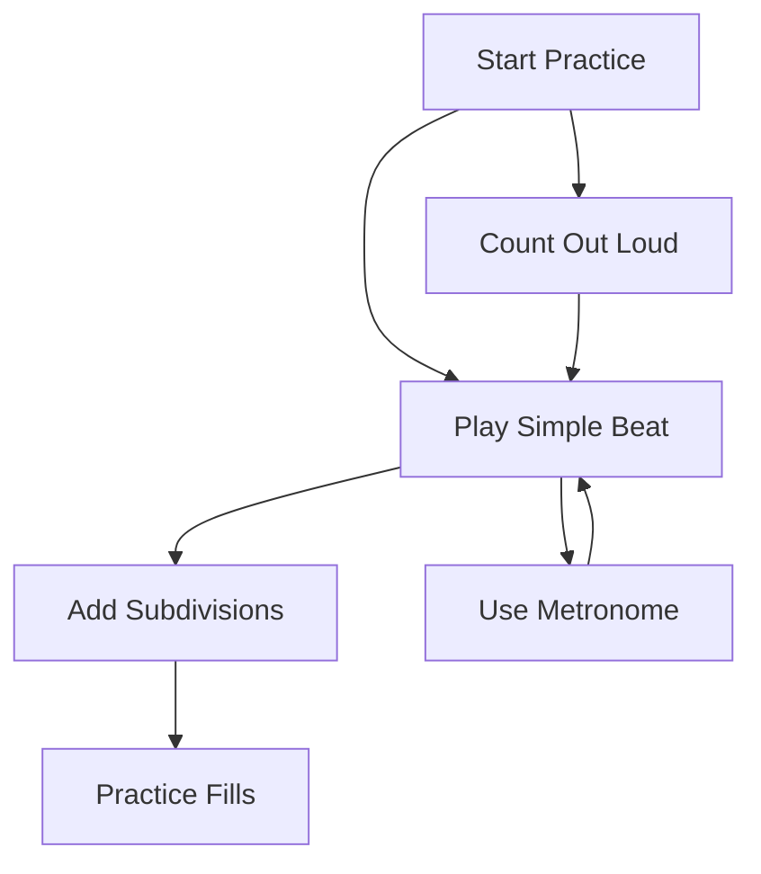

# Beginner Foundation: Drums 03 Grooves Timekeeping And Subdivisions

## 1. Everyday Intuition & First Principles
Imagine you're in a parade, and everyone needs to march in perfect time. The drum is like the leader of the parade, keeping everyone in sync. Grooves are the patterns the drummer plays to keep the parade moving smoothly. Timekeeping is the drummer's job to ensure everyone stays on beat, just like a conductor in an orchestra. Subdivisions are like the smaller steps within each march that make the parade more dynamic and interesting.

## 2. Foundational Vocabulary & Glossary
- **Groove:** A rhythmic pattern that provides a foundation for music, often played by the drummer.
- **Timekeeping:** The act of maintaining a steady beat to keep music in sync.
- **Subdivision:** A division of a beat into smaller, equal parts to create more complex rhythms.
- **Measure:** A segment of time defined by a specific number of beats.
- **Beat:** The basic unit of time in music, often marked by a strong accent.
- **Rhythm:** The pattern of beats and silences in music.
- **Steady Tempo:** A consistent speed at which music is played.
- **Fill:** A short musical phrase played by the drummer to transition between grooves or sections.

## 3. Visual System Flow
### ASCII Diagram
```
+-------------------+       +-------------------+       +-------------------+
|   Start Practice  |  ---> |   Play Simple Beat  |  ---> |   Add Subdivisions  |
+-------------------+       +-------------------+       +-------------------+
          |                           |                           |
          v                           v                           v
+-------------------+       +-------------------+       +-------------------+
|   Count Out Loud  |  ---> |   Use Metronome   |  ---> |   Practice Fills    |
+-------------------+       +-------------------+       +-------------------+
```

### Mermaid Flowchart


## 4. Common Beginner Misconceptions & Mental Traps
- **Misconception:** Grooves are just about playing loud and fast.
  - **Reality:** Grooves are about consistency and feel, not necessarily volume or speed.
- **Misconception:** Timekeeping is only important for drummers.
  - **Reality:** Timekeeping is crucial for all musicians to stay in sync.
- **Misconception:** Subdivisions are too complex for beginners.
  - **Reality:** Subdivisions are fundamental and can be learned gradually.
- **Misconception:** Fills are just random hits.
  - **Reality:** Fills are structured and serve to transition between grooves smoothly.

## 5. Socratic Discussion Starters
- What is the primary role of a drummer in a band?
- How does a simple beat differ from a groove?
- Why is it important to practice with a metronome?
- Can you explain the difference between a quarter note and an eighth note?
- How do fills enhance a groove?
- What are some common mistakes beginners make when trying to add subdivisions to their playing?
