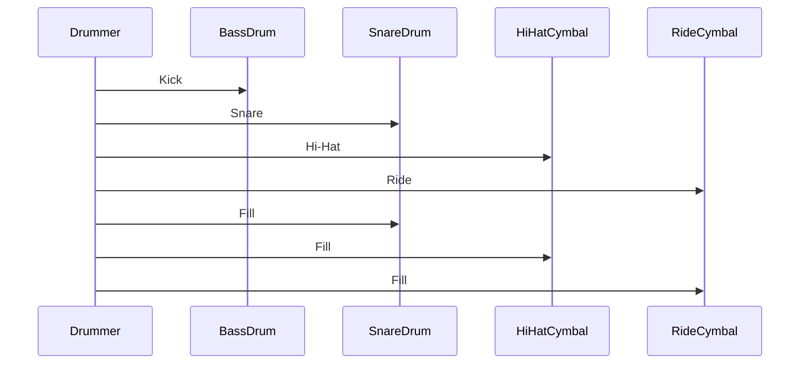

# Intermediate Foundation: Drums 03 Grooves Timekeeping And Subdivisions

## 1. Architectural Mental Model
In the realm of drumming, the architectural mental model is akin to understanding the blueprint of a musical composition. For intermediate drummers, this involves a deeper dive into grooves, timekeeping, and subdivisions. Grooves are the rhythmic patterns that form the foundation of a song, while timekeeping ensures that these patterns are played accurately and consistently. Subdivisions, on the other hand, are the smaller rhythmic units that make up the groove, allowing for more complex and nuanced playing.

### Key Concepts:
- **Grooves:** Patterns that define the rhythmic feel of a song.
- **Timekeeping:** The ability to maintain a steady tempo and rhythm.
- **Subdivisions:** Smaller rhythmic units that enhance the complexity of grooves.

### Production Architecture:
- **Layered Approach:** Think of drumming as a multi-layered system where each layer builds upon the previous one. The bottom layer is the basic groove, the middle layer includes additional fills and variations, and the top layer involves complex subdivisions and syncopations.
- **Modular Design:** Grooves can be seen as modular components that can be combined and recombined to create different musical arrangements. Understanding how these modules interact is crucial for advanced drumming.

## 2. Systems Taxonomy & Component Protocols
In drumming, the systems taxonomy involves categorizing different types of grooves, timekeeping techniques, and subdivision patterns. This taxonomy helps in understanding the relationships between different components and how they interact to create a cohesive musical experience.

### Grooves Taxonomy:
- **Standard Grooves:** Common grooves such as rock, funk, jazz, and swing.
- **Complex Grooves:** Grooves that incorporate multiple layers of rhythms and syncopations.
- **Custom Grooves:** Unique grooves tailored to specific musical styles or compositions.

### Timekeeping Protocols:
- **Metronome Use:** Utilizing a metronome to maintain a consistent tempo.
- **Internal Clock:** Developing an internal sense of time and rhythm.
- **Adaptive Timekeeping:** Adjusting timekeeping to fit the dynamics and feel of a song.

### Subdivision Protocols:
- **Basic Subdivisions:** Simple subdivisions like eighth notes, sixteenth notes, and triplets.
- **Advanced Subdivisions:** More complex subdivisions such as quintuplets, septuplets, and polyrhythms.
- **Syncopated Subdivisions:** Subdivisions that emphasize off-beats and syncopations.

## 3. Multi-Component Interaction Flow
Understanding how different components of drumming interact is essential for creating complex and dynamic grooves. Below is a detailed interaction flow using ASCII and Mermaid sequence diagrams.

### ASCII Sequence Diagram:
```
Drummer ->|Kick| Bass Drum
Drummer ->|Snare| Snare Drum
Drummer ->|Hi-Hat| Hi-Hat Cymbal
Drummer ->|Ride| Ride Cymbal
Drummer ->|Fill| Snare Drum
Drummer ->|Fill| Hi-Hat Cymbal
Drummer ->|Fill| Ride Cymbal
```

### Mermaid Sequence Diagram:


## 4. Architectural Trade-offs & Production Pitfalls
When designing grooves, timekeeping, and subdivisions, it's important to consider the trade-offs and potential pitfalls that can arise.

### Trade-offs:
- **Complexity vs. Clarity:** More complex grooves and subdivisions can add depth and interest, but they can also be difficult to follow and execute.
- **Consistency vs. Variation:** Maintaining a consistent groove is crucial for timekeeping, but introducing variations can keep the music interesting and dynamic.

### Production Pitfalls:
- **Overcomplicating Grooves:** Adding too many layers or subdivisions can make the groove difficult to play and understand.
- **Neglecting Timekeeping:** Focusing too much on complex rhythms without maintaining a steady tempo can disrupt the overall feel of the music.
- **Ignoring Subdivisions:** Subdivisions are essential for adding complexity and nuance, but they should be used judiciously to avoid cluttering the groove.

## 5. Socratic Discussion Starters
Socratic discussions are a great way to bridge the gap between theoretical knowledge and practical application. Here are some questions to spark discussion:

- **How can you balance complexity and clarity in your grooves?**
- **What strategies do you use to maintain a steady tempo while playing complex subdivisions?**
- **How do you incorporate syncopated subdivisions into your grooves without losing the overall feel of the music?**
- **Can you provide examples of how you have adapted your timekeeping to fit the dynamics and feel of a song?**
- **How do you approach designing custom grooves that fit specific musical styles or compositions?**

By exploring these questions, intermediate drummers can deepen their understanding of grooves, timekeeping, and subdivisions, and develop a more nuanced and dynamic approach to drumming.
