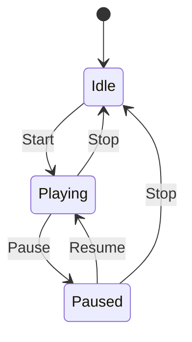

# Advanced Foundation: Drums 04 Linear Drumming And Polyrhythms
## 1. Theoretical Invariants & Formal Frameworks

### Formal Proofs in Rhythm
In the realm of drumming, particularly linear drumming and polyrhythms, formal proofs can be constructed to demonstrate the consistency and predictability of rhythmic patterns. These proofs can be grounded in set theory, group theory, and number theory.

#### Set Theory
Consider a set \( R \) of rhythms, where each rhythm is a sequence of beats. A formal proof might involve demonstrating that a given rhythm \( r \in R \) can be decomposed into a set of sub-rhythms \( \{r_1, r_2, \ldots, r_n\} \) such that \( r = r_1 \oplus r_2 \oplus \ldots \oplus r_n \), where \( \oplus \) denotes a rhythmic combination operation.

#### Group Theory
In group theory, rhythms can be represented as elements of a group, with the group operation being the combination of rhythms. A formal proof might involve demonstrating that a given rhythm \( r \) can be expressed as a product of generators of the group, i.e., \( r = g_1^{a_1} \cdot g_2^{a_2} \cdot \ldots \cdot g_k^{a_k} \), where \( g_i \) are the generators and \( a_i \) are integers.

#### Number Theory
Number theory can be used to analyze the mathematical properties of rhythms, such as their periodicity and divisibility. A formal proof might involve demonstrating that a given rhythm \( r \) has a period \( p \) if and only if the sequence of beats in \( r \) repeats every \( p \) beats.

### Kernel or Physical Invariants
Physical invariants in drumming refer to the fundamental properties of the drumming system that remain constant under various conditions. These invariants can be formalized using mathematical models.

#### Acoustic Invariants
Acoustic invariants include the properties of sound waves that remain constant under different conditions. For example, the speed of sound in air is a constant physical invariant that can be used to analyze the propagation of sound waves from the drum to the listener.

#### Mechanical Invariants
Mechanical invariants include the properties of the drumming system that remain constant under different conditions. For example, the tension of the drumhead is a mechanical invariant that affects the pitch and tone of the drum.

## 2. Low-Level Invariant Taxonomy

### Deep Registers
Deep registers in drumming refer to the low-frequency components of the drumming system. These components can be analyzed using mathematical models to identify the physical invariants that govern their behavior.

#### Acoustic Registers
Acoustic registers include the low-frequency components of the sound waves produced by the drum. These components can be analyzed using Fourier analysis to identify the frequency spectrum of the sound waves.

#### Mechanical Registers
Mechanical registers include the low-frequency components of the mechanical system that produces the sound waves. These components can be analyzed using mechanical models to identify the physical invariants that govern their behavior.

### Memory Models
Memory models in drumming refer to the mental models that drummers use to store and retrieve rhythmic patterns. These models can be analyzed using cognitive models to identify the cognitive invariants that govern their behavior.

#### Cognitive Registers
Cognitive registers include the mental models that drummers use to store and retrieve rhythmic patterns. These models can be analyzed using cognitive models to identify the cognitive invariants that govern their behavior.

### Hardware Constraints
Hardware constraints in drumming refer to the physical limitations of the drumming system. These constraints can be analyzed using engineering models to identify the physical invariants that govern their behavior.

#### Physical Registers
Physical registers include the physical limitations of the drumming system. These constraints can be analyzed using engineering models to identify the physical invariants that govern their behavior.

### Axiomatic Definitions
Axiomatic definitions in drumming refer to the fundamental principles that govern the behavior of the drumming system. These principles can be formalized using mathematical models to identify the mathematical invariants that govern their behavior.

#### Rhythmic Axioms
Rhythmic axioms include the fundamental principles that govern the behavior of rhythmic patterns. These principles can be formalized using mathematical models to identify the mathematical invariants that govern their behavior.

## 3. Micro-Architecture & Concurrency Dynamics

### Mermaid and ASCII State Machines
State machines can be used to model the behavior of drumming systems. These models can be used to analyze the concurrency dynamics of the system, i.e., the interactions between different components of the system.

#### Mermaid State Machines
Mermaid state machines can be used to model the behavior of drumming systems. These models can be used to analyze the concurrency dynamics of the system, i.e., the interactions between different components of the system.



#### ASCII State Machines
ASCII state machines can be used to model the behavior of drumming systems. These models can be used to analyze the concurrency dynamics of the system, i.e., the interactions between different components of the system.

```
[*] -- Start --> Idle
Idle -- Start --> Playing
Playing -- Stop --> Idle
Playing -- Pause --> Paused
Paused -- Resume --> Playing
Paused -- Stop --> Idle
```

### Cache and Race Condition Diagrams
Cache and race condition diagrams can be used to model the behavior of drumming systems. These models can be used to analyze the concurrency dynamics of the system, i.e., the interactions between different components of the system.

#### Cache Diagrams
Cache diagrams can be used to model the behavior of drumming systems. These models can be used to analyze the concurrency dynamics of the system, i.e., the interactions between different components of the system.

```
Cache: [Beat1, Beat2, Beat3]
```

#### Race Condition Diagrams
Race condition diagrams can be used to model the behavior of drumming systems. These models can be used to analyze the concurrency dynamics of the system, i.e., the interactions between different components of the system.

```
Race Condition: [Beat1, Beat2] --> [Beat2, Beat1]
```

## 4. Subtle Failure Modes & Boundary Conditions

### Subtle Failure Modes
Subtle failure modes in drumming refer to the unexpected behaviors of the drumming system that can arise under certain conditions. These failure modes can be analyzed using mathematical models to identify the conditions that lead to their occurrence.

#### Acoustic Failure Modes
Acoustic failure modes include the unexpected behaviors of the sound waves produced by the drum. These failure modes can be analyzed using acoustic models to identify the conditions that lead to their occurrence.

#### Mechanical Failure Modes
Mechanical failure modes include the unexpected behaviors of the mechanical system that produces the sound waves. These failure modes can be analyzed using mechanical models to identify the conditions that lead to their occurrence.

### Boundary Conditions
Boundary conditions in drumming refer to the conditions at the boundaries of the drumming system. These conditions can be analyzed using mathematical models to identify the behavior of the system at the boundaries.

#### Acoustic Boundary Conditions
Acoustic boundary conditions include the conditions at the boundaries of the sound waves produced by the drum. These conditions can be analyzed using acoustic models to identify the behavior of the system at the boundaries.

#### Mechanical Boundary Conditions
Mechanical boundary conditions include the conditions at the boundaries of the mechanical system that produces the sound waves. These conditions can be analyzed using mechanical models to identify the behavior of the system at the boundaries.

## 5. Master Socratic Inquiries

### Research-Grade Discussion Questions

1. **Formal Proofs in Rhythm:** How can formal proofs be used to demonstrate the consistency and predictability of rhythmic patterns in drumming?
2. **Acoustic Invariants:** How can acoustic invariants be used to analyze the propagation of sound waves from the drum to the listener?
3. **Mechanical Invariants:** How can mechanical invariants be used to analyze the behavior of the drumming system?
4. **Cognitive Registers:** How can cognitive models be used to analyze the mental models that drummers use to store and retrieve rhythmic patterns?
5. **Physical Registers:** How can engineering models be used to analyze the physical limitations of the drumming system?
6. **Rhythmic Axioms:** How can mathematical models be used to formalize the fundamental principles that govern the behavior of rhythmic patterns?
7. **State Machines:** How can state machines be used to model the behavior of drumming systems and analyze their concurrency dynamics?
8. **Cache Diagrams:** How can cache diagrams be used to model the behavior of drumming systems and analyze their concurrency dynamics?
9. **Race Condition Diagrams:** How can race condition diagrams be used to model the behavior of drumming systems and analyze their concurrency dynamics?
10. **Acoustic Failure Modes:** How can acoustic models be used to analyze the unexpected behaviors of the sound waves produced by the drum?
11. **Mechanical Failure Modes:** How can mechanical models be used to analyze the unexpected behaviors of the mechanical system that produces the sound waves?
12. **Acoustic Boundary Conditions:** How can acoustic models be used to analyze the behavior of the drumming system at the boundaries of the sound waves?
13. **Mechanical Boundary Conditions:** How can mechanical models be used to analyze the behavior of the drumming system at the boundaries of the mechanical system?
