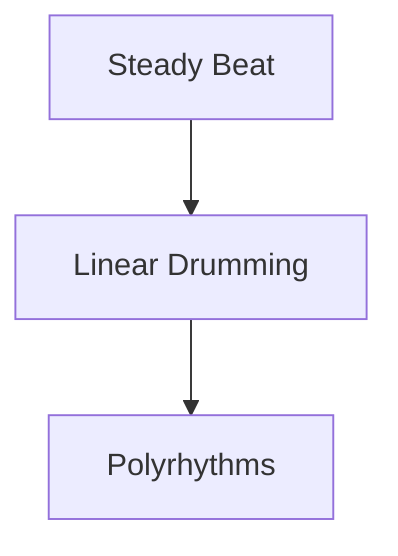

# Beginner Foundation: Drums 04 Linear Drumming And Polyrhythms

## 1. Everyday Intuition & First Principles
Imagine you're walking on a busy street. You hear the footsteps of people walking at different paces. Linear drumming is like walking in a straight line, keeping a steady beat, while polyrhythms are like hearing multiple people walking at different speeds at the same time. Understanding these concepts helps you create complex and interesting rhythms that can add depth and excitement to your drumming.

## 2. Foundational Vocabulary & Glossary
- **Linear Drumming:** Playing a steady, consistent rhythm on the drums, often using a single pattern or groove.
- **Polyrhythm:** Playing two or more conflicting rhythms simultaneously, creating a complex and layered sound.
- **Steady Beat:** A consistent, repeating rhythm that serves as the foundation of a musical piece.
- **Rhythm Section:** The part of a band that provides the rhythmic foundation, typically including drums, bass, and sometimes guitar or keyboard.
- **Time Signature:** A notational convention used in Western musical notation to specify how many beats are in a measure and which note value constitutes one beat.
- **Subdivision:** Dividing a beat into smaller, equal parts to create more complex rhythms.

## 3. Visual System Flow

### ASCII Diagram
```
+-------------------+       +-------------------+       +-------------------+
|  Steady Beat      |  ---> |  Linear Drumming  |  ---> |  Polyrhythms      |
+-------------------+       +-------------------+       +-------------------+
```

### Mermaid Flowchart


## 4. Common Beginner Misconceptions & Mental Traps
- **Misconception:** Linear drumming is too simple and not interesting. **Trap:** Failing to see the importance of a solid foundation before moving to more complex rhythms.
- **Misconception:** Polyrhythms are too difficult to learn. **Trap:** Overcomplicating the process and getting discouraged before mastering the basics.
- **Misconception:** You need to be a prodigy to play complex rhythms. **Trap:** Believing that natural talent is more important than practice and dedication.

## 5. Socratic Discussion Starters
- What is the importance of a steady beat in drumming?
- How does linear drumming contribute to the overall feel of a song?
- Can you explain what a polyrhythm is and give an example?
- How do you practice subdividing beats to improve your rhythm skills?
- What are some common mistakes beginners make when trying to play polyrhythms, and how can they be avoided?
