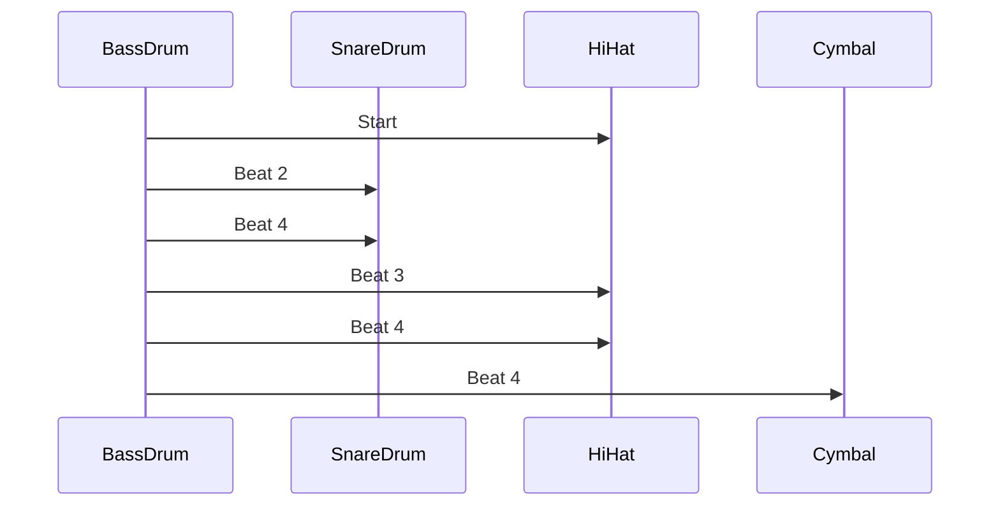

# Intermediate Foundation: Drums 04 Linear Drumming And Polyrhythms

## 1. Architectural Mental Model
In the realm of drumming, especially when delving into linear drumming and polyrhythms, it's essential to establish a robust mental model that integrates both theoretical and practical aspects. This model should encompass the foundational elements of rhythm, timing, and coordination, while also considering the interplay between different drumming components such as the bass drum, snare, hi-hat, and cymbals.

### Key Concepts:
- **Linear Drumming:** Focuses on playing a consistent, steady rhythm that can be divided into equal parts. It is the backbone of most drumming styles and is crucial for maintaining a solid groove.
- **Polyrhythms:** Involves playing two or more conflicting rhythms simultaneously. This technique adds complexity and depth to the drumming, allowing for intricate patterns and textures.

### Mental Model:
Imagine the drum kit as a system with various components, each responsible for a specific role in the overall rhythm. The bass drum provides the foundation, the snare adds emphasis, the hi-hat keeps time, and the cymbals add color and dynamics. Linear drumming ensures that these components work in harmony, while polyrhythms introduce layers of complexity by allowing different components to play at varying rhythms.

## 2. Systems Taxonomy & Component Protocols
To effectively implement linear drumming and polyrhythms, it's crucial to understand the taxonomy of drumming components and the protocols that govern their interaction.

### Taxonomy:
- **Bass Drum (Kick):** The primary timekeeper, responsible for the foundational rhythm.
- **Snare Drum:** Provides emphasis and accents, often on beats 2 and 4 in a 4/4 time signature.
- **Hi-Hat:** Maintains a steady flow of time, often played on every beat or every other beat.
- **Cymbals:** Add texture and dynamics, used for fills, crashes, and accents.

### Protocols:
- **Standard Notation:** A system of writing music that includes symbols to indicate pitch, duration, and other aspects of a performance.
- **Counting Systems:** Techniques for keeping track of time, such as counting in 4/4, 3/4, or 6/8 time signatures.
- **Rhythm Notation:** Symbols and patterns used to represent rhythmic patterns, such as quarter notes, eighth notes, and sixteenth notes.

## 3. Multi-Component Interaction Flow
To understand how different drumming components interact in linear drumming and polyrhythms, it's helpful to visualize the interaction flow using ASCII and Mermaid sequence diagrams.

### ASCII Sequence Diagram:
```
Bass Drum:  X---X---X---X---
Snare Drum: ----X-------X---
Hi-Hat:     X-X-X-X-X-X-X-X-
Cymbal:     ------------X---
```

### Mermaid Sequence Diagram:


## 4. Architectural Trade-offs & Production Pitfalls
When incorporating linear drumming and polyrhythms into your drumming, it's important to consider the trade-offs and potential pitfalls that may arise.

### Trade-offs:
- **Complexity vs. Clarity:** Adding polyrhythms can create intricate patterns, but it's essential to maintain clarity and ensure that the rhythm remains accessible to the listener.
- **Precision vs. Feel:** While precision is crucial in maintaining accurate timing, it's equally important to infuse the rhythm with feel and groove.

### Production Pitfalls:
- **Overcomplication:** Avoid overcomplicating the rhythm to the point where it becomes difficult to follow or loses its impact.
- **Lack of Practice:** Mastering linear drumming and polyrhythms requires consistent practice and repetition. Skipping this step can lead to inconsistent performance.

## 5. Socratic Discussion Starters
To deepen your understanding of linear drumming and polyrhythms, consider the following questions:

- How can you use linear drumming to create a solid foundation for your drumming?
- What are some common techniques for incorporating polyrhythms into your playing?
- How do you balance complexity and clarity when using polyrhythms?
- What role does precision play in maintaining the integrity of a rhythm?
- How can you infuse your drumming with feel and groove while maintaining accuracy?
