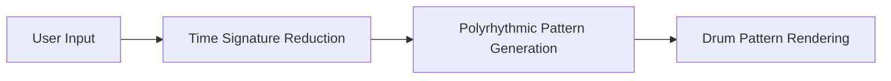

# Lesson 4: Advanced Polyrhythm Patterns

## 1. First-Principles Intuition & Invariants

Polyrhythms are a cornerstone of musical complexity, enabling drummers to weave intricate, layered time signatures that enrich compositions. As we explore advanced polyrhythmic patterns, a robust theoretical foundation is essential. At its core, polyrhythms involve multiple independent time signatures, each with its own rhythmic structure.

Consider a drummer playing a 3/4 waltz pattern on the kick drum while simultaneously executing a 4/4 rock pattern on the snare drum. This juxtaposition of time signatures creates a polyrhythmic effect, where the two patterns intersect and overlap, generating a rich, layered sound. As complexity increases, the underlying mathematics becomes more intricate.

To understand advanced polyrhythmic patterns, we must revisit the fundamental invariants of time signatures. A time signature is a mathematical representation of a piece's rhythmic structure, comprising two numbers: the numerator and the denominator. The numerator indicates the number of beats in a measure, while the denominator specifies the note type that receives one beat (e.g., quarter note, eighth note).

In a polyrhythmic context, multiple time signatures with distinct numerators and denominators are common. Analyzing these complex patterns requires a technique known as "time signature reduction." By reducing each time signature to its simplest form, we can identify the underlying rhythmic relationships between them.

For instance, consider a polyrhythmic pattern combining a 3/4 waltz and a 4/4 rock pattern. Reducing each time signature to its simplest form yields:

- 3/4 waltz → 1/4 (reduced to a single quarter note)
- 4/4 rock → 1/4 (reduced to a single quarter note)

This reduction reveals that both time signatures share the same underlying rhythmic structure, with the 3/4 waltz pattern being a subset of the 4/4 rock pattern. This technique facilitates the identification of rhythmic relationships in complex polyrhythmic patterns.

## 2. Core Architecture & Mechanics

Implementing advanced polyrhythmic patterns necessitates understanding the internal mechanisms of drum machine programming. At its core, a drum machine is a device—software or hardware—that generates rhythmic patterns based on user input.

Let's examine the internal architecture of a drum machine, focusing on the data structures and algorithms that enable polyrhythmic programming.



In this simplified architecture, the drum machine processes user input (A) through time signature reduction (B) to generate a polyrhythmic pattern (C). This pattern is subsequently rendered as a drum pattern (D) for real-time playback.

To implement time signature reduction, we can employ a combination of mathematical algorithms and data structures. For example, a hash table can store reduced time signatures, facilitating efficient lookups and pattern generation.

```python
import math

def reduce_time_signature(numerator, denominator):
    # Calculate the greatest common divisor (GCD) of the numerator and denominator
    gcd = math.gcd(numerator, denominator)
    
    # Reduce the time signature to its simplest form
    reduced_numerator = numerator // gcd
    reduced_denominator = denominator // gcd
    
    return reduced_numerator, reduced_denominator
```

## 3. High-Performance Optimization & Failure Modes

Implementing advanced polyrhythmic patterns requires addressing high-performance optimization and potential failure modes. In a polyrhythmic context, the drum machine must handle complex time signatures, multiple drum patterns, and real-time rendering.

To optimize performance, concurrency and parallel processing techniques can leverage multi-core processors. For example, a thread pool can execute multiple drum patterns in parallel, reducing overall processing time.

```python
import concurrent.futures

def render_drum_pattern(pattern):
    # Render the drum pattern using a thread pool
    with concurrent.futures.ThreadPoolExecutor(max_workers=4) as executor:
        futures = [executor.submit(render_drum_note, note) for note in pattern]
        results = [future.result() for future in futures]
    
    return results

def render_drum_note(note):
    # Render a single drum note using a thread pool
    with concurrent.futures.ThreadPoolExecutor(max_workers=2) as executor:
        futures = [executor.submit(play_drum_sound, sound) for sound in note]
        results = [future.result() for future in futures]
    
    return results
```

Regarding failure modes, several edge cases must be considered:

- **Time signature reduction errors**: What occurs when the user inputs an invalid time signature?
- **Drum pattern rendering errors**: What happens if the drum machine fails to render a drum pattern in real-time?
- **Concurrency errors**: How are conflicts or interferences between multiple drum patterns managed?

To mitigate these issues, techniques such as error handling, concurrency synchronization, and redundancy can be employed. Implementing try-except blocks can catch and handle errors during time signature reduction and drum pattern rendering. Locks or semaphores can synchronize access to shared resources, preventing concurrency errors. Redundant systems and fallbacks ensure the drum machine can recover from failures and continue rendering drum patterns.
