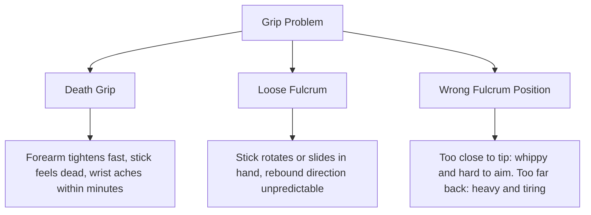
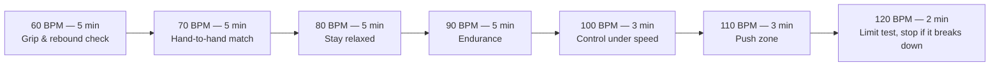
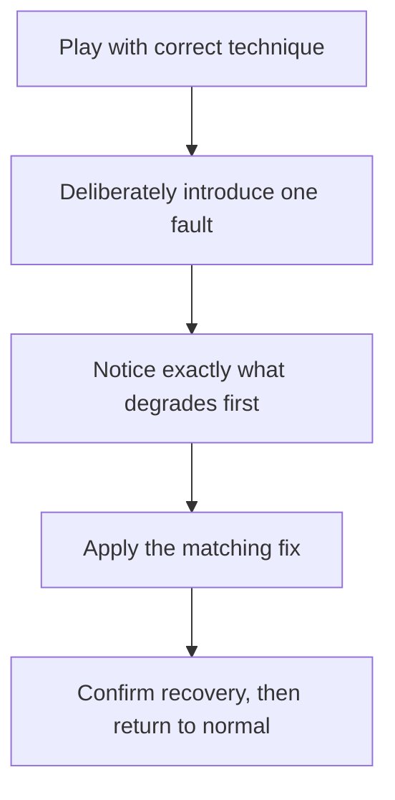

# Drum Lab 01: Grip, Fulcrum & Rebound Mechanics

## What You're Building

Every drumming skill—speed, dynamics, endurance, coordination—sits on top of two mechanical systems: how you hold the stick (grip/fulcrum) and how you use the drumhead's stored energy (rebound). This lab installs both correctly before you touch a single rudiment pattern. Skip this and you'll spend years fighting tension you built into your hands on day one.

## Gear & Setup

- **Drum/pad:** 14"×5.5" snare tuned to a clear, resonant pitch, or any practice pad with real rebound (avoid thin rubber pads with no bounce — they teach false technique).
- **Sticks:** 5A hickory, 16", roll them on a flat table to confirm they're not warped. 7A if your hands are small or you're under 12 years old.
- **Metronome:** Any app with a visible beat flash helps when you're watching your hands instead of listening.
- **Seating:** Throne or chair height so your forearms are parallel to the floor when sticks rest on the head. Feet flat, back upright, shoulders down and relaxed — tension starts in the shoulders before it ever reaches your hands.
- **Optional but genuinely useful:** a kitchen scale (grip calibration), phone camera on a tripod or stand (technique review), a strip of tape (fulcrum and strike-zone marking).

Sit down and check one thing before anything else: when your arms hang naturally and you bring the sticks to the drum, do your wrists stay straight, or do they cock up/down? If they bend, your seat is the wrong height — fix that first. No grip technique survives a bad setup.

## Part 1 — The Fulcrum: Your Stick's Pivot Point

### Why it matters

The stick needs one stable pivot and several light guides. If every finger grips equally hard, the stick can't rotate freely, and a stick that can't rotate can't rebound — you end up muscling every stroke instead of letting the drum give energy back to you.

### Building the grip, step by step (matched grip)

1. **Find the balance point.** Rest the stick on one extended finger and slide it until it balances — this lands around 40–45% up from the butt end. Tape a small mark here. You won't grip here; it's just a landmark.

2. **Set the fulcrum forward of that point.** Measure about 1.5" (roughly four finger-widths) forward of the balance mark, toward the tip. This is where thumb meets index finger.

3. **Form the contact.** Thumb pad presses against the side of your index finger at its first knuckle. This is a **pinch point, not a fist** — think of holding a pencil you're about to write with, not a hammer you're about to swing.

4. **Gut-check the pressure.** If you have a scale: lay the stick across it, grip with thumb and index only, and read the number. You're aiming for roughly **half a pound (around 220–250g)**. No scale? Use the drop test below — it's just as reliable.

5. **Curl the remaining fingers.** Middle finger curls gently right behind the fulcrum. Ring and pinky curl along for the ride with the lightest possible contact — barely touching the wood. They are *passive stabilizers*, not grippers. If you can feel them actively squeezing, they're doing too much.

### The drop test (no scale required)

Hold the stick vertically by the fulcrum alone, with your other fingers open and away. Tip the stick to horizontal, then relax your thumb/index slightly.

- **Falls to vertical in about half a second to a second:** correct tension.
- **Falls instantly, stick almost slips out of your hand:** too loose — pinch a bit more.
- **Barely moves, or you have to shake it loose:** too tight — you're death-gripping.

Run this test any time you suspect tension has crept in. It takes five seconds and tells you more than a scale number ever will, because it tests *function*, not force.

### Common grip failures



| Problem | What you'll see | What you'll feel | Fix |
|---|---|---|---|
| Death grip | White knuckles, rigid forearm, no bounce | Hand cramps in under 5 minutes | Open ring/pinky completely; re-check with the drop test |
| Loose fulcrum | Stick visibly rotates or walks in the hand | Slippery, unstable | Tighten thumb/index pinch slightly |
| Fulcrum too close to tip (< 1") | Huge stick arc from tiny wrist motion | "Whippy," hard to control volume | Move the pinch point back toward 1.5–2" |
| Fulcrum too far back (>3") | Stick barely moves, you compensate with big arm motion | Tiring, sluggish | Move the pinch point forward toward 1.5–2" |

## Part 2 — Rebound: Let the Drum Do Half the Work

### The physics, briefly

A drumhead under tension behaves like a trampoline. When the stick strikes it, the head deflects downward, stores that energy for a couple of milliseconds, then springs back and pushes the stick upward. A well-tuned head with the right technique returns roughly 70–80% of your stroke energy. Your job is not to "lift" the stick back up — it's to **get out of its way** so it can rise on its own, then catch it at the top.

### The four phases of one stroke

1. **Downstroke:** The wrist flexes (not the elbow — keep your forearm relatively still) through roughly 90–120°, accelerating the tip toward the head in a straight line. Just before contact, your ring and pinky should be at their lightest — any squeezing here kills the rebound before it happens.

2. **Impact:** Contact lasts only a couple of milliseconds. The fulcrum should feel like it's absorbing the shock, not resisting it — like catching a ball with a slightly bent elbow instead of a locked arm.

3. **Rebound:** The head pushes the stick back up. At 90 BPM in moderate dynamics, the tip should rise about 5–6" above the head. This is the energy you just put in, coming back to you for free.

4. **Recovery:** The stick reaches its peak height, your wrist eases to control the position, and your secondary fingers re-engage just enough to steady the stick for the next stroke — not to stop it dead.

### Calibrating your rebound height

1. Tape small marks on the stick at 4", 6", and 8" from the tip to give yourself a visual height reference.
2. Play single strokes at 60 BPM and watch where the stick peaks after each hit.
3. You're aiming for about 5–6" at a moderate 90 BPM tempo — higher at louder dynamics, lower when playing soft.
4. If you can, film yourself from the side. Height should stay within about an inch, stroke to stroke.

**Diagnosing what you see:**
- **Rebound under 3":** you're damping it — grip too tight, or your wrist is reversing direction before the stick finishes rising. Loosen the ring/pinky contact.
- **Rebound over 8":** you're overpowering the stroke, or not damping at all. Ease the wrist velocity, let the secondary fingers add a touch more control at the top.
- **Height swinging wildly between hits:** usually inconsistent impact angle (see below) rather than grip.

### Where and how you hit the head

- **Strike zone:** about 2–3" in from the center of the drum. Dead center kills rebound and bends pitch; too near the rim is harsh and will eventually crack a stick tip. Tape a small target dot there while you're building consistency.
- **Impact angle:** 45° from the head is your default — it's the angle that gives full tone and maximum efficient rebound. Steeper angles (60–75°) choke the tone and shorten the bounce; shallower angles (below 30°) glance off the head and lose energy sideways instead of up.

| Angle | Rebound | Tone | Control | When to use |
|---|---|---|---|---|
| 30° (shallow) | Weak, glancing | Thin | Hard to aim | Avoid — this is a technique flaw, not a choice |
| 45° (standard) | Full, efficient | Clear, full | Best | Default for everything |
| 60° | Good | Slightly darker | Good | Low-volume passages |
| 75° (near vertical) | Choked | Muffled | Limited speed | Rare special effects only |

Film yourself from the side, pause the video right at the moment of impact, and eyeball the angle between stick and head. If it's consistently landing between 45–60°, your technique is solid.

## Part 3 — Practice Routine: Single-Stroke Roll (R L R L)

This is the atomic unit of drumming. Everything downstream — paradiddles, rolls, fills, independence — is built from this motion executed cleanly.



**60–70 BPM — foundation.** Every 60 seconds, run the drop test. Watch that both hands produce identical volume and rebound height — most players have a dominant hand that unconsciously grips tighter. Record 30 seconds on your phone and compare left vs. right.

**75–90 BPM — working zone.** This is where most of your daily practice should live. Lock to the click with zero drift. Keep breathing normally — if you notice you're holding your breath, your grip has tightened without you noticing.

**95–110 BPM — speed development.** The stick must reach its rebound peak *before* you ask for the next stroke. If you're muscling the stick down before it's finished rising, you're fighting the bounce instead of using it. If one hand consistently lags, that hand has a grip or fulcrum problem — isolate it with single-hand reps.

**115–120 BPM — limit test.** Two minutes only. This tells you where your current ceiling is; it is not where you should be living day to day. If timing falls apart, stick slips, or anything hurts, stop immediately and drop back to 80 BPM.

### 30-minute session template

```text
0–5 min    60 BPM warm-up — drop test, posture check
5–10 min   70 BPM — bilateral symmetry (L vs R identical)
10–15 min  80 BPM — film 30 seconds for review
15–20 min  90 BPM — endurance, zero timing errors is the target
20–25 min  100 BPM — push zone
25–28 min  110 BPM — speed test
28–30 min  60 BPM cooldown + grip release stretches
```

## Part 4 — Double-Stroke Roll (R R L L)

The second stroke of a double is **caught, not played**. If you're pushing the second hit down with muscle, you've missed the entire point of the exercise — you're training the wrong motion.

### Learning the catch

1. Play a single right-hand stroke (R1) and let it rebound fully without touching it. Watch where it peaks and how long it takes to get there.
2. Now play R1 again, but this time add a second, much smaller tap (R2) exactly at the moment the stick reaches that peak. R2 should feel like you're gently redirecting a bounce already in progress — not winding up a second full stroke.
3. Repeat the same process with the left hand alone (L1, L2).
4. Combine into R R L L once each hand can do its own double cleanly.

### Checking you're doing it right

Record yourself playing R R L L and listen to the volume relationship between the two strokes of each double:
- **R2 about 2–4dB quieter than R1** — correct. This slight taper is just natural energy loss; it's expected and it's good.
- **R2 almost silent** — you're damping the rebound, usually by re-gripping with the ring/pinky too soon after impact. Consciously relax those fingers right after the first hit.
- **R2 as loud as R1** — you're forcing a second stroke instead of catching a bounce. Slow down to 60 BPM and rebuild the catch from step 1 above.

### 15-minute double-stroke drill

```text
1. R-hand bounce only, observe natural rebound       2 min
2. R1-R2 controlled catch, 70 BPM                     3 min
3. L-hand bounce only, observe natural rebound        2 min
4. L1-L2 controlled catch, 70 BPM                     3 min
5. Combine RRLL, 75-90 BPM                            5 min
```

If speed stalls anywhere above 100 BPM, the fix is almost never "try harder" — it's dropping 20 BPM and re-syncing your wrist motion with the stick's natural bounce rate until the catch feels automatic again, then building back up.

## Part 5 — Deliberately Breaking Technique to Understand It

The fastest way to recognize a problem in real playing is to have caused it on purpose first. Run each of these once; they take a few minutes and pay off for years.



### Drill A: Overgripping on purpose

Start at a correct, relaxed grip and play single strokes at 90 BPM. Every 30 seconds, consciously squeeze a little harder. Within 2–4 minutes you'll feel the exact moment the rebound dies and the forearm starts to burn. That sensation — stick suddenly feeling "stuck," rebound height collapsing below 4" — is your early-warning signature for overgripping during a real performance or long set. The recovery is always the same: stop, shake your hands out for a few seconds, re-run the drop test, and resume at a slower tempo for 30–60 seconds before working back up.

### Drill B: Loosening the fulcrum until the stick slips

Deliberately loosen your thumb/index pinch and play singles starting at 60 BPM, adding 10 BPM every 30 seconds. Note the tempo where the stick starts to twist or slide in your hand. Most players find this somewhere between 100–130 BPM with a loose grip, versus well past 160 BPM with a correct fulcrum. This teaches you that fulcrum pressure requirements *scale with speed* — a grip that feels fine at a ballad tempo can fail completely on a fast tune.

### Drill C: Overdamping the double-stroke

Play R R L L at 80 BPM and deliberately clamp your ring and pinky hard after each first stroke. You'll hear the second stroke of each double disappear or turn into a dull thud — it stops sounding like a double and starts sounding like two unrelated singles. This is the single most common fault in developing players and now you have the sound and feel memorized, so you can catch it in your own playing without needing to record and review.

### Drill D: Angle drift

Play two minutes of singles while intentionally varying your strike angle between very shallow and very steep, stroke to stroke. Listen to how uneven the volume gets even though your wrist effort feels the same. This is why volume inconsistency on a gig is often an angle problem, not a dynamics problem — your ears will now recognize the difference.

## Tempo Ceiling & Endurance Benchmarks

Run this once now, then monthly, to track real progress instead of guessing.

**Tempo ceiling test:** Start singles at 60 BPM, add 10 BPM every 60 seconds, stop when you get three timing errors greater than ±30ms in a row. Write down the tempo and what broke first — timing, volume, one hand lagging, or outright fatigue.

| Tempo range | What it feels like |
|---|---|
| 60–90 BPM | Natural, low effort, room to add dynamics |
| 95–120 BPM | Working zone, needs real focus |
| 125–145 BPM | Strain — technique is being tested |
| 150–170 BPM | Errors mounting, near max effort |
| 175+ BPM | Breakdown territory for most players |

Typical starting ceilings: beginners land around 100–120 BPM, intermediate players 130–150 BPM, advanced players 160–180+ BPM. Expect roughly 5–10 BPM of ceiling improvement per month with consistent practice — this is not linear, so don't panic over a flat week.

**Endurance test:** Play singles at a comfortable 90 BPM and track how long you sustain clean technique before timing errors exceed about 10 per 30-second window, or your forearm starts burning. Beginners typically hold 5–10 minutes; intermediate players 10–15; advanced players 20+. Retest every couple of weeks — expect small, steady gains, not dramatic jumps.

## Quick Reference Card

```mermaid
flowchart TD
    Root["GRIP"]
    Root --> G1["Fulcrum: thumb + index, ~1.5 in from tip"]
    Root --> G2["Secondary fingers: light contact only, never squeezing"]
    Root --> G3["Drop test: stick falls vertical in 0.5-1.0 sec when released"]
    
    Impact["IMPACT"]
    Impact --> I1["Angle: 45° (default), up to 60° for softer playing"]
    Impact --> I2["Strike zone: 2-3 in from drum center"]
    Impact --> I3["Straight-line trajectory into the head, not an arc"]
    
    Rebound["REBOUND"]
    Rebound --> R1["Target height: 5-6 in at 90 BPM"]
    Rebound --> R2["Double-stroke R1→R2: R2 slightly quieter, never forced"]
    Rebound --> R3["Let the stick finish rising before you ask for the next stroke"]
    
    Breaks["WHEN SOMETHING BREAKS"]
    Breaks --> B1["Rebound dies → release ring/pinky, re-run drop test"]
    Breaks --> B2["Stick slips → tighten fulcrum pinch, dry your hands"]
    Breaks --> B3["Doubles sound like singles → relax grip right after first hit"]
    Breaks --> B4["Volume uneven → check strike angle on video"]
    Breaks --> B5["Pain anywhere → stop. Not negotiable."]
```



## Where This Goes Next

Once singles and doubles feel physically easy at 90–100 BPM with stable rebound and no creeping tension, you're ready for paradiddles, flams, and full rudiment combinations — all of which reuse exactly the grip and rebound mechanics you just built. Revisit this lab monthly: tension habits creep back in quietly, and a five-minute drop-test check now saves you from relearning this from scratch after a bad week of gigging.
