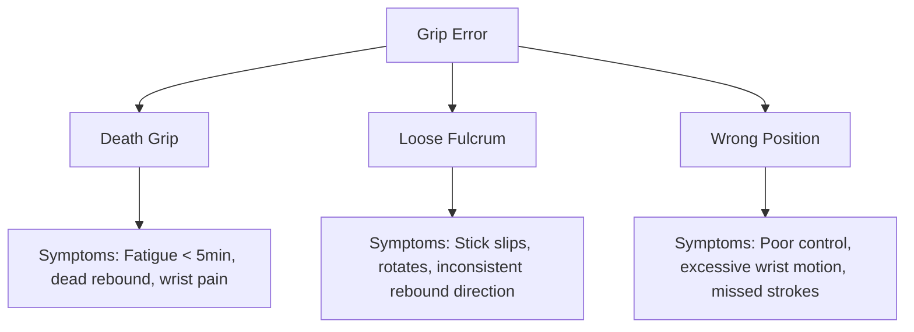
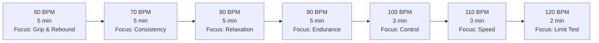
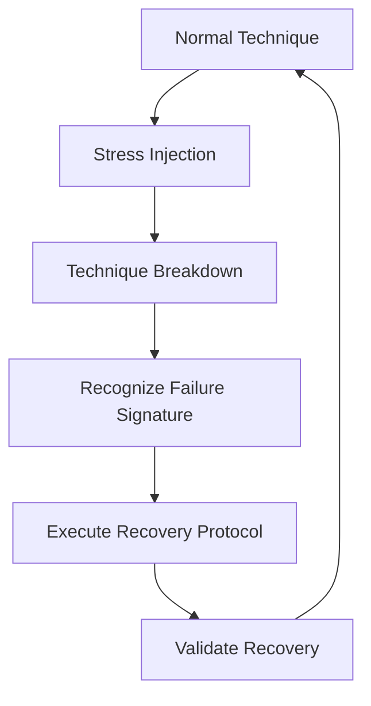
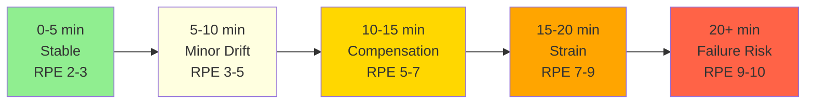

# Operational Verification Labs: 01 Rudiments Grip And Rebound

## Objective & Lab Setup

### Objective
Master the biomechanical foundations of drumming through systematic analysis of grip mechanics and rebound dynamics. You will isolate and optimize the physical variables that control stick behavior, then validate your technique under stress conditions. This lab builds the motor patterns required for all advanced drumming: coordination, speed, dynamics, and endurance.

### Lab Setup
- **Drum Kit:** 14"×5.5" snare drum (maple or birch shell preferred), tuned to 340-360 Hz fundamental (use DrumDial or tuning app). Any practice pad works if snare unavailable—prioritize rebound surface over acoustic tone.
- **Drumsticks:** Matched pair of 5A hickory sticks (16" length, 0.565" diameter, 45-48g). Verify straightness by rolling on flat surface. Alternative: 7A for smaller hands.
- **Metronome:** Digital metronome with subdivision display. Korg MA-2 or smartphone app with visual flash.
- **Recording Device:** Smartphone video (1080p minimum) positioned 3 feet away, capturing full stroke motion. Audio recording optional but useful for SPL analysis.
- **Measurement Tools:** Digital kitchen scale (±1g resolution), ruler with millimeter markings, painter's tape for marking sticks.
- **Practice Space:** Quiet room where you can clearly hear metronome and stick rebound. Stable chair or throne at height where forearms are parallel to floor when sticks contact drumhead.

**Critical Setup Validation:**
- Sit with feet flat, back straight, shoulders relaxed
- Snare or pad height: sticks strike surface at natural hand position when arms hang relaxed
- Sticks rest on surface with forearms parallel to floor—if wrists bend up or down, adjust height
- Lighting allows clear view of hands and stick motion

## Exercise 1: Foundational Practical Implementation

### Grip Biomechanics: Fulcrum Theory

The stick pivots around the fulcrum (thumb + index finger contact point). Everything else—wrist motion, rebound control, dynamics—depends on this pivot working correctly. Get this wrong and every stroke fights you.

**Fulcrum Formation Protocol:**

1. **Locate Natural Balance Point:**
   - Hold stick horizontally on one extended index finger
   - Slide stick until it balances (typically 40-45% from butt end)
   - Mark balance point with small piece of tape
   - This is reference only—fulcrum goes forward of this point

2. **Create Primary Fulcrum:**
   - Position fulcrum 1.5" (four finger-widths) forward of balance point
   - Thumb pad opposes first joint (knuckle) of index finger
   - Create contact point, not a squeeze
   - Test: stick should pivot freely when you apply slight pressure to butt end

3. **Verify Fulcrum Pressure:**
   - Place stick on kitchen scale
   - Apply grip with thumb and index only
   - Scale should read 250g (about half a pound)
   - Too light (<200g): stick will slip during fast playing
   - Too heavy (>300g): rebound gets damped, hand fatigues quickly

4. **Add Secondary Fingers:**
   - Middle finger curls around stick immediately behind fulcrum
   - Ring and pinky curl naturally, maintaining light contact
   - Total grip pressure: still 250g on scale (secondary fingers don't squeeze)
   - These fingers stabilize and damp excess vibration—they're not active control surfaces

5. **Grip Release Test:**
   - Hold stick vertically by fulcrum only
   - Rotate hand so stick is horizontal
   - Release grip slightly—stick should drop to vertical within 0.5-1.0 seconds
   - Too fast: grip too loose
   - Doesn't drop: grip too tight

**Common Grip Errors:**



**Error Recognition & Correction:**

| Error | Visual Signature | Feel Signature | Fix |
|-------|------------------|----------------|-----|
| Death grip (>400g) | White knuckles, rigid forearm, stick doesn't rebound | Hand cramping, stick feels "stuck" | Release secondary fingers completely, verify 250g on scale |
| Loose fulcrum (<150g) | Stick rotates in hand, position shifts | Stick feels slippery, unstable | Increase thumb/index pressure, verify on scale |
| Fulcrum too close to tip (<1") | Excessive stick movement, large arc | Difficult to control volume, feels "whippy" | Move fulcrum back to 1.5-2.0" from tip |
| Fulcrum too far back (>3") | Minimal stick travel, large hand motion | Requires excessive force, tiring | Move fulcrum forward to 1.5-2.0" from tip |

### Rebound Dynamics: Energy Transfer Cycle

Rebound is not passive—it's an active energy recovery system. The drumhead stores energy from your stroke and returns it. Your job: capture that returned energy efficiently.

**The Four-Phase Stroke Cycle:**

**Phase 1: Downstroke (Acceleration)**
- Wrist flexes through 90-120° arc
- Forearm remains relatively stationary (pivot at wrist, not elbow)
- As stick approaches impact, secondary fingers release contact
- Stick tip accelerates in straight line toward target
- Duration: ~100-150ms at 90 BPM

**Phase 2: Impact (Energy Transfer)**
- Stick tip contacts drumhead for 2-5ms
- Energy transfers into head deflection (drumhead moves down)
- Head generates acoustic wave (the sound you hear)
- Fulcrum absorbs reactive force but doesn't fight it
- Stick begins reversing direction

**Phase 3: Rebound (Energy Recovery)**
- Drumhead returns to equilibrium, pushing stick back up
- Energy transfers from head back into stick motion
- Fulcrum acts as pivot point, redirecting energy upward
- Stick tip rises 4-6" above drumhead (target height at 90 BPM)
- Duration: ~100-150ms

**Phase 4: Recovery (Damping & Reset)**
- Stick reaches maximum height (apex)
- Wrist extends slightly to control stick position
- Secondary fingers re-engage to arrest excess oscillation
- Stick stabilizes in ready position for next stroke
- Duration: ~50-100ms

**Rebound Height Calibration:**

1. Mark stick with tape at 4", 6", 8" from tip
2. Execute single stroke at 60 BPM
3. Observe maximum rebound height after impact
4. Target: 5-6" at 90 BPM (scales with tempo and dynamics)
5. Video yourself from side angle—rebound height should be consistent ±1"

**Rebound Height Diagnostics:**

- **Too low (<3"):** Excessive grip tension or premature wrist reversal. Release secondary fingers post-impact. Verify 250g grip pressure.
- **Too high (>8"):** Insufficient damping or excessive stroke force. Increase secondary finger contact slightly. Reduce stroke velocity.
- **Inconsistent (±3"):** Variable grip tension or impact angle. Focus on consistent fulcrum pressure and 45° strike angle.

### Impact Geometry: Strike Zone & Angle

Where and how you strike the drumhead determines rebound efficiency.

**Optimal Strike Zone:**
- **Position:** 2-3" from center of snare drum
- **Why:** Avoids dead center (low rebound, pitch bending) and rim (harsh tone, stick damage)
- **Visual reference:** Place small piece of tape as target. Aim for consistent contact on this spot.

**Impact Angle:**
- **Target:** 45-60° from drumhead surface
- **Setup:** When stick is at ready position (4-6" above head), tip should point toward strike zone at 45°
- **Execution:** Maintain this angle through entire stroke—don't flatten out at impact

**Impact Angle Effects:**

| Angle | Rebound Efficiency | Tone Quality | Control | Use Case |
|-------|-------------------|--------------|---------|----------|
| 30° (shallow) | Poor—glancing contact | Thin, weak | Difficult | Avoid |
| 45° (baseline) | Optimal | Full, clear | Excellent | Default technique |
| 60° (steeper) | Good | Full, slightly darker | Good | Lower dynamics |
| 75° (near-vertical) | Reduced | Dark, muffled | Limited stroke velocity | Special effects only |

**Angle Verification:**
- Video yourself from side angle
- Freeze frame at moment of impact
- Measure angle between stick and drumhead surface
- Consistent 45-60° indicates good technique

### Systematic Practice Routine

**Single-Stroke Roll (RLRL) Development:**

The single-stroke roll is the atomic unit of drumming. Master this and everything else becomes possible.

**Progressive Tempo Protocol:**



**60-70 BPM (Foundation Building):**
- **Duration:** 5 minutes per tempo
- **Focus Points:**
  - Grip pressure constant at 250g (check every 60 seconds)
  - Rebound height 5-6" and consistent between hands
  - Impact angle 45° maintained throughout
  - Secondary fingers release at impact, re-engage at apex
- **Success Metric:** Both hands produce identical volume (±1dB if measuring SPL)
- **Video Check:** Record 30 seconds. Watch for asymmetries in motion, height, or timing.

**75-90 BPM (Working Zone):**
- **Duration:** 5 minutes per tempo
- **Focus Points:**
  - Timing locked to metronome (no drift or rushing)
  - Wrist motion smooth and continuous (no jerking)
  - Shoulders and neck remain relaxed
  - Breathing steady (don't hold breath)
- **Success Metric:** Zero timing errors over 100-stroke sequence
- **Common Failure:** Tension creeps into forearm—check grip pressure on scale if this happens

**95-110 BPM (Speed Development):**
- **Duration:** 3 minutes per tempo
- **Focus Points:**
  - Rebound timing—stick reaches apex before next stroke
  - Fulcrum remains stable (no micro-adjustments)
  - Forearm stays relaxed despite increased tempo
  - If fatigue appears, drop tempo immediately
- **Success Metric:** Maintain 4-6" rebound height without grip tension increase
- **Diagnostic:** Video from front angle. If one hand lags consistently, that side has technique error.

**115-120 BPM (Control Bandwidth Limit):**
- **Duration:** 2 minutes per tempo
- **Focus Points:**
  - This should feel challenging but controlled
  - If technique breaks down (missed strokes, timing chaos, pain), stop immediately
  - Current limit ≠ permanent limit—you'll improve
- **Success Metric:** Complete 2 minutes with <5 timing errors
- **Important:** Don't practice at this tempo extensively. Build foundation at 70-90 BPM.

**Practice Session Structure (30 minutes):**
```
Minutes 0-5:   60 BPM warmup, verify grip mechanics
Minutes 5-10:  70 BPM, focus on bilateral symmetry  
Minutes 10-15: 80 BPM, record video for analysis
Minutes 15-20: 90 BPM, endurance test
Minutes 20-25: 100 BPM, push zone
Minutes 25-28: 110 BPM, speed test
Minutes 28-30: 60 BPM cooldown, grip release stretches
```

**Double-Stroke Roll (RRLL) Development:**

The double-stroke roll requires timing the second stroke to coincide with the natural rebound peak of the first. This is coordination, not force.

**Rebound Timing Principle:**
- First stroke (R1): Full wrist stroke, generates rebound
- Second stroke (R2): Timed to occur at rebound apex—minimal additional force needed
- If R2 requires pushing, timing is wrong

**Progressive Protocol:**

**60-70 BPM (Rebound Synchronization):**
1. Execute single stroke with right hand (R1)
2. Allow stick to rebound fully—observe apex height and timing
3. On next stroke, add second tap (R2) at the exact moment stick reaches apex
4. R2 should feel like "catching" the rebound, not forcing a new stroke
5. Repeat with left hand (L1-L2)
6. Combine: RRLL pattern

**Timing Measurement:**
- Time interval between R1 and R2 should match natural rebound period
- Test: Let stick bounce freely after one stroke. Time how long until it settles.
- R1→R2 interval should be ~80% of this natural period

**75-90 BPM (Bounce Coefficient Tuning):**
- **Audio Check:** Record yourself playing RRLL pattern
- **Expected amplitude relationship:** R2 should be 2-4dB quieter than R1 (natural energy dissipation)
- **If R2 too quiet (>6dB difference):** Releasing secondary fingers too late, damping rebound
- **If R2 too loud (equal to R1):** Forcing second stroke instead of using rebound—defeats the purpose
- **Target:** Smooth, even rhythm with subtle volume taper R1→R2

**95-110 BPM (High-Frequency Response):**
- Wrist oscillation frequency must synchronize with rebound frequency
- If R2 timing drifts early or late, rebound energy isn't being captured
- Common error: Trying to play faster by tensing muscles—opposite of what works
- Solution: Reduce tempo by 20 BPM, focus on rebound timing, increase gradually

**Double-Stroke Drill Sequence (15 minutes):**
```
1. R bounce (R1 only, observe natural rebound): 2 min
2. RR controlled (R1-R2 at rebound peak): 3 min at 70 BPM
3. L bounce (L1 only): 2 min
4. LL controlled (L1-L2 at rebound peak): 3 min at 70 BPM
5. RRLL combined: 5 min at 75-90 BPM
```

## Exercise 2: Parameter Variation & Empirical Analysis

### Systematic Grip Parameter Space Exploration

You've learned the optimal parameters. Now deliberately vary them to understand *why* they're optimal. This builds intuition for self-correction during performance.

**Test Variables:**
1. Fulcrum position: How far from tip?
2. Fulcrum force: How hard to grip?
3. Impact angle: How steep to strike?
4. Secondary finger pressure: How much damping?

**Measurement Approach:**
- Change ONE variable at a time
- Keep everything else fixed
- Record results
- Compare to baseline

### Experiment 2.1: Fulcrum Position Sweep

**Question:** What happens when fulcrum moves toward tip vs. toward butt?

**Setup:**
- Mark four test positions on stick with tape:
  - Position A: 1.0" from tip
  - Position B: 1.5" from tip (baseline—optimal)
  - Position C: 2.0" from tip
  - Position D: 2.5" from tip
- Fixed parameters: 250g grip force, 90 BPM tempo, 45° impact angle

**Procedure:**
1. Execute 2-minute single-stroke roll at each position
2. Record video from side angle
3. Note subjective control rating (1-10 scale)
4. Measure rebound height from video (pause at apex, measure with ruler on screen)
5. Count any grip slips or position adjustments

**Data Collection Table:**

| Position | Distance (mm) | Rebound Height (in) | Control Rating (1-10) | Fatigue Onset (min) | Notes |
|----------|---------------|---------------------|-----------------------|---------------------|-------|
| A        | 25            |                     |                       |                     |       |
| B        | 38            |                     |                       |                     |       |
| C        | 51            |                     |                       |                     |       |
| D        | 64            |                     |                       |                     |       |

**Expected Results:**
- **Position A (1.0"):** High control precision, lower volume, shorter rebound, hand fatigue appears quickly. Feels sensitive—small wrist motion creates large stick movement.
- **Position B (1.5"):** Balanced—good control with adequate power and rebound. Should feel natural.
- **Position C (2.0"):** Slightly less control precision, higher volume, taller rebound, delayed fatigue. Feels more powerful but less responsive.
- **Position D (2.5"):** Difficult control, high volume, very tall rebound, but requires excessive wrist motion. Feels "loose" and imprecise.

**Analysis Question:** Why does position B balance control and power?
- Closer to tip: Increases leverage ratio (small hand motion = large tip motion), but reduces mechanical advantage for generating force
- Farther from tip: Decreases leverage ratio (large hand motion needed), but increases mechanical advantage for force
- Position B hits the sweet spot: enough leverage for control without sacrificing power

### Experiment 2.2: Grip Tension Sweep

**Question:** How does grip pressure affect rebound and fatigue?

**Setup:**
- Use kitchen scale to calibrate four tension levels:
  - Level 1: 150g (light—below optimal)
  - Level 2: 250g (optimal baseline)
  - Level 3: 350g (firm—above optimal)
  - Level 4: 450g (tight—excessive)
- Fixed parameters: 1.5" fulcrum position, 90 BPM tempo, double-stroke roll (RRLL)

**Procedure:**
1. Verify tension on scale before starting each level
2. Execute 2-minute double-stroke roll
3. Record audio for amplitude analysis (if possible) or note subjective volume consistency
4. Count stick slips or grip readjustments
5. Rate forearm tension sensation (1-10 scale)

**Data Collection Table:**

| Tension | Force (g) | Slip Count | R1→R2 Volume Relationship | Forearm Tension (1-10) | Fatigue Onset (min) |
|---------|-----------|------------|---------------------------|------------------------|---------------------|
| Light   | 150       |            |                           |                        |                     |
| Optimal | 250       |            |                           |                        |                     |
| Firm    | 350       |            |                           |                        |                     |
| Tight   | 450       |            |                           |                        |                     |

**Expected Results:**
- **150g (Light):** Stick feels unstable, may rotate or slip during strokes. R1→R2 relationship inconsistent. Low fatigue but poor control.
- **250g (Optimal):** Stable grip, R2 naturally quieter than R1 (2-4dB), moderate fatigue. Control feels natural.
- **350g (Firm):** No slipping, but R2 significantly damped (>5dB quieter than R1). Increased forearm tension, faster fatigue.
- **450g (Tight):** Death grip—R2 nearly silent or absent (rebound fully damped). Hand cramping within 2-3 minutes. Avoid.

**Key Insight:** Rebound efficiency peaks at moderate tension (250g). Too loose = instability. Too tight = damping and fatigue. The optimal zone is narrow—practice calibrating by feel.

### Experiment 2.3: Impact Angle Variation

**Question:** How does strike angle affect rebound height and tone?

**Setup:**
- Video record from side angle (critical for angle measurement)
- Test four angles using wrist position adjustment:
  - 30° from drumhead
  - 45° from drumhead (baseline)
  - 60° from drumhead
  - 75° from drumhead
- Fixed parameters: 250g grip, 1.5" fulcrum, 80 BPM (slow enough for precise angle control)

**Procedure:**
1. Execute 20 single strokes per angle with 2-second rest between strokes
2. Video record entire sequence
3. Review video frame-by-frame at impact moment
4. Measure angle using protractor overlay (many video apps have angle measurement tools)
5. Measure rebound height from video

**Data Collection Table:**

| Impact Angle | Mean Rebound (in) | Tone Quality (subjective 1-10) | Control Difficulty (1-10) | Notes |
|--------------|-------------------|--------------------------------|---------------------------|-------|
| 30°          |                   |                                |                           |       |
| 45°          |                   |                                |                           |       |
| 60°          |                   |                                |                           |       |
| 75°          |                   |                                |                           |       |

**Expected Results:**
- **30° (Shallow):** Low rebound (<3"), thin tone, stick may glance off surface. Difficult to control direction.
- **45° (Baseline):** Optimal rebound (5-6"), full tone, natural feel. Easiest to control consistently.
- **60° (Steeper):** Good rebound (4-5"), slightly darker tone, still controllable but requires more vertical wrist motion.
- **75° (Near-vertical):** Reduced rebound (3-4"), muffled tone, feels restricted. Limited stroke velocity.

**Key Insight:** 45-60° range provides best balance of rebound efficiency, tone quality, and ergonomic comfort. Shallower angles lose energy to glancing contact. Steeper angles require excessive lifting motion.

### Experiment 2.4: Secondary Finger Damping Analysis

**Question:** How do ring/pinky fingers affect stick control and rebound?

**Setup:**
- Four damping conditions:
  - Condition A: Fingers extended away (zero contact)
  - Condition B: Fingers lightly touching (50g)
  - Condition C: Fingers curled normally (150g—baseline)
  - Condition D: Fingers tightly wrapped (250g)
- Fixed parameters: 250g fulcrum force (thumb/index), 100 BPM single-stroke roll

**Procedure:**
1. Execute 50-stroke sequence for each condition
2. Video record from front angle
3. Count visible stick wobbles or rotations
4. Rate subjective control stability (1-10)
5. Measure timing consistency by playing along with metronome—count timing errors

**Data Collection Table:**

| Condition | Finger Force (est.) | Wobble Count | Control Stability (1-10) | Timing Errors | Rebound Height (in) |
|-----------|---------------------|--------------|--------------------------|---------------|---------------------|
| None      | 0                   |              |                          |               |                     |
| Light     | 50g                 |              |                          |               |                     |
| Normal    | 150g                |              |                          |               |                     |
| Heavy     | 250g                |              |                          |               |                     |

**Expected Results:**
- **None (0g):** Maximum rebound height, but stick wobbles/rotates. Difficult to maintain consistent strike point. Timing errors increase.
- **Light (50g):** Near-maximum rebound, slight wobble reduction, improved control. Good balance.
- **Normal (150g—baseline):** Moderate rebound, stable stick position, best control. Optimal for most playing.
- **Heavy (250g):** Reduced rebound (<4"), minimal wobble, but feels constrained. Fatigue increases.

**Key Insight:** Secondary fingers function as adjustable dampers. Light contact (50-100g) provides stability without sacrificing rebound. Excessive contact trades rebound efficiency for a marginal control increase—not worth it.

### Synthesis: Multivariate Optimization

After completing single-parameter sweeps, test your optimal configuration:

**Optimal Parameter Set (Validated):**
- Fulcrum position: 1.5-2.0" from tip
- Fulcrum force: 250g ±50g
- Impact angle: 45-60°
- Secondary finger force: 50-100g (light contact)

**Validation Test:**
1. Set up all parameters at optimal values
2. Execute 5-minute continuous single-stroke roll at 100 BPM
3. Record entire session
4. Measure:
   - Timing precision (count deviations >±20ms)
   - Volume consistency (subjective—does it sound even?)
   - Fatigue onset (when do you first notice tension or difficulty?)
   - Rebound height stability (video review—consistent ±1"?)

**Target Performance:**
- Timing errors: <10 over entire 5-minute session
- Volume: Consistent throughout (no gradual increase or decrease)
- Fatigue: None or minimal by 5-minute mark
- Rebound: 5-6" ±1" throughout session

**If targets not met:** Review video and identify which parameter drifted. Common: grip tension creeps up over time. Solution: Check grip on scale every 60 seconds during practice until calibration becomes automatic.

## Exercise 3: Fault Injection & Stress Testing

### Failure Mode Analysis

Deliberately breaking technique under controlled conditions teaches you to recognize and recover from errors during performance. This section makes you antifragile.



### Fault 3.1: Progressive Grip Tension Increase

**Scenario:** During performance, anxiety or fatigue causes unconscious grip tightening. Recognize it early and reset before control degrades completely.

**Injection Protocol:**
1. Begin with optimal grip (250g verified on scale)
2. Execute single-stroke roll at 90 BPM
3. Every 30 seconds, deliberately increase grip tension by ~50g
4. Continue until technique breaks down (obvious timing errors, pain, or stick control loss)
5. Duration: typically 3-5 minutes until failure

**Measurement:**
- **0-1 min (250g baseline):** Record performance quality—this is your reference
- **1-2 min (300g):** Note first signs of degradation (subtle timing drift, reduced rebound height)
- **2-3 min (350g):** Obvious degradation (timing errors increase, tone quality drops)
- **3-4 min (400g):** Severe degradation (multiple errors per 8-bar phrase, forearm tension visible)
- **4-5 min (450g+):** Breakdown (cramping, control loss, technique collapse)

**Failure Signatures to Recognize:**
- **Acoustic:** Volume becomes inconsistent—some strokes louder, others quieter
- **Tactile:** Stick feels "dead"—rebound sensation diminishes
- **Visual:** Rebound height drops below 4"
- **Biomechanical:** Forearm muscles visibly tense, wrist range of motion decreases

**Recovery Protocol (Execute in 15 seconds):**
1. **Stop playing immediately** (mid-phrase if necessary—better to reset than push through)
2. **Release grip completely:** Shake hands out, stretch fingers
3. **Re-calibrate on scale:** Verify return to 250g ±50g
4. **Test rebound:** Execute 5 slow single strokes, observe 5-6" rebound height
5. **Resume at reduced tempo:** Drop to 70 BPM, gradually increase back to working tempo over 60 seconds

**Prevention Strategy:**
- Check grip tension every 60-90 seconds during practice
- Place scale nearby—take 5-second breaks to verify tension hasn't crept up
- When performing, use breath as tension gauge: if holding breath, grip is probably too tight

### Fault 3.2: Fulcrum Slip Under Speed

**Scenario:** At high tempos, insufficient fulcrum pressure causes stick to slip through grip. Catastrophic if it happens during a fill.

**Injection Protocol:**
1. Deliberately reduce fulcrum force to 150g (below critical threshold)
2. Start single-stroke roll at 60 BPM
3. Increase tempo by 10 BPM every 30 seconds
4. Record tempo at which slip first occurs
5. Note slip characteristics (partial slide, full slip, rotational spin)

**Expected Failure Tempo:**
- 150g grip typically fails at 100-120 BPM
- 200g grip fails at 130-150 BPM
- 250g grip (optimal) stable up to 160+ BPM

**Slip Signatures:**
- **Acoustic:** Sudden drop in volume or complete silence (missed stroke)
- **Tactile:** Loss of stick position awareness—suddenly feels "wrong"
- **Visual:** Stick position shifts relative to fulcrum markers, or stick rotates around longitudinal axis

**Recovery Protocol (30 seconds):**
1. **Stop immediately:** Don't try to continue with compromised grip
2. **Re-establish fulcrum:** Place stick on scale, verify 250g pressure
3. **Check position:** Ensure fulcrum is still 1.5-2.0" from tip (may have shifted during slip)
4. **Diagnostic check:** Is slip due to:
   - Moisture (sweat)? → Dry hands, apply grip powder/rosin
   - Fatigue? → Rest 60 seconds, stretch forearms
   - Wrong position? → Re-measure and mark stick
5. **Validation:** Execute 20 test strokes at 80 BPM, zero slip events = recovered
6. **Graduated return:** Resume at 50% of failure tempo, increase gradually

**Prevention Strategy:**
- Maintain 250g minimum fulcrum pressure at all tempos
- Keep hands dry—towel nearby during practice
- If slip occurs once, stop and diagnose—don't push through and hope it resolves

### Fault 3.3: Rebound Damping (Premature Wrist Reversal)

**Scenario:** Excessive secondary finger pressure or premature wrist reversal arrests rebound energy. Second stroke in double-stroke roll becomes forced rather than rebounded.

**Injection Protocol:**
1. Execute double-stroke roll (RRLL) at 80 BPM
2. Deliberately increase secondary finger pressure to 250-300g (heavy wrap)
3. Observe degradation of second stroke (R2, L2) quality
4. Record audio if possible to measure amplitude ratio

**Measurement:**
- **Normal:** R1→R2 amplitude ratio = 0.7-0.9 (R2 is 1-3dB quieter)
- **Damped:** R1→R2 amplitude ratio < 0.5 (R2 is >6dB quieter or nearly silent)

**Failure Signatures:**
- **Acoustic:** Second stroke significantly quieter or completely absent—sounds like singles instead of doubles
- **Tactile:** Stick feels "dead" after first stroke—no rebound sensation
- **Visual:** Wrist reverses direction before stick reaches apex—cutting rebound short
- **Biomechanical:** Visible forearm tension, reduced rebound height (<3")

**Recovery Protocol (60 seconds):**
1. **Isolate rebound mechanism:** Execute single R1 strokes only. Allow full rebound, catch stick at apex. Repeat 10 times.
2. **Consciously release secondary fingers:** After impact, actively relax ring/pinky. Stick should bounce freely.
3. **Rebound timing drill:** R1 stroke → wait for rebound peak → add R2 at exact peak moment. Repeat 20 times slowly.
4. **Measure ratio:** Audio record RRLL pattern. Verify R1→R2 ratio returns to 0.7-0.9 range.
5. **Full pattern:** Resume RRLL at 70 BPM, gradually increase tempo.

**Key Diagnostic:** If R2 requires pushing/forcing, timing is wrong. R2 should feel like "catching" the rebound energy, not generating a new stroke.

### Fault 3.4: Impact Angle Drift

**Scenario:** Inconsistent wrist trajectory causes variable impact angle, producing erratic rebound direction and volume.

**Injection Protocol:**
1. Deliberately vary impact angle randomly (30-75° range)
2. Execute single-stroke roll at 90 BPM for 2 minutes
3. Video record from side angle
4. Analyze angle consistency and rebound behavior

**Measurement:**
- **Normal:** Angle consistency σ < 5°, rebound direction consistent, volume even
- **Fault:** Angle consistency σ > 15°, rebound direction varies, volume inconsistent

**Failure Signatures:**
- **Acoustic:** Wide volume swings—some strokes loud, others weak
- **Visual:** Stick rebounds at inconsistent angles—sometimes straight up, sometimes sideways
- **Tactile:** Rebound timing unpredictable—difficult to maintain consistent rhythm
- **Control:** Difficulty keeping consistent stroke height—some strokes require catching at different heights

**Recovery Protocol (90 seconds):**
1. **Visual target:** Place small piece of tape on drumhead as aim point
2. **Fixed trajectory drill:** Practice 20 strokes aimed precisely at target, focus on consistent stick path
3. **Angle verification:** Video record side angle. Pause at impact frame. Measure angle. Target: 45° ±5°.
4. **Proprioceptive calibration:** Execute strokes with eyes closed, focusing on consistent wrist motion feel
5. **Validation:** Record 30 seconds at 80 BPM. Measure angle σ from video. Target: σ < 5°.

### Stress Test 3.5: Tempo Ceiling Determination

**Objective:** Find your current maximum sustainable tempo. This number will increase as technique improves—retest monthly to track progress.

**Protocol:**
```
Progressive Tempo Stress Test:

1. Setup: Single-stroke roll (RLRL), metronome
2. Start: 60 BPM (warm-up, verify technique quality)
3. Increment: +10 BPM every 60 seconds
4. Continue until failure criterion met
5. Failure criterion: 3 consecutive timing errors >±30ms

Record:
- Failure tempo (BPM at which criterion met)
- Failure mode (timing, power, coordination, or fatigue)
- Time to failure from start (total minutes)
```

**Typical Progression:**

| Tempo Range | Performance Quality | Physiological State | Control Bandwidth |
|-------------|---------------------|---------------------|-------------------|
| 60-90 BPM | Comfortable—technique feels natural | Relaxed, low effort | High—can add dynamics, accents |
| 95-120 BPM | Working zone—requires focus | Moderate effort, sustainable | Medium—consistent technique possible |
| 125-145 BPM | Strain threshold—technique challenged | High effort, fatigue building | Low—focused on maintaining basics |
| 150-170 BPM | Failure onset—errors increasing | Maximum effort, rapid fatigue | Very low—survival mode |
| 175+ BPM | Breakdown—control lost | Exhaustion, cramping risk | None—technique collapse |

**Failure Mode Taxonomy:**

1. **Timing Failure:** Unable to maintain synchronization with metronome (most common)
2. **Power Failure:** Insufficient stroke velocity—rebound height drops, volume fades
3. **Coordination Failure:** One hand significantly slower than other (bilateral asymmetry)
4. **Fatigue Failure:** Muscle exhaustion—forearm cramping, loss of motor control

**Analysis:**
- Note failure tempo and mode
- Typical beginner ceiling: 100-120 BPM
- Typical intermediate ceiling: 130-150 BPM
- Advanced ceiling: 160-180+ BPM
- Retest monthly—expect 5-10 BPM improvement per month with consistent practice

**Important:** Your ceiling today is NOT your ceiling forever. This test quantifies current state, not potential.

### Stress Test 3.6: Endurance Under Optimal Conditions

**Objective:** Determine how long you can maintain optimal technique before degradation. Builds stamina for extended performances.

**Protocol:**
```
Endurance Test Configuration:

- Tempo: 90 BPM (moderate, sustainable)
- Pattern: Single-stroke roll (RLRL)
- Duration: Until failure or 20 minutes (whichever first)
- Conditions: Optimal grip (250g), proper posture, verified technique

Measurement intervals (every 2 minutes):
1. Check grip tension on scale (should remain 250g ±50g)
2. Rate perceived exertion (RPE 1-10 scale)
3. Count timing errors in 30-second sample
4. Video record 10-second clip for technique drift analysis
5. Record any pain, discomfort, or fatigue sensations

Failure criteria (any one triggers end):
- Timing errors >10 per 30-second sample
- Grip tension drifts outside 150-350g range
- Rebound height drops >30% from baseline
- Pain or cramping (RPE >8)
```

**Expected Endurance Curve:**



**Phase Characteristics:**

**0-5 minutes (Stable):**
- Technique feels natural and effortless
- Grip tension stable at 250g
- Timing precise
- No fatigue sensations
- RPE: 2-3 ("Light effort")

**5-10 minutes (Minor Drift):**
- Slight grip tension increase (250g → 280g typical)
- Subtle timing drift may appear
- First awareness of forearm muscle activity
- RPE: 3-5 ("Moderate effort")
- **Intervention:** Conscious grip check, ensure secondary fingers haven't tightened

**10-15 minutes (Compensation):**
- Grip tension may spike to 300-350g if not monitored
- Timing errors increase (1-3 per 30-second sample)
- Forearm fatigue noticeable
- May unconsciously adjust posture (leaning, shoulder tension)
- RPE: 5-7 ("Hard effort")
- **Intervention:** 5-second micro-break (release grip, shake hands), verify posture

**15-20 minutes (Strain):**
- Grip difficult to maintain at 250g (wants to drift higher or lower)
- Timing errors frequent (5-10 per 30-second sample)
- Forearm burning sensation
- Conscious effort required to maintain technique
- RPE: 7-9 ("Very hard effort")
- **Decision point:** Stop if RPE >8 or pain appears. Pushing through builds bad habits.

**20+ minutes (Failure Risk):**
- Technique breakdown likely
- Cramping risk
- Pain threshold
- RPE: 9-10 ("Maximum effort")
- **Stop immediately** if this phase reached

**Recovery Strategies (Implement During Test):**

1. **Micro-Breaks (Every 90 seconds):**
   - Release grip completely for 3 seconds
   - Shake hands to reset tension
   - Deep breath
   - Resume—should feel refreshed

2. **Tension Monitoring (Every 60 seconds):**
   - Conscious grip check: "Am I squeezing too hard?"
   - Verify 250g on scale if drift suspected
   - Release secondary fingers if tight

3. **Postural Reset (Every 5 minutes):**
   - Check: shoulders relaxed? Back straight? Breathing steady?
   - Reset any unconscious slouching or tension
   - Adjust throne height if needed

4. **Hydration (10-minute mark):**
   - Small sip of water
   - Prevents dehydration-accelerated fatigue

**Target Endurance:**
- Beginner: 5-10 minutes before notable fatigue
- Intermediate: 10-15 minutes with good technique maintenance
- Advanced: 20+ minutes with minimal degradation

**Important:** Endurance builds slowly. Don't force it. If you reach failure at 8 minutes today, that's your starting point. Retest in 2 weeks—expect 1-2 minute improvement.

### Stress Test 3.7: Environmental Perturbation

**Objective:** Test technique robustness under non-ideal conditions. Performance doesn't happen in controlled labs—prepare for reality.

**Test Conditions:**

**Condition 1: Temperature Variation**
- **Cold Hands:** Submerge hands in cold water (10-15°C) for 60 seconds, dry thoroughly, play immediately
- **Warm Hands:** Submerge in warm water (35-40°C) for 60 seconds, dry thoroughly, play immediately
- **Expected:** Cold reduces dexterity and joint mobility. Warm improves flexibility but may increase sweat.

**Condition 2: Stick Moisture**
- **Dry (Control):** Normal stick condition
- **Moist:** Lightly dampen grip area with water, simulate sweaty hands
- **Expected:** Moisture reduces friction coefficient—slip risk increases significantly

**Condition 3: Cognitive Load**
- **Simple Task:** Count backwards by 7s from 200 while playing
- **Expected:** Divided attention degrades technique precision—timing errors increase

**Condition 4: Postural Compromise**
- **One-Leg Standing:** Execute drill while standing on one leg
- **Expected:** Balance challenge reduces available attention for technique refinement

**Condition 5: Visual Deprivation**
- **Eyes Closed:** Execute drill with eyes closed, rely on tactile and auditory feedback only
- **Expected:** Initial performance drop, but may improve timing precision (increased focus on metronome)

**Measurement Protocol:**
```
For each condition:
1. Execute 2-minute single-stroke roll at 90 BPM
2. Record audio (if possible)
3. Count timing errors (>±20ms deviation from click)
4. Count grip slips or position adjustments
5. Rate difficulty (1-10 scale)

Resilience score calculation:
Resilience = (Perturbed_performance / Baseline_performance) × 100%

Baseline: timing errors in normal conditions
Perturbed: timing errors under test condition

Target resilience: >80% across all conditions
```

**Data Collection Table:**

| Condition | Timing Errors | Grip Slips | Difficulty (1-10) | Resilience (%) | Notes |
|-----------|---------------|------------|-------------------|----------------|-------|
| Baseline (normal) | | 0 | 3 | 100% | |
| Cold hands | | | | | |
| Warm hands | | | | | |
| Moist stick | | | | | |
| Cognitive load | | | | | |
| One-leg stand | | | | | |
| Eyes closed | | | | | |

**Expected Resilience Rankings:**
1. **Warm hands:** 95-100% (often improves performance)
2. **Eyes closed:** 90-95% (may improve timing focus)
3. **Cognitive load:** 80-90% (moderate degradation)
4. **One-leg stand:** 70-85% (balance challenge)
5. **Cold hands:** 60-80% (significant dexterity loss)
6. **Moist stick:** 50-70% (slip risk high)

**Adaptation Strategies:**
- **Cold hands:** Pre-performance warmup critical. Increase warm-up duration in cold environments.
- **Moist stick:** Grip aids (powder, rosin, gloves). Towel nearby. Proactive hand drying.
- **Cognitive load:** Practice with distractions deliberately. Builds resistance to performance pressure.
- **Postural compromise:** Strengthen core stability. Improves seated endurance.
- **Visual deprivation:** Trains proprioception. Useful for developing "feel" over visual dependence.

**Key Insight:** Technique that only works under ideal conditions isn't performance-ready. Introduce perturbations progressively in practice to build antifragile motor patterns.

## Practical Cheat Sheet & Quick Reference

### Grip Formation Decision Tree

```mermaid
graph TD
    sub_start["Place stick on scale"] --> sub_force{"Force reading?"}
    sub_force -->|"<200g"| sub_increase["Increase thumb/index pressure"]
    sub_force -->|"200-300g"| sub_position["Check fulcrum position"]
    sub_force -->|">300g"| sub_decrease["Release tension—relax grip"]
    
    sub_position --> sub_check{"1.5-2.0\" from tip?"}
    sub_check -->|No| sub_reposition["Move fulcrum to 1.5-2.0\""]
    sub_check -->|Yes| sub_secondary["Check secondary fingers"]
    
    sub_secondary --> sub_light{"Light contact only?"}
    sub_light -->|"No - squeezing"| sub_release["Release ring/pinky—light touch"]
    sub_light -->|Yes| sub_verified["✓ Grip Verified"]
    
    sub_increase --> sub_position
    sub_decrease --> sub_position
    sub_reposition --> sub_secondary
    sub_release --> sub_verified
```

### Rebound Troubleshooting Matrix

| Symptom | Visual Cue | Feel | Most Likely Cause | Quick Fix | Verification |
|---------|-----------|------|-------------------|-----------|--------------|
| Rebound height <3" | Stick barely leaves drum | Dead, no bounce sensation | Excessive grip tension or premature wrist reversal | Release secondary fingers; verify 250g on scale | Rebound increases to 5-6" |
| Inconsistent rebound direction | Stick bounces sideways | Unpredictable timing | Variable impact angle | Video yourself; fix trajectory to 45° | Rebound straight up consistently |
| Second stroke (R2) very quiet | R2 barely audible | Forced, not rebounded | Premature damping or wrong timing | Release fingers post-impact; time R2 at rebound peak | R1→R2 ratio = 0.7-0.9 |
| Stick slips during stroke | Position shifts in hand | Loose, unstable | Insufficient fulcrum pressure | Increase to 250-300g; dry hands if sweaty | Zero slips at working tempo |
| Rapid fatigue (<5 min) | Forearm muscles visibly tense | Burning sensation | Excessive secondary finger force | Release ring/pinky to light touch | Endurance extends >10 min |
| Timing drift at high tempo | Can't keep up with click | Frantic, chasing | Rebound timing mismatch | Reduce tempo 20 BPM; sync wrist with bounce period | Timing stable within ±10ms |
| Volume inconsistent | Some loud, some quiet | Erratic, unpredictable | Grip tension fluctuation or angle drift | Check grip every 30 sec; use visual target | Volume even throughout phrase |

### Critical Parameters Quick Reference Card

**Print this and tape it near your practice space:**

```
GRIP ARCHITECTURE:
├─ Fulcrum Position: 1.5-2.0" from tip
├─ Fulcrum Force: 250g (verify on scale)
├─ Secondary Contact: 50-100g (light touch)
└─ Drop Test: Horizontal stick drops in 0.5-1.0 sec

IMPACT GEOMETRY:
├─ Angle: 45-60° from drumhead
├─ Strike Zone: 2-3" from snare center
├─ Trajectory: Straight line, not arc
└─ Contact Duration: 2-5ms

REBOUND DYNAMICS:
├─ Target Height: 5-6" at 90 BPM
├─ Coefficient (e): 0.70-0.80
├─ R1→R2 Ratio: 0.7-0.9 (doubles)
└─ Recovery: Apex before next stroke

TEMPO PROGRESSION:
├─ Foundation: 60-80 BPM (5 min each)
├─ Working: 90-100 BPM (daily practice)
├─ Challenge: 110-120 BPM (limit test)
└─ Increment: +5 BPM after stable 5 min

FAILURE RECOGNITION:
├─ Rebound <4": Check grip tension
├─ Timing errors: Reduce tempo 20 BPM
├─ Stick slips: Increase fulcrum to 250g
├─ Fatigue <5 min: Release secondary fingers
└─ Pain: STOP immediately—rest, reset
```

### Emergency Recovery Procedures

**15-Second Grip Reset:**
1. Stop playing immediately
2. Stick on scale → verify 250g ±50g
3. Check fulcrum position (1.5-2.0" from tip)
4. 5 slow test rebounds (5-6" height)
5. Resume at 70% previous tempo

**60-Second Fatigue Circuit-Break:**
1. Release grip completely, shake hands vigorously (10 sec)
2. Forearm stretches: wrist flexion (pull fingers back) and extension (push fingers forward), 10 sec each
3. Deep breathing: 3 slow cycles, exhale fully
4. Re-establish grip with scale verification
5. Test with 20 singles at 60 BPM before resuming

**30-Second Coordination Re-Sync:**
1. Drop to 50 BPM
2. Execute 20 singles with exaggerated, slow motion
3. Increase 10 BPM every 10 strokes
4. Verify bilateral symmetry (L and R sound identical)
5. Return to working tempo gradually

### Practice Session Template (30 minutes)

**Warm-Up (5 min):**
- 60 BPM singles: verify grip mechanics (250g), check posture
- Video record 30 seconds: analyze for asymmetries
- Grip calibration: measure on scale, adjust if needed

**Foundation Building (10 min):**
- 70 BPM singles (3 min): focus on bilateral symmetry
- 80 BPM singles (3 min): focus on relaxation and consistency
- 90 BPM singles (4 min): endurance check—target zero timing errors

**Skill Development (10 min):**
- 80 BPM doubles (5 min): focus on R1→R2 timing and amplitude ratio
- 90 BPM doubles (3 min): push zone—maintain technique quality
- Video review (2 min): identify one specific improvement target

**Speed Test (3 min):**
- Progressive tempo: 100 → 110 → 120 BPM (1 min each)
- Goal: determine current control ceiling
- Note failure tempo and mode for tracking

**Cool-Down (2 min):**
- 60 BPM singles: slow, controlled, verify technique hasn't degraded
- Grip release stretches: forearm flexion/extension
- Quick self-assessment: what improved today? What needs work tomorrow?

### Weekly Progress Tracking

**Measure these metrics once per week, same day/time:**

| Week | Max Tempo (BPM) | Endurance @ 90 BPM (min) | Timing σ @ 90 BPM (errors/min) | Grip Stability (scale drift ±g) | Notes |
|------|-----------------|--------------------------|--------------------------------|---------------------------------|-------|
| 1    |                 |                          |                                |                                 |       |
| 2    |                 |                          |                                |                                 |       |
| 3    |                 |                          |                                |                                 |       |
| 4    |                 |                          |                                |                                 |       |
| 8    |                 |                          |                                |                                 |       |
| 12   |                 |                          |                                |                                 |       |

**Target Progression (Realistic Expectations):**

| Metric | Week 1 (Beginner) | Week 4 | Week 8 | Week 12 (Competent) |
|--------|-------------------|--------|--------|---------------------|
| Max sustainable tempo | 90-100 BPM | 105-115 BPM | 120-130 BPM | 135-145 BPM |
| Endurance @ 90 BPM | 5-8 min | 10-12 min | 15-18 min | 20+ min |
| Timing errors @ 90 BPM | 15-20/min | 8-12/min | 4-6/min | <3/min |
| Grip stability | ±75g drift | ±50g drift | ±30g drift | ±20g drift |

**Don't expect linear progress.** Some weeks plateau. Some weeks leap forward. Trust the process.

### Musical Context Integration

Once mechanical proficiency is established (Week 8-12 metrics achieved), integrate rudiments into musical contexts:

**1. Dynamic Control Ladder:**
- Practice singles at 5 dynamic levels: pp → p → mf → f → ff
- Maintain rebound principles at all dynamics
- Softer (pp/p): reduce wrist velocity, not grip tension
- Louder (f/ff): increase wrist velocity, not grip tension
- Verify: rebound height scales with dynamics (pp = 2-3", ff = 8-10")

**2. Accent Patterns:**
- Apply accents to singles: >RlRl, R>lRl, Rl>Rl, etc.
- Accented stroke: +6-10dB louder than unaccented (measure with dB meter if available)
- Technique: accent = faster wrist velocity, not harder grip
- Common error: tensing up for accents—maintain 250g fulcrum regardless of accent

**3. Surface Variation:**
- Move doubles between snare, toms, cymbals
- Adjust rebound expectations:
  - Snare (coated head): e ≈ 0.70-0.80 (baseline)
  - Tom (clear head): e ≈ 0.75-0.85 (higher rebound)
  - Cymbal: e ≈ 0.50-0.60 (lower rebound—adjust technique)
- Practice maintaining R1→R2 ratio across all surfaces

**4. Metric Complexity:**
- Practice rudiments in odd meters: 5/8, 7/8, 9/8
- Maintain rebound quality regardless of metric complexity
- Verify timing precision doesn't degrade with meter changes
- Common challenge: rushing in odd meters—anchor to subdivision, not bar

**5. Musical Phrasing:**
- Apply dynamics and accents to create musical phrases
- Example: crescendo over 8-bar phrase from pp to ff
- Technique challenge: maintain consistent rebound throughout dynamic range
- Goal: technique becomes invisible—serves musical expression

### Final Integration: Performance Simulation

**Month 3+ (After Mechanical Mastery):**

**Simulated Performance Stress Test:**
1. Learn 3-minute piece incorporating singles, doubles, accents, dynamics
2. Practice until comfortable at tempo
3. Execute under stress conditions:
   - Record video (camera watching = simulated audience pressure)
   - Play through 3 times consecutively (simulates set/rehearsal)
   - Add cognitive load (count backwards by 7s while playing)
   - Perform with eyes closed (simulates low-light stage)
4. Review recording: does technique hold under pressure?
5. Identify weak points: where does technique degrade first?
6. Target those weak points in next month's practice

**Mastery Indicator:** Technique quality remains >90% under all stress conditions. If this is true, you have antifragile technique ready for real-world performance.

---

## Conclusion: Mastery Through Systematic Practice

This lab established the biomechanical foundation for all drumming technique. You now understand:

1. **Grip mechanics:** Why 250g fulcrum pressure at 1.5-2.0" from tip optimizes control and rebound
2. **Rebound dynamics:** How to capture and redirect drumhead energy instead of fighting it
3. **Parameter relationships:** How grip tension, impact angle, and damping interact to affect performance
4. **Failure modes:** How to recognize technique degradation early and recover quickly
5. **Stress resilience:** How to maintain technique quality under non-ideal conditions

**Mastery is indicated by:**
- Achieving all target metrics consistently (Week 12 column in tracking table)
- Recovering rapidly from induced faults (<30 seconds to baseline)
- Maintaining technique quality across tempo ranges (60-140+ BPM)
- Sustaining performance for extended periods (20+ minutes at 90 BPM)
- Adapting to environmental perturbations (>80% resilience score)

**Return to these exercises monthly** to verify technique retention and identify any regression requiring remediation. As you progress to more advanced techniques (paradiddles, flams, rolls), these foundational mechanics remain constant—grip, rebound, and control principles apply universally.

Now pick up your sticks and train. Every stroke is data. Every practice session is an experiment. Be systematic. Be patient. Be relentless.
