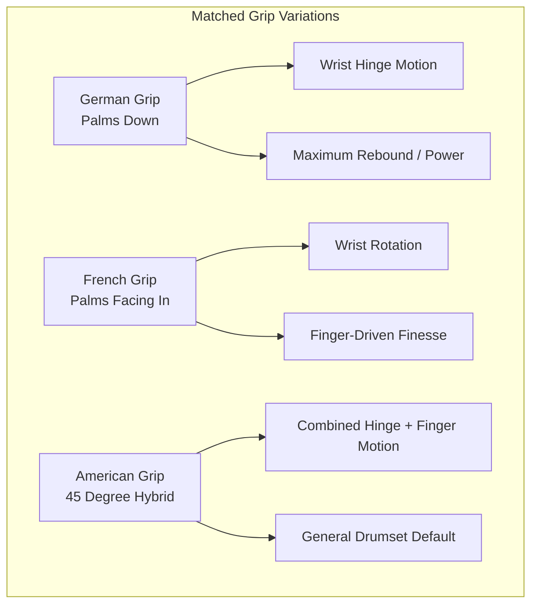
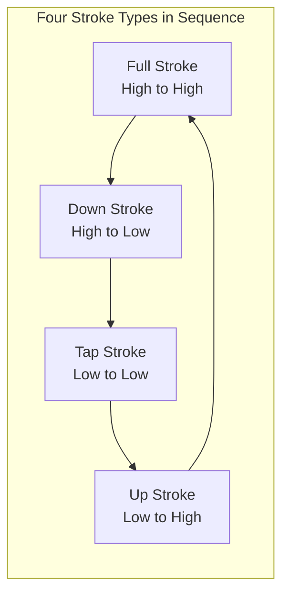
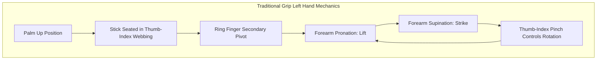
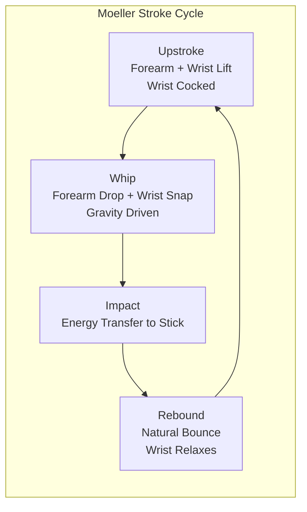
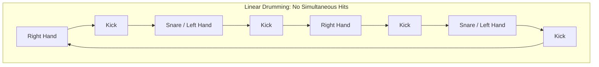

# Lesson 1: Mastering Stick Grip & Rebound Control

## 1. Core Biomechanics & Physical Foundation (15%)

Drumming is energy transfer, not muscle force. Your arm accelerates the stick, the stick strikes the head, the head compresses and springs back, and your grip decides how much of that spring-back you get to keep. Picture dribbling a basketball: a death grip on the ball kills the bounce, and a limp hand loses the ball entirely. The same physics governs stick control.

**Rebound physics in one paragraph:** On impact, the drumhead (a tensioned mylar membrane) stores kinetic energy as it deflects downward, then releases that energy back into the stick as it returns to rest. A choked grip absorbs this returning energy in your fingers instead of letting it re-launch the stick — you feel it as a "dead" stop at the head. A grip that's too loose lets the stick fly on its own path with no steering. The goal is a grip loose enough to let the rebound happen, firm enough to redirect it on your next downstroke.

**Pressure distribution (feel, not percentages to measure):** Your fulcrum — thumb and index finger pad — does the steering. Middle, ring, and pinky are passengers that close gently around the stick to catch it on the rebound and reopen to let it fly again. If you clench all five fingers equally, you've built a hammer, not a lever.

**Wrist vs. fingers, the practical split:** Wrist motion generates the big, loud strokes and sets the stick in motion. Finger motion (opening and closing the back three fingers, plus micro-pressure from the fulcrum) controls what happens *after* impact — how high the stick rebounds, how loud the next note is, whether a double stroke speaks evenly. At slow tempos you can muscle through with wrist alone. Above roughly 140 BPM of 16th notes, there isn't time for a full wrist cycle between notes — the fingers have to take over rebound control or your hands will lock up.

---

## 2. Matched Grip: Mechanics & Hand Posture

Matched grip: both hands mirror each other, palms generally facing down or inward, thumbs on top of the stick. This is the default for drumset (rock, funk, fusion, Latin, pop) and for most modern orchestral/concert snare playing.

### 2.1 Building the Fulcrum — Step by Step

**Find the balance point first.**
1. Balance the stick across one finger, sliding it until it sits level.
2. Mark that spot mentally — it's usually 5–7 cm (2–3 inches) from the butt end on a standard 5A/5B stick.
3. This is where your fulcrum fingers go. Gripping too far from this point makes the stick feel tip-heavy and kills rebound.

**Construct the fulcrum.**
1. Rest the stick on the first pad of your index finger — not the tip, not down at the base knuckle.
2. Curl your thumb down to meet the side of the stick (not the top of it), forming a loose circle with the index finger, like you're holding a pencil but higher up on the hand.
3. Squeeze only enough that a gentle shake of your hand doesn't dislodge the stick. If you can comfortably wiggle the stick side to side inside the fulcrum, that's correct tension — not too tight.

**Wrap the back three fingers.**
1. Curl middle, ring, pinky loosely around the shaft, barely in contact.
2. Leave a visible 2–3mm air gap between the stick and your palm. If the stick touches your palm at rest, your whole grip is too far back — slide your fulcrum forward toward the balance point.

**60-second self-check:** Hold the stick out in front of you and let it hang by gravity only, fulcrum fingers doing all the holding. If the back three fingers fall open on their own, you're ready. If they're clamped shut just holding the stick up, start over with less tension.

### 2.2 The Three Wrist Orientations

**German grip — palms down.**
- Forearms horizontal, palms facing the floor, thumbs pointing toward each other.
- Motion: wrist hinges up and down, like opening a door with a vertical hinge turned sideways under your hand.
- Best for: loud, fast single strokes, orchestral/marching snare, metal double-kick-style hand patterns, anything prioritizing raw rebound and volume.

**French grip — palms facing each other.**
- Forearms more vertical, thumbs on top, palms facing inward toward each other.
- Motion: wrist rotates (pronation/supination), and the fingers do active, visible work opening and closing to control rebound height.
- Best for: fast fingertip technique, timpani rolls, precise soft dynamics, bongo/hand-drum-style fine control transferred to sticks.

**American grip — the 45° hybrid.**
- Forearms angled roughly halfway between the two above.
- Motion: blends wrist hinge with finger control.
- Best for: general drumset playing. If you only learn one grip orientation, learn this one first, then branch into German for power and French for finesse.

### 2.3 The Four Stroke Types

These four strokes are the actual vocabulary of dynamic control. Every groove, fill, and rudiment is built from combinations of these.

**Full stroke — loud to loud.**
1. Start tip 20–25 cm (8–10 in) above the head.
2. Drive down with the wrist.
3. On impact, relax — let the stick rebound back up to near its starting height on its own.
4. Use for: consecutive accents, forte passages, anything that needs to stay loud.

**Down stroke — loud into quiet.**
1. Start high (20–25 cm).
2. Strike.
3. Immediately after impact, close the fingers gently to stop the stick low (3–5 cm / 1–2 in).
4. Use for: an accent immediately followed by a soft note — e.g., loud "1," soft "e."

**Tap stroke — quiet to quiet.**
1. Start low, 3–5 cm above the head.
2. Strike softly.
3. Let it rebound back to that same low height — fingers stay relaxed, don't add extra lift.
4. Use for: ghost notes, consecutive soft notes, fast quiet subdivisions.

**Up stroke — quiet into loud.**
1. Start low (3–5 cm).
2. Strike softly.
3. Immediately lift the stick up to the high starting position (20–25 cm) right after impact — this is an active lift, not a passive rebound.
4. Use for: a soft note that sets up an accent — e.g., soft "a," loud downbeat "1."

**The drill that actually teaches this:** set a metronome to 60 BPM. Play quarter notes R-R-R-R with this exact height pattern: Full, Down, Tap, Up, repeat. You're forced to execute all four strokes back to back. Most players discover the up stroke is the weakest — the lift feels unnatural at first because you're used to only lifting as a passive rebound, not as an active motion.

### 2.4 Common Matched Grip Errors & Fixes

| Error | Symptom | Fix |
|---|---|---|
| Death grip | No rebound, fast hand fatigue, choked tone | "Drop and catch" drill: hold stick horizontal, let it fall from your fulcrum, catch the rebound off the pad with the lightest possible grip. 20 reps per hand. |
| Grip too loose | Stick flies out, volume is erratic | Tighten only the thumb-index fulcrum. Leave the back three fingers loose. |
| Stick touches palm | Rebound choked, wrist motion restricted | Slide fulcrum forward to the balance point; recheck the 2–3mm gap. |
| All-forearm, no wrist | Heavy, slow, fatiguing strokes | Rest forearm flat on a table edge. Practice wrist-only hinge strokes at 40 BPM until the forearm stays still. |
| All-wrist, no fingers | Can't play ghost notes, fingers cramp under speed | Finger-tap drill: wrist frozen, bounce the stick using only finger open/close at 60 BPM tap-stroke height. |
| Thumb on top instead of side | Rebound angle inconsistent, rotation restricted | Rotate thumb to the side of the stick to build a side-pressure fulcrum with the index finger. |
| Back fingers fully extended | Stick wobbles, no rebound damping | Curl fingers naturally around the shaft — "holding a bird," firm enough to contain, gentle enough not to crush. |

---

## 3. Traditional Grip: Mechanics & Applications

Traditional grip: left hand underhand (palm up), right hand standard matched grip. Born from the tilted drum carried on a marching sling, it's still essential for jazz comping, rudimental/corps snare, and orchestral snare repertoire that calls for it.

### 3.1 Left Hand Construction — Step by Step

1. **Palm up, V-shape.** Turn your left palm to face the ceiling. Spread index and middle finger into a loose peace sign.
2. **Seat the stick.** Lay the stick into the webbing between thumb and index finger, in the crease where the thumb meets the palm — not resting flat on the palm surface.
3. **Set the secondary contact point.** The shaft crosses over the ring finger near the fingernail/cuticle area, not the fleshy pad. This is your second pivot.
4. **Thumb-index fulcrum.** Thumb rests on top of the stick pointing toward the tip; index curls over from above to meet it in a loose pinch. This pinch is what you rotate to control the stroke.
5. **Support fingers.** Middle finger supports from underneath with its pad; ring and pinky curl gently beneath, guiding only.
6. **Drive it with forearm rotation, not wrist bend.** Pronate (rotate inward) to lift the tip; supinate (rotate outward) to strike. The thumb-index pinch and the ring-finger contact act as two pivot points the stick rotates between.

### 3.2 Stroke Mechanics

- **Upstroke (prep):** pronate the forearm, wrist stays neutral, tip rises 20–30 cm above the head.
- **Downstroke (impact):** supinate the forearm, add a small wrist snap right at contact for extra velocity, then let the stick rebound — height after impact is governed by finger pressure, not forearm motion.
- **Dynamic control:** open the fingers fully after impact for loud strokes (max rebound); gently squeeze middle and ring fingers to shorten the rebound for quiet strokes; for ghost notes, use almost pure finger motion with the stick barely leaving the head.

### 3.3 Common Traditional Grip Errors & Fixes

| Error | Symptom | Fix |
|---|---|---|
| Stick slips in the webbing | Sound and feel shift mid-phrase | Seat the stick deeper in the crease, not on the palm surface; firm up thumb contact slightly. |
| Ring finger clamped | Stick can't pivot, hand cramps | Treat the ring finger as a pivot, not a clamp. Practice slow no-stick rotations to feel the natural arc. |
| Wrist bending sideways | Uneven tone, wrist pain | Keep wrist in line with the forearm; the rotation comes from the forearm, not a lateral wrist bend. Film yourself from above. |
| No rebound control | Every note sounds the same, no ghost notes possible | Isolate finger-pressure modulation at 60 BPM: light touch for rebound, firm squeeze to choke. |
| Elbow flares outward | Fatigue, inconsistent stroke path | Keep the elbow near your body; the rotation should be compact. |
| Index finger pressing down instead of guiding | Dead, choked tone | Index rests on top and guides — it should never add downward pressure. |

### 3.4 Traditional Grip Practice Protocol

**Drill 1 — Rotation isolation, no drum, 2 minutes.**
Rotate the forearm in and out in slow motion, feeling the stick pivot at the two contact points. No wrist deviation.

**Drill 2 — Rebound control on pad, metronome 60 BPM.**
Full strokes (loud) on beats 1 & 3, tap strokes (quiet) on beats 2 & 4, no change in hand tension between dynamics.

**Drill 3 — Traditional vs. matched comparison, metronome 80 BPM, 16th notes.**
Play R-L-R-L single strokes: first pass traditional-left/matched-right, second pass matched both hands. The traditional left hand should match the matched right hand in volume, tone, and timing — if it doesn't, slow down and isolate the weaker hand.

---

## 4. Essential Rudiments: Physical Drills & Practice Protocol

Rudiments train specific biomechanical patterns, not abstract "exercises." Each one below names the exact skill it builds.

### 4.1 Single Stroke Roll (R-L-R-L)

**Builds:** hand-to-hand alternation and rebound consistency between two different hands.

1. Metronome 60 BPM, play 16th notes (4 per click), sticking R-L-R-L continuous.
2. Dynamics sweep: pp → p → mf → f, then back down. This forces consistent grip mechanics across volumes instead of tensing up as you get louder.
3. **Rebound check:** after each stroke the tip should bounce 5–7 cm (2–3 in) on its own. No bounce = grip too tight.
4. Progression: 60 → 80 → 100 → 120 → 140 → 160 BPM, raising 20 BPM every two weeks only once the current tempo is clean at mf and f.

**Accent variations** (keep the base sticking R-L-R-L, just move the accent):
- Accent every 3rd note: **R**-l-r-**L**-r-l-**R**-l-r… (creates a 3-over-4 feel against the pulse)
- Accent every 4th note: **R**-l-r-l-**R**-l-r-l… (reinforces the downbeat)
- Accent every 5th note: **R**-l-r-l-r-**L**-r-l-r-l… (the accent walks across the barline)

**Evenness check:** record at 120 BPM, play back and really focus on whether all 16 notes in one 4-beat phrase sound identical in volume and spacing. Uneven doubles or rushed 16ths are easy to miss live but obvious on playback.

### 4.2 Double Stroke Roll (R-R-L-L)

**Builds:** finger-controlled rebound — the second stroke of each pair must come from the fingers, not the wrist.

1. Metronome 60 BPM, 16th notes, sticking R-R-L-L continuous.
2. First stroke of each pair: wrist-driven, starts high, strikes, settles low.
3. Second stroke: pure finger bounce off the already-low position — no wrist movement at all.
4. **Goal:** both strokes in a pair sound identical. The classic failure is a quiet second stroke — fix by relaxing the grip and actively opening the fingers right after the first stroke lands.
5. Progression: 60 → 70 → 80 → 90 → 100 → 120 BPM.

**Inverted double** (accent the "wrong" note to build control): R-R-**L**-L-R-R-**L**-L.

**Velocity note:** above roughly 140 BPM the doubles naturally start to blur into a buzz/crush sound — that's correct physics, not a mistake. Above 180 BPM the second stroke is almost entirely passive rebound; the wrist is barely moving at all.

### 4.3 Paradiddle (R-L-R-R-L-R-L-L)

**Builds:** seamless transition between single strokes and double strokes within one phrase — this is the rudiment that shows up most in actual fills and grooves.

1. Metronome 60 BPM, 16th notes, sticking R-L-R-R-L-R-L-L continuous.
2. Let the double strokes (R-R, L-L) ride the natural rebound — don't force them with extra wrist motion.
3. Progression: 60 → 80 → 100 → 120 → 140 BPM.

**Paradiddle-diddle** (6-note grouping, adds a second double): R-L-R-R-L-L / L-R-L-L-R-R.

**Tom fill application:** map R = high tom, L = mid tom, doubles = floor tom. The pattern becomes High-Mid-High-Floor / Mid-High-Mid-Floor. Practice at 80 BPM, then drop it into the last bar of a 4-bar phrase ending on a crash downbeat.

### 4.4 Flam (Grace Note + Primary Note)

**Builds:** precise timing offset between two hands at two different dynamic levels.

1. One hand (grace) starts low, 2–3 cm above the head, strikes quietly.
2. Other hand (primary) starts high, 20 cm above the head, strikes with full volume.
3. Release both hands at essentially the same moment — the height difference alone creates the "just before" timing of the grace note, because the low hand has a shorter distance to travel.
4. Metronome 60 BPM quarter notes, alternate the lead hand each beat (L-flam, R-flam, L-flam, R-flam).
5. **Check:** record it. If grace and primary sound simultaneous, you haven't differentiated the starting heights enough — exaggerate, then dial it back in.
6. Progression: 60 → 80 → 100 BPM.

**Flam accent:** **Flam**-tap-tap-**Flam**-tap-tap, sticking lR-R-L / rL-L-R (capital = primary note of the flam, loud; lowercase taps are quiet). Trains loud-soft-soft dynamic grouping.

**Flam tap:** lR-R / rL-L (3-note grouping) — the hand that just played the grace note has to immediately play a quiet tap. Good coordination stress-test.

### 4.5 Drag (Double Grace Notes + Primary)

**Builds:** finger-controlled doubles played quietly as an ornament, not as a loud double stroke.

1. Two grace notes played low (2–3 cm) using pure finger bounce, no wrist lift — they should sound like a tight "buzz" or "ruff."
2. Primary note played high (20 cm) and loud, full wrist stroke.
3. Notation: single drag = **ll**R (two left grace notes, right primary); double drag = **ll**R **rr**L.
4. Metronome 60 BPM, alternate: **ll**R **rr**L **ll**R **rr**L.
5. Progression: 60 → 80 → 100 BPM.

**Drag paradiddle #1:** **ll**R-L-R-R-**rr**L-R-L-L — a staple of rudimental snare solos and drum corps cadences.

### 4.6 Moeller Technique: Whip Stroke for Speed & Dynamics

The Moeller technique (Sanford Moeller) uses gravity-assisted forearm drop plus a wrist snap to generate loud, fast strokes with almost no muscular effort. It's the technique that lets drummers play forte for an entire song without forearm fatigue.

**Breakdown:**
1. **Upstroke (prep):** lift forearm and wrist together like an underhand throw. Tip rises 30–45 cm. Wrist cocks back (extends), storing tendon tension like a loaded spring.
2. **Whip (downstroke):** let the forearm *fall* under gravity — don't push it down. As it falls, snap the wrist forward (flexes), releasing the stored tension into the stick.
3. **Rebound:** let the stick bounce naturally; wrist follows through and relaxes; the forearm's downward arc flows directly back into the next upstroke prep.

**Drill protocol:**
1. No metronome, slow motion: lift → whip → rebound → lift, 10 reps per hand, feeling for the wrist snap and stick whip.
2. Metronome 40 BPM quarter notes, full Moeller motion every stroke, aiming for full volume with zero tension.
3. Progression: 40 → 50 → 60 → 80 → 100 BPM. As tempo rises the upstroke height naturally shrinks — you physically can't lift 30–45 cm between fast beats, and that's correct, not a flaw to fight.

**Moeller for dynamic contrast:** accents get the full whip (forearm lift + wrist snap); ghost notes between them get wrist-only taps from a 2–3 cm height with the forearm staying level. This lets you play loud-quiet-quiet-quiet patterns with almost no extra effort.

**Combination drill:** metronome 60 BPM, pattern **R**-l-r-l (accent first right, rest are quiet taps). Right-hand accent uses the full Moeller whip; every other note is a low wrist/finger tap with no forearm lift. Rotate the accent position through R-l-r-l, l-**R**-r-l, l-r-**R**-l, l-r-l-**R** to decouple the accent from "always the first note."

---

## 5. Four-Limb Independence: Drumset Coordination Grids

Drumset playing requires your brain to run four independent motor streams at once: right hand (ride/hi-hat), left hand (snare), right foot (kick), left foot (hi-hat pedal). You build this the same way you build any motor skill stack — one new limb at a time, locked to a metronome.

### 5.1 Ride/Hi-Hat Ostinato + Kick Variations

**Drill 1 — quarter-note ride + kick, metronome 80 BPM.**
Right hand: steady quarter notes on ride, no deviation. Right foot: kick on 1 & 3. Once locked, add kick on 2 & 4, then all four beats, then syncopations like the "&" of beat 2.

**Drill 2 — jazz ride pattern + feathered kick, metronome 80 BPM.**
Right hand plays the classic "ding-ding-a-ding" ride pattern — quarter on 1, the "&" of 2, quarter on 3, the "&" of 4 (sounds like "DING-ding-a-DING-ding-a"). Right foot feathers (very quiet, almost inaudible taps) on all four beats. Once stable, move the kick to just 2 & 4, then syncopate it.

### 5.2 Snare Backbeat + Four-Way Coordination

**Drill 3 — basic rock beat, metronome 80 BPM.**
Right hand: 8th notes on hi-hat. Left hand: snare on 2 & 4. Right foot: kick on 1 & 3. Left foot: close the hi-hat pedal on 2 & 4, landing exactly with the snare. This is the single most important coordination pattern in all of popular music — don't rush past it.

**Drill 4 — linear drumming, metronome 60 BPM, 16th notes.**
Sticking R-K-S-K (R = right hand, K = kick, S = snare), continuous, with the rule that no two limbs ever strike at the same instant. This forces precise subdivision timing because there's no overlap to hide behind. Progress to 80, then 100 BPM, then vary the pattern: R-K-S-R-K-S-K-K, or S-K-R-K-S-K-R-R.

### 5.3 Polyrhythmic Independence: 3:2 and 4:3

**3 against 2 (right hand vs. left hand), metronome 60 BPM.**
Right hand: triplets (3 per beat — "1-trip-let"). Left hand: 8th notes (2 per beat — "1-&"). Both hands land together on beat 1, then diverge until the next downbeat.

*Protocol:* practice right hand alone for 4 bars, left hand alone for 4 bars, then combine. Record and check for rushing or dragging in either hand — this polyrhythm is notorious for one hand unconsciously "helping" the other land, which defeats the purpose. Then swap hands, then add a kick drum on quarter notes underneath both.

**4 against 3 (right hand vs. right foot), metronome 60 BPM.**
Right hand: 16th notes ("1-e-&-a"). Right foot: triplets ("1-trip-let"). Both land together on beat 1.

**5 against 4 (advanced):** right hand quintuplets against left hand 16th notes. Only attempt this once 3:2 and 4:3 are solid — it's a different level of subdivision control and will feel impossible if the groundwork isn't there.

### 5.4 Hi-Hat Foot Independence

The left foot is the most commonly neglected limb on the kit. These drills specifically target it.

**Drill 5 — chick on the upbeats, metronome 80 BPM.**
Right hand: 8th notes on hi-hat (with sticks). Left foot: close the hi-hat (stomp) on every "&." Right foot: kick on 1 & 3. Left hand: snare on 2 & 4. The goal is a crisp, consistent "chick" sound that doesn't disturb the stick pattern happening on the same cymbal.

**Drill 6 — four-on-the-floor with hi-hat foot variations, metronome 100 BPM.**
Right hand 8ths, left hand snare on 2 & 4, right foot kick on all four beats. Left foot progression: quarter notes with the kick → 2 & 4 only (with the snare) → upbeats only → "e" and "a" of each beat (16th-note upbeats). Each variation is its own 2-minute drill before moving to the next.

### 5.5 Coordination Grid: Systematic Build

Work each row for 2 minutes minimum before moving down. Don't skip rows even if they feel easy — the grid is cumulative and skipped rows show up as weak links later.

| Phase | Right Hand (Hi-Hat/Ride) | Left Hand (Snare) | Right Foot (Kick) | Left Foot (Hi-Hat) |
|---|---|---|---|---|
| 1 | Quarter notes | — | — | — |
| 2 | Quarter notes | Beats 2 & 4 | — | — |
| 3 | Quarter notes | Beats 2 & 4 | Beats 1 & 3 | — |
| 4 | Quarter notes | Beats 2 & 4 | Beats 1 & 3 | Beats 2 & 4 (with snare) |
| 5 | 8th notes | Beats 2 & 4 | Beats 1 & 3 | Beats 2 & 4 |
| 6 | 8th notes | Beats 2 & 4 | "1 & 3 &" | Beats 2 & 4 |
| 7 | 8th notes | Beats 2 & 4 | "1 e & a 3" (16ths) | Beats 2 & 4 |
| 8 | Jazz ride pattern | Beats 2 & 4 | "1 & 3 &" | Quarter notes (all 4 beats) |
| 9 | 8th notes | Ghost 8ths (pp) + accents on 2 & 4 | "1 e & 3" | Upbeats ("&" of each beat) |

**Metronome rule:** start each phase at 60 BPM, add 10 BPM per clean session up to 120 BPM, then advance to the next phase.

---

## 6. Dynamic Control & Ghost Note Technique

Ghost notes are quiet, almost-felt-not-heard notes played between the main accents. They're what separates a flat, mechanical groove from one with texture and forward motion — essential vocabulary in funk, hip-hop, and modern R&B drumming.

### 6.1 Mechanics

- **Accent (forte):** tip starts 20–30 cm above the head, full wrist stroke.
- **Ghost note (pianissimo):** tip starts about 2–3 cm above the head, pure finger bounce, wrist stays level and still.
- **Sound target:** on a snare drum, a good ghost note produces a soft "tiss" from the snare wires buzzing, present but never competing with the backbeat.

### 6.2 Drill Protocol

**Drill 1 — accent/ghost isolation, metronome 60 BPM, 16th notes, single hand on snare.**
Pattern: g-g-**A**-g (g = ghost, A = accent), all on one hand to isolate the dynamic control before adding coordination. Once the accent is clearly loud and the ghosts are barely audible, add the other hand playing steady 8th notes on hi-hat.

**Drill 2 — funk foundation (Purdie-style), metronome 80 BPM.**
Right hand: 8th notes on hi-hat. Left hand snare: g-g-**A**-g / g-g-**A**-g continuous 16ths. Right foot: kick on 1 & 3. The accents should land on the "e" of beat 1 and the "e" of beat 3, strong and clear against quiet, even ghost notes around them.

**Drill 3 — linear ghost notes, metronome 70 BPM, 16th notes.**
Sticking R-g-R-g-K-g-R-g (R = hi-hat, g = snare ghost, K = kick), strictly one limb at a time. Ghost notes should be clearly audible but distinctly quieter than the hi-hat and kick around them.

### 6.3 Paradiddle Ghost Note Integration

Pattern: R-L-R-**r**-L-R-L-**l** (lowercase = ghost). Accent the first note of each four-note group, ghost the final note of each double.

**Drumset application:** map R = hi-hat, L = snare, and the ghost notes land on the snare at low volume. Add kick on 1 & 3 underneath. The result is a syncopated, textured groove — this exact mechanism underlies a huge share of funk and fusion drumming vocabulary.

---

## 7. Advanced Stroke Techniques: Buzz Rolls, Press Rolls & One-Handed Rolls

### 7.1 Buzz Roll (Multiple Bounce Roll)

1. Strike with moderate wrist force.
2. Immediately after impact, add slight extra finger pressure into the head — this sustains a rapid series of micro-bounces (roughly 4–6 per stroke) instead of one clean rebound.
3. Don't choke it completely — you want controlled buzzing, not silence.
4. Alternate hands smoothly (R-buzz, L-buzz) so the individual buzzes blend into one continuous sustained sound.

**Drill:** metronome 60 BPM half notes. Buzz roll for 2 beats, single tap on beat 3, buzz roll for 2 beats, tap on beat 1. Check that buzz density (bounces per stroke) is identical between hands — a common tell is one hand buzzing thinner than the other.

### 7.2 Press Roll (Orchestral Snare Roll)

Tighter, more controlled version of the buzz roll used for sustained crescendo/decrescendo passages in concert and orchestral snare parts.

1. Start at low stick height (around 5 cm).
2. Alternate hands at a controlled rate (e.g., 16th-note alternation at 60 BPM).
3. Hold consistent downward pressure to sustain the buzz.
4. Increase pressure and stroke speed to crescendo, decrease to decrescendo.

**Drill:** metronome 60 BPM, 4-bar crescendo pp → ff, 4-bar decrescendo ff → pp, listening for any gaps or sudden volume jumps in the roll.

### 7.3 One-Handed Roll (Continuous Double Strokes, One Hand)

Used in orchestral timpani rolls and solo/showmanship contexts. First stroke of each pair is wrist-driven, second is pure finger rebound — at high speed (120+ BPM of doubles) the second stroke becomes almost entirely passive.

**Drill:** metronome 60 BPM quarter notes. Right hand plays continuous doubles for 4 beats, then left hand for 4 beats, checking for even spacing and no tempo drift. Progress to 80, 100, 120 BPM.

---

## 8. Limb Isolation & Subdivision Accuracy

### 8.1 Metronome Displacement Drills

**Drop beat 1:** metronome 80 BPM with beat 1's click muted (most metronome apps let you mute specific beats). Play steady quarter notes on snare; your internal beat 1 should line up exactly when the click returns on beat 2. Variation: mute all clicks for 2 bars and re-enter cleanly on bar 3.

**Half-time metronome:** set the click to sound only on beats 2 & 4 of a felt 4/4 bar. Play 8th notes on hi-hat, snare on 2 & 4 (landing with the clicks), kick on 1 & 3 (with no click reference at all). This trains your internal sense of the downbeat instead of leaning on the metronome for it.

### 8.2 Subdivision Pyramid Drill

Metronome fixed at 60 BPM throughout:

1. Bar 1 — quarter notes (1/beat)
2. Bar 2 — 8th notes (2/beat)
3. Bar 3 — 8th-note triplets (3/beat)
4. Bar 4 — 16th notes (4/beat)
5. Bar 5 — 16th-note triplets / sextuplets (6/beat)
6. Bar 6 — 32nd notes (8/beat)

Each subdivision must stay locked to the click — no rushing into the denser subdivisions, no dragging out of them. Once clean ascending, reverse it (32nd notes down to quarters), then run the full pyramid up and down continuously for 2 minutes without stopping.

---

## 9. Practice Routine Template: Daily 60-Minute Session

**Warm-up (10 min):** 5 min single stroke roll 60→120 BPM, 5 min double stroke roll 60→100 BPM.

**Rudiment focus (15 min):** 5 min paradiddle variations, 5 min flam rudiments, 5 min drag rudiments.

**Coordination & independence (20 min):** 5 min one phase of the coordination grid (Section 5.5), 5 min polyrhythm (alternate 3:2 / 4:3 by day), 5 min linear drumming, 5 min funk ghost-note groove (Section 6.2).

**Musicality & application (10 min):** 5 min playing along to a song in your target genre, locking specifically with the bassist's timing; 5 min improvised fills over a 4-bar loop (3 bars groove, 1 bar fill, repeat).

**Cool-down (5 min):** buzz and press rolls through a full dynamic sweep, pp → ff → pp.

---

## 10. Equipment Considerations & Setup Ergonomics

### 10.1 Stick Selection

- **Tip shape and tone:** round tip = full, balanced tone; acorn = brighter attack; barrel = darker, fuller tone; nylon tip = brightest attack, most durable on cymbals.
- **Shoulder taper:** a longer, gentler taper gives more flex and rebound; a shorter taper is stiffer and more durable.
- **Common sizes:** 5A (medium weight/taper, the versatile default — start here), 5B (heavier, more durable, suited to rock), 7A (lighter, thinner, preferred for jazz and finesse work), 2B (very heavy, used for metal and marching).
- **Material:** hickory is the industry-standard balance of weight, flex, and durability; maple is lighter with faster rebound but wears faster; oak is denser and more durable but stiffer, with less natural flex.

### 10.2 Practice Pad Setup

- **Rubber pad:** high rebound, loud — best for building raw speed and endurance.
- **Gel pad:** low rebound, quiet — closer to a real drumhead's feel, better for finesse and dynamic work.
- **Hybrid pad (rubber rim, gel center):** covers both needs on one surface.
- **Positioning:** mount at the same height and angle as your snare — roughly 5 cm below navel height when standing, angled slightly toward you. If you practice seated, match your drum throne height exactly.

### 10.3 Drumset Ergonomics

- **Throne height:** thighs parallel to the floor or angled slightly down (5–10°); knees near 90° or slightly more open; feet flat on the pedals, heels able to rest on the ground.
- **Snare position:** centered between the legs, roughly 5 cm below navel height, tilted 5–10° toward you.
- **Toms:** angled toward you, reachable without extending the shoulder forward; floor tom at or slightly below snare height.
- **Cymbals:** ride at shoulder height or just below, close enough to play without leaning; crashes within easy reach from the snare position, tilted 20–30° away from you so the stick takes a glancing blow rather than a flat one.
- **Common setup mistakes:** toms mounted too high or far (shoulder tension), snare too low (hunched back), throne too low (restricted leg drive), cymbals too high (limits dynamic range and causes shoulder fatigue over a set).

---

## 11. Troubleshooting Common Technical Issues

| Issue | Likely Cause | Fix |
|---|---|---|
| Hand fatigue within 5 minutes | Death grip, excess tension | "Drop and catch" drill after every few strokes; take a short break every 10 minutes. |
| Uneven single stroke roll | Weak rebound on one hand, asymmetric fulcrum | Isolate the weak hand alone for 5 minutes; check both fulcrums match in position and pressure. |
| Can't play fast double strokes | Wrist-only motion, no finger bounce engaged | Practice buzz rolls to feel finger-driven rebound; rebuild doubles slowly at 60 BPM focused on the second-stroke bounce. |
| Bass drum pedal feels sluggish | Spring too tight, footboard angle off, heel-down limiting travel | Loosen spring tension; level the footboard; try heel-up technique for faster strokes. |
| Hi-hat chick weak or inconsistent | Clutch too tight, cymbals gapped too wide, inconsistent foot pressure | Set clutch so cymbals sit 1–2mm apart when closed; drill foot isolation separately from hand patterns. |
| Paradiddles sound uneven | Doubles are muscled instead of rebounded | Drop to 40 BPM; let the double bounce; if it won't bounce, the grip is too tight. |
| Flams sound simultaneous | Both hands starting from the same height | Exaggerate the height difference (1 in vs. 12 in), then gradually normalize it. |
| Ghost notes too loud | Wrist motion creeping in, stick starting too high | Isolate ghost notes alone for 2 minutes; stick should never rise past 2 in; freeze the wrist. |
| Buzz roll sounds choppy | Pressure inconsistent, alternation too slow, stick bouncing instead of buzzing | Slightly increase finger pressure after impact; slow the hand alternation; cross-train with press roll technique. |

---

## 12. Next Steps: Expanding Your Vocabulary

Once the material above is solid, progress to:

1. **Advanced rudiments:** ratamacue, Swiss triplet, pataflafla, flam paradiddle-diddle.
2. **Odd time signatures:** 5/4, 7/8, 9/8 grooves and subdivision accuracy within them.
3. **Polymetric independence:** 5:4, 7:4 limb combinations.
4. **Hybrid rudiments:** stacking multiple rudiments into single phrases (e.g., paradiddle + flam accent + drag).
5. **Brushes:** sweep patterns, triplet sweeps, jazz comping vocabulary.
6. **Double bass drumming:** heel-toe, slide, and swivel techniques for metal and progressive styles.
7. **Latin percussion techniques:** clave, cascara, tumbao; conga and bongo hand technique transferred to kit.
8. **Orchestral snare & timpani:** concert etudes, roll-speed calibration, stick selection for orchestral contexts.

**Recommended practice approach:**
- Get every exercise in this lesson clean at 120 BPM before moving on.
- Record yourself weekly; compare month-over-month rather than day-to-day, since daily variation is normal and misleading.
- Keep a practice journal logging tempos achieved, recurring problem spots, and breakthroughs — this is the single best predictor of long-term progress among serious students.
