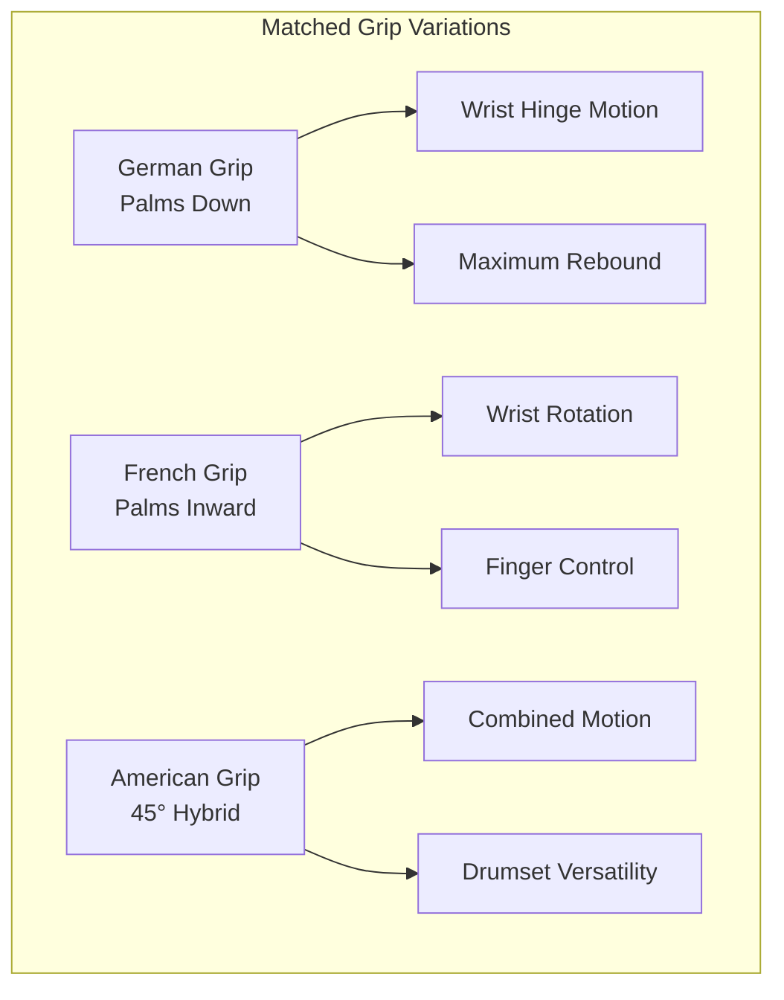
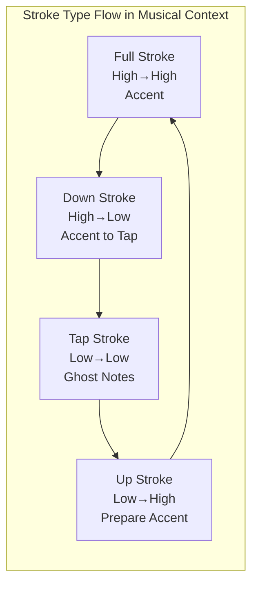
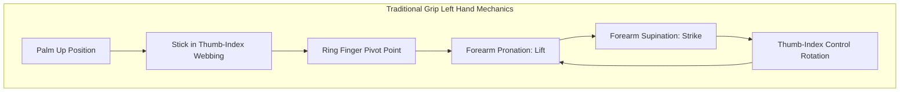
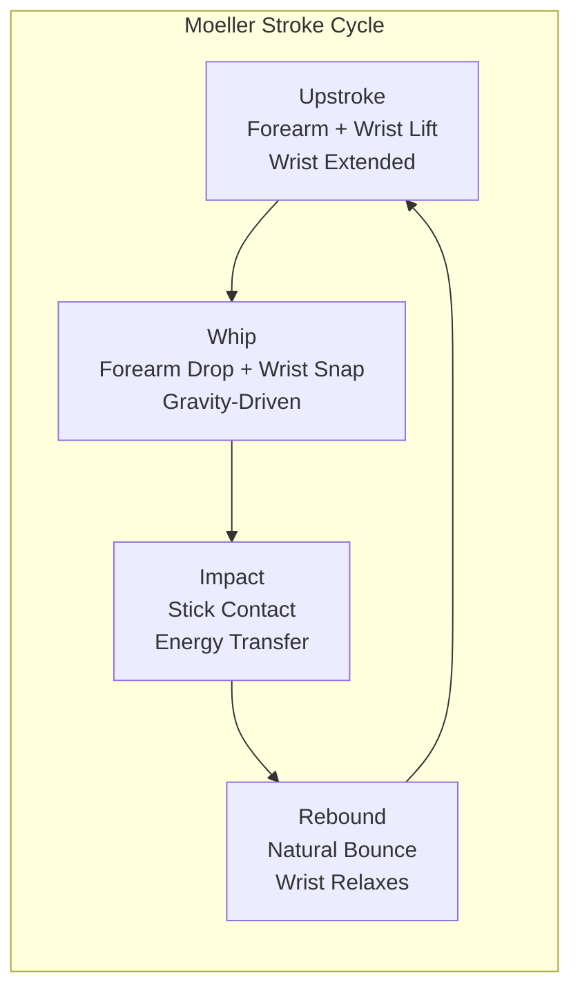
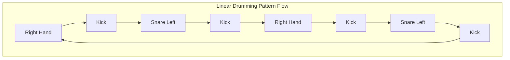

# Lesson 1: Mastering Stick Grip & Rebound Control

## 1. Core Biomechanics & Physical Foundation (15%)

Drumming begins with efficient energy transfer from your hand through the stick to the drumhead, then capturing the natural rebound. The stick is a lever that amplifies your wrist motion; the drumhead is an elastic membrane that returns energy. Your grip controls how much energy you waste versus how much you channel into sound and rebound.

**Rebound Physics:** When the stick tip strikes the drumhead, the head compresses and stores elastic energy, then releases it back into the stick. A tight, death-grip chokes this energy transfer—the stick can't bounce freely. A loose, floppy grip loses directional control. The optimal grip balances control with rebound efficiency: firm fulcrum (pivot point) between thumb and index finger, relaxed remaining fingers that allow the stick to oscillate.

**Grip Pressure Distribution:** Your fulcrum (thumb + index) holds roughly 60% of control pressure. The middle, ring, and pinky fingers provide guidance and cushioning with 40% pressure—they're shock absorbers, not clamps. This distribution prevents the stick from flying away while preserving natural bounce.

**Wrist vs. Fingers:** The wrist provides the primary stroke motion (pronation/supination for matched grip, rotation for traditional grip). Fingers control rebound height and dynamics through micro-adjustments in pressure. High-speed playing relies on rebound efficiency; slow, controlled strokes rely on finger damping.

---

## 2. Matched Grip: Mechanics & Hand Posture (85% Practical)

Matched grip uses identical hand positions for both hands—palms facing down, thumbs on top of the stick. This is the dominant grip for modern drumset playing (rock, funk, fusion, Latin) and orchestral snare/timpani.

### 2.1 Fulcrum Construction

**Step 1: Locate the Balance Point**
1. Hold the stick horizontally with one finger under the shaft.
2. Slide your finger until the stick balances naturally—this is typically 1/3 to 1/4 of the stick's length from the butt end.
3. The balance point is your fulcrum anchor.

**Step 2: Build the Fulcrum**
1. Place the stick across the first pad of your index finger (not the fingertip, not the base—the fleshy pad).
2. Curl your thumb over the stick to meet the side of your index finger, forming a loose "OK" sign.
3. The stick should rest in the crease between thumb and index, with the thumb pad pressing lightly against the side of the stick (not the top).
4. Squeeze just enough so the stick doesn't slip when you lift your hand—no more.

**Step 3: Wrap the Remaining Fingers**
1. Curl your middle, ring, and pinky fingers gently around the stick.
2. These fingers should barely touch the stick when your hand is relaxed—they're guides, not grippers.
3. Leave a visible gap (2–3mm) between your palm and the stick. The stick should never touch your palm.

### 2.2 Wrist Stroke Mechanics

**German Grip (Palms Down, Maximum Rebound):**
- Forearms horizontal, palms facing the floor.
- Wrist hinge rotates up and down like a door hinge.
- Use for: Fast single strokes, rolls, rebound-heavy patterns.
- Common in orchestral snare, marching snare, and speed metal double bass patterns.

**French Grip (Palms Facing Each Other, Maximum Finger Control):**
- Forearms vertical, palms facing inward (thumbs on top).
- Wrist rotates side-to-side (pronation/supination).
- Fingers actively control rebound height through micro-adjustments.
- Use for: Precise finger-controlled accents, orchestral timpani rolls, fast finger-tip technique.

**American Grip (Hybrid, 45° Angle):**
- Forearms at 45° angle—halfway between German and French.
- Combines wrist hinge (German) with finger control (French).
- Most versatile grip for drumset playing across genres.

### 2.3 Stroke Types & Rebound Control

Drumming strokes are classified by how you control the rebound:

**Full Stroke (Let It Bounce):**
1. Start with stick tip 8–12 inches above the drumhead.
2. Accelerate the stick downward using wrist rotation.
3. **After impact:** Let the stick rebound naturally to the starting height.
4. Fingers remain relaxed—do NOT squeeze to stop the stick.
5. Use for: Accents, downbeats, forte (loud) passages.

**Down Stroke (Choke the Rebound):**
1. Start high (8–12 inches).
2. Strike the head.
3. **After impact:** Squeeze fingers to stop the stick close to the head (1–2 inches).
4. Use for: Accents followed by quiet notes (e.g., the "1" of "1-e-&-a" when the "e" is soft).

**Tap Stroke (Low and Quiet):**
1. Start low (1–2 inches above the head).
2. Strike gently.
3. **After impact:** Let the stick rebound to the low starting position.
4. Fingers stay relaxed.
5. Use for: Ghost notes, piano (quiet) passages, fast subdivision fills.

**Up Stroke (Lift After Impact):**
1. Start low (1–2 inches).
2. Strike the head.
3. **After impact:** Immediately lift the stick to a high position (8–12 inches).
4. Use for: Quiet notes followed by accents (e.g., the "a" of "1-e-&-a" before an accented downbeat).

### 2.4 Common Matched Grip Errors & Fixes

| **Error** | **Symptom** | **Fix** |
|-----------|-------------|---------|
| Death grip (too tight) | Stick doesn't rebound; hand fatigues quickly; tone is choked. | Relax fingers after each stroke. Practice "drop and catch" drill: let stick fall, catch rebound with minimal grip pressure. |
| Floppy grip (too loose) | Stick flies out of hand; inconsistent volume; poor articulation. | Tighten fulcrum (thumb + index) slightly. Middle/ring/pinky stay loose. |
| Stick touches palm | Restricts wrist motion; chokes rebound; causes blisters. | Open palm, maintain 2–3mm gap. Check grip in a mirror. |
| Wrist locked (all forearm) | Slow, heavy strokes; fatigue in forearm; no finesse. | Isolate wrist motion: rest forearm on table, practice wrist hinge only. Start at 40 BPM. |
| Fingers locked (all wrist) | Limited dynamic control; no ghost notes; fingers cramp. | Practice finger-controlled taps: wrist stays still, fingers open/close to bounce stick. |
| Thumb on top of stick | Restricts rotation; inconsistent rebound angle. | Reposition thumb to side of stick, creating side-pressure fulcrum with index finger. |
| Back fingers extended | Stick wobbles; no control over rebound damping. | Curl all fingers around stick naturally. Think "holding a bird"—firm enough to contain, gentle enough not to crush. |

---

## 3. Traditional Grip: Mechanics & Applications

Traditional grip is asymmetrical: the left hand holds the stick underhand (palm up), the right hand uses matched grip. Developed for tilted marching snare drums, it remains essential for jazz brushwork, orchestral snare, and rudimental drumming.

### 3.1 Left Hand Traditional Grip Construction

**Step 1: Hand Position**
1. Turn your left palm upward.
2. Create a "peace sign" (V-shape) with your index and middle fingers.

**Step 2: Stick Placement**
1. Lay the stick in the webbing between your thumb and index finger.
2. The stick rests in the crease where your thumb connects to your palm.
3. The stick crosses over the cuticle of your ring finger (the stick touches the fingernail area, not the pad).

**Step 3: Thumb & Index Control**
1. Your thumb rests on top of the stick, pointing toward the tip.
2. Your index finger curves over the stick from above, forming a loose "pinch" with the thumb.
3. This thumb-index pinch is your fulcrum—it controls rotation.

**Step 4: Remaining Fingers**
1. Your middle finger supports the stick from below (pad of the finger).
2. Ring and pinky fingers curl gently underneath—they guide but don't grip.

**Step 5: Wrist & Forearm Rotation**
1. Rotate your forearm inward (pronation) to lift the stick.
2. Rotate outward (supination) to strike the drum.
3. The stick pivots in the thumb-index fulcrum; the ring finger acts as a secondary pivot point during the stroke.

### 3.2 Traditional Grip Stroke Mechanics

**Upstroke (Preparation):**
- Rotate forearm inward (pronation).
- Wrist stays relatively neutral.
- Stick tip rises 8–12 inches above the drumhead.

**Downstroke (Impact):**
- Rotate forearm outward (supination).
- Wrist snaps downward slightly at impact for added velocity.
- After impact, allow the stick to rebound naturally; control height by adjusting finger pressure.

**Finger Control for Dynamics:**
- **Loud strokes:** Open fingers fully after impact to maximize rebound.
- **Quiet strokes:** Squeeze middle and ring fingers gently to dampen rebound.
- **Ghost notes:** Use primarily finger motion with minimal forearm rotation—the stick barely leaves the head.

### 3.3 Common Traditional Grip Errors & Fixes

| **Error** | **Symptom** | **Fix** |
|-----------|-------------|---------|
| Stick slips out of webbing | Inconsistent sound; stick shifts during playing. | Tighten thumb-webbing contact. Ensure stick rests deep in the crease, not on the surface of the palm. |
| Ring finger locked/tense | Stick doesn't pivot smoothly; hand cramps. | Relax ring finger—it's a pivot point, not a clamp. Practice slow rotations with no stick to feel the natural motion. |
| Wrist bending sideways | Uneven sound; wrist pain. | Keep wrist aligned with forearm. Rotate forearm, not wrist. Record yourself from above to check alignment. |
| No rebound control | All notes sound the same; can't play ghost notes. | Practice finger pressure modulation: light touch for rebound, firm squeeze to choke. Isolate this motion at 60 BPM. |
| Elbow winging out | Fatigue; inconsistent stroke path. | Keep elbow close to body. Forearm rotation should be compact, not sweeping. |
| Index finger pressing down | Chokes stick vibration; dead tone. | Index finger rests on top but does not push down. Think "guiding," not "pressing." |

### 3.4 Traditional Grip Practice Protocol

**Drill 1: Rotation Isolation (No Drum)**
1. Hold stick in traditional grip.
2. Rotate forearm inward (lift) and outward (drop) in slow motion.
3. Focus: Smooth, continuous rotation with no wrist deviation.
4. Duration: 2 minutes per session.

**Drill 2: Rebound Control (On Pad)**
1. **Metronome:** 60 BPM quarter notes.
2. Play full strokes (loud) on beats 1 & 3.
3. Play tap strokes (quiet) on beats 2 & 4.
4. Goal: Seamless transition between loud and quiet without changing grip tension.

**Drill 3: Traditional vs. Matched Comparison**
1. Play single stroke roll (R-L-R-L) at 80 BPM 16th notes.
2. First pass: Traditional grip left hand, matched grip right hand.
3. Second pass: Matched grip both hands.
4. Goal: Left hand traditional should sound identical to right hand matched in volume, tone, and timing.

---

## 4. Essential Rudiments: Physical Drills & Practice Protocol

Rudiments are the vocabulary of drumming—small, repeatable patterns that build coordination, speed, and dynamic control. Every rudiment trains a specific biomechanical skill.

### 4.1 Single Stroke Roll (R-L-R-L)

**Purpose:** Develops hand-to-hand coordination and rebound efficiency.

**Drill Protocol:**
1. **Metronome:** 60 BPM (quarter notes).
2. **Subdivision:** 16th notes (4 notes per click).
3. **Pattern:** R-L-R-L (right-left-right-left), continuous.
4. **Dynamics:** Pianissimo (pp) → Piano (p) → Mezzo-forte (mf) → Forte (f), then reverse.
5. **Rebound Check:** Each stroke should bounce naturally to 2–3 inches after impact. If the stick doesn't bounce, you're gripping too hard.
6. **Progression:** 60 BPM → 80 BPM → 100 BPM → 120 BPM → 140 BPM → 160 BPM (add 20 BPM every 2 weeks).

**Advanced Variation (Accents):**
- Accent every 3rd note: **R**-L-R-**L**-R-L-**R**-L-R… (creates polymeter effect—3 against 4).
- Accent every 4th note: **R**-L-R-L-**R**-L-R-L… (standard downbeat accents).
- Accent every 5th note: **R**-L-R-L-R-**L**-R-L-R-L… (shifts accent across barline).

**Evenness Check:**
- Record yourself at 120 BPM.
- Play back at half speed (60 BPM perceived).
- Listen for: volume inconsistencies, rushed notes, timing hiccups.
- Goal: All 16 notes in a 4-beat phrase should be indistinguishable in volume and spacing.

### 4.2 Double Stroke Roll (R-R-L-L)

**Purpose:** Develops finger-controlled rebound and wrist velocity.

**Drill Protocol:**
1. **Metronome:** 60 BPM.
2. **Subdivision:** 16th notes.
3. **Pattern:** R-R-L-L-R-R-L-L, continuous.
4. **First Stroke (Down):** Use wrist motion—stick starts high, strikes, stays low.
5. **Second Stroke (Rebound):** Use finger bounce—open fingers to let stick bounce naturally, no wrist motion.
6. **Goal:** Both strokes in the pair should sound identical in volume and timbre.
7. **Common Error:** Second stroke is quieter (weak rebound). Fix: relax grip, open fingers actively after first stroke.
8. **Progression:** 60 BPM → 70 BPM → 80 BPM → 90 BPM → 100 BPM → 120 BPM.

**Advanced Variation (Inverted Double):**
- R-R-**L**-L-R-R-**L**-L (accent the first left stroke).
- This forces the right hand to play a down stroke before the left accent.

**Velocity Building Drill:**
1. Start at 60 BPM with distinct, separated double strokes.
2. Gradually increase tempo.
3. At 140+ BPM, the doubles will naturally merge into a "buzz" or "crush" roll—this is correct.
4. At very high speeds (180+ BPM), the second stroke becomes almost entirely finger-controlled rebound—the wrist barely moves.

### 4.3 Paradiddle (R-L-R-R-L-R-L-L)

**Purpose:** Develops hand-to-hand flow with double strokes; essential for drumset fills and orchestral snare passages.

**Drill Protocol:**
1. **Metronome:** 60 BPM.
2. **Subdivision:** 16th notes.
3. **Pattern:** R-L-R-R-L-R-L-L, continuous.
4. **Sticking Emphasis:** The double strokes (R-R, L-L) should flow naturally—don't force them. Let the rebound do the work.
5. **Progression:** 60 BPM → 80 BPM → 100 BPM → 120 BPM → 140 BPM.

**Advanced Variation (Paradiddle-diddle):**
- R-L-R-R-L-L-L-R-L-L-R-R (adds an extra double stroke).
- Sticking: R-L-R-R-L-L / L-R-L-L-R-R (6-note grouping).

**Drumset Application (Tom Fills):**
1. Map paradiddle to three toms: R = high tom, L = mid tom, doubles = floor tom.
2. Pattern becomes: High-Mid-High-Floor / Mid-High-Mid-Floor.
3. Practice at 80 BPM, then incorporate into 4-bar phrases ending on beat 1 of bar 5 (crash cymbal).

### 4.4 Flam (Grace Note + Primary Note)

**Purpose:** Develops hand independence and precise timing between hands.

**Technique:**
1. **Grace Note (Quiet):** One hand starts low (1 inch above head), strikes quietly.
2. **Primary Note (Loud):** Other hand starts high (8 inches above head), strikes immediately after the grace note with full volume.
3. **Timing:** The grace note should land just before the primary note—not simultaneously, not a full 16th note early. Think "barely before."
4. **Visual:** If the grace note is 1 inch away and the primary is 8 inches away, releasing them at the same time naturally creates the "just before" effect due to distance.

**Drill Protocol:**
1. **Metronome:** 60 BPM (quarter notes).
2. **Pattern:** Flam on every beat, alternating lead hand (L-flam, R-flam, L-flam, R-flam).
3. **Check:** Record yourself. The grace note should be audible but quieter than the primary. If they sound identical, you're not differentiating stroke heights.
4. **Progression:** 60 BPM → 80 BPM → 100 BPM.

**Flam Accent (Compound Rudiment):**
- Pattern: **Flam**-R-L-**Flam**-L-R (flam on beat 1, two taps, flam on beat 3, two taps).
- Sticking: L**R**-R-L-R**L**-L-R (bold = primary note of flam).
- Accent the primary note of each flam; taps are quiet.
- This trains dynamic contrast: loud-quiet-quiet, loud-quiet-quiet.

**Flam Tap:**
- Pattern: L**R**-R-R**L**-L (flam, then two taps with same hand).
- Sticking: L**R**-R / R**L**-L (3-note grouping).
- Advanced coordination: the hand that just played the grace note must immediately play a tap.

### 4.5 Drag (Controlled Double Grace Notes)

**Purpose:** Develops finger-controlled doubles at low volume.

**Technique:**
1. Play two grace notes (doubles) followed by a primary note.
2. **Grace note doubles:** Played low (1 inch) and quiet using finger bounce—no wrist lift.
3. **Primary note:** Played high (8 inches) and loud using full wrist stroke.
4. **Timing:** The two grace notes should sound like a quick "buzz" or "ruff," landing just before the primary.

**Notation & Sticking:**
- Single drag: **ll**R (two left grace notes, right primary).
- Double drag: **ll**R **rr**L (left drag, right drag).

**Drill Protocol:**
1. **Metronome:** 60 BPM.
2. **Pattern:** Single drag on every beat, alternating hands (**ll**R **rr**L **ll**R **rr**L).
3. **Goal:** Grace note doubles are tight and even; primary note is distinct and loud.
4. **Progression:** 60 BPM → 80 BPM → 100 BPM.

**Drag Paradiddle #1:**
- Pattern: **ll**R-L-R-R-**rr**L-R-L-L
- Combines drag rudiment with paradiddle sticking.
- Essential for rudimental snare solos and drum corps cadences.

### 4.6 Moeller Technique: Whip Stroke for Speed & Dynamics

The Moeller technique uses gravity and forearm rotation to generate effortless, high-velocity strokes. Developed by Sanford Moeller, it's essential for traditional grip jazz drummers and modern drumset players seeking speed without tension.

**Moeller Stroke Breakdown:**

1. **Preparation (Upstroke):**
   - Lift your forearm and wrist together, as if throwing a ball underhand.
   - The stick tip rises 12–18 inches above the drumhead.
   - Your wrist is cocked back (extended), storing elastic energy in the wrist tendons.

2. **Whip (Downstroke):**
   - Drop your forearm using gravity—don't push down.
   - As your forearm falls, snap your wrist forward (flex), releasing the stored energy.
   - The stick "whips" into the drumhead at high velocity with minimal effort.

3. **Rebound (Recovery):**
   - Allow the stick to rebound naturally.
   - Your wrist follows through and relaxes.
   - The forearm continues its downward arc, then smoothly transitions back into the upstroke preparation.

**Drill Protocol:**
1. **Slow Motion (No Metronome):**
   - Practice the full arm motion: lift forearm → whip wrist → let stick rebound → lift again.
   - Focus on feeling the wrist "snap" and the stick "whip."
   - Do 10 repetitions per hand, ultra-slow.

2. **Metronome Integration (40 BPM):**
   - Play quarter notes (one stroke per beat).
   - Full Moeller motion on every stroke.
   - Goal: Effortless, full-volume strokes with no tension in forearm or wrist.

3. **Progression:**
   - 40 BPM → 50 BPM → 60 BPM → 80 BPM → 100 BPM.
   - As speed increases, the upstroke height decreases naturally (physics—you can't lift as high in less time). This is correct.

**Moeller for Ghost Notes & Accents:**
- **Accent (Loud):** Full Moeller whip—forearm lifts high, wrist snaps hard.
- **Ghost Note (Quiet):** Wrist-only tap—forearm stays level, wrist bounces the stick gently from low height (1–2 inches).
- This contrast allows effortless dynamic range: loud notes use the whole arm, quiet notes use fingers/wrist only.

**Moeller Combination Drill (Accent-Tap Pattern):**
1. **Metronome:** 60 BPM.
2. **Pattern:** **R**-L-R-L (accent first right, others are ghost notes).
3. **Right hand (accent):** Full Moeller whip.
4. **Left hand + remaining right taps:** Low wrist taps, no forearm lift.
5. **Goal:** Massive dynamic contrast—accent is forte (f), taps are pianissimo (pp).
6. **Progression:** Shift the accent to different positions: R-**L**-R-L, R-L-**R**-L, R-L-R-**L**.

---

## 5. Four-Limb Independence: Drumset Coordination Grids

Drumset playing requires independent control of all four limbs simultaneously. The brain must partition motor commands into separate streams—right hand (ride/hi-hat), left hand (snare), right foot (bass drum), left foot (hi-hat pedal).

### 5.1 Foundation: Steady Ride Ostinato + Bass Drum Variations

**Ostinato (Repeating Pattern):** A fixed pattern in one limb that continues while other limbs vary.

**Drill 1: Quarter Note Ride + Walking Bass**
1. **Metronome:** 80 BPM.
2. **Right Hand (Ride Cymbal):** Quarter notes (one hit per beat), continuous.
3. **Right Foot (Bass Drum):** Play on beats 1 & 3 (downbeats).
4. **Goal:** Maintain perfectly steady ride pattern while bass drum plays.
5. **Progression:** Add bass drum on beats 2 & 4. Then try all four beats. Then syncopated patterns (e.g., "1-&-a" of beat 2).

**Drill 2: Jazz Ride Pattern + Bass Drum**
1. **Right Hand (Ride):** Jazz "ding-ding-a-ding" pattern:
   - Notation: Quarter note on 1, "&" of 2, quarter note on 3, "&" of 4.
   - Sound: "DING-ding-a-DING-ding-a" (accents on 1 and 3).
2. **Right Foot (Bass Drum):** Feather (light taps) on all four beats.
3. **Goal:** Ride pattern stays rhythmically accurate; bass drum taps are quiet and consistent (pp dynamic).
4. **Progression:** Add bass drum on beats 2 & 4 only. Then syncopate ("1-&" of beat 2, "& 4").

### 5.2 Snare Backbeat + Coordination

**Drill 3: Backbeat Foundation (Rock Beat)**
1. **Metronome:** 80 BPM.
2. **Right Hand (Hi-Hat):** 8th notes (two hits per beat), continuous.
3. **Left Hand (Snare):** Beats 2 & 4 (backbeats).
4. **Right Foot (Bass Drum):** Beats 1 & 3.
5. **Left Foot (Hi-Hat Pedal):** Close hi-hat on beats 2 & 4 (with snare).
6. **Goal:** All limbs locked to metronome; backbeat (snare + hi-hat foot) is synchronized.

**Drill 4: Linear Drumming (One Limb at a Time)**
1. **Metronome:** 60 BPM (16th note subdivision).
2. **Pattern (16th notes):** R-K-S-K-R-K-S-K (R = right hand, K = kick/bass drum, S = snare/left hand).
3. **Rule:** Only one limb sounds at any moment—no two limbs strike simultaneously.
4. **Goal:** Smooth, even 16th note flow with crisp separation between limbs.
5. **Progression:** Increase tempo to 80 BPM, then 100 BPM. Then create variations: R-K-S-R-K-S-K-K, S-K-R-K-S-K-R-R.

### 5.3 Polyrhythmic Independence: 3:2 and 4:3

**3 Against 2 (Right Hand vs. Left Hand):**
1. **Right Hand:** Play 3 evenly spaced notes over 1 beat (triplets: "1-trip-let").
2. **Left Hand:** Play 2 evenly spaced notes over 1 beat (8th notes: "1-&").
3. **Metronome:** 60 BPM.
4. **Alignment:** Right hand and left hand strike simultaneously on beat 1, then diverge.
5. **Counting Method:** Say out loud: "1-trip-let-&-trip-let" (left hand on "1" and "&", right hand on "1", "trip", "let").

**Drill Protocol:**
1. Practice right hand alone (triplets) for 4 bars.
2. Practice left hand alone (8th notes) for 4 bars.
3. Combine: right hand triplets + left hand 8th notes.
4. **Check:** Record yourself. Both hands should be perfectly even—no rushing, no dragging.
5. **Progression:** Switch hands (left triplets, right 8th notes). Then add bass drum on quarter notes.

**4 Against 3 (Right Hand vs. Right Foot):**
1. **Right Hand:** Play 4 evenly spaced notes over 1 beat (16th notes: "1-e-&-a").
2. **Right Foot:** Play 3 evenly spaced notes over 1 beat (triplets: "1-trip-let").
3. **Metronome:** 60 BPM.
4. **Alignment:** Hand and foot strike together on beat 1, then diverge.

**Advanced Polyrhythm: 5 Against 4**
1. **Right Hand:** Quintuplets (5 even notes per beat).
2. **Left Hand:** 16th notes (4 notes per beat).
3. This is extremely challenging—reserve for advanced coordination practice only after mastering 3:2 and 4:3.

### 5.4 Hi-Hat Foot Independence Drills

The hi-hat pedal (left foot) is often the most neglected limb. These drills build left foot control.

**Drill 5: Hi-Hat Chick on Upbeats**
1. **Metronome:** 80 BPM.
2. **Right Hand (Hi-Hat, played with stick):** 8th notes, continuous.
3. **Left Foot (Hi-Hat Pedal):** Close hi-hat (stomp) on upbeats ("&" of each beat).
4. **Right Foot (Bass Drum):** Beats 1 & 3.
5. **Left Hand (Snare):** Beats 2 & 4.
6. **Goal:** Hi-hat foot produces crisp "chick" sound on upbeats without disrupting right hand stick pattern.

**Drill 6: Four-on-the-Floor with Hi-Hat Variations**
1. **Metronome:** 100 BPM.
2. **Right Hand (Hi-Hat):** 8th notes.
3. **Left Hand (Snare):** Beats 2 & 4.
4. **Right Foot (Bass Drum):** All four beats (four-on-the-floor disco pattern).
5. **Left Foot (Hi-Hat Pedal):** Start with quarter notes (stomp on all four beats with bass drum). Then try:
   - Stomp on beats 2 & 4 only (with snare).
   - Stomp on upbeats only ("&" of each beat).
   - Stomp on "e" and "a" of each beat (16th note upbeats).

### 5.5 Drumset Coordination Grid: Systematic Build

This grid builds four-limb independence systematically. Practice each cell for 2 minutes before progressing.

| **Phase** | **Right Hand (Hi-Hat/Ride)** | **Left Hand (Snare)** | **Right Foot (Kick)** | **Left Foot (Hi-Hat Pedal)** |
|-----------|------------------------------|-----------------------|-----------------------|------------------------------|
| 1 | Quarter notes | — | — | — |
| 2 | Quarter notes | Beats 2 & 4 | — | — |
| 3 | Quarter notes | Beats 2 & 4 | Beats 1 & 3 | — |
| 4 | Quarter notes | Beats 2 & 4 | Beats 1 & 3 | Beats 2 & 4 (with snare) |
| 5 | 8th notes | Beats 2 & 4 | Beats 1 & 3 | Beats 2 & 4 |
| 6 | 8th notes | Beats 2 & 4 | "1 & 3 &" | Beats 2 & 4 |
| 7 | 8th notes | Beats 2 & 4 | "1 e & a 3" (16th notes) | Beats 2 & 4 |
| 8 | Jazz ride pattern | Beats 2 & 4 | "1 & 3 &" | Quarter notes (all four beats) |
| 9 | 8th notes | Ghost notes (all 8th notes, pp) + accents on 2 & 4 | "1 e & 3" | Upbeats ("&" of each beat) |

**Metronome Progression:** Start every phase at 60 BPM. Increase by 10 BPM each session until you reach 120 BPM cleanly. Then progress to the next phase.

---

## 6. Dynamic Control & Ghost Note Technique

Ghost notes are quiet, almost inaudible notes played between accents. They create rhythmic texture and drive in funk, hip-hop, and modern R&B drumming. Mastering ghost notes requires independent finger control and stroke height differentiation.

### 6.1 Ghost Note Mechanics

**Stroke Height:**
- **Accent (Forte):** Stick starts 8–12 inches above head, uses full wrist stroke.
- **Ghost Note (Pianissimo):** Stick starts 1 inch above head, uses finger bounce only—wrist stays level.

**Sound Quality:**
- Ghost notes should be audible but not felt—they add texture without overwhelming the groove.
- On snare drum, ghost notes produce a subtle "tiss" sound from the snare wires vibrating.

### 6.2 Ghost Note Drill Protocol

**Drill 1: Accent-Ghost Isolation**
1. **Metronome:** 60 BPM.
2. **Pattern (16th notes):** **g**-**g**-A-**g** (**g** = ghost note, A = accent).
3. **Sticking:** All notes on snare drum, single hand (right hand only).
4. **Goal:** Accent is loud (f), ghost notes are barely audible (pp).
5. **Progression:** Once clean, add left hand on hi-hat playing 8th notes.

**Drill 2: Funk Pattern (Classic "Purdie Shuffle" Foundation)**
1. **Metronome:** 80 BPM.
2. **Right Hand (Hi-Hat):** 8th notes.
3. **Left Hand (Snare - 16th note pattern):** **g**-**g**-A-**g** / **g**-**g**-A-**g** (continuous).
4. **Right Foot (Bass Drum):** Beats 1 & 3.
5. **Goal:** Snare ghost notes are quiet and even; accents on "e" of beat 1 and "e" of beat 3 are strong.

**Drill 3: Linear Ghost Notes**
1. **Metronome:** 70 BPM (16th notes).
2. **Pattern:** R-**g**-R-**g**-K-**g**-R-**g** (R = right hand hi-hat, **g** = left hand snare ghost note, K = kick).
3. **Rule:** Only one limb sounds at a time (linear).
4. **Goal:** Ghost notes are distinct but quieter than hi-hat and kick.

### 6.3 Paradiddle Ghost Note Integration

**Pattern:** R-L-R-**r**-L-R-L-**l** (lowercase = ghost note).
- Accents on the first note of each four-note group.
- Ghost notes on the final double stroke.

**Application:**
1. Map to drumset: R = hi-hat, L = snare, **r**/**l** = ghost notes on same surface.
2. Add bass drum on beats 1 & 3.
3. Result: Textured, syncopated groove with dynamic contrast.

---

## 7. Advanced Stroke Techniques: Buzz Rolls, Press Rolls & One-Handed Rolls

### 7.1 Buzz Roll (Multiple Bounce Roll)

**Technique:**
- Press the stick into the drumhead slightly after impact, allowing it to bounce rapidly (4–6 bounces per stroke).
- Alternate hands: R-buzz, L-buzz, R-buzz, L-buzz.
- The result is a smooth, sustained "roll" sound.

**Mechanics:**
1. **Downstroke:** Use wrist to strike the head with moderate force.
2. **Pressure Application:** After impact, increase finger grip pressure slightly to keep the stick in contact with the head—this sustains the buzz.
3. **Rebound Control:** Don't choke the stick completely; allow micro-bounces.
4. **Hand Alternation:** Alternate hands smoothly so the buzzes blend into a continuous sound.

**Drill Protocol:**
1. **Metronome:** 60 BPM (half notes).
2. **Pattern:** Buzz roll for 2 beats, single stroke tap on beat 3, buzz roll for 2 beats, tap on beat 1.
3. **Goal:** Seamless transition between buzz roll and single strokes.
4. **Evenness Check:** The buzz density (bounces per stroke) should be identical between hands.

### 7.2 Press Roll (Orchestral Snare Roll)

**Technique:**
- Similar to buzz roll but with more controlled, even pressure and tighter buzzes.
- Used in orchestral snare and concert band music for sustained crescendos and decrescendos.

**Execution:**
1. Start with low stick height (2 inches).
2. Alternate hands at a controlled rate (e.g., 16th note hand alternation at 60 BPM).
3. Apply consistent pressure to sustain buzzes.
4. Increase pressure and stroke velocity for crescendo; decrease for decrescendo.

**Drill Protocol:**
1. **Metronome:** 60 BPM.
2. **Pattern:** 4-bar crescendo (start pp, end ff), 4-bar decrescendo (start ff, end pp).
3. **Goal:** Smooth, even roll with no gaps or volume inconsistencies.

### 7.3 One-Handed Roll (Double Stroke Roll with One Hand)

**Technique:**
- Play continuous double strokes with one hand: R-R-R-R-R-R or L-L-L-L-L-L.
- Used in orchestral timpani rolls and showmanship drumming.

**Mechanics:**
1. **First Stroke:** Wrist motion.
2. **Second Stroke:** Finger bounce (rebound).
3. **Speed:** At high speeds (120+ BPM doubles), the second stroke becomes almost entirely finger-controlled.

**Drill Protocol:**
1. **Metronome:** 60 BPM (quarter notes).
2. **Right Hand:** Play continuous double strokes for 4 beats.
3. **Left Hand:** Play continuous double strokes for 4 beats.
4. **Goal:** Doubles are even and seamless; no tempo fluctuation.
5. **Progression:** Increase to 80 BPM, 100 BPM, 120 BPM.

---

## 8. Limb Isolation & Subdivision Accuracy

### 8.1 Metronome Displacement Drills

These drills train your internal clock by removing the metronome on certain beats.

**Drill 1: Drop Beat 1**
1. **Metronome:** 80 BPM, mute the click on beat 1.
2. **Pattern:** Play steady quarter notes on snare.
3. **Goal:** Your internal beat 1 should align when the metronome click returns.
4. **Variation:** Drop beats 2 & 4, or drop all clicks for 2 bars and re-enter on bar 3.

**Drill 2: Half-Time Metronome**
1. **Metronome:** 60 BPM (but treat it as if it's 120 BPM playing half-time—metronome clicks on beats 2 & 4 only).
2. **Play:** 8th notes on hi-hat, snare on beats 2 & 4 (with clicks), bass drum on beats 1 & 3 (no clicks).
3. **Goal:** Maintain tempo without clicks on downbeats.

### 8.2 Subdivision Pyramid Drill

**Purpose:** Internalizes all standard rhythmic subdivisions.

**Drill Protocol:**
1. **Metronome:** 60 BPM.
2. **Bar 1:** Quarter notes (1 note per beat).
3. **Bar 2:** 8th notes (2 notes per beat).
4. **Bar 3:** 8th note triplets (3 notes per beat).
5. **Bar 4:** 16th notes (4 notes per beat).
6. **Bar 5:** 16th note triplets (6 notes per beat—double-time triplets).
7. **Bar 6:** 32nd notes (8 notes per beat—requires very fast hand speed).

**Goal:** Each subdivision is even and locked to the metronome. No rushing, no dragging.

**Progression:** Once clean, reverse the pyramid (start with 32nd notes, end with quarter notes). Then play the pyramid ascending and descending continuously for 2 minutes without stopping.

---

## 9. Practice Routine Template: Daily 60-Minute Session

This routine balances technique, rudiments, coordination, and musicality.

**Warm-Up (10 minutes):**
- 5 min: Single stroke roll, starting at 60 BPM, increasing to 120 BPM.
- 5 min: Double stroke roll, starting at 60 BPM, increasing to 100 BPM.

**Rudiment Focus (15 minutes):**
- 5 min: Paradiddle variations (standard, paradiddle-diddle, inverted).
- 5 min: Flam rudiments (flam, flam accent, flam tap).
- 5 min: Drag rudiments (single drag, double drag, drag paradiddle #1).

**Coordination & Independence (20 minutes):**
- 5 min: Four-limb grid (work on one phase from Section 5.5).
- 5 min: Polyrhythm practice (3:2 or 4:3, alternating daily).
- 5 min: Linear drumming patterns.
- 5 min: Ghost note groove (funk pattern from Section 6.2).

**Musicality & Application (10 minutes):**
- 5 min: Play along with a song in your target genre (focus on locking with the bass and maintaining consistent timefeel).
- 5 min: Improvised fill practice (set a 4-bar loop: 3 bars groove + 1 bar fill; repeat).

**Cool-Down (5 minutes):**
- 5 min: Buzz roll and press roll at various dynamics (pp → ff → pp).

---

## 10. Equipment Considerations & Setup Ergonomics

### 10.1 Stick Selection

**Stick Anatomy:**
- **Tip:** Bead shape affects tone (round = full tone, acorn = bright tone, barrel = dark tone, nylon = brighter attack).
- **Shoulder:** Taper angle affects rebound and flex.
- **Shaft:** Diameter and length affect weight distribution and reach.

**Standard Sizes:**
- **5A:** Medium weight, medium taper. Most versatile—works for all genres. Start here.
- **5B:** Heavier than 5A. Better for rock and loud playing; more durability.
- **7A:** Lighter, thinner. Preferred for jazz and finesse playing.
- **2B:** Very heavy. Used for heavy rock, metal, and marching drums.

**Material:**
- **Hickory:** Industry standard—balanced weight, flex, and durability.
- **Maple:** Lighter than hickory; faster rebound but less durable.
- **Oak:** Heavier and denser than hickory; very durable but less flex.

### 10.2 Practice Pad Setup

**Pad Types:**
- **Rubber pad:** High rebound, loud. Best for building speed and endurance.
- **Gel pad:** Low rebound, quiet. Simulates realistic drumhead feel; better for finesse practice.
- **Hybrid pad:** Dual-zone (rubber rim, gel center) for versatility.

**Positioning:**
- Mount pad on a stand at the same height and angle as your snare drum (typically 1–2 inches below your navel when standing, angled slightly toward you).
- If practicing seated, match your drumset throne height.

### 10.3 Drumset Ergonomics

**Throne Height:**
- Your thighs should be parallel to the ground or angled slightly downward (5–10°).
- Knees at 90° or slightly more open.
- Feet flat on pedals with heels on the ground.

**Snare Drum Position:**
- Centered between your legs, 1–2 inches below your navel.
- Angled slightly toward you (5–10°) for comfortable stick access.

**Tom Positioning:**
- Rack toms angled toward you, within easy reach without stretching.
- Floor tom at the same height as your snare or slightly lower.

**Cymbal Height:**
- Ride cymbal: shoulder height or slightly below; close enough to play comfortably without leaning.
- Crash cymbals: within easy reach from snare position, angled away from you (20–30°) for stick glancing blow.

**Common Setup Errors:**
- Toms too high or too far away (causes shoulder tension).
- Snare too low (forces hunched posture).
- Throne too low (restricts leg motion).
- Cymbals too high (limits dynamics and causes fatigue).

---

## 11. Troubleshooting Common Technical Issues

| **Issue** | **Cause** | **Solution** |
|-----------|-----------|--------------|
| Hand fatigue within 5 minutes | Death grip; excessive tension. | Relax grip after every stroke. Practice "drop and catch" drill. Take breaks every 10 minutes. |
| Uneven single stroke roll | Weak rebound on one hand; inconsistent grip pressure. | Isolate weak hand: play single strokes with weak hand only for 5 minutes. Check fulcrum symmetry. |
| Can't play fast double strokes | Wrist-only motion; not utilizing finger bounce. | Practice buzz rolls to feel finger-controlled rebound. Start doubles at 60 BPM, focus on second stroke finger bounce. |
| Bass drum pedal feels sluggish | Pedal tension too tight; footboard angle incorrect; heel-down technique restricting motion. | Loosen pedal spring tension. Ensure footboard is horizontal. Practice heel-up technique for faster strokes. |
| Hi-hat chick is weak/inconsistent | Clutch too tight; cymbals too far apart; inconsistent foot pressure. | Adjust clutch so cymbals are 1–2mm apart when closed. Practice foot isolation drills. |
| Paradiddles sound uneven | Doubles (R-R, L-L) are forced rather than rebounded. | Slow down to 40 BPM. Let the double stroke bounce naturally. If the stick doesn't bounce, relax grip. |
| Flams sound simultaneous | Both hands starting from same height; not differentiating stroke heights. | Exaggerate: grace note hand stays 1 inch above head, primary hand starts 12 inches above. Gradually reduce exaggeration. |
| Ghost notes are too loud | Using wrist motion instead of finger bounce; stick starting too high. | Isolate: play ghost notes only (no accents) for 2 minutes. Stick should never rise above 2 inches. Wrist stays level. |
| Buzz roll sounds choppy | Inconsistent pressure; hand alternation too slow; stick bouncing off head rather than buzzing. | Increase finger pressure slightly after impact. Slow down hand alternation. Practice press roll technique. |

---

## 12. Next Steps: Expanding Your Vocabulary

Once you've mastered the foundational material in this lesson, progress to:

1. **Advanced Rudiments:** Ratamacue, Swiss triplet, pataflafla, flam paradiddle-diddle.
2. **Odd Time Signatures:** 5/4, 7/8, 9/8 grooves and subdivision accuracy.
3. **Polymetric Independence:** 5:4, 7:4 limb patterns.
4. **Hybrid Rudiments:** Combining multiple rudiments into single phrases (e.g., paradiddle + flam accent + drag).
5. **Brushes:** Sweep patterns, triplet sweeps, and jazz comping.
6. **Double Bass Drumming:** Heel-toe technique, slide technique, swivel technique for speed metal and progressive rock.
7. **Latin Percussion Techniques:** Clave, cascara, tumbao patterns; conga and bongo hand techniques.
8. **Orchestral Snare & Timpani:** Concert etudes, roll speed calibration, stick choice for orchestral contexts.

**Recommended Practice Approach:**
- Master Lesson 1 content at 120 BPM across all exercises before advancing.
- Record yourself weekly and compare recordings month-over-month to track progress objectively.
- Use a practice journal to log tempos, problem areas, and breakthroughs.
