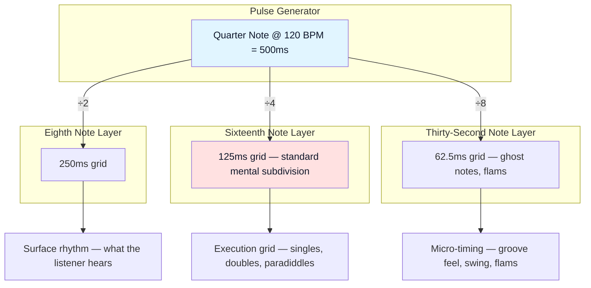
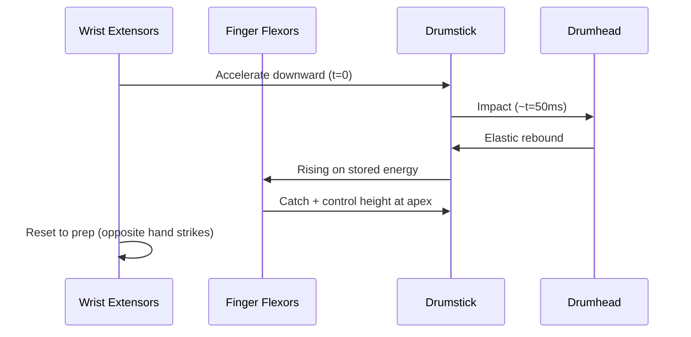
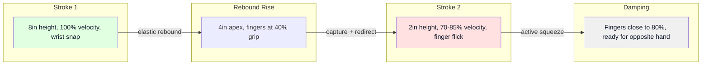
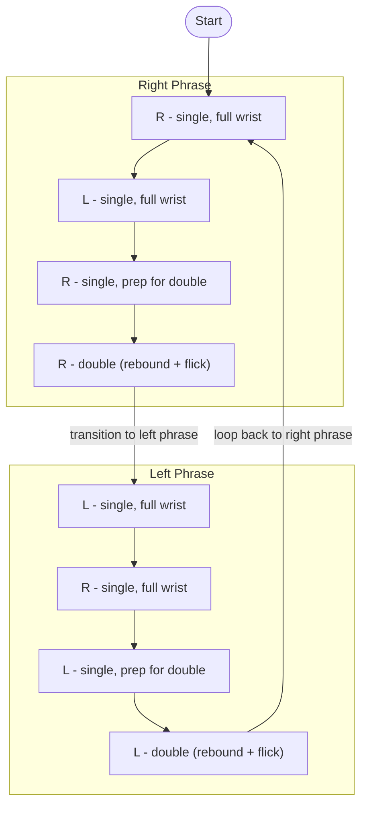
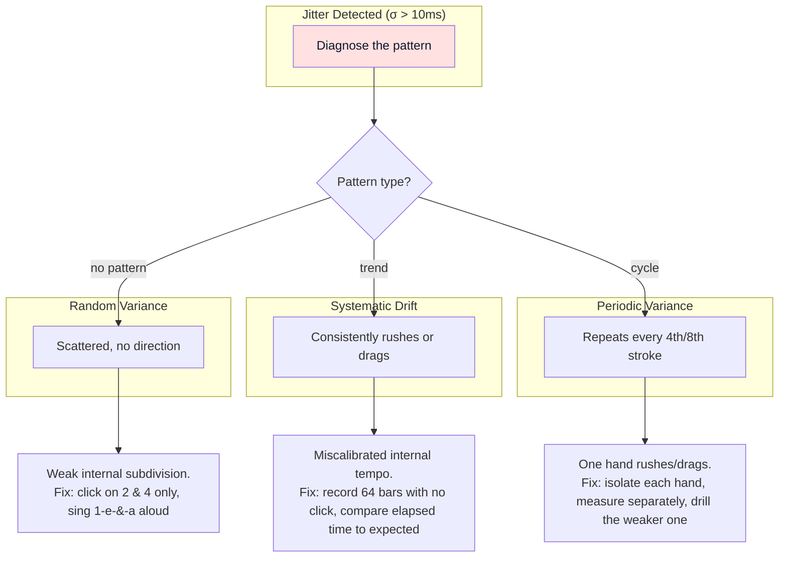

# Lesson 1: Right Hand Techniques — Stick Control, Rebound, and the Paradiddle Family

## 1. First-Principles Intuition (15%)

### The Rebound Principle

A drumstick striking a head is an elastic collision: the head compresses, stores energy, and returns most of it to the stick. Fighting the rebound wastes effort; harnessing it is the entire basis of fast, relaxed playing. Think of the head as a trampoline and the stick as the person jumping on it — your job is to time the catch, not power every bounce.

**One-paragraph physics:** stroke volume tracks impact velocity (double the speed, roughly quadruple the acoustic energy), and a well-tuned head returns 60–80% of that velocity as rebound. Heavier sticks carry more momentum and feel "slower" to redirect; tighter heads give faster, crisper rebound, looser heads absorb more and feel "dead." Your fingers are the variable in this system — tight fingers choke the rebound, loose fingers let it run free, and controlled players modulate between the two within a single stroke.

### The Kinetic Chain: Forearm, Wrist, Fingers

- **Forearm (rotation):** gross positioning, repositioning around the kit, and raw power for accents.
- **Wrist (flexion/extension):** the primary engine for strokes below ~140 BPM sixteenths. Should move like a loose hinge, not a stiff lever.
- **Fingers (flexion/extension):** fine control — they catch the rebound, add a late "whip" of speed, and execute doubles/buzz strokes the wrist alone can't recover fast enough for.

Think of it as a transmission: **wrist = engine, fingers = clutch and throttle.** Wrist-only playing hits a hard speed ceiling around 140–160 BPM sixteenths. Finger-only playing has no power behind it. Good technique blends both, shifting the ratio as tempo rises.

### Internal Subdivision

Your sense of tempo is hierarchical. A quarter note at 120 BPM (500 ms) breaks down into two eighths (250 ms) and four sixteenths (125 ms). Drummers who sound "locked in" are mentally running the sixteenth-note grid at all times, even while playing quarter notes — this is what lets you drop a ghost note or syncopation exactly where it belongs instead of approximating it.



---

## 2. Core Stroke Mechanics (85% Hands-On)

### Single Stroke: The Foundation (R-L-R-L)

Every other pattern in this lesson is a variation on alternating strokes. Get this right before anything else.

**Grip and stick height reference:**

| Dynamic | Stick height (tip to head) | Use |
|---|---|---|
| p (soft) | 2–3 in | ghost notes, quiet practice |
| mf (medium) | 6–8 in | default practice height |
| f (loud) | 12+ in | accents, fills |

**The four-phase stroke:**

1. **Prep:** stick cocked back 30–40°, fulcrum between thumb and first knuckle of index finger, remaining fingers lightly touching the stick (not gripping).
2. **Acceleration:** wrist extends, gravity does most of the work. No pushing with the fingers here — let it fall.
3. **Impact:** stick contacts head for 1–3 ms; the head compresses and fires the stick back up.
4. **Rebound/recovery:** fingers close gently at the apex of the bounce to catch and control height, wrist flexes back to prep position, opposite hand begins its stroke.

**Checkpoint:** drop the stick from prep height with zero wrist push. It should bounce back to 60–70% of that height on its own. If it dies on the head or you have to "help" it up, your grip is too tight or your stick angle is off (should strike at 85–90°, not a steep glancing angle).



**Troubleshooting:**

| Symptom | Cause | Fix |
|---|---|---|
| Stick doesn't bounce back | Grip too tight, fingers choking the stick | Loosen; only thumb + index stay firm, others barely touch |
| Volume inconsistent | No height discipline | Put a strip of tape on the stick at your target prep height as a visual anchor |
| Forearm burns within 2 min | Driving strokes from the forearm, not the wrist | Rest forearm on the pad edge, isolate wrist motion only |
| Tempo creeps up | Anticipating hits instead of listening to rebound | Record yourself; practice with click on 2 & 4 only to force listening |

**Practice drill — Single Stroke Foundation**

Metronome at 60 BPM throughout. Progress only when the current line is clean for the full duration with no forearm tension.

| Week | Tempo | Note value | Duration | Focus |
|---|---|---|---|---|
| 1 | 60 | Quarters | 2 min | Rebound height consistency, visual check |
| 2 | 60→80 | Eighths | 3 min each | Wrist relaxation, no forearm tension |
| 3 | 100 | Eighths | 5 min continuous | Endurance |
| 3 | 60 | Sixteenths | 3 min | Count "1-e-&-a" aloud |
| 4 | 80→100 | Sixteenths | 3 min each | Clean articulation, this is your working-tempo grid |

**Week 4 checkpoint:** clean singles at 100 BPM sixteenths (6.6 Hz per hand) for 5 minutes, no forearm fatigue, stick rebounds to 60–70% height with zero conscious effort.

---

### Double Stroke: Harnessing Rebound Energy (RR-LL)

A double stroke is not "hit twice" — it's one wrist stroke plus one rebound redirected by the fingers. Done right it costs 30–40% less effort than two single strokes of equal volume.

**Mechanics:**

1. First stroke: normal single from 6–8 inches.
2. Rebound capture: as the stick rises, let fingers stay open (~40% grip) so it rebounds freely — don't raise the wrist to "go get" the second hit.
3. Second stroke: at the rebound apex (3–4 in), a small finger "flick" (middle/ring closing) redirects the stored energy downward into the second hit. Minimal wrist involvement.
4. Damping: immediately after the second stroke, fingers close to ~80% grip to kill any third bounce. Stick settles near 2 inches, ready for the opposite hand.

**Grip pressure through the double:**

| Phase | Grip % | Why |
|---|---|---|
| After stroke 1 | 40% | let it rebound freely |
| At rebound apex | 60% | begin catching |
| Second stroke | 60–70% + finger flick | redirect energy, don't push |
| After stroke 2 | 80% | kill the 3rd bounce |

Target: second stroke lands at 70–85% of first-stroke volume. If it's much quieter, you're relying on pure passive rebound with no finger flick — a "ghost" second note instead of a controlled one.

**Drill — Rebound Isolation (do this before alternating doubles):**

1. Stick resting on pad, loose grip.
2. Lift slightly and drop — no push, pure gravity.
3. Let it bounce once. Note the height (should recover 50–70%).
4. Reset. This time, at the bounce apex, close fingers and add a small downward flick for a second, audible, controlled bounce (not a ghost).
5. 50 reps per hand before moving to alternating RR-LL.

**Drill — Doubles in context**

| Week | Tempo | Note value | Pattern | Focus |
|---|---|---|---|---|
| 1 | 40–50 | Whole notes | RR (beat 1) – LL (beat 2) | No 3rd bounce, smooth hand switch |
| 2 | 60–80 | Half notes | RR-LL, 2 per bar | Second-stroke velocity consistency |
| 3 | 60–80 | Quarters | RR-LL, 4 per bar | Zero hesitation L→R |
| 4 | 60–100 | Quarters→Eighths | RR-LL | 5 min endurance; working tempo |

**Week 4 checkpoint:** clean doubles at 100 BPM quarters, second stroke at 70–85% of first, no phantom bounces, 100 consecutive doubles (50/hand) without breakdown.



**Troubleshooting:**

| Symptom | Cause | Fix |
|---|---|---|
| Second stroke too quiet | No finger flick, pure passive rebound | Isolate RR only, exaggerate the flick |
| Extra 3rd/4th bounces | No damping after stroke 2 | Squeeze to 80% immediately after; practice "RR-silence-RR-silence" |
| Left doubles sloppy, right clean | Non-dominant hand undertrained | 60% of practice time leading with left (LL-RR-LL-RR) |
| Stroke 2 louder than stroke 1 | Pushing with the wrist instead of redirecting rebound | Cut wrist motion on stroke 2 by ~70%, trust the flick |
| Falls apart above 80 BPM | Finger technique underdeveloped | Drop to 40 BPM, exaggerate finger motion, add 5 BPM/week |

---

### Paradiddle: Pattern Switching (RLRR-LRLL)

The paradiddle is asymmetric — each hand has a different job. Right phrase: R-L-R-R (single-single-double). Left phrase: L-R-L-L (single-single-double). It's hard because the lead hand flips every four strokes and you must switch stroke types (single→double) mid-phrase without hesitating.

**Say it as you play it:** "PAR-a-DID-dle" → R-L-R-R, with a light accent on "PAR" and "DID" — this maps naturally onto beat 1 and the first stroke of the double, and speaking it recruits motor planning that speeds up learning the sequence.



**Critical checkpoints:** strokes 1–3 of each phrase should feel exactly like alternating singles. Stroke 4 is a controlled double, not a rushed buzz. The hardest spot is the handoff — right double (beat 4) into left single (beat 5) — with zero hesitation.

**4-stage progression:**

**Stage 1 (Week 1) — Phrase isolation.** 40 BPM. Play RLRR, count "Par-a-did-dle" aloud, pause 2 clicks, play LRLL, pause, repeat for 5 minutes. Goal: each phrase feels natural in isolation.

**Stage 2 (Week 2) — Phrase linking.** 60 BPM. Play RLRR-LRLL continuously, no pauses, 8 minutes. If it breaks down, restart from RLRR (always restart on the right phrase).

**Stage 3 (Week 3) — Subdivision lock.** 80 BPM, click on beats 1 and 3 only. Stop counting aloud. 10 minutes. Goal: pattern recognition becomes automatic; you stop tracking individual strokes.

**Stage 4 (Week 4) — Working tempo.** 100–120 BPM, 5 minutes. Add dynamic shape: accent the first stroke of each phrase (**R**-L-R-R-**L**-R-L-L) for musical phrasing.

**Metronome displacement (once Stage 4 is solid):**

| Week | Click placement | Focus |
|---|---|---|
| 1 | All 4 beats | Pattern accuracy |
| 2 | Beats 1 & 3 | Internal subdivision |
| 3 | Beats 2 & 4 | Syncopation awareness |
| 4 | Beat 1 only | Deep internal pulse |
| 5 | No click | Self-assessed internal time |

After stage 5, play 32 bars with no click, then bring the click back — you should be within ±3 BPM. Drift beyond ±5 BPM means back to stage 3.

**Troubleshooting:**

| Symptom | Cause | Fix |
|---|---|---|
| Pattern collapses after 4–8 bars | Counting individual strokes, not phrases | Say "PAR-a-DID-dle" aloud, chunk in 4-stroke units |
| Left double sloppy | Non-dominant hand underdeveloped | Practice LRLL-RLRR 60% of the time; isolate LL-rest-LL-rest |
| Tempo rushes on the double | Not trusting rebound | Isolate RR-pause-LL-pause at 40 BPM |
| Hiccup at the handoff (4→5 or 8→1) | Mental switching cost | Drill just the seam: RR-L-RR-L-RR-L |
| Breaks down after 30s at 100 BPM | Pattern not consolidated yet | Drop to 80 BPM, 5 min continuous — needs more total reps |

### Paradiddle Variations

Only start these once you can play the basic paradiddle for 5 minutes at 100 BPM without breakdown.

**1. Paradiddle-Diddle (RLRRLL-LRLLRR)** — two doubles per phrase (R-L-RR-LL). The hard part is stroke 5: the opposite hand must fire a clean single immediately after the first hand's double finishes. Practical tempo ceiling is lower than the basic paradiddle (100–120 BPM) because of the rapid double-double handoff. Progression: 40 BPM isolated phrases (wk1) → 60 BPM continuous with vocal count (wk2) → 80 BPM clean doubles both hands (wk3) → 100 BPM endurance (wk4).

**2. Inverted Paradiddle (RLLR-LRRL)** — double moves to positions 2–3 (R-LL-R). Forces single→double→single switching inside one phrase; the stroke 3→4 transition (double into opposite-hand single) is the signature difficulty. Musically useful as a fill: the natural accent falls on stroke 4, resolving cleanly onto the next downbeat.

**3. Delayed Paradiddle (RLRLRR-LRLRLL)** — four pure singles, then the double arrives late (R-L-R-L-RR). Strokes 1–4 are identical to a plain singles drill; the challenge is not disturbing that flow while mentally queuing the double on strokes 5–6. In 4/4 starting on beat 1, the double lands on the backbeat (beat 3), giving it real rhythmic weight — useful for linear fills.

**Integration (Week 6 target):** cycle all four patterns back-to-back with no pauses — RLRR-LRLL → RLRRLL-LRLLRR → RLLR-LRRL → RLRLRR-LRLRLL → repeat — for 5 minutes at 80 BPM without breakdown or tempo drift.

---

## 3. Technique Optimization & Failure Recovery

### Breaking the 160–180 BPM Wall

The relaxed wrist oscillates naturally at 4–8 Hz. Sixteenth notes at 180 BPM demand 12 Hz per hand — past that, pure wrist motion can't recover fast enough. Three levers fix this; use them together, not one at a time.

**1. Compress stroke distance.** Time per stroke = distance / velocity. If velocity is biomechanically capped, shrink the distance.

| Tempo | Prep height | Rebound height |
|---|---|---|
| 120 BPM | 6–8 in | 4–5 in |
| 160 BPM | 4–6 in | 3–4 in |
| 180 BPM | 3–4 in | 2–3 in |
| 200+ BPM | 1–2 in | ~1 in (buzz territory) |

Drill: start at 120 BPM with normal 6–8 in height for 1 minute, then without stopping or changing tempo, lower height gradually over 30 seconds to 3–4 in. Volume drops — that's expected, prioritize clean articulation. Stabilize, then bump tempo 10 BPM and repeat.

**2. Add finger drive.** Past ~160 BPM the wrist becomes the pulse and fingers supply the "whip" through impact.

| Speed range | Wrist share | Finger share |
|---|---|---|
| 60–120 BPM | 90% | 10% |
| 120–160 BPM | 70% | 30% |
| 160–200 BPM | 50% | 50% |
| 200+ BPM | 30% | 70% (buzz/finger roll territory) |

Drill — finger isolation: rest the forearm on the pad edge, lock the wrist completely, generate strokes using only the middle/ring/pinky closing motion. You should get a quiet but clear tone. Once reliable, remove the forearm lock and reintroduce wrist motion at 140 BPM, consciously engaging fingers every stroke.

**3. Modulate grip pressure through the cycle** instead of holding one constant tension:

| Phase | Grip % |
|---|---|
| Prep | 40–50% |
| Acceleration | 50–60% |
| Impact | 70–80% |
| Rebound | 40–50% |
| Recovery | 50–60% |

Drill: at 60 BPM quarters, exaggerate "tight at impact, loose on rebound" consciously. Increase tempo in 10 BPM steps; by 140+ BPM the modulation should be unconscious.

**6-week breakthrough protocol:**

| Week | Focus | Target | Daily |
|---|---|---|---|
| 1 | Height reduction | 140 BPM, 3–4 in | 15 min |
| 2 | Finger isolation | 140 BPM, finger snap every stroke | 15 min |
| 3 | Grip modulation | 140 BPM, conscious tight-loose | 15 min |
| 4 | Integration | 160 BPM, all three combined | 20 min |
| 5 | Push | 170 BPM, 1 min on / 1 min off x5 | 20 min |
| 6 | Breakthrough | 180 BPM, 30s on / 1 min off x5 | 20 min |

**Do not start this protocol** until you can play clean singles at 140 BPM for 10 minutes with zero tension. Forcing speed past your current technique is how tendonitis starts, not how speed is gained.

### Reducing Timing Jitter

| Std. deviation (σ) at 120 BPM | Level | Sounds like |
|---|---|---|
| < 5 ms | Elite | "locked in," "in the pocket" |
| 5–10 ms | Advanced | solid, groove-enhancing micro-variation |
| 10–15 ms | Intermediate | noticeably loose |
| 15–25 ms | Beginner | rushed or dragging |
| >25 ms | Foundational gap | timing is the limiting factor |

**Diagnostic:** record 2 minutes of steady sixteenths at 120 BPM on your phone or interface, import into any DAW (Reaper, Logic, Ableton), overlay a sixteenth-note grid, and measure deviation per hit.



**4-week subdivision strengthening:**

| Week | Play | Count aloud | Goal |
|---|---|---|---|
| 1 | Quarters @ 60 BPM | "1-e-&-a-2-e-&-a..." | internalize 4 sixteenths = 1 quarter |
| 2 | Eighths @ 60 BPM | same sixteenth count | internalize 2 sixteenths = 1 eighth |
| 3 | Sixteenths @ 60 BPM | thirty-seconds: "1-ta-e-ta-&-ta-a-ta..." | micro-timing awareness for ghosts/flams |
| 4 | Sixteenths @ 80 BPM | silent — internalized | drop a random syncopation every 8 bars, grid stays stable |

**Metronome weaning (4 stages, ~12 weeks):**

1. **Weeks 1–2:** full click reference, every session.
2. **Weeks 3–4:** click 8 bars on, mute 4 bars (keep playing), click returns — check alignment; drift > 1 beat means back to stage 1.
3. **Weeks 5–8:** click 8 bars on, mute 16, click returns; drift > 2 beats means shorten the muted section and repeat.
4. **Weeks 9–12:** click 4 bars on, mute 64, click returns; target within ±2 BPM of start.

**Rushing vs. dragging:**
- **Rushing** = anticipatory motor commands firing before the beat. Fix: deliberately play 5–10 ms *behind* the click, verify by recording.
- **Dragging** = reactive commands firing after you perceive the beat. Fix: deliberately play 5–10 ms *ahead*, verify by recording.

**Tempo calibration check:** play 32 bars at 120 BPM (should take 64 seconds) with no clock visible, then check a stopwatch. 60–62s = you rushed; 66–68s = you dragged. Repeat weekly and adjust your "ahead/behind" feel accordingly.

### Bilateral Symmetry

Left-hand weakness shows up as: louder right hits in alternating patterns, right rushing while left drags, and right-leading patterns being clean while left-leading patterns fall apart (cutting your usable vocabulary in half).

**Measuring it:**
- *With e-drums:* record MIDI velocity for 1 minute of R-L-R-L sixteenths at 120 BPM, compute (avg R − avg L) / avg R × 100.
- *Without e-drums:* film from the side, compare rebound apex height between hands.

| Metric | Elite | Intermediate | Needs work |
|---|---|---|---|
| Velocity difference | < 5% | < 10% | >10% |
| Timing offset | < 3 ms | < 8 ms | >8 ms |
| Max tempo gap (R-lead vs L-lead) | < 5 BPM | < 10 BPM | >10 BPM |

**12-week corrective plan:**

- **Weeks 1–4:** 60% practice time on left-leading patterns (LRLL-RLRR, L-R-L-R), 20% right-leading, 20% left hand isolated (mute the right hand with a towel on the pad, play L-L-L-L). The non-dominant hand needs roughly 3x the reps to close the gap.
- **Weeks 5–8:** asymmetric dynamics — left hand plays f (8 in height) while right plays mf (6 in), forcing the left hand to generate real power. Ramp to ff on left by week 6–7, then equalize both at mf by week 8 and retest.
- **Weeks 9–12:** mirror practice — every pattern you learn right-leading, immediately drill left-leading (2 min right / 2 min left, x3). Don't move to the next pattern until both feel equal.

**Week 12 target:** all patterns feel equally natural leading with either hand; velocity gap under 5%.

### Anti-Tension Failure Checklist

**Forearm burn within 5 minutes:**
- Grip over 50% during recovery phase? → consciously loosen, drill "tight-loose-tight-loose."
- Forearm doing the work instead of wrist? → rest forearm on pad edge, isolate wrist for 2 minutes.
- Tempo beyond current capability? → drop 20–30 BPM, rebuild at 5 BPM/week.
- Stick height too high for the tempo? → cut it by half, check if fatigue drops.
- Practicing past 20 minutes straight? → take a 5-minute break, shake out, hydrate.

**Rebound feels dead or erratic:**
- Fingers rigid/locked? → dead-stick drop test: can the stick swing freely from the fulcrum?
- Stick angle off-perpendicular? → film from the side, should strike at 85–90°.
- Second stroke too forceful? → isolate RR, aim for 70% rebound / 30% finger flick, not a forced push.
- Pad or head too tight/loose? → drop test: 6 in drop should return 4 in (60–70%).

**Timing collapses after 30 seconds:**
- No internal subdivision? → go back to vocal sixteenth counting.
- Attention drifting? → shorten to 15-second focused bursts with breaks, extend gradually.
- Pattern too complex for current level? → regress to singles at the same tempo and rebuild up.
- Reacting to the click instead of anticipating it? → drop metronome volume to 30%, practice weaning stage 2.

**Emergency reset:** stop immediately, shake out hands and arms for 30 seconds, play dead-slow quiet singles at 40 BPM focusing only on rebound, and don't retry the failed pattern that session — sleep consolidates motor learning, and patterns that feel impossible today are often easy tomorrow.

---

## 4. 6-Week Practice System (Zero to Foundation)

15–25 minutes daily, 6 days a week, one full rest day. Quality over quantity — do not extend sessions past 25 minutes.

**Weeks 1–2: Single Stroke Mastery (15 min/day)**

| Drill | Tempo | Note value | Time | Focus |
|---|---|---|---|---|
| R-L-R-L | 40 BPM | Quarters | 3 min | Rebound height, 60–70% return |
| R-L-R-L | 60 BPM | Eighths | 3 min | Forearm relaxation |
| R-L-R-L | 60 BPM | Sixteenths | 3 min | Grip modulation |
| Pyramid | 60→80→60 BPM | Sixteenths | 6 min | Smooth tempo transitions, no technique change |

*Pyramid drill: 1 min each at 60-65-70-75-80, then back down 75-70-65-60.*

**Week 2 checkpoint:** clean singles at 100 BPM sixteenths, 2 minutes, no forearm fatigue, left/right velocity within 10%.

**Weeks 3–4: Double Stroke Integration (20 min/day)**

| Drill | Tempo | Note value | Time | Focus |
|---|---|---|---|---|
| RR-LL | 40 BPM | Whole notes | 4 min | No 3rd bounce, active damping |
| RR-LL | 60 BPM | Half notes | 4 min | Second stroke at 70–80% volume |
| RR-LL | 80 BPM | Quarters | 4 min | Zero hesitation on hand switch |
| Mixed: RRLL-RLRL-RRLL-RLRL | 60 BPM | Eighths | 4 min | Switch cleanly between double/single mechanics |
| Pyramid (doubles) | 60→100→60 BPM | Eighths | 4 min | Endurance without quality loss |

**Week 4 checkpoint:** clean doubles at 100 BPM quarters for 2 minutes, stroke 2 consistently 70–80% of stroke 1, fluid single/double switching.

**Weeks 5–6: Paradiddle Foundation (25 min/day)**

| Drill | Tempo | Note value | Time | Focus |
|---|---|---|---|---|
| RLRR-LRLL (spoken) | 40 BPM | Quarters | 3 min | "PAR-a-DID-dle" chunking |
| RLRR-LRLL | 40 BPM | Quarters | 5 min | Doubles as clean as isolated RR-LL |
| RLRR-LRLL | 60 BPM | Eighths | 5 min | No hesitation at turnarounds |
| RLRR-LRLL | 80 BPM | Sixteenths | 5 min | Automatic phrase flow |
| LRLL-RLRR | 60 BPM | Eighths | 4 min | Left-leading feels equally natural |
| Cycling: singles(8 bars)→doubles(8)→paradiddle(8) | 60 BPM | Eighths | 3 min | Technique flexibility |

**Week 6 checkpoint:** clean paradiddles at 80 BPM sixteenths for 2 minutes, left-leading equal to right-leading, can cycle stroke types without stopping. If any checkpoint fails, repeat that 2-week block before moving on.

### Long-Term Benchmarks

| Skill | 3 months | 6 months | 12 months |
|---|---|---|---|
| Single stroke max tempo (16ths) | 140 BPM | 160 BPM | 180 BPM |
| Single stroke endurance | 5 min @ 120 | 10 min @ 140 | 15 min @ 160 |
| Double stroke max tempo (16ths) | 120 BPM | 140 BPM | 160 BPM |
| Double stroke endurance | 3 min @ 100 | 5 min @ 120 | 10 min @ 140 |
| Paradiddle max tempo (16ths) | 100 BPM | 120 BPM | 140 BPM |
| Paradiddle endurance | 3 min @ 80 | 5 min @ 100 | 10 min @ 120 |
| Timing precision (σ) | < 15 ms @ 100 | < 10 ms @ 120 | < 8 ms @ 120 |
| Bilateral velocity gap | < 15% | < 10% | < 5% |

Retest every 4 weeks, record audio/video, and direct extra practice time at whichever metric is behind schedule.

### Weekly Practice Log Template

```
Date: ____________

Tempo ceilings (max clean tempo before breakdown):
  Singles: ___ BPM (16ths)   Doubles: ___ BPM (16ths)   Paradiddles: ___ BPM (16ths)

Endurance:
  Singles @ 120: ___ min    Doubles @ 100: ___ min    Paradiddles @ 80: ___ min

Tension check:
  Fatigue onset: ___ min at ___ BPM     Tension-free max tempo: ___ BPM

Bilateral balance (1-10):
  Left-leading: ___/10    Right-leading: ___/10

Timing:
  Recorded + analyzed grid: Y/N    Estimated jitter: <5 / 5-10 / 10-15 / >15 ms
  Max bars without click before >2 BPM drift: ___

Notes:
```

Review monthly. If left-hand rating sits 3+ points below right for two consecutive weeks, re-enter the bilateral corrective protocol.

---

## 5. Integration With Full-Kit Independence

### Mirroring to the Left Hand

Every drill above gets repeated left-leading. Practice ratio: 50/50 right/left during weeks 1–6, shift to 60% left if the bilateral assessment shows >10% gap (weeks 7–12), return to 50/50 once symmetry holds. The left hand isn't weaker by nature — it has had thousands fewer hours of fine motor use than the hand you write and click a mouse with. It needs volume, not talent.

### Bass Drum (Right Foot): Same Rebound Physics

- **Heel-down** = wrist-driven stroke analog: ankle pivots, heel stays down, more control, lower volume.
- **Heel-up** = forearm-driven stroke analog: leg lifts, full-weight strike, more power.
- **Heel-toe slide:** strike with the ball of the foot, rock back to strike again with the heel — analog of the hand's double-stroke whip.
- **Rebound double:** let the beater bounce off the head, redirect with an ankle snap — direct parallel to the hand double.

Once hand doubles are solid (end of week 4), transfer the feel: alternate RR on the hand with RR on the foot, same rebound-capture sensation, gradually increasing tempo.

### Hi-Hat Foot: Binary Precision

The left foot is open/closed, nothing in between, but the timing of the transition must be exact. Layer it in only after hands are solid:

1. **Weeks 1–6:** hands only, feet ignored.
2. **Weeks 7–10:** add right foot — paradiddle on hands at 60 BPM, right foot on steady quarters.
3. **Weeks 11–16:** add left hand — right hand steady eighths on hi-hat, left hand backbeats on 2 & 4, right foot quarters on 1 & 3. This is a basic rock beat.
4. **Weeks 17–24:** add left foot — opens the hi-hat on the "&" of 2 and "&" of 4, between the snare hits, for the classic open-hi-hat-on-offbeats sound.

### Three-Phase Four-Limb Integration

The brain can consciously drive only 1–2 limbs at a time; everything else must already be automatic (cerebellum-controlled) before you add the next limb.

**Phase 1 (weeks 7–10), 5 min each daily:**

| Combination | Pattern | Tempo |
|---|---|---|
| RH + bass | Hand: RLRR-LRLL, Foot: quarters | 60 BPM |
| RH + LH | Both play paradiddles in unison | 60 BPM |
| LH + bass | Hand: backbeats (2 & 4), Foot: quarters | 60 BPM |

**Phase 2 (weeks 11–16):**

| Combination | Pattern | Tempo |
|---|---|---|
| RH + LH + bass | RH 8ths/hi-hat, LH backbeat/snare, foot quarters/kick | 80 BPM |
| RH + LH + hi-hat foot | RH 8ths/open hi-hat, LH backbeat, LF closes hi-hat on 1 & 3 | 60 BPM |

**Phase 3 (months 5–12):** all four limbs independent — right hand steady on hi-hat/ride, left hand syncopated with ghost notes, right foot syncopated/doubled bass patterns, left foot offbeat hi-hat opens.

| Drill | Pattern | Tempo | Focus |
|---|---|---|---|
| Linear groove | No two limbs hit together, interlocking 16ths | 80 BPM | Polyrhythmic independence |
| Paradiddle orchestration | RLRR-LRLL mapped: R=kick, L=snare, R=hi-hat, R=kick | 60 BPM | Pattern transfer to the full kit |
| 3 vs 4 polyrhythm | RH triplets, LH sixteenths, feet quarters | 60 BPM | Forces cerebellar automaticity |

**On consolidation timing:** a pattern typically needs 10,000–15,000 total repetitions before it runs on autopilot. An 8-bar phrase at 100 BPM sixteenths is 128 strokes; repeating that phrase 80–120 times (roughly 10–15 short sessions) moves it toward permanent encoding — but only with sleep between sessions. Cramming 100 reps in one sitting does not stick the way the same 100 reps spread across 10 nights does.

---

## Final Integration: From Technique to Music

Singles, doubles, and the paradiddle family aren't exercises you graduate from — they're the vocabulary every groove, fill, and solo is assembled from.

Keep three priorities ahead of everything else:

- **Rebound control** — the stick does most of the work, you guide it.
- **Timing precision** — run the internal sixteenth-note grid, don't chase the click reactively.
- **Bilateral symmetry** — no "weak hand," just unequal practice time, and that's fixable.

Start at 40 BPM without hesitation — it's the tempo where every mechanical error is visible and correctable before it becomes a habit. If the stick isn't rebounding to 60–70% height on its own, stop and fix grip or angle before pushing tempo. Expect plateaus of two to three weeks followed by sudden jumps — that's how neural consolidation actually works, not a smooth curve. The 6-week foundation here, executed with real metronome discipline and honest logging, puts you ahead of most drummers who never build it deliberately at all.
