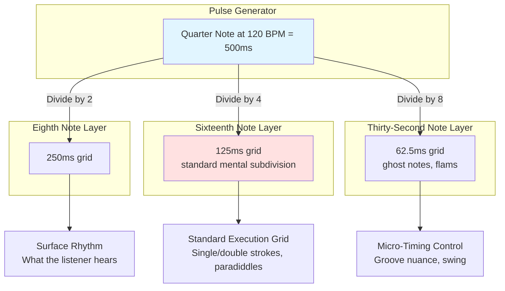
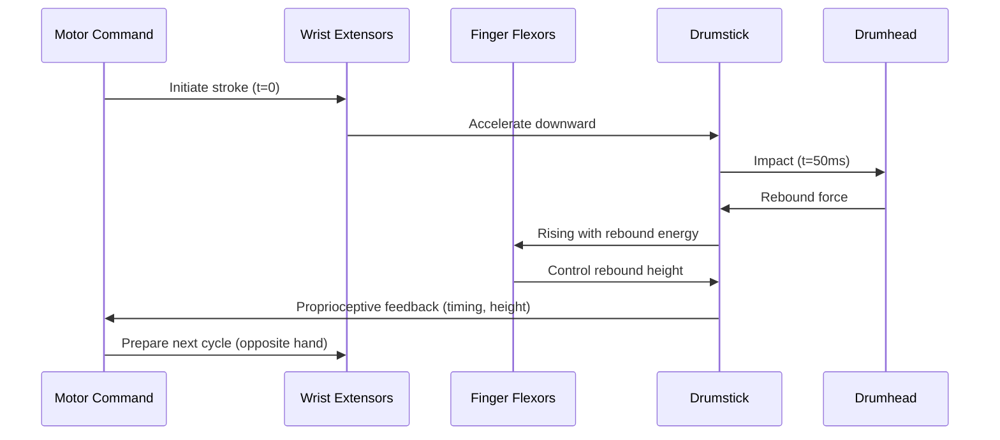
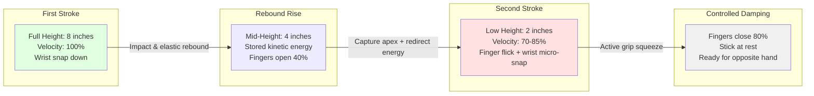
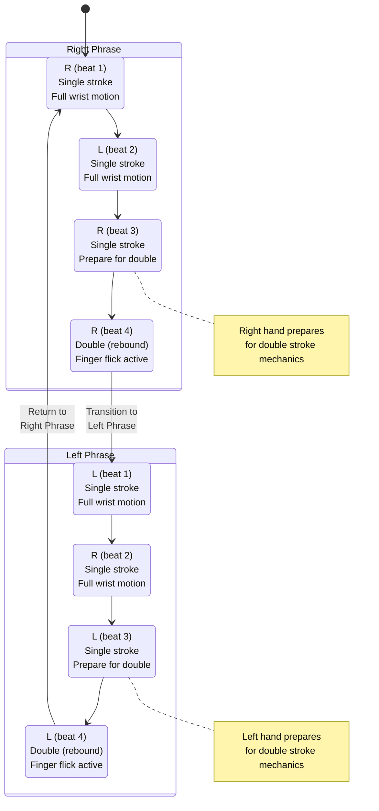
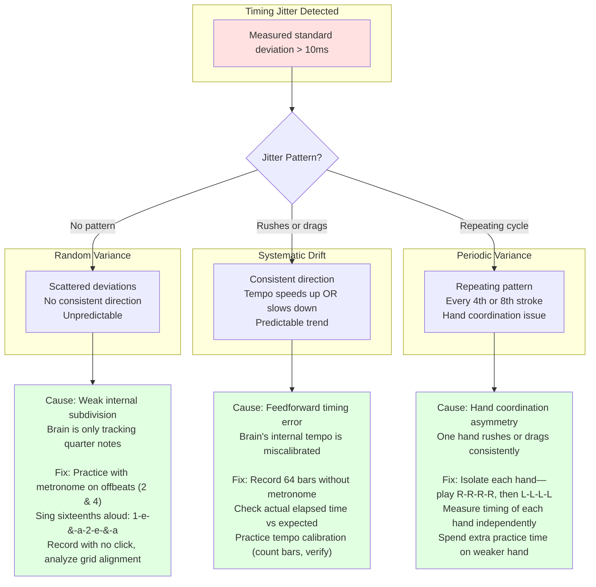

# Lesson 1: Right Hand Techniques

## 1. First-Principles Intuition (15%)

### The Rebound Principle

When a drumstick strikes a drumhead, the collision is partially elastic—meaning the stick bounces back. This rebound is your ally, not your enemy. Elite drummers harness rebound energy rather than fighting it. The stick wants to return; your fingers and wrist simply guide and time that return.

**Core Physics in One Paragraph:**
Impact velocity determines volume (doubling speed quadruples acoustic power). The drumhead behaves like a trampoline: compress it fast, it pushes back hard. Stick rebound velocity is roughly 70-90% of impact velocity on typical heads. A heavier stick has more inertia and rebounds differently than a light stick. Tighter heads rebound faster; looser heads absorb more energy. Your hand controls rebound height and timing by modulating finger pressure—tight grip kills the bounce, loose grip lets it run wild.

### The Kinetic Chain: Wrist, Fingers, Forearm

Your arm is a multi-joint system:
- **Forearm rotation (pronation/supination):** Gross positioning and power delivery for accents.
- **Wrist flexion/extension:** Primary stroke generator. The wrist is a hinge that should move freely.
- **Fingers (flexion/extension):** Fine control, rebound damping, and secondary stroke activation (doubles, buzz rolls).

**Key Principle:** The wrist is your engine. Fingers are your clutch and throttle. Trying to play fast with only wrist motion is like driving without shifting gears—you hit a speed ceiling and burn out. Trying to play with only finger motion gives you no power. You need both, applied at the right time.

### Temporal Precision and Internal Subdivision

Your brain's cerebellum acts as an internal metronome. It subdivides beats hierarchically. A quarter note at 120 BPM (500ms) is mentally broken into:
- **Sixteenth notes:** 125ms each (the standard grid for most patterns)
- **Eighth notes:** 250ms each (surface rhythm)
- **Thirty-second notes:** 62.5ms each (micro-timing for ghost notes, swing feel)

Elite drummers think in sixteenth-note grids even when playing quarter notes. This internal subdivision lets you place notes precisely between the beats, execute syncopations accurately, and maintain tempo without external reference.

## 2. Core Stroke Mechanics (85% Hands-On)

### Single Stroke: The Foundation (R-L-R-L)

This is your bread and butter. Everything else is a variation of alternating strokes.

**Physical Execution:**

1. **Starting Position (Stick Height):**
   - Low volume (p): 2-3 inches above drumhead
   - Medium volume (mf): 6-8 inches
   - High volume (f): 12+ inches
   - Measure from stick tip to head, not from your hand

2. **The Stroke Cycle (Four Phases):**

   **Phase 1—Preparation:** Stick at height, wrist cocked slightly back (30-40° angle), fingers loose grip (fulcrum between thumb and index finger, other fingers barely touching).

   **Phase 2—Acceleration:** Wrist extends (straightens), gravity assists, stick accelerates downward. Do not push with fingers—let the stick fall with a wrist snap.

   **Phase 3—Impact:** Stick contacts head for 1-3 milliseconds. The head compresses and rebounds the stick.

   **Phase 4—Rebound & Recovery:** Stick bounces back. Fingers close slightly at the rebound apex to catch and control the height. Wrist flexes (bends back) to original position. Repeat with opposite hand.

**Critical Checkpoint:** After impact, the stick should bounce back to roughly 60-70% of starting height without any effort from you. If it doesn't, your grip is too tight or the stick angle is wrong.

**Common Failure Modes & Fixes:**

| Symptom | Root Cause | Fix |
|---------|-----------|-----|
| Stick doesn't bounce back | Grip too tight; fingers choking stick | Loosen grip; only thumb + index firm |
| Inconsistent volume | Varying stick height; no height discipline | Mark tape on stick shaft; maintain consistent prep height |
| Forearm fatigue after 2 minutes | Using forearm muscles instead of wrist snap | Isolate wrist motion; practice with forearm resting on pad edge |
| Timing rushes (speeds up) | Anticipating strokes; not listening to rebound | Record yourself; practice with metronome on offbeats (clicks on 2 & 4) |

**Practice Drill—Single Stroke Foundation:**

Set metronome to 60 BPM. Play quarter notes (one stroke per click) for 2 minutes continuous.

**Week-by-week progression:**

| Week | Tempo (BPM) | Note Value | Strokes per Minute | Focus |
|------|-------------|------------|-------------------|-------|
| 1 | 60 | Quarter notes | 240 | Rebound height consistency (visual check) |
| 2 | 60 | Eighth notes | 480 | Wrist relaxation, no forearm tension |
| 2 | 80 | Eighth notes | 640 | Tempo increase without technique change |
| 3 | 100 | Eighth notes | 800 | Endurance, 5-minute continuous |
| 3 | 60 | Sixteenth notes | 960 | Internal subdivision (count "1-e-&-a") |
| 4 | 80 | Sixteenth notes | 1280 | Clean articulation at faster grid |
| 4 | 100 | Sixteenth notes | 1600 | Working tempo for most patterns |

**Checkpoints (end of week 4):**
- Clean singles at 100 BPM sixteenths (6.6 Hz per hand)
- No forearm fatigue after 5-minute continuous playing
- Stick rebounds to 60-70% height automatically

### Double Stroke: Harnessing Rebound Energy (RR-LL)

The double stroke is a mechanical optimization. Instead of resetting between strokes, you redirect the rebound into a second hit. This cuts the energy cost by 30-40% compared to two single strokes.

**Physical Execution:**

1. **First Stroke:** Execute a normal single stroke from medium height (6-8 inches).

2. **Rebound Capture:** As the stick bounces back, fingers open slightly to allow free rebound (like catching a basketball on the rise). Do not raise the wrist yet.

3. **Second Stroke:** From the rebound apex (3-4 inches), perform a small wrist flick downward combined with finger snap. This redirects rebound energy into the second hit.

4. **Active Damping:** After the second stroke, fingers squeeze gently to prevent unintended third bounce. The stick should come to rest at low height (2 inches), ready for the opposite hand.

5. **Critical Timing:** The second stroke happens roughly 60-80ms after the first (at 120 BPM sixteenths). The interval is shorter than two separate singles because you're using stored kinetic energy.

**The Finger's Role:**
- **After first stroke:** Fingers open slightly (40% grip pressure) to let stick rebound freely
- **At rebound apex:** Fingers begin closing (60% grip pressure) to catch the stick
- **During second stroke:** Fingers provide a small downward "whip" or "flick" that adds energy to the rebound
- **After second stroke:** Fingers close fully (80% grip pressure) to dampen and stop any third bounce

**Velocity Relationship:**
- First stroke: 100% intended velocity
- Second stroke: 70-85% of first stroke (add finger energy to reach target volume)

**Practice Drill—Rebound Isolation:**

This drill isolates the rebound mechanics without the complexity of alternating hands.

1. Hold stick loosely, tip resting on pad.
2. Lift wrist slightly and let stick drop (no push). Gravity alone accelerates it.
3. Let stick bounce once naturally. Observe the rebound height (should be 50-70% of drop height).
4. Reset. Now repeat, but as the stick rebounds, close your fingers at the apex and add a small wrist flick downward for a controlled second bounce.
5. The second bounce should produce a clear, audible tone—not a ghost note.
6. Practice this 50 times per hand before moving to alternating doubles.

**Practice Drill—Doubles in Context:**

Set metronome to 40 BPM. Play RR-LL with each double lasting one beat (two strokes per click).

**Week-by-week progression:**

| Week | Tempo (BPM) | Note Value | Pattern | Focus |
|------|-------------|------------|---------|-------|
| 1 | 40 | Whole notes | RR (beat 1), LL (beat 2) | Rebound control, no 3rd bounce |
| 1 | 50 | Whole notes | RR-LL continuous | Smooth hand transitions |
| 2 | 60 | Half notes | RR-LL (2 doubles per bar) | Consistent second stroke velocity |
| 2 | 80 | Half notes | RR-LL | Finger flick activation |
| 3 | 60 | Quarter notes | RR-LL (4 doubles per bar) | Pattern continuity |
| 3 | 80 | Quarter notes | RR-LL | No hesitation between L→R transition |
| 4 | 100 | Quarter notes | RR-LL | Endurance, 5 minutes continuous |
| 4 | 60 | Eighth notes | RR-LL (8 doubles per bar) | Working tempo for most grooves |

**Checkpoints (end of week 4):**
- Clean doubles at 100 BPM quarter notes
- Second stroke velocity 70-85% of first stroke
- No phantom bounces after second stroke
- Can execute 100 consecutive doubles (50 per hand) without breakdown

**Common Failure Modes & Fixes:**

| Symptom | Root Cause | Fix |
|---------|-----------|-----|
| Second stroke is a ghost (too quiet) | Not adding finger flick; relying only on passive rebound | Exaggerate finger snap on second stroke; practice RR in isolation without alternating |
| Unintended 3rd/4th bounces | Fingers too loose; not damping after second stroke | Actively squeeze fingers (80% pressure) immediately after second hit; practice "RR-silence-RR-silence" pattern |
| Right hand doubles are clean, left hand doubles are sloppy | Non-dominant hand has less finger control | Spend 60% of practice time starting with left hand (LL-RR-LL-RR); isolate left hand (play LL-rest-LL-rest for 5 min daily) |
| Second stroke is louder than first | Pushing with wrist instead of redirecting rebound | Reduce wrist motion on second stroke by 70%; let rebound + finger flick do the work |
| Doubles fall apart above 80 BPM | Finger technique not developed | Slow down to 40 BPM; exaggerate finger motion; gradually increase 5 BPM per week |

### Paradiddle: Pattern Switching & Hand Coordination (RLRR-LRLL)

The paradiddle introduces asymmetry: each hand plays a different sequence. Right hand executes R-L-R-R (single-single-double), left hand executes L-R-L-L (single-single-double).

**Why This Is Hard:**
- Your brain must track which hand is playing and what type of stroke (single vs. double)
- The pattern is not mirror-symmetric (unlike alternating singles)
- You must switch between single and double stroke mechanics mid-pattern
- The lead hand changes every four strokes, requiring mental reorientation

**Breaking It Down:**

Think of the paradiddle as two 4-stroke phrases that interlock:
- **Right phrase:** R-L-R-R (lead with right, single-single-double)
- **Left phrase:** L-R-L-L (lead with left, single-single-double)

**Syllabic Learning Method:**

Speak the pattern aloud while playing:
- **"Par-a-did-dle"** maps to **R-L-R-R**
- **"Par-a-did-dle"** maps to **L-R-L-L**

Accent the "Par" and "did" syllables slightly to feel the pattern's internal structure:
- **"PAR-a-DID-dle"** = **R-L-RR** (accent first R and first of the double)

This vocalization engages motor cortex planning regions and strengthens the neural pathway for the pattern.

**Physical Execution Step-by-Step:**

1. **R (beat 1):** Right hand single stroke from 6-8 inches. Full wrist extension, normal rebound to 4 inches.

2. **L (beat 2):** Left hand single stroke from 6-8 inches. While right hand is recovering to starting position.

3. **R (beat 3):** Right hand single stroke from 6-8 inches. This is the setup stroke for the double—mentally prepare for rebound capture.

4. **R (beat 4):** Right hand double stroke from rebound (3-4 inches). Add finger flick. Dampen after second hit.

5. **L (beat 5):** Left hand single stroke from 6-8 inches. Right hand is now at rest position.

6. **R (beat 6):** Right hand single stroke from 6-8 inches. While left hand is recovering.

7. **L (beat 7):** Left hand single stroke from 6-8 inches. This is the setup stroke for the double—mentally prepare.

8. **L (beat 8):** Left hand double stroke from rebound (3-4 inches). Add finger flick. Dampen after second hit.

**Critical Checkpoints:**
- Beats 1-2-3 should feel identical to normal alternating singles
- Beat 4 is the controlled double (not a rushed buzz)
- The transition from beat 4 (right double) to beat 5 (left single) should have zero hesitation—this is the hardest part
- Beats 5-6-7 should feel identical to alternating singles
- Beat 8 is the controlled double
- The transition from beat 8 (left double) back to beat 1 (right single) completes the loop

**Practice Drill—Slow Motion Dissection:**

This drill isolates each phrase before linking them.

**Stage 1 (Week 1): Phrase Isolation**

Set metronome to 40 BPM (sixteenth notes at 40 = 150ms per stroke).

1. Play **RLRR** (right phrase), count aloud "Par-a-did-dle"
2. Pause 2 seconds (two clicks)
3. Play **LRLL** (left phrase), count aloud "Par-a-did-dle"
4. Pause 2 seconds
5. Repeat for 5 minutes

**Goal:** Internalize the hand-specific patterns separately. The double should feel natural at the end of each phrase.

**Stage 2 (Week 2): Phrase Linking**

Set metronome to 60 BPM.

1. Play **RLRR-LRLL** continuously with no pauses
2. Say "Right phrase, left phrase, right phrase, left phrase" as you play
3. Focus on the transition points (beat 4→5 and beat 8→1)
4. If you break down, stop and restart from **RLRR** (always restart on right phrase)
5. Practice for 8 minutes

**Goal:** Smooth transitions between phrases. No hesitation or tempo disruption.

**Stage 3 (Week 3): Subdivision Lock**

Set metronome to 80 BPM with clicks on beats 1 and 3 only (half-time feel).

1. Play **RLRR-LRLL** continuously
2. The metronome is no longer clicking every stroke—you must maintain internal sixteenth-note grid
3. Stop counting aloud; internalize the pattern
4. Practice for 10 minutes

**Goal:** Automatic pattern recognition; attention shifts from individual strokes to phrase flow.

**Stage 4 (Week 4): Working Tempo**

Set metronome to 100-120 BPM.

1. Play **RLRR-LRLL** continuously for 5 minutes
2. Add dynamic variations: play first stroke of each phrase at f (forte), remaining strokes at mf (mezzo-forte)
3. This creates the natural accent pattern: **R**-L-R-R-**L**-R-L-L

**Goal:** Full-tempo execution with musical phrasing. Pattern is now automatic; cerebellum has taken over from prefrontal cortex.

**Practice Drill—Metronome Displacement:**

Once the basic paradiddle is solid, this drill develops deep internal time.

Set metronome to 60 BPM. Play paradiddle with these click placements:

| Week | Metronome Placement | Effect | Focus |
|------|-------------------|--------|-------|
| 1 | Clicks on all four beats | Standard reference | Pattern accuracy |
| 2 | Clicks on beats 1 & 3 | Half-time feel | Internal subdivision (beats 2 & 4 are silent) |
| 3 | Clicks on beats 2 & 4 | Backbeat feel | Syncopation awareness |
| 4 | Clicks on beat 1 only | One-per-bar | Deep internal pulse (beats 2-3-4 are silent) |
| 5 | No metronome | Pure internal time | Self-assessment (record and check tempo drift) |

After stage 5, play for 32 bars (2 minutes at 60 BPM) with no metronome. Turn metronome back on—you should still be within ±3 BPM of 60. If you've drifted more than 5 BPM, return to stage 3.

**Common Failure Modes & Fixes:**

| Symptom | Root Cause | Fix |
|---------|-----------|-----|
| Pattern falls apart after 4-8 bars | Not thinking in phrases; counting individual strokes | Say "PAR-a-DID-dle" aloud while playing; chunk the pattern into 4-stroke units |
| Right-hand double is clean, left-hand double is sloppy | Non-dominant hand underdeveloped | Practice left-leading paradiddle (LRLL-RLRR) 60% of practice time; isolate left-hand doubles (LL-rest-LL-rest) |
| Tempo rushes (speeds up) during doubles | Anticipating second stroke; not trusting rebound | Isolate doubles: RR-pause-LL-pause at 40 BPM; focus on listening to stick, not pushing |
| Timing hiccup at transition (beat 4→5 or 8→1) | Mental switching cost; brain needs to reorient | Practice only the transition: play RR-L-RR-L-RR-L (double-single repeating); removes full pattern complexity |
| Accent pattern is backwards (accenting beat 2 or 3) | Misunderstanding pattern structure | Mark the first stroke of each phrase with visual cue (colored tape on pad); accent only the lead stroke |
| Can play at 100 BPM for 30 seconds, then breaks down | Insufficient neural consolidation | Reduce tempo to 80 BPM, play for 5 minutes continuously; pattern needs more repetitions (10,000+ for automaticity) |

### Paradiddle Variations: Expanding the Vocabulary

Once the basic paradiddle is solid (can execute at 100 BPM for 5 minutes continuously), these variations reveal deeper mechanical principles and expand your pattern vocabulary.

**1. Paradiddle-Diddle (RLRRLL-LRLLRR):**

Extends the double to a triple stroke (diddle-diddle = two doubles).

**Structure:**
- Right phrase: R-L-RR-LL (single-single-double-double)
- Left phrase: L-R-LL-RR (single-single-double-double)

**New Mechanical Challenge:** Three controlled rebounds per hand in rapid succession (RR-LL on right, LL-RR on left).

**Physical Execution:**
- First stroke: Normal single (full wrist)
- Second stroke: Normal single (full wrist)
- Third stroke: First of right double (normal single, prepare for rebound)
- Fourth stroke: Second of right double (rebound + finger flick)
- Fifth stroke: First of left double (THIS IS THE HARD PART—left hand must execute a clean single immediately after right hand finishes double)
- Sixth stroke: Second of left double (rebound + finger flick)

**Practice Progression:**

| Week | Tempo (BPM) | Duration | Focus |
|------|-------------|----------|-------|
| 1 | 40 | 5 min | Phrase isolation: RLRRLL-pause-LRLLRR-pause |
| 2 | 60 | 8 min | Continuous execution with vocal count |
| 3 | 80 | 10 min | Clean doubles on both hands (no ghost notes) |
| 4 | 100 | 5 min | Endurance test (pattern should not degrade) |

**Tempo Ceiling:** Max practical tempo is 100-120 BPM sixteenths (lower than basic paradiddle) due to rapid double-double transition.

**2. Inverted Paradiddle (RLLR-LRRL):**

Moves the double to the second and third positions instead of third and fourth.

**Structure:**
- Right phrase: R-LL-R (single-double-single)
- Left phrase: L-RR-L (single-double-single)

**New Mechanical Challenge:** You must switch from single mechanics → double mechanics → single mechanics within a 4-stroke phrase. This forces rapid technique modulation.

**Physical Execution:**
- First stroke: Normal single (full wrist), but mentally prepare for immediate double
- Second stroke: First of double (setup stroke, higher rebound)
- Third stroke: Second of double (rebound + finger flick)
- Fourth stroke: Normal single (full wrist), but now with opposite hand—this transition from double to single is the pattern's signature difficulty

**Practice Progression:**

| Week | Tempo (BPM) | Duration | Focus |
|------|-------------|----------|-------|
| 1 | 40 | 5 min | Slow dissection: focus on stroke 3→4 transition (double to opposite-hand single) |
| 2 | 60 | 8 min | Evenness—all four strokes should be equal volume |
| 3 | 80 | 10 min | Pattern continuity (no hesitation at turnarounds) |
| 4 | 100 | 5 min | Musical application: use as fill pattern (resolves on beat 1) |

**Musical Application:** The inverted paradiddle's natural accent falls on beat 4 (the single after the double), creating rhythmic tension. Excellent for drum fills that resolve on the downbeat.

**3. Delayed Paradiddle (RLRLRR-LRLRLL):**

Four singles followed by a double. The double arrives "late" in the phrase, creating rhythmic tension.

**Structure:**
- Right phrase: R-L-R-L-RR (four singles, then double)
- Left phrase: L-R-L-R-LL (four singles, then double)

**New Mechanical Challenge:** You must maintain perfect alternating singles while anticipating the upcoming double. The mental pattern is: "single-single-single-single-prepare-DOUBLE."

**Physical Execution:**
- Strokes 1-4: Pure alternating singles (R-L-R-L). No different from basic single-stroke drill.
- Stroke 5: Setup stroke for double (this is a single, but mentally you're preparing for rebound capture)
- Stroke 6: Second of double (rebound + finger flick)

**Practice Progression:**

| Week | Tempo (BPM) | Duration | Focus |
|------|-------------|----------|-------|
| 1 | 60 | 5 min | Phrase isolation with long pauses to reset mentally |
| 2 | 80 | 8 min | Continuous execution—doubles should not disrupt singles flow |
| 3 | 100 | 10 min | Add dynamic accent on beat 5 (first of double) |
| 4 | 120 | 5 min | Working tempo for fills and linear grooves |

**Musical Application:** This pattern creates a "delayed resolution" feel. In a 4/4 bar, if you start on beat 1, the double lands on beat 3 (the backbeat), giving it strong rhythmic weight.

**Practice Integration Matrix:**

Once all three variations are individually solid, cycle through them to develop pattern-switching fluency.

| Week | Pattern Cycle | Tempo | Duration | Focus |
|------|--------------|-------|----------|-------|
| 1-2 | Basic Paradiddle only | 80-100 BPM | 10 min | Foundation solidification |
| 3 | Basic + Paradiddle-Diddle | 60-80 BPM | 15 min | Add one variation |
| 4 | Basic + Inverted | 60-80 BPM | 15 min | Add second variation |
| 5 | Basic + Delayed | 80-100 BPM | 15 min | Add third variation |
| 6 | All four patterns in sequence | 80 BPM | 20 min | No pauses between patterns: RLRR-LRLL → RLRRLL-LRLLRR → RLLR-LRRL → RLRLRR-LRLRLL → repeat |

**Success Metric (end of week 6):** Can play all four paradiddle variations in continuous sequence for 5 minutes at 80 BPM without breakdown or tempo drift.

## 3. Technique Optimization & Failure Recovery

### Speed Ceiling: Breaking Through 180 BPM

Most intermediate drummers hit a wall around 160-180 BPM (sixteenth notes = 10.6-12 Hz per hand). Beyond this, pure wrist motion can't recover fast enough.

**Physiological Limit:**
The wrist's natural oscillation frequency is 4-8 Hz when relaxed. Pushing beyond 12 Hz (180 BPM sixteenths) requires biomechanical optimization—you cannot simply "try harder."

**Three Techniques to Extend Speed:**

**1. Reduce Stroke Amplitude (Distance Compression):**

The fundamental speed equation: **Time per stroke = Distance / Velocity**

If velocity is capped by biomechanics, you must reduce distance.

| Tempo | Stick Height (Preparation) | Stick Height (Rebound) | Rationale |
|-------|---------------------------|------------------------|-----------|
| 120 BPM | 6-8 inches | 4-5 inches | Standard practice height; full tone |
| 160 BPM | 4-6 inches | 3-4 inches | Reduced height; tone remains clear |
| 180 BPM | 3-4 inches | 2-3 inches | Minimal height; tone starts to compress |
| 200+ BPM | 1-2 inches | 1 inch | Stick barely leaves head; buzz roll territory |

**Practice Drill—Progressive Height Reduction:**

1. Set metronome to 120 BPM sixteenths. Play R-L-R-L with normal 6-8 inch stick height for 1 minute.
2. Without stopping or changing tempo, gradually lower stick height over 30 seconds until you're at 3-4 inches.
3. The volume will decrease—this is expected. Focus on maintaining clean articulation (no double-bounces, no ghost notes).
4. Once stable at 3-4 inches, increase tempo to 140 BPM. If technique breaks down, return to 120 BPM and repeat.
5. Continue this cycle: stabilize at reduced height → increase tempo 10 BPM → stabilize → increase tempo.

**Success Metric:** Clean singles at 180 BPM sixteenths with 3-4 inch stick height and no forearm tension.

**2. Add Finger Technique (Moeller Micro-Motion):**

At high speeds, the wrist becomes the pulse generator, and fingers add the "whip" that accelerates the stick through impact.

**Finger Contribution Analysis:**

| Speed Range | Wrist Contribution | Finger Contribution | Combined Effect |
|-------------|-------------------|-------------------|----------------|
| 60-120 BPM | 90% (wrist is primary) | 10% (fingers guide) | Full-tone strokes |
| 120-160 BPM | 70% (wrist is primary) | 30% (fingers assist) | Clear articulation maintained |
| 160-200 BPM | 50% (wrist + fingers equal) | 50% (fingers critical) | Compressed tone, still audible |
| 200+ BPM | 30% (wrist provides pulse) | 70% (fingers do most work) | Buzz roll / finger roll territory |

**Physical Execution—Finger Snap Mechanics:**

1. **Starting Position:** Fingers loosely wrapped around stick, fulcrum at thumb-index joint.

2. **Downstroke (wrist + fingers):**
   - Wrist extends (straightens) as in normal stroke
   - Simultaneously, middle/ring/pinky fingers snap closed (like making a fist)
   - This adds 20-30% more velocity to the stick

3. **Rebound:**
   - Fingers open slightly at impact to allow stick to rebound freely
   - Wrist begins flexing back to starting position

4. **Recovery:**
   - Fingers remain loose during recovery phase
   - Wrist completes return to cocked position
   - Fingers prepare for next snap

**Practice Drill—Finger Isolation:**

This drill isolates finger motion to build the neuromuscular pathway.

1. Rest your forearm on the edge of a practice pad so only your hand/wrist can move.
2. Lock your wrist in a fixed position (no wrist motion allowed).
3. Generate strokes using ONLY finger snap (middle/ring/pinky closing rapidly).
4. You should get a quiet but clear tone—if you get nothing, you're not snapping hard enough.
5. Practice R-L-R-L finger-only strokes for 2 minutes at 60 BPM.
6. Once you can generate clean tones with finger-only motion, remove the forearm support and add wrist motion back in.
7. Now play R-L-R-L at 140 BPM, consciously engaging fingers on every stroke.

**Success Metric:** Can generate audible tones using finger motion alone; finger technique is now available at high speeds.

**3. Optimize Grip Pressure Dynamically (The Squeeze-Release Cycle):**

Elite drummers modulate grip pressure throughout the stroke cycle. Constant tight grip wastes energy and kills rebound. Constant loose grip loses control and produces ghost notes.

**Grip Pressure Cycle:**

| Stroke Phase | Grip Pressure | Rationale |
|-------------|--------------|-----------|
| Preparation (stick at height) | 40-50% | Loose enough to allow free rotation in hand |
| Acceleration (stick moving down) | 50-60% | Gentle guidance, not forceful pushing |
| Impact (stick contacts head) | 70-80% | Firm enough to control rebound, prevent stick from slipping |
| Rebound (stick rising) | 40-50% | Loose enough to allow stick to bounce freely to natural height |
| Recovery (stick returning to prep) | 50-60% | Controlled positioning for next stroke |

**Practice Drill—Grip Pressure Awareness:**

1. Set metronome to 60 BPM, play quarter notes.
2. On each stroke, consciously pulse your grip: **tight (impact) → loose (rebound) → tight (impact) → loose (rebound)**.
3. Exaggerate the sensation initially—make it feel like you're squeezing and releasing dramatically.
4. After 2 minutes, increase tempo to 80 BPM. The grip modulation should still be present but less exaggerated.
5. Continue increasing tempo by 10 BPM increments. At 140+ BPM, the grip modulation becomes subtle and unconscious—your hand is doing it automatically.

**Success Metric:** Grip pressure modulation is unconscious at 140+ BPM; no conscious attention required.

**Speed Breakthrough Protocol (6-Week Intensive):**

This protocol is designed for drummers stuck at 160 BPM who want to reach 180+ BPM.

| Week | Drill Focus | Tempo Target | Daily Duration |
|------|------------|--------------|----------------|
| 1 | Height reduction | 140 BPM (3-4 inch height) | 15 min |
| 2 | Finger isolation | 140 BPM (finger snap on every stroke) | 15 min |
| 3 | Grip pressure awareness | 140 BPM (conscious tight-loose cycle) | 15 min |
| 4 | Integration | 160 BPM (all three techniques combined) | 20 min |
| 5 | Push tempo | 170 BPM (hold for 1 min, rest 1 min, repeat 5x) | 20 min |
| 6 | Breakthrough | 180 BPM (hold for 30 sec, rest 1 min, repeat 5x) | 20 min |

**Checkpoints:**
- End of week 3: All three techniques feel natural at 140 BPM
- End of week 4: Clean singles at 160 BPM for 2 minutes continuous
- End of week 6: Clean singles at 180 BPM for 30 seconds minimum

**Warning:** Do not attempt this protocol until you can play clean singles at 140 BPM for 10 minutes with zero tension. Attempting to force speed with poor technique causes tendonitis and repetitive strain injury.

### Timing Precision: Reducing Jitter

Elite drummers maintain timing variance under ±5ms at 120 BPM. Intermediate players often exhibit ±15-20ms jitter, which makes grooves feel "loose" or "sloppy."

**Diagnostic Test:**

1. Set metronome to 120 BPM.
2. Record yourself playing steady sixteenth notes (R-L-R-L) for 2 minutes using a phone or interface.
3. Import audio into a DAW (Reaper, Logic, Pro Tools, Ableton).
4. Enable grid overlay with sixteenth-note resolution.
5. Zoom in and measure the time deviation of each stroke from the grid line.
6. Calculate standard deviation (σ) of timing errors.

**Timing Quality Assessment:**

| Standard Deviation (σ) | Assessment | Listener Perception |
|------------------------|-----------|-------------------|
| <5ms | Elite / Professional | "Locked in" / "Tight" / "In the pocket" |
| 5-10ms | Advanced / Gigging musician | Solid; occasional micro-timing variations add groove |
| 10-15ms | Intermediate | Noticeable looseness; groove feels unsteady |
| 15-25ms | Beginner | Significant timing issues; sounds rushed or dragging |
| >25ms | Needs foundational work | Timing is primary limiting factor |

**If jitter is >10ms, diagnose the source:**

**Strengthening Internal Subdivision:**

Most timing errors stem from weak internal sixteenth-note grids. Your brain is only thinking quarter notes, so everything between is guesswork.

**The Subdivision Hierarchy:**

Elite drummers think in the smallest common subdivision for the music they're playing, even when playing slower note values.

Example: Playing a rock beat at 120 BPM with quarter-note kick and snare.
- Beginner thinks: "1, 2, 3, 4" (quarter notes only)
- Intermediate thinks: "1 & 2 & 3 & 4 &" (eighth notes)
- Advanced thinks: "1-e-&-a-2-e-&-a-3-e-&-a-4-e-&-a" (sixteenth notes)

The advanced player can place ghost notes, syncopations, and fills precisely between the beats because they have a sixteenth-note mental grid, even though the basic beat is quarters and eighths.

**Progressive Subdivision Drill (4-Week Protocol):**

**Week 1: Quarter Notes with Sixteenth-Note Counting**

1. Set metronome to 60 BPM.
2. Play quarter notes (one stroke per click: R, L, R, L).
3. While playing, count aloud: "1-e-&-a-2-e-&-a-3-e-&-a-4-e-&-a"
4. Your stroke lands only on the "1, 2, 3, 4" but you're vocalizing the sixteenth-note grid.
5. Practice 5 minutes daily.

**Goal:** Internalize that four sixteenth notes = one quarter note.

**Week 2: Eighth Notes with Sixteenth-Note Counting**

1. Set metronome to 60 BPM.
2. Play eighth notes (two strokes per click: R-L, R-L).
3. While playing, count aloud: "1-e-&-a-2-e-&-a-3-e-&-a-4-e-&-a"
4. Your strokes land on "1 & 2 & 3 & 4 &" but you're vocalizing all sixteenths.
5. Practice 5 minutes daily.

**Goal:** Internalize that two sixteenth notes = one eighth note.

**Week 3: Sixteenth Notes with Thirty-Second Counting**

1. Set metronome to 60 BPM.
2. Play sixteenth notes (four strokes per click: R-L-R-L).
3. While playing, count aloud thirty-seconds: "1-ta-e-ta-&-ta-a-ta-2-ta-e-ta-&-ta-a-ta..."
4. Your strokes land on "1-e-&-a" but you're vocalizing the finer grid.
5. Practice 5 minutes daily.

**Goal:** Develop micro-timing awareness for ghost notes and flams.

**Week 4: Internalization (Silent Counting)**

1. Set metronome to 80 BPM.
2. Play sixteenth notes (R-L-R-L).
3. Stop counting aloud—internalize the sixteenth-note grid.
4. Every 8 bars, play a random syncopation (skip one stroke), then return to steady sixteenths. The grid should remain stable.
5. Practice 10 minutes daily.

**Goal:** Unconscious sixteenth-note awareness; you can place any note precisely.

**Checkpoints:**
- End of week 2: Can play steady eighths while counting sixteenths aloud without losing count
- End of week 3: Can play steady sixteenths while counting thirty-seconds aloud
- End of week 4: Internal sixteenth-note grid is stable; timing jitter reduced to <10ms

**Metronome Weaning Protocol (Breaking Click Dependency):**

Constant metronome use can create dependency—you become unable to maintain tempo without external reference. Elite drummers have strong internal timekeeping.

**4-Stage Weaning Process:**

**Stage 1 (Weeks 1-2): Full Metronome Reference**

Play with metronome for entire practice session. This establishes the tempo reference in your brain.

**Stage 2 (Weeks 3-4): Short Muted Sections**

1. Play with metronome for 8 bars.
2. Metronome mutes for 4 bars (keep playing—do not stop).
3. Metronome returns for 8 bars.
4. Check alignment: Are you still on the click when it returns?
5. If you've drifted >1 beat, your internal clock is weak—return to Stage 1.

**Stage 3 (Weeks 5-8): Extended Muted Sections**

1. Play with metronome for 8 bars.
2. Metronome mutes for 16 bars.
3. Metronome returns for 8 bars.
4. Measure drift: If you're >2 beats off, reduce muted section to 12 bars and repeat.

**Stage 4 (Weeks 9-12): Long-Form Internal Timekeeping**

1. Play with metronome for 4 bars (establish tempo).
2. Metronome mutes for 64 bars (4 minutes at 60 BPM, 2 minutes at 120 BPM).
3. Metronome returns.
4. Goal: After 64 bars, you should be within ±3 BPM of starting tempo.

**Success Metric:** Can play 64 bars without metronome and remain within ±2 BPM of starting tempo when click returns.

**Advanced Timing Diagnostic—Tempo Drift Analysis:**

If you consistently rush (speed up) or drag (slow down):

**Rushers (tempo increases over time):**
- **Cause:** Anticipatory motor commands—your brain is sending "play" signals before the beat arrives.
- **Fix:** Practice playing slightly behind the click (lazy, laid-back feel). Record yourself and verify you're late by 5-10ms. This recalibrates your anticipation.

**Draggers (tempo decreases over time):**
- **Cause:** Reactive motor commands—your brain is sending "play" signals after perceiving the beat.
- **Fix:** Practice playing slightly ahead of the click (driving, pushing feel). Record yourself and verify you're early by 5-10ms. This recalibrates your reaction time.

**Tempo Calibration Drill:**

1. Set metronome to 120 BPM.
2. Play for exactly 32 bars (64 seconds) without looking at a clock.
3. Stop and check elapsed time with a stopwatch.
4. If elapsed time is 60-62 seconds: You rushed (internal clock is fast).
5. If elapsed time is 66-68 seconds: You dragged (internal clock is slow).
6. Repeat this test weekly and adjust your playing feel (ahead or behind) to calibrate your internal tempo.

### Bilateral Symmetry: Balancing Left and Right

Non-dominant hand weakness creates:
- **Dynamic imbalance:** Right hits harder than left in R-L-R-L patterns (listeners hear an accent on every other note)
- **Timing asymmetry:** Right hand rushes, left hand drags (groove feels uneven)
- **Pattern limitations:** Right-hand-leading patterns are clean, left-leading patterns fall apart (cuts your vocabulary in half)

**Quantitative Assessment:**

Use velocity-sensitive e-drums or video analysis to measure differences between hands.

**Method 1: E-Drum Velocity Measurement**

1. Set e-drums to record MIDI velocity.
2. Play R-L-R-L sixteenth notes at 120 BPM for 1 minute.
3. Export MIDI and analyze velocities in a DAW.
4. Calculate: (Average R velocity - Average L velocity) / Average R velocity × 100 = % difference

**Method 2: Video Analysis (No E-Drums Required)**

1. Film yourself from the side playing R-L-R-L at 120 BPM.
2. Review in slow motion and measure stick height at apex of rebound.
3. Right hand should rebound to same height as left hand.
4. Estimate % difference visually.

**Bilateral Balance Assessment:**

| Metric | Target (Elite) | Acceptable (Intermediate) | Needs Work |
|--------|----------------|--------------------------|------------|
| Velocity difference (R vs L) | <5% | <10% | >10% |
| Timing offset (R leads or L leads) | <3ms | <8ms | >8ms |
| Maximum tempo (R-lead vs L-lead patterns) | <5 BPM difference | <10 BPM difference | >10 BPM difference |
| Endurance (time until left hand fatigues vs right) | <10% difference | <20% difference | >20% difference |

**Corrective Protocol (12-Week Plan):**

**Phase 1 (Weeks 1-4): Left-Hand Dominance Drills**

Reverse the normal practice ratio to force left-hand development.

**Daily Practice Breakdown:**
- 60% of time: Left-hand-leading patterns (L-R-L-R, LRLL-RLRR)
- 20% of time: Right-hand-leading patterns (R-L-R-L, RLRR-LRLL)
- 20% of time: Isolated left hand (mute right hand with towel on pad; play L-L-L-L)

**Why This Works:** Non-dominant hand needs 3x the repetitions to reach the same proficiency as dominant hand. Spending 60% of time on left-leading patterns provides this extra volume.

**Phase 2 (Weeks 5-8): Asymmetric Dynamics**

Force the weaker hand to do more work by assigning it higher dynamic levels.

**Drill:** Play R-L-R-L with dynamic contrast:
- Left hand: f (forte—hit hard, 8-inch stick height)
- Right hand: mf (mezzo-forte—medium, 6-inch stick height)

This forces the left hand to generate more power and control higher rebounds.

**Progression:**

| Week | Left Hand Dynamic | Right Hand Dynamic | Duration |
|------|------------------|-------------------|----------|
| 5 | f (loud) | mf (medium) | 5 min daily |
| 6 | ff (very loud) | mf (medium) | 5 min daily |
| 7 | ff (very loud) | p (soft) | 5 min daily |
| 8 | Equalize both hands at mf | Test balance | 10 min daily |

**Phase 3 (Weeks 9-12): Mirror Practice**

Every pattern you learn right-leading, immediately learn left-leading.

**Protocol:**

1. Learn new pattern starting with right hand (e.g., RLRR-LRLL paradiddle).
2. Once comfortable (can execute at 80 BPM for 2 minutes), immediately flip it (LRLL-RLRR).
3. Alternate between right-leading and left-leading versions: 2 minutes right, 2 minutes left, repeat 3x.
4. Do not move to next pattern until both versions are equally comfortable.

**Patterns to Practice in Mirror:**

| Pattern | Right-Leading | Left-Leading | Week |
|---------|--------------|--------------|------|
| Singles | R-L-R-L | L-R-L-R | 9 |
| Doubles | RR-LL-RR-LL | LL-RR-LL-RR | 9 |
| Paradiddle | RLRR-LRLL | LRLL-RLRR | 10 |
| Paradiddle-Diddle | RLRRLL-LRLLRR | LRLLRR-RLRRLL | 11 |
| Inverted Paradiddle | RLLR-LRRL | LRRL-RLLR | 11 |
| Delayed Paradiddle | RLRLRR-LRLRLL | LRLRLL-RLRLRR | 12 |

**Checkpoints:**
- End of week 4: Left-hand singles are within 10% velocity of right-hand singles
- End of week 8: Left hand can play at f (forte) with same control as right hand
- End of week 12: All patterns feel equally natural starting with either hand

**Advanced Assessment—Cross-Hand Timing Test:**

This test reveals subtle timing asymmetries.

1. Set metronome to 60 BPM.
2. Play R-L-R-L quarter notes (one stroke per click).
3. Record audio.
4. Import into DAW and zoom in on waveform.
5. Measure which hand consistently lands closer to the grid line.

**Common Patterns:**
- **Right hand early, left hand late:** Right hand is anticipating, left hand is reacting. Fix: Consciously delay right hand; it's rushing.
- **Right hand on time, left hand late:** Left hand has slower motor command transmission. Fix: Left hand needs to "think" earlier—mentally cue it 10-20ms before right hand.
- **Both hands late, but left is later:** Reaction time issue. Fix: Practice with metronome on offbeats (clicks on 2 & 4) to improve anticipation.

### Failure Mode Recovery: The Anti-Tension Checklist

When technique breaks down mid-practice, systematic diagnosis prevents ingraining bad habits.

**Symptom: Forearm Burn / Fatigue (Muscle Fatigue in <5 Minutes)**

Run through this checklist in order:

- [ ] **Grip pressure check:** Is grip >50% during recovery phase?
  - Fix: Consciously loosen grip after each stroke. Practice "tight-loose-tight-loose" pulse.

- [ ] **Muscle group check:** Is forearm doing the work instead of wrist?
  - Test: Rest forearm on pad edge. Can you generate strokes with wrist + fingers only?
  - Fix: Isolate wrist motion. Practice with forearm immobilized for 2 minutes.

- [ ] **Tempo check:** Is tempo beyond current capability?
  - Test: Drop tempo by 30 BPM. Does fatigue disappear?
  - Fix: Current tempo is too fast for your technique. Drop 20 BPM and rebuild gradually (5 BPM per week).

- [ ] **Stick height check:** Is stick height too high for current tempo?
  - Test: Reduce stick height by 50%. Does fatigue decrease?
  - Fix: You're using too much distance. Compress stroke amplitude.

- [ ] **Duration check:** Have you been practicing for >20 minutes without a break?
  - Fix: Take 5-minute break. Shake out arms. Drink water. Muscles need recovery time.

**Symptom: Loss of Rebound Control (Stick Feels "Dead" or Bounces Erratically)**

- [ ] **Finger rigidity check:** Are fingers rigid/locked?
  - Test: Let stick dangle from fulcrum (thumb-index). Can it swing freely?
  - Fix: Practice dead-stick bounces (drop stick, let it bounce naturally, no hand motion).

- [ ] **Stick angle check:** Is stick tilted instead of perpendicular?
  - Test: Film yourself from the side. Stick should strike head at 85-90° angle.
  - Fix: Adjust stick angle. Perpendicular = maximum rebound energy return.

- [ ] **Double stroke check:** Is second stroke too forceful?
  - Test: Play RR in isolation. Second stroke should use 70% rebound energy, 30% added finger flick.
  - Fix: Reduce wrist motion on second stroke. Let rebound do the work.

- [ ] **Head tension check:** Is practice pad too tight or too loose?
  - Test: Drop stick from 6 inches. It should bounce back to 4 inches (60-70%).
  - Fix: Adjust pad tension or switch to different practice surface.

**Symptom: Timing Falls Apart After 30 Seconds (Cannot Maintain Steady Pulse)**

- [ ] **Subdivision check:** Is internal subdivision absent?
  - Test: Count sixteenths aloud while playing. Can you maintain accurate count?
  - Fix: Practice with vocal counting (week 1-3 of subdivision drill).

- [ ] **Attention check:** Is attention drifting to unrelated thoughts?
  - Test: Focus exclusively on the sound of the stick for 15 seconds. Does timing improve?
  - Fix: Shorten practice segments to 15-second bursts with 15-second breaks. Gradually extend.

- [ ] **Pattern complexity check:** Is pattern too complex for current skill level?
  - Test: Regress to singles at same tempo. Does timing stabilize?
  - Fix: Pattern is beyond current ability. Return to simpler pattern and build gradually.

- [ ] **Metronome dependency check:** Are you listening reactively instead of anticipating?
  - Test: Turn metronome volume down to 30%. Can you still lock in?
  - Fix: Practice metronome weaning protocol (Stage 2).

**Emergency Reset Protocol:**

If everything feels wrong and frustration is mounting, **STOP IMMEDIATELY.**

Forcing technique through frustration ingrains bad motor patterns that take months to unlearn. Better to stop early than practice incorrectly.

**Reset Procedure:**

1. **Stop playing immediately.** Put sticks down.

2. **Shake out hands and arms for 30 seconds.** Literally shake them like you're trying to dry your hands without a towel. This flushes accumulated tension.

3. **Play dead-slow singles (40 BPM quarter notes).** Focus only on rebound. Volume should be soft (p). Stick height should be minimal (3 inches).

4. **Do not attempt the failed pattern again today.** Your neuromuscular system is fatigued. Practicing the same pattern will only reinforce the failure.

5. **Return tomorrow with fresh state.** Sleep consolidates motor learning. Often, patterns that felt impossible yesterday are suddenly easy after a night's rest.

**Long-Term Fatigue Management:**

If you consistently hit failure within 10-15 minutes of practice:

- **Overtraining:** You're practicing too much. Reduce daily practice time by 50% for one week.
- **Poor technique foundation:** Return to Phase 1 (single strokes at 60 BPM) and rebuild from scratch with obsessive attention to rebound and relaxation.
- **Physical conditioning:** Consider general fitness (cardio, stretching, forearm strengthening). Drumming is a physical activity; weak muscles fatigue fast.

## 4. Practice System Design

### Deliberate Practice Structure (6-Week Foundation)

This is a complete, turnkey practice system for building right-hand technique from scratch. Follow this protocol exactly for 6 weeks before moving to advanced material.

**Daily Practice Duration:** 15-25 minutes (no more—quality over quantity)

**Weekly Schedule:**
- Days 1-5: Follow the prescribed drills
- Day 6: Free exploration—play anything that feels good
- Day 7: Complete rest (no drumming)

---

**Week 1-2: Single Stroke Mastery**

*Daily Practice: 15 minutes*

| Drill | Tempo | Note Value | Duration | Focus |
|-------|-------|------------|----------|-------|
| R-L-R-L | 40 BPM | Quarter notes | 3 min | Rebound height consistency—watch stick, aim for 60-70% return height |
| R-L-R-L | 60 BPM | Eighth notes | 3 min | Forearm relaxation—if forearm burns, grip is too tight |
| R-L-R-L | 60 BPM | Sixteenth notes | 3 min | Grip pressure modulation—tight at impact, loose during rebound |
| Pyramid drill | 60→80→60 BPM | Sixteenth notes | 6 min | Tempo transitions without technique change—gradual accel/decel |

**Pyramid Drill Protocol:**
- 1 minute at 60 BPM
- 1 minute at 65 BPM
- 1 minute at 70 BPM
- 1 minute at 75 BPM
- 1 minute at 80 BPM
- 1 minute at 75 BPM (back down)
- 1 minute at 70 BPM
- ... continue down to 60 BPM

**Success Metrics (End of Week 2):**
- Clean singles at 100 BPM sixteenths (6.6 Hz per hand) for 2 minutes
- No forearm fatigue after 5-minute continuous playing
- Left-hand velocity within 10% of right-hand velocity (film yourself or use e-drums)
- Stick rebounds to 60-70% height automatically with no conscious effort

**If you cannot meet these metrics, repeat Week 1-2 before progressing.**

---

**Week 3-4: Double Stroke Integration**

*Daily Practice: 20 minutes*

| Drill | Tempo | Note Value | Duration | Focus |
|-------|-------|------------|----------|-------|
| RR-LL | 40 BPM | Whole notes | 4 min | Second stroke control—no unintended 3rd bounce, active finger damping after second hit |
| RR-LL | 60 BPM | Half notes | 4 min | Finger flick on second stroke—second stroke should be 70-80% volume of first |
| RR-LL | 80 BPM | Quarter notes | 4 min | Smooth hand transitions—no hesitation between LL→RR or RR→LL |
| Mixed pattern | 60 BPM | Eighth notes | 4 min | Pattern: RRLL-RLRL-RRLL-RLRL (switch between doubles and singles without stopping) |
| Pyramid drill | 60→100→60 BPM | Eighth notes (doubles) | 4 min | Endurance at higher tempos—doubles should not degrade as tempo increases |

**Mixed Pattern Explanation:**
- Bar 1: RR-LL (doubles)
- Bar 2: R-L-R-L (singles)
- Bar 3: RR-LL (doubles)
- Bar 4: R-L-R-L (singles)
- Repeat continuously for 4 minutes

This forces rapid switching between double stroke mechanics and single stroke mechanics.

**Success Metrics (End of Week 4):**
- Clean doubles at 100 BPM quarter notes for 2 minutes
- Second stroke velocity 70-80% of first stroke (consistent volume)
- No phantom bounces after second stroke (active damping is automatic)
- Can switch between singles and doubles fluidly in mixed pattern drill

**If you cannot meet these metrics, repeat Week 3-4 before progressing.**

---

**Week 5-6: Paradiddle Foundation**

*Daily Practice: 25 minutes*

| Drill | Tempo | Note Value | Duration | Focus |
|-------|-------|------------|----------|-------|
| RLRR-LRLL (spoken) | 40 BPM | Quarter notes | 3 min | Phrase recognition—say "PAR-a-DID-dle" aloud while playing, chunk into 4-stroke units |
| RLRR-LRLL | 40 BPM | Quarter notes | 5 min | Clean doubles within pattern—the double should not feel different from isolated RR-LL drill |
| RLRR-LRLL | 60 BPM | Eighth notes | 5 min | Phrase continuity—no hesitation at turnarounds (beat 4→5 and beat 8→1) |
| RLRR-LRLL | 80 BPM | Sixteenth notes | 5 min | Automatic execution—stop thinking about individual strokes, feel the phrase flow |
| LRLL-RLRR (left-leading) | 60 BPM | Eighth notes | 4 min | Bilateral symmetry—left-leading should feel as natural as right-leading |
| Pattern cycling | 60 BPM | Eighth notes | 3 min | Cycle: Singles (8 bars) → Doubles (8 bars) → Paradiddle (8 bars) → repeat without stopping |

**Pattern Cycling Drill:**
- Bars 1-8: R-L-R-L (singles)
- Bars 9-16: RR-LL (doubles)
- Bars 17-24: RLRR-LRLL (paradiddle)
- Return to bar 1, repeat for 3 minutes

This develops technique flexibility—the ability to switch between stroke types seamlessly.

**Success Metrics (End of Week 6):**
- Clean paradiddles at 80 BPM sixteenth notes for 2 minutes
- Left-leading and right-leading paradiddles feel equally natural (no difference in comfort or tempo ceiling)
- Can cycle singles→doubles→paradiddles without stopping or breaking technique
- Doubles within paradiddle pattern match quality of isolated doubles

**If you cannot meet these metrics, repeat Week 5-6 before progressing.**

---

### Long-Term Benchmarks (6-12 Months)

After completing the 6-week foundation, continue building toward these long-term targets.

| Skill | 3-Month Target | 6-Month Target | 12-Month Target |
|-------|----------------|----------------|-----------------|
| Single stroke max tempo | 140 BPM 16ths (9.3 Hz per hand) | 160 BPM 16ths (10.6 Hz per hand) | 180 BPM 16ths (12 Hz per hand) |
| Single stroke endurance | 5 min at 120 BPM | 10 min at 140 BPM | 15 min at 160 BPM |
| Double stroke max tempo | 120 BPM 16ths | 140 BPM 16ths | 160 BPM 16ths |
| Double stroke endurance | 3 min at 100 BPM | 5 min at 120 BPM | 10 min at 140 BPM |
| Paradiddle max tempo | 100 BPM 16ths | 120 BPM 16ths | 140 BPM 16ths |
| Paradiddle endurance | 3 min at 80 BPM | 5 min at 100 BPM | 10 min at 120 BPM |
| Timing precision (σ) | <15ms at 100 BPM | <10ms at 120 BPM | <8ms at 120 BPM |
| Bilateral symmetry (velocity) | <15% difference | <10% difference | <5% difference |
| Bilateral symmetry (tempo) | <15 BPM difference | <10 BPM difference | <5 BPM difference |

**How to Use These Benchmarks:**

Every 4 weeks, test yourself against the appropriate target for your timeline. Record the test (audio + video) and assess honestly. If you're behind target, identify the weak point and dedicate extra practice time to that specific drill.

---

### Practice Logging & Self-Assessment

Track these metrics weekly in a practice journal (paper notebook or digital spreadsheet).

**Weekly Log Template:**

**Date:** ____________

**Tempo Ceilings (Maximum Clean Tempo Before Breakdown):**
- Singles: ___ BPM (sixteenth notes)
- Doubles: ___ BPM (sixteenth notes)
- Paradiddles: ___ BPM (sixteenth notes)

**Endurance (Maximum Duration at Target Tempo):**
- Singles at 120 BPM: ___ minutes
- Doubles at 100 BPM: ___ minutes
- Paradiddles at 80 BPM: ___ minutes

**Tension Check:**
- Forearm fatigue appears after ___ minutes at ___ BPM
- Tension-free maximum tempo: ___ BPM

**Bilateral Balance (1-10 Scale, 10 = Effortless):**
- Left-hand-leading patterns feel: ___/10
- Right-hand-leading patterns feel: ___/10

**Timing Assessment:**
- Recorded myself and analyzed grid alignment: Yes / No
- Estimated timing jitter: <5ms / 5-10ms / 10-15ms / >15ms
- Metronome weaning (max bars without reference before >2 BPM drift): ___ bars

**Notes / Observations:**
(Any breakthroughs, struggles, or questions)

---

**Why Logging Matters:**

Without measurement, you're practicing blind. The journal reveals:
- **Progress trends:** Are tempos increasing week-over-week?
- **Stagnation points:** Stuck at the same tempo for 3+ weeks? Technique issue needs diagnosis.
- **Fatigue patterns:** If tension appears consistently after 10 minutes, technique is faulty.
- **Bilateral imbalances:** If left-hand rating is consistently 3-4 points below right, you need Phase 1 corrective protocol.

Review your log monthly and adjust practice focus based on weak points.

## 5. Integration with Full-Kit Independence

These right-hand techniques are foundational modules for four-limb drumming. The same principles extend to all limbs.

### Left Hand: Mirror Development

Everything learned with the right hand must be mirrored to the left. Your goal is ambidextrous fluency—both hands equally capable.

**Practice Ratio:**
- Weeks 1-6 (Foundation): 50% right-leading, 50% left-leading
- Weeks 7-12 (Corrective): 60% left-leading, 40% right-leading (if bilateral assessment shows >10% difference)
- Month 4+: Return to 50/50 once symmetry is achieved

**Key Insight:** The left hand is not "weaker" because of genetics—it's weaker because of cumulative practice time. Your right hand has thousands more hours of use (writing, mouse control, daily tasks). The left hand just needs more deliberate repetitions to catch up.

### Bass Drum (Right Foot): Identical Rebound Physics

The beater-to-drumhead interaction follows identical rebound physics as sticks.

**Single Stroke (Bass Drum):**
- **Heel-down technique:** Analogous to wrist-driven stick stroke. Lower volume, more control. Ankle pivots, heel stays on footboard.
- **Heel-up technique:** Analogous to forearm-driven stick stroke. Higher volume, more power. Entire leg lifts, foot strikes with full body weight.

**Double Stroke (Bass Drum):**
- **Slide technique (heel-toe):** Strike with ball of foot, then rock back to heel for second hit. Analogous to wrist-flick double on hands.
- **Rebound technique:** Let beater bounce back from head, then redirect rebound with ankle snap. Direct parallel to hand double stroke mechanics.

**Practice Transfer:**

Once right-hand doubles are solid (Week 4), begin practicing bass drum doubles using the same rebound principles:

1. Play RR (right hand) → RR (right foot) → RR (right hand) → RR (right foot)
2. This establishes the feel of rebound capture on the foot
3. Gradually increase tempo, maintaining clean doubles on both hand and foot

### Hi-Hat (Left Foot): Binary Control with Precise Timing

The hi-hat foot operates in binary states: open (cymbals separated) or closed (cymbals touching).

**Coordination Challenge:** The left foot must execute precise open/close timing while both hands and right foot are playing independent patterns.

**Practice Progression:**

1. **Weeks 1-6:** Focus exclusively on hands (ignore feet). Master right-hand techniques first.

2. **Weeks 7-10:** Add bass drum to right hand patterns:
   - Right hand plays paradiddle (RLRR-LRLL) at 60 BPM
   - Right foot plays quarter notes (kick on beats 1, 2, 3, 4)
   - Left hand rests

3. **Weeks 11-16:** Add left hand:
   - Right hand plays hi-hat (steady eighth notes on closed hi-hat)
   - Left hand plays snare (backbeats on 2 and 4)
   - Right foot plays bass (quarter notes on 1 and 3)
   - This is a basic rock beat

4. **Weeks 17-24:** Add hi-hat foot:
   - All four limbs active
   - Left foot opens hi-hat on "&" of 2 and "&" of 4 (between snare hits)
   - This creates the classic "open hi-hat on offbeats" sound

### Path to Four-Limb Coordination

Each limb is initially learned in isolation using the drills in this lesson. Once individual limb control is solid (Week 6+), begin layering.

**Neurological Principle:** The brain can only consciously control 1-2 limbs simultaneously. The other limbs must be automated (cerebellum-controlled) to achieve four-limb independence.

**Three-Phase Integration:**

**Phase 1 (Weeks 7-10): Two-Limb Combinations**

Practice these combinations for 5 minutes each daily:

| Combination | Pattern | Tempo | Focus |
|------------|---------|-------|-------|
| Right hand + bass drum | Hand: RLRR-LRLL, Foot: Quarter notes | 60 BPM | Foot maintains steady pulse while hand plays pattern |
| Right hand + left hand | Both play paradiddles in unison | 60 BPM | Hands locked together (not independent yet) |
| Left hand + bass drum | Hand: Backbeats (beats 2 & 4), Foot: Quarter notes | 60 BPM | Simple rock coordination |

**Goal:** Comfortable two-limb coordination; can maintain patterns for 5 minutes without breakdown.

**Phase 2 (Weeks 11-16): Three-Limb Combinations**

| Combination | Pattern | Tempo | Focus |
|------------|---------|-------|-------|
| Right hand + left hand + bass drum | Rock beat: RH eighths on hi-hat, LH backbeats on snare, Foot quarter notes on kick | 80 BPM | Basic groove foundation |
| Right hand + left hand + hi-hat foot | RH eighths on open hi-hat, LH backbeats, LF closes hi-hat on "1" and "3" | 60 BPM | Hi-hat foot control |

**Goal:** Solid three-limb coordination; basic rock beat is automatic.

**Phase 3 (Months 5-12): Four-Limb Independence**

All limbs executing independent rhythmic patterns:
- Right hand: Steady eighths or sixteenths on hi-hat or ride cymbal
- Left hand: Syncopated snare patterns, ghost notes, accents
- Right foot: Syncopated bass drum patterns, double strokes
- Left foot: Hi-hat openings on offbeats

**Advanced Coordination Drills:**

| Drill | Pattern | Tempo | Focus |
|-------|---------|-------|-------|
| Linear groove | No two limbs hit simultaneously; create interlocking sixteenth-note patterns | 80 BPM | Polyrhythmic independence |
| Paradiddle orchestration | RLRR-LRLL distributed across kit: R=kick, L=snare, R=hi-hat, R=kick, repeat | 60 BPM | Pattern transfer to kit |
| Polyrhythm: 3 against 4 | Right hand: Triplets, Left hand: Sixteenth notes, Feet: Quarter notes | 60 BPM | Cerebellum override (impossible to think consciously) |

**Neurological Consolidation Timeline:**

Each pattern requires approximately:
- **10,000-15,000 repetitions** to reach automaticity (cerebellum takes over from prefrontal cortex)
- At 100 BPM sixteenth notes, one 8-bar phrase = 128 strokes
- That phrase needs to be played 80-120 times for neural consolidation
- 80-120 repetitions = 10-15 practice sessions of 8-12 repetitions each

**Key Insight:** You cannot rush neural consolidation. A pattern practiced 100 times in one day will not be retained. The same 100 repetitions spread over 10 days with sleep between each session will be permanently encoded. Sleep consolidates motor learning—this is why difficult patterns often feel easier the next day.

---

## Final Integration: From Technique to Music

The right-hand techniques in this lesson are not isolated skills—they are the atomic building blocks of all drumming. Every groove, fill, and solo is built from singles, doubles, and their variations.

**The Exponential Payoff:**

- Each 1ms improvement in timing precision makes every future pattern you learn more solid
- Each 5% gain in bilateral balance doubles the number of patterns you can execute (mirror versions)
- Each 10 BPM increase in tempo ceiling opens up entire genres (punk, metal, speed jazz)

**Practice Philosophy:**

Master these fundamentals with obsessive attention to:
- **Rebound control:** The stick does most of the work; you guide it
- **Timing precision:** Internal sixteenth-note grid, not reactive click-following
- **Bilateral symmetry:** Both hands equally fluent, no dominant/weak distinction

**Start slow.** 40 BPM is not "too slow"—it's the tempo where you can observe every mechanical detail and correct errors immediately.

**Obsess over rebound.** If the stick isn't bouncing back to 60-70% height automatically, your grip or angle is wrong. Fix it before increasing tempo.

**Trust the process.** Progress is not linear. You will plateau for 2-3 weeks, then suddenly break through. This is normal—neural consolidation happens in discrete jumps, not smooth curves.

The 6-week foundation protocol in this lesson will give you technique that 90% of drummers never develop. Execute it with discipline, log your progress, and adjust based on metrics. The result: a foundation that supports a lifetime of musical exploration.
