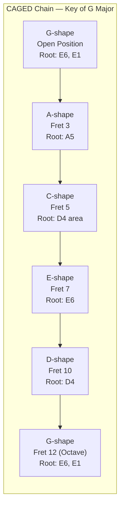
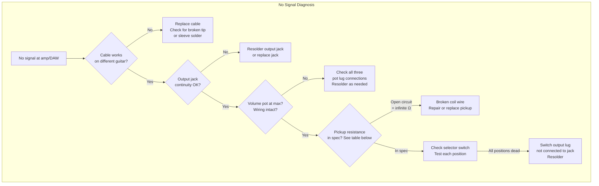
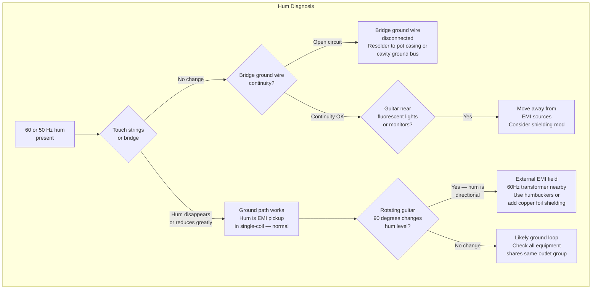

# Electric Guitar Masterclass: Signal Chain, Fretboard Mastery, and Performance Engineering

## Who This Is For and How to Use It

This guide is for the guitarist who wants to understand *why* everything works the way it does — not just follow instructions blindly. You'll move between the instrument in your hands, the electronics inside it, and the signal chain that shapes your tone. Every exercise is immediately playable or testable. The theory never exceeds what you need to make a better decision in the room.

Work through the exercises in order the first time. After that, treat each section as a reference you can drop into at any point.

**What you need:**

- Solid-body electric guitar (any pickup configuration)
- Amplifier (tube, solid-state, or modeled) *or* audio interface + amp sim (Neural DSP, BIAS FX 2, Guitar Rig 6, or free alternatives like Amplitube CS)
- DAW: Reaper (free evaluation), Ableton Live, Logic Pro, or GarageBand
- Spectrum analyzer: SPAN by Voxengo (free), Audacity, or iZotope RX
- Digital multimeter (any sub-$30 model works)
- Chromatic tuner (clip-on or pedal, ±1 cent accuracy)
- Metronome (phone app is fine; Tempo or Pro Metronome)
- Two instrument cables of different lengths (10 ft and 20 ft minimum)

---

## Module 1: The Fretboard as a System — CAGED, Intervals, and Spatial Thinking

Before touching the signal chain, you need to own the fretboard. The CAGED system is the most practical mental map available to guitarists because it converts the fretboard from a grid of 144 individual notes into five repeating shapes that your hands already know from open chords.

### 1.1 Why CAGED Works: Geometric Intervals on a Linear Neck

The guitar neck is an equal-temperament grid. Every fret is one semitone (one half-step), and the string tuning interval is a perfect fourth (5 semitones) between most strings — except B to G, which is a major third (4 semitones). This one asymmetry is the reason CAGED shapes look slightly different on each string set, and knowing it consciously prevents the confusion that makes players memorize shapes without understanding them.

The five CAGED shapes tile the neck without gaps or overlaps. Each shape derives from an open chord you already know. When you barre the nut with an imaginary capo, every open chord becomes movable.

```
Open E major chord shape → barre at fret 3 → G major
Open A major chord shape → barre at fret 2 → B major  
Open G major chord shape → barre at fret 5 → C major (partial voicing)
Open C major chord shape → barre at fret 3 → Eb major
Open D major chord shape → barre at fret 5 → G major (higher voicing)
```

The chain loops: E → D → C → A → G → E (cycling up the neck). Each shape connects to the next, so mastering the hand-off between shapes is as important as knowing the shapes themselves.

### 1.2 The Five Shapes in Full — Chord Voicings, Root Locations, and Fingering

For every shape below:
- **R** = Root note
- **3** = Major third
- **5** = Perfect fifth
- **X** = Muted string (do not sound)
- Fret numbers are relative to the shape's lowest root position

---

**E-Shape Barre Chord (Root on String 6)**

This is your workhorse barre chord. Full six-string voicing, root on the low E string.

```
           E  A  D  G  B  e
Fret X:    R  .  .  .  .  R    ← Index finger barres all six strings
Fret X+1:  .  .  .  .  5  .
Fret X+2:  .  R  R  .  .  .    ← Middle: A string; Ring: D string  
Fret X+3:  .  .  .  3  .  .    ← Pinky: G string
```

Practical example — G major (E-shape, fret 3):

```
e |---3---|
B |---3---|
G |---4---|  ← Pinky
D |---5---|  ← Ring
A |---5---|  ← Middle
E |---3---|  ← Index barre
```

Finger assignment:
- Index: barre fret 3, all 6 strings
- Middle: A string, fret 5
- Ring: D string, fret 5
- Pinky: G string, fret 4

**Common fingering error:** Players collapse the index barre at the B string. Solution — rotate the index finger slightly toward its bony edge (not the pad), and ensure your thumb is behind the middle finger, not creeping toward the headstock.

---

**A-Shape Barre Chord (Root on String 5)**

Root moves to the A string. Mute the low E with the tip of your index finger or let it lean over and touch it lightly.

```
           E  A  D  G  B  e
Fret X:    X  R  .  .  .  5    ← Index barre; E string muted
Fret X+1:  .  .  .  .  .  .
Fret X+2:  .  .  5  R  3  .    ← Ring finger barres D/G/B at X+2
                                   OR: Middle (D), Ring (G), Pinky (B)
```

Practical example — C major (A-shape, fret 3):

```
e |---3---|  (optional — often muted or allowed to ring as a 5th)
B |---5---|  ← Ring barre or Pinky
G |---5---|  ← Ring barre
D |---5---|  ← Ring barre
A |---3---|  ← Index barre
E |---X---|  (muted)
```

**Two valid fingering approaches:**
1. Mini-barre: Ring finger barres D, G, B at X+2 simultaneously. Efficient for fast changes.
2. Three-finger: Middle on D, Ring on G, Pinky on B. More control, easier to modify for minor/7th chords.

For A-shape minor, simply lift the note at X+2 on the B string — it disappears from the voicing naturally.

---

**D-Shape Barre Chord (Root on String 4)**

Highest pitched of the three primary shapes. Root on the D string. Low E and A are muted.

```
           E  A  D  G  B  e
Fret X+2:  .  .  R  .  R  .    ← Index barre covers G, B, e at X+2
Fret X+3:  .  .  .  .  3  .    ← Wait — see below
Fret X+4:  .  .  .  5  .  .    ← Middle finger: G string
Fret X+5:  .  R  .  .  .  .    ← This is now the A-shape position (linking shape)
```

Corrected practical layout — C major (D-shape, fret 10):

```
e |---10---|  ← Index barre
B |---10---|  ← Index barre  
G |---12---|  ← Ring finger (or Pinky)
D |---10---|  ← Index barre (D string root)
A |----X---|  (muted)
E |----X---|  (muted)
```

The D-shape is most useful as a 4-string partial chord (D, G, B, e). Don't force it to be a full 6-string voicing — it isn't designed for that.

---

**C-Shape Barre Chord (Root on String 5, open C voicing moved up)**

```
           E  A  D  G  B  e
Fret X:    .  .  .  R  3  5    ← Index barre if transposing (partial)
Fret X+1:  .  .  5  .  .  .    ← Middle: D string
Fret X+2:  .  .  .  .  .  .
Fret X+3:  3  R  .  .  .  .    ← Ring: E string; Pinky: A string
```

The C-shape is used most often as a upper-neck partial voicing or in jazz contexts for voice leading rather than as a full barre. Its wide stretch makes it physically demanding in lower positions.

---

**G-Shape Barre Chord (Root on String 6 and String 1)**

```
           E  A  D  G  B  e
Fret X:    R  .  .  .  .  R    ← Roots on strings 6 and 1
Fret X+1:  .  .  .  .  .  .
Fret X+2:  .  .  .  .  3  .    ← Ring finger (or barre B/e)
Fret X+3:  .  3  5  R  .  .    ← Middle: A; Index: stretches back (challenging)
```

In practice, the G-shape full barre is awkward. It sees most real-world use in its partial form (G, B, e strings only) or as a reference point for locating scale patterns in the upper register.

**Practical rule:** For most pop, rock, and blues playing, master E-shape and A-shape first to 100% fluency, then add D-shape partial voicings. C and G shapes pay dividends later in jazz and fusion contexts.

---

### 1.3 The CAGED Chain in Action — Linking Shapes Across the Neck

Here's how the five shapes connect for the key of G major, starting at the open position and moving up the neck:

```
Open    Fret 3   Fret 5   Fret 7    Fret 10   Fret 12
  G       G        G        G          G         G
(G-shp) (A-shp) (C-shp) (E-shp)   (D-shp)   (G-shp)
```



**Drill: Connect the Chain**

Set your metronome to 60 BPM. Play each shape as a whole chord (4 beats per shape), then transition to the next one with no pause. Your goal is smooth, clean transitions with every note ringing.

Progression: G-shape → A-shape → C-shape → E-shape → D-shape → E-shape → A-shape → G-shape (back down)

Metronome targets:
- 60 BPM — focus on clean, all notes ringing
- 80 BPM — maintain tone quality
- 100 BPM — fluid, relaxed transitions

---

### 1.4 Minor and Seventh Chord Variants Within Each Shape

You don't need five entirely new shapes for minor chords. Each CAGED shape has a minor modification — usually one note moves one fret.

**E-shape minor (Em-shape barre):**

```
e |---3---|  ← Index barre
B |---3---|  ← Index barre
G |---4---|  ← Middle finger (not Pinky — one fret lower than major)
D |---5---|  ← Ring
A |---5---|  ← Pinky
E |---3---|  ← Index barre
```

The major 3rd (G string Pinky in E major shape) drops one fret to become a minor 3rd. Everything else stays the same.

**A-shape minor (Am-shape barre):**

```
e |---3---|  ← open/muted
B |---5---|  ← Ring
G |---5---|  ← Middle
D |---5---|  ← No B-string note at X+2 — that was the major 3rd, now omitted
A |---3---|  ← Index barre
E |---X---|
```

Actually, simplest approach: A-shape minor = same as A-shape major but remove the finger on the B string (or barre only D and G with the ring finger, leaving B open to ring as a 5th — context-dependent).

**Dominant 7th modifications:**

E7-shape: Lift the ring finger (D string). The open D string was at X+2; now you fret one lower: D string at X+1 (using middle).

A7-shape: G string note drops one fret from X+2 to X+1 to create the minor 7th interval.

---

### 1.5 Chord Transition Mechanics and Practice Drills

**The pivot finger principle:** When two adjacent chords share one or more notes on the same fret and string, keep those fingers planted. They become pivot fingers. The remaining fingers move around them.

Example — Am to C major:
- Am: Index on B string fret 1, Middle on D string fret 2, Ring on G string fret 2
- C major: Middle on D string fret 2 (stays!), Ring on A string fret 3, Index on B string fret 1 (stays!)
- Only the Ring finger moves (D string → A string)

**The guide finger principle:** When transitioning between shapes that don't share exact notes, keep one finger lightly touching a string throughout the transition to maintain positional orientation. It slides along the string without pressing down during the move, then lands cleanly at the new position.

**Practice Drill — Four-Chord Workout**

Chord progression: G major (E-shape fret 3) → C major (A-shape fret 3) → D major (A-shape fret 5) → Em (E-shape fret 7)

```
Bar:  1        2        3        4
      G        C        D        Em
Strum: ↓ ↓ ↑ ↑ ↓ ↑  (each bar, repeat)
```

Metronome targets:
- 60 BPM — analyze each transition: where does finger movement start? Make it late (last 20% of previous chord's duration)
- 80 BPM — ghost shifting: begin moving toward new position during the strum before the change
- 100 BPM — the transition should be inaudible; no clicks, buzzes, or dead strings
- 120 BPM — goal tempo for performance-ready

---

## Module 2: Picking Mechanics, Strumming Patterns, and Rhythmic Control

### 2.1 Pick Ergonomics and Slant Mechanics

The pick should sit between the pad of the thumb and the side of the index finger's first segment — not the fingertip. The tip of the pick extends no more than 3–5 mm past the fingers. More extension = more flex and loss of control.

**Pick slant:** This is the angle of the pick relative to the string plane.
- **Downward pick slant (DPS):** Pick tip angled toward the floor. Favors downstroke exit and string hopping. Good for single-string lead lines moving to lower strings.
- **Upward pick slant (UPS):** Pick tip angled toward the ceiling. Favors upstroke exit. Good for lines moving to higher strings.
- **Neutral/flat:** Pick parallel to strings. Good for strumming. Requires deliberate escape on string changes.

**Economy picking vs. alternate picking:**

Economy (or sweep) picking follows the direction of string change — if moving from E to A string, use a downstroke for both. This eliminates the inefficient "trapped" pick problem. Used heavily in jazz, shred, and country chicken picking.

Alternate picking (strict down-up-down-up) is metronomically even and builds consistent timing at the cost of requiring deliberate escape strokes on string changes.

For rhythm playing: use a neutral slant with relaxed wrist rotation.
For lead lines: develop both and choose based on the phrase direction.

**Pick material and thickness — practical guide:**

| Thickness | Feel | Tonal Character | Best For |
|-----------|------|-----------------|----------|
| 0.46–0.60 mm (thin) | Flexible, bendy | Bright attack, airy | Acoustic-style strumming, light fingerstyle hybrid |
| 0.60–0.88 mm (medium) | Slight give | Balanced, present | All-around, rock rhythm |
| 0.88–1.14 mm (heavy) | Stiff | Full fundamental, defined | Lead, single-note lines |
| 1.14–3.0 mm (extra heavy) | Rigid | Maximum articulation | Jazz, prog, shred |

The pick thickness affects the attack transient: thinner picks produce a broader, snap-like attack with more high-frequency content. Thicker picks produce a tighter, more fundamental-dominant attack.

---

### 2.2 Strumming Mechanics — Wrist vs. Arm Motion

**Common error:** New players strum from the elbow, treating the entire forearm as the pendulum. This fatigues quickly and kills dynamic control.

**Correct mechanics:**
- The elbow anchor point stays relatively fixed (resting on the guitar body or floating just above it).
- The strumming motion comes from wrist rotation — the same movement as turning a doorknob.
- On downstrokes, the wrist leads slightly ahead of the pick.
- On upstrokes, the wrist rotates back, and the pick grazes the strings lightly.

**Dynamic control:** Upstrokes should naturally be 2–4 dB softer than downstrokes when strumming chords. This creates the micro-dynamics that make rhythm guitar feel alive rather than mechanical. When you want an accented upstroke (reggae, ska), consciously add wrist snap to match downstroke velocity.

---

### 2.3 Strumming Pattern Library — Notation and Execution

**Symbol legend:**

```
↓  = Downstroke (full or partial)
↑  = Upstroke
×  = Muted strum (palm mute across all strings, or fret-hand mute)
(↓) = Ghost strum (keep wrist moving, pick doesn't contact strings — maintains rhythm)
```

**Keep the wrist moving constantly.** The key to clean strumming patterns is treating the wrist as a metronome. Even when a strum is "missing" from a pattern, your wrist continues the motion — just the pick doesn't make contact. This is the ghost strum principle.

---

**Pattern 1: Basic Folk/Pop (4/4, quarter notes)**

```
Beat:   1    2    3    4
        ↓    ↓    ↓    ↓
```

Metronome: 70 → 100 BPM. Accent beats 2 and 4 (backbeat). Practice with closed eyes after learning — listen for even spacing.

---

**Pattern 2: Standard Rock Eighth-Note Pattern**

```
Beat:   1    &    2    &    3    &    4    &
        ↓    ↑    ↓    ↑    ↓    ↑    ↓    ↑
```

Metronome: 60 → 120 BPM. The upstrokes should catch only the top 3–4 strings (G, B, e), not drag all the way through. This creates natural brightness contrast.

---

**Pattern 3: Common Pop Syncopated Pattern**

```
Beat:   1    &    2    &    3    &    4    &
        ↓   (↑)   ↓    ↑   (↓)   ↑    ↓    ↑
```

The parentheses are ghost strums — wrist moves, pick misses strings. This pattern underlies countless pop songs (Jack Johnson, John Mayer, Ed Sheeran acoustic style).

Metronome: 70 BPM learning tempo → 90–100 BPM target.

---

**Pattern 4: Reggae/Ska Upstroke Pattern**

```
Beat:   1    &    2    &    3    &    4    &
       (↓)   ↑   (↓)   ↑   (↓)   ↑   (↓)   ↑
```

Only upstrokes land. Downstrokes are ghost strums. Upstrokes are sharp and staccato — fret hand mutes immediately after each upstroke hit. This creates the characteristic chop.

Metronome: 80 BPM. Practice the staccato mute independently before adding the pattern.

---

**Pattern 5: Sixteenth-Note Funk Pattern**

```
Beat:   1  e  &  a   2  e  &  a   3  e  &  a   4  e  &  a
        ↓  ×  ↑  ↓   ×  ↑  ×  ↓   ↑  ×  ↓  ×   ↑  ↓  ×  ↑
```

The × marks are palm-muted or fret-hand muted percussive hits. The rhythm should feel like a groove, not a mechanical exercise. Accent the downbeats (1 and 3) and the "and" of 2 and 4 for funk feel.

Metronome: Start at 60 BPM treating each sixteenth as a beat (effectively 15 BPM tempo for the full bar). Build to 80 BPM actual tempo.

---

### 2.4 Fingerstyle Fundamentals — Travis Picking

Travis picking (alternating thumb bass + independent finger melody) is the foundation of country, folk, and acoustic fingerstyle. It applies directly to electric guitar for clean tone playing.

**Hand setup:**
- Thumb (p): handles bass strings (E, A, D — usually alternating E and A or A and D)
- Index finger (i): G string
- Middle finger (m): B string
- Ring finger (a): high e string
- Rest the heel of your hand lightly on the saddles for a slight palm mute on bass notes (optional — creates a "thump" quality)

**Basic Travis Pattern (4/4):**

```
Beat:    1    &    2    &    3    &    4    &
Thumb:   p         p         p         p
Fingers:      i         m         i         m
```

Played simultaneously or arpeggio: thumb hits the downbeat bass note, fingers alternate on the upbeats.

**On a G chord (open position):**

```
Beat:    1    &    2    &    3    &    4    &
String:  E6        G3        A5        G3
              B2        B2        B2        B2
```

Add melody variations by changing which finger note lands on the "2" and "4" beats.

Metronome: 60 BPM one-string-at-a-time drilling, then 50 BPM integrating the full pattern → 80 BPM target → 100 BPM for musical application.

---

## Module 3: Electromagnetic Transduction and the Passive Signal Chain

### 3.1 How Pickups Work — Practical Physics

A pickup is a coil of fine wire (AWG 42–44) wound thousands of times around a magnetic core (the pole pieces). The strings, being ferromagnetic, are magnetized by the pickup's permanent magnet. When a string vibrates, it disturbs the magnetic field around the coil. That changing magnetic flux induces a small voltage in the coil — this is Faraday's law at work.

**What matters practically:**

The induced voltage is proportional to string *velocity* (rate of change of displacement), not displacement itself. This is why the attack transient — when string velocity is highest right after the pluck — produces the loudest, most harmonically rich signal. As the string loses energy and velocity decreases, the signal rolls off.

String velocity is greatest at the midpoint between nut and bridge. The pickup's position on the body determines which part of the string's motion it captures:

- **Neck pickup** sits under high-displacement, lower-velocity motion → strong fundamental, warm and full
- **Bridge pickup** sits near the saddle where displacement is small but velocity changes rapidly → bright, cutting, harmonically complex
- **Middle pickup** (Strat HSS or SSS) captures a balance point between both extremes

**Output signal levels by position:**

| Pickup Position | Typical Peak Output | Dominant Frequency Range |
|----------------|---------------------|--------------------------|
| Bridge (single-coil) | 100–300 mV p-p | 2–5 kHz emphasized |
| Middle (single-coil) | 120–350 mV p-p | Balanced, mild cut ~2.5 kHz |
| Neck (single-coil) | 150–400 mV p-p | 200 Hz – 1 kHz emphasized |
| Bridge (humbucker) | 300–600 mV p-p | Balanced, reduced above 3 kHz |
| Neck (humbucker) | 400–800 mV p-p | Warm, 100 Hz – 800 Hz |

**Humbucker vs. single-coil:** A humbucker is two coils wound in opposite directions and wired out of phase with each other. External electromagnetic interference (60/50 Hz hum) couples equally to both coils and cancels out. The guitar signal, coming from string vibration on the pole pieces, doesn't cancel because each coil's pole pieces are under different strings. The result: hum cancellation without signal cancellation. The trade-off is higher inductance (4–10 H vs. 2–3.5 H for single-coils), which rolls off high frequencies faster.

---

### 3.2 Signal Chain Topology — From String to Speaker

```mermaid
graph LR
    subgraph sub_guitar ["Inside the Guitar"]
        A["Vibrating String\n(Ferromagnetic steel)"] --> B["Pickup Coil\n5k–10k turns AWG 42"]
        B --> C["Volume Pot\n250kΩ or 500kΩ\naudio taper"]
        C --> D["Tone Circuit\nRC Low-Pass Filter\n0.022–0.047 µF cap"]
        D --> E["Output Jack\n1/4 inch TS"]
    end

    subgraph sub_cable ["Passive Cable"]
        F["Instrument Cable\n20–100 pF/ft\nforms LPF with pickup Z"]
    end

    subgraph sub_amp ["Amplifier / Interface"]
        G["Amp Input\n470kΩ–1MΩ impedance\nloads pickup resonance"]
        G --> H["Preamp / Gain Stage\nClean or clipping"]
        H --> I["EQ / Tone Stack\nPassive or active"]
        I --> J["Power Amp / DAW"]
    end

    E --> F --> G

    style A fill:#d4e8ff
    style B fill:#fff4cc
    style D fill:#ffd4d4
    style F fill:#e8e8e8
    style G fill:#d4ffd4
    style J fill:#d4ffd4
```



---

### 3.3 Volume and Tone Controls — What They Actually Do

**Volume control:** A 250 kΩ or 500 kΩ potentiometer wired as a voltage divider between the pickup output and ground. At full (10), all signal passes. As you reduce it, the pot's resistance divides the signal — but it also loads the pickup's inductive impedance, creating a resonant filter interaction. Rolling volume back changes your tone, not just your loudness. The standard fix for preserving tone at lower volumes is a **treble bleed circuit**: a small capacitor (typically 0.001 µF) in parallel with a 100–150 kΩ resistor placed across the volume pot. This creates a high-pass path that counteracts the capacitive loading.

**250 kΩ vs. 500 kΩ pots:** Single-coil pickups use 250 kΩ because the lower load damps the pickup's resonant peak slightly, taming harshness. Humbuckers use 500 kΩ to preserve their high-frequency content. Installing 500 kΩ pots on a Strat makes it brighter and more aggressive — legitimate mod choice, not a mistake.

**Tone control:** A capacitor in series with a potentiometer, wired to ground. This creates a variable low-pass filter. As you turn the pot down, more capacitive loading is applied to the signal path, progressively rolling off high frequencies.

The cap value determines *how much* treble gets rolled off:
- 0.022 µF: Rolls off highs more aggressively; less cap = brighter tone sweep (most Fenders)
- 0.047 µF: Wider frequency sweep; Gibsons, warmer character
- 0.015 µF: Brighter still; boutique mod for single-coils

**Measuring the effect yourself:**

1. Connect guitar to audio interface. No processing on the input.
2. Record 10 open-string plucks (E string) at tone knob position 10.
3. Repeat at positions 7, 5, 3, and 0.
4. Open each recording in SPAN or Audacity. Set FFT size to 4096, Hann window.
5. Compare the high-frequency shelf — you'll see it progressively dropping above 1–4 kHz.

---

### 3.4 Cable Capacitance and Tone Degradation

Instrument cables have distributed capacitance — typically 20–100 picofarads per foot depending on cable quality. This capacitance, combined with the pickup's output inductance, forms an RLC resonant circuit. The practical consequences:

- Longer cables shift the resonant peak downward (darker tone)
- Higher-capacitance cables do the same
- The resonant peak itself can add a mid-presence emphasis (some players love this)

**Practical test:**

Record the same chord stab with a 10-foot cable, then a 20-foot cable, then a 30-foot cable (if available). Compare FFT plots. The high-frequency roll-off shift will be audible and visible in the analyzer — typically the 3 dB point drops 1–2 kHz between cable lengths.

**If you're running more than 20 feet of cable:** Use a low-impedance buffer at the guitar output. An active DI box, a true-bypass looper with a buffer, or any pedal with a good input buffer (Boss TU-3 tuner, for example) will re-drive the signal at low impedance, making it cable-length immune downstream.

---

### 3.5 Pickup Height Adjustment — Dialing In Output and Clarity

Pickup height directly affects output level, tone, and intonation. Too close to the strings: high output but magnetic pull on the string disrupts vibration, causing intonation errors and "wolf note" sustain anomalies. Too far: weak output, thin tone.

**Starting reference heights (measured from string underside to pole piece top, fretted at the highest fret):**

| Pickup Type | Bass Side (Low E) | Treble Side (High e) |
|-------------|-------------------|----------------------|
| Single-coil (bridge) | 2.0–2.5 mm | 1.5–2.0 mm |
| Single-coil (neck) | 2.5–3.0 mm | 2.0–2.5 mm |
| Humbucker (bridge) | 2.5–3.0 mm | 2.0–2.5 mm |
| Humbucker (neck) | 3.0–3.5 mm | 2.5–3.0 mm |

**Procedure:**

1. Fret the low E string at the last fret (22nd or 24th). This takes the spring tension out of the neck.
2. Measure distance from the low E string's underside to the low E pole piece.
3. Adjust pickup mounting screws (clockwise = up) to reach target height.
4. Repeat for the high e string side.
5. Play each string from open to 12th fret and listen for sustain evenness. If notes around fret 12–15 on the wound strings sustain poorly or go sharp, back the pickup away from the strings.

---

## Module 4: Distortion, Saturation, and Amp Sim Configuration

### 4.1 Clipping Physics — Why Distortion Sounds Musical

An amplifier's output is linear only within a certain voltage range. When input signal exceeds that range, the output can't follow — it gets clipped. The clipping introduces harmonics that weren't in the original signal.

**Soft clipping (tube amplifiers, most overdrive pedals):** The transition from linear to clipped is gradual, introducing both odd and even harmonics. Even harmonics (2nd, 4th) are perceived as musical and warm because they correspond to octave and fifth relationships. This is why a cranked tube amp sounds "sweet" rather than harsh.

**Hard clipping (most solid-state high-gain circuits, fuzz):** The transition is abrupt, introducing predominantly odd harmonics (3rd, 5th, 7th). Odd harmonics at high amplitudes create the aggressive, buzzy character of metal distortion and classic fuzz tones.

**Stacking distortion:** A Tube Screamer (or any overdrive) placed before an amp is not adding distortion — it's doing two things:
1. Boosting the mid-range (the TS peaks around 720 Hz), giving the amp input a shaped signal
2. Raising the signal level so the amp's input stage hits its clipping point sooner and more consistently

The amp is still doing most of the distortion character work. The overdrive pedal is a launch ramp that determines where the amp clips.

---

### 4.2 Amp Sim Configuration — Neural DSP, BIAS FX 2, Guitar Rig

The fundamental settings that most impact tone:

**Input gain (preamp gain):** Controls how hard you're driving the first gain stage. For clean tones, keep this where the signal just barely clips on strong strums. For crunch, push it into soft clipping. For high gain, stack it.

**EQ (tone stack):** Most amp sims model passive Baxandall or James/Marshall EQ topologies. These are interactive — boosting bass can appear to cut mids even with the mid knob unchanged. Set EQ flat first (noon on all knobs), then sculpt by ear starting with the most problematic frequency.

**Master volume:** On real amps, master volume controls output stage drive. In sims, it usually scales overall output level without affecting tone significantly — but good models will add subtle power amp saturation at high settings.

**Recommended starting settings for three common tones:**

*Clean, Fender-style:*
```
Amp:    Blackface Deluxe or Twin model
Gain:   2–3 (just below breakup)
Bass:   5, Mid: 4, Treble: 6
Master: 7
Reverb: 2–3 (spring)
```

*Classic rock crunch, Marshall-style:*
```
Amp:    Plexi 1959 or JCM800 model
Gain:   5–6 (preamp crunch)
Bass:   5, Mid: 7, Treble: 6
Presence: 6
Master: 7
```

*High-gain modern metal:*
```
Amp:    Recto, Diezel, or EVH model
Gain:   7–8
Bass:   4 (avoid mud), Mid: 5–6, Treble: 7
Presence: 5–6
Noise Gate: threshold -30 dBFS, attack fast, release medium
```

---

### 4.3 Effects Chain Order — The Complete Signal Flow

Order matters fundamentally, not cosmetically. Here's why each placement decision exists:

```mermaid
graph LR
    subgraph sub_preamp_chain ["Pre-Amp Signal Chain"]
        A["Guitar\n(High-Z, 100–800mV)"] --> B["Tuner\nBuffered bypass\nimpedance first"]
        B --> C["Wah / Filter\nFreq sweep best pre-dirt"]
        C --> D["Compressor\nDynamics before distortion\n= sustained, even drive"]
        D --> E["Overdrive / Distortion\nNonlinear waveshaping"]
        E --> F["EQ (pre-amp)\nSculpt signal entering amp"]
    end

    subgraph sub_amp ["Amplifier Stage"]
        G["Amp Preamp"] --> H["Amp Power Stage\n(Sat/Clean)"]
    end

    subgraph sub_postamp ["Post-Amp / FX Loop"]
        I["Modulation\nChorus, Flanger, Phaser\npost-dirt = clear sweep"]
        I --> J["Delay\nTime repeats of\nfull processed signal"]
        J --> K["Reverb\nSpatial envelope last\nin chain always"]
    end

    F --> G
    H --> I

    style A fill:#d4e8ff
    style E fill:#ffd4d4
    style G fill:#fff4cc
    style K fill:#d4ffd4
```



**The three rules that explain the order:**

1. **Dynamics before distortion.** A compressor before an overdrive sustains your signal into the clipping zone, creating long, even saturation. After distortion, a compressor clamps the already-clipped signal, killing sustain and potentially causing pumping artifacts. Exception: some players deliberately use a compressor after dirt for a tighter, punchier feel — it's valid but changes the character significantly.

2. **Pitch/frequency shifting before distortion.** Wah, octave pedals, and envelope filters work on the guitar's clean harmonic content. If you run them after distortion, the complex distorted harmonics confuse the tracking and smear the effect.

3. **Time-based effects last (or in effects loop).** Delay and reverb should process the fully-formed, fully-distorted signal as a unit. Putting delay before distortion means each delay repeat gets distorted — this can create an intentionally washy, noisy texture, but it's not the standard. Reverb before dirt creates an indistinct, muddy wash.

---

### 4.4 DAW Recording Configuration

**Interface settings for real-time guitar monitoring:**

| Application | Sample Rate | Bit Depth | Buffer Size | Round-Trip Latency |
|-------------|-------------|-----------|-------------|-------------------|
| Live amp sim monitoring | 48 kHz | 24-bit | 64–128 samples | 3–6 ms (target) |
| Tracking with plugins | 48 kHz | 24-bit | 128–256 samples | 6–12 ms |
| Mixing/non-realtime | 48 kHz or 96 kHz | 24-bit | 512–1024 samples | Irrelevant |

**Latency > 12 ms feels wrong.** It disrupts the physical feedback loop between your pick attack and what you hear. If your interface can't get below 12 ms round-trip at your current buffer size, switch to hardware monitoring (listen to the direct signal from the interface's monitor mix, not the DAW output) while tracking.

**Input level targets:**

- Peak signal on hard strums: **–12 to –6 dBFS**
- Average level during playing: **–18 to –12 dBFS**
- Noise floor (strings damped, no playing): **below –60 dBFS**

If you're hitting 0 dBFS or clipping the input stage, reduce the interface's input gain — not the guitar's volume knob (that changes your tone and pickup loading).

---

## Module 5: Systematic Troubleshooting — Faults, Diagnosis, and Repair

### 5.1 Troubleshooting Philosophy

Work systematically from source to destination. Every symptom has a small number of likely causes. Eliminate the simplest and most accessible first. Avoid replacing components blindly — measure first, replace only after confirming the measurement is out of spec.

**The substitution rule:** When in doubt, substitute a known-good component (a different cable, a different guitar, a different amp) to isolate which part of the chain has the problem. This is faster than metering every joint before you know which sub-system is failing.

---

### 5.2 Diagnostic Decision Trees

**Symptom: No signal at all**



**Symptom: Excessive 60/50 Hz hum**



**Symptom: Intermittent signal (cutting in and out)**

1. Wiggle cable at guitar end while playing → dropout? Replace cable or resolder jack.
2. Wiggle cable at amp end → dropout? Clean or replace amp input jack.
3. Move pickup selector switch back and forth → dropout? Clean with contact cleaner (DeoxIT D5) or replace switch.
4. Squeeze guitar body near control cavity → dropout? Cold solder joint inside; open cavity and inspect.
5. Turn volume or tone pot → crackling? Dirty pot track; apply contact cleaner to pot shaft, rotate 20 times. Replace if crackling persists.

**Symptom: Weak/thin tone**

1. Measure pickup resistance (procedure below). Open circuit or significantly low resistance = coil fault.
2. Check pickup height — below 4 mm on the bass side is likely too far for most single-coils.
3. Verify correct pot values: 500 kΩ for humbuckers, 250 kΩ for single-coils. Cross-matched values alter tonal character.
4. Test with 10 ft cable vs. 20 ft cable — if the shorter cable restores high end, your 20 ft cable's capacitance is loading the signal excessively.

---

### 5.3 Resistance Measurement Procedure

1. Disconnect guitar from all cables.
2. Set multimeter to resistance (Ω) mode — 20 kΩ range.
3. Unsolder the pickup's hot wire from the volume pot's input lug (or use the selector switch to route only that pickup to the output).
4. Touch probes to: pickup hot wire (+) and pickup ground (−).
5. Compare to spec:

| Pickup Type | Normal DC Resistance | Fault Indicators |
|-------------|---------------------|-----------------|
| Strat single-coil | 5.6 – 7.5 kΩ | >100 kΩ = open coil; <1 kΩ = short |
| Tele bridge single-coil | 6.0 – 8.5 kΩ | Same thresholds |
| P-90 | 7.5 – 9.5 kΩ | Same thresholds |
| PAF-style humbucker | 7.0 – 9.0 kΩ | Same thresholds |
| Hot-rod humbucker | 12.0 – 18.0 kΩ | >40 kΩ suspicious |

Note: DC resistance doesn't tell you *everything* about a pickup's health. A coil can test within normal resistance range but have a partial short across some windings (turns-short). Turns-shorts show up as reduced output with normal resistance. Confirm with output level comparison to a known-good reference pickup if resistance is in spec but output seems weak.

---

### 5.4 Solder Joint Quality — What Good vs. Bad Looks Like

A good solder joint:
- **Appearance:** Shiny, smooth, volcano-cone or concave fillet shape
- **Probe test:** Firm, doesn't flex or crack when poked with a toothpick
- **Resistance:** <0.1 Ω continuity

A cold (bad) solder joint:
- **Appearance:** Dull, grainy, gray surface texture, often balled up or convex
- **Symptom:** Intermittent signal, crackling when guitar is handled
- **Cause:** Moving the joint before solder solidified, insufficient heat, or oxidized surfaces

**Rework procedure:**

1. Clean the iron tip with brass wool (not wet sponge — thermal shock reduces tip life).
2. Set temperature: 300–340°C for lead-free solder (Sn96.5/Ag3/Cu0.5); 310–325°C for 60/40 tin-lead.
3. Heat the joint pad *and* the wire simultaneously — the solder flows to the heat, not the iron.
4. Apply rosin-core solder (63/37 or 60/40 for easiest flow) — avoid acid-core (plumbing) solder.
5. Remove iron, hold joint completely still for 3–5 seconds while solder solidifies.
6. Inspect: shiny, smooth, no gaps, wire not moving relative to pad.

---

### 5.5 Cavity Shielding — Hum Reduction Mod

If your single-coil guitar has persistent hum even with strings grounded, adding copper foil shielding to the control cavity reduces EMI pickup dramatically.

**Materials:** Copper foil tape with conductive adhesive (not plain aluminum HVAC tape — it doesn't conduct through the adhesive). Available at most guitar parts suppliers or hardware stores.

**Procedure:**

1. Remove all controls and pickguard/cavity cover.
2. Cut foil pieces to fit the cavity walls and floor. Overlap pieces by 5 mm minimum to ensure electrical continuity.
3. Press foil firmly to all surfaces including the pickup cavities if accessible.
4. Test conductivity: touch multimeter probes to two foil sections — should read <1 Ω.
5. Connect the foil ground to the existing ground bus (pot casing, common ground wire) with a short wire soldered to the foil.
6. Reinstall controls. The foil cage creates a Faraday shielding effect around the internal wiring, dramatically reducing hum coupling from external EMI fields.

---

## Module 6: Essential Scales, Riffs, and Practice Structures

### 6.1 The Pentatonic Box — Your First Lead Framework

The minor pentatonic scale is the foundation of blues, rock, and lead guitar. Five notes per octave, arranged in five box positions that map directly onto the CAGED system positions.

**Position 1 (the "home box") — A minor pentatonic at fret 5:**

```
e |---5---8---|
B |---5---8---|
G |---5---7---|
D |---5---7---|
A |---5---7---|
E |---5---8---|
```

Fingering: Index on fret 5, Pinky on fret 8 (or Ring on fret 7 for the middle notes).

Scale degrees: Root – Minor 3rd – 4th – 5th – Minor 7th (then repeat up the octave).

**Three essential patterns to drill from Position 1:**

*Pattern A — Ascending/Descending (technique builder):*
```
E string:  5 – 8
A string:  5 – 7
D string:  5 – 7
G string:  5 – 7
B string:  5 – 8
e string:  5 – 8 (then descend back down)
```
Metronome: 60 BPM with strict alternate picking → 80 → 100 → 120 BPM.

*Pattern B — Cross-String Lick (phrasing builder):*
```
e string:  8 – 5 (pull-off)
B string:  8 – 5 (pull-off)
G string:  7 – 5 (pull-off)
Repeat from top
```
Add a final bend: fret 7 on the G string, bend up one whole step (to the equivalent of fret 9 pitch), hold two beats, release.

*Pattern C — Classic Blues Ending Lick:*
```
Fret:   5    8    5    7    5    7    5
String: B    B    B    G    G    A    A
Pick:   ↓    ↑    ↓    ↑    ↓    ↑    ↓
```
Metronome: 70 BPM clean, with slight swing feel → 90 BPM.

---

### 6.2 String Bending Mechanics and Intonation

Bending is a core expressive technique — it's the guitar's equivalent of vocal vibrato and portamento.

**Proper bend mechanics:**
- Use the ring finger to execute most bends (strongest leverage).
- Support the ring finger with the middle and index fingers behind it on the same string — all three fingers push together. Using only the ring finger alone is a common beginner error that leads to weak bends and finger fatigue.
- The motion comes from rotating the wrist toward the headstock (for upward bends on the lower three strings), not just pushing the finger sideways.
- Anchor the thumb over the top of the neck (or hook it around the low E side) for leverage.

**Whole step (two-fret) bend on G string, 7th fret (Am pentatonic Position 1):**

This takes the G (note at fret 7) up to A (the equivalent of fret 9). How you know it's in tune: fret the same string at the 9th fret without bending — that's your pitch target. Bend up to match it by ear before playing the lick.

**Half-step bend:** One fret up. Used for the blues note (b5) color and for subtle country expression.

**Pre-bend:** Bend the note before plucking, then release. The audience hears the note come down instead of going up — mysterious, vocal quality.

**Vibrato after bend:** After reaching the top of a bend, add vibrato by repeatedly slightly releasing and re-bending within a narrow range (about 1/4 to 1/3 of the full bend). The rhythm of the vibrato should match the tempo of the music.

---

### 6.3 Power Chord Riff Vocabulary

Power chords (5th interval — Root + 5th, optionally doubled root) are the vocabulary of rock. They're not "simplified" chords — they're harmonically ambiguous (neither major nor minor) and cut through distortion without muddiness.

**Two-string power chord:**
```
E5 at open position:
E |---0---|
A |---2---|  ← Middle finger
D |---2---|  ← Ring finger (optional — adds low octave doubling)
```

**Movable power chord shape (root on E string):**
```
        E  A  D
Fret X: R  .  .
X+2:    .  5  R    ← Middle (A) and Ring (D) fingers
                      OR Ring (A) and Pinky (D) for more independence
```

**Classic rock riff framework — E blues progression:**

```
Tempo: 120 BPM, straight eighth feel

Bar 1–2:  E5  (E string open or fret 0+2)
Bar 3–4:  A5  (fret 5 on E string shape, OR: open A with power shape)
Bar 5:    B5  (fret 7 on E string shape)
Bar 6:    A5
Bar 7–8:  E5

Strum pattern: ↓ ↓ × ↓ × ↓ × ↓   (eighth note grid, × = palm mute)
```

Metronome progression: Start at 80 BPM for clean execution → 100 BPM → 120 BPM performance tempo.

---

### 6.4 Structured Practice Session Design

A 30-minute daily practice session, organized for maximum retention:

```
0:00–5:00    Warm-up
             Chromatic exercise: 1-2-3-4 on each string, all positions
             Slow tempo (60 BPM), no musical content — purely mechanical
             Focus: hand position, relaxed grip

5:00–10:00   Technique drill (rotating focus)
             Week 1: CAGED chord transitions (Module 1 drills)
             Week 2: Picking mechanics and scale runs (Module 6.1)
             Week 3: Bending and vibrato (Module 6.2)
             Week 4: Strumming patterns (Module 2)

10:00–20:00  Applied playing
             Work on a specific song, riff, or chord progression
             Use a metronome; start 20 BPM below comfortable tempo
             Record yourself — even just on phone — and listen back

20:00–28:00  Sight-reading or ear training
             Pick up a chord chart or lead sheet you haven't played before
             Or: listen to a chord progression and try to identify the shapes by ear

28:00–30:00  Free play / enjoyment
             No metronome, no targets — just play for fun
             This consolidates the session's work and maintains motivation
```

**The 80% rule for tempo:** When you can play something cleanly 8 out of 10 times at a given tempo, increase by 5 BPM. Chasing 100% perfection at a low tempo before advancing is slower than incremental progressive overload.

---

## Module 7: Reference Tables and Quick Guides

### 7.1 Pickup Specifications

| Parameter | Single-Coil | P-90 | Humbucker | High-Output HB |
|-----------|-------------|------|-----------|----------------|
| DC Resistance | 5.5–7.5 kΩ | 7.5–9.5 kΩ | 7–9 kΩ | 12–18 kΩ |
| Inductance | 2–3.5 H | 4–5 H | 4–10 H | 8–12 H |
| Resonant Peak | 3–5 kHz | 2–4 kHz | 1.5–3 kHz | 1–2 kHz |
| Output (p-p) | 100–400 mV | 200–500 mV | 300–600 mV | 500–900 mV |
| Vol Pot (ideal) | 250 kΩ | 250–500 kΩ | 500 kΩ | 500 kΩ |

### 7.2 Passive Component Reference

| Component | Value | Purpose |
|-----------|-------|---------|
| Vol pot, single-coil | 250 kΩ audio taper | Signal attenuation |
| Vol pot, humbucker | 500 kΩ audio taper | Signal attenuation |
| Tone pot | 250–500 kΩ | LPF frequency range |
| Tone cap (bright) | 0.022 µF | High-cut filter |
| Tone cap (warm) | 0.047 µF | Wider treble roll-off |
| Treble bleed cap | 0.001 µF | Preserve highs at low vol |
| Treble bleed resistor | 100–150 kΩ | Pairs with treble bleed cap |

### 7.3 Signal Levels in DAW

| Level | Meaning | Action |
|-------|---------|--------|
| 0 dBFS | Digital ceiling | Never let signal reach this |
| –6 dBFS | Hot peak | Maximum acceptable transient |
| –12 dBFS | Healthy peak | Good lead guitar recording level |
| –18 dBFS | Moderate | Rhythm guitar, leaves headroom |
| –40 dBFS | Quiet | Should hear clearly above noise |
| –60 dBFS | Near noise floor | Acceptable silent passage floor |

### 7.4 Audio Interface Settings

| Use Case | Sample Rate | Buffer | Expected Latency |
|----------|-------------|--------|-----------------|
| Amp sim monitoring | 48 kHz | 64–128 samples | 3–6 ms |
| Tracking with FX | 48 kHz | 128–256 samples | 6–12 ms |
| Overdubbing | 48 kHz | 256 samples | ~10 ms |
| Mixing | 48 kHz | 512–1024 samples | Irrelevant |

### 7.5 Guitar Maintenance Schedule

**After every session:**
- Wipe down strings with microfiber cloth (extends string life 2–3×)
- Wipe down neck and body
- Check tuning before putting away

**Monthly:**
- Clean fretboard: rosewood/ebony — few drops of lemon oil, buff dry; maple — dry cloth only
- Check bridge saddle intonation (compare fretted 12th fret to 12th fret harmonic — should match within ±1 cent)
- Clean output jack with contact cleaner spray into the jack while cycling a plug in and out

**Every 3–6 months:**
- Replace strings (or when they lose brightness, feel rough, or won't intonate)
- Truss rod check: sight down the neck from headstock looking for excessive forward bow (relief) or back-bow. For electric: 0.2–0.4 mm of relief at the 7th fret (capo at 1st, fret at last fret, measure gap at 7th) is normal.
- Pickup height verification (see Module 3.5)

**Annually:**
- Full inspect all solder joints inside cavity — look for cold joints, loose wires
- Check all nut slots (strings should not bind when tuning — if they ping and jump in pitch, the nut slot needs lubrication: graphite from a pencil, or Teflon-based nut sauce)
- Check tuning machine screw tightness

### 7.6 CAGED Chord Quick Reference

**Key of A major — all five shapes across the neck:**

```
Shape      Root Fret   Notes
---------  ----------  ----------------
A-shape    Open (0)    Open A chord
C-shape    Fret 2      Stretch position
E-shape    Fret 5      Root: E string fret 5
G-shape    Fret 7      Root: E string fret 7
D-shape    Fret 9      Root: D string fret 9
A-shape    Fret 12     Octave repeat
```

**Minor chord modifications from major shapes:**

| Shape | Major → Minor Change |
|-------|---------------------|
| E-shape | Drop G string note 1 fret (Pinky → Ring) |
| A-shape | Remove B string note (or drop 1 fret) |
| D-shape | Drop B string note 1 fret |
| C-shape | Drop G string note 1 fret |
| G-shape | Drop B string note 1 fret |

### 7.7 Common Strumming Patterns Reference

```
Legend: ↓=down  ↑=up  ×=muted  ( )=ghost strum

Quarter-note (beginner):
1    2    3    4
↓    ↓    ↓    ↓

Basic eighth-note (rock):
1    &    2    &    3    &    4    &
↓    ↑    ↓    ↑    ↓    ↑    ↓    ↑

Syncopated pop:
1    &    2    &    3    &    4    &
↓   (↑)   ↓    ↑   (↓)   ↑    ↓    ↑

Reggae chop:
1    &    2    &    3    &    4    &
(↓)  ↑   (↓)   ↑   (↓)   ↑   (↓)   ↑

Funk sixteenth:
1  e  &  a   2  e  &  a   3  e  &  a   4  e  &  a
↓  ×  ↑  ↓   ×  ↑  ×  ↓   ↑  ×  ↓  ×   ↑  ↓  ×  ↑
```

---

## Appendix: Troubleshooting at a Glance

| Symptom | Most Likely Cause | First Test |
|---------|------------------|-----------|
| No signal | Cable or jack | Substitute known-good cable |
| Hum disappears when touching strings | Normal grounded single-coil behavior | No action needed |
| Hum doesn't change when touching strings | Missing bridge ground | Check bridge ground wire continuity |
| Crackling when moving cable | Broken cable | Wiggle cable while monitoring — confirm dropout |
| Crackling from turning pots | Dirty pot tracks | DeoxIT D5 on pot shaft, rotate 20 times |
| Weak, thin output | Pickup too far from strings or wrong pot values | Measure pickup height; check pot values with meter |
| Dead on one selector position | Switch contact or disconnected pickup | Test each selector position; check pickup wiring |
| Delay between playing and hearing sound | Buffer too large | Reduce buffer size in audio interface settings |
| Notes won't intonate above 12th fret | Nut slot too shallow or saddle position wrong | Check 12th fret harmonic vs. fretted — adjust saddle |
| Fret buzz on specific notes | Low fret or neck relief too flat | Check neck relief; check for worn fret under affected note |
