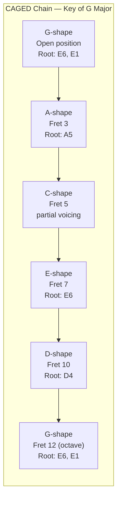
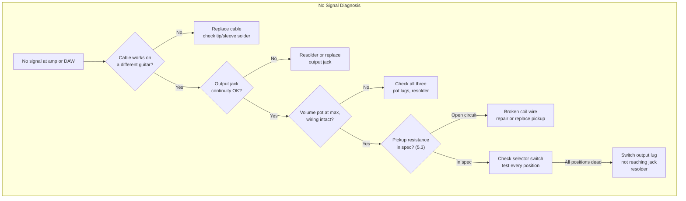
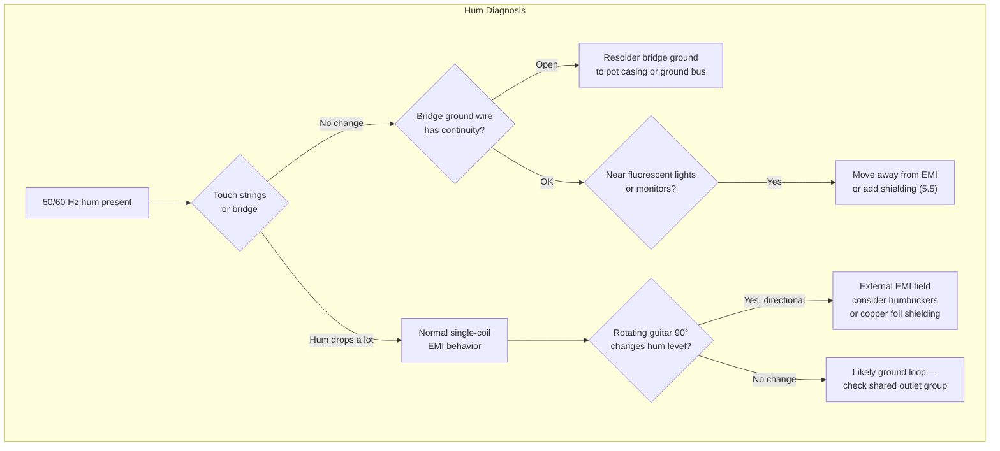

# Electric Guitar Masterclass: Signal Chain, Fretboard Mastery, and Performance Engineering

## Who This Is For and How to Use It

This guide treats you as both a performer and a technician. You'll move between the instrument in your hands, the electronics inside it, and the amplification chain that shapes your tone. Every exercise is immediately playable or testable on gear you already own. Theory appears only where it changes a decision you make in the room — which pickup to select, which cable to grab, which finger to move first.

Work the modules in order the first time through. After that, use this as a reference you open mid-practice.

**What you need:**

- Solid-body electric guitar (any pickup configuration)
- Amplifier (tube, solid-state, or modeled) *or* audio interface + amp sim (Neural DSP, BIAS FX 2, Guitar Rig 6, or the free Amplitube CS)
- DAW: Reaper, Ableton Live, Logic Pro, or GarageBand
- Spectrum analyzer: SPAN by Voxengo (free) or Audacity's built-in analyzer
- Digital multimeter (any sub-$30 model)
- Chromatic tuner, clip-on or pedal, ±1 cent accuracy
- Metronome app (Tempo, Pro Metronome, or your DAW's click)
- Two instrument cables of different lengths (10 ft and 20 ft minimum)
- Small Phillips screwdriver (pickup height adjustment), soldering iron, 60/40 or lead-free rosin-core solder

---

## Module 1: The Fretboard as a System — CAGED, Intervals, and Spatial Thinking

The CAGED system converts the fretboard from 144 individual notes into five repeating shapes your hands already know from open chords. Master the hand-off between shapes and you can play any chord, in any key, anywhere on the neck, without hunting.

### 1.1 Why CAGED Works

The neck is a linear grid: one fret equals one semitone. String-to-string tuning is a perfect fourth (5 semitones) for every pair except B to G, which is a major third (4 semitones). That single asymmetry is why CAGED shapes look slightly different depending on which string set they sit on — the shape "bends" slightly at the B string. Knowing this consciously stops you from memorizing shapes as pure geometry disconnected from the notes inside them.

Each CAGED shape is an open chord with a barre substituting for the nut. The five shapes tile the neck with no gaps:

```
E-shape → D-shape → C-shape → A-shape → G-shape → E-shape (one octave up)
```

Learn the chain in that order, moving up the neck, and every shape connects directly to the next one's root.

### 1.2 The Five Shapes — Fingerings, Roots, and Honest Limitations

Every diagram below reads low string (E6) to high string (e1), top to bottom.

---

**E-Shape Barre Chord (Root on String 6)** — your workhorse barre chord, full six strings.

Practical example — **G major** (E-shape, fret 3):

```
e |--3--|  Index (barre)
B |--3--|  Index (barre)
G |--4--|  Pinky
D |--5--|  Ring
A |--5--|  Middle
E |--3--|  Index (barre)
```

**Common error:** the barre collapses at the B string because players press with the fleshy pad. Fix: rotate the index finger toward its bony edge, keep the thumb directly behind the middle finger (not creeping toward the headstock), and angle the barre finger slightly so the knuckle clears the lowest string.

---

**A-Shape Barre Chord (Root on String 5)** — low E string muted.

Practical example — **C major** (A-shape, fret 3):

```
e |--3--|  optional, often muted
B |--5--|  Ring (mini-barre) or Pinky
G |--5--|  Ring (mini-barre)
D |--5--|  Ring (mini-barre)
A |--3--|  Index (barre)
E |--X--|  muted — lean index finger tip over it
```

Two valid fingerings:
1. **Mini-barre:** Ring finger flattens across D/G/B simultaneously at X+2. Fast for quick changes.
2. **Three-finger:** Middle on D, Ring on G, Pinky on B. Slower to set but easier to modify into minor or 7th voicings on the fly.

For A-shape **minor**, simply lift the B-string note — the chord becomes minor without moving anything else.

---

**D-Shape Barre Chord (Root on String 4)** — best used as a 4-string partial (D, G, B, e). Don't force a full six-string voicing from it; the shape wasn't built for that and the low strings fight the chord's own root note.

Practical example — **C major** (D-shape, fret 10):

```
e |--10--|  Index (barre)
B |--10--|  Index (barre)
G |--12--|  Ring or Pinky
D |--10--|  Index (barre, root)
A |---X--|  muted
E |---X--|  muted
```

---

**C-Shape Barre Chord (Root on String 5)** — a wide stretch, most useful as an upper-neck partial voicing or in jazz voice leading, rarely as a full low-position barre.

```
          E   A   D   G   B   e
Fret X:   3   R   .   .   .   .   ← Ring: E string; Index: A string
Fret X+1: .   .   5   .   .   .   ← Middle: D string
Fret X+3: .   .   .   R   3   5   ← Pinky barre across G/B/e (partial)
```

---

**G-Shape Barre Chord (Root on Strings 6 and 1)** — awkward as a full barre; in real playing it shows up almost exclusively as a 3-string partial (G, B, e) or as a landmark for locating scale patterns.

**Practical rule:** master E-shape and A-shape to 100% fluency first. Add D-shape partials next. C-shape and G-shape pay off later, mostly in jazz and fusion voice leading — don't burn early practice time forcing them into full barres.

### 1.3 The CAGED Chain — Key of G Major



**Drill — Connect the Chain**

Metronome 60 BPM, 4 beats per shape, no pause between shapes. Goal: every note still ringing when you land the next chord.

Sequence: G-shape → A-shape → C-shape → E-shape → D-shape → E-shape → A-shape → G-shape (back down).

Targets: 60 BPM clean → 80 BPM maintaining tone → 100 BPM fluid, no hesitation on the shift.

### 1.4 Minor and Dominant 7th Modifications

You don't need five new shapes for minor chords — one note moves, usually by a single fret.

**E-shape minor:**

```
e |--3--|  Index (barre)
B |--3--|  Index (barre)
G |--4--|  Middle (NOT pinky — one fret lower than major)
D |--5--|  Ring
A |--5--|  Pinky
E |--3--|  Index (barre)
```

The major 3rd on the G string drops one fret to become a minor 3rd. Everything else stays put.

**A-shape minor:** remove the B-string note entirely from the A-major shape (that note was the major 3rd). You're left with Index barre on the A string root and Ring mini-barre on D/G, B left open to ring as the 5th.

**Dominant 7th:**
- **E7-shape:** lift the Ring finger off the D string so it drops from X+2 to X+1 (play it with Middle instead).
- **A7-shape:** drop the G-string note one fret, from X+2 to X+1, creating the minor 7th.

### 1.5 Chord Transition Mechanics

**Pivot finger principle:** if two chords share a note on the same string and fret, keep that finger planted — it's a pivot. Only the other fingers move.

Example, **Am → C major**:
- Am: Index on B string fret 1, Middle on D string fret 2, Ring on G string fret 2
- C major: Middle stays on D string fret 2, Index stays on B string fret 1, Ring moves from G string to A string fret 3

Only one finger travels. This is why Am and C feel so natural back to back.

**Guide finger principle:** when shapes share no exact notes, let one finger glide lightly along a string (without pressing) during the move. It re-orients your hand position and lands cleanly without you having to look at the fretboard.

**Practice Drill — Four-Chord Workout**

Progression: G major (E-shape, fret 3) → C major (A-shape, fret 3) → D major (A-shape, fret 5) → Em (E-shape, fret 7). One bar each, strum pattern ↓↓↑↑↓↑.

Metronome progression:
- 60 BPM — finger movement should start late, in the last 20% of the previous chord's duration, not early
- 80 BPM — ghost-shift: begin moving toward the next shape *during* the strum, before the actual chord change
- 100 BPM — the transition should be inaudible: no clicks, no muted strings, no buzz
- 120 BPM — performance-ready tempo

---

## Module 2: Picking Mechanics, Strumming Patterns, and Rhythmic Control

### 2.1 Pick Grip and Slant Mechanics

Hold the pick between the pad of the thumb and the side of the index finger's first segment, not the fingertip. Let the tip extend only 3–5 mm past your fingers — more exposed pick means more flex and less control, especially on fast alternate picking.

**Pick slant** is the angle of the pick face relative to the string plane:

- **Downward pick slant (DPS):** tip angled toward the floor. Favors a downstroke exit when crossing to a lower string. Good for descending lead lines.
- **Upward pick slant (UPS):** tip angled toward the ceiling. Favors an upstroke exit when crossing to a higher string. Good for ascending lines.
- **Neutral/flat:** pick parallel to the strings. Standard for strumming; requires a deliberate "escape" motion on string changes or the pick gets trapped between strings.

**Economy picking:** when the next note is on an adjacent string in the same direction you're already moving, let the pick continue through rather than reversing. Moving E string to A string, both ascending — use two downstrokes in a row instead of forcing an upstroke. Removes the "trapped pick" problem, used heavily in country chicken-picking, jazz lines, and shred runs.

**Alternate picking:** strict down-up-down-up regardless of string crossings. Builds the most even internal clock and is non-negotiable for timing development, even if you later adopt economy picking for specific phrases.

**Pick thickness — practical guide:**

| Thickness | Feel | Tonal Character | Best For |
|-----------|------|-----------------|----------|
| 0.46–0.60 mm | Flexible | Bright, airy attack | Acoustic-style strumming |
| 0.60–0.88 mm | Slight give | Balanced, present | All-around rock rhythm |
| 0.88–1.14 mm | Stiff | Defined fundamental | Lead, single-note lines |
| 1.14–3.0 mm | Rigid | Maximum articulation | Jazz, prog, shred |

Thinner picks flex on contact, producing a softer, broader attack transient with less pick noise. Thicker picks don't flex, so more of the string's energy transfers instantly — tighter attack, more apparent note definition at speed.

### 2.2 Strumming Mechanics — Wrist, Not Elbow

**The single most common beginner error:** strumming from the elbow, swinging the whole forearm like a pendulum. It fatigues fast and makes dynamic control impossible.

**Correct mechanics:**
- Elbow stays roughly anchored, resting near the guitar's lower bout.
- The motion is wrist rotation — the same movement as turning a doorknob, not a flicking motion.
- Downstrokes: wrist leads slightly ahead of the pick.
- Upstrokes: wrist rotates back, pick grazes the strings lightly rather than digging in.

**Dynamics:** let upstrokes land 2–4 dB softer than downstrokes naturally. That asymmetry is what makes rhythm playing feel alive instead of mechanical. For reggae/ska accented upstrokes, consciously add wrist snap to match downstroke velocity — it's a deliberate override, not the default.

### 2.3 Strumming Pattern Library

**Legend:** ↓ down, ↑ up, × muted strum, (↓)/(↑) ghost strum — wrist keeps moving, pick doesn't touch the strings.

**Keep the wrist moving on every beat subdivision, even the ghosted ones.** Treat the wrist as the real metronome; the pick contacting strings is just a subset of that constant motion.

---

**Pattern 1 — Basic quarter-note (beginner):**

```
1    2    3    4
↓    ↓    ↓    ↓
```
60 → 100 BPM. Accent beats 2 and 4. Once comfortable, close your eyes and listen for even spacing — your ears will catch rushing/dragging before your hands feel it.

---

**Pattern 2 — Standard rock eighth-note:**

```
1    &    2    &    3    &    4    &
↓    ↑    ↓    ↑    ↓    ↑    ↓    ↑
```
60 → 120 BPM. Let upstrokes catch only the top 3–4 strings (G, B, e) rather than dragging through all six — this creates a natural brightness contrast between down and up.

---

**Pattern 3 — Syncopated pop:**

```
1    &    2    &    3    &    4    &
↓   (↑)   ↓    ↑   (↓)   ↑    ↓    ↑
```
70 → 100 BPM. The ghosted strums (in parentheses) are what make this pattern feel conversational instead of mechanical — think Jack Johnson or John Mayer acoustic grooves.

---

**Pattern 4 — Reggae/ska chop:**

```
1    &    2    &    3    &    4    &
(↓)  ↑   (↓)   ↑   (↓)   ↑   (↓)   ↑
```
Only upstrokes land. Downstrokes are pure ghost motion. Mute immediately with the fret hand after each upstroke — that staccato chop is the entire character of the pattern. Practice the mute alone before adding the strum. 80 BPM target.

---

**Pattern 5 — Sixteenth-note funk:**

```
1  e  &  a   2  e  &  a   3  e  &  a   4  e  &  a
↓  ×  ↑  ↓   ×  ↑  ×  ↓   ↑  ×  ↓  ×   ↑  ↓  ×  ↑
```
The × marks are palm-muted percussive hits, not silent beats. Accent the downbeats (1, 3) and the "and" of 2 and 4. Start by counting each sixteenth note out loud at 60 BPM before attempting the pattern at speed; build to 80 BPM actual tempo.

### 2.4 Fingerstyle Fundamentals — Travis Picking

**Hand assignment:**
- Thumb (p): bass strings, usually alternating E/A or A/D depending on the chord
- Index (i): G string
- Middle (m): B string
- Ring (a): high e string

Rest the heel of your picking hand lightly on the bridge saddles for an optional palm-mute "thump" on the bass notes.

**Basic pattern, 4/4:**

```
1    &    2    &    3    &    4    &
p         p         p         p
     i         m         i         m
```

On an open **G chord:**

```
1    &    2    &    3    &    4    &
E6        G3        A5        G3
     B2        B2        B2        B2
```

Drill progression: one string at a time at 60 BPM → integrate the full pattern at 50 BPM → 80 BPM target → 100 BPM musical application.

---

## Module 3: Electromagnetic Transduction and the Passive Signal Chain

### 3.1 How Pickups Work — Just Enough Physics

A pickup is a coil of fine wire wound thousands of turns around a magnetized core. The string, being ferromagnetic, disturbs the magnet's field as it vibrates; the changing field induces a small voltage in the coil (Faraday's law, one sentence, done).

**What matters practically:** the induced voltage tracks string *velocity*, not displacement. That's why the pluck transient — peak velocity right after you strike the string — is the loudest, most harmonically dense part of the note, and why the signal decays as the string settles.

Pickup position determines which part of the string's motion gets captured:

- **Neck pickup** sits where displacement is large but velocity is lower → warm, full, fundamental-heavy
- **Bridge pickup** sits where displacement is small but velocity swings rapidly → bright, cutting, harmonically rich
- **Middle pickup** sits at a balance point between the two

| Pickup Position | Typical Output | Emphasized Range |
|------------------|-----------------|-------------------|
| Bridge (single-coil) | 100–300 mV p-p | 2–5 kHz |
| Middle (single-coil) | 120–350 mV p-p | ~2.5 kHz, balanced |
| Neck (single-coil) | 150–400 mV p-p | 200 Hz – 1 kHz |
| Bridge (humbucker) | 300–600 mV p-p | reduced above 3 kHz |
| Neck (humbucker) | 400–800 mV p-p | 100–800 Hz |

**Humbucker vs. single-coil:** a humbucker is two coils wound oppositely and wired out of phase with each other. External 50/60 Hz interference hits both coils equally and cancels. The guitar's own signal doesn't cancel, because each coil sits under a different set of pole pieces picking up different string motion. Trade-off: the two coils in series roughly double the inductance (4–10 H vs. 2–3.5 H for single-coils), which rolls off highs faster — the reason humbuckers sound "darker" even before any EQ is applied.

### 3.2 Signal Chain Topology

```mermaid
graph LR
    subgraph sub_guitar ["Inside the Guitar"]
        A["Vibrating string<br/>ferromagnetic steel"] --> B["Pickup coil<br/>5k-10k turns, AWG 42"]
        B --> C["Volume pot<br/>250k or 500k ohm<br/>audio taper"]
        C --> D["Tone circuit<br/>RC low-pass filter<br/>0.022-0.047 uF cap"]
        D --> E["Output jack<br/>1/4 inch TS"]
    end

    subgraph sub_cable ["Passive Cable"]
        F["Instrument cable<br/>20-100 pF per ft<br/>forms LPF with pickup Z"]
    end

    subgraph sub_amp ["Amplifier or Interface"]
        G["Amp input<br/>470k-1M ohm<br/>loads pickup resonance"]
        H["Preamp / gain stage<br/>clean or clipping"]
        I["EQ / tone stack<br/>passive or active"]
        J["Power amp or DAW"]
        G --> H --> I --> J
    end

    E --> F --> G

    style A fill:#d4e8ff
    style B fill:#fff4cc
    style D fill:#ffd4d4
    style F fill:#e8e8e8
    style G fill:#d4ffd4
    style J fill:#d4ffd4
```



### 3.3 Volume and Tone Controls — What They Actually Do

**Volume:** a potentiometer wired as a voltage divider. At 10, all signal passes. As you turn it down, the pot resistance also loads the pickup's inductive impedance, which shifts the pickup's resonant peak downward — rolling volume off doesn't just lower level, it darkens tone. Fix: a **treble bleed circuit** — a small capacitor (~0.001 µF) in parallel with a 100–150 kΩ resistor, wired across the volume pot. It opens a high-frequency bypass path that compensates for the capacitive loading as you roll back.

**250 kΩ vs 500 kΩ pots:** single-coils use 250 kΩ because the lower resistance slightly damps the pickup's resonant peak, taming harshness. Humbuckers use 500 kΩ to preserve their already-rolled-off high end. Swapping 500 kΩ pots into a Strat is a legitimate brightening mod, not a wiring mistake.

**Tone control:** a capacitor in series to ground through a pot, forming a variable low-pass filter. Turning the tone knob down increases capacitive loading, progressively cutting highs.

| Cap value | Effect |
|-----------|--------|
| 0.022 µF | Less aggressive roll-off, brighter sweep (most Fenders) |
| 0.047 µF | Wider roll-off range, warmer (Gibsons) |
| 0.015 µF | Even brighter — boutique single-coil mod |

**Hear it yourself:** record 10 open low-E plucks at tone-knob positions 10, 7, 5, 3, 0, with no input processing. Load each into SPAN (FFT size 4096, Hann window) and compare the high-shelf — you'll watch it drop progressively above 1–4 kHz.

### 3.4 Cable Capacitance and Tone

Instrument cables carry 20–100 pF of capacitance per foot. Combined with the pickup's inductance, this forms a resonant circuit. Practical consequences:

- Longer cables and higher-capacitance cables both push the resonant peak lower → darker tone
- The resonant bump itself adds a mid-presence character some players actively prefer (vintage low-fi tones lean on this)

**Test it:** record the same chord with a 10 ft, then 20 ft, then 30 ft cable (if available). Compare FFTs — expect the 3 dB high-frequency point to drop 1–2 kHz per cable-length jump.

**Running more than 20 ft?** Put a buffer at the guitar output — an active DI box, a true-bypass looper with a buffer, or any pedal with a quality input buffer (a Boss TU-3 tuner works fine). It re-drives the signal at low impedance so the rest of the cable run doesn't matter.

### 3.5 Pickup Height Adjustment

Too close to the strings: strong output but the magnet's pull disturbs string vibration, causing intonation drift and odd "wolf tone" sustain loss. Too far: weak, thin signal.

| Pickup Type | Bass side (Low E) | Treble side (High e) |
|-------------|---------------------|------------------------|
| Single-coil (bridge) | 2.0–2.5 mm | 1.5–2.0 mm |
| Single-coil (neck) | 2.5–3.0 mm | 2.0–2.5 mm |
| Humbucker (bridge) | 2.5–3.0 mm | 2.0–2.5 mm |
| Humbucker (neck) | 3.0–3.5 mm | 2.5–3.0 mm |

**Procedure:**

1. Fret the low E string at the last fret to remove spring tension from the measurement.
2. Measure string underside to pole piece with calipers or a feeler-gauge card.
3. Adjust the two pickup mounting screws (clockwise raises the pickup) to hit target height.
4. Repeat on the treble side.
5. Play open through the 12th fret on every string, listening for uneven sustain. If wound strings around fret 12–15 die fast or go sharp when fretted, back the pickup further from the strings.

---

## Module 4: Distortion, Saturation, and Amp Sim Configuration

### 4.1 Clipping Physics — Why Distortion Sounds Musical

An amp stage is linear only within a voltage window. Push the input past that window and the output can't follow — it clips, and clipping generates new harmonics that weren't present in the clean signal.

**Soft clipping** (tube amps, most overdrive pedals): the transition from linear to clipped is gradual, generating both even and odd harmonics. Even harmonics (2nd, 4th) read as musical because they're octave and fifth relationships to the fundamental — this is the "sweet" character of a cranked tube amp.

**Hard clipping** (solid-state high-gain circuits, most fuzz): the transition is abrupt, generating mostly odd harmonics (3rd, 5th, 7th). High-amplitude odd harmonics produce the aggressive, buzzy edge of metal distortion and classic fuzz.

**Stacking an overdrive in front of an amp** isn't really "adding distortion" — it's doing two things: boosting midrange (a Tube Screamer peaks around 720 Hz) and raising signal level so the amp's own input stage clips sooner and more consistently. The amp still does most of the distortion work; the pedal decides when and how hard it hits that threshold.

### 4.2 Amp Sim Configuration

**Input gain:** for clean tone, set it so the signal barely clips on your hardest strums. For crunch, push it into soft clipping. For high gain, stack a boost/overdrive in front rather than maxing a single gain stage — stacking gives you more control over where the harmonics pile up.

**EQ / tone stack:** most sims model passive Baxandall or Marshall-style tone stacks, which are interactive — boosting bass audibly thins out mids even with the mid knob untouched. Set everything flat (noon) first, then sculpt starting with whichever frequency is actually causing a problem, not a generic "scoop the mids" preset.

**Master volume:** on real amps it drives the power-stage saturation. In most sims it mainly scales output level, though better models add a touch of power-amp compression at higher settings.

**Starting points for three common tones:**

*Clean, Fender-style:*
```
Amp: Blackface Deluxe or Twin model
Gain: 2-3 (just below breakup)
Bass 5 / Mid 4 / Treble 6
Master: 7
Reverb: 2-3 (spring)
```

*Classic rock crunch, Marshall-style:*
```
Amp: Plexi 1959 or JCM800 model
Gain: 5-6
Bass 5 / Mid 7 / Treble 6
Presence: 6
Master: 7
```

*High-gain modern metal:*
```
Amp: Recto, Diezel, or EVH model
Gain: 7-8
Bass 4 (avoid mud) / Mid 5-6 / Treble 7
Presence: 5-6
Noise gate: threshold -30 dBFS, fast attack, medium release
```

### 4.3 Effects Chain Order

```mermaid
graph LR
    subgraph sub_preamp_chain ["Pre-Amp Signal Chain"]
        A["Guitar<br/>high-Z, 100-800mV"] --> B["Tuner<br/>buffered bypass first"]
        B --> C["Wah / filter<br/>tracks clean harmonics best"]
        C --> D["Compressor<br/>dynamics before distortion"]
        D --> E["Overdrive / distortion<br/>nonlinear waveshaping"]
        E --> F["EQ pre-amp<br/>shapes what enters the amp"]
    end

    subgraph sub_amp ["Amplifier Stage"]
        G["Amp preamp"] --> H["Amp power stage"]
    end

    subgraph sub_postamp ["Post-Amp / FX Loop"]
        I["Modulation<br/>chorus, flanger, phaser"] --> J["Delay<br/>repeats full processed signal"] --> K["Reverb<br/>always last"]
    end

    F --> G
    H --> I

    style A fill:#d4e8ff
    style E fill:#ffd4d4
    style G fill:#fff4cc
    style K fill:#d4ffd4
```



**Three rules behind the order:**

1. **Dynamics before distortion.** A compressor ahead of overdrive sustains the signal into the clipping zone evenly. A compressor placed after distortion clamps an already-clipped waveform, killing sustain and risking pumping artifacts. (Some players intentionally compress after dirt for a tighter, punchier feel — valid, but it changes the character noticeably.)

2. **Pitch-tracking and frequency effects before distortion.** Wah, octave pedals, and envelope filters track the guitar's clean harmonic content. Run them after distortion and the dense harmonic content confuses the tracking, smearing the effect.

3. **Time-based effects last, or in the effects loop.** Delay and reverb should process the fully-formed, fully-distorted signal as one unit. Delay before distortion means every repeat gets distorted too — an intentional lo-fi texture some players chase, but not the default. Reverb before dirt turns into mud.

### 4.4 DAW Recording Configuration

| Use Case | Sample Rate | Bit Depth | Buffer | Round-Trip Latency |
|----------|-------------|-----------|--------|---------------------|
| Live amp-sim monitoring | 48 kHz | 24-bit | 64–128 samples | 3–6 ms |
| Tracking with plugins | 48 kHz | 24-bit | 128–256 samples | 6–12 ms |
| Mixing / non-realtime | 48/96 kHz | 24-bit | 512–1024 samples | irrelevant |

**Past 12 ms round-trip, the pick-to-ear feedback loop feels wrong** and will mess with your timing. If your interface can't hit under 12 ms at a usable buffer, monitor the direct hardware signal instead of the DAW's processed output while tracking.

**Input level targets:**

- Peak on hard strums: **−12 to −6 dBFS**
- Average playing level: **−18 to −12 dBFS**
- Noise floor, strings damped: **below −60 dBFS**

If you're clipping the input, lower the interface's gain knob — not the guitar's volume control, which changes your tone via pickup loading (Module 3.3).

---

## Module 5: Systematic Troubleshooting — Faults, Diagnosis, and Repair

### 5.1 Philosophy

Work source to destination. Eliminate the cheapest, most accessible cause first. **Substitution rule:** swap in a known-good cable, guitar, or amp to isolate which sub-system is failing before you pick up a meter or soldering iron.

### 5.2 No Signal — Diagnostic Tree



### 5.3 Hum — Diagnostic Tree



### 5.4 Intermittent Signal — Checklist

1. Wiggle cable at guitar end while playing — dropout? Replace cable or resolder jack.
2. Wiggle cable at amp end — dropout? Clean or replace amp input jack.
3. Rock the pickup selector — dropout? DeoxIT D5 contact cleaner, or replace switch.
4. Squeeze the guitar body near the control cavity — dropout? Cold solder joint inside; open and inspect.
5. Turn volume/tone pots — crackling? Apply contact cleaner to the pot shaft, rotate 20 times. Replace if it persists.

### 5.5 Weak/Thin Tone — Checklist

1. Measure pickup resistance (5.6 below). Open circuit, or far below spec, = coil fault.
2. Check pickup height — below ~4 mm on the bass side is too far for most single-coils.
3. Confirm pot values match pickup type: 250 kΩ single-coil, 500 kΩ humbucker.
4. A/B a 10 ft vs 20 ft cable — if the shorter cable restores high end, your 20 ft cable's capacitance is loading the signal.

### 5.6 Resistance Measurement Procedure

1. Disconnect the guitar from all cables.
2. Multimeter to resistance mode, 20 kΩ range.
3. Isolate the pickup: unsolder its hot lead from the volume pot, or use the selector to route only that pickup.
4. Probe pickup hot (+) and pickup ground (−).
5. Compare against spec:

| Pickup Type | Normal DC Resistance | Fault Indicator |
|-------------|------------------------|-------------------|
| Strat single-coil | 5.6–7.5 kΩ | >100 kΩ open, <1 kΩ short |
| Tele bridge single-coil | 6.0–8.5 kΩ | Same thresholds |
| P-90 | 7.5–9.5 kΩ | Same thresholds |
| PAF-style humbucker | 7.0–9.0 kΩ | Same thresholds |
| Hot-rod humbucker | 12.0–18.0 kΩ | >40 kΩ suspicious |

A coil can read in-spec resistance but still have a partial turns-short, showing up as weak output with a "normal" meter reading. If resistance checks out but output still feels weak, A/B against a known-good reference pickup.

### 5.7 Solder Joint Quality

**Good joint:** shiny, smooth, concave volcano-cone fillet. Doesn't flex when poked with a toothpick. <0.1 Ω continuity.

**Cold joint:** dull, grainy, gray, often balled or convex. Causes crackling and intermittent dropouts when the guitar is handled — usually from moving the joint before the solder solidified, insufficient heat, or an oxidized surface.

**Rework procedure:**

1. Clean the iron tip with brass wool, not a wet sponge (thermal shock shortens tip life).
2. Set temperature: 300–340°C for lead-free (Sn96.5/Ag3/Cu0.5); 310–325°C for 60/40 tin-lead.
3. Heat the pad *and* the wire together — solder flows toward heat, not toward the iron tip alone.
4. Apply rosin-core solder (63/37 or 60/40). Never use acid-core plumbing solder.
5. Remove the iron and hold the joint perfectly still for 3–5 seconds while it solidifies.
6. Inspect: shiny, smooth, no gaps, wire not loose relative to the pad.

### 5.8 Cavity Shielding — Hum Reduction Mod

**Materials:** copper foil tape with conductive adhesive (plain aluminum HVAC tape won't conduct through its adhesive layer).

**Procedure:**

1. Remove controls and the cavity cover/pickguard.
2. Cut foil to line the cavity walls and floor, overlapping pieces by 5 mm minimum for continuity.
3. Press foil firmly onto every surface, including pickup routes if accessible.
4. Verify continuity: probe two foil sections with a multimeter, should read <1 Ω.
5. Solder a short ground wire from the foil to the existing ground bus (pot casing or common ground wire).
6. Reassemble. The foil forms a Faraday cage around the cavity wiring, cutting hum pickup from external EMI fields dramatically.

---

## Module 6: Essential Scales, Riffs, and Practice Structures

### 6.1 The Pentatonic Box — Position 1

A minor pentatonic, fret 5, the foundation box for blues and rock lead.

```
e |--5--8--|
B |--5--8--|
G |--5--7--|
D |--5--7--|
A |--5--7--|
E |--5--8--|
```

Fingering: Index on fret 5 throughout, Pinky on fret 8, Ring covers fret 7 on the middle strings. Scale degrees: Root – ♭3 – 4 – 5 – ♭7.

**Pattern A — technique builder, strict alternate picking:**
```
E: 5-8   A: 5-7   D: 5-7   G: 5-7   B: 5-8   e: 5-8 (then descend)
```
60 → 80 → 100 → 120 BPM.

**Pattern B — cross-string phrasing, pull-offs:**
```
e: 8-5 (pull-off)
B: 8-5 (pull-off)
G: 7-5 (pull-off)
```
Finish with a bend: fret 7 on the G string, bend a whole step up to the fret-9 pitch, hold two beats, release.

**Pattern C — classic blues ending lick:**
```
Fret:   5    8    5    7    5    7    5
String: B    B    B    G    G    A    A
Pick:   ↓    ↑    ↓    ↑    ↓    ↑    ↓
```
70 BPM with a slight swing feel → 90 BPM.

### 6.2 String Bending Mechanics

**Mechanics:**
- Use the Ring finger for most bends — it has the most leverage.
- Back it up with Middle and Index fingers on the same string behind it; all three push together. A lone ring finger is a common error that produces weak, out-of-tune bends and fatigue.
- The motion is wrist rotation toward the headstock on the lower three strings, not a sideways finger push.
- Anchor the thumb over the top of the neck, or hooked around the bass side, for leverage.

**Whole-step bend, G string fret 7 (Am pentatonic Position 1):** target pitch is the note at fret 9. Check by fretting fret 9 unbent first, memorize that pitch, then bend up to match it by ear.

**Half-step bend:** one fret's worth of pitch — the blues ♭5 color and country-style grace notes.

**Pre-bend:** bend silently before plucking, then release after striking — the note descends instead of ascending, a vocal, mysterious effect.

**Vibrato after a bend:** at the top of the bend, oscillate within about 1/4 to 1/3 of the bend's total range, releasing and re-bending repeatedly. Match the oscillation rate to the song's tempo, not a fixed speed.

### 6.3 Power Chord Riff Vocabulary

Power chords (Root + 5th) are harmonically neutral — neither major nor minor — which is exactly why they cut cleanly through distortion without sounding muddy.

**Open E5:**
```
E |--0--|
A |--2--|  Middle
D |--2--|  Ring (optional octave doubling)
```

**Movable shape, root on E string:**
```
      E    A    D
Fret: R    .    .
+2:   .    5    R    Middle (A) / Ring (D), or Ring/Pinky for independence
```

**Classic rock riff — E blues progression, 120 BPM straight eighths:**

```
Bar 1-2: E5
Bar 3-4: A5 (fret 5, E-string shape, or open-position A power chord)
Bar 5:   B5 (fret 7, same shape)
Bar 6:   A5
Bar 7-8: E5

Strum: ↓ ↓ × ↓ × ↓ × ↓   (eighth-note grid, × = palm mute)
```

Build from 80 BPM clean → 100 BPM → 120 BPM performance tempo.

### 6.4 Structured 30-Minute Practice Session

```
0:00-5:00    Warm-up
             Chromatic 1-2-3-4 exercise, every string, 60 BPM
             No musical content — pure mechanics, relaxed grip

5:00-10:00   Technique drill (rotate weekly)
             Week 1: CAGED transitions (Module 1.5)
             Week 2: Picking mechanics and scale runs (Module 6.1)
             Week 3: Bending and vibrato (Module 6.2)
             Week 4: Strumming patterns (Module 2.3)

10:00-20:00  Applied playing
             Work a real song/riff/progression at a metronome tempo
             20 BPM below your comfortable ceiling; record and listen back

20:00-28:00  Sight-reading or ear training
             New chord chart you haven't played, or identify a progression by ear

28:00-30:00  Free play
             No metronome, no targets — consolidation and motivation
```

**The 80% rule:** when you can play a passage cleanly 8 out of 10 attempts at a given tempo, raise it 5 BPM. Chasing flawless execution at a slow tempo before advancing is slower progress than incremental overload.

---

## Module 7: Reference Tables

### 7.1 Pickup Specifications

| Parameter | Single-Coil | P-90 | Humbucker | High-Output HB |
|-----------|-------------|------|-----------|-----------------|
| DC Resistance | 5.5–7.5 kΩ | 7.5–9.5 kΩ | 7–9 kΩ | 12–18 kΩ |
| Inductance | 2–3.5 H | 4–5 H | 4–10 H | 8–12 H |
| Resonant Peak | 3–5 kHz | 2–4 kHz | 1.5–3 kHz | 1–2 kHz |
| Output (p-p) | 100–400 mV | 200–500 mV | 300–600 mV | 500–900 mV |
| Ideal Volume Pot | 250 kΩ | 250–500 kΩ | 500 kΩ | 500 kΩ |

### 7.2 Passive Component Reference

| Component | Value | Purpose |
|-----------|-------|---------|
| Volume pot, single-coil | 250 kΩ audio taper | Signal attenuation |
| Volume pot, humbucker | 500 kΩ audio taper | Signal attenuation |
| Tone pot | 250–500 kΩ | Low-pass filter range |
| Tone cap, bright | 0.022 µF | High-cut filter |
| Tone cap, warm | 0.047 µF | Wider treble roll-off |
| Treble bleed cap | 0.001 µF | Preserve highs at low volume |
| Treble bleed resistor | 100–150 kΩ | Pairs with treble bleed cap |

### 7.3 Signal Levels in the DAW

| Level | Meaning | Action |
|-------|---------|--------|
| 0 dBFS | Digital ceiling | Never reach this |
| −6 dBFS | Hot peak | Max acceptable transient |
| −12 dBFS | Healthy peak | Good lead guitar level |
| −18 dBFS | Moderate | Rhythm guitar, extra headroom |
| −40 dBFS | Quiet | Should still read clearly above noise |
| −60 dBFS | Near noise floor | Acceptable silence floor |

### 7.4 Audio Interface Settings

| Use Case | Sample Rate | Buffer | Expected Latency |
|----------|-------------|--------|--------------------|
| Amp sim monitoring | 48 kHz | 64–128 samples | 3–6 ms |
| Tracking with FX | 48 kHz | 128–256 samples | 6–12 ms |
| Overdubbing | 48 kHz | 256 samples | ~10 ms |
| Mixing | 48 kHz | 512–1024 samples | irrelevant |

### 7.5 Guitar Maintenance Schedule

**After every session:** wipe strings with microfiber (triples string life), wipe neck/body, check tuning before putting it away.

**Monthly:** clean the fretboard — a few drops of lemon oil for rosewood/ebony, dry cloth only for maple. Check intonation (fretted 12th fret vs. 12th fret harmonic should match within ±1 cent). Spray contact cleaner into the output jack while cycling a plug in and out.

**Every 3–6 months:** replace strings when they lose brightness, feel rough, or won't intonate. Check truss rod relief — capo fret 1, fret the last fret, measure the gap at fret 7; 0.2–0.4 mm is normal for electric. Re-verify pickup height (Module 3.5).

**Annually:** inspect every solder joint in the control cavity for cold joints or loose wires. Check nut slots — binding that causes pitch to "ping" when tuning means the slot needs graphite (pencil lead) or Teflon-based nut lubricant. Check tuning machine screw tightness.

### 7.6 CAGED Quick Reference — Key of A Major

```
Shape      Root Fret   Notes
---------  ----------  --------------------------
A-shape    Open (0)    Open A chord
C-shape    Fret 2      Stretch position, partial
E-shape    Fret 5      Root: E string, fret 5
G-shape    Fret 7      Root: E string, fret 7
D-shape    Fret 9      Root: D string, fret 9
A-shape    Fret 12     Octave repeat
```

**Minor modifications:**

| Shape | Major → Minor Change |
|-------|-------------------------|
| E-shape | Drop G-string note 1 fret, play with Middle not Pinky |
| A-shape | Remove B-string note |
| D-shape | Drop B-string note 1 fret |
| C-shape | Drop G-string note 1 fret |
| G-shape | Drop B-string note 1 fret |

### 7.7 Strumming Pattern Quick Reference

```
Legend: down arrow, up arrow, x muted, parentheses ghost strum

Quarter-note:      1 2 3 4         (all downstrokes)
Eighth-note rock:   1 & 2 & 3 & 4 & (alternating down/up)
Syncopated pop:     1 (&) 2 & (3) & 4 &  (ghost on the 2nd "&" position per bar)
Reggae chop:        all downstrokes ghosted, only upstrokes land
Funk sixteenth:     accent 1, 3, and the "and" of 2 and 4; x hits are percussive mutes
```

---

## Appendix: Troubleshooting at a Glance

| Symptom | Most Likely Cause | First Test |
|---------|---------------------|---------------|
| No signal | Cable or jack | Substitute a known-good cable |
| Hum disappears when touching strings | Normal grounded single-coil behavior | No action needed |
| Hum doesn't change when touching strings | Missing bridge ground | Check bridge ground wire continuity |
| Crackling when moving cable | Broken cable | Wiggle while monitoring, confirm dropout |
| Crackling from turning pots | Dirty pot tracks | DeoxIT D5 on pot shaft, rotate 20 times |
| Weak, thin output | Pickup too far, or wrong pot values | Measure pickup height; verify pot values |
| Dead on one selector position | Switch contact or disconnected pickup | Test each position; check pickup wiring |
| Delay between playing and hearing it | Buffer too large | Reduce interface buffer size |
| Notes won't intonate above 12th fret | Nut slot or saddle position wrong | Compare 12th fret harmonic to fretted note |
| Fret buzz on specific notes | Low fret, or neck relief too flat | Check neck relief; inspect fret under the buzzing note |
