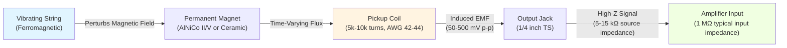
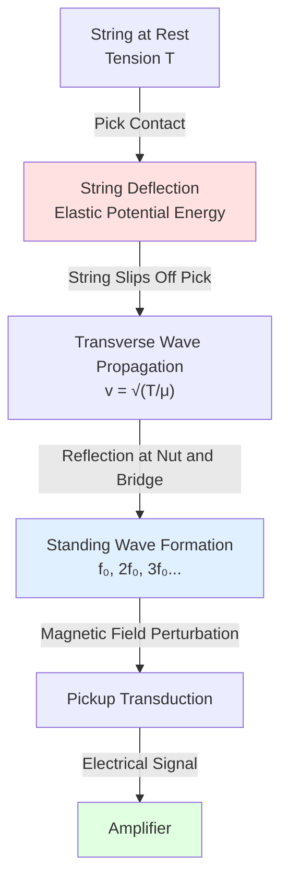
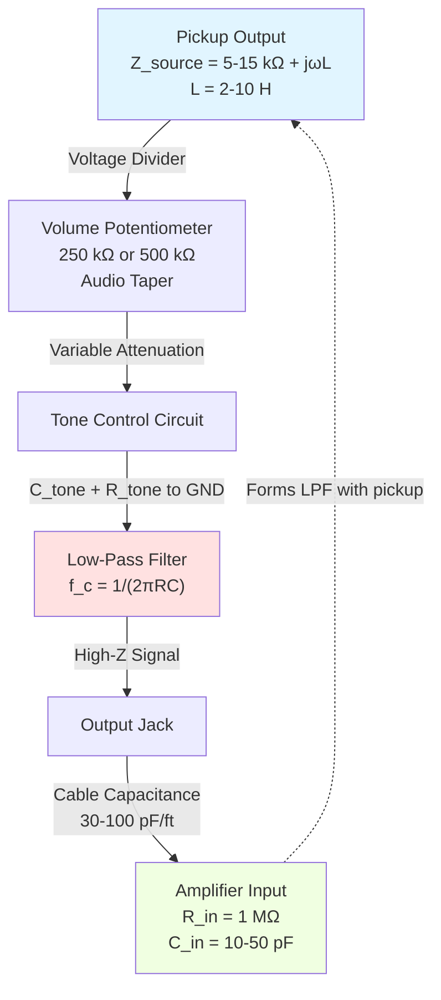

# Operational Verification Laboratory: Electric Guitar Signal Chain, Transduction Physics, and Performance Engineering

## Laboratory Objectives and Instrumentation Requirements

This laboratory provides rigorous, hands-on investigation of electric guitar signal generation, transduction, amplification, and digital signal processing. The exercises examine the physical principles underlying magnetic pickup operation, passive electronic circuit behavior, signal path analysis, and digital audio processing. Students will develop proficiency in systematic troubleshooting, empirical measurement, and performance optimization through controlled experimentation and quantitative analysis.

### Required Laboratory Equipment

**Hardware:**
- Solid-body electric guitar with electromagnetic pickups (single-coil or humbucker configuration)
- Passive tone control circuit (capacitor-based high-frequency roll-off, typically 0.022 µF or 0.047 µF)
- Amplifier with clean and overdrive channels, or
- Audio interface with minimum 24-bit/96 kHz resolution and <10 ms round-trip latency
- Shielded instrument cable (1/4" TS connector, <20 ft to minimize capacitance loading)
- Digital multimeter for resistance and continuity measurements
- Chromatic tuner (±1 cent accuracy)

**Software:**
- Digital Audio Workstation: Ableton Live, Reaper, or Logic Pro
- Guitar amplifier simulator: Neural DSP Archetype suite, Positive Grid BIAS FX 2, or Native Instruments Guitar Rig 6 Pro
- Spectrum analyzer and waveform visualization: Audacity, iZotope RX, or SPAN by Voxengo
- Optional: SPICE circuit simulator (LTspice) for pickup loading analysis

### Safety and Grounding Protocol

Electric guitars operate at low voltage (<1V RMS from pickups), but amplification stages can produce hazardous audio pressure levels (>85 dB SPL) and electrical shock from improperly grounded equipment. Verify all equipment ground connections before operation. Maintain monitoring volume below 85 dB SPL during extended sessions to prevent hearing damage.

## Exercise 1: Signal Transduction Physics and Fretboard Topology

### Part A: Electromagnetic Induction and Pickup Output Characteristics

Electric guitar pickups operate on Faraday's law of electromagnetic induction: a time-varying magnetic flux through a coil induces an electromotive force (EMF) proportional to the rate of flux change. The ferromagnetic strings, magnetized by permanent magnets in the pickup, perturb the magnetic field when vibrating. This perturbation induces an alternating current in the pickup coil.

**Theoretical Foundation:**

The induced voltage in a pickup coil is given by:

```
V_induced = -N × (dΦ/dt)
```

Where:
- N = number of turns in the pickup coil (typically 5,000-10,000 for single-coils, 4,000-5,000 per coil for humbuckers)
- Φ = magnetic flux through the coil
- dΦ/dt = rate of change of magnetic flux (proportional to string velocity)

The output impedance of a typical single-coil pickup ranges from 5-8 kΩ at DC, with significant inductive reactance (2-5 H inductance) causing frequency-dependent impedance. Humbuckers exhibit 8-15 kΩ DC resistance and higher inductance (4-10 H), resulting in reduced high-frequency response and increased output voltage.

**Procedure 1.1: Pickup Output Voltage Measurement**

1. Connect the electric guitar to the audio interface using a shielded cable.
2. Configure the DAW for 96 kHz sample rate, 24-bit depth, and disable all input processing.
3. Set guitar volume and tone controls to maximum (full counterclockwise rotation typically = minimum in passive circuits; verify by ear).
4. Pluck the low E string (82.41 Hz fundamental) at the 12th fret with moderate force.
5. Measure peak-to-peak voltage in the DAW waveform view immediately after the attack transient.
6. Repeat for bridge, middle (if present), and neck pickup positions.

**Expected Results:**

| Pickup Position | Typical Output (p-p) | Harmonic Content |
|----------------|----------------------|------------------|
| Bridge (single-coil) | 100-300 mV | Bright, emphasized >2 kHz |
| Neck (single-coil) | 150-400 mV | Warm, emphasized 200-800 Hz |
| Humbucker (bridge) | 300-600 mV | Balanced, reduced >4 kHz |

The bridge pickup produces a brighter tone due to its position near the string's node, where higher harmonics have greater amplitude. The neck pickup captures more fundamental and lower-order harmonics due to greater string displacement amplitude near the neck.

**Procedure 1.2: Frequency Response Analysis**

1. Record 10 seconds of open string plucks (E, A, D, G, B, E) with each pickup.
2. Export recordings as uncompressed WAV files.
3. Open each recording in spectrum analyzer software.
4. Generate FFT plots (4096-point FFT, Hann window) showing frequency distribution from 80 Hz to 8 kHz.
5. Compare the harmonic structure and formant peaks between pickup positions.



### Part B: Fretboard Topology and the CAGED System

The guitar fretboard is organized according to equal temperament tuning, where each fret represents a semitone interval corresponding to a frequency ratio of 2^(1/12) ≈ 1.0594631. The CAGED system is a mnemonic framework for visualizing chord voicings and scale patterns across the fretboard by relating movable shapes to the five basic open chord forms: C, A, G, E, and D.

**Fretboard Physics:**

The fundamental frequency of a vibrating string segment is given by:

```
f = (1/2L) × √(T/μ)
```

Where:
- L = vibrating length of the string
- T = string tension (typically 15-25 lbs per string)
- μ = linear mass density (mass per unit length)

Each fret position reduces the vibrating length by the factor 2^(-1/12), increasing frequency by one semitone. The 12th fret halves the vibrating length, doubling the frequency (one octave).

**Procedure 1.3: CAGED System Chord Voicings**

The CAGED system divides the fretboard into five overlapping regions. Each region contains a movable chord shape derived from the open position equivalents. Understanding these shapes enables rapid transposition and visualization of harmonic relationships.

**E-Shape Barre Chord (Major):**

```
Fret:   X   X+2 X+2 X+1 X   X
String: E   A   D   G   B   e
Note:   R   5   R   3   5   R

Example: E-shape at 3rd fret = G major
Fingering:
- Index finger: Barre across all strings at fret X
- Middle finger: A string at fret X+2
- Ring finger: D string at fret X+2
- Pinky finger: G string at fret X+1
```

The E-shape is the most commonly used barre chord form. The root note is located on the low E string at the barred fret. This shape produces a full, six-string voicing with doubled roots and fifths.

**A-Shape Barre Chord (Major):**

```
Fret:   X   X   X+2 X+2 X+2 X
String: E   A   D   G   B   e
Note:   -   R   5   R   3   5

Example: A-shape at 5th fret = D major
Fingering:
- Index finger: Barre across strings A through e at fret X
- Ring finger: Barre across D, G, and B strings at fret X+2 (or use separate fingers)
- Low E string muted (not played)
```

The A-shape places the root on the A string. This voicing emphasizes midrange frequencies and is particularly effective for rhythm playing in dense arrangements.

**D-Shape Barre Chord (Major):**

```
Fret:   X   X+5 X+4 X+2 X+3 X+2
String: E   A   D   G   B   e
Note:   -   -   R   3   5   R

Example: D-shape at 10th fret = C major
Fingering:
- Index finger: Barre across G, B, and e strings at fret X+2
- Middle finger: D string at fret X+2 (note: conflicts with index; typically use X+4 for D string)
- Ring finger: B string at fret X+3
- Pinky finger: A string at fret X+5
- Low E and A strings muted
```

The D-shape is harmonically dense but physically demanding. The root is on the D string, producing a bright voicing that cuts through ensemble textures.

**C-Shape Barre Chord (Major):**

```
Fret:   X+3 X+3 X+2 X   X+1 X
String: E   A   D   G   B   e
Note:   3   R   5   R   3   5

Example: C-shape at 8th fret = Ab major (starting from G string)
Fingering:
- This shape is less commonly barred due to wide finger stretches
- Typically used as a partial voicing starting from the A or D string
```

The C-shape requires significant finger independence and is often played as a partial chord in practical applications.

**G-Shape Barre Chord (Major):**

```
Fret:   X   X   X   X   X+2 X+3
String: E   A   D   G   B   e
Note:   R   3   5   R   3   R

Example: G-shape at 3rd fret = Bb major (root on low E at 3rd fret)
Fingering:
- Complex shape requiring ring finger barre on B and e strings
- Less commonly used in contemporary playing styles
```

The G-shape is physically demanding and less ergonomic than E and A shapes. It is occasionally employed in jazz and fusion contexts for voice-leading purposes.

**Procedure 1.4: Chord Transition Practice and Muscle Memory Development**

1. Set a metronome to 60 BPM.
2. Practice the following chord progression using E and A shape barre chords:
   - E major (E-shape at open position)
   - A major (A-shape at open position)
   - B major (A-shape at 2nd fret)
   - C# minor (A-shape minor variant at 4th fret)
3. Strum once per beat, ensuring clean contact with all intended strings.
4. Gradually increase tempo to 120 BPM over multiple sessions.
5. Record your playing at 100 BPM and analyze for:
   - Timing accuracy (measure deviation from metronome grid in DAW)
   - String buzz or muted notes (visible as irregular waveform envelopes)
   - Transition noise (audible artifacts during chord changes)

**Performance Optimization:**

Efficient chord transitions rely on minimal finger movement and anticipatory finger placement. During the transition between chords, move fingers to the new position during the final 10-20% of the previous chord's duration. This technique, known as "ghost shifting," reduces audible gaps in the harmonic progression.

### Part C: Strumming Mechanics and Rhythmic Subdivision

Strumming technique affects both the temporal and spectral characteristics of the guitar signal. The angle of pick attack, the compliance of the pick material, and the velocity profile all influence the resulting waveform.

**Pick Dynamics Physics:**

When a pick strikes a string, it stores elastic potential energy as the string deflects. The string releases this energy when it slips off the pick edge, generating the initial high-amplitude transient. The attack transient contains broadband spectral energy, with emphasis in the 2-5 kHz range contributing to perceived "presence."

Pick thickness and material affect tone:
- Thin picks (0.38-0.60 mm): Flexible, emphasize high frequencies, produce "snappy" attack
- Medium picks (0.60-0.88 mm): Balanced response, general-purpose
- Heavy picks (0.88-1.50 mm): Rigid, emphasize fundamental and lower harmonics, produce "thick" tone

**Procedure 1.5: Strumming Pattern Analysis**

1. Configure DAW for recording at 96 kHz, 24-bit.
2. Select a medium pick (0.73 mm) for controlled experiments.
3. Strum an open E major chord with the following patterns at 90 BPM:

**Pattern A: Quarter-note downstrokes**
```
Beat:     1   2   3   4
Strum:    ↓   ↓   ↓   ↓
```

**Pattern B: Eighth-note alternating**
```
Beat:     1   &   2   &   3   &   4   &
Strum:    ↓   ↑   ↓   ↑   ↓   ↑   ↓   ↑
```

**Pattern C: Syncopated sixteenth-note**
```
Beat:     1 e & a  2 e & a  3 e & a  4 e & a
Strum:    ↓   ↑ ↓    ↑   ↓    ↑ ↓ ↑    ↓   ↑
```

4. Record each pattern for 8 measures.
5. Analyze the recordings in the DAW:
   - Measure average RMS level for downstrokes vs. upstrokes
   - Compare attack transient duration (time from initial deflection to peak amplitude)
   - Generate spectrogram to observe frequency content variation over time

**Expected Observations:**

Downstrokes typically exhibit 2-4 dB higher RMS level than upstrokes due to biomechanical leverage advantages. Downstrokes emphasize lower strings (E, A, D), while upstrokes emphasize higher strings (G, B, e), creating subtle timbral variation within the strumming pattern.



## Exercise 2: Passive Electronics, Signal Loading, and Parameter Optimization

### Part A: Volume and Tone Control Circuit Analysis

Electric guitars employ passive RC (resistor-capacitor) networks for volume and tone control. Understanding these circuits enables informed tonal shaping and troubleshooting of signal degradation.

**Volume Control Circuit:**

The volume potentiometer is a variable resistor (typically 250 kΩ for single-coils, 500 kΩ for humbuckers) configured as a voltage divider. When set to maximum, the full pickup output passes to the output jack. As the control is reduced, signal voltage is attenuated according to the potentiometer's resistance ratio.

```
V_out = V_pickup × (R_pot_remaining / R_pot_total)
```

However, the potentiometer also loads the pickup's output impedance, causing high-frequency roll-off due to the pickup's inductive reactance forming a low-pass filter with the cable capacitance and volume pot resistance.

**Tone Control Circuit:**

The tone control adds a capacitor (typically 0.022 µF for brighter response, 0.047 µF for warmer response) in series with a potentiometer (250 kΩ or 500 kΩ) connected from the signal path to ground. This forms a variable low-pass filter.

The cutoff frequency is approximated by:

```
f_cutoff = 1 / (2π × R_tone × C_tone)
```

Where:
- R_tone = tone potentiometer resistance (varies with knob position)
- C_tone = tone capacitor value

With a 500 kΩ tone pot at 50% rotation (250 kΩ) and 0.022 µF capacitor:

```
f_cutoff = 1 / (2π × 250,000 × 0.000000022)
f_cutoff ≈ 28.9 Hz
```

This calculation represents the first-order approximation. In practice, the pickup inductance and cable capacitance create a more complex multi-pole filter response with resonant peaks typically between 2-5 kHz.

**Procedure 2.1: Volume Control Frequency Response Measurement**

1. Connect guitar to audio interface via shielded cable.
2. Set tone control to maximum (full counterclockwise).
3. Set volume control to 10 (maximum).
4. Generate a pink noise signal in the DAW and route it to guitar amplifier simulator with a clean amp model.
5. Simultaneously, configure the guitar to output signal to a recording track.
6. Record 30 seconds of pink noise playback as received by the guitar pickups (this requires an external speaker playing the noise near the guitar, or use a signal generator with electromagnetic coupling - note: this is impractical; alternative approach below).

**Revised Practical Approach for Volume Control Analysis:**

1. Set all controls to maximum.
2. Pluck each open string and record the attack transient.
3. Measure peak amplitude in DAW.
4. Reduce volume control to 8, 6, 4, 2, and 0.
5. Repeat pluck and measurement for each setting.
6. Generate a graph plotting volume setting (x-axis) vs. peak amplitude in dBFS (y-axis).

**Expected Results:**

Most guitar volume potentiometers use an audio taper (logarithmic) rather than linear taper. This means that perceived volume changes more linearly with knob rotation, but measured voltage follows a logarithmic curve. At the 50% rotation point, output voltage is typically 20-30% of maximum rather than 50%.

**Procedure 2.2: Tone Control Frequency Response Measurement**

1. Set volume to maximum.
2. Set tone control to 10 (maximum, minimum capacitive loading).
3. Record open string plucks for all six strings.
4. Reduce tone control to 8, 6, 4, 2, and 0.
5. Repeat recordings at each setting.
6. Export recordings as WAV files.
7. Use spectrum analyzer to generate frequency response plots (80 Hz - 10 kHz) for each tone setting.
8. Overlay plots to visualize the progressive high-frequency roll-off.

**Expected Results:**

At maximum tone setting, the high-frequency response extends to the pickup's natural resonant peak (2-5 kHz for single-coils, 1.5-3 kHz for humbuckers). As the tone control is reduced, a shelving filter progressively attenuates frequencies above approximately 500 Hz. At minimum tone setting, the output has a "dark" or "muffled" character with significant attenuation above 2 kHz.



### Part B: Cable Capacitance and Signal Degradation

Instrument cables exhibit distributed capacitance (typically 30-100 pF per foot) that forms a low-pass filter with the pickup's output impedance. Longer cables result in greater capacitive loading and more high-frequency loss.

**Cable Loading Theory:**

The pickup inductance (L), cable capacitance (C), and total resistance (pickup DC resistance + volume pot + amplifier input resistance) form an RLC circuit with a resonant frequency:

```
f_resonance = 1 / (2π√(LC))
```

For a single-coil pickup with 3 H inductance and a 20-foot cable with 70 pF/ft capacitance:

```
C_total = 20 × 70 = 1400 pF = 1.4 × 10^-9 F
f_resonance = 1 / (2π√(3 × 1.4 × 10^-9))
f_resonance ≈ 2460 Hz
```

The resonant peak creates emphasis around this frequency, but frequencies above the resonance are progressively attenuated at 12 dB/octave.

**Procedure 2.3: Cable Length Impact Measurement**

1. Connect guitar using a 10-foot cable.
2. Record open string plucks for all six strings.
3. Replace with a 20-foot cable and repeat recordings.
4. Replace with a 30-foot cable and repeat recordings.
5. Generate frequency response plots for each cable length.
6. Measure the 3 dB roll-off frequency for each configuration.

**Expected Results:**

Increasing cable length shifts the resonant frequency downward and increases high-frequency roll-off. A 10-foot cable may exhibit 3 dB attenuation at 5 kHz, while a 30-foot cable shows 3 dB attenuation at 3 kHz, resulting in noticeably darker tone.

**Mitigation Strategies:**

- Use shorter cables when possible
- Employ low-capacitance cables (e.g., <30 pF/ft)
- Use active electronics (buffer preamp) at the guitar output
- Use wireless systems with transmitter buffers

### Part C: Digital Amplifier Simulation and Nonlinear Distortion

Amplifier simulators model the complex nonlinear behavior of tube and solid-state amplifiers through various techniques including wave shaping, convolution, and component-level circuit modeling.

**Distortion Physics:**

Amplifier distortion occurs when the input signal exceeds the amplifier's linear operating region, causing waveform clipping. Soft clipping (tube amplifiers) introduces odd and even harmonics, creating "warm" distortion. Hard clipping (solid-state amplifiers) introduces primarily odd harmonics, creating "harsh" or "brittle" distortion.

The transfer function of a soft clipper can be approximated by:

```
V_out = (2/π) × arctan(k × V_in)
```

Where k is the distortion coefficient. As k increases, the output approaches square-wave clipping.

**Procedure 2.4: Amplifier Model Characterization**

1. Open amplifier simulator (Neural DSP, BIAS FX, or Guitar Rig).
2. Select a clean amp model (e.g., Fender Blackface Deluxe Reverb emulation).
3. Set all EQ controls to neutral (5 on a 0-10 scale).
4. Set gain to minimum.
5. Record a clean E chord strum.
6. Increase gain to 3, 6, and 10, recording at each setting.
7. Export recordings and generate:
   - Waveform comparison showing progressive clipping
   - FFT plots showing harmonic generation
   - Total Harmonic Distortion (THD) measurements

**THD Calculation:**

```
THD = √(V₂² + V₃² + V₄² + ... + Vₙ²) / V₁

Where:
V₁ = RMS voltage of fundamental frequency
V₂, V₃, etc. = RMS voltage of harmonic components
```

Clean amplifiers exhibit THD < 1%. Overdrive settings produce THD of 5-20%. Heavy distortion exceeds 50% THD.

**Procedure 2.5: Effects Chain Signal Flow Analysis**

Modern guitar signal processing chains involve multiple effects processors in series. The order of effects dramatically impacts the final tone.

**Typical Signal Chain:**


**Effect Order Principles:**

1. **Dynamics before distortion:** Compressors placed before distortion create sustain by maintaining signal level above the clipping threshold. Placed after distortion, they even out the distorted signal's dynamics.

2. **Distortion before modulation:** Placing modulation effects (chorus, flanger) after distortion prevents the modulation from being distorted, preserving clarity.

3. **Time-based effects last:** Delay and reverb should be placed at the end of the chain to create natural spatial effects that envelop the entire processed signal.

**Procedure 2.6: Effects Chain Experimentation**

1. Configure the following effects chain in Guitar Rig or equivalent:
   - Clean amp model
   - Compressor (ratio 4:1, threshold -20 dB, attack 10 ms, release 100 ms)
   - Overdrive (gain 6, tone 7, level 8)
   - Delay (time 375 ms, feedback 30%, mix 25%)

2. Record a 16-bar progression using E, A, D, and G chords.

3. Reorder the chain to:
   - Clean amp model
   - Overdrive
   - Compressor
   - Delay

4. Record the same progression with identical playing technique.

5. Compare recordings through spectrum analysis and subjective listening assessment.

**Expected Results:**

Configuration 1 (compressor before overdrive) produces sustained distortion with even dynamics. Configuration 2 (compressor after overdrive) produces tighter, more controlled distortion with reduced sustain. The compressor in configuration 2 may introduce "pumping" artifacts as it responds to the distorted signal's envelope.

## Exercise 3: Fault Injection, Diagnostic Methodology, and Signal Path Troubleshooting

### Part A: Pickup System Faults and Electromagnetic Interference

Electric guitar signal chains are susceptible to various failure modes including open circuits, short circuits, ground loops, and electromagnetic interference (EMI). Systematic diagnosis requires understanding the expected behavior of each component.

**Common Pickup Faults:**

1. **Open coil:** Complete signal loss, infinite resistance measurement
2. **Shorted coil:** Weak output, low resistance measurement (<1 kΩ)
3. **Intermittent connection:** Crackling, signal dropouts during movement
4. **Microphonic feedback:** Squealing when pickup is exposed to high SPL
5. **EMI pickup:** 60 Hz (or 50 Hz) hum, radio frequency interference

**Procedure 3.1: Pickup Resistance Measurement and Verification**

1. Disconnect guitar from amplifier.
2. Remove strings (optional, but improves access).
3. Unsolder the pickup's hot lead from the volume potentiometer.
4. Set multimeter to resistance mode (Ω).
5. Measure DC resistance between the pickup's hot lead and ground.

**Expected Resistance Values:**

| Pickup Type | Typical DC Resistance |
|-------------|----------------------|
| Stratocaster single-coil | 5.5 - 7.5 kΩ |
| Telecaster bridge (vintage) | 6.0 - 8.0 kΩ |
| P-90 single-coil | 7.0 - 9.0 kΩ |
| PAF-style humbucker | 7.0 - 9.0 kΩ |
| High-output humbucker | 12.0 - 18.0 kΩ |

Measurements outside these ranges indicate potential faults. Infinite resistance suggests an open coil (broken wire). Resistance below 1 kΩ suggests a shorted coil.

**Procedure 3.2: Electromagnetic Interference Diagnosis**

1. Connect guitar to amplifier with moderate gain.
2. Set guitar volume to maximum.
3. Position the guitar in playing position and listen for hum.
4. Rotate the guitar 90° and observe hum level change.
5. Touch the strings or bridge ground wire and observe hum reduction.

**EMI Sources and Mitigation:**

**60 Hz hum (North America) or 50 Hz hum (Europe, Asia):**
- **Source:** AC power line radiation, transformer fields
- **Diagnosis:** Hum increases when facing certain directions, decreases when rotated 90°
- **Mitigation:** Use humbucking pickups, shield the control cavity with conductive copper foil, ensure proper grounding

**Radio frequency interference (RFI):**
- **Source:** AM/FM radio transmitters, cellular towers, digital devices
- **Diagnosis:** Audible radio stations or buzzing that changes with proximity to electronics
- **Mitigation:** Add capacitors (100-200 pF) between hot leads and ground, use shielded cable for internal wiring

**Ground loop hum:**
- **Source:** Multiple ground paths creating current loops
- **Diagnosis:** Hum that changes when touching strings, disappears when guitar cable is disconnected from amplifier
- **Mitigation:** Verify bridge ground wire continuity, isolate amplifier and guitar power sources

```mermaid
graph TD
    A["Pickup Coil"] -->|"Hot Signal"| B["Volume Pot"]
    A -->|"Ground"| C["Cavity Shielding<br/>(Copper Foil/Conductive Paint)"]
    C -->|"Ground Connection"| D["Bridge Ground Wire"]
    D -->|"String Contact"| E["Strings<br/>(Player Body Ground)"]
    B --> F["Output Jack<br/>Sleeve = Ground"]
    C --> F
    
    G["AC Power Line<br/>60 Hz Radiation"] -.->|"EMI Coupling"| A
    H["Human Body<br/>(Antenna for EMI)"| -.->|"Grounded via strings"| E
    
    style A fill:#e1f5ff
    style C fill:#ffe1e1
    style F fill:#f0ffe1
    style G fill:#ffcccc
```

### Part B: Wiring Faults and Signal Path Verification

Internal guitar wiring failures produce various symptoms including intermittent signal, scratchy controls, and dead pickups in specific selector positions.

**Procedure 3.3: Systematic Signal Path Testing**

1. **Output Jack Verification:**
   - Set multimeter to continuity mode.
   - Touch probes to output jack tip and sleeve.
   - With guitar volume at maximum, continuity should show open circuit (no continuity).
   - Touch strings while measuring; continuity should appear (confirming ground path).

2. **Volume Potentiometer Verification:**
   - Measure resistance between volume pot's outer lugs (should equal pot rating: 250 kΩ or 500 kΩ).
   - Rotate pot through full range; resistance should change smoothly without jumps.
   - Scratchy pots indicate worn resistive track; clean with contact cleaner or replace.

3. **Pickup Selector Switch Verification:**
   - Measure resistance between switch output lug and each pickup's hot lead.
   - Cycle through all selector positions.
   - Verify that each position connects the corresponding pickup(s) to the output.

**Procedure 3.4: Intentional Fault Injection and Recovery**

This exercise develops troubleshooting skills by intentionally introducing reversible faults.

**Fault 1: Simulated Cold Solder Joint**

1. Identify the connection between the volume pot and output jack.
2. Loosen (do not remove) the solder joint by gently flexing the wire.
3. Connect guitar to amplifier and play while manipulating the wire.
4. Observe intermittent signal dropout.
5. Resolder the connection with proper technique:
   - Clean surfaces with isopropyl alcohol
   - Heat joint with 350°C (660°F) soldering iron
   - Apply 60/40 or 63/37 rosin-core solder
   - Allow joint to cool without movement
   - Inspect for shiny, concave fillet (good joint) vs. dull, convex bead (cold joint)

**Fault 2: Simulated Broken Pickup Selector**

1. Temporarily disconnect one pickup's hot lead from the selector switch.
2. Test all selector positions and note which positions lose signal.
3. Reconnect the pickup and verify signal restoration.

**Procedure 3.5: Ground Loop Isolation**

Ground loops occur when multiple ground paths exist, allowing AC currents to flow through the audio signal ground. This introduces hum and noise.

1. Connect guitar to amplifier.
2. Connect amplifier and audio interface to the same power strip.
3. Connect audio interface to computer via USB.
4. Monitor guitar signal in DAW while playing.
5. Measure noise floor with no playing (should be <-60 dBFS).
6. If excessive hum is present (>-40 dBFS), disconnect USB cable and measure again.
7. If hum reduces, a ground loop exists between computer ground and audio ground.
8. Employ one of these mitigation strategies:
   - Use a USB isolator
   - Ensure all equipment is plugged into the same power outlet group
   - Use balanced audio connections where possible (not applicable for guitar direct input, but relevant for amplifier recording)

### Part C: Amplifier Overdrive and Thermal Stress Testing

Amplifiers, particularly tube designs, exhibit nonlinear behavior that intensifies under sustained high-power operation. Digital simulators model this behavior, but understanding physical amplifier limitations informs realistic performance practices.

**Procedure 3.6: Amplifier Saturation Characteristics**

1. Configure amplifier simulator with a vintage tube amp model (e.g., Marshall Plexi, Fender Bassman).
2. Set gain to maximum.
3. Play sustained power chords (E5, A5, D5) with heavy downstrokes.
4. Observe waveform in DAW:
   - At moderate input levels, soft clipping rounds the waveform peaks
   - At high input levels, hard clipping flattens the peaks completely

5. Add a tube screamer / overdrive pedal before the amp input.
6. Set pedal gain to moderate and level to high.
7. Observe how the pedal pre-compresses and shapes the signal before amplifier clipping.

**Tube Screamer Circuit Theory:**

The classic TS-808 Tube Screamer uses an operational amplifier configured as a non-inverting amplifier with asymmetric clipping diodes in the feedback path. This creates soft clipping with emphasis on mid-range frequencies (centered around 720 Hz), which helps the guitar cut through a mix.

```
Gain = 1 + (R_feedback / R_input)
Clipping threshold ≈ 0.7V (silicon diode forward voltage)
```

The Tube Screamer acts as a "transparent" overdrive by compressing the signal's dynamic range before it hits the amplifier's input stage, allowing the amplifier's natural overdrive characteristics to dominate the tone.

**Procedure 3.7: Latency Measurement and Compensation**

Digital audio systems introduce latency (delay between input and output) due to analog-to-digital conversion, buffer processing, and digital-to-analog conversion. Excessive latency impairs performance by creating perceptible delay between string attack and audible output.

1. Configure audio interface for minimum buffer size (e.g., 64 samples at 48 kHz = 1.33 ms).
2. Create two tracks in DAW:
   - Track 1: Direct guitar input (bypassing all processing)
   - Track 2: Guitar input with amplifier simulator plugin

3. Record a series of sharp, percussive muted string attacks on both tracks simultaneously.
4. Measure the time offset between Track 1 and Track 2 waveforms in the DAW.
5. This offset represents the plugin processing latency.

**Expected Latency Values:**

| Configuration | Typical Latency |
|--------------|----------------|
| Hardware amplifier | <1 ms |
| Audio interface only (64 samples @ 48 kHz) | 2-5 ms |
| Audio interface + simple plugin | 5-10 ms |
| Audio interface + complex convolution reverb | 10-20 ms |

Latency below 10 ms is generally imperceptible for most players. Latency above 20 ms creates noticeable "slap-back" effect that disrupts performance timing.

**Mitigation Strategies:**

- Reduce buffer size (increases CPU load, may cause audio dropouts)
- Use plugins with low-latency modes
- Enable DAW's latency compensation during mixing (not applicable during recording)
- Use hardware monitoring on audio interface to hear direct signal with zero latency, even if recorded signal has latency

```mermaid
graph LR
    A["Guitar String Pluck<br/>t = 0 ms"] -->|"Transduction"| B["Pickup Output<br/>t = 0.1 ms"]
    B -->|"Cable Propagation"| C["Audio Interface ADC<br/>t = 0.2 ms"]
    C -->|"Buffer Delay<br/>(64 samples @ 48kHz)"| D["DAW Input<br/>t = 1.5 ms"]
    D -->|"Plugin Processing<br/>(Amp Sim)"| E["DAW Output<br/>t = 6.0 ms"]
    E -->|"Buffer Delay"| F["Audio Interface DAC<br/>t = 7.5 ms"]
    F -->|"Monitor Output"| G["Headphones/Speakers<br/>t = 8.0 ms"]
    
    style A fill:#e1f5ff
    style D fill:#ffe1e1
    style G fill:#f0ffe1
```



## Practical Reference Guide: Signal Chain Specifications and Diagnostic Procedures

### Pickup Specifications and Expected Output

| Parameter | Single-Coil | Humbucker | P-90 |
|-----------|-------------|-----------|------|
| DC Resistance | 5.5 - 8.0 kΩ | 7.0 - 18.0 kΩ | 7.0 - 9.0 kΩ |
| Inductance | 2.0 - 3.5 H | 4.0 - 10.0 H | 4.0 - 5.0 H |
| Resonant Frequency | 2.5 - 5.0 kHz | 1.5 - 3.0 kHz | 2.0 - 4.0 kHz |
| Output Voltage (p-p) | 100 - 400 mV | 300 - 800 mV | 200 - 500 mV |
| Magnet Type | AlNiCo 2/5, Ceramic | AlNiCo 2/5, Ceramic | AlNiCo 2/5 |

### Passive Component Values

| Component | Typical Value | Function |
|-----------|---------------|----------|
| Volume Pot (single-coil) | 250 kΩ audio taper | Signal attenuation |
| Volume Pot (humbucker) | 500 kΩ audio taper | Signal attenuation |
| Tone Pot | 250 kΩ or 500 kΩ | Variable low-pass filter |
| Tone Capacitor (bright) | 0.022 µF | High-frequency roll-off |
| Tone Capacitor (warm) | 0.047 µF | High-frequency roll-off |
| Treble Bleed Capacitor | 0.001 µF | Preserve highs at low volume |

### Cable and Connection Specifications

| Parameter | Specification |
|-----------|---------------|
| Maximum cable length (passive) | <25 feet (7.6 m) |
| Cable capacitance (low-quality) | 80-120 pF/ft |
| Cable capacitance (high-quality) | 20-40 pF/ft |
| Output jack contact resistance | <0.1 Ω |
| Proper solder joint appearance | Shiny, smooth, concave fillet |

### Amplifier Input Specifications

| Parameter | Typical Value |
|-----------|---------------|
| Input impedance | 470 kΩ - 1 MΩ |
| Input capacitance | 10 - 50 pF |
| Maximum input level (clean) | 1 - 2 V RMS |
| Noise floor | -80 dB to -100 dB |

### Troubleshooting Decision Tree

**Symptom: No signal output**
1. Check cable continuity → Replace cable if open circuit
2. Check output jack continuity → Resolder or replace if intermittent
3. Check pickup resistance → Replace pickup if open or shorted
4. Check volume pot wiring → Repair connections

**Symptom: Excessive hum (60/50 Hz)**
1. Touch strings → If hum reduces, ground path is functional
2. Rotate guitar 90° → If hum changes, EMI coupling is present
3. Shield control cavity with copper foil
4. Verify bridge ground wire continuity
5. Check for ground loops in multi-amp setups

**Symptom: Intermittent signal**
1. Manipulate cable while playing → Replace cable if signal drops
2. Manipulate output jack → Resolder or replace if signal drops
3. Move selector switch → Clean or replace if signal drops
4. Check for cold solder joints on all connections

**Symptom: Weak or thin tone**
1. Measure pickup resistance → Replace if significantly below specification
2. Check pickup height → Adjust to 2-3 mm from strings (bass side), 1.5-2.5 mm (treble side)
3. Verify correct pot values (500 kΩ for humbuckers, 250 kΩ for single-coils)
4. Test with shorter cable to rule out capacitive loading

### CAGED System Chord Reference

**Major Chord Formulas (intervals from root):**
- Root (1), Major Third (4 semitones), Perfect Fifth (7 semitones)

**E-Shape Barre (Root on 6th string):**
```
e |---|---|---|---|-R-|    Fret: X
B |---|---|---|---|-5-|    Fret: X
G |---|---|---|-3-|---|    Fret: X+1
D |---|---|-R-|---|---|    Fret: X+2
A |---|---|-5-|---|---|    Fret: X+2
E |---|-R-|---|---|---|    Fret: X (barred)
```

**A-Shape Barre (Root on 5th string):**
```
e |---|---|---|---|-5-|    Fret: X
B |---|---|---|-3-|---|    Fret: X+2
G |---|---|-R-|---|---|    Fret: X+2
D |---|---|-5-|---|---|    Fret: X+2
A |---|-R-|---|---|---|    Fret: X (barred)
E |-X-|---|---|---|---|    (muted)
```

### Strumming Pattern Notation

```
Symbol Legend:
↓ = Downstroke
↑ = Upstroke
× = Muted strum (palm mute or fret-hand muting)
() = Ghost note (implied but not struck)

Common Patterns:

Folk/Country Pattern (4/4):
1  &  2  &  3  &  4  &
↓     ↓  ↑  ↑  ↓  ↑

Rock Pattern (4/4):
1  &  2  &  3  &  4  &
↓     ↓  ↑     ↑  ↓  ↑

Reggae Upstroke Pattern (4/4):
1  &  2  &  3  &  4  &
   ↑     ↑     ↑     ↑
```

### Audio Interface Configuration Recommendations

| Application | Sample Rate | Bit Depth | Buffer Size | Expected Latency |
|-------------|-------------|-----------|-------------|------------------|
| Recording | 48 kHz or 96 kHz | 24-bit | 256-512 samples | 10-20 ms (acceptable) |
| Live monitoring | 48 kHz | 24-bit | 64-128 samples | 2-6 ms (ideal) |
| Mixing | 48 kHz | 24-bit | 1024-2048 samples | Latency irrelevant |

### Signal Level Reference (dBFS in DAW)

| Level | Description | Recommended Usage |
|-------|-------------|-------------------|
| 0 dBFS | Digital maximum | Absolute peak, never exceed |
| -6 dBFS | Hot signal | Maximum peak for recorded tracks |
| -12 dBFS | Strong signal | Typical peak for lead guitar |
| -18 dBFS | Moderate signal | Typical peak for rhythm guitar |
| -40 dBFS | Weak signal | Below noise floor for most interfaces |
| -60 dBFS | Noise floor | Target for silent passages |

### Maintenance Schedule

**Weekly (for active players):**
- Clean strings with microfiber cloth after each session
- Check tuning stability

**Monthly:**
- Clean fretboard with appropriate cleaner (lemon oil for rosewood/ebony, dry cloth for maple)
- Check bridge, nut, and tuner tightness
- Inspect cable for damage
- Clean output jack with contact cleaner

**Annually:**
- Replace strings
- Deep clean all hardware
- Check and adjust pickup height
- Verify all solder joints and internal wiring integrity
- Shield control cavity if not already done

This laboratory guide provides systematic procedures for understanding, measuring, and optimizing electric guitar signal generation, transmission, and processing. Mastery of these principles enables informed artistic decisions, efficient troubleshooting, and optimal signal chain configuration for any musical context.
