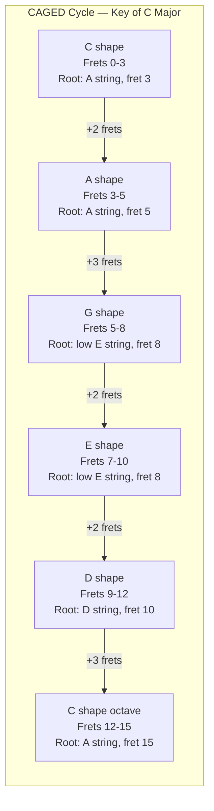
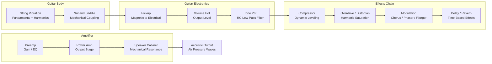
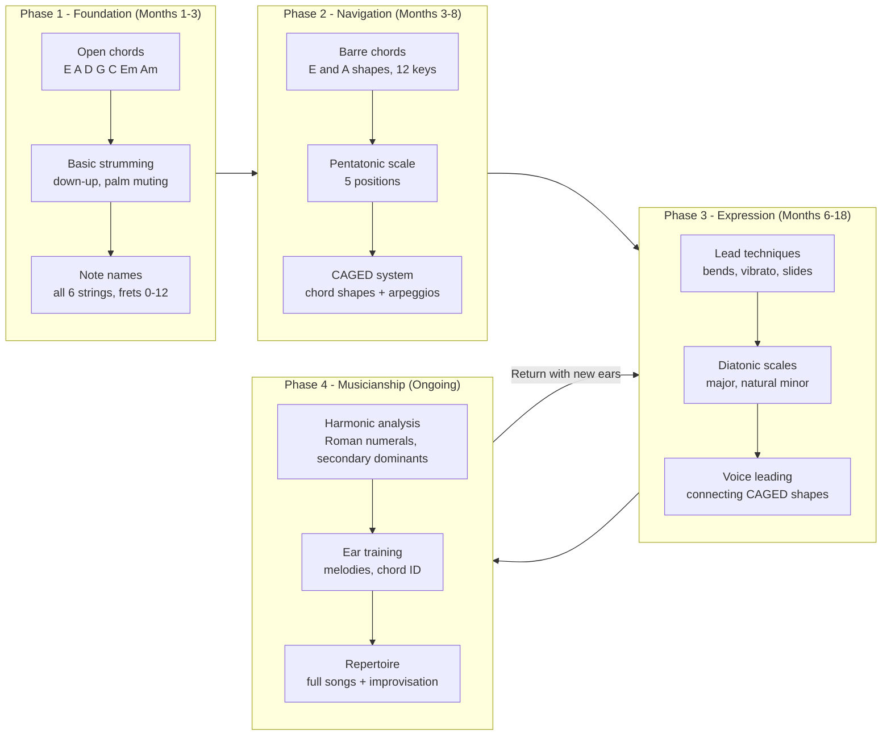

# Electric Guitar Masterclass: Fretboard Navigation, Technique & Musicianship

## Module 1: Hands-On Fretboard Orientation

### Your First Day on the Neck — What to Actually Practice

Six strings, 22–24 frets, two hands that must work independently before they work together. Left hand frets, right hand picks or strums. Train each hand separately before asking them to cooperate.

**Day-one physical checklist:**

- Thumb behind the neck, roughly opposite your middle finger — not hooked over the top.
- Wrist floats slightly away from the neck. If your palm touches the neck's back surface, the wrist has collapsed and your reach is compromised.
- Fret with the fingertip, not the pad. The finger should arch enough that the nail faces the ceiling.
- Press down just behind the fret wire (on the nut side), never on top of it and never floating halfway between two frets.
- Use only the pressure needed for a clean note. Electric guitar action runs roughly 1.5–2.5 mm at the 12th fret — you are moving a string a couple of millimeters, not crushing it.

**Right hand anchor:** Rest the heel of your picking hand lightly on or near the bridge saddles. This gives you a stable palm-muting reference. Pick angle should sit around 30–45° relative to the string — not flush, not perpendicular.

---

### The Six Strings — Names, Notes, and Memory Hooks

```
String 6 (thickest, lowest) ── E2  ── "Eddie"
String 5                     ── A2  ── "Ate"
String 4                     ── D3  ── "Dynamite"
String 3                     ── G3  ── "Good"
String 2                     ── B3  ── "Bye"
String 1 (thinnest, highest) ── E4  ── "Eddie" (octave)
```

Memory sentence: **E**ddie **A**te **D**ynamite, **G**ood **B**ye **E**ddie.

The two E strings share a pitch class two octaves apart. Everything learned on the low E string repeats on the high E string at the same fret numbers, an octave higher.

**Open string drill — Day 1:**
Say the string name and note name aloud as you pluck each string, one per click at 60 BPM. Reverse direction. Then skip strings (6→4→2→1→3→5). Repeat until "low E, A, D, G, B, high E" is as automatic as your own name.

---

### The Chromatic Map — Every Note Across the Neck

Moving one fret up raises pitch by a semitone. Moving to the adjacent thicker string at the same fret raises pitch by a perfect fourth (5 semitones) — except crossing from string 3 (G) to string 2 (B), which raises pitch by only a major third (4 semitones). This G→B exception is the single most important asymmetry on the instrument: it shifts every scale shape, chord voicing, and transferred interval by one fret the moment it crosses that boundary.

**Full note map — frets 0 through 12:**

```
String │  0    1    2    3    4    5    6    7    8    9   10   11   12
───────┼────────────────────────────────────────────────────────────────
  e(1) │  E4   F    F#   G    G#   A    A#   B    C    C#   D    D#   E5
  B(2) │  B3   C    C#   D    D#   E    F    F#   G    G#   A    A#   B4
  G(3) │  G3   G#   A    A#   B    C    C#   D    D#   E    F    F#   G4
  D(4) │  D3   D#   E    F    F#   G    G#   A    A#   B    C    C#   D4
  A(5) │  A2   A#   B    C    C#   D    D#   E    F    F#   G    G#   A3
  E(6) │  E2   F    F#   G    G#   A    A#   B    C    C#   D    D#   E3
```

Fret 12 duplicates fret 0, one octave higher — every shape, pattern, and fingering repeats exactly 12 frets up the neck.

**Note geography drill — Weeks 1–2:**
Pick a note (start with A). Find every A on every string, frets 0–12, using the table, then without it. Target: locate any note on any single string within 2 seconds. Cover all 12 pitch classes over two weeks, one or two per day.

---

## Module 2: Left-Hand Technique — Ergonomics and Mechanics

### Fretting Hand Posture in Detail

Fingers are numbered 1 (index) through 4 (pinky). The thumb is unnumbered — an anchor, not a fretting finger (except specific thumb-over techniques in blues and rock).

**Correct arch:** Each finger curves so the tip contacts the string, preventing accidental muting of adjacent strings. Imagine cupping a small ball in your palm — that natural curve is your starting shape.

**Thumb placement rule:** For frets 1–5 (wider spacing), keep the thumb behind finger 2. For frets 7–12 (narrower spacing), the thumb can drift slightly toward the index side. Never let it creep over the top of the neck during single-note playing — that collapses the wrist and kills your reach.

**One finger per fret (OFPF) — when to use it:**
OFPF becomes comfortable around fret 5 and up, where spacing tightens. In first position (frets 1–4 on a 25.5" scale), stretching four fingers across four frets is demanding for beginners — build toward it gradually rather than forcing it on day one.

### Four-Finger Independence Exercises

Fingers 3 and 4 share a tendon branch from the extensor digitorum communis, which is why pinky independence from the ring finger is the hardest coordination task on the instrument. These drills target it directly.

**Exercise 1 — Spider Crawl (60 BPM → 100 BPM):**

```
e|──5──6──7──8──|
B|──5──6──7──8──|
G|──5──6──7──8──|
D|──5──6──7──8──|
A|──5──6──7──8──|
E|──5──6──7──8──|
```

Fingers 1–2–3–4, one per fret, on every string pair, then move the whole pattern up and down the neck. No finger lifts until its next note demands it. Every note equal in volume and clarity.

**Exercise 2 — Ring/Pinky isolation (60 BPM):**

```
e|──7──────9──|  (fingers 3 then 4; fingers 1 and 2 stay down on frets 5 and 6)
B|──7──────9──|
G|──7──────9──|
```

Fingers 1 and 2 remain planted on frets 5 and 6 throughout. Only 3 and 4 move. This isolates the exact tendon slip that frees the pinky from the ring finger. Five minutes daily for two weeks produces measurable improvement.

**Exercise 3 — Hammer-on/Pull-off strength (70 BPM):**

```
e|──5h7──7p5──| (repeat 8 times per string)
B|──5h7──7p5──|
G|──5h7──7p5──|
```

Hammer-ons must sound loud enough without a pick stroke. Pull-offs need a slight sideways flick rather than a straight lift — the sideways motion is what plucks the lower note.

---

## Module 3: Right-Hand Mechanics — Picking, Strumming, and Fingerstyle

### Pick Mechanics

**Grip:** Hold the pick between the side of the index finger and the pad of the thumb, tip extending 3–5 mm past your fingers. Too much exposed tip gives uncontrolled flex; too little drags on the string.

**Alternate picking:** Down on the beat, up on the offbeat — the foundational motion. Start at 60 BPM with a metronome. Raise tempo only when every note is equally clean and equally loud.

**Downstroke authority:** Most rhythm playing favors downstrokes because they deliver a stronger, more forceful attack that sits better in a mix. Reserve upstrokes for deliberate articulation, not default habit.

**Pick slant angles:**
- Downward pick slant (DPS): tip angled down, favors downstrokes — common in rock/metal rhythm playing.
- Upward pick slant (UPS): tip angled up, favors upstrokes — common in country and certain lead lines.
- Neutral/flat: used for tremolo picking and strict alternate picking.

**Economy picking:** Sweep in the direction of string travel when crossing strings instead of always alternating. Moving from string 6 toward string 1, stack consecutive downstrokes; moving back, consecutive upstrokes. This shortens pick travel at high speed.

**Alternate picking drill (60 BPM → 120 BPM):**

```
e|──5─6─7─8──8─7─6─5──| (down-up-down-up throughout)
B|──5─6─7─8──8─7─6─5──|
(repeat across all strings)
```

One note per click. Add 5 BPM only when the current tempo feels effortless.

### Palm Muting

Rest the heel of your picking hand on the strings 10–15 mm in front of the bridge saddles. Too far forward produces a dead thud; too far back (or lifted) leaves the strings ringing unmuted. The sweet spot produces a controlled "chugging" texture.

Palm muting is dynamic, not fixed — roll the wrist forward mid-phrase to deepen the mute progressively, creating a swell. This is a signature rock and metal rhythm technique.

### Fingerstyle Foundation

Without a pick, assign the right-hand fingers:

```
Thumb (p) → strings 6, 5, 4 (bass strings)
Index (i) → string 3
Middle (m) → string 2
Ring (a)   → string 1
```

**Travis picking pattern — foundational (60 BPM), over an open G chord (320033):**

```
  T = thumb, i = index, m = middle, a = ring

  Beat: 1  +  2  +  3  +  4  +
  Str:  6     3     5     3     (thumb alternates 6th and 5th; fingers arpeggiate treble strings)
  R.H.: T     i     T     m
```

The thumb alternates bass strings on beats 1 and 3 while the fingers independently pick treble strings, producing the illusion of two instruments at once — the backbone of folk, country, and acoustic fingerstyle.

---

## Module 4: Open Chords — Your First Vocabulary

### The Five Essential Open Chord Shapes

**E major (022100):**
```
   E A D G B e
   0 2 2 1 0 0

   Finger 1: B string, fret 1
   Finger 2: A string, fret 2
   Finger 3: D string, fret 2
   Strings 1, 3, 6: open
```

**A major (x02220):**
```
   E A D G B e
   x 0 2 2 2 0

   Option 1: fingers 1–2–3 on D–G–B, fret 2 each
   Option 2: barre D–G–B at fret 2 with finger 1 (prepares you for barre chords)
```

**D major (xx0232):**
```
   E A D G B e
   x x 0 2 3 2

   Finger 1: G string, fret 2
   Finger 2: high e string, fret 2
   Finger 3: B string, fret 3
   Mute strings 6 and 5
```

**G major (320003) — two fingerings:**
```
   Version 1 (beginner):
   Finger 1: A string, fret 2
   Finger 2: low E string, fret 3
   Finger 3: B string, fret 3

   Version 2 (preferred):
   Finger 2: A string, fret 2
   Finger 3: low E string, fret 3
   Finger 4: high e string, fret 3
```

Version 2 frees fingers 1 and 2 to drop straight into Cadd9, D, or Em — the key to smooth open-position transitions.

**C major (x32010):**
```
   E A D G B e
   x 3 2 0 1 0

   Finger 1: B string, fret 1
   Finger 2: D string, fret 2
   Finger 3: A string, fret 3
   G and high e strings: open
```

### Minor Chord Shapes

**Em (022000):** finger 2 on A string fret 2, finger 3 on D string fret 2. Everything else open — the most resonant open chord on the instrument.

**Am (x02210):** finger 1 on B string fret 1, finger 2 on D string fret 2, finger 3 on G string fret 2.

**Dm (xx0231):** finger 1 on high e fret 1, finger 2 on G string fret 2, finger 3 on B string fret 3.

### Chord Transition Drill

Pick two chords. Metronome at 60 BPM. Change chord on beat 1 of every other measure (every 8 beats). Increase tempo only when both chords ring clean through the change.

**Priority transitions:**
1. G → D → Em → C (the "axis" progression — appears in hundreds of songs)
2. Am → F → C → G
3. E → A → D (rock/blues power progression)

**Pivot finger technique:** When two chords share a note at the same string/fret, keep that finger planted. Going from C to Am, finger 1 (B string, fret 1) never moves — one less finger to reposition, and a noticeably faster, cleaner change.

---

## Module 5: Barre Chords — Unlocking the Full Neck

### The E-Shape Barre Chord

The open E major shape, barred at any fret with the index finger, becomes a movable major chord with its root on string 6.

**F major barre (133211) — the first barre chord:**
```
   Fret 1, full barre, finger 1 across all 6 strings
   Finger 2: G string, fret 2
   Finger 3: A string, fret 3
   Finger 4: D string, fret 3
```

The barre fails in predictable ways:

| Failure | Cause | Fix |
|---|---|---|
| B string buzzes or mutes | Finger 1 bent at the middle joint, creating a gap | Straighten finger 1; roll it slightly toward the headstock |
| High e string mutes | Index finger not reaching string 1 | Extend farther; confirm thumb sits behind finger 1, not finger 2 |
| All strings buzz | Insufficient pressure | Fret just behind (nut-side of) the fret wire |
| Wrist pain | Excess grip force | You're using far more force than needed; relax consciously |

**E-shape barre root map (string 6):**
```
Fret:  1    2    3    4    5    6    7    8    9   10   11   12
Root:  F    F#   G    G#   A    A#   B    C    C#   D    D#   E
```

Memorize this row. Once you know the note on the low E string at any fret, you know the chord name.

**E minor barre shape:** remove finger 2 from the E major barre. Root locations stay the same; the quality flips to minor.

### The A-Shape Barre Chord

The open A major shape, barred at any fret, becomes a movable major chord with root on string 5.

**B major barre (x24442):**
```
   Barre fret 2 with finger 1 (strings 1–5)
   Finger 2: D string, fret 4
   Finger 3: G string, fret 4
   Finger 4: B string, fret 4

   Alternative "mini-barre": fret 2 with finger 1, then finger 3 barres frets 3–4 across D–G–B
```

**A-shape barre root map (string 5):**
```
Fret:  1    2    3    4    5    6    7    8    9   10   11   12
Root:  A#   B    C    C#   D    D#   E    F    F#   G    G#   A
```

### Combining E-Shape and A-Shape for Any Key

For any major chord you have two barre options: root on string 6 or root on string 5. Use whichever keeps your hand closer to its current position.

**Example — I–IV–V in G:**
```
G major: E-shape barre, fret 3  (root on string 6)
C major: A-shape barre, fret 3  (root on string 5) — hand stays in place
D major: A-shape barre, fret 5  (root on string 5) — shift up two frets
```

One shift for the whole progression, versus three large jumps if you stayed in E-shape throughout (fret 3 → fret 8 → fret 10). Knowing both shapes builds economy of motion into your fretting hand by default.

---

## Module 6: The CAGED System — Fretboard Architecture

### What CAGED Actually Is

CAGED isn't a memorization gimmick — it's a direct consequence of the tuning's interval structure. Because standard tuning is mostly perfect fourths with one major-third exception (G→B), only five distinct open-chord shapes exist. These shapes — C, A, G, E, D — tile the entire fretboard in a repeating cycle with no gaps.

Each shape contains the same three pitch classes (root, major third, perfect fifth) arranged differently across the strings, and the shapes interlock: the top notes of one overlap the bottom notes of the next.



The offsets (+2, +3, +2, +2, +3) sum to 12 — one octave. The two larger jumps occur at the G and D shapes because those are the points where the root crosses the G→B string boundary, requiring an extra fret to preserve pitch equivalence.

### The Five Shapes with Scale Degrees Marked

**C shape (key of C, frets 0–3):** R=C, 3=E, 5=G
```
e |──0──|──1──|─────|──3──|
B |─────|──1──|─────|──3──|
G |─────|─────|──2──|─────|
D |─────|─────|──2──|──3──|
A |─────|─────|─────|──3──R
E |─────|─────|─────|─────|
```

**A shape (key of C, frets 3–5):** R=C on A string, fret 3
```
e |─────|─────|──5──|
B |──1──|─────|──5──|
G |──1──|──2──|─────|
D |──1──|──2──|─────|
A |─────|─────|──5──R
E |─────|─────|─────|
  Fret:  3    4    5
```

**G shape (key of C, frets 5–8):** R=C on low E, fret 8
```
e |──5──|─────|──7──|──8──|
B |──5──|─────|──7──|──8──|
G |──5──|─────|─────|──7──|
D |──5──|─────|──7──|─────|
A |──5──|─────|──7──|─────|
E |─────|─────|──7──|──8──R
  Fret:  5    6    7    8
```

**E shape (key of C, frets 7–10):** R=C on low E, fret 8
```
e |──7──|──8──|─────|──10─|
B |──8──|─────|──10─|─────|
G |──7──|──9──|─────|─────|
D |──7──|─────|──9──|──10─|
A |──7──|──8──|─────|──10─|
E |──8──R─────|──10─|─────|
  Fret:  7    8    9   10
```

**D shape (key of C, frets 9–12):** R=C on D string, fret 10 (octave R on B string fret 12)
```
e |──9──|─────|──12─|
B |─────|──10─|──12─R(octave)
G |──9──|─────|──12─|
D |─────|──10─|──12─R
A |─────|─────|─────|
E |─────|─────|─────|
  Fret:  9   10   12
```

### CAGED Practice Protocol

Don't try to absorb all five shapes at once. One shape per week.

**Week 1 — E shape:** Play the E-shape barre at every root from fret 1 to fret 12. For each position also play the arpeggio (root → 3rd → 5th → octave → 5th → 3rd → root) using only notes inside that shape's fret span. Metronome at 60 BPM, one note per two beats; work up to 80 BPM.

**Week 2 — A shape:** Same drill. Connect A shape back to E shape by locating the shared chord tones at the boundary frets.

**Weeks 3–5 — G, C, D shapes:** Add one per week. By week 5, run the full CAGED cycle in one key (e.g. G major) up the neck without stopping.

**Shape-linking drill (after week 5):** Choose a key, play the chord in each CAGED shape consecutively up the neck, transitioning through the shared note at each boundary. This is what turns the neck into one connected surface instead of five isolated boxes.

---

## Module 7: Pentatonic and Blues Scales — Lead Guitar Foundation

### The Minor Pentatonic Scale

Five notes, two notes per string — the most versatile lead guitar tool on the instrument.

Formula: Root – b3 – 4 – 5 – b7

**A minor pentatonic, position 1 (frets 5–8):**
```
e |──5──────8──|
B |──5──────8──|
G |──5──────7──|
D |──5──────7──|
A |──5──────7──|
E |──5──────8──|
   Fret: 5      8
```

Finger 1 on all lower-fret notes, finger 4 (or 3) on all higher-fret notes — two fingers per string locks the position in cleanly.

### All Five Pentatonic Positions

The five positions map directly onto the five CAGED shapes — not a coincidence, since the pentatonic scale is the skeleton of the major/minor chord. Know CAGED and you already know where the five pentatonic boxes live.

```
Position 1 (A shape) — frets 5-8:
e|──5──────8──|   B|──5──────8──|   G|──5──────7──|
D|──5──────7──|   A|──5──────7──|   E|──5──────8──|

Position 2 (G shape) — frets 7-10:
e|──8──────10─|   B|──8──────10─|   G|──7──────9──|
D|──7──────10─|   A|──7──────10─|   E|──8──────10─|

Position 3 (E shape) — frets 10-12:
e|──10─────12─|   B|──10─────12─|   G|──9──────12─|
D|──10─────12─|   A|──10─────12─|   E|──10─────12─|

Position 4 (D shape) — frets 12-15:
e|──12─────15─|   B|──13─────15─|   G|──12─────14─|
D|──12─────14─|   A|──12─────14─|   E|──12─────15─|

Position 5 (C shape) — frets 2-5 (or 14-17):
e|──2──────5──|   B|──1──────3──|   G|──2──────4──|
D|──2──────5──|   A|──2──────5──|   E|──2──────5──|
```

### The Blues Scale — Adding the b5

Add the flattened fifth (b5), the "blue note," to the minor pentatonic.

A blues scale: A – C – D – D# – E – G

**Position 1 of A blues scale (frets 5–8):**
```
e |──5──────8──|
B |──5──────8──|
G |──5──────7──|
D |──5──6───7──|   ← fret 6 = D# (the blue note)
A |──5──────7──|
E |──5──────8──|
```

The blue note is a passing tone, not a destination — bend through it, slide through it, or hit it and resolve immediately up or down.

### String Bending — The Core Lead Guitar Technique

A bend raises pitch by pushing the string toward the ceiling (strings 1–3) or pulling toward the floor (strings 4–6). One whole-step bend equals 2 frets of pitch increase; a half-step bend equals 1 fret. The pitch must land cleanly on target — that's what separates a musical bend from an out-of-tune squawk.

**Executing a whole-step bend:**
1. Finger 3 on the note to bend, fingers 1 and 2 behind it on the same string for leverage.
2. Push perpendicular to the string's length, toward the ceiling (strings 1–3).
3. Drive the push from wrist rotation, not finger strength — the forearm rotates slightly as you push.
4. Target: the note two frets higher than your starting fret.

**Verification drill:** Fret the target note (two frets up) first to hear it, then return and bend up to match. If the bend lands on that pitch, it's in tune; if not, adjust the wrist rotation and try again.

**Classic bend positions (A minor pentatonic, position 1):**
```
e |──5──────8──|
B |──5──8b──8──|   ← fret 8 bend = whole step, matches fret 10 pitch
G |──5──7b──7──|   ← fret 7 bend = whole step, matches fret 9 pitch
D |──5──7───7──|
A |──5──7───7──|
E |──5──────8──|

"b" = whole-step bend
```

### Lead Guitar Practice Structure (Daily 20 Minutes)

```
0:00-5:00    Pentatonic position 1, up and down, alternate picking (60-90 BPM)
5:00-10:00   Bending drill: 5 bends on G string, 5 on B string, each held 2 beats then released. Tune each one.
10:00-15:00  Play along with an A minor backing track, staying inside position 1 only. Focus on phrasing, not speed.
15:00-20:00  Connect positions 1 and 2: phrase in position 1, slide or shift to position 2, resolve there.
```

---

## Module 8: Rhythm Guitar and Chord Voicings

### Power Chords — The Foundation of Rock Rhythm

A power chord contains only two pitch classes: root and perfect fifth. Neither major nor minor, which makes it universally compatible with both.

**E5 power chord:**
```
E |──0──|
A |──2──|   ← finger 1
D |──2──|   ← finger 3 (or barre with finger 1's tip)
G |──x──| (muted with finger 1's tip)
B |──x──|
e |──x──|
```

**A5 power chord:**
```
E |──x──|
A |──0──|
D |──2──|   ← finger 1
G |──2──|   ← finger 3
B |──x──|
e |──x──|
```

The same two-finger root+fifth shape moves freely on strings 6–5 or 5–4. Root name = note on the lower string of the pair.

**Power chord palm-muted rhythm pattern — 120 BPM:**
```
E5 on string 6, fret 0

Beat: 1  +  2  +  3  +  4  +
      ↓  ↓  ↓  ↑  ↓  ↓  ↓  ↑
      PM PM PM PM ── PM PM ──

PM = palm muted, ── = open (lift palm slightly)
```

### Extended and Suspended Chord Voicings

**Dsus2 (xx0230) and Dsus4 (xx0233):**
```
Dsus2: remove finger 1 from D major → B string rings open (major 2nd)
Dsus4: move finger 2 from e-string fret 2 to e-string fret 3 (adds 4th)
```

Alternating these with D major is a core sound of acoustic and clean electric rhythm playing.

**Gadd9 (320030 or 320033):**
```
e |──3──|   ← optional, finger 4
B |──3──|   ← optional, finger 3
G |──0──|
D |──0──|
A |──2──|   ← finger 1
E |──3──|   ← finger 2
```

Add9 avoids the suspended 4th — it colors the chord without removing the third, keeping major quality while sounding open and contemporary.

**A7 (x02020):**
```
e |──0──|
B |──2──|   ← finger 2
G |──0──|
D |──2──|   ← finger 1
A |──0──|
E |──x──|
```

The A7 → D7 alternation covers a large share of blues and funk rhythm vocabulary.

### The Rhythm Guitar Approach

Rhythm guitar is about locking with the drums and placing notes with intention, not about the strum pattern itself.

**Strum pattern fundamentals:** The right hand moves in a constant down-up pendulum, one stroke per eighth note at all times — what changes is whether the pick actually contacts the strings. Ghost strums (motion without contact) preserve the groove pocket while accented hits create rhythmic interest.

**Standard rock strum pattern (100 BPM):**
```
Beat: 1  +  2  +  3  +  4  +
Str:  ↓  ↑  ↓     ↓  ↑  ↓  ↑
      ✓  ✓  ✓  ✗  ✓  ✓  ✓  ✓

✓ = contact, ✗ = ghost strum
```

**Funk 16th-note pattern (90 BPM):**
```
Beat: 1  e  +  a  2  e  +  a  3  e  +  a  4  e  +  a
Str:  ↓  ✗  ↑  ✗  ↓  ✗  ↑  ↓  ✗  ✗  ↑  ✗  ↓  ✗  ✗  ↑
PM:   PM          PM    PM                PM
```

Accented hits mark the "one"; syncopated upstrokes create the funk feel. Keep unaccented strokes as damped 16th-note chops by releasing left-hand pressure without lifting off the string.

---

## Module 9: Signal Chain Architecture



### Pickup Physics in One Paragraph

A pickup is a coil of wire wrapped around magnets. A vibrating steel string disturbs the magnetic field and induces a voltage proportional to the *rate of change* of flux, not the flux itself — the pickup behaves as a velocity sensor, so fast-changing waveforms (high harmonics) produce proportionally more output than slow-changing ones (the fundamental). Single-coil pickups (Strat, Tele) give bright, articulate tone with audible 60 Hz hum from AC power lines. Humbuckers (Les Paul, SG) wire two opposing coils in series, canceling the hum while summing the string signal, which yields higher output, more midrange, and a warmer character because the added coil inductance rolls off extreme highs.

### Tone Control Mechanics

The tone control is a first-order RC low-pass filter: a capacitor in series with a potentiometer to ground. Turning the knob down raises the resistance in circuit, lowering the cutoff frequency and progressively removing high partials. Stratocasters typically use 0.047 µF capacitors; Les Pauls use 0.022 µF — the smaller cap leaves more treble in the circuit at any knob position, part of why a Les Paul keeps a mid-focused character even with the tone rolled back.

**Practical use:** Rolling a Stratocaster's neck-pickup tone from 10 to 7 is a faster route to a warm jazz tone than EQ tweaking at the amp. Rolling to 3–4 produces a cocked-wah timbre that cuts through a dense mix differently than a full-treble signal.

### Effects Chain Ordering and Why It Matters

```
Guitar → Tuner → Compressor → Overdrive/Distortion →
EQ → Modulation (Chorus/Phaser) → Delay → Reverb → Amp
```

- **Tuner first** sees the cleanest signal for accurate pitch detection.
- **Compressor before dirt** evens out pick dynamics before they hit the overdrive, giving more consistent saturation.
- **Overdrive before modulation** means the overdrive shapes the dry signal first; modulation then moves that already-distorted signal in pitch/time, widening the effect.
- **Delay before reverb** mimics how sound naturally propagates in a room — delay repeats feed into the reverb tail. Reversed, the reverb tail itself gets delayed, producing a washed-out sludge.

**Dirt before amp vs. in the effects loop:** An amp's effects loop sits between preamp and power amp. Effects placed there hear an already-driven preamp signal. Putting time-based effects (delay, reverb) in the loop instead of in front of the amp keeps their repeats and tails clean, uncolored by preamp distortion — correct practice for high-gain setups. For clean or low-gain amps it makes little audible difference.

---

## Module 10: Voice Leading and Harmonic Movement

### Roman Numeral Analysis — The Key-Agnostic Framework

Chords in a progression are named by scale degree within the key, not by letter name — this lets you transpose any progression to any key instantly.

In G major:
```
I   = G major
ii  = A minor
iii = B minor
IV  = C major
V   = D major
vi  = E minor
vii°= F# diminished
```

Uppercase = major, lowercase = minor, ° = diminished.

**Progressions worth internalizing:**
- **I–IV–V (major key):** G–C–D. The 12-bar blues is built on this.
- **I–V–vi–IV:** G–D–Em–C. Appears across an enormous range of popular songs.
- **ii–V–I (jazz):** Am–D–G. The fundamental jazz cadence.
- **i–VII–VI–VII (rock/modal):** Em–D–C–D. A Dorian/Aeolian rocking vamp.

### Secondary Dominants

The V chord pulls toward I because of the tritone tension between its third and seventh. You can borrow that pull for any chord in the key by temporarily treating it as a local I and playing the V7 of that chord.

**V/V in G major:** V is D; V of D is A7. Playing A7 → D inside a G major context tonicizes D momentarily without leaving the key.

**Common secondary dominants in G major:**
```
V/ii  → E7  → Am
V/iii → F#7 → Bm
V/IV  → G7  → C
V/V   → A7  → D
V/vi  → B7  → Em
```

Each one creates a brief intensification before resolving to its target — the tool that makes simple progressions sound sophisticated.

### Connecting Chords on the Fretboard with Minimal Movement

Smooth voice leading moves each chord tone to the nearest available chord tone in the next chord. Jumping position for every change is a beginner habit; advanced players keep the hand as stationary as possible.

**Example: I–V–vi–IV in C major using open/CAGED voicings:**
```
Cmaj7  (x32000):  static — no barre needed
G/B    (x20033):  bass note moves C → B (A string, fret 3 → fret 2)
Am7    (x02010):  finger 2 stays on D string fret 2; finger 1 moves to B string fret 1
Fmaj7  (x33210):  barre fret 1 — the largest move in the progression
```

Three of four changes involve minimal finger movement, producing a connected, pianistic quality rather than four unrelated barre grabs.

**Rootless voicings for clean electric and jazz:**
In a band, the bass covers the root. This frees the guitarist to voice from the third upward for less muddy, more harmonically interesting textures.

```
Cmaj7 rootless: strings 4-1 at frets 3-5-4-3 (no root C)
Dm7 rootless:   strings 4-1 at frets 5-6-5-5
G7 rootless:    strings 4-1 at frets 4-3-3-3 (or 4-5-3-4 for the tritone-sub voicing)
```

---

## Module 11: Advanced Techniques

### Vibrato — The Human Element

Vibrato is pitch oscillation that sustains and colors a note expressively — identical notes with different vibrato styles sound like different players.

- **Wrist vibrato (classical, jazz):** the wrist rocks while the finger stays in contact; pitch oscillates subtly above and below target.
- **Arm vibrato (blues, rock):** the forearm rotates, using the finger as a lever; wider and more expressive.
- **Below-pitch vibrato (blues style):** start on the note, dip below, return — the ear hears it as resolving upward, creating emotional pull.

**Vibrato drill (60 BPM):** Hold a note (finger 3, B string fret 10). Begin a vibrato cycle on each beat. Week 1: one cycle per two beats, slow and wide. Week 2: two cycles per beat, faster and controlled. Keep oscillation width consistent across cycles.

### Hammer-ons, Pull-offs, and Legato Lines

Legato phrasing plays fast lines with minimal picking effort, at the cost of each slurred note being slightly quieter unless you apply deliberate extra force.

**Legato scale run (A minor pentatonic, position 1):**
```
e |──5h8────────────────|
B |──5h8────────────────|
G |──5h7────────────────|
D |──5h7────────────────|
A |──5h7────────────────|
E |──5h8────────────────|

Ascending: pick first note per string, hammer the second.
Descending: pick top note, pull off to the lower.

Speed target: 80 BPM (16th notes) → 110 BPM → 140 BPM
```

**Trill exercise (independence and strength):**
```
B |──5h7p5h7p5──| (continuous trill, 1 minute per finger pair, fingers 1 and 3)
```

### Sliding — Smooth Position Shifts

A slide keeps the finger in contact with the string while shifting position, retaining the attack of the first note and arriving at the second through a smooth glide.

- **Legato slide:** pick the first note only; the second sounds from momentum.
- **Shift slide:** re-pick after the slide completes, to re-attack the second note.
- **Approach slide (grace slide):** no defined starting pitch — start below the target and slide up quickly for a scooping, vocal quality.

**Connecting pentatonic positions 1 and 2 via slide (G string):**
```
|──5──7──────9──|
     ↑  slide ↑
Finger 3 at fret 7, slide to fret 9 — now in position 2
```

### Natural and Artificial Harmonics

**Natural harmonics:** touch the string directly above a fret wire (don't press down) and pluck, producing a bell-like tone at that harmonic.

```
Fret 12 → octave above open string (2nd harmonic)
Fret 7  → octave + perfect 5th above open string (3rd harmonic)
Fret 5  → two octaves above open string (4th harmonic)
Fret 9  → two octaves + major 3rd (5th harmonic, slightly sharp of equal temperament)
```

**Practical use:** The fret-12 harmonic lets you check intonation by ear without a tuner — compare it to the fretted 12th-fret note. Sharp fretted note means the saddle needs to move away from the nut to lengthen the string.

**Pinch harmonics:** let the thumb edge of the picking hand brush the string immediately after the pick strikes. This produces a harmonic squeal whose pitch depends on where that contact lands relative to the bridge — closer to the bridge, higher harmonic. Requires overdrive or amp gain to sustain; on a clean signal, the level is too low to hear.

---

## Module 12: Fretboard Navigation Failure Modes and Diagnosis

| Problem | Root Cause | Diagnosis | Fix |
|---|---|---|---|
| Notes sound as thuds | Finger pad touching adjacent string; insufficient arch | Clean alone, muted in a chord | Arch the finger higher; fret with the very tip |
| Fret buzz | Finger too far from fret wire; action too low | Buzz disappears under more pressure | Move finger to just behind (nut-side of) the fret wire |
| Positional locking | Shape memorized without interval awareness | Can't find a note outside the learned box | Drill scale degrees by number; name notes as you play |
| G→B shift errors | Asymmetry not internalized as reflex | Patterns working on strings 6–4 fail on strings 3–1 | Explicitly drill every interval across the G–B boundary |
| Barre chord string gaps | Index finger bent at the middle joint | Specific strings buzz while others ring clean | Roll index finger toward the headstock; use its bony outer edge |
| Bends land out of tune | Weak target-pitch awareness; wrist not rotating | Bend arrives at a vague pitch | Pre-hear the target by fretting it first, then match by bending |
| Fatigue and forearm pain | Excess grip force; collapsed wrist | Pain after 10–15 minutes of practice | Minimum-force fretting; take breaks; keep wrist forward of the neck |
| Intonation drift up the neck | Saddle position wrong; relief incorrect | Harmonic at fret 12 ≠ fretted note at fret 12 | Intonate each saddle; check truss rod relief |

### The Minimum Force Test

Fret any note with far less force than you normally would — barely enough to touch the string — then increase pressure gradually until the note sounds clean with no buzz. That threshold is the actual required force. Most beginners apply 5–10× more than needed. Repeating this test consciously over several weeks rewires muscle memory toward efficiency and prevents the tendon overuse that causes playing-related injuries.

### Intonation Setup Procedure

1. Tune to pitch with an accurate chromatic tuner.
2. Play the 12th-fret harmonic on string 6; note the pitch.
3. Fret the 12th fret firmly on string 6; note the pitch.
4. If the fretted note is **sharp** of the harmonic, the string is too short — move the saddle away from the nut.
5. If **flat**, the string is too long — move the saddle toward the nut.
6. Re-tune the open string after each saddle adjustment (moving the saddle shifts tension).
7. Repeat for all six strings.

This guarantees the fretted octave matches the harmonic octave within tuner accuracy. It won't guarantee perfect intonation at every single fret — that depends on string mass uniformity and setup quality — but it gets the instrument as in-tune as its design allows.

---

## Module 13: Structured Practice Architecture

### Daily Practice Template (45 Minutes)

```
0:00-5:00    Physical warm-up
             Spider crawl, frets 5-8, all strings, 60 BPM
             Chromatic runs, alternate picking, 60-70 BPM

5:00-10:00   Note geography
             Name every note on one string (rotate daily)
             No shape patterns — compute from the nearest open-string landmark

10:00-20:00  Technique focus (rotate weekly)
             Week 1: Barre chord transitions (E-shape, all 12 roots)
             Week 2: Pentatonic position 1 lead (bends, vibrato)
             Week 3: CAGED shape arpeggio (E shape to A shape connection)
             Week 4: Legato runs (hammer-on/pull-off lines)

20:00-30:00  Chord progression and rhythm
             This week's target progression with metronome or drum loop
             Strum pattern + clean changes + palm muting variations

30:00-40:00  Applied musicianship
             Improvise over a backing track using only the target scale/position
             Restriction: fewer notes, more rhythm and phrasing

40:00-45:00  Free playing / ear training
             No rules, no metronome
             Try to reproduce a melody heard today, by ear
```

### Four-Phase Mastery Progression



### The Backing Track Protocol

A metronome tells you if you're on the beat; a drummer tells you if you're grooving. Different skills. Once a technique is clean at metronome tempo, move it onto a backing track.

**Sources:** YouTube ("A minor blues backing track"), JamTracks, iReal Pro, or a self-built loop in GarageBand/REAPER.

**Constraint-based improvisation rule:** When improvising over a new progression for the first time, limit yourself to three notes from the fitting pentatonic scale. Removing note-choice cognitive load forces attention onto rhythm, timing, vibrato, and phrasing — the elements that actually make music sound musical.

---

## Module 14: Physics of the Fretboard — What You Need to Know (And Nothing More)

Equal temperament divides the octave into 12 equal semitones, each a frequency ratio of 2^(1/12) ≈ 1.05946. Every fret raises pitch by this ratio, and twelve of them multiply to exactly 2 — the octave — which is why fret 12 is the geometric midpoint of the string and every pattern repeats there. Frets get physically closer together up the neck because equal frequency ratios correspond to logarithmically shrinking physical distances. Practical takeaway: pressing harder doesn't change pitch (beyond a negligible sharpening from excess force), and every fingering pattern repeats identically 12 frets higher.

Standard tuning (E–A–D–G–B–E) is mostly perfect fourths (5 semitones) with one major third (4 semitones) between G and B. That asymmetry keeps open major chord shapes practical without large stretches, while keeping the treble strings close enough for single-note melodic playing. The consequence is the one-fret G→B adjustment you'll apply constantly — every interval, pattern, and chord shape shifts by one fret crossing that boundary.

A plucked string vibrates at its fundamental and simultaneously at all integer multiples of it. Where you pick determines which harmonics stand out: near the bridge emphasizes brightness (upper partials); near the 12th fret produces a hollow, woody tone (even partials cancel). Open chords ring with extra sympathetic vibration because open strings share harmonic relationships with the fretted notes — barre the same chord shape up the neck and that sympathetic ring disappears even though the pitch relationships are identical. Not a flaw, a resource for deliberate tone choices.

---

## Quick-Reference Cards

### Fret-to-Note Reference (Low E string, the navigation spine)

```
Fret:   0    1    2    3    4    5    6    7    8    9   10   11   12
Note:   E    F    F#   G    G#   A    A#   B    C    C#   D    D#   E
```

Know this row cold and you always have the root of any E-shape barre chord and any E-string scale pattern.

### Cross-String Interval Summary

| Crossing | Interval at same fret | Semitones | Unison offset |
|---|---|---|---|
| String 6 → 5 | Perfect 4th | +5 | +5 frets |
| String 5 → 4 | Perfect 4th | +5 | +5 frets |
| String 4 → 3 | Perfect 4th | +5 | +5 frets |
| **String 3 → 2** | **Major 3rd** | **+4** | **+4 frets** |
| String 2 → 1 | Perfect 4th | +5 | +5 frets |

The bolded row is the G→B exception — every scale shape, chord voicing, and position shift must account for it.

### Five Invariants — The Axioms of the Instrument

1. **Semitone per fret.** Each fret raises pitch by 2^(1/12). Fret 12 = one octave up; all patterns repeat there.
2. **Standard tuning.** Mostly perfect fourths with one major third exception (G→B). Know it reflexively.
3. **Cross-string unison.** Same pitch on the adjacent thicker string sits +5 frets away (+4 across G→B). These two numbers are the entire architecture of the neck.
4. **CAGED tiling.** Five shapes cover the neck with no gaps. Root offsets: +2, +3, +2, +2, +3 (sum = 12), asymmetric because of the G→B exception.
5. **Pickup as velocity sensor.** It captures rate of change of magnetic flux, not displacement. Pluck position, pickup selection, and tone control shape timbre; none of them change fretted pitch.
