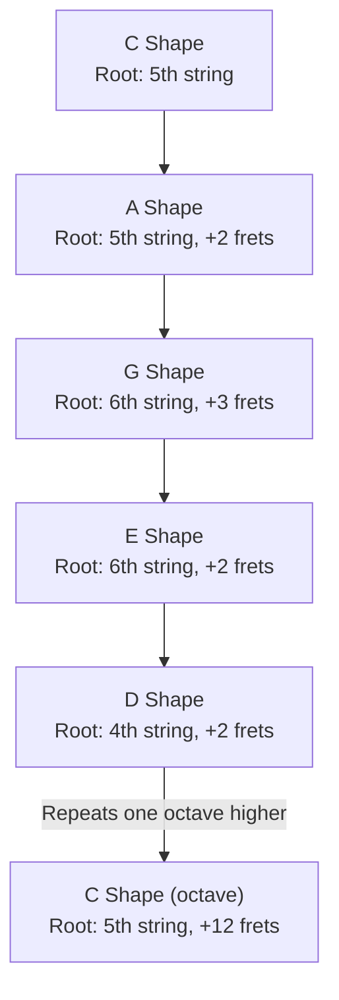
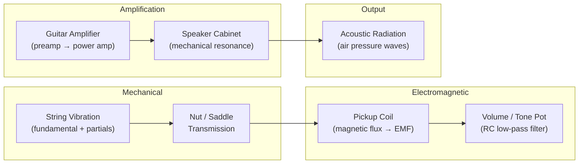
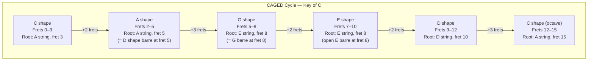
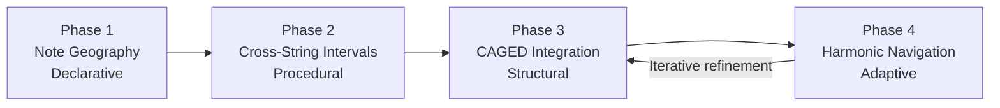

# Lesson 1: Fretboard Navigation Basics — A First-Principles Technical Reference

## 1. First-Principles Intuition & Invariants

### The Physics of Equal Temperament

The electric guitar's fretboard is a physical instantiation of the equal-tempered chromatic scale. Every fret placement is computed from one invariant: adjacent semitones maintain a frequency ratio of $2^{1/12} \approx 1.05946$. The absolute frequency of any fretted note is therefore:

$$f_n = f_0 \cdot 2^{n/12}$$

where $f_0$ is the open-string frequency and $n$ is the fret number. This exponential relationship has a direct geometric consequence: fret spacing decreases logarithmically along the neck. The distance from the nut to fret $n$ on a scale-length $L$ instrument is:

$$d_n = L \cdot \left(1 - 2^{-n/12}\right)$$

For a Fender Stratocaster with $L = 648$ mm (25.5 inches), the nut-to-fret-1 distance is approximately 36.4 mm, while the nut-to-fret-12 distance is exactly $L/2 = 324$ mm — the octave invariant. This is why the 12th fret always falls at the geometric midpoint of the vibrating string, regardless of instrument or tuning.

The practical implication: intonation errors accumulate multiplicatively. A saddle position error of 1 mm on a 648 mm scale introduces roughly $\pm 2.7$ cents of pitch error per octave traversed. This is the first-principles reason why saddle intonation adjustment is not optional on a well-set-up instrument.

### Standard Tuning: Why These Intervals?

Standard tuning — E2 (82.41 Hz), A2 (110.00 Hz), D3 (146.83 Hz), G3 (196.00 Hz), B3 (246.94 Hz), E4 (329.63 Hz) — is not arbitrary. The interval structure is predominantly perfect fourths (5 semitones) with a single major third (4 semitones) between G3 and B3. This asymmetry is a deliberate compromise between two competing constraints:

1. **Chord voicing ergonomics.** A pure all-fourths tuning (E–A–D–G–C–F) produces symmetric interval patterns across all strings but makes open major chords mechanically awkward — the open E major chord would require a four-fret stretch on the first three strings.
2. **Range and register balance.** The maj3 between G and B keeps the first and second strings close enough in pitch that melody playing in the high register remains idiomatic.

The all-fourths exception means that any chord or scale shape learned on strings 6–5–4 or 4–3 must be mentally adjusted by one fret when crossing the G–B boundary — a persistent source of confusion for learners and a source of elegantly asymmetric fingerings for advanced players.

### The Harmonic Series and Open String Resonance

A plucked string does not produce a single frequency. It vibrates simultaneously at all integer multiples of the fundamental:

$$f_m = m \cdot f_0, \quad m = 1, 2, 3, \ldots$$

The relative amplitude of each partial is determined by the plucking position and string stiffness. Plucking near the bridge emphasizes high-order partials (bright tone); plucking near the 12th fret cancels even-order partials (hollow, woody tone). The 12th-fret natural harmonic — produced by lightly touching the string at its midpoint — isolates the second partial at $2f_0$, one octave above the open string. The 7th-fret harmonic isolates the third partial at $3f_0$, a perfect fifth plus one octave above the fundamental.

This matters for fretboard navigation because sympathetic resonance between open strings and fretted notes produces the characteristic "openness" of certain chord voicings. An E major chord in open position resonates sympathetically across all six strings; the same chord barred at the 7th fret does not, because the open strings are no longer harmonically related to the fretted pitches. Understanding this explains why open-position chords and their barre equivalents have distinct timbral characters beyond mere register differences.

---

## 2. Core Architecture & Mechanics

### The Fretboard as a Pitch Matrix

The fretboard is a two-dimensional discrete pitch space. Assign string index $s \in \{1, \ldots, 6\}$ (high E to low E) and fret index $f \in \{0, \ldots, 24\}$. The MIDI note number at any position is:

$$\text{MIDI}(s, f) = \text{MIDI}_{\text{open}}(s) + f$$

The open-string MIDI values in standard tuning are: E4=64, B3=59, G3=55, D3=50, A2=45, E2=40. The full pitch matrix for the first 12 frets is:

```
String │  0    1    2    3    4    5    6    7    8    9   10   11   12
───────┼────────────────────────────────────────────────────────────────
  e(1) │  E4   F4  F#4  G4  G#4  A4  A#4  B4   C5  C#5  D5  D#5  E5
  B(2) │  B3   C4  C#4  D4  D#4  E4   F4  F#4  G4  G#4  A4  A#4  B4
  G(3) │  G3  G#3  A3  A#3  B3   C4  C#4  D4  D#4  E4   F4  F#4  G4
  D(4) │  D3  D#3  E3   F3  F#3  G3  G#3  A3  A#3  B3   C4  C#4  D4
  A(5) │  A2  A#2  B2   C3  C#3  D3  D#3  E3   F3  F#3  G3  G#3  A3
  E(6) │  E2   F2  F#2  G2  G#2  A2  A#2  B2   C3  C#3  D3  D#3  E2
```

The octave equivalence invariant is immediately visible: fret 12 on any string produces the same pitch class as fret 0, one octave higher. This means every pattern, shape, or fingering repeats identically 12 frets up the neck.

### Interval Topology Across the Neck

The fretboard has four canonical interval movements, each with a precise fret-offset interpretation:

| Movement | Interval | Semitones | Fret offset | String delta |
|---|---|---|---|---|
| Adjacent fret, same string | Minor 2nd (semitone) | 1 | +1 | 0 |
| Two frets, same string | Major 2nd (tone) | 2 | +2 | 0 |
| Same fret, adjacent string (not G→B) | Perfect 4th | 5 | 0 | +1 |
| Same fret, G→B string crossing | Major 3rd | 4 | 0 | +1 |
| To same pitch class, next string down (not G→B) | Unison | 0 | +5 | +1 |
| To same pitch class, next string down (G→B) | Unison | 0 | +4 | +1 |

The unison offsets (+5 or +4 frets) are the operational definition of standard tuning. They are the most important navigation primitives on the instrument.

```mermaid
graph LR
    A["E2\n(6th string, fret 0)"] -->|"+5 frets → unison on 5th string"| B["A2\n(5th string, fret 0)"]
    B -->|"+5 frets → unison on 4th string"| C["D3\n(4th string, fret 0)"]
    C -->|"+5 frets → unison on 3rd string"| D["G3\n(3rd string, fret 0)"]
    D -->|"+4 frets → unison on 2nd string\n(G→B exception)"| E["B3\n(2nd string, fret 0)"]
    E -->|"+5 frets → unison on 1st string"| F["E4\n(1st string, fret 0)"]
```



This graph is not merely descriptive — it is the derivation of every cross-string interval. Any melodic interval can be expressed as a combination of these primitives.

### The CAGED System: Structural Analysis

The CAGED system is a consequence of the fretboard's interval topology, not a pedagogical convention imposed upon it. Five open-position major chord voicings tile the fretboard without gaps when each shape's root is connected to the next shape's root via the cross-string unison offsets derived above.

Each CAGED shape contains the same three pitch classes (root, major third, perfect fifth) but distributes them across strings differently. The critical architectural insight is that **the shapes interlock**: the highest-pitched notes of one shape overlap with the lowest-pitched notes of the next shape at the same fret range.



The fret distances between consecutive root positions are not uniform because the root migrates between strings, encountering the G→B asymmetry at different points in the cycle. This is why the G and E shapes are "wider" — they span more frets — than the C, A, and D shapes.

### Signal Chain Architecture

Fretboard navigation does not exist in isolation; the acoustic event produced by fretting a note is transformed by a chain of electromechanical and electronic stages before it becomes sound. Understanding this chain matters because it determines which physical techniques produce which audible results.



A single-coil pickup (Stratocaster) samples string velocity at a fixed point. The output voltage is proportional to the rate of change of magnetic flux: $V = -N \frac{d\Phi}{dt}$. This means the pickup does not capture a "snapshot" of the waveform — it captures its derivative. High-frequency partials, which change rapidly, are therefore emphasized relative to fundamentals. A humbucker, with its two opposing coils wired in series, cancels external electromagnetic interference (hum) while summing string-vibration signal, producing higher output and a warmer frequency response due to increased inductance.

The tone control is a first-order RC low-pass filter: a capacitor (typically 0.047 µF on a Stratocaster, 0.022 µF on a Les Paul) in series with a potentiometer to ground. The cutoff frequency is:

$$f_c = \frac{1}{2\pi RC}$$

Turning down the tone knob increases $R$, lowering $f_c$ and rolling off high-frequency partials. This is why the same fretted note sounds dramatically different at different tone settings — the timbre, not the pitch, changes.

---

## 3. Computational Fretboard Modeling

The fretboard's mathematical structure makes it tractable to model programmatically. The following Python implementation computes pitch matrices, identifies enharmonic equivalents, finds all positions for a given note, and generates scale/chord position sets.

```python
"""
fretboard.py — A first-principles fretboard position calculator.

Models the fretboard as a pitch matrix and provides efficient lookup,
interval computation, and scale/chord position generation.
"""

from __future__ import annotations
from dataclasses import dataclass
from typing import Iterator

# ── Constants ────────────────────────────────────────────────────────────────

# MIDI note numbers for open strings: index 0 = high E (string 1)
STANDARD_TUNING_MIDI: tuple[int, ...] = (64, 59, 55, 50, 45, 40)

# Chromatic note names, enharmonic-aware
NOTE_NAMES: tuple[str, ...] = (
    "C", "C#/Db", "D", "D#/Eb", "E", "F",
    "F#/Gb", "G", "G#/Ab", "A", "A#/Bb", "B"
)

# Interval structures: semitone offsets from root
SCALE_INTERVALS: dict[str, tuple[int, ...]] = {
    "major":           (0, 2, 4, 5, 7, 9, 11),
    "natural_minor":   (0, 2, 3, 5, 7, 8, 10),
    "harmonic_minor":  (0, 2, 3, 5, 7, 8, 11),
    "pentatonic_major":(0, 2, 4, 7, 9),
    "pentatonic_minor":(0, 3, 5, 7, 10),
    "blues":           (0, 3, 5, 6, 7, 10),
    "dorian":          (0, 2, 3, 5, 7, 9, 10),
    "mixolydian":      (0, 2, 4, 5, 7, 9, 10),
}

CHORD_INTERVALS: dict[str, tuple[int, ...]] = {
    "major":    (0, 4, 7),
    "minor":    (0, 3, 7),
    "dom7":     (0, 4, 7, 10),
    "maj7":     (0, 4, 7, 11),
    "min7":     (0, 3, 7, 10),
    "dim7":     (0, 3, 6, 9),
    "aug":      (0, 4, 8),
    "sus2":     (0, 2, 7),
    "sus4":     (0, 5, 7),
}


# ── Core Data Model ───────────────────────────────────────────────────────────

@dataclass(frozen=True)
class FretPosition:
    """A unique location on the fretboard."""
    string: int   # 1-indexed, 1 = high E, 6 = low E
    fret: int     # 0 = open string

    @property
    def midi(self) -> int:
        return STANDARD_TUNING_MIDI[self.string - 1] + self.fret

    @property
    def pitch_class(self) -> int:
        return self.midi % 12

    @property
    def note_name(self) -> str:
        return NOTE_NAMES[self.pitch_class]

    @property
    def octave(self) -> int:
        return (self.midi // 12) - 1

    def __str__(self) -> str:
        string_names = ["e", "B", "G", "D", "A", "E"]
        return f"{string_names[self.string - 1]}:{self.fret}({self.note_name}{self.octave})"


class Fretboard:
    """
    A complete model of the guitar fretboard under a given tuning.

    Provides O(1) note lookup and efficient position search via
    precomputed pitch-class index.
    """

    def __init__(
        self,
        tuning: tuple[int, ...] = STANDARD_TUNING_MIDI,
        num_frets: int = 24,
    ) -> None:
        self.tuning = tuning
        self.num_strings = len(tuning)
        self.num_frets = num_frets

        # Precompute: pitch_class → list of FretPosition
        self._index: dict[int, list[FretPosition]] = {pc: [] for pc in range(12)}
        for s in range(1, self.num_strings + 1):
            for f in range(self.num_frets + 1):
                pos = FretPosition(string=s, fret=f)
                self._index[pos.pitch_class].append(pos)

    def all_positions_for_note(self, pitch_class: int) -> list[FretPosition]:
        """Return every fretboard position that produces the given pitch class (0=C … 11=B)."""
        return self._index[pitch_class % 12]

    def positions_in_range(
        self,
        pitch_class: int,
        fret_min: int = 0,
        fret_max: int | None = None,
    ) -> list[FretPosition]:
        """Filter positions by fret range — useful for positional playing."""
        if fret_max is None:
            fret_max = self.num_frets
        return [
            p for p in self.all_positions_for_note(pitch_class)
            if fret_min <= p.fret <= fret_max
        ]

    def scale_positions(
        self,
        root_pc: int,
        scale: str,
        fret_min: int = 0,
        fret_max: int = 24,
    ) -> dict[int, list[FretPosition]]:
        """
        Return all fretboard positions for each degree of the given scale.

        Returns a dict mapping scale degree (0-indexed) → [FretPosition].
        """
        intervals = SCALE_INTERVALS[scale]
        return {
            degree: self.positions_in_range(
                (root_pc + semitones) % 12, fret_min, fret_max
            )
            for degree, semitones in enumerate(intervals)
        }

    def chord_positions(
        self,
        root_pc: int,
        chord_type: str,
        fret_min: int = 0,
        fret_max: int = 24,
    ) -> dict[int, list[FretPosition]]:
        """Return all fretboard positions for each note in the given chord."""
        intervals = CHORD_INTERVALS[chord_type]
        return {
            degree: self.positions_in_range(
                (root_pc + semitones) % 12, fret_min, fret_max
            )
            for degree, semitones in enumerate(intervals)
        }

    def interval_between(self, pos_a: FretPosition, pos_b: FretPosition) -> int:
        """Return the signed interval in semitones from pos_a to pos_b."""
        return pos_b.midi - pos_a.midi

    def render_positions(
        self,
        positions: list[FretPosition],
        fret_min: int = 0,
        fret_max: int = 12,
    ) -> str:
        """
        Render a set of positions as a fretboard diagram.

        Marks each active position with its note name; open strings with 'o'.
        """
        string_names = ["e", "B", "G", "D", "A", "E"]
        pos_set = {(p.string, p.fret) for p in positions}
        lines: list[str] = []

        header = "    " + "".join(f"{f:>4}" for f in range(fret_min, fret_max + 1))
        lines.append(header)
        lines.append("    " + "----" * (fret_max - fret_min + 1))

        for s in range(1, self.num_strings + 1):
            label = string_names[s - 1]
            cells: list[str] = []
            for f in range(fret_min, fret_max + 1):
                if (s, f) in pos_set:
                    pos = FretPosition(string=s, fret=f)
                    cells.append(f"{pos.note_name:>4}")
                else:
                    cells.append("   .")
            lines.append(f"{label:>2}  {''.join(cells)}")

        return "\n".join(lines)


# ── Frequency Computation ─────────────────────────────────────────────────────

def fret_frequency(open_freq: float, fret: int) -> float:
    """Return the frequency of a fretted note given the open string frequency."""
    return open_freq * (2 ** (fret / 12))


def fret_position_mm(scale_length_mm: float, fret: int) -> float:
    """
    Compute the distance from the nut to a given fret in millimeters.

    Derived from: d_n = L * (1 - 2^(-n/12))
    """
    return scale_length_mm * (1.0 - 2 ** (-fret / 12))


def intonation_cents_error(
    target_freq: float, actual_freq: float
) -> float:
    """
    Compute the intonation error in cents.

    100 cents = 1 semitone. Human pitch discrimination threshold ≈ 5–10 cents.
    """
    import math
    return 1200.0 * math.log2(actual_freq / target_freq)


# ── Demo ──────────────────────────────────────────────────────────────────────

if __name__ == "__main__":
    import math

    board = Fretboard()

    # --- 1. Show all positions for the note A (pitch class 9) ---
    print("=== All positions for A (pitch class 9) ===")
    for pos in board.all_positions_for_note(9):
        print(f"  {pos}")

    # --- 2. Show E minor pentatonic positions in first position (frets 0–5) ---
    print("\n=== E minor pentatonic (frets 0–5) ===")
    E_PC = 4  # E = pitch class 4
    scale_pos = board.scale_positions(E_PC, "pentatonic_minor", fret_min=0, fret_max=5)
    all_pos: list[FretPosition] = []
    for degree, positions in scale_pos.items():
        for p in positions:
            all_pos.append(p)
    print(board.render_positions(all_pos, fret_min=0, fret_max=5))

    # --- 3. Fret spacing for Stratocaster scale length ---
    print("\n=== Strat fret spacing (648 mm scale) ===")
    print(f"{'Fret':>6} {'Dist from nut (mm)':>22} {'Freq E2 (Hz)':>16}")
    for f in range(13):
        dist = fret_position_mm(648.0, f)
        freq = fret_frequency(82.407, f)
        print(f"{f:>6} {dist:>22.2f} {freq:>16.3f}")

    # --- 4. Intonation error example ---
    target = fret_frequency(82.407, 12)   # Perfect octave
    actual = fret_frequency(82.407, 12) * 1.001  # 0.1% sharp saddle error
    error = intonation_cents_error(target, actual)
    print(f"\nIntonation error (0.1% saddle displacement): {error:.2f} cents")
```

---

## 4. The CAGED System: Geometric Proof

The CAGED system is often presented as a memorization trick. It is more correctly understood as a theorem about the fretboard's topology under standard tuning. Here is the derivation.

**Premise:** Every major chord consists of pitch classes {R, R+4, R+7} (root, major third, perfect fifth). These three pitch classes must appear on all six strings in a playable voicing (maximum 4-fret span, no string skipping in most positions).

**Derivation of shape transitions:** Starting from an open C major chord (root on A string, fret 3), moving to a voicing one perfect fourth higher (F major) requires the root to move up 5 semitones on the same string — fret 8 on the A string. This is impractical as a barre chord anchor on the A string because the shape becomes a compression of the C shape. Instead, the root migrates to the E string (fret 1), producing the E shape for F major.

This root migration between strings, governed by the cross-string unison offsets derived in Section 2, produces exactly five distinct shape classes before returning to the original shape 12 frets up. The shapes are named after the open-chord that each resembles at its lowest playable position.



The fret offsets (+2, +3, +2, +2, +3) sum to 12 — one octave — confirming the cycle completes correctly. The two larger jumps (+3) occur at the G and D shapes because the root crosses the G→B string boundary, requiring one extra fret to maintain pitch equivalence.

---

## 5. High-Performance Navigation & Failure Mode Analysis

### Cognitive Architecture of Fretboard Mastery

Expert fretboard navigation is a multi-layer cognitive skill, not a linear memorization task. The architecture has three levels:

**Level 1 — Reactive (pitch class → position).** Given a target note, instantly identify all positions within reach. This requires the cross-string unison offsets (Section 2) to be internalized as motor reflexes, not conscious recall. Practice tool: "single-note geography" — name every note on every string in random order under a 1-second timeout.

**Level 2 — Structural (position → scale/chord context).** Given a hand position, recognize which CAGED shape contains it and which scale degrees are available without shifting. This is pattern recognition on the pitch matrix defined in Section 2.

**Level 3 — Harmonic (progression → voice-leading trajectory).** Given a chord progression, plan a continuous trajectory through CAGED shapes that minimizes hand displacement while maintaining melodic voice leading. This is a shortest-path problem on the fretboard graph.

The Level 3 problem is formally equivalent to finding a minimum-weight path through a graph where nodes are CAGED-shape positions and edge weights represent hand displacement cost. Advanced players solve this heuristically; it can be computed exactly using dynamic programming on the pitch matrix.

### Economy of Motion: Biomechanical Analysis

The left hand (fretting hand) operates most efficiently when the wrist is slightly forward of the neck, the thumb sits behind the middle finger, and each finger is pre-positioned over its assigned fret before sounding. These are not stylistic preferences — they follow from the anatomy of the flexor digitorum superficialis and profundus tendons, which share a common sheath through the carpal tunnel.

Excessive grip strength is the primary failure mode. The force required to fret a note on a well-set-up electric guitar (action ≈ 2 mm at the 12th fret, 9–42 gauge strings) is approximately 0.5–1.5 N per string — far less than untrained players apply. Chronic overgripping compresses the median nerve (carpal tunnel syndrome) and inflames the flexor tendons. The engineering solution is proper setup (nut height, truss rod relief, saddle height) which minimizes required fretting force, and deliberate practice of minimum-force fretting.

**Finger independence** is limited by the extensor digitorum communis, which shares tendon slips across all four fingers. The ring and pinky fingers share a particularly coupled connection, which is why the "ring finger down, pinky free" movement is mechanically harder than any other combination. Exercises targeting this coupling should isolate the specific tendon slip, not merely repeat chord shapes.

### Failure Mode Taxonomy

| Failure Mode | Root Cause | Diagnostic | Remediation |
|---|---|---|---|
| Notes sound as "thuds" | Insufficient fretting-hand pressure, or finger pad touching adjacent string | Note sounds when string plucked alone but mutes in chord | Adjust finger arch; ensure tip placement |
| Fret buzz | Fretting finger too far from fret wire, or action too low | Buzz disappears when pressing harder | Move finger closer to fret; setup adjustment |
| Positional locking | CAGED shape memorized without interval understanding | Cannot locate a note outside the memorized box | Practice scale degrees by number, not by shape |
| Cross-string interval errors | G→B asymmetry not internalized | Patterns that work on strings 6–4 fail on strings 3–1 | Explicitly practice crossing the G–B boundary |
| Intonation drift up the neck | Saddle not properly intonated, or high action | Harmonics at fret 12 ≠ fretted note at fret 12 | Intonate saddle; check truss rod relief |
| Tendon strain / RSI | Excess grip force, collapsed wrist angle | Pain along forearm or in palm | Minimum-force fretting; ergonomic wrist position |

### Intonation Verification Protocol

A calibrated workflow for intonation setup, expressed as executable logic:

```python
def verify_intonation(
    string_index: int,
    open_freq: float,
    fret12_freq: float,
    tolerance_cents: float = 3.0,
) -> dict:
    """
    Verify 12th-fret intonation against the theoretical perfect octave.

    Parameters
    ----------
    string_index    : 1–6 (high E to low E)
    open_freq       : measured open-string frequency in Hz
    fret12_freq     : measured 12th-fret frequency in Hz
    tolerance_cents : acceptable deviation in cents (default: 3.0)

    Returns
    -------
    dict with keys: expected_freq, actual_freq, error_cents, status, action
    """
    import math

    expected = open_freq * 2.0  # Perfect octave
    error_cents = 1200.0 * math.log2(fret12_freq / expected)

    if abs(error_cents) <= tolerance_cents:
        status = "PASS"
        action = "No adjustment required."
    elif error_cents > 0:
        status = "FAIL — SHARP"
        action = "Move saddle away from nut (increase string length)."
    else:
        status = "FAIL — FLAT"
        action = "Move saddle toward nut (decrease string length)."

    return {
        "string": string_index,
        "open_freq_hz": round(open_freq, 3),
        "expected_12th_hz": round(expected, 3),
        "actual_12th_hz": round(fret12_freq, 3),
        "error_cents": round(error_cents, 2),
        "status": status,
        "action": action,
    }


# Example: check all six strings against measured frequencies
MEASURED_OPEN:   tuple[float, ...] = (329.63, 246.94, 196.00, 146.83, 110.00, 82.41)
MEASURED_FRET12: tuple[float, ...] = (659.26, 493.88, 392.00, 293.66, 220.00, 164.81)

if __name__ == "__main__":
    for i, (op, f12) in enumerate(zip(MEASURED_OPEN, MEASURED_FRET12), start=1):
        result = verify_intonation(i, op, f12)
        print(
            f"String {result['string']}: {result['status']:18s} "
            f"({result['error_cents']:+.2f} cents)  → {result['action']}"
        )
```

---

## 6. Practice Architecture: Structured Progression

Effective fretboard mastery follows a progression from declarative knowledge (naming notes) through procedural fluency (finding intervals reflexively) to adaptive expertise (constructing lines in real time). The following structure implements this progression:

**Phase 1 — Note Geography (weeks 1–4).** Map all 12 notes on each string individually. The constraint: no visual pattern recognition allowed — name the note by computing its distance from the nearest open-string landmark. Target: any note on any string within 2 seconds.

**Phase 2 — Cross-String Intervals (weeks 3–8).** Practice the 11 canonical interval relationships across all string pairs. Special emphasis on G→B crossing. Target: given any note, name the note 3 strings higher/lower at the same fret within 1 second.

**Phase 3 — CAGED Shape Integration (weeks 6–16).** Map each CAGED shape not as a fingering, but as a set of scale degrees. For each shape, identify the 1, 3, 5, b7 on every string. Practice connecting shapes through shared notes at their overlap zones.

**Phase 4 — Harmonic Context Navigation (ongoing).** Given a ii–V–I progression in any key, navigate it through two consecutive CAGED positions without repeating any shape. This forces Level 3 cognitive processing (Section 5) and develops the trajectory planning required for professional-level improvisation.



---

## 7. Summary: Invariants and Key Theorems

The following invariants govern the entire fretboard system and should be treated as axioms — every advanced concept derives from them:

1. **Equal temperament axiom.** $f_n = f_0 \cdot 2^{n/12}$. All pitch relationships are computable from this formula.

2. **Octave invariant.** Fret 12 is a perfect octave above fret 0 on the same string. Every pattern repeats at 12-fret displacement.

3. **Cross-string unison offsets.** Moving to the same pitch on the adjacent higher string requires +5 frets (or +4 across the G→B boundary). These two values encode the entire architecture of standard tuning.

4. **CAGED completeness theorem.** The five CAGED shapes tile the fretboard without gaps, with consecutive roots separated by offsets summing to 12 (one octave). The asymmetric offsets (+2, +3, +2, +2, +3) arise directly from the G→B major-third exception.

5. **Harmonic series and timbre.** The pickup captures $\frac{d\Phi}{dt}$, not $\Phi$ directly. Plucking position, pickup position, and tone control collectively determine which partials survive to the amplifier. Fretted pitch is invariant to these parameters; timbre is not.

Mastery of the electric guitar's fretboard is, at its core, mastery of these five invariants applied reflexively under the time pressure of musical performance.
