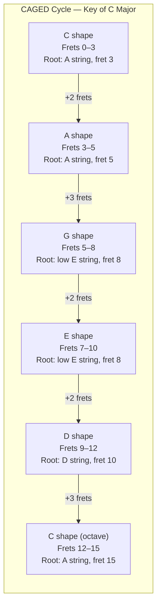
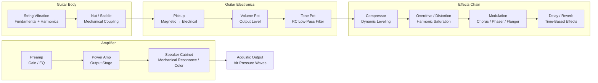
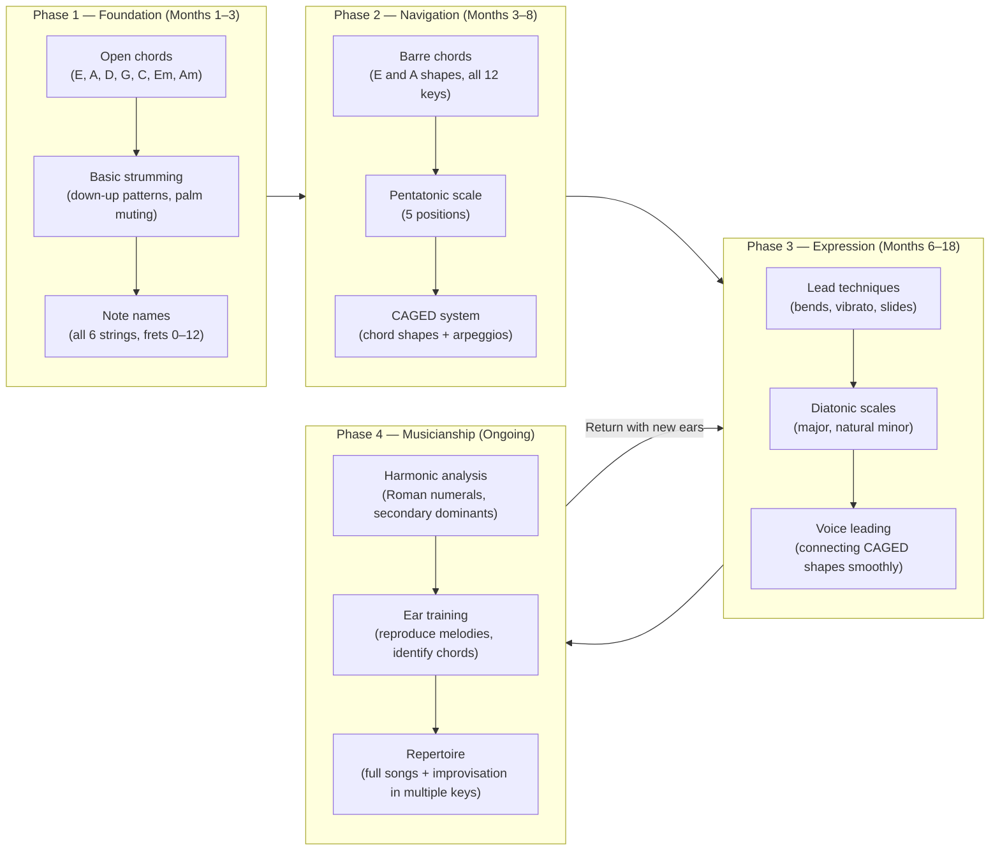

# Electric Guitar Masterclass: Fretboard Navigation, Technique & Musicianship

## Module 1: Hands-On Fretboard Orientation

### Your First Day on the Neck — What to Actually Practice

Before theory, here is the physical reality: you have six strings, 22–24 frets, and two hands that need to work independently. The left hand frets; the right hand picks or strums. Neither hand knows what the other is doing until you train them together.

**Day-one physical checklist:**

- Thumb sits behind the neck, roughly opposite your middle finger — not hooked over the top.
- Wrist floats slightly away from the neck. If your palm is touching the neck body, your wrist has collapsed.
- Fret with the fingertip, not the pad. Your finger should arch enough that the nail faces the ceiling.
- Press down just behind the fret wire (between frets), not on top of it and not halfway between two frets.
- Use only the pressure needed to get a clean note — which is far less than you think. Electric guitar action is typically 1.5–2.5 mm at the 12th fret. You are pressing a string down a couple of millimeters, not crushing a walnut.

**Right hand anchor:** Rest the heel of your right hand lightly on the bridge saddles. This gives you palm muting control and a stable reference point. Your pick angle should be roughly 30–45° relative to the string — not perfectly parallel, not perpendicular.

---

### The Six Strings — Names, Notes, and Memory Hooks

```
String 6 (thickest, lowest) ── E2  ── "Eddie"
String 5                     ── A2  ── "Ate"
String 4                     ── D3  ── "Dynamite"
String 3                     ── G3  ── "Good"
String 2                     ── B3  ── "Bye"
String 1 (thinnest, highest) ── E4  ── "Eddie" (octave)
```

Memory sentence: **E**ddie **A**te **D**ynamite, **G**ood **B**ye **E**ddie.

The two E strings are the same pitch class, two octaves apart. Everything you learn on the low E string repeats on the high E string — same fret numbers, same note names, octave higher.

**Open string drill — Day 1:**
Say the string name and note name out loud as you pluck each string, one per click at 60 BPM. Then reverse direction. Then skip strings (6→4→2→1→3→5). Do this until "low E, A, D, G, B, high E" is as automatic as your own name.

---

### The Chromatic Map — Every Note Across the Neck

The neck is a grid. Moving one fret up raises pitch by one semitone (a half step). Moving across to the adjacent thicker string at the same fret raises pitch by a perfect fourth (5 semitones) — except crossing from string 3 (G) to string 2 (B), which raises pitch by only a major third (4 semitones). That G→B exception is the single most important asymmetry on the instrument. It affects every scale shape, every chord voicing, and every interval you transfer across strings.

**Full note map — frets 0 through 12:**

```
String │  0    1    2    3    4    5    6    7    8    9   10   11   12
───────┼────────────────────────────────────────────────────────────────
  e(1) │  E4   F    F#   G    G#   A    A#   B    C    C#   D    D#   E5
  B(2) │  B3   C    C#   D    D#   E    F    F#   G    G#   A    A#   B4
  G(3) │  G3   G#   A    A#   B    C    C#   D    D#   E    F    F#   G4
  D(4) │  D3   D#   E    F    F#   G    G#   A    A#   B    C    C#   D4
  A(5) │  A2   A#   B    C    C#   D    D#   E    F    F#   G    G#   A3
  E(6) │  E2   F    F#   G    G#   A    A#   B    C    C#   D    D#   E3
```

The fret-12 column is identical to fret-0 — just one octave higher. This is the octave invariant: every shape, pattern, and fingering repeats exactly 12 frets up the neck.

**Note geography drill — Week 1–2:**
Pick one note (start with the note A). Find every A on every string from frets 0–12. Use the table above, then close the book and find them from memory. Target: locate any note on any single string within 2 seconds. Work through all 12 pitch classes over two weeks.

---

## Module 2: Left-Hand Technique — Ergonomics and Mechanics

### Fretting Hand Posture in Detail

The fretting hand has four fingers numbered 1 (index) through 4 (pinky). Thumb is not numbered — it is the anchor, not a fretting finger (except for specific thumb-over techniques used in blues and rock).

**Correct arch:**
Each finger should curve so that the tip makes contact with the string, not the pad. This prevents accidentally muting adjacent strings. Visualize holding a small ball in your palm — that natural curve is the right starting shape.

**Thumb placement rule:**
For frets 1–5 (wider spacing), keep the thumb behind the middle finger (finger 2). For frets 7–12 (narrower spacing), the thumb can drift slightly toward the index finger. Never let the thumb creep over the top of the neck when playing single notes — that collapses the wrist and kills your reach.

**One finger per fret (OFPF) — when to use it:**
On most electric guitars, OFPF is comfortable from around fret 5 upward, where fret spacing tightens. In the first position (frets 1–4 on a standard 25.5" scale), stretching all four fingers across four frets is demanding for beginners. Build up to it gradually.

### Four-Finger Independence Exercises

The ring finger (3) and pinky (4) share a tendon branch from the extensor digitorum communis. This coupling is why the "pinky independent of ring finger" movement is the hardest on the instrument. These exercises address it directly.

**Exercise 1 — Spider Crawl (60 BPM → 100 BPM):**

Play this pattern on every string pair, then advance up and down the neck. Keep fingers 1–4 assigned strictly to frets 5–6–7–8.

```
e|──5──6──7──8──|
B|──5──6──7──8──|
G|──5──6──7──8──|
D|──5──6──7──8──|
A|──5──6──7──8──|
E|──5──6──7──8──|
```

Fingers: 1–2–3–4 on each string. No lifting a finger until the next pattern requires it. Each note clean and equal volume.

**Exercise 2 — Ring/Pinky isolation (60 BPM):**

```
e|──7──────9──|  (fingers 3 then 4, fingers 1 and 2 resting on frets 5 and 6)
B|──7──────9──|
G|──7──────9──|
```

Hold fingers 1 and 2 down on frets 5 and 6 at all times. Only fingers 3 and 4 move. This forces the specific tendon slip that controls the pinky in isolation from the ring finger. Even 5 minutes daily over two weeks produces measurable improvement.

**Exercise 3 — Hammer-on/Pull-off strength (70 BPM):**

```
e|──5h7──7p5──| (repeat 8 times per string)
B|──5h7──7p5──|
G|──5h7──7p5──|
```

Hammer-ons must be loud enough to sound without a right-hand pick stroke. Pull-offs must be a slight sideways flick, not a straight lift — the sideways motion plucks the lower string.

---

## Module 3: Right-Hand Mechanics — Picking, Strumming, and Fingerstyle

### Pick Mechanics

**Grip:** Hold the pick between the side of the index finger and the pad of the thumb. The pick tip should extend about 3–5 mm past your fingers. Too much pick exposed = uncontrolled flex. Too little = your fingers drag the string.

**Alternate picking:** Down on the beat, up on the offbeat. This is the foundational motion — consistent, symmetrical, and efficient. Practice with a metronome starting at 60 BPM. Only increase tempo when every note sounds equally clean and equally loud.

**Downstroke authority:** Most rhythm playing uses predominantly downstrokes because downstrokes produce a stronger, more forceful attack that sits better in a band mix. Reserve upstrokes for intentional articulation choices, not default habit.

**Pick slant angles:**
- Downward pick slant (DPS): pick tip angled downward. Favors downstrokes; common in rock/metal rhythm playing.
- Upward pick slant (UPS): pick tip angled upward. Favors upstrokes; common in country and certain lead styles.
- Neutral/flat: used for tremolo picking and strict alternate picking.

**Economy picking:** Instead of always alternating, sweep in the direction of string travel when crossing strings. Moving from string 6 to string 1, use consecutive downstrokes; moving back, consecutive upstrokes. Economy picking reduces pick travel distance at high speeds.

**Alternate picking drill (60 BPM → 120 BPM):**

```
e|──5─6─7─8──8─7─6─5──| (down-up-down-up throughout)
B|──5─6─7─8──8─7─6─5──|
(continue all strings)
```

One note per click. Increase by 5 BPM only when the previous tempo sounds effortless.

### Palm Muting

Rest the heel of your right hand on the strings just forward of the bridge saddles — no more than 10–15 mm from the bridge. Too far forward = dead thud. Too far back (or lifting off) = unmuted ring. The sweet spot produces a "chugging" texture.

Palm muting is not a fixed position — it is dynamic. You can gradually roll your wrist forward mid-phrase to increase muting progressively, creating a swell effect. This is a core sound of rock and metal rhythm guitar.

### Fingerstyle Foundation

If you play without a pick, the right-hand fingers are assigned as follows:

```
Thumb (p) → strings 6, 5, 4 (bass strings)
Index (i) → string 3
Middle (m) → string 2
Ring (a)   → string 1
```

**Travis picking pattern — foundational (60 BPM):**

Over an open G chord (320033):

```
  T = thumb, i = index, m = middle, a = ring
  
  Beat: 1  +  2  +  3  +  4  +
  Str:  6     3     5     3     (thumb alternates 6th and 5th; fingers arpeggiate)
  R.H.: T     i     T     m
```

The thumb alternates between bass strings on beats 1 and 3 (sometimes 2 and 4), while the fingers independently pick the treble strings. This creates the illusion of two instruments playing simultaneously — it is the foundation of folk, country, and acoustic fingerstyle.

---

## Module 4: Open Chords — Your First Vocabulary

### The Five Essential Open Chord Shapes

Learn these in order. Each shape trains a different left-hand configuration.

**E major (022100):**
```
   E A D G B e
   0 2 2 1 0 0
   
   Finger 1: B string, fret 1
   Finger 2: A string, fret 2
   Finger 3: D string, fret 2
   Strings 1, 3, 6: open (ring openly)
```

**A major (x02220):**
```
   E A D G B e
   x 0 2 2 2 0
   
   Option 1: Fingers 1–2–3 on D–G–B strings, fret 2
   Option 2: Barre all three strings (D–G–B) at fret 2 with finger 1
   (Option 2 prepares you for barre chords)
```

**D major (xx0232):**
```
   E A D G B e
   x x 0 2 3 2
   
   Finger 1: G string, fret 2
   Finger 2: high e string, fret 2
   Finger 3: B string, fret 3
   Only strings 4–1 ring; mute strings 6 and 5
```

**G major (320003) — two fingerings:**
```
   Version 1 (beginner):
   Finger 1: A string, fret 2
   Finger 2: low E string, fret 3
   Finger 3: B string, fret 3
   
   Version 2 (preferred — leaves fingers 1 and 2 free):
   Finger 2: A string, fret 2
   Finger 3: low E string, fret 3
   Finger 4: high e string, fret 3
```

Version 2 of G major is superior because fingers 1 and 2 can drop immediately into a Cadd9, D, or Em shape — this is the secret to smooth chord transitions in the open position.

**C major (x32010):**
```
   E A D G B e
   x 3 2 0 1 0
   
   Finger 1: B string, fret 1
   Finger 2: D string, fret 2
   Finger 3: A string, fret 3
   G and high e strings: open
```

### Minor Chord Shapes

**Em (022000):**
```
   Finger 2: A string, fret 2
   Finger 3: D string, fret 2
   All other strings open — the most resonant open chord on the instrument
```

**Am (x02210):**
```
   Finger 1: B string, fret 1
   Finger 2: D string, fret 2
   Finger 3: G string, fret 2
```

**Dm (xx0231):**
```
   Finger 1: high e string, fret 1
   Finger 2: G string, fret 2
   Finger 3: B string, fret 3
```

### Chord Transition Drill — The Most Important Practice You Can Do

Pick any two chords. Set a metronome to 60 BPM. Change chord on beat 1 of every other measure (every 8 beats). Increase tempo only when the change is seamless and both chords ring clean.

**Priority transitions to drill:**
1. G → D → Em → C (the "axis" progression — appears in hundreds of songs)
2. Am → F → C → G
3. E → A → D (power progression for rock/blues)

**Pivot finger technique:** When transitioning between chords that share a note at the same string/fret, keep that finger planted. For example, going from C major to Am, your finger 1 (B string, fret 1) stays in place — it is the pivot. This eliminates one of the three fingers you need to move and dramatically speeds up the transition.

---

## Module 5: Barre Chords — Unlocking the Full Neck

### The E-Shape Barre Chord

The E major open chord shape, barred at any fret with the index finger, produces a major chord. The root is on the low E string (string 6) at the barre fret.

**F major barre (133211) — the first barre chord:**
```
   Fret 1, full barre with finger 1 across all 6 strings
   Finger 2: G string, fret 2
   Finger 3: A string, fret 3
   Finger 4: D string, fret 3
```

The barre is the hardest physical skill on the guitar. It fails in predictable ways:

| Failure | Cause | Fix |
|---|---|---|
| B string buzzes or mutes | Finger 1 bent at middle joint, creating a gap | Straighten finger 1; roll it very slightly toward the nut (toward headstock) |
| High e string mutes | Index finger not reaching string 1 | Extend finger farther; check thumb is behind index finger, not finger 2 |
| All strings buzz | Not enough pressure | Ensure fret placement is just behind (nut-side of) the fret wire |
| Wrist pain | Excess grip force | You are using 10x more force than needed; relax consciously |

**E-shape barre chord root map (string 6):**
```
Fret:  1    2    3    4    5    6    7    8    9   10   11   12
Root:  F    F#   G    G#   A    A#   B    C    C#   D    D#   E
```

Memorize this map. Once you know the note on the low E string at any fret, you have the chord name.

**E minor barre shape:** Remove finger 2 from the E major barre. The result is a minor chord with the same root locations.

### The A-Shape Barre Chord

The A major open chord shape, barred at any fret, produces a major chord with the root on the A string (string 5).

**B major barre (x24442):**
```
   Barre fret 2 with finger 1 (strings 1–5)
   Finger 2: D string, fret 4
   Finger 3: G string, fret 4
   Finger 4: B string, fret 4
   
   Alternative: barre fret 2, then barre frets 3–4 with finger 3 (D–G–B)
   This "mini-barre" is easier for most players.
```

**A-shape barre chord root map (string 5):**
```
Fret:  1    2    3    4    5    6    7    8    9   10   11   12
Root:  A#   B    C    C#   D    D#   E    F    F#   G    G#   A
```

### Combining E-Shape and A-Shape for Any Key

For any major chord, you have two barre positions: one with the root on string 6, one with the root on string 5. Use whichever puts your hand closer to where it already is. This is the beginning of voice-leading efficiency.

**Example — playing a I–IV–V in G:**
```
G major: E-shape barre, fret 3 (root on string 6)
C major: A-shape barre, fret 3 (root on string 5) — hand stays in position!
D major: A-shape barre, fret 5 (root on string 5) — shift up two frets
```

No position shift for the IV chord, one shift for the V. Compare this to jumping from fret 3 (G, E-shape) to fret 8 (C, E-shape) to fret 10 (D, E-shape) — that is three large shifts for the same progression. Economy of motion is built into the system once you know both shapes.

---

## Module 6: The CAGED System — Fretboard Architecture

### What CAGED Actually Is

CAGED is not a memorization gimmick. It is a consequence of standard tuning's interval structure. Because the tuning is primarily perfect fourths with one major-third exception (G→B), only five distinct open-chord shapes exist. These five shapes — C, A, G, E, D — tile the entire fretboard in a repeating cycle, covering every position with no gaps.

Each shape contains the same three pitch classes (root, major third, perfect fifth) distributed differently across the strings. The shapes interlock: the highest notes of one shape overlap with the lowest notes of the next.



The fret offsets (+2, +3, +2, +2, +3) sum to 12 — one octave. The two larger jumps happen at G and D shapes because those are the moments the root crosses the G→B string boundary, requiring one extra fret to maintain pitch equivalence.

### The Five Shapes with Scale Degrees Marked

For each shape, the root (R), major third (3), and perfect fifth (5) locations are shown. Knowing these three tones in every shape lets you construct chords, arpeggios, and melodies from any position.

**C shape (key of C, frets 0–3):**
```
e |──0──|──1──|──────|──3──|
B |──────|──1──|──────|──3──|
G |──────|──────|──2──|──────|   R=C, 3=E, 5=G
D |──────|──────|──2──|──3──|
A |──────|──────|──────|──3──R
E |──────|──────|──────|──────|
```

**A shape (key of C, frets 3–5):**
```
e |──────|──────|──5──|
B |──1──|──────|──5──|
G |──1──|──2──|──────|   R=C on A string fret 3
D |──1──|──2──|──────|
A |──────|──────|──5──R
E |──────|──────|──────|
  Fret:  3     4     5
```

**G shape (key of C, frets 5–8):**
```
e |──5──|──────|──7──|──8──|
B |──5──|──────|──7──|──8──|
G |──5──|──────|──────|──7──|   R=C on low E fret 8
D |──5──|──────|──7──|──────|
A |──5──|──────|──7──|──────|
E |──────|──────|──7──|──8──R
  Fret:  5      6     7     8
```

**E shape (key of C, frets 7–10):**
```
e |──7──|──8──|──────|──10─|
B |──8──|──────|──10─|──────|
G |──7──|──9──|──────|──────|   R=C on low E fret 8
D |──7──|──────|──9──|──10─|
A |──7──|──8──|──────|──10─|
E |──8──R──────|──10─|──────|
  Fret:  7     8     9    10
```

**D shape (key of C, frets 9–12):**
```
e |──9──|──────|──12─|
B |──────|──10─|──12─R(octave)
G |──9──|──────|──12─|
D |──────|──10─|──12─R
A |──────|──────|──────|
E |──────|──────|──────|
  Fret:  9    10    12
```

### CAGED Practice Protocol

Do not try to memorize all five shapes simultaneously. Work one shape per week.

**Week 1 — E shape:**
Play the E-shape barre chord at every root position from fret 1 to 12. For each position, also play the arpeggio (root → 3rd → 5th → octave root → 5th → 3rd → root) using only notes within that shape's fret span. Set metronome to 60 BPM, one note per two beats. Work up to 80 BPM.

**Week 2 — A shape:**
Repeat the same drill with the A-shape barre. Connect the A shape back to the E shape by finding the shared notes at their overlap zone (they share chord tones at the boundary frets).

**Weeks 3–5 — G, C, D shapes:**
Add one shape per week. By week 5, run the full CAGED cycle in one key (e.g., G major) up the neck without stopping.

**Shape-linking drill (after week 5):**
Choose a key. Play the chord in each CAGED shape consecutively up the neck. Transition by playing the shared note at the shape boundary, then resolving into the next shape. This builds shape continuity — the neck becomes one connected object, not five isolated boxes.

---

## Module 7: Pentatonic and Blues Scales — Lead Guitar Foundation

### The Minor Pentatonic Scale

Five notes. Two notes per string. The most versatile lead guitar tool on the instrument.

Minor pentatonic formula: Root – b3 – 4 – 5 – b7

**Position 1 (root position) — the starting point for all lead playing:**

For E minor pentatonic (root = E), position 1 sits at fret 0 (open position) or at fret 12.

```
e |──0──────3──|
B |──0──────3──|
G |──0──────2──|
D |──0──────2──|
A |──0──────2──|
E |──0──────3──|
```

For A minor pentatonic (root = A), position 1 sits at fret 5:

```
e |──5──────8──|
B |──5──────8──|
G |──5──────7──|
D |──5──────7──|
A |──5──────7──|
E |──5──────8──|
   Fret: 5      8
```

Fingers: use finger 1 for all the lower fret notes, finger 4 (or 3) for all the higher fret notes. This two-finger-per-string approach locks in the position cleanly.

### All Five Pentatonic Positions

The five pentatonic positions map directly onto the five CAGED shapes. This connection is not coincidental — the pentatonic scale is the skeleton of the major/minor chord. If you know CAGED, you already know where the five pentatonic positions live.

Here are all five positions of A minor pentatonic:

```
Position 1 (A shape) — frets 5–8:
e |──5──────8──|
B |──5──────8──|
G |──5──────7──|
D |──5──────7──|
A |──5──────7──|
E |──5──────8──|

Position 2 (G shape) — frets 7–10:
e |──8──────10─|
B |──8──────10─|
G |──7──────9──|
D |──7──────10─|
A |──7──────10─|
E |──8──────10─|

Position 3 (E shape) — frets 10–12:
e |──10─────12─|
B |──10─────12─|
G |──9──────12─|
D |──10─────12─|
A |──10─────12─|
E |──10─────12─|

Position 4 (D shape) — frets 12–15:
e |──12─────15─|
B |──13─────15─|
G |──12─────14─|
D |──12─────14─|
A |──12─────14─|
E |──12─────15─|

Position 5 (C shape) — frets 2–5 (or 14–17):
e |──2──────5──|
B |──1──────3──|
G |──2──────4──|
D |──2──────5──|
A |──2──────5──|
E |──2──────5──|
```

### The Blues Scale — Adding the b5

Add one note to the minor pentatonic: the flattened fifth (b5), also called the "blue note." This note creates the tension that makes blues guitar sound like blues guitar.

A blues scale: A – C – D – D# – E – G

**Position 1 of A blues scale (frets 5–8):**
```
e |──5──────8──|
B |──5──────8──|
G |──5──────7──|
D |──5──6───7──|   ← fret 6 = D# (the blue note)
A |──5──────7──|
E |──5──────8──|
```

The blue note appears on the D string at fret 6 (one fret above the root-octave shape note). It is used as a passing tone — you do not park on it. You bend through it, slide through it, or hit it and immediately resolve up or down.

### String Bending — The Core Lead Guitar Technique

A bend raises pitch by pushing the string toward the ceiling (on strings 1–3) or pulling toward the floor (on strings 4–6). One tone bend = 2 frets worth of pitch increase. Half-step bend = 1 fret. The pitch must arrive cleanly at the target — this is what separates a musical bend from an out-of-tune squawk.

**How to execute a whole-step bend:**
1. Place finger 3 (ring finger) on the note you want to bend. Place fingers 1 and 2 behind it on the same string for support — they add leverage.
2. Push the string perpendicular to the string's length, toward the ceiling (for strings 1, 2, 3).
3. The push comes from rotating the wrist, not from finger strength alone. The forearm rotates slightly counterclockwise as you push.
4. Target pitch: the note two frets higher than where your finger is.

**Verification drill:** Fret the target note (two frets up) so you hear it, then come back and bend up to match it. If your bend arrives at the same pitch, it is in tune. If not, adjust your wrist rotation.

**Classic bend positions (A minor pentatonic, position 1):**
```
e |──5──────8──|
B |──5──8b──8──|   ← fret 8 bend = whole step up to match fret 10 pitch
G |──5──7b──7──|   ← fret 7 bend = whole step up to match fret 9 pitch  
D |──5──7───7──|
A |──5──7───7──|
E |──5──────8──|

"b" = whole-step bend
```

### Lead Guitar Practice Structure (Daily 20 Minutes)

```
0:00 – 5:00  → Pentatonic position 1 up and down with alternate picking (60–90 BPM)
5:00 – 10:00 → Bending drill: 5 bends on the G string, 5 bends on the B string.
               Each bend held for 2 beats, then released slowly. Tune each one.
10:00 – 15:00 → Play along with a backing track in A minor.
               Constraint: stay inside position 1 only. Focus on phrasing (pauses, 
               dynamics) rather than playing every note as fast as possible.
15:00 – 20:00 → Connecting positions 1 and 2. Play a phrase in position 1,
               then slide or shift to position 2 and resolve there.
```

---

## Module 8: Rhythm Guitar and Chord Voicings

### Power Chords — The Foundation of Rock Rhythm

A power chord contains only two distinct pitch classes: the root and the perfect fifth. It is technically neither major nor minor, which makes it universally compatible with both.

**E5 power chord (string 6, fret 0):**
```
E |──0──|
A |──2──|
D |──2──|
G |──x──| (mute with finger 1 tip)
B |──x──|
e |──x──|

Finger 1: A string, fret 2
Finger 3: D string, fret 2 (or barre with finger 1 tip muting)
```

**A5 power chord (string 5, fret 0):**
```
E |──x──|
A |──0──|
D |──2──|
G |──2──|
B |──x──|
e |──x──|
```

For movable power chords, the same two-finger shape (root + fifth) moves up the neck on strings 6–5, or strings 5–4. The root name is determined by the note on string 6 or string 5.

**Power chord palm-muted rhythm pattern — 120 BPM:**
```
E5 on string 6, fret 0

Beat: 1  +  2  +  3  +  4  +
      ↓  ↓  ↓  ↑  ↓  ↓  ↓  ↑
      PM PM PM PM ── PM PM ──

PM = palm muted, ── = open (lift palm slightly)
```

### Extended and Suspended Chord Voicings

Once you have the CAGED shapes internalized, you can modify them to produce extended chords by adding or altering tones within the shape's fret window.

**Dsus2 (xx0230) and Dsus4 (xx0233):**
```
Dsus2: Remove finger 1 from D major (B string goes open → major 2nd)
Dsus4: Move finger 2 from e string fret 2 to e string fret 3 (adds 4th)
```

These two chords, alternated with D major, are a core sound of acoustic and clean electric rhythm playing.

**Add9 chords — G major voicings:**

```
Gadd9 (320030 or 320033):
e |──3──|   ← optional (finger 4)
B |──3──|   ← optional (finger 3)
G |──0──|
D |──0──|
A |──2──|   ← finger 1
E |──3──|   ← finger 2 (or 3)
```

The add9 avoids the perfect 4th interval present in a sus chord — it adds color without suspending the third, maintaining major quality while sounding open and contemporary.

**Dominant 7th chords — rhythm and funk:**

```
A7 (x02020):
e |──0──|
B |──2──|   ← finger 2
G |──0──|
D |──2──|   ← finger 1
A |──0──|
E |──x──|
```

This open A7 voicing is a cornerstone of blues and funk rhythm playing. The alternation of A7 → D7 covers a large percentage of blues rhythm parts.

### The Rhythm Guitar Approach

Rhythm guitar is not about strumming patterns — it is about locking with the drums, controlling dynamics, and placing your notes with intention.

**Strum pattern fundamentals:**
Your right hand moves in a constant down-up pendulum motion, one stroke per eighth note at all times. What changes is not the motion but whether the pick makes contact with the strings. Ghost strums (the motion without contact) maintain the groove pocket while creating rhythmic interest through accented hits.

**Standard rock strum pattern (100 BPM):**
```
Beat: 1  +  2  +  3  +  4  +
Str:  ↓  ↑  ↓     ↓  ↑  ↓  ↑
      ✓  ✓  ✓  ✗  ✓  ✓  ✓  ✓

✓ = contact, ✗ = ghost strum (motion only)
```

**Funk 16th-note pattern (90 BPM):**
```
Beat: 1  e  +  a  2  e  +  a  3  e  +  a  4  e  +  a
Str:  ↓  ✗  ↑  ✗  ↓  ✗  ↑  ↓  ✗  ✗  ↑  ✗  ↓  ✗  ✗  ↑
PM:   PM          PM    PM                PM
```

The accented hits define the "one" and the syncopated upstrokes create the funk feel. Keep the unaccented strokes as damped 16th-note chops (muted with the left hand releasing pressure).

---

## Module 9: Signal Chain Architecture

The electric guitar's sound is the product of an entire chain of electromechanical and electronic stages. Understanding this chain tells you exactly where to adjust to get the sound in your head.



### Pickup Physics in One Paragraph

A pickup is a coil of wire wrapped around magnets. When a steel string vibrates, it disturbs the magnetic field, inducing a voltage proportional to the rate of change of flux (not the flux itself). This means the pickup is effectively a velocity sensor: fast-changing waveforms (high harmonics) produce proportionally higher output than slow-changing ones (the fundamental). Single-coil pickups (Strat, Tele) produce bright, articulate tone with audible 60Hz hum from AC power lines. Humbuckers (Les Paul, SG) wire two opposing coils in series, canceling the hum while summing the string signal — the result is higher output, more midrange, and a warmer character due to increased coil inductance rolling off extreme highs.

### Tone Control Mechanics

The tone control is a first-order RC low-pass filter: a capacitor in series with a potentiometer to ground. Turning the knob down increases the resistance, lowering the cutoff frequency and progressively removing high-frequency partials. Stratocasters typically use 0.047 µF capacitors; Les Pauls use 0.022 µF — the smaller capacitor leaves more treble in the circuit at any given knob position, contributing to the Les Paul's mid-focused character even with the tone control partially rolled back.

**Practical use:** Rolling the tone knob from 10 to 7 on a Stratocaster in the neck position is a faster way to get a warm jazz tone than any amount of EQ tweaking at the amp. Rolling it to 3 or 4 produces a cocked-wah timbre that cuts through a dense mix differently than a full-treble signal.

### Effects Chain Ordering and Why It Matters

The sequence of effects determines their interaction. Standard ordering:

```
Guitar → Tuner → Compressor → Overdrive/Distortion → 
EQ → Modulation (Chorus/Phaser) → Delay → Reverb → Amp
```

**Why this order:**
- Tuner first: sees the cleanest signal for accurate pitch detection.
- Compressor before dirt: evens out pick dynamics before they hit the overdrive, producing more consistent saturation.
- Overdrive before modulation: the overdrive distorts the dry signal; modulation then moves that distorted signal in pitch/time, creating a wider effect.
- Delay before reverb: the delay echoes repeat into the reverb tail — this is how live sound naturally propagates in a room. Reversed (reverb → delay), the reverb tail gets delayed, creating a washed-out sludge.

**Dirt before amp vs. in the effects loop:**
An amp's effects loop sits between the preamp and power amp stages. Effects in the loop hear an already-driven preamp signal. If you place time-based effects (delay, reverb) in the loop rather than in front of the amp, the amp's preamp distortion does not color the repeats and tails — they stay clean. This is correct for high-gain setups. For clean or low-gain setups, it makes little audible difference.

---

## Module 10: Voice Leading and Harmonic Movement

### Roman Numeral Analysis — The Key-Agnostic Framework

Chords are not named by their letter names when analyzing progressions — they are named by their scale degree within the key. This lets you transfer any progression to any key instantly.

In the key of G major:
```
I   = G major
ii  = A minor
iii = B minor
IV  = C major
V   = D major
vi  = E minor
vii°= F# diminished
```

Uppercase Roman numerals = major chords. Lowercase = minor. The ° symbol = diminished.

The most important progressions to internalize:

**I–IV–V (major key):** G – C – D. The 12-bar blues is built on this.
**I–V–vi–IV:** G – D – Em – C. Appears in an extraordinary number of popular songs.
**ii–V–I (jazz):** Am – D – G. The fundamental jazz cadence.
**i–VII–VI–VII (rock/modal):** Em – D – C – D. Dorian/Aeolian rocking vamp.

### Secondary Dominants

The V chord in any key has strong pull toward the I chord because of the tritone tension between the third and seventh of the V7 chord. You can apply this same dominant tension to any chord in the key by temporarily treating it as a local I chord and playing the V7 of that chord.

**V/V in G major:** The V is D. The V of D is A7. Playing A7 → D in a G major context creates a secondary resolution — a momentary tonicization of D without leaving the key.

**Common secondary dominants in G major:**
```
V/ii  → E7  → Am
V/iii → F#7 → Bm
V/IV  → G7  → C
V/V   → A7  → D
V/vi  → B7  → Em
```

Each of these creates a brief but powerful intensification before resolving to its target chord. This is the harmonic tool that makes simple progressions sound sophisticated.

### Connecting Chords on the Fretboard with Minimal Movement

The goal of professional chord playing is smooth voice leading — moving each chord tone to the nearest available chord tone in the next chord. Jumping positions for every chord change is for beginners. Advanced players keep the hand as stationary as possible.

**Example: I–V–vi–IV in C major using CAGED positions:**
```
Cmaj7  (x32000):  static — no barre needed
G/B    (x20033):  bass note moves from C (A string, fret 3) to B (A string, fret 2)
Am7    (x02010):  finger 2 stays on D string, fret 2; finger 1 moves to B string fret 1
Fmaj7  (x33210):  barre fret 1 — this is the largest move in the progression
```

By using the maj7 and open voicings, three of the four chord changes involve minimal finger movement. The resulting progression sounds more connected and pianistic than four separate barre chords.

**Rootless voicings for clean electric and jazz:**
In a band context, the bass player handles the root. This frees the guitarist to voice chords from the third upward, producing less muddy, more harmonically interesting textures.

```
Cmaj7 rootless: ──5──4──5──3── (strings 4–1 at frets 3–5, no root C)
Dm7 rootless:   ──5──6──5──5──
G7 rootless:    ──4──3──3──3── (or ──4──5──3──4── for the tritone substitution voicing)
```

---

## Module 11: Advanced Techniques

### Vibrato — The Human Element

Vibrato is pitch oscillation used to sustain and expressively color notes. It is the technique that most distinguishes a guitar player's voice — identical notes played with different vibrato styles sound like different players.

**Types:**
- **Wrist vibrato (classical, jazz):** The wrist rocks back and forth; the finger stays in contact with the string. The pitch oscillates above and below the target pitch. This is subtle and controlled.
- **Arm vibrato (blues, rock):** The entire forearm rotates, using the finger as a lever. The string is pushed and partially released in cycles. This is wider and more expressive.
- **Below-pitch vibrato (accurate blues style):** Start on the note, dip below, return to pitch. The ear perceives this as the note resolving upward, creating emotional pull.

**Vibrato drill (60 BPM):**
Hold a note (finger 3 on B string, fret 10 for A minor context). On each beat, begin a vibrato cycle. First week: one cycle per two beats (slow, wide). Second week: two cycles per beat (faster, controlled). The goal is consistent pitch width — each oscillation should travel the same distance.

### Hammer-ons, Pull-offs, and Legato Lines

Legato phrasing (hammer-ons and pull-offs) allows you to play fast lines with minimal right-hand effort. The tradeoff: each slurred note is slightly quieter than a picked note unless you apply deliberate extra force.

**Legato scale run (A minor pentatonic, position 1 at fret 5):**
```
e |──5h8────────────────|
B |──5h8────────────────|
G |──5h7────────────────|
D |──5h7────────────────|
A |──5h7────────────────|
E |──5h8────────────────|

Ascending: pick first note on each string only, hammer the second
Descending: pick top note, pull off to lower note

Speed target: 80 BPM (16th notes) → 110 BPM → 140 BPM
```

**Trill exercise (builds independence and strength):**
```
B |──5h7p5h7p5──| (continuous trill, 1 minute per finger pair)
   fingers 1 and 3
```

### Sliding — Smooth Position Shifts

A slide (gliss) moves between two notes by keeping the finger in contact with the string while shifting position. It retains the picked attack of the first note while arriving at the second pitch through a smooth glide.

**Slide types:**
- **Legato slide:** Pick first note, slide without re-picking the second. The second note sounds from the momentum of the first.
- **Shift slide:** Pick both the first note and the second (after sliding). Used to re-attack after the shift.
- **Approach slide (grace slide):** No defined starting pitch — start below the target and slide up quickly. Creates a scooping, vocal quality.

**Position shift using slides (connecting pentatonic positions 1 and 2):**
```
On G string:
|──5──7──────9──|
     ↑  slide ↑
Finger 3 at fret 7, slide to fret 9 (now in position 2)
```

### Natural and Artificial Harmonics

**Natural harmonics:** Touch the string directly above a fret wire (do not press down) and pluck. The result is a bell-like tone at a specific harmonic of the open string.

Main natural harmonic nodes:
```
Fret 12 → octave above open string (2nd harmonic)
Fret 7  → octave + perfect 5th above open string (3rd harmonic)
Fret 5  → 2 octaves above open string (4th harmonic)
Fret 9  → 2 octaves + major 3rd (5th harmonic — slightly sharp of equal temperament)
```

**Practical use:** The fret 12 harmonic lets you check intonation by ear without a tuner — if the harmonic and the fretted 12th-fret note match in pitch, your intonation is correct. If the fretted note is sharp of the harmonic, the saddle needs to move away from the nut (increase string length).

**Pinch harmonics (artificial harmonics):** While picking, let the thumb edge of the picking hand touch the string immediately after the pick strikes. This creates a harmonic squeal at a node determined by where the pick/thumb contact occurs relative to the bridge. The closer to the bridge, the higher the harmonic. This requires the overdrive effect or amplifier gain to sustain — on a clean signal, the volume is too low to hear.

---

## Module 12: Fretboard Navigation Failure Modes and Diagnosis

### Common Problems with Direct Solutions

| Problem | Root Cause | Diagnosis | Fix |
|---|---|---|---|
| Notes sound as thuds | Finger pad touching adjacent string; insufficient arch | Note sounds clean played alone, mutes in chord | Arch finger higher; fret with the very tip |
| Fret buzz | Finger too far from fret wire; action too low | Buzz disappears when pressing harder | Move finger to just behind (nut-side of) the fret wire |
| Positional locking | Shape memorized without interval awareness | Cannot find a note outside the box | Practice scale degrees by number, name notes as you play |
| G→B shift errors | Asymmetry not internalized as reflex | Patterns that work on strings 6–4 fail on strings 3–1 | Explicitly drill every interval across the G–B boundary |
| Barre chord string gaps | Index finger bent at middle joint | Specific strings buzz while others ring clean | Roll index finger slightly toward headstock; use the bony outer edge |
| Loss of bends in tune | Insufficient target pitch awareness; wrist not rotating | Bend arrives at a vague pitch, not a clear note | Pre-hear the target; fret the target note first, then match by bending |
| Fatigue and forearm pain | Excess grip force; collapsed wrist | Pain after 10–15 minutes of practice | Minimum-force fretting; take breaks; wrist forward of the neck |
| Intonation drift up the neck | Saddle position wrong; relief incorrect | Harmonics at fret 12 ≠ fretted note at fret 12 | Intonate each saddle; check truss rod relief |

### The Minimum Force Test

Pick up the guitar and fret any note with far less force than you normally would — barely enough to touch the string. Gradually increase pressure until the note sounds clean with no buzz. That threshold is the actual required force. Most beginners apply 5–10x this force. This test, repeated over several weeks as a conscious habit during practice, rewires muscle memory toward efficiency and prevents the tendon overuse that causes playing-related injuries.

### Intonation Setup Procedure

1. Tune the guitar to pitch with an accurate chromatic tuner.
2. Play the 12th-fret harmonic on string 6. Record the pitch.
3. Fret the 12th fret firmly (normal playing force) on string 6. Record the pitch.
4. If the fretted note is **sharp** of the harmonic: the string is too short. Move the saddle away from the nut (increase string length).
5. If the fretted note is **flat** of the harmonic: the string is too long. Move the saddle toward the nut (decrease string length).
6. Re-tune the open string after each saddle adjustment (moving the saddle changes the tension slightly).
7. Repeat for all six strings.

This procedure guarantees the fretted octave equals the harmonic octave within tuner accuracy. It does not guarantee perfect intonation at every fret (that is a function of string mass uniformity and setup quality), but it ensures the instrument is as in-tune as the design allows.

---

## Module 13: Structured Practice Architecture

### Daily Practice Template (45 Minutes)

The goal of structured practice is deliberate skill-building, not casual playing. Each block targets a specific skill in isolation before combining them.

```
0:00 – 5:00   │ Physical warm-up
              │ Spider crawl exercise, frets 5–8, all strings, 60 BPM
              │ Chromatic runs, alternate picking, 60–70 BPM
              │
5:00 – 10:00  │ Note geography
              │ Name every note on one string (pick a different string each day)
              │ No patterns — compute from the nearest open-string landmark
              │
10:00 – 20:00 │ Technique focus (rotate weekly)
              │ Week 1: Barre chord transitions (E-shape, all 12 roots)
              │ Week 2: Pentatonic position 1 lead (bends, vibrato)
              │ Week 3: CAGED shape arpeggio (E shape → A shape connection)
              │ Week 4: Legato runs (hammer-on/pull-off lines)
              │
20:00 – 30:00 │ Chord progression and rhythm
              │ Practice this week's target progression with a metronome or drum loop
              │ Strum pattern + clean changes + palm muting variations
              │
30:00 – 40:00 │ Applied musicianship
              │ Improvise over a backing track using only the target scale/position
              │ Restriction: play fewer notes, focus on rhythm and phrasing
              │
40:00 – 45:00 │ Free playing / ear training
              │ Play anything — no rules, no metronome
              │ Try to reproduce a melody you heard today by ear
```

### Four-Phase Mastery Progression



### The Backing Track Protocol

A metronome tells you if you are on the beat. A drummer tells you if you are grooving. These are different skills. Once any technique is clean at metronome tempo, the next step is always to put it over a backing track (drum loop, full band minus guitar).

**Platforms for backing tracks:**
- YouTube: search "[key] [style] backing track" (e.g., "A minor blues backing track")
- JamTracks app, iReal Pro (chord symbol playback with adjustable tempo)
- GarageBand / REAPER: build your own simple drum loop

**Constraint-based improvisation rule:** When first improvising over a new chord progression, limit yourself to three notes. Seriously — three. Pick three notes from the pentatonic scale that fit the key, and explore rhythm, timing, vibrato, and phrasing with only those three notes. Remove the note-choice cognitive load and you discover that phrasing is what actually makes music sound musical.

---

## Module 14: Physics of the Fretboard — What You Need to Know (And Nothing More)

Equal temperament divides the octave into 12 equal semitones, each with a frequency ratio of 2^(1/12) ≈ 1.05946. Every fret raises the pitch by this ratio. At fret 12, twelve of these ratios multiply to exactly 2 — the octave. This is why fret 12 is always the geometric midpoint of the vibrating string, regardless of instrument or tuning, and why every fret pattern repeats there. The frets get physically closer together as you go up the neck because equal frequency ratios correspond to logarithmic (not linear) physical distances. The practical takeaway: pressing harder does not change pitch (beyond negligible fretting-sharp), and every fingering pattern repeats identically 12 frets higher.

Standard tuning (E–A–D–G–B–E) uses predominantly perfect fourths (5 semitones) with one major third (4 semitones) between G and B. This asymmetry was chosen to make open major chord shapes practical without requiring large stretches, while keeping the treble strings close enough in pitch for single-note melody playing. The consequence is the G→B one-fret adjustment you will apply thousands of times — every pattern, interval, and chord shape shifts by one fret when it crosses that string boundary.

The harmonic series means a plucked string vibrates at its fundamental frequency and simultaneously at all integer multiples of that frequency. Where you pick determines which harmonics are emphasized: near the bridge produces brightness (more upper partials); near the 12th fret produces a hollow, woody tone (even partials cancel). Open-position chords ring with sympathetic vibration across all strings because the open strings share harmonic relationships with the fretted tones. Barre the same chord up the neck and that sympathetic ring disappears — the timbre changes even though the pitch relationships are identical. This is not a problem; it is a resource.

---

## Quick-Reference Cards

### Fret-to-Note Reference (Low E string, the navigation spine)

```
Fret:   0    1    2    3    4    5    6    7    8    9   10   11   12
Note:   E    F    F#   G    G#   A    A#   B    C    C#   D    D#   E
```

Knowing this row perfectly means you always know the root of any E-shape barre chord and any E-string scale pattern.

### Cross-String Interval Summary

| Crossing | Interval at same fret | Semitones | Unison offset (same pitch) |
|---|---|---|---|
| String 6 → 5 | Perfect 4th | +5 | +5 frets |
| String 5 → 4 | Perfect 4th | +5 | +5 frets |
| String 4 → 3 | Perfect 4th | +5 | +5 frets |
| **String 3 → 2** | **Major 3rd** | **+4** | **+4 frets** |
| String 2 → 1 | Perfect 4th | +5 | +5 frets |

The bolded row is the G→B exception. Every scale shape, chord voicing, and position shift must account for it.

### Five Invariants — The Axioms of the Instrument

1. **Semitone per fret.** Each fret raises pitch by 2^(1/12). Fret 12 = one octave up. All patterns repeat there.
2. **Standard tuning.** Mostly perfect fourths (5 semitones) with one major third (G→B, 4 semitones). Know this exception reflexively.
3. **Cross-string unison.** Same pitch on the adjacent thicker string is +5 frets (or +4 across G→B). These two values are the entire architecture of the neck.
4. **CAGED tiling.** Five shapes cover the entire neck with no gaps. Root offsets between shapes: +2, +3, +2, +2, +3 (sum = 12). Asymmetric offsets arise from the G→B exception.
5. **Pickup as velocity sensor.** The pickup captures rate of change of magnetic flux, not displacement. Pluck position, pickup selector, and tone control shape timbre. Fretted pitch is unaffected by any of these.
