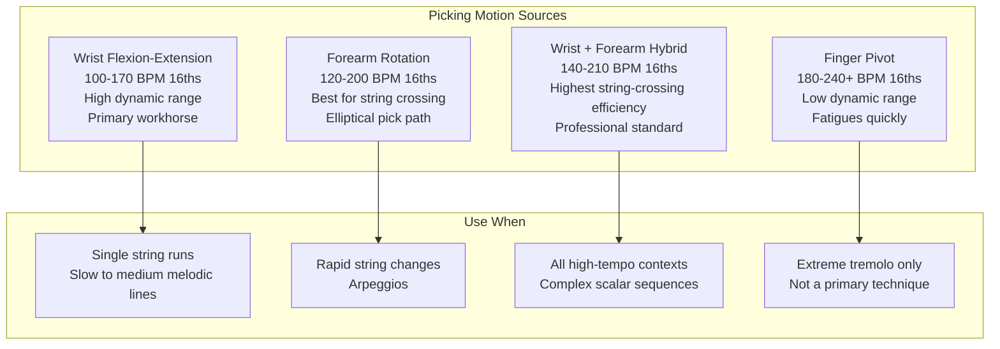
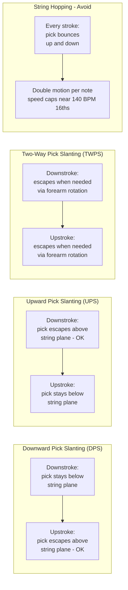
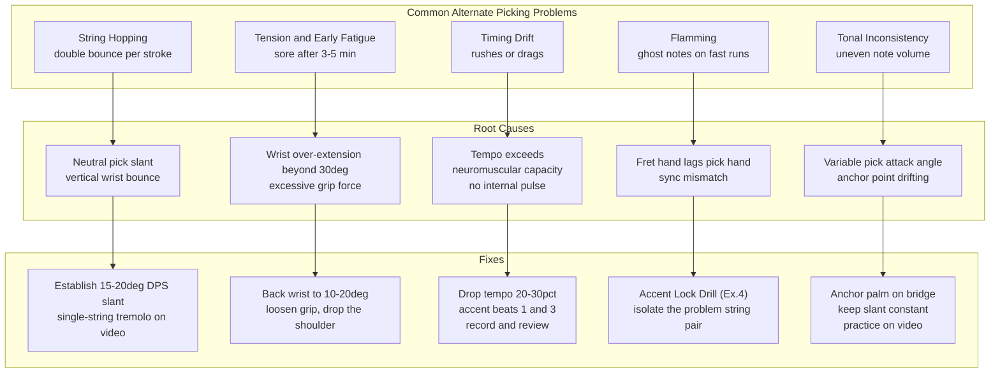

# Lesson 1: Mastering Alternate Picking on Electric Guitar

## 1. First-Principles Intuition (The 15%)

Alternate picking converts the hand-arm system into a bidirectional oscillator. Instead of lifting and repositioning the pick for every note, the return stroke becomes the next attack. This halves the movement required per note compared to all-downstrokes, which is why it scales to tempos where pure downstrokes physically can't keep up.

Two things to understand before you pick up the guitar:

**String displacement and tone**: When the pick contacts a string, it deflects it laterally, and the angle of that deflection determines harmonic content. A pick held perpendicular to the string produces a bright, harmonically dense attack. Rotating the pick 20–30° so the leading edge trails slightly produces a smoother displacement curve — warmer tone, easier release. This is "edge picking," and it affects both tone and picking efficiency.

**Pick escape geometry**: After each stroke, the pick must clear the string to execute the next one. If it escapes in the same direction after both the down and upstroke, you get *string hopping* — an inefficient double-bounce that caps your speed around 130–140 BPM 16ths regardless of how hard you practice. The fix is pick slant: a rotational offset so one stroke direction naturally exits above the string plane while the other stays at or below it. Downward Pick Slanting (DPS) means upstrokes escape upward; Upward Pick Slanting (UPS) means downstrokes escape upward. Two-Way Pick Slanting (TWPS) uses forearm rotation to switch between the two on demand.

That's the physics. Everything else in this lesson is hands-on mechanics.

---

## 2. Hand Setup: Lock This In Before You Play a Note

### Picking Hand Position

1. **Rest your forearm on the guitar body** at roughly its midpoint, not the elbow or wrist. This anchors you without locking the wrist.
2. **Pronate the forearm** 45–70° from anatomical position (palm faces slightly downward toward the strings). This naturally creates a trailing-edge DPS slant.
3. **Wrist position**: slight extension, 10–20°, neutral to a slight downward curve. Never crank it upward or hyperextend it. Check from the side — if the wrist looks kinked, back it off.
4. **Grip**: pick between the pad of the thumb and the lateral side of the index finger's first knuckle. The tip sticks out 3–6 mm beyond the fingertip — less for precision work, more for single-note fluency. Firm enough that it doesn't spin, loose enough that you feel no tension in the forearm. If your thumbnail goes white, ease off.
5. **Pick slant**: with the pick in position, the trailing edge should sit elevated 10–20° relative to the string. That's DPS, the right default starting point for most players.

### Fret Hand Position

- **Thumb behind the neck**, opposite the middle finger, centered on the back of the neck profile — not hooked over the top.
- **Curved fingers**, approaching strings from above at roughly 90°. Fingertips make contact, not finger pads.
- **Small gap between palm and neck** so fingers stay free to arc independently.
- **Relaxed shoulder and elbow.** Tension creep starts at the shoulder and travels down — check both before every session.

---

## 3. The Four Motion Sources



**Wrist motion**: the up-down flex of the wrist, like quickly turning a small doorknob. Most players develop this first, and it's the correct foundation. Keep the arc small, 15–25° — bigger arcs slow you down.

**Forearm rotation**: the pronation-supination twist around the forearm's axis. Hold your arm out, palm up, then rotate so the palm faces down — that's the range in play. Combined with wrist motion it produces an elliptical pick path, so string changes feel like the pick rolls between strings rather than leaping.

**Hybrid**: what most advanced players actually do. Wrist handles dynamics and accents; forearm handles string navigation. Highest ceiling, takes longest to develop.

**Finger pivot**: reserve for extreme tremolo passages or as a rescue motion. Don't train it as your primary technique — it fatigues fast and gives you little dynamic control.

---

## 4. Pick Geometry: Matching Pick to Technique

| Pick Type | Thickness | Tip Shape | Best For | Why |
|-----------|-----------|-----------|----------|-----|
| Standard 351 | 0.73–1.0 mm | Medium round | General alternate picking | Balanced attack, forgiving |
| Jazz III | 0.88–1.38 mm | Sharp, pointed | Speed runs, accuracy | Small shape = short stroke path |
| Jazz III XL | 1.0–1.38 mm | Sharp, larger body | Speed + comfort | Same tip, easier to grip |
| Thin teardrop | 0.46–0.60 mm | Medium | Rhythm, chords | Flex softens attack, good for strumming |
| Stubby / wedge | 2.0–3.0 mm | Sharp or blunt | Blues, rock tone | Rigid = maximum attack definition |

**Starting recommendation**: Dunlop Jazz III (red nylon, 1.38 mm) or the Jazz III XL. The small shape forces a short, efficient stroke. Players who struggle with string hopping on a standard pick often find it disappears immediately on a Jazz III, simply because there's less pick to get caught on the string.

**Edge picking**: rotate the pick 20–30° from flat against the string so the leading corner contacts first. This reduces resistance and smooths the release — the pick slides off rather than snapping through. You'll feel less resistance and hear a slightly warmer tone.

---

## 5. Pick Slant Mechanics: Solving String Crossing

This is the central mechanical concept. Get it wrong and no amount of practice unlocks clean string crossing.



**DPS, the default starting point**: it's the natural result of the forearm pronation setup from Section 2. After every upstroke, the pick floats free above the strings, so crossing from a higher string to a lower one (G string to B string, for example) on an upstroke is effortless — the pick is already clear. That's an *outside string change on an upstroke*, the DPS player's strength.

**The DPS limitation**: crossing from a lower string to a higher one (B string to G string) on a downstroke is awkward, because the pick dives below the plane on downstrokes. That's an *outside string change on a downstroke* — the DPS trap.

**Handling both directions**: either develop TWPS (forearm rotation that re-slants between strokes), or plan fingerings so string changes land on the favorable stroke. Three-note-per-string scale fingerings cycle string changes between up and downstrokes; with DPS, half the ascending changes land on upstrokes (easy) and the other half need an economy picking sweep (Section 8).

**Diagnosis test**: play a single-string tremolo slowly and film your pick from the side. If it hops symmetrically above and below the string, that's string hopping — fix the slant. If one stroke clearly stays low while the other floats free, that's correct slant, and the floating stroke is your outside-change stroke.

---

## 6. The Core Practice Sequence

Work through these in order. Each one builds on the last.

### Exercise 1: Single-String Tremolo — Motor Pattern Foundation

**Goal**: lock in the oscillation before adding left-hand or string-crossing complexity.

**Setup**: fret the B string at the 7th fret (F#) with your index finger. Full picking position. Metronome on.

**Execution**: continuous 16th notes, strict down-up alternation. Keep the motion wrist-primary — the forearm stays relatively still, not pumping up and down. The movement is rotational at the wrist, not a vertical bounce. Keep the slant consistent throughout.

**Metronome targets**:
```
Week 1-2:   60 BPM -> 80 BPM
Week 3-4:   80 BPM -> 100 BPM
Week 5-6:  100 BPM -> 120 BPM
Week 7+:   120 BPM -> 140 BPM
```
Advance only when the current tempo feels effortless for 60 continuous seconds with no timing drift.

**Success check**: record yourself and zoom in on the pick. Smooth oscillation, no hesitation, no bounce. Upstrokes and downstrokes equal in volume.

---

### Exercise 2: Two-String Crossing — E Minor Pentatonic Fragments

**Fretboard position**: E minor pentatonic, 7th position, strings 3 and 2.

```
String 3 (G): fret 7 = G | fret 9 = A
String 2 (B): fret 7 = E | fret 8 = F# | fret 10 = B
```

**Pattern A — 2 notes per string**:
```
Ascending:   G(3)-A(3) -> E(2)-B(2)
             D    U       D    U

Descending:  B(2)-E(2) -> A(3)-G(3)
             D    U       D    U
```

**Pattern B — 3-note grouping, string-change awareness**:
```
G - A - E - A - G
D   U   D   U   D
        ^
  String change here lands on a downstroke
  (DPS outside change — watch this transition)
```

**Metronome targets** (8th notes): 60 → 80 → 100 → 120 → 140 BPM.

**What to watch**: the G-to-B string change. With DPS, the downstroke at that change dips below the plane. Keep the transition a continuous arc, not a hop. Double-strikes or string noise mean slow down and isolate that single transition until it's clean before returning to tempo.

---

### Exercise 3: Three-Note-Per-String G Major Scale — Full-Neck Alternate Picking

**Fingering**, starting at the 3rd fret:
```
String 6 (E low):  3-5-7   (G-A-B)
String 5 (A):      4-5-7   (C-D-E)
String 4 (D):      4-5-7   (F#-G-A)
String 3 (G):      4-5-7   (B-C-D)
String 2 (B):      5-7-8   (E-F#-G)
String 1 (E high): 7-8-10  (A-B-C)
```

**Pick pattern**, strict alternation starting on a downstroke:
```
String 6:   D-U-D   (ends on downstroke)
String 5:   U-D-U   (string change lands on upstroke)
String 4:   D-U-D
String 3:   U-D-U
String 2:   D-U-D
String 1:   U-D-U
```

This cycling of up/down string changes is why 3-notes-per-string trains full bidirectional crossing. Ascending, every other change lands on an upstroke (DPS-friendly); the rest land on a downstroke and need either TWPS or an economy sweep.

**Economy option for the hard changes**: where the pick fights its slant, let it sweep through — the two strings share one continuous downward motion (economy picking at the string boundary only). Notes must stay rhythmically distinct; if they blur together, slow down.

**Metronome targets** (16th notes): 60 → 80 → 100 → 120 BPM, advancing 2 BPM every 4–5 days. Target: clean two-octave ascent and descent at 120 BPM.

---

### Exercise 4: The Synchronization Drill

The most common intermediate plateau is sync, not speed: the pick fires at the right rate but the fret hand lands slightly early or late, producing a soft ghost note before the real one ("flamming").

**Diagnostic**: record at 100 BPM through headphones. Doubled or smeared notes mean a sync issue.

**Fix — Accent Lock Drill**: use the G major scale from Exercise 3 at 80 BPM. Accent (hit harder) beats 1 and 3. The fret finger must land exactly on the accented pick stroke — not before, not after.

```
Beat:  1       +   2   +   3       +   4   +
Pick:  D(acc)  U   D   U   D(acc)  U   D   U
Note:  G           A           B           C
Fret:  land    lift  land  lift  land   lift  land  lift
```

The landing of the fretting finger is the accent. Note before the click means the fret hand is early; after means it's late. Adjust until they land as one event.

---

### Exercise 5: Musical Application — Pentatonic Runs with Phrasing

**Material**: A minor pentatonic, 5th position.
```
String 6 (E): fret 5 = A | fret 8 = D
String 5 (A): fret 5 = D | fret 7 = E
String 4 (D): fret 5 = G | fret 7 = A
String 3 (G): fret 5 = C | fret 7 = D
String 2 (B): fret 5 = E | fret 8 = A
String 1 (E): fret 5 = A | fret 8 = D
```

**Phrase 1 — Canonical rock lick, strings 2–1**:
```
String 2: fret 8 (A) - fret 5 (E)
String 1: fret 8 (D) - fret 5 (A) - fret 8 (D)
Pick:        D             U           D     U    D

Rhythm: 16th-note triplets at 90 BPM
Phrasing: accent note 1, back off the last two, slight crescendo over the phrase
```

**Phrase 2 — Descending run with dynamic shaping**:
```
Strings 1-6, 2 notes per string, descending
D-A(str1) -> E-A(str2) -> D-G(str3) -> A-E(str4) -> D-A(str5)
Pick: D U | D U | D U | D U | D U

Phrasing: start mezzoforte, diminuendo to the final note
Metronome: 90 BPM 8ths -> 110 BPM
```

Practice both phrases over an Am backing track at 90–100 BPM. The goal is for the picking mechanism to disappear — you're thinking about phrasing, not pick direction. When the technique is internalized, that happens automatically.

---

## 7. Failure Mode Diagnosis & Fixes



**The number one mistake**: playing through tension. The moment you feel forearm tightness or wrist ache, stop and shake the hand out. If it returns within two minutes, that's your stopping signal for the session. Playing through early tension cements bad habits and builds toward injury — the correct response is always "slow down and find what changed," never "push through."

---

## 8. Economy Picking and Directional Picking: When to Break the Rules

Strict alternate picking is the foundation. Once it's solid, two variations become available.

### Economy Picking

When moving to an adjacent string in the same direction as your current stroke, sweep both with one continuous motion instead of reversing.

```
Strict alternate:  D-U-D-U-D   (string change 3->4 is an upstroke)
Economy picking:   D-U-D       (notes 1-2 on strings 4-3 as D-U,
                                 then one downstroke sweeps 3->2)
```

Economy picking is faster for arpeggios and sequential patterns but requires precise timing — notes must sound rhythmically even, not strummed. Practice it in dedicated sessions rather than mixing it unconsciously into alternate-picking drills; mixing without intent is what produces inconsistent technique.

### Directional Picking

A systematic rule: economy picking for *outside* string changes (pick moving away from the body), strict alternate for *inside* string changes (pick moving toward the body). This gives the efficiency of economy picking wherever it's geometrically natural without sacrificing note independence. Many professional rock and fusion players use this without labeling it.

---

## 9. Progressive Training Protocol


### Daily Practice Allocation (45–90 min)

| Segment | Time | Content |
|---------|------|---------|
| Warm-up | 5–10 min | Passive stretches, then slow tremolo from 60 BPM |
| Technique drills | 15–20 min | Exercises 1–3 at current working tempo |
| Sync drill | 10 min | Accent Lock Drill (Exercise 4) |
| Musical application | 15–20 min | Phrases over backing track |
| Cool-down | 5 min | Slow playing, then stretches |

**Rule**: never start or end a session at max tempo. Taper down in the last 5 minutes so the nervous system settles on relaxed, correct motion — that's what gets encoded into long-term motor memory.

---

## 10. Injury Prevention

Alternate picking is high-frequency repetitive motion. Connective tissue adaptation lags neuromuscular gains by 4–8 weeks — you can feel ready to push harder long before your tendons have caught up.

### Pre-Session Warm-Up (every time)

1. Finger extensions: spread all five fingers wide, hold 5 seconds, release — 10 reps per hand.
2. Wrist rotations: 10 slow clockwise, 10 counterclockwise.
3. Forearm pronation/supination: palms up to palms down, 15 slow reps.
4. Prayer stretch: palms together at chest height, lower slowly, hold 20 seconds.
5. Fist squeeze: gentle, 10 reps — never grip hard.
6. Progressive tremolo ramp: 60 → 80 → 100 BPM, 30 seconds each. This warms the neural pathway, not just the muscles.

### Session Structure Rules

- Maximum continuous playing block: 25 minutes.
- Mandatory break: at least 5 minutes away from the guitar.
- Daily maximum: 90 minutes intermediate, 60 minutes beginner.
- At least one full rest day per week — motor patterns consolidate during rest.

### Stop Immediately If

- Pain during playing (sharp or localized, distinct from normal fatigue burn)
- Numbness or tingling in fingers or palm (median/ulnar nerve compression)
- Reduced grip strength compared to session start
- Ache persisting more than 48 hours after a session

If any of these appear: rest 72 hours, return at 50% volume and 80% of previous tempo. If symptoms persist beyond a week, see a physician experienced with performing musicians. Tendinitis caught early resolves in 2–4 weeks; ignored, it can become chronic.

---

## 11. Measuring Progress: Concrete Benchmarks

| Metric | Beginner | Intermediate | Advanced | Professional |
|--------|----------|--------------|----------|---------------|
| Max sustainable tempo (16ths, 1 min) | 80–100 BPM | 110–130 BPM | 140–160 BPM | 170–200+ BPM |
| Timing precision (CV of note onset) | < 10% | < 5% | < 3% | < 2% |
| Dynamic range (pp to ff, one scale) | 10 dB | 15 dB | 20 dB | 25+ dB |
| Endurance (sustained at 85% of MST) | 60 sec | 120 sec | 300 sec | 600+ sec |
| String crossing (clean 3NPS at tempo) | 60 BPM | 90 BPM | 120 BPM | 150+ BPM |

**Measuring timing precision**: record a 1-minute run, import into a free DAW (GarageBand, Audacity, Reaper), zoom into the waveform, and measure note-onset intervals. Divide the standard deviation by the mean and multiply by 100 for your CV percentage. Field test without software: if playing sounds "grippy" against the metronome with occasional microfalls, you're above 5%; if it locks in cleanly, you're likely below 3%.

---

## 12. The Integration Principle

Alternate picking is mechanical infrastructure underneath musical expression, not a speed contest. The endpoint is the ability to play a melody, run, or lick without consciously managing pick direction — the cerebellum handles it without cortical oversight.

The path there is a loop: correct motion → repetition → tempo increase → repetition → endurance → musical context → tempo increase. Each pass embeds the pattern deeper.

Players plateau for one of three reasons:
1. Practicing at a tempo where correct motion can't be maintained (too fast, too soon)
2. Never pushing past comfortable tempos (too slow, too long)
3. Drilling in isolation and never placing the technique inside real musical phrases

Find licks you love, work out their pick patterns, and drill those rather than abstract scales forever. The technique transfers from there.
