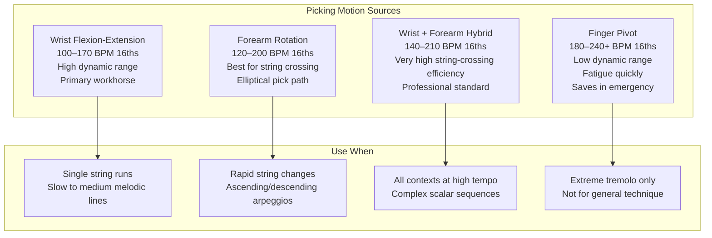
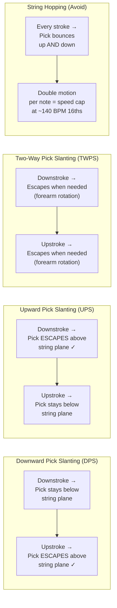
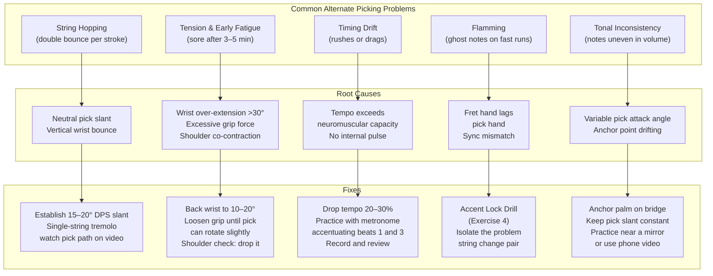

# Lesson 1: Mastering Alternate Picking on Electric Guitar

## 1. First-Principles Intuition (The 15%)

Alternate picking works because it converts the hand-arm system into a bidirectional oscillator. Instead of lifting and repositioning the pick for every note, you exploit the symmetry of down-up motion — the return stroke becomes the next attack. This halves the movement required per note compared to all-downstrokes, which is why it scales to high tempos where pure downstrokes physically can't follow.

There are two things to understand at the physics level and then we move on:

**String displacement and tone**: When your pick contacts a string, it deflects it laterally. The angle of that deflection determines harmonic content. A pick held perpendicular to the string produces a bright, harmonically dense attack. Rotating the pick 20–30° so the leading edge trails slightly produces a smoother displacement curve — warmer tone, easier release. This is "edge picking" and it matters for both tone and pick-shedding efficiency.

**Pick escape geometry**: After each stroke, the pick must clear the string to execute the next. If the pick escapes in the same direction after both down and upstrokes, you get *string hopping* — an inefficient double-bounce that caps your speed. The solution is pick slant: a slight rotational offset of the pick so that one stroke direction naturally exits above the string plane and the other stays below or within it. Downward Pick Slanting (DPS) means upstrokes escape upward; Upward Pick Slanting (UPS) means downstrokes escape upward. Two-Way Pick Slanting (TWPS) or forearm rotation lets you switch on demand.

That's the physics. Everything else in this lesson is hands-on mechanics.

---

## 2. Hand Setup: Getting It Right Before You Play a Note

Nothing in this lesson matters if the hand setup is wrong. Lock this in first.

### Picking Hand Position

1. **Rest your forearm on the guitar body** at roughly the forearm's midpoint — not the elbow, not the wrist. This anchors you without locking the wrist.
2. **Pronate the forearm** about 45–70° from anatomical position (palm faces slightly downward and toward the strings). This naturally creates a trailing-edge DPS slant.
3. **Wrist position**: slight extension, 10–20°. Neutral to slight downward curve. Never crank the wrist upward or hyper-extend it. If your wrist looks kinked when you look from the side, back it off.
4. **Grip**: Pick between the pad of the thumb and the *lateral side* of the index finger's first knuckle joint. The pick sticks out 3–6 mm beyond the fingertip — less for precision, more for single-note fluency. Grip firmly enough that it doesn't spin, loosely enough that you can't hear tension in your forearm. If your thumbnail goes white, you're gripping too hard.
5. **Pick slant**: With the pick held in position, the trailing edge (the edge that just left the string) should be visibly elevated 10–20°. This is DPS. For most players starting out, DPS is the right default.

### Fret Hand Position

- **Thumb behind the neck**, opposite the middle finger, roughly centered on the back of the neck profile. Not hooked over the top.
- **Curved fingers**: approach strings from above at roughly 90°. Fingertips contact strings, not pads.
- **Wrist slightly away from the neck** — there should be a small gap between palm and neck. This keeps fingers free to arc.
- **Relaxed shoulder and elbow**: tension creep starts at the shoulder and travels down. Check both before every practice session.

---

## 3. The Four Motion Sources

You will use different motion sources depending on tempo and context. Here's what each one feels like and when to use it:



**Wrist motion**: The up-down flex of the wrist, like turning a small doorknob quickly. This is what most players develop first and it's the right foundation. Keep the motion small and centered — 15–25° of arc is enough. Bigger arcs slow you down.

**Forearm rotation**: The pronation-supination twist of the forearm around its axis. Hold your arm out, palm up, then rotate so the palm faces down — that's the range you're tapping. When coupled with wrist, it creates an elliptical pick path that makes string changes feel like the pick is *rolling* between strings rather than leaping.

**Hybrid (wrist + forearm)**: What most advanced players actually do. The wrist provides dynamic control and accents; the forearm handles string navigation. It takes time to develop but it's the highest-ceiling approach.

**Finger pivot**: Useful only for extreme tremolo or as a rescue when other systems break down. Don't train this as your primary technique.

---

## 4. Pick Geometry: Matching Your Pick to Your Technique

This is not gear talk — pick choice directly affects whether your technique works or fights you.

| Pick Type | Thickness | Tip Shape | Best For | Why |
|-----------|-----------|-----------|----------|-----|
| Standard 351 | 0.73–1.0 mm | Medium round | General alternate picking | Balanced attack, forgiving |
| Jazz III | 0.88–1.38 mm | Sharp pointed | Speed runs, accuracy | Small shape = short stroke path |
| Jazz III XL | 1.0–1.38 mm | Sharp, slightly larger | Speed + comfort | Same tip as Jazz III, larger grip area |
| Thin teardrop | 0.46–0.60 mm | Medium | Rhythm, chords | Flex softens attack, good for strumming |
| Stubby / wedge | 2.0–3.0 mm | Very sharp or blunt | Blues, rock tone | Rigid = maximum attack definition |

**Starting recommendation**: Dunlop Jazz III (red nylon, 1.38 mm) or the Jazz III XL. The small shape forces a short, efficient stroke. Many players who struggle with standard picks find the Jazz III immediately corrects string-hopping because there's simply less pick to get caught.

**Edge picking**: Hold the pick so it's rotated ~20–30° from fully flat to the string. The leading corner contacts first. This reduces pick resistance against the string and smooths the release — the pick "slides off" rather than snapping through. You'll feel less resistance and hear a slightly warmer tone.

---

## 5. Pick Slant Mechanics: Solving the String-Crossing Problem

This is the central mechanical concept. Get this wrong and no amount of practice will unlock clean string crossing.



**DPS (default starting point)**: Natural result of the forearm pronation setup described above. After every upstroke, the pick floats free above the strings. This means you can easily cross from a higher string to a lower string (e.g., moving from G string to B string) on an upstroke — the pick is already above, nothing to clear. This is called an *outside string change on an upstroke* and it's the DPS player's strength.

**The DPS limitation**: Crossing from a lower string to a higher string (e.g., B string to G string) on a downstroke is awkward with DPS because the pick dives below the string plane on downstrokes. This is an *outside string change on a downstroke* — the DPS trap.

**How to handle both directions**: Either develop TWPS (forearm rotation that re-slants between strokes) or learn to plan your picking so string changes fall on the favorable stroke. Three-note-per-string scale fingerings, for example, cycle string changes between upstrokes and downstrokes — with DPS, ascending changes land on upstrokes (easy) and you use economy picking sweeps on descending sections.

**Diagnosis test**: Play a single-string tremolo slowly. Watch or film your pick from the side. Does the pick hop symmetrically above and below the string? That's string hopping — fix the slant. Does one stroke clearly stay low while the other floats free? That's correct slant. The escaped stroke is your "outside change" stroke.

---

## 6. The Core Practice Sequence

Work through these exercises in order. Don't jump ahead. Each one builds on the last.

---

### Exercise 1: Single-String Tremolo (Motor Pattern Foundation)

**Goal**: Lock in the oscillation motion before adding any left-hand or string-crossing complexity.

**Setup**:
- Fret the B string at the 7th fret (F# note) with your index finger.
- Right hand in full picking position.
- Metronome on.

**Execution**:
- Play continuous 16th notes, strict down-up alternation.
- Keep the motion wrist-primary. Watch that the forearm doesn't pump up and down — the forearm stays relatively still.
- The movement is *rotational at the wrist*, not a vertical bounce.
- Keep the pick slant consistent throughout.

**Metronome Targets**:

```
Week 1–2:   60 BPM → 80 BPM (16th notes = 4 strokes per click)
Week 3–4:   80 BPM → 100 BPM
Week 5–6:  100 BPM → 120 BPM
Week 7+:   120 BPM → 140 BPM
```

Advance to the next tempo only when the current one feels effortless for 60 seconds with no timing drift.

**Success check**: Record yourself. Zoom in on the pick. The motion should look like a smooth oscillation — no hesitation between strokes, no bounce. Upstrokes and downstrokes should sound dynamically even.

---

### Exercise 2: Two-String String Crossing (E Minor Pentatonic Fragments)

**Goal**: Introduce string crossing with a simple 2-string fragment before full-scale runs.

**Fretboard position**: E minor pentatonic, 7th position, strings 3 and 2 only.

```
String 3 (G):  fret 7 = G  |  fret 9 = A
String 2 (B):  fret 7 = E  |  fret 8 = F#  |  fret 10 = B
```

**Pattern A — 2-note-per-string ascending/descending**:

```
Ascending:   G(3)–A(3) → E(2)–B(2)
             D    U      D    U

Descending:  B(2)–E(2) → A(3)–G(3)
             D    U      D    U
```

**Pattern B — 3-note grouping (string change awareness)**:

```
G – A – E – A – G
D   U   D   U   D
        ^
   String change here on a downstroke (DPS outside change)
   Watch this transition carefully.
```

**Metronome Targets**:

```
Start:  60 BPM (8th notes)
Step 1: 80 BPM
Step 2: 100 BPM
Step 3: 120 BPM
Step 4: 140 BPM
```

**What to watch**: The string change from string 3 to string 2 (G to B string). With DPS, the downstroke at the string change dips below the plane. Keep the transition smooth — the pick should approach the B string in a continuous arc, not hop over. If you hear a double-strike or string noise, slow down and isolate just that one transition.

---

### Exercise 3: Three-Note-Per-String G Major Scale (Full-Neck Alternate Picking)

**Goal**: Master two-octave scalar runs with alternating string-change stroke directions.

**Fingering — 3 notes per string, starting at the 3rd fret**:

```
String 6 (E low):  3–5–7   (G – A – B)
String 5 (A):      4–5–7   (C – D – E)  [index shifts]
String 4 (D):      4–5–7   (F# – G – A)
String 3 (G):      4–5–7   (B – C – D)
String 2 (B):      5–7–8   (E – F# – G)
String 1 (E high): 7–8–10  (A – B – C)
```

**Pick pattern — strict alternation, start downstroke**:

```
String 6:   D – U – D   (3 notes, ends on downstroke)
String 5:   U – D – U   (string change on upstroke)
String 4:   D – U – D
String 3:   U – D – U
String 2:   D – U – D
String 1:   U – D – U
```

This cycling of down/up string changes is why 3-note-per-string patterns train complete bidirectional string crossing. Ascending, every other string change lands on an upstroke (DPS-friendly); the other half lands on a downstroke (requires either TWPS or economy picking sweep).

**Economy picking option for the "hard" string changes**: On string changes where the pick would have to fight its slant (downstroke into the adjacent higher string in DPS), allow the pick to sweep through — the two strings share one continuous downward motion. This is economy picking at the string boundary only. The notes must remain rhythmically separate — if they blur, slow down.

**Metronome Targets**:

```
Start:   60 BPM (16th notes)
Phase 1: 60 → 80 BPM
Phase 2: 80 → 100 BPM
Phase 3: 100 → 120 BPM
Target:  120 BPM clean two-octave ascent and descent
```

Advance 2 BPM every 4–5 days. No shortcuts.

---

### Exercise 4: The Synchronization Drill (Both Hands Together)

The most common intermediate plateau is a sync problem: the pick fires at the right rate but fret-hand fingers land slightly early or late. This creates "flamming" — a soft ghost note before the intended note.

**Diagnostic**: Record at 100 BPM and listen back through headphones. If notes sound doubled or smeared, you have a sync issue, not a speed issue.

**Fix — The Accent Lock Drill**:

Use the G major scale from Exercise 3. Play at 80 BPM. Add a pick accent (hit harder) on every beat 1 and beat 3. At the moment of the accent, the fret finger must land *simultaneously* with the pick — not before, not after. Work the accent notes first, then fill in around them.

```
Beat:        1       +       2       +       3       +       4       +
Pick:        D(acc)  U       D       U       D(acc)  U       D       U
             G               A               B               C
Fret:        land    lift    land    lift    land    lift    land    lift
```

The landing of the fretting finger IS the accent. If you hear the note before the click, the fret hand is early. If you hear it after, it's late. Adjust until accent and click land as one event.

---

### Exercise 5: Musical Application — Pentatonic Runs with Phrasing

**Goal**: Take the technique out of drill mode and into musical context.

**Musical material**: A minor pentatonic, 5th position (the "blues box").

```
String 6 (E):  fret 5 = A  |  fret 8 = D
String 5 (A):  fret 5 = D  |  fret 7 = E
String 4 (D):  fret 5 = G  |  fret 7 = A
String 3 (G):  fret 5 = C  |  fret 7 = D
String 2 (B):  fret 5 = E  |  fret 8 = A
String 1 (E):  fret 5 = A  |  fret 8 = D
```

**Phrase 1 — The Canonical Rock Lick (strings 2–1)**:

```
String 2: fret 8 (A) – fret 5 (E)
String 1: fret 8 (D) – fret 5 (A) – fret 8 (D)
Pick:        D             U           D      U      D

Rhythm: 16th note triplets at 90 BPM
Phrasing: Accent the first note, back off on the last two, slight crescendo over the phrase
```

**Phrase 2 — Descending run with dynamic shaping**:

```
Strings 1→6, 2 notes per string, descending
D–A (str 1) → E–A (str 2) → D–G (str 3) → A–E (str 4) → D–A (str 5)

Pick: D U | D U | D U | D U | D U
      (each pair = one string)

Phrasing: Start at mezzoforte, diminuendo toward the final note
Metronome: 90 BPM 8th notes → 110 BPM
```

**Practice this phrase over a backing track** (Am vamp, 90–100 BPM). The goal is for the alternate picking mechanism to disappear — you should be thinking about *phrasing*, not which direction the pick is going. When the technique is internalized, that happens automatically.

---

## 7. Failure Mode Diagnosis & Fixes



**The number one mistake**: Playing through tension. The moment you feel forearm tightness or wrist ache, stop. Shake the hand out. If it returns within 2 minutes, that's your stopping signal for that session. Playing through early tension cements bad habits and builds toward injury. The correct response to tension is never "push through" — it's always "slow down and find what changed."

---

## 8. Economy Picking and Directional Picking: When to Break the Rules

Strict alternate picking (D-U-D-U regardless of string changes) is the foundation. Once you have it, you gain access to two important variations:

### Economy Picking

When moving from one string to the adjacent string *in the same direction as your current stroke*, you can sweep both with a single continuous motion rather than reversing.

**Example**: Playing a 3-note ascending arpeggio across strings 4–3–2.

```
Strict alternate:   D – U – D – U – D    (note 3→4 is an upstroke string change)
Economy picking:    D – U – D    (notes 1–2 on strings 4–3 with D–U, then sweep D into string 2)
                                  ↑ this downstroke sweeps through string 3→2 in one motion
```

Economy picking is faster for arpeggios and sequential scalar patterns but requires precise timing — the notes must still sound rhythmically even, not as a strum.

**Don't mix these randomly**: Economy picking requires a different motor program. Practice it in dedicated economy-picking sessions, not mixed into alternate picking drills. Mixing unconsciously is what creates inconsistent technique.

### Directional Picking (Strategically Planned Economy)

A systematic ruleset: use economy picking for *outside string changes* (pick moving away from the guitar body) and strict alternate for *inside string changes* (pick moving toward the guitar body). This gives you the efficiency of economy picking at every string change where it's geometrically natural, without compromising note independence.

The result is fast, clean, and musically consistent. Many professional rock and fusion players use this without necessarily labeling it.

---

## 9. Progressive Training Protocol

### Phase Breakdown

```mermaid
gantt
    title Alternate Picking Development Timeline
    dateFormat  X
    axisFormat  Week %s

    section Phase 1 — Motor Pattern
    Single-string tremolo, pick slant setup     :a1, 0, 2w
    Two-string crossing introduction            :a2, 1, 2w

    section Phase 2 — Tempo Building
    3NPS scale, 60→100 BPM                      :b1, 2, 4w
    Synchronization drills                      :b2, 3, 3w

    section Phase 3 — Endurance
    Sustained runs at 100–130 BPM               :c1, 6, 4w
    Musical application with backing tracks     :c2, 7, 3w

    section Phase 4 — Velocity Push
    Max tempo bursts, 130 BPM+                  :d1, 10, 4w
    Economy / directional integration           :d2, 11, 3w
```



### Daily Practice Allocation (45–90 min total)

| Segment | Time | Content |
|---------|------|---------|
| Warm-up | 5–10 min | Passive stretches, then slow single-string tremolo starting at 60 BPM |
| Technique drills | 15–20 min | Exercises 1–3 at current working tempo |
| Sync drill | 10 min | Accent Lock Drill (Exercise 4) |
| Musical application | 15–20 min | Phrases and licks over backing track |
| Cool-down | 5 min | Slow playing, then stretches |

**Rule**: Never start a session at max tempo. Never end a session at max tempo. Always taper down in the last 5 minutes to let the nervous system settle on successful, relaxed motion — this is what gets encoded.

---

## 10. Injury Prevention

Alternate picking generates high-frequency repetitive motion. Respect the adaptation timeline of your connective tissue — it lags behind your neuromuscular gains by 4–8 weeks. You can *feel* ready to push harder long before your tendons have caught up.

### Pre-Session Warm-Up (Do Every Time)

1. **Finger extensions**: Spread all five fingers wide, hold 5 seconds, release. 10 reps each hand.
2. **Wrist rotations**: 10 slow clockwise, 10 counterclockwise.
3. **Forearm pronation/supination**: Arms out, palms up → palms down. 15 reps, slow.
4. **Prayer stretch**: Press palms together at chest height, slowly lower hands. Hold 20 seconds.
5. **Fist squeeze**: Gently squeeze a soft ball or just make a fist, 10 reps. Never grip hard.
6. **Progressive tremolo ramp**: 60 BPM → 80 BPM → 100 BPM, 30 seconds each. This warms the neural pathway, not just the muscles.

### Session Structure Rules

- **Maximum continuous playing block**: 25 minutes.
- **Mandatory break**: At least 5 minutes away from the guitar.
- **Daily maximum**: 90 minutes for intermediate players; 60 minutes for beginners.
- **Days off**: At minimum one full rest day per week. The nervous system consolidates motor patterns during rest — days off are not optional.

### Stop Immediately If

- Pain during playing (distinguish from normal burn/fatigue — pain is sharp, localized, or persists after stopping)
- Numbness or tingling in fingers or palm (median or ulnar nerve compression)
- Reduced grip strength compared to session start
- Persistent ache lasting more than 48 hours after a session

If any of these appear: rest 72 hours. Return at 50% volume and 80% of your previous tempo. If symptoms return or persist beyond a week, see a physician who works with performing artists. Tendinitis caught early resolves in 2–4 weeks; tendinitis ignored can become chronic.

---

## 11. Measuring Progress: Concrete Benchmarks

Track these numbers. What gets measured gets improved.

| Metric | Beginner | Intermediate | Advanced | Professional |
|--------|----------|--------------|----------|--------------|
| Max Sustainable Tempo (16th notes, 1 min) | 80–100 BPM | 110–130 BPM | 140–160 BPM | 170–200+ BPM |
| Timing precision (CV of note onset) | <10% | <5% | <3% | <2% |
| Dynamic range (pp to ff, one scale) | 10 dB | 15 dB | 20 dB | 25+ dB |
| Endurance (sustained 85% MST) | 60 sec | 120 sec | 300 sec | 600+ sec |
| String crossing (clean 3NPS at tempo) | 60 BPM | 90 BPM | 120 BPM | 150+ BPM |

**How to measure timing precision**: Record a 1-minute run. Import the audio into a free DAW (GarageBand, Audacity, Reaper). Zoom into the waveform and measure note onset intervals. Calculate the standard deviation divided by the mean and multiply by 100 — that's your CV percentage. For a rough field test: if your playing sounds "grippy" against the metronome with occasional microfalls, you're above 5%. If it locks in cleanly, you're likely below 3%.

---

## 12. The Integration Principle

Alternate picking is not a party trick or a speed contest. It is the mechanical infrastructure underneath musical expression. The endpoint of this training is not a BPM number — it's the ability to play a melody, a scale run, or a lick without consciously managing the pick direction at all.

That happens when the technique is *so automated* that the cerebellum handles it without cortical oversight. The path there is systematic: correct motion → repetition → tempo increase → repetition → endurance → musical context → tempo increase. Each loop of that cycle embeds the pattern deeper.

The players who plateau are almost always doing one of three things:
1. Practicing at a tempo where they cannot maintain correct motion (too fast, too soon)
2. Never pushing past comfortable tempos (too slow, too long)
3. Drilling in isolation and never placing the technique inside musical phrases

The balance is deliberate discomfort at the mechanical level, inside musical material that motivates you to keep playing. Find the licks you love, work out their pick patterns, and drill those — not abstract scale exercises forever. The technique will transfer.
