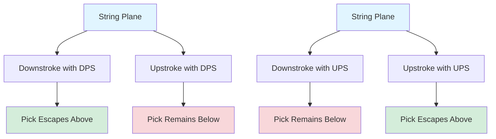
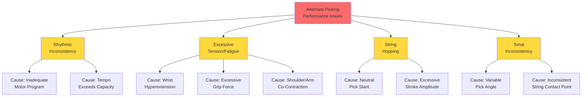

# Lesson 1: Mastering Alternate Picking Technique

## 1. First-Principles Intuition & Invariants

Alternate picking is the foundational mechanical technique for executing sequential notes on the electric guitar through systematic alternation of downward and upward pick strokes. This technique is not merely a stylistic choice but a biomechanical optimization that enables high-velocity, high-precision note articulation by leveraging the symmetry of bidirectional motion and minimizing recovery time between successive attacks.

### Biomechanical Foundation

The human hand operates as a complex kinematic chain consisting of the shoulder, elbow, wrist, and finger joints. Alternate picking exploits the natural oscillatory capacity of this system by converting the hand-arm complex into a resonant mechanical oscillator. The primary motion originates from one of three kinetic sources, each with distinct efficiency characteristics:

**Wrist Motion** (primary mechanism for moderate tempos, 120-180 BPM sixteenth notes): The wrist joint provides approximately 70-90 degrees of flexion-extension range. When the forearm is pronated (palm facing downward) and the wrist is positioned in slight extension (15-20 degrees), the extensor carpi radialis and flexor carpi radialis muscles create an antagonistic pair that enables rapid oscillation with minimal metabolic cost.

**Forearm Rotation** (rotation-based picking, effective for string-crossing patterns): Supination and pronation of the forearm, driven by the supinator and pronator teres muscles, rotate the radius around the ulna. This motion, when coupled with subtle wrist deviation, creates an elliptical pick path that naturally accommodates string changes.

**Finger Motion** (rare, used primarily for tremolo techniques exceeding 200 BPM): Interphalangeal joint flexion-extension, particularly of the thumb against the index finger, enables extremely high-frequency oscillation but sacrifices dynamic control and string-crossing capability.

### Physical Invariants of String Excitation

When a guitar pick strikes a string, the contact duration is extraordinarily brief—typically 1-3 milliseconds for a standard 351-shape pick striking a .010" gauge string. During this contact window, the pick displaces the string laterally, storing potential energy in the string's tension. The maximum displacement amplitude determines the fundamental intensity of the resulting vibration.

The string's subsequent motion follows the wave equation:

```
∂²y/∂t² = (T/μ) · ∂²y/∂x²
```

where T is string tension, μ is linear mass density, y is lateral displacement, t is time, and x is position along the string. The fundamental frequency f₀ is determined by:

```
f₀ = (1/2L) · √(T/μ)
```

where L is the vibrating string length. For a standard guitar in E standard tuning, the high E string (scale length 25.5", tension approximately 16.2 lbs, linear density 0.000041 lb/in) vibrates at 329.63 Hz (E4).

**Critical Insight**: The pick's attack angle directly affects the string's initial displacement profile and thus the harmonic content of the resulting tone. A perpendicular attack (90° angle) produces maximum fundamental energy but generates significant high-frequency harmonics due to the sharp displacement discontinuity at the pick release point. An oblique attack (20-30° from perpendicular) produces a smoother displacement profile, emphasizing lower-order harmonics and creating a warmer tone.

### Pick Slant and Escape Motion

The concept of "pick slant" or "edge picking" is fundamental to efficient alternate picking across multiple strings. When the pick is held with a trailing-edge slant (the edge that just struck the string is elevated relative to the leading edge), downstrokes naturally escape above the string plane, while upstrokes dive below. This geometry creates what practitioners call "downward pick slanting" or DPS.

Conversely, upward pick slanting (UPS) elevates the pick after upstrokes and drives it downward after downstrokes. The mathematical description of this motion involves a three-dimensional pick trajectory where the vertical component (perpendicular to the guitar's face) couples with the lateral component (parallel to the strings) through the pick's slant angle θ:

```
z(t) = A · sin(ωt + φ) · sin(θ)
```

where z is vertical displacement, A is the lateral stroke amplitude, ω is angular frequency, and φ is the phase offset.



This geometric relationship is the key to solving the "string-hopping" problem—the inefficient motion where the pick escapes the string plane after every stroke, regardless of direction. Efficient alternate picking requires that only one stroke direction (either down or up, depending on pick slant) escapes the string plane, while the other remains within or below it.

## 2. Core Architecture & Mechanics

### Hand Posture and Joint Configuration

The optimal hand configuration for alternate picking depends on the specific motion source (wrist, forearm, or finger) and the musical context. However, certain postural principles remain invariant:

**Wrist Alignment**: The wrist should be positioned in neutral extension (0-20 degrees) relative to the forearm axis. Excessive flexion (negative angle) or extension (positive angle beyond 30 degrees) compresses the carpal tunnel, increasing risk of median nerve impingement. The neutral position maximizes the mechanical advantage of the wrist flexors and extensors while minimizing compressive forces on neurovascular structures.

**Forearm Pronation**: For wrist-based picking, the forearm is typically pronated 45-90 degrees from the supinated anatomical position. This pronation angle determines the natural pick slant: greater pronation produces more trailing-edge elevation (DPS), while less pronation approaches neutral or even UPS geometry.

**Thumb-Index Grip**: The pick is held between the pad of the thumb and the lateral aspect of the index finger's distal phalanx. The contact force should be sufficient to prevent pick slippage (approximately 2-5 Newtons) but not so excessive as to restrict the pick's rotational degree of freedom about the thumb-index contact points. This rotational compliance acts as a mechanical low-pass filter, absorbing high-frequency string impacts and preventing the pick from catching or snagging on the string.

### Kinematic Chain Analysis

The motion of alternate picking can be modeled as a driven harmonic oscillator with the pick as the terminal element. The system's transfer function determines how motion at the proximal joints (shoulder, elbow) translates to motion at the distal effector (pick tip).

```mermaid
flowchart LR
    A["Shoulder<br/>Stabilization"] --> B["Elbow<br/>Minimal Motion"]
    B --> C["Forearm<br/>Rotation (optional)"]
    C --> D["Wrist<br/>Flexion-Extension"]
    D --> E["Finger<br/>Grip Stability"]
    E --> F["Pick<br/>String Contact"]
    
    F --> G["String<br/>Lateral Displacement"]
    G --> H["Vibration<br/>Propagation"]
    H --> I["Pickup<br/>Electromagnetic<br/>Transduction"]
    I --> J["Amplifier<br/>Signal Chain"]
    
    style A fill:#fff4e6
    style D fill:#d4edda
    style F fill:#ff6b6b
    style I fill:#4ecdc4
```



For wrist-driven alternate picking at 140 BPM sixteenth notes (approximately 9.3 Hz oscillation frequency), the wrist executes a sinusoidal angular displacement:

```
θ(t) = θ₀ · sin(2πft)
```

where θ₀ is the peak angular displacement (typically 15-25 degrees) and f is the frequency. The pick tip velocity v_pick is related to the angular velocity by:

```
v_pick = r · ω = r · 2πf · θ₀
```

where r is the effective radius from the wrist rotation axis to the pick tip (approximately 8-12 cm for typical hand dimensions). At 9.3 Hz with θ₀ = 20° (0.349 radians), the peak pick velocity approaches 0.35 m/s or approximately 1.25 km/h—a modest velocity that nonetheless requires precise neuromuscular coordination.

### Motion Source Selection Criteria

The choice of motion source depends on tempo, string-crossing requirements, and dynamic range:

| Motion Source | Optimal Tempo Range | String-Crossing Efficiency | Dynamic Range | Fatigue Resistance |
|---------------|---------------------|----------------------------|---------------|-------------------|
| Wrist Flexion-Extension | 100-180 BPM 16ths | Moderate | High | Moderate |
| Forearm Rotation | 120-200 BPM 16ths | High | Moderate | High |
| Finger Motion | 180-240+ BPM 16ths | Low | Low | Low |
| Hybrid (Wrist + Forearm) | 140-200 BPM 16ths | Very High | High | High |

**Wrist motion** provides excellent dynamic control because the wrist flexors and extensors are large muscle groups with high force capacity. However, the wrist's moment of inertia limits maximum oscillation frequency.

**Forearm rotation** reduces the moment of inertia by bringing the rotation axis closer to the pick, enabling higher frequencies. The supinator and pronator muscles are smaller but capable of rapid contraction cycles. The elliptical pick path naturally accommodates string changes.

**Finger motion** minimizes moment of inertia by placing the rotation axis at the thumb-index contact point, enabling extremely high frequencies. However, the small intrinsic hand muscles fatigue rapidly, and the minimal stroke amplitude provides limited dynamic range.

### Pick Geometry and Material Properties

The pick functions as the mechanical interface between the kinetic energy of the hand and the potential energy stored in the string's displacement. Pick geometry affects both tone and technique efficiency:

**Thickness**: Thin picks (0.38-0.60 mm) flex during string contact, storing energy elastically and releasing it over an extended contact duration. This produces a softer attack with reduced high-frequency content. Thick picks (0.88-3.0 mm) remain rigid, producing a shorter contact duration and brighter tone with enhanced high-frequency harmonics.

**Shape**: The standard 351 shape provides a moderate tip radius (approximately 1.5-2.5 mm) balancing precision and durability. Jazz III picks feature a sharper tip radius (0.5-1.0 mm), enabling more precise string addressing but wearing more rapidly.

**Material**: The elastic modulus and internal damping coefficient determine the pick's dynamic response. Delrin (acetal polyoxymethylene) provides moderate stiffness with low damping. Ultex (polyetherimide) offers higher stiffness and lower damping for increased brightness. Tortoiseshell (historical, now prohibited) combined moderate stiffness with high internal damping, producing a warm tone.

The pick's contact mechanics during string strike can be approximated using Hertzian contact theory. For a rigid pick striking a compliant string, the contact force F relates to the indentation depth δ:

```
F = (4/3) · E* · √R · δ^(3/2)
```

where E* is the reduced elastic modulus and R is the effective radius of curvature. This nonlinear relationship means that small increases in pick velocity produce disproportionately large increases in contact force and, consequently, output volume.

## 3. High-Performance Optimization & Failure Modes

### Progressive Training Protocol

Developing efficient alternate picking requires systematic neuromuscular adaptation through progressive overload. The training protocol should address three distinct adaptation mechanisms:

**Motor Learning** (neurological): The central nervous system must encode the correct motor program, converting conscious execution into automated subroutines managed by the cerebellum and basal ganglia. This requires 3000-5000 repetitions of the correct motion pattern.

**Muscular Endurance** (metabolic): The involved muscles must develop enhanced oxidative capacity (increased mitochondrial density, capillary proliferation) to sustain repetitive contractions without lactate accumulation. This requires training sessions of 15-30 minutes at 70-85% of maximum sustainable tempo.

**Connective Tissue Adaptation** (structural): Tendons and ligaments must increase collagen cross-linking and elastic modulus to withstand repetitive loading. This is the slowest adaptation process, requiring 8-12 weeks of consistent training.

A systematic training progression:

**Phase 1: Motor Pattern Acquisition (Weeks 1-2)**
- Tempo: 60-80 BPM quarter notes (1-2 Hz pick oscillation)
- Duration: 5 minutes per session, 2-3 sessions daily
- Focus: Establish correct hand position, wrist motion path, and pick escape geometry
- Metronome subdivision: Play one note per click, emphasizing mechanical consistency over speed

**Phase 2: Tempo Increase (Weeks 3-6)**
- Tempo: Progressive from 80 to 120 BPM quarter notes
- Duration: 10 minutes per session, 2 sessions daily
- Focus: Maintain mechanical efficiency while increasing oscillation frequency
- Protocol: Increase tempo by 4 BPM every 3-4 days when current tempo feels effortless

**Phase 3: Endurance Building (Weeks 7-10)**
- Tempo: 100-140 BPM quarter notes (sustained)
- Duration: 15-20 minutes per session, 1-2 sessions daily
- Focus: Extend sustainable duration at target tempo
- Protocol: Add 2 minutes to session duration every 5-7 days

**Phase 4: Maximum Velocity (Weeks 11+)**
- Tempo: Progressive from 140 BPM to individual maximum
- Duration: Short bursts (30-60 seconds) at maximum tempo
- Focus: Push neurological firing rate limits
- Protocol: Practice maximum-tempo bursts separated by rest intervals (1:3 work-to-rest ratio)

### Diagnostic Framework for Technique Failure Modes

Alternate picking dysfunction manifests through specific observable symptoms, each corresponding to distinct mechanical or neurological failures:



**Failure Mode 1: String Hopping**

String hopping occurs when the pick escapes the string plane after both downstrokes and upstrokes, creating a double-escaped motion. This doubles the vertical displacement requirement and limits maximum tempo.

*Root Cause*: Neutral pick slant (0° trailing edge angle) or active vertical wrist motion component.

*Diagnosis*: Video analysis reveals pick tip tracing a symmetric arc above and below the string plane. Subjective sensation of "bouncing" motion.

*Correction*: Establish consistent pick slant (15-25° trailing edge elevation). Focus on minimizing vertical motion component—the pick should "sweep" across strings rather than "bounce" over them. Practice single-string tremolo with attention to keeping one stroke direction within/below the string plane.

**Failure Mode 2: Excessive Tension and Premature Fatigue**

Tension manifests as muscle soreness, reduced range of motion, or tremor after 2-5 minutes of playing.

*Root Cause*: Excessive wrist extension (>30°), high grip force (>5N), or antagonistic co-contraction of flexor and extensor muscle groups.

*Diagnosis*: Visual inspection reveals whitened fingernails (indicating excessive grip force) or excessive wrist extension. Electromyography would show co-contraction of antagonist muscles.

*Correction*: Reduce wrist extension to neutral range (0-20°). Use minimum grip force necessary to prevent pick slippage—practice with progressively thinner picks to develop grip sensitivity. Implement active relaxation protocol: every 5 minutes, stop playing and consciously release all hand tension, then resume with minimal necessary tension.

**Failure Mode 3: Rhythmic Inconsistency (Timing Drift)**

Rhythmic inconsistency appears as accelerando/ritardando tendencies or note duration variability.

*Root Cause*: Inadequate motor program encoding (insufficient repetitions) or tempo exceeding neuromuscular capacity.

*Diagnosis*: Audio recording analysis reveals tempo drift >3% or inter-onset interval (IOI) coefficient of variation >5%.

*Correction*: Reduce practice tempo by 20-30%. Increase repetitions at this tempo until timing consistency is achieved (IOI CV <3%). Use a metronome with accent patterns to develop internal pulse tracking. Practice with drum backing tracks to develop ensemble synchronization.

**Failure Mode 4: Tonal Inconsistency (Volume or Timbre Variation)**

Notes exhibit variable amplitude or frequency content despite intended uniformity.

*Root Cause*: Variable pick attack angle, inconsistent string contact point (bridge vs. neck), or variable stroke velocity.

*Diagnosis*: Audio recording shows note-to-note amplitude variation >6 dB or spectral centroid variation >500 Hz.

*Correction*: Anchor the picking hand by resting the palm or fingers on the guitar body to stabilize the lateral position. Maintain constant pick slant and attack angle through conscious attention. Practice with a compressor effect to make amplitude variations more audible. Record and analyze practice sessions to identify specific problem notes.

### Advanced Techniques: Economy Picking and Hybrid Approaches

While strict alternate picking (down-up-down-up regardless of string changes) is the pedagogical foundation, professional players often employ hybrid techniques for specific musical contexts:

**Economy Picking**: When changing strings in the direction of pick motion (e.g., downstroke on string 3 followed by downstroke on string 2), the pick "sweeps" through both strings using a single motion. This reduces motion count but requires precise timing to prevent the notes from blurring together.

*Application*: Ascending and descending scalar patterns, arpeggio sequences.

*Tradeoff*: Increased efficiency but reduced per-note dynamic control.

**Directional Picking**: A systematic approach where outside string changes (moving from a higher-numbered string to a lower-numbered string, or vice versa) use economy picking, while inside string changes use strict alternation.

*Application*: Complex melodic lines with frequent string crossing.

*Tradeoff*: Requires more complex motor program encoding (context-dependent motion patterns) but offers optimal efficiency across diverse musical material.

### Measuring Progress: Quantitative Metrics

Objective measurement enables data-driven training adjustments:

**Maximum Sustainable Tempo (MST)**: The highest tempo at which alternate picking can be maintained for 60 seconds without technique breakdown. Measured in notes per second (Hz).

*Baseline (novice)*: 4-6 Hz
*Intermediate*: 8-10 Hz  
*Advanced*: 12-14 Hz
*Professional*: 14-16 Hz+

**Timing Precision (TP)**: The coefficient of variation (CV) of inter-onset intervals, measured using audio analysis software.

*Target*: CV <3% (standard deviation <3% of mean IOI)

**Dynamic Range (DR)**: The difference between softest and loudest controlled note, measured in decibels.

*Target*: DR >18 dB with maintained timing precision

**Endurance (E)**: Duration of sustained alternate picking at 85% MST before technique failure.

*Target*: E >300 seconds (5 minutes)

### Integration with Musical Context

Alternate picking is not an isolated skill but a foundation for musical expression. The technique must be integrated with:

**Fret-Hand Synchronization**: Each pick attack must coincide precisely with fret-hand finger placement. Synchronization errors ("flamming") create a sloppy, indistinct sound. Practice with a metronome placing accents on beats 1 and 3 (in 4/4), ensuring picked notes and fretted notes align exactly with accents.

**Phrase Shaping**: Alternate picking enables dynamic variation through stroke velocity control. Practice major scales with crescendo/decrescendo patterns (pp → ff → pp over two octaves) to develop independent velocity control.

**String Crossing Efficiency**: Scalar patterns across multiple strings require integrating pick slant with vertical hand motion. Practice three-note-per-string scales (e.g., G major: 3-5-7 on each string) focusing on minimizing vertical displacement during string changes.

## 4. Practice Exercises & Implementation

### Exercise 1: Single-String Tremolo (Motor Pattern Foundation)

**Objective**: Establish the fundamental wrist oscillation pattern without the complication of string crossing.

**Protocol**:
- Select the B string (second string), fret at the 5th fret (E note)
- Set metronome to 60 BPM
- Play continuous sixteenth notes (4 notes per beat), using strict down-up alternation
- Focus on: (1) consistent pick slant, (2) minimal wrist extension, (3) smooth sinusoidal motion
- Duration: 5 minutes
- Progressive tempo increase: Add 4 BPM every 3 days when current tempo feels effortless

**Success Criteria**: Ability to maintain even sixteenth notes at 120 BPM for 60 seconds with no rhythmic deviation audible against metronome.

### Exercise 2: Two-String Scalar Fragment (String Crossing Integration)

**Objective**: Develop string-crossing efficiency while maintaining alternate picking.

**Musical Material**: E minor pentatonic box pattern, strings 3-2 only
- String 3 (G): frets 7-9 (D-E)
- String 2 (B): frets 8-10 (G-A)

**Pattern**: D-E-G-A-G-E-D (ascending and descending)

**Protocol**:
- Metronome: 80 BPM, play eighth notes
- Pick pattern: D(down)-E(up)-G(down)-A(up)-G(down)-E(up)-D(down)
- Notice that the string change from E (string 3) to G (string 2) occurs on a downstroke—this is the critical "outside" string change where pick escape is essential
- Focus on minimizing vertical motion during the E→G transition
- Duration: 10 minutes
- Progressive increase: Add 4 BPM every 4 days

**Success Criteria**: Clean articulation of all notes with no string noise during transitions at 140 BPM.

### Exercise 3: Three-Note-Per-String Scale (Advanced String Crossing)

**Objective**: Master the most demanding string-crossing context.

**Musical Material**: G major scale, three notes per string
- String 6 (E): frets 3-5-7 (G-A-B)
- String 5 (A): frets 4-5-7 (C-D-E)  
- String 4 (D): frets 4-5-7 (F#-G-A)
- String 3 (G): frets 4-5-7 (B-C-D)
- String 2 (B): frets 5-7-8 (E-F#-G)
- String 1 (E): frets 7-8-10 (A-B-C)

**Protocol**:
- Metronome: 60 BPM, play sixteenth notes
- Pick pattern: Strict alternation starting with downstroke
- Analyze: String changes occur after three notes, meaning they alternate between downstroke transitions and upstroke transitions
- This requires bidirectional pick escape capability—mastery of both DPS and UPS, or adoption of forearm rotation to accommodate both directions
- Duration: 15 minutes
- Progressive increase: Add 2 BPM every 5 days

**Success Criteria**: Two-octave ascent and descent at 120 BPM with no timing errors and uniform tone across all notes.

### Exercise 4: Rhythmic Variation (Musical Application)

**Objective**: Develop alternate picking in musically realistic rhythmic contexts beyond continuous sixteenth notes.

**Musical Material**: Simple chord progression with melodic embellishment (e.g., I-IV-V in E major)

**Pattern Example**: Over E major chord (4 beats)
- Beat 1: E (downstroke, quarter note)
- Beat 2: G#-B (up-down, eighth notes)
- Beat 3: E-F#-G#-F# (down-up-down-up, sixteenth notes)
- Beat 4: E (downstroke, quarter note)

**Protocol**:
- Metronome: 90 BPM
- Play the pattern as written, maintaining strict alternate picking
- Focus on dynamic shaping: emphasize downbeat quarter notes, de-emphasize internal sixteenth notes
- Change chords every 4 beats (E → A → B → E)
- Duration: 10 minutes

**Success Criteria**: Smooth execution of rhythmic transitions with appropriate dynamic shaping and no flamming between hands.

## 5. Biomechanical Risk Management

Repetitive strain injuries (RSI) are the most significant occupational hazard for guitarists. The neuromuscular system requires time to adapt to the mechanical demands of alternate picking.

### Injury Prevention Protocol

**Warm-up Routine (10 minutes before practice)**:
1. Finger extension/flexion: 20 repetitions
2. Wrist circles: 10 repetitions each direction
3. Forearm pronation/supination: 20 repetitions
4. Progressive tempo single-string tremolo: Start at 60 BPM, increase by 10 BPM every 30 seconds until reaching target practice tempo

**Practice Session Structure**:
- Maximum continuous playing duration: 25 minutes
- Mandatory rest interval: 5 minutes between sessions
- Total daily practice time: 90-120 minutes maximum (beginners: 45-60 minutes)

**Warning Signs of Overtraining**:
- Pain during or after playing (distinguish from normal muscular fatigue)
- Reduced range of motion
- Numbness or tingling (indicates nerve compression)
- Persistent soreness lasting >48 hours

**Response Protocol**: If warning signs appear, cease practice immediately. Rest for 48-72 hours. Upon resumption, reduce practice volume by 50% and tempo by 20%. If symptoms persist beyond 7 days, seek evaluation from a medical professional specializing in performing arts medicine.

### Ergonomic Optimization

**Guitar Positioning**: The guitar should be positioned such that the picking hand approaches the strings at approximately 45 degrees from vertical when the forearm is parallel to the floor. Use a strap adjusted to maintain this angle in both seated and standing positions.

**Chair Height (seated practice)**: Feet flat on floor, thighs parallel to ground. Avoid crossing legs, as this creates pelvic asymmetry and compensatory spinal rotation.

**Practice Environment**: Maintain room temperature 20-22°C (68-72°F). Cold temperatures reduce finger dexterity and increase injury risk.

## 6. Conclusion

Mastering alternate picking is a multidimensional challenge requiring integration of biomechanical efficiency, motor learning, and musical expression. The technique is fundamentally governed by the physics of string vibration, the biomechanics of the human hand, and the neurological processes of motor control.

Key principles:
- Pick slant determines escape trajectory and enables efficient string crossing
- Motion source (wrist, forearm, finger) should be matched to tempo and musical context  
- Progressive overload training protocols enable systematic neuromuscular adaptation
- Technique efficiency is measurable through quantitative metrics (tempo, timing precision, dynamic range)
- Injury prevention requires structured practice protocols and attention to warning signs

The path from novice to advanced practitioner spans 6-18 months of consistent, deliberate practice. Progress is not linear—expect plateaus, temporary regressions, and breakthrough moments. The ultimate goal is not mechanical perfection but musical fluency: the ability to translate musical ideas into physical reality with minimal conscious interference.
