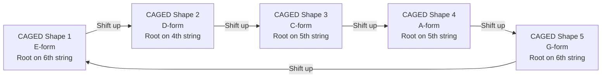
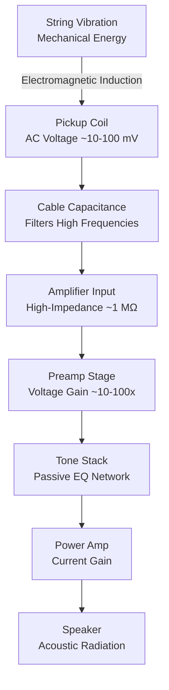

# Lesson 1: Introduction to Pentatonic Modes on Electric Guitar

## 1. First-Principles Intuition & Invariants

The pentatonic scale represents one of music's most fundamental pitch structures: five notes per octave arranged to maximize consonance while preserving melodic flexibility. Its ubiquity across cultures—from African kora music to Scottish folk melodies to American blues—stems from its acoustic properties and cognitive accessibility.

### Acoustic Foundation

The pentatonic scale emerges naturally from the harmonic series. When a string vibrates at a fundamental frequency *f₀*, it simultaneously produces overtones at integer multiples: 2*f₀*, 3*f₀*, 4*f₀*, 5*f₀*, 6*f₀*, etc. The major pentatonic scale approximates the pitch classes found in the first six harmonics, omitting the dissonant intervals that arise from the 4th and 7th scale degrees of the diatonic system.

In equal temperament, the major pentatonic scale (scale degrees 1, 2, 3, 5, 6) consists of intervals measured in semitones:

- **Root → Major 2nd**: 2 semitones, frequency ratio ≈ 2^(2/12) ≈ 1.122
- **Root → Major 3rd**: 4 semitones, frequency ratio ≈ 2^(4/12) ≈ 1.260
- **Root → Perfect 5th**: 7 semitones, frequency ratio ≈ 2^(7/12) ≈ 1.498
- **Root → Major 6th**: 9 semitones, frequency ratio ≈ 2^(9/12) ≈ 1.682

The minor pentatonic scale (scale degrees 1, ♭3, 4, 5, ♭7) follows a complementary structure:

- **Root → Minor 3rd**: 3 semitones, frequency ratio ≈ 2^(3/12) ≈ 1.189
- **Root → Perfect 4th**: 5 semitones, frequency ratio ≈ 2^(5/12) ≈ 1.335
- **Root → Perfect 5th**: 7 semitones, frequency ratio ≈ 2^(7/12) ≈ 1.498
- **Root → Minor 7th**: 10 semitones, frequency ratio ≈ 2^(10/12) ≈ 1.782

The critical insight: both pentatonic forms avoid the tritone interval (six semitones, ratio ≈ √2), which creates the strongest dissonance in tonal music. By excluding scale degrees that form tritones with the tonic or dominant, the pentatonic scale achieves maximal consonance with minimal pitch material.

### Invariant Properties

**Transposition invariance**: Every major pentatonic scale contains the same interval sequence (2-2-3-2-3 semitones). This uniformity enables pattern-based learning on the guitar fretboard, where physical shapes can be transposed to any key by shifting position.

**Relative duality**: The A minor pentatonic (A-C-D-E-G) and C major pentatonic (C-D-E-G-A) share identical pitch content but differ in tonal center. This relationship extends to all major/minor pentatonic pairs separated by a minor third.

**Modal flexibility**: Because the pentatonic scale omits the characteristic tones that define major versus minor (the 4th and 7th degrees), it functions ambiguously over both major and minor harmonies. An A minor pentatonic phrase works over Am, Am7, A7, and even Amaj7 chords with varying degrees of tension and color.

### Cognitive Accessibility

Psychoacoustic research suggests the pentatonic scale's five-note structure sits within the working memory capacity of most listeners, enabling easier melodic retention and pattern recognition compared to seven-note diatonic scales. This cognitive economy explains the scale's prevalence in children's songs, folk traditions, and improvised music where melodic invention must happen in real time.

## 2. Core Architecture & Mechanics

### Fretboard Geometry and the CAGED System

Standard guitar tuning (E₂-A₂-D₃-G₃-B₃-E₄, low to high) creates a two-dimensional pitch lattice where horizontal motion along a string raises pitch chromatically (one semitone per fret) and vertical motion between strings jumps by intervals of perfect fourths (five semitones), except the G-to-B string transition, which is a major third (four semitones).

The CAGED system partitions the fretboard into five interlocking pentatonic shapes, each anchored to one of five basic open chord forms (C, A, G, E, D). These shapes tessellate across the neck, creating a continuous mapping of the pentatonic scale.



For the **A minor pentatonic** (A-C-D-E-G), the five CAGED positions span the entire fretboard:

**Position 1 (E-form, 5th position)**:
```
e|---------------5--8--
B|---------------5--8--
G|---------------5--7--
D|---------------5--7--
A|---------------5--7--
E|---------------5--8--
```

**Position 2 (D-form, 7th position)**:
```
e|------------7--8-----
B|------------8--10----
G|------------7--9-----
D|------------7--9-----
A|------------7--10----
E|------------7--8-----
```

**Position 3 (C-form, 10th position)**:
```
e|--------10--12-------
B|--------10--13-------
G|--------9---12-------
D|--------10--12-------
A|--------10--12-------
E|--------10--12-------
```

**Position 4 (A-form, 12th position)**:
```
e|--12--15-------------
B|--13--15-------------
G|--12--14-------------
D|--12--14-------------
A|--12--15-------------
E|--12--15-------------
```

**Position 5 (G-form, open position)**:
```
e|--0---3--------------
B|--1---3--------------
G|--0---2--------------
D|--0---2--------------
A|--0---3--------------
E|--0---3--------------
```

Each position covers approximately three to four frets and overlaps with adjacent positions, enabling seamless position shifts during improvisation.

### String Physics and Harmonic Excitation

An electric guitar string vibrates as a tensioned wire with fixed endpoints. When plucked, the string's displacement creates a superposition of standing waves at the fundamental frequency and its harmonics. The pickup—a magnetic coil positioned beneath the strings—converts these vibrations into an electrical signal via electromagnetic induction.

The pickup's position along the string length dramatically affects harmonic content:

- **Bridge pickup**: Positioned near the string's terminus, it detects higher-order harmonics strongly, producing a bright, cutting tone.
- **Neck pickup**: Positioned near the string's midpoint (where fundamental motion is maximal), it emphasizes lower harmonics, yielding a warm, round tone.
- **Middle pickup**: Balances fundamental and harmonic content.

The frequency response of a typical single-coil pickup exhibits a resonant peak around 2-5 kHz due to the inductor-capacitor (LC) circuit formed by the coil's inductance and the cable capacitance. This resonance accentuates upper-midrange frequencies, contributing to the characteristic "twang" of Stratocaster-style guitars.



### Picking Mechanics and Attack Transients

The pick's interaction with the string determines the attack envelope—the initial transient that shapes the note's perceived character. When the pick displaces the string laterally, it stores potential energy proportional to the displacement distance. Upon release, the string snaps back, generating a complex waveform rich in high-frequency transients.

**Alternate picking** (strict down-up alternation) maintains temporal regularity and enables high-speed execution. The motion originates from wrist rotation rather than forearm or finger motion, minimizing fatigue.

**Economy picking** (also called sweep picking) reduces pick motion by allowing directional consolidation: when moving to an adjacent lower string, a downstroke continues the motion; when moving to an adjacent higher string, an upstroke continues. This technique reduces the total pick travel distance but requires precise muting to prevent unwanted string noise.

**Pick angle** and **edge picking**: Holding the pick at a 45-degree angle relative to the string (rather than perpendicular) reduces frictional resistance and softens the attack. This technique, common in jazz and fusion playing, produces a rounder tone with less pick noise.

### Fretting Hand Biomechanics

Optimal fretting technique balances force minimization with clean articulation. The required fretting force *F* depends on string gauge, action height, and fret position. For a typical .010" high-E string at the 12th fret, approximately 1-2 N of force suffices to seat the string against the fret.

**Finger independence** is limited by the extensor digitorum communis muscle, which controls the middle, ring, and pinky fingers via a shared tendon structure. This anatomical coupling makes independent ring and pinky finger motion challenging. Targeted exercises that isolate these fingers (e.g., chromatic runs, spider exercises) strengthen the interosseous muscles that enable independent finger control.

**Thumb position**: The fretting hand thumb should rest behind the neck, opposite the index and middle fingers, providing a counterpressure fulcrum. For lead playing in the upper register, many players adopt a "thumb-over" grip where the thumb wraps over the neck's top edge, enabling string muting and occasional fretting of the bass strings.

## 3. High-Performance Optimization & Failure Modes

### Technique Optimization

**Legato playing** (hammer-ons and pull-offs) reduces reliance on the picking hand, enabling fluid phrase execution at high tempos. A hammer-on uses the fretting finger's kinetic energy to excite the string; a pull-off uses a lateral plucking motion. Both techniques require precise timing and sufficient finger velocity to produce consistent volume.

**String damping** prevents sympathetic vibration and harmonic overtones from adjacent strings. The fretting hand's unused fingers rest lightly on higher strings (above the fretted note), while the picking hand's palm or fingers mute lower strings. Without disciplined muting, pentatonic runs in the upper register generate a muddy wash of unintended harmonics.

**Position shift economy**: Transitioning between CAGED positions requires either a sliding motion (where a fretting finger maintains string contact during the shift) or a jump (where all fingers lift simultaneously). Slides preserve legato articulation but constrain timing; jumps enable rhythmic precision but create audible gaps. Elite players develop hybrid strategies that match the transition type to the musical context.

### Algorithmic Practice Structures

Traditional scale practice (ascending/descending stepwise motion) fails to develop the pattern recognition and intervallic fluency required for improvisation. More effective practice structures include:

**Interval cycling**: Play the scale in thirds (1-3, 2-5, 3-6, 5-1, 6-2), fourths (1-5, 2-6, 3-1, 5-2, 6-3), and fifths. This approach embeds harmonic relationships and prepares the ear and fingers for melodic leaps.

**Sequence patterns**: Apply repeating rhythmic or melodic patterns across the scale. For example, a four-note ascending pattern (1-2-3-5, 2-3-5-6, 3-5-6-1) creates a cascading effect and reveals note groupings obscured by linear practice.

**Metronome displacement**: Practice with the metronome on beats 2 and 4 (instead of 1 and 3) to internalize the backbeat feel central to blues and rock. Gradually increase tempo using a logarithmic progression (e.g., 60, 66, 72, 80, 88 BPM) to avoid plateaus.

```python
def generate_interval_sequence(scale_notes, interval_steps):
    """
    Generate a melodic sequence by cycling through a pentatonic scale
    using a fixed interval distance.
    
    Args:
        scale_notes: List of MIDI note numbers for the pentatonic scale
        interval_steps: Number of scale degrees to skip (e.g., 2 for thirds)
    
    Returns:
        List of MIDI note numbers forming the interval sequence
    """
    sequence = []
    num_notes = len(scale_notes)
    
    for i in range(num_notes):
        # Current note
        sequence.append(scale_notes[i])
        # Note at interval distance, wrapping octave if needed
        target_idx = (i + interval_steps) % num_notes
        target_note = scale_notes[target_idx]
        # If we wrapped, transpose up an octave
        if target_idx <= i:
            target_note += 12
        sequence.append(target_note)
    
    return sequence

# A minor pentatonic: A, C, D, E, G (MIDI: 57, 60, 62, 64, 67)
a_minor_pent = [57, 60, 62, 64, 67]

# Generate sequence in thirds
thirds_sequence = generate_interval_sequence(a_minor_pent, 2)
print(f"Thirds sequence: {thirds_sequence}")
# Output: [57, 62, 60, 64, 62, 67, 64, 69, 67, 72]
```

### Common Failure Modes

**Tension and repetitive strain injury (RSI)**: Guitar playing involves sustained isometric contraction (holding frets) combined with rapid fine-motor motion. This combination creates cumulative microtrauma in the tendons and musculotendinous junctions. Early warning signs include pain in the finger flexor tendons (volar forearm), thumb abductor (thenar eminence), and wrist extensors (dorsal forearm).

Mitigation strategies:
- **Warm-up protocol**: Five minutes of large-motion exercises (arm circles, wrist rotations) followed by graduated chromatic exercises at low tempo.
- **Ergonomic setup**: Adjust guitar strap height so the fretting hand reaches the neck without shoulder elevation or wrist extension. Use a footstool or guitar support to stabilize the instrument without forced postures.
- **Work-rest cycles**: Apply the 50-10 rule (50 minutes playing, 10 minutes rest) during intensive practice sessions. During rest intervals, perform antagonist muscle stretches (wrist and finger extensors).

**Rhythmic drift**: When practicing scales without accompaniment, players often unconsciously accelerate through familiar patterns and decelerate through difficult passages. This rhythmic instability undermines groove development.

Mitigation: Record practice sessions and analyze timing using a digital audio workstation (DAW) with a visual waveform display. Timing deviations become immediately apparent when aligned against a metronome grid. Alternatively, practice with a looper pedal to create a rhythmic drone or chord vamp, forcing adherence to an external tempo.

**Tone homogeneity**: Exclusive focus on pentatonic scales can lead to predictable phrasing and melodic clichés. The pentatonic scale's consonance becomes monotonous without chromatic embellishment or rhythmic variation.

Mitigation: Introduce "blue notes"—chromatic passing tones that add tension. In the A minor pentatonic, the ♭5 (E♭) serves as a chromatic connector between D and E, while the ♭3 to major 3rd motion (C to C♯) creates a blues-inflected sound. These additions transform the pentatonic framework into a blues scale, expanding expressive possibilities.

### Signal Chain Optimization

The electric guitar signal path introduces nonlinearities and frequency-dependent losses that shape the final tone:

1. **Guitar output impedance**: ~5-20 kΩ depending on pickup type and volume pot setting
2. **Cable capacitance**: ~30 pF/foot for typical instrument cable; 20-foot cable ≈ 600 pF
3. **Amplifier input impedance**: ~1 MΩ for tube amps, ~10 MΩ for modern high-impedance inputs

This system forms an RC low-pass filter with cutoff frequency:

f_c = 1 / (2π × R × C)

For R = 10 kΩ (pickup impedance) and C = 600 pF (cable capacitance):

f_c = 1 / (2π × 10,000 × 600 × 10⁻¹²) ≈ 26.5 kHz

While this cutoff sits above the fundamental frequencies of guitar notes, it attenuates the upper harmonics that contribute to brightness and articulation. Long cable runs create measurable high-frequency loss, motivating the use of buffer pedals or active pickups in professional rigs.

```mermaid
graph LR
    A["Guitar Pickup<br/>Z_out ≈ 10 kΩ"] -->|"Instrument Cable<br/>C ≈ 600 pF"| B["Amplifier Input<br/>Z_in ≈ 1 MΩ"]
    B --> C["Tube Preamp<br/>12AX7 Triode<br/>Gain ≈ 60-100"]
    C --> D["Tone Stack<br/>Passive EQ<br/>Fender/Marshall"]
    D --> E["Power Amp<br/>EL34/6L6 Push-Pull"]
    E --> F["Output Transformer<br/>Impedance Matching"]
    F --> G["Speaker<br/>12\" Celestion<br/>≈ 100 dB SPL"]
    
    style C fill:#f9d5a5
    style E fill:#f9d5a5
```

**Buffer placement**: A unity-gain buffer (op-amp circuit with high input impedance, low output impedance) inserted immediately after the guitar isolates the pickup from cable capacitance, preserving high-frequency content. However, buffers eliminate the pickup-cable resonance that contributes to "vintage" tone, so buffer use represents a tradeoff between fidelity and tonal coloration.

## 4. Applied Pentatonic Vocabulary in Blues and Rock

### Phrasing Archetypes

The pentatonic scale's musical utility emerges not from raw note content but from idiomatic phrasing—characteristic rhythmic and melodic gestures that define genre conventions.

**Call-and-response**: A short motivic phrase (the "call") occupies the first half of a measure, followed by silence or sustained notes (the "response"). This phrasing mirrors vocal conventions in African-American blues tradition and creates space within the improvisation.

**Bent-note expressivity**: String bending (pushing the string perpendicular to the fretboard to raise pitch) adds continuous pitch inflection unavailable in piano-based instruments. A minor 3rd bent up a half-step to a major 3rd (C to C♯ in A minor) creates the quintessential blues sound. Full-step bends (two semitones) and pre-bends (fretting the bent note, then releasing to pitch) expand expressive range.

**Vibrato**: Oscillating pitch via rapid back-and-forth string bending adds warmth and sustain to sustained notes. Vibrato rate (5-7 Hz) and width (quarter-tone to semitone) vary by stylistic context: blues vibrato tends toward slower, wider oscillations; rock vibrato is faster and narrower.

### Harmonic Context and Chord Tones

While the pentatonic scale functions over many harmonic contexts, awareness of chord tones (root, third, fifth, seventh) enables targeted note selection that reinforces the underlying
