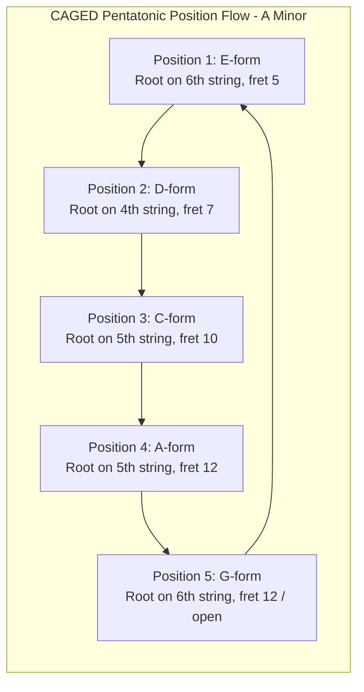
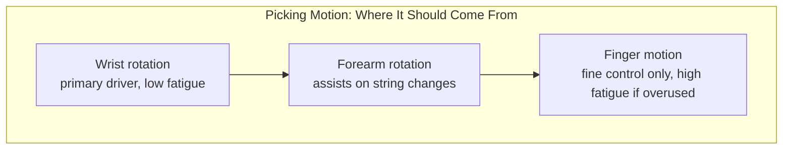
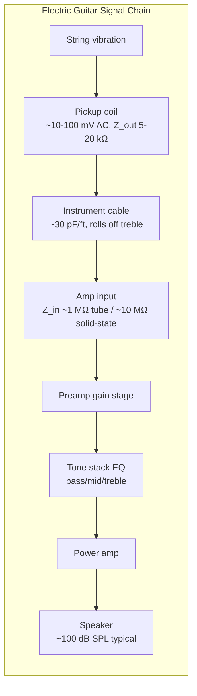

# Lesson 1: Pentatonic Mastery on Electric Guitar — CAGED Positions, Technique, and Blues Phrasing

## 1. Why the Pentatonic Scale Works (Acoustic Foundation)

Pluck an open string and it vibrates at a fundamental pitch while simultaneously ringing out overtones at 2×, 3×, 4×, 5×, 6× that frequency. Those low-numbered overtones are consonant with the fundamental by construction — they're the acoustic "safe" intervals. The pentatonic scale is built almost entirely from those relationships.

**Minor pentatonic**: 1, ♭3, 4, 5, ♭7 (A minor pentatonic = A-C-D-E-G)
**Major pentatonic**: 1, 2, 3, 5, 6 (C major pentatonic = C-D-E-G-A)

The key design feature of both scales: **no tritone**. The 4th-to-7th-degree interval in a full major scale is a tritone (6 semitones), the most dissonant interval in Western harmony. Pentatonic scales drop exactly the notes that create that tritone, which is why you can throw pentatonic lines over almost any chord in a progression and rarely hit a genuinely "wrong" note. That forgiveness is the entire reason beginners can improvise convincingly within a week, and why advanced players never outgrow the scale.

**Relative duality**: A minor pentatonic (A-C-D-E-G) and C major pentatonic (C-D-E-G-A) are the *same five notes*, just different tonal centers, a minor third apart. This means every fingering you learn below does double duty — shift your sense of "home" from A to C and you're playing major pentatonic with zero new shapes to learn. This is how blues and rock guitarists move fluidly between "minor" and "major" flavors over the same chord.

That's the theory. Everything from here is fretboard mechanics you execute today.

## 2. Fretboard Architecture: The Five CAGED Positions

Standard tuning (low to high: E-A-D-G-B-E) moves a perfect fourth (5 semitones) between adjacent strings, except G→B, which is a major third (4 semitones). This one irregularity — the "tuning break" — is why pentatonic box shapes aren't visually symmetrical from string to string. Memorize the shapes as physical patterns; don't try to derive them from the math every time.

The **CAGED system** overlays five pentatonic box shapes on the neck, each named for the open chord shape it resembles. They interlock and repeat every octave (12 frets).



All diagrams below are **A minor pentatonic (A-C-D-E-G)**. To transpose: slide the whole shape. Position 1 at fret 5 = A minor. Move it to fret 7 = B minor. Fret 3 = G minor. Same shape, new root.

### Position 1 — E-form (root on 6th string, fret 5)

```
e|---------------5--8--
B|---------------5--8--
G|---------------5--7--
D|---------------5--7--
A|---------------5--7--
E|---------------5--8--
```
**Fingering**: index (1) covers every note on the lower fret of each string, pinky (4) covers the higher fret. Thumb stays anchored behind the neck roughly opposite the middle finger. This is the single most-used position in rock and blues soloing — learn this one cold before anything else.

### Position 2 — D-form (root on 4th string, fret 7)

```
e|------------7--8-----
B|------------8--10----
G|------------7--9-----
D|------------7--9-----
A|------------7--10----
E|------------7--8-----
```
**Fingering**: index on fret 7, middle (2) on fret 8, ring (3) on fret 9, pinky on fret 10. Notice frets 7-8 on the low E and D strings overlap with the top of Position 1 — that's your connection point for shifting up the neck.

### Position 3 — C-form (root on 5th string, fret 10)

```
e|--------10--12-------
B|--------10--13-------
G|--------9---12-------
D|--------10--12-------
A|--------10--12-------
E|--------10--12-------
```
**Fingering**: index on frets 9-10, ring on fret 12, pinky on fret 13. This sits in the middle of the neck where string tension is moderate and bends feel the most controllable — a good "home base" position for early bending practice.

### Position 4 — A-form (root on 5th string, fret 12)

```
e|--12--15-------------
B|--13--15-------------
G|--12--14-------------
D|--12--14-------------
A|--12--15-------------
E|--12--15-------------
```
**Fingering**: index on fret 12, middle on 13, ring on 14, pinky on 15. Past the 12th fret the frets sit closer together and string tension drops slightly, which makes wide bends and fast vibrato physically easier — many signature high-register blues licks live here.

### Position 5 — G-form (root on 6th string, open or fret 12)

```
e|--0---3--------------
B|--1---3--------------
G|--0---2--------------
D|--0---2--------------
A|--0---3--------------
E|--0---3--------------
```
**Fingering**: index on fret 1, middle on fret 2, ring on fret 3; open strings ring freely. This is Position 1 shifted down an octave — same shape, open strings substituting for the fretted notes 12 frets below.

### Horizontal Connection Drill

Boxes get you playing fast, but they also trap your ear into thinking vertically. Break that habit by playing the entire scale on one string:

```
G string:  5  7  9  10  12  14  15  17  19
           A  B  C  D   E   F#  G   A   B    <- notice F# is NOT in A minor pent;
                                                 skip straight 9->10 steps as marked
```
Correct fret sequence for A minor pentatonic on the G string only:
```
G|--5--7--9--10--12--14--15--17--19--
```
Play this ascending and descending at 60 BPM, one note per click, saying the interval out loud (whole step, whole step, half step, whole step...). This builds the *sound* of the scale independent of box shapes, which is what lets you eventually improvise across the whole neck instead of hopping between five memorized patterns.

## 3. Core Mechanics: Picking, Fretting, Damping

### Picking Hand

Alternate picking (strict down-up-down-up) is your default stroke pattern. The motion should come from **wrist rotation** — think of turning a doorknob — not from the forearm or fingers. Anchor your ring or pinky finger lightly on the pickguard for a stable reference point.



**Pick angle**: tilt the pick 20-30° relative to the string rather than holding it dead flat. This reduces drag and gives a rounder, less clicky attack. Jazz players push this further (45°+) for a smoother, more legato pick sound.

**Pick depth**: let the tip travel just 2-3mm past the string. Deeper strokes are louder but slower; shallow strokes enable speed at the cost of dynamic range. Match depth to the musical context, not habit.

### Fretting Hand

**Pressure**: you need about as much force as pressing a computer key, not a death grip. Press only hard enough that the string makes clean contact with the fret. Excess pressure causes fatigue, sharp intonation (you're stretching the string), and long-term tendon strain.

**Thumb position**: anchored behind the neck, roughly opposite your middle finger, for most pentatonic playing. Above fret 12, many players shift to "thumb-over" — wrapping the thumb over the top edge of the neck — which gives extra reach and naturally mutes the low E string.

**String damping**: this is the detail that separates clean players from muddy ones. Fingers not actively fretting should rest lightly against the strings above the one you're playing; the picking-hand palm rests lightly against the strings below the bridge to control unwanted ringing from lower strings. Without this, pentatonic runs generate sympathetic buzz that muddies the recording or mix.

### Pre-Practice Posture Checklist

Run this before every session:

1. Fretting wrist: straight, no inward/outward bend (bent wrist compresses the carpal tunnel).
2. Fretting fingers: curved, fingertip contact perpendicular to the fretboard — flat fingers cause buzz and accidental muting.
3. Fretting thumb: resting behind the neck, not clamped like a baseball bat grip.
4. Picking wrist: straight to slightly extended, forming one continuous line with the forearm.
5. Pick grip: relaxed, held between thumb and index only.
6. Shoulders: down and relaxed. Tension here transmits straight down into the hands.

Stop and reset if you feel tension anywhere in that chain — it doesn't stay localized.

## 4. Progressive Practice Protocol

### Weeks 1-2: Position Mastery, 60 → 80 BPM

Metronome at **60 BPM**, quarter notes, one note per click. Play all five positions ascending and descending.

**Daily drill (20 minutes)**:
1. Position 1 — 4 reps up/down
2. Position 2 — 4 reps up/down
3. Position 3 — 4 reps up/down
4. Position 4 — 4 reps up/down
5. Position 5 — 4 reps up/down

Every note rings clean, picking stays strictly alternating, no tension in the hands. Only move to 70 BPM, then 80 BPM, once all five are effortless at the current tempo. Skipping increments is how bad technique gets baked in at speed.

### Weeks 3-4: Interval Sequences, 80 → 100 BPM

Straight ascending/descending scales don't train your ear to hear harmony — interval sequences do.

**Thirds sequence (Position 1, A minor pentatonic)**:
```
e|---------------------
B|---------------------
G|--5--7--5--7---------
D|--5-------7--5--7----
A|--5--7--------7--5--7
E|---------------------
```

**Fourths sequence (Position 1)**:
```
e|---------------------
B|--5--8---------------
G|--5-------7----------
D|--5--7-------7-------
A|--------7-------7----
E|---------------------
```

Run both sequences through all five positions at 80, then 90, then 100 BPM. This is what trains your fingers to land on usable chord tones later when improvising over changes.

### Weeks 5-6: Position Shifting, 100 → 120 BPM

Connect adjacent positions with same-finger slides, keeping string contact through the shift.

**Position 1 → Position 2**:
```
e|---------------5--8--7--8-----
B|---------------5--8-----8--10-
G|---------------5--7-----7--9--
D|---------------5--7-----7--9--
A|---------------5--7-----7--10-
E|---------------5--8-----7--8--
                    ↑ slide with ring finger, fret 7 to fret 7 on D string
```

Repeat for every adjacent pair (2→3, 3→4, 4→5, 5→1 with octave displacement). Target **100 BPM in eighth notes by the end of week 6**. If you stall, record yourself and look at the waveform against a grid in Audacity or Reaper — timing drift is obvious once you see it, and much harder to hear in real time.

### Weeks 7-8: Legato, 120 → 140 BPM

Legato — hammer-ons and pull-offs — removes picking from every note and opens up fluid, vocal phrasing.

**Hammer-on**: strike down with the fingertip pad with enough velocity that the note matches picked volume. A weak hammer-on sounds thin and uneven — commit to the strike.

**Pull-off**: with two notes fretted, release the higher finger with a slight pluck motion toward your palm (perpendicular to the string) rather than just lifting straight up. That lateral flick is what actually re-excites the string.

**Basic legato drill (Position 1)**:
```
e|---------------------
B|---------------------
G|--5h7p5--------------
D|--------5h7p5--------
A|-------------5h7p5---
E|---------------------
```
Pick only the first note on each string; everything else is hammer/pull. Practice at 120 BPM eighth notes, matching legato volume to picked volume.

**Three-note-per-string progression**:
```
e|---------------------
B|---------------------
G|--5h7h9--9p7p5-------
D|---------------5h7h9-
A|---------------------
E|---------------------
```
Push toward 140 BPM once volume consistency is solid — don't chase speed before the notes are even.

### Weeks 9-10: Bending, Vibrato, Blues Phrasing

**Half-step bend**: fret C (fret 8, high E string, Position 1) with your ring finger, supported behind it by index and middle. Bend up one semitone to C♯ — the supporting fingers do most of the work; ring finger alone isn't strong enough for a clean bend.

**Whole-step bend**: same starting note, bend up a full tone to D. This is the core blues bend. Check your intonation by fretting fret 10 (D) first, memorizing that pitch, then matching it with the bend.

**Pre-bend and release**: bend up to pitch *before* picking, pick, then release while the note rings — produces a descending pitch slide, a classic blues phrase ending.

**Vibrato**: rapid, controlled oscillation around the target pitch, roughly 5-7 cycles per second, quarter-tone to semitone wide. Blues vibrato tends slower and wider; rock vibrato faster and narrower. Practice it exclusively on long sustained notes at phrase endings — vibrato on short notes is wasted motion.

**Call-and-response phrasing**: play a 2-beat phrase, leave 2 beats of space (rest or let the last note ring). This single habit does more for your soloing than any scale knowledge — space is what makes lines sound like phrases instead of scale exercises.

**Target: 120-140 BPM, full musical phrases with bends and vibrato integrated, not bolted on.**

### Weeks 11-12: Rhythmic Displacement

Set the metronome to click on **beats 2 and 4** instead of 1 and 3. This is how you internalize the backbeat feel that blues and rock live on. Run your positions and sequences against this click.

**Syncopation**: deliberately start licks on the "and" of a beat instead of the downbeat.
```
Count:  1   +   2   +   3   +   4   +
Pick:       ↓       ↓       ↓       ↓
```
Force yourself to start phrases off the beat for a full practice session — it feels wrong at first and starts sounding natural within a week.

## 5. Signal Chain and Pickup Selection



**Bridge pickup**: sits near the string's fixed end where high harmonics are strongest — bright, cutting, sharp attack. Use for rhythm comping and lead tones that need to cut through a band mix.

**Neck pickup**: sits near the string's midpoint where the fundamental dominates — warmer, rounder, softer attack. Use for jazz-inflected lines, blues, smooth legato leads.

**Middle/blended position**: combines both, often partially out-of-phase on Strat-style guitars, producing the scooped "quack" tone. Great for funk rhythm and clean arpeggios.

**Cable length matters more than people think.** A long (18-20 ft) cable adds enough capacitance to roll off some upper harmonics — your tone gets duller the longer the run, even with identical settings. A buffer pedal placed right after the guitar fixes this by presenting a low-impedance output to the cable, but it also removes some of the pickup-cable interaction that contributes to a "vintage" high-end character. Try both and decide by ear for your rig, not by spec sheet.

## 6. Injury Prevention and Common Failure Modes

### RSI Warning Signs
- Pain along the finger flexor tendons (inside of forearm)
- Thumb base pain (thenar eminence)
- Wrist extensor pain (back of forearm)
- Tingling or numbness in the fingers — stop immediately, this indicates nerve involvement

### Prevention Protocol

1. **Warm-up (5 min)**: arm circles (10 each direction), wrist rotations (10 each direction), finger-flexor stretch (extend arm, pull fingers back gently with the other hand, hold 15 sec), then a slow chromatic one-finger-per-fret run at 60 BPM across all six strings before touching the scale material.

2. **50-10 work-rest cycle**: 50 minutes of playing, 10 minutes of complete rest with antagonist stretches (wrist/finger extensors), stand up, shake out the hands.

3. **Ergonomic setup**: strap height that lets the fretting hand reach the neck without raising the shoulder or over-extending the wrist; a footstool or guitar support for seated classical-style posture if that's your context; enough light that you're not hunching forward to see the fretboard.

4. **Pain means stop.** Not "push through it" — stop, rest 48 hours, ice if inflamed, see a physician if it recurs. Tendon injuries from guitar are common and entirely avoidable with proper mechanics.

### Rhythmic Drift

Unaccompanied scale practice invites unconscious speeding through easy sections and slowing on hard ones. Record yourself, load it into Audacity/Reaper/GarageBand, and look at your note onsets against a grid — drift that's invisible by ear becomes obvious visually.

**Fix**: loop a simple two-chord vamp (Am-G) or a static root-note drone and improvise over it. The external, unforgiving tempo reference exposes timing weakness instantly, far better than a metronome click alone because you have to subdivide and phrase against it.

### Melodic Monotony — The Blues Scale Fix

Pure pentatonic playing goes stale fast without chromatic color. Add the ♭5 as a passing tone to get the **blues scale**:

**A minor blues scale**: A-C-D-**E♭**-E-G

```
Position 1 with b5 added:
e|---------------5--8--
B|---------------5--8--
G|---------------5--7--
D|------------5--6--7--
A|------------5--6--7--
E|---------------5--8--
                 ↑
              b5 (Eb) — passing tone only, approach from D, resolve to E
```

Never land on the ♭5 as a target — it's a tension tone that wants resolution, approached from D (below) and released into E (above).

## 7. Playing Over Changes: Chord-Tone Targeting

Pentatonic scales work over many chords, but landing on **chord tones** (root, 3rd, 5th, ♭7th) on strong beats and using scale tones as connective material on weak beats makes your lines sound intentional instead of generic.

**12-bar blues in A**:
```
| A7 (4 bars) | D7 (2 bars) | A7 (2 bars) | E7 (1 bar) | D7 (1 bar) | A7 (2 bars) |
```

**Over A7** (A, C♯, E, G): A minor pentatonic (A-C-D-E-G) has the ♭3 (C) instead of the chord's major 3rd (C♯). Bend C up a quarter-to-half step toward C♯ on downbeats to outline the dominant chord quality, or switch to A major pentatonic (A-B-C♯-E-F♯) for a cleaner major sound.

**Over D7**: shift to D minor pentatonic (D-F-G-A-C), or stay in A minor pentatonic, which shares four tones with D7's extended sound (D-F♯-A-C). The F natural clashing against D7's F♯ is exactly the "blue note" tension that defines the style — lean into it rather than avoiding it.

**Over E7**: E minor pentatonic (E-G-A-B-D) or A minor pentatonic both work. Specifically target E (root), bend G toward G♯ (major 3rd), B (5th), D (♭7th).

**Practice protocol**: loop the progression, solo using only chord tones landing on downbeats for several passes, then gradually fill in scale tones as connective material between them. This single exercise does more to make you sound like you're "playing the changes" than any amount of scale-only practice.

## 8. Next Steps

Once the five positions, shifting, legato, bending, vibrato, and chord-tone targeting are solid:

1. **Dorian mode** — add the major 6th to minor pentatonic (A-B-C-D-E-F♯-G) for a brighter, fusion/funk minor sound.
2. **Mixolydian mode** — add major 2nd and 6th to major pentatonic (A-B-C♯-D-E-F♯-G), the dominant-7th sound at the core of rock and blues.
3. **Harmonic minor** — add the major 7th to natural minor (A-B-C-D-E-F-G♯) for a darker, classical/neoclassical color.
4. **Arpeggios** — isolate triads and seventh chords across the neck as the harmonic skeleton under your scale lines.
5. **True horizontal playing** — extend the single-string drill from Section 2 until box shapes become optional rather than structural.

The pentatonic scale isn't training wheels you discard later — B.B. King, Albert King, and most of the blues and rock canon were built almost entirely on it. What separates a beginner from a master isn't more notes; it's time, phrasing, and intent behind the five you already have.

Pick up the guitar. Position 1, 60 BPM, right now.
