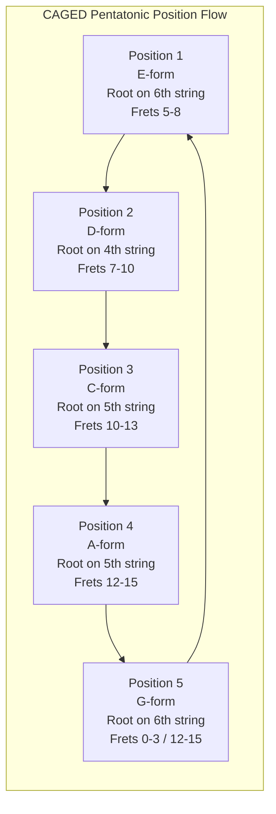
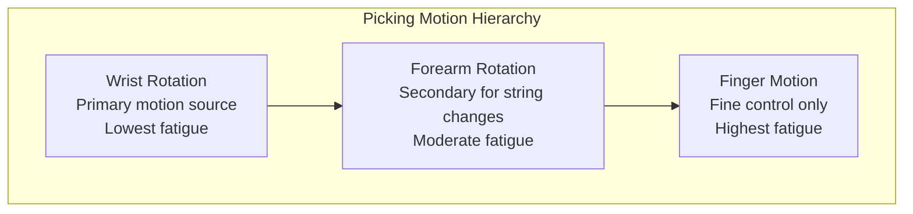
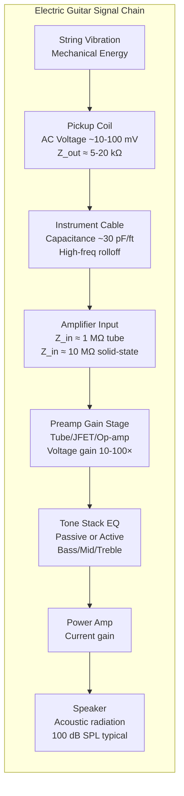

# Lesson 1: Introduction to Pentatonic Modes on Electric Guitar

## 1. First-Principles Intuition: Why the Pentatonic Scale Works

The pentatonic scale—five notes per octave—is the most fundamental melodic framework in guitar playing. Its power comes from what it excludes: the dissonant intervals that create harmonic tension in the seven-note diatonic system.

### Acoustic Foundation (15% Theory Cap)

When you pluck a guitar string, it vibrates at a fundamental frequency and simultaneously produces overtones at integer multiples (2×, 3×, 4×, 5×, 6× the fundamental). The major pentatonic scale (1, 2, 3, 5, 6) approximates the pitch relationships found in these natural harmonics, while the minor pentatonic (1, ♭3, 4, 5, ♭7) creates a darker, more ambiguous tonality.

The critical insight: **both pentatonic forms avoid the tritone**—the six-semitone interval that creates maximum dissonance. By excluding the 4th and 7th degrees (in major pentatonic) or the 2nd and 6th degrees (in minor pentatonic), these scales achieve maximum consonance with minimal pitch material. This makes them acoustically forgiving and melodically flexible over changing harmonies.

**Relative duality**: A minor pentatonic (A-C-D-E-G) and C major pentatonic (C-D-E-G-A) share identical pitch content but differ in tonal center. This relationship exists for all major/minor pentatonic pairs separated by a minor third. Practically, this means you can play A minor pentatonic over C major harmony and vice versa—a foundational technique in blues, rock, and country guitar.

Now let's translate this acoustic theory into physical fretboard mechanics you can execute immediately.

## 2. Fretboard Architecture: The Five CAGED Positions

Standard tuning (E-A-D-G-B-E, low to high) creates a pitch grid where moving up one fret raises pitch by one semitone, and moving to an adjacent string jumps by a perfect fourth (five semitones), except the G-to-B string transition, which is a major third (four semitones). This asymmetry—the "tuning break"—is why guitar fingerings look irregular compared to bass or keyboard patterns.

The **CAGED system** divides the fretboard into five interlocking pentatonic shapes, each anchored to an open chord form (C, A, G, E, D). These shapes tessellate across the neck, creating continuous coverage from nut to upper register.



### A Minor Pentatonic: The Five Box Positions

All fret numbers below are for **A minor pentatonic** (A-C-D-E-G). Transpose by moving the entire shape up or down the neck: shift Position 1 to the 7th fret for B minor, 3rd fret for G minor, etc.

**Position 1 (E-form, 5th position)** – Root on 6th string, fret 5:
```
e|---------------5--8--
B|---------------5--8--
G|---------------5--7--
D|---------------5--7--
A|---------------5--7--
E|---------------5--8--
     Root on E string ↑
```
**Fingering**: Use index finger (1) for frets 5-7, pinky (4) for fret 8. Keep your wrist straight, thumb anchored behind the neck opposite your middle finger. This is the most common starting position for rock and blues soloing.

**Position 2 (D-form, 7th position)** – Root on 4th string, fret 7:
```
e|------------7--8-----
B|------------8--10----
G|------------7--9-----
D|------------7--9-----
A|------------7--10----
E|------------7--8-----
     Root on D string ↑
```
**Fingering**: Index on fret 7, middle (2) on fret 8, ring (3) on fret 9, pinky on fret 10. This position connects smoothly to Position 1 via frets 7-8.

**Position 3 (C-form, 10th position)** – Root on 5th string, fret 10:
```
e|--------10--12-------
B|--------10--13-------
G|--------9---12-------
D|--------10--12-------
A|--------10--12-------
E|--------10--12-------
     Root on A string ↑
```
**Fingering**: Index on fret 9-10, ring on fret 12, pinky on fret 13. This position sits in the "sweet spot" of the neck where string tension is balanced and bends are easiest.

**Position 4 (A-form, 12th position)** – Root on 5th string, fret 12:
```
e|--12--15-------------
B|--13--15-------------
G|--12--14-------------
D|--12--14-------------
A|--12--15-------------
E|--12--15-------------
     Root on A string ↑
```
**Fingering**: Index on fret 12, middle on fret 13, ring on fret 14, pinky on fret 15. Above the 12th fret, fret spacing tightens and string tension softens, making bends and vibrato easier.

**Position 5 (G-form, open position)** – Root on 6th string, fret 5 or open:
```
e|--0---3--------------
B|--1---3--------------
G|--0---2--------------
D|--0---2--------------
A|--0---3--------------
E|--0---3--------------
     Root on E string ↑
```
**Fingering**: Open strings provide natural resonance. Use index on fret 1, middle on fret 2, ring on fret 3. This position is identical to Position 1 shifted down 12 frets (one octave).

### Horizontal vs. Vertical Navigation

Most beginners practice pentatonic scales as vertical shapes (ascending/descending within a single position). Intermediate players learn to connect positions by shifting horizontally along a single string. Advanced players think **diagonally**—combining horizontal shifts with string changes to create fluid, unpredictable lines.

**Horizontal connection drill**: Play the A minor pentatonic scale entirely on the G string:
```
G|--5--7--9--10--12--14--15--17--19--
```
This forces you to learn the intervallic distances (whole step, whole step, minor third, whole step) rather than relying on visual box shapes.

## 3. Core Mechanics: Picking, Fretting, and String Damping

### Picking Hand Biomechanics

The pick is your primary tone-shaping tool. Pick angle, attack depth, and motion trajectory determine whether a note sounds bright and articulate or soft and muted.

**Alternate picking** (strict down-up alternation) is the foundation of speed and consistency. The motion originates from **wrist rotation**, not forearm or finger motion. Imagine turning a doorknob back and forth—this is the wrist deviation axis. Keep your forearm stationary and anchor your pinky or ring finger lightly on the pickguard for stability.



**Pick angle and edge picking**: Hold the pick at a 20-30° angle relative to the string plane, not perpendicular. This reduces frictional resistance and produces a rounder attack with less pick noise. Jazz and fusion players use extreme edge picking (45°+ angle) for a fluid, legato sound.

**Pick depth**: The tip should penetrate just past the string diameter—approximately 2-3mm. Deeper picking increases volume and attack but slows down fast passages. Shallow picking (barely grazing the string) enables speed but sacrifices dynamic control.

### Fretting Hand Technique

**Finger pressure**: You need far less force than you think—approximately 1-2 Newtons (equivalent to pressing a computer key). Excessive fretting force causes fatigue, intonation sharpness, and tendon strain. The string only needs to contact the fret cleanly; pressing harder doesn't improve tone.

**Thumb position**: For pentatonic scale work, anchor your thumb behind the neck, approximately opposite your middle finger. This creates a fulcrum for efficient force transfer. In the upper register (above fret 12), many players adopt "thumb-over" position, wrapping the thumb over the neck's top edge to mute the low E string.

**Finger independence**: The ring and pinky fingers share connective tissue (extensor digitorum communis), making independent motion difficult. Targeted exercises that isolate these fingers strengthen the interosseous muscles that enable finger independence.

**String damping** is the most overlooked technical element. Unused fretting fingers rest lightly on higher strings (above the fretted note), while the picking hand's palm or fingers mute lower strings. Without disciplined damping, pentatonic runs generate sympathetic vibrations and muddy overtones.

### Hand Posture Checklist

Execute this checklist before every practice session:

1. **Fretting hand wrist**: Straight, not bent inward or outward. A bent wrist compresses the carpal tunnel and causes nerve impingement.
2. **Fretting hand fingers**: Curved, fingertips perpendicular to fretboard. Flat fingers cause buzzing and mute adjacent strings.
3. **Fretting hand thumb**: Anchored behind neck, not gripping like a baseball bat.
4. **Picking hand wrist**: Straight to slightly extended. The forearm, wrist, and hand should form a continuous line.
5. **Picking hand grip**: Relaxed, holding the pick with index finger and thumb only. Don't clench your fist.
6. **Shoulder and upper arm**: Relaxed, not elevated or hunched forward.

Tension anywhere in this kinetic chain propagates to the hands. If your shoulders are tense, your fingers will be too.

## 4. Progressive Practice Protocol: From 60 BPM to Performance Speed

### Week 1-2: Position Mastery at 60-80 BPM

Set a metronome to **60 BPM, quarter-note pulse**. Play each of the five CAGED positions ascending and descending, one note per click. Focus on:

- Clean articulation: every note should ring clearly without fret buzz.
- Consistent pick attack: alternate picking throughout, maintaining even volume.
- Relaxed hand posture: stop immediately if you feel tension or pain.

**Daily drill (20 minutes)**:
1. Position 1: 4 repetitions ascending/descending
2. Position 2: 4 repetitions ascending/descending
3. Position 3: 4 repetitions ascending/descending
4. Position 4: 4 repetitions ascending/descending
5. Position 5: 4 repetitions ascending/descending

Once you can execute all five positions without hesitation at 60 BPM, increase to **70 BPM**, then **80 BPM**. Do not skip tempo increments—gradual progression builds muscle memory and prevents injury.

### Week 3-4: Intervallic Sequences at 80-100 BPM

Linear scale practice (ascending/descending stepwise motion) doesn't develop improvisational fluency. Instead, practice **interval sequences** that embed harmonic relationships.

**Thirds sequence** (scale degrees: 1-3, 2-5, 3-6, 5-1, 6-2):
```
Position 1 in A minor pentatonic:
e|---------------------
B|---------------------
G|--5--7--5--7---------
D|--5-------7--5--7----
A|--5--7--------7--5--7
E|---------------------
```

**Fourths sequence** (scale degrees: 1-5, 2-6, 3-1, 5-2, 6-3):
```
Position 1 in A minor pentatonic:
e|---------------------
B|--5--8---------------
G|--5-------7----------
D|--5--7-------7-------
A|--------7-------7----
E|---------------------
```

Practice these sequences across all five positions at **80 BPM, then 90 BPM, then 100 BPM**. Interval sequences force you to hear the scale harmonically rather than melodically, preparing your ear for chord-tone targeting in improvisation.

### Week 5-6: Position Shifting at 100-120 BPM

Now connect adjacent positions via sliding transitions. Slide on the same finger, maintaining string contact throughout the shift.

**Position 1 → Position 2 connection**:
```
e|---------------5--8--7--8-----
B|---------------5--8-----8--10-
G|---------------5--7-----7--9--
D|---------------5--7-----7--9--
A|---------------5--7-----7--10-
E|---------------5--8-----7--8--
                    ↑ Slide
```

Use your ring finger to slide from fret 7 (Position 1) to fret 7 (Position 2) on the D string, then continue the pattern. Practice this connection ascending and descending until seamless.

Repeat for all adjacent position pairs:
- Position 2 → Position 3
- Position 3 → Position 4
- Position 4 → Position 5
- Position 5 → Position 1 (octave displacement)

**Target tempo: 100 BPM eighth notes by week 6**. If you plateau, record yourself and analyze timing deviations using a DAW's waveform display aligned against a grid.

### Week 7-8: Legato and Phrasing at 120-140 BPM

**Legato** (hammer-ons and pull-offs) reduces picking dependency and enables fluid, vocal-like phrasing. A hammer-on uses finger velocity to excite the string; a pull-off uses lateral finger motion to pluck the string as you release.

**Hammer-on technique**: Strike the string with your fretting finger's pad (not tip) with enough velocity to produce consistent volume. Weak hammer-ons sound muffled and uneven.

**Pull-off technique**: Fret two adjacent notes. As you release the higher note, pull your finger slightly toward your palm (perpendicular to the string), plucking the string. This lateral motion excites the lower fretted note.

**Legato drill in Position 1**:
```
e|---------------------
B|---------------------
G|--5h7p5--------------
D|--------5h7p5--------
A|-------------5h7p5---
E|---------------------
```
The "h" indicates hammer-on, "p" indicates pull-off. Pick only the first note of each string, then execute the remaining notes via legato. This develops finger velocity and left-hand independence.

Progress to **three-note-per-string legato patterns**:
```
e|---------------------
B|---------------------
G|--5h7h9--9p7p5-------
D|---------------5h7h9-
A|---------------------
E|---------------------
```

Practice at **120 BPM eighth notes**, focusing on volume consistency. Legato notes should match picked notes in volume and clarity.

### Week 9-10: Blues Phrasing and Bent-Note Vocabulary

The pentatonic scale's musical utility emerges from **idiomatic phrasing**—characteristic rhythmic and melodic gestures that define genre conventions.

**String bending** adds continuous pitch inflection unavailable on piano. Push the string perpendicular to the fretboard (toward the ceiling on the treble strings, toward the floor on the bass strings) to raise pitch.

**Half-step bend**: Fret C (8th fret, high-E string in Position 1), bend up one semitone to C♯. Use your ring finger to fret and bend, supported by your index and middle fingers behind it. All three fingers push together—the ring finger alone lacks sufficient strength.

**Whole-step bend**: Fret C (8th fret, high-E string), bend up two semitones to D. This is the signature blues bend. Check intonation by fretting the target note (D, 10th fret) and matching its pitch with your bend.

**Pre-bend and release**: Fret and bend to pitch before picking, then release the string while it's ringing. This creates a descending pitch slide.

**Vibrato**: Oscillate pitch via rapid back-and-forth bending (5-7 Hz, quarter-tone to semitone width). Blues vibrato tends toward slower, wider oscillations; rock vibrato is faster and narrower. Practice vibrato on sustained notes at the end of phrases.

**Call-and-response phrasing**: Play a short melodic phrase (two beats), then rest or sustain a note (two beats). This mirrors vocal conventions in blues tradition and creates space within the solo.

**Target tempo: 120-140 BPM for phrased, musical solos with bends and vibrato**.

### Week 11-12: Rhythmic Displacement and Syncopation

Set your metronome to **click on beats 2 and 4** instead of 1 and 3. This internalizes the backbeat feel central to blues and rock. Practice all five positions and interval sequences with this displaced click.

**Syncopated rhythms**: Place notes on the "and" of beats (eighth-note upbeats) rather than downbeats. This creates rhythmic tension and forward motion.

```
Count:  1   +   2   +   3   +   4   +
Pick:       ↓       ↓       ↓       ↓
```

Practice pentatonic licks starting on upbeats, forcing yourself to think in syncopated phrases.

## 5. Signal Chain and Pickup Position: Tone Shaping Fundamentals

The electric guitar signal path shapes tone through electromagnetic transduction, cable capacitance, and amplifier input impedance.



**Pickup position effects**:

- **Bridge pickup**: Positioned near the string's fixed endpoint (bridge saddle), it detects higher-order harmonics strongly, producing bright, cutting tone with sharp attack transients. Use for rhythm playing, aggressive lead tones, and cutting through dense mixes.

- **Neck pickup**: Positioned near the string's midpoint (where fundamental displacement is maximal), it emphasizes lower harmonics, yielding warm, round tone with softer attack. Use for jazz, blues, and smooth lead tones.

- **Middle position**: Blends both pickups (often out-of-phase in Stratocasters), creating a scooped midrange "quack" tone. Use for funk rhythm and clean arpeggios.

**Cable capacitance and treble loss**: A 20-foot instrument cable (~600 pF capacitance) combined with 10 kΩ pickup impedance creates an RC low-pass filter with cutoff around 26 kHz. While this is above the fundamental frequencies of guitar notes, it attenuates upper harmonics that contribute to brightness. Long cable runs create audible high-frequency loss.

**Buffer pedals**: A unity-gain buffer (high input impedance, low output impedance) inserted immediately after the guitar isolates the pickup from cable capacitance, preserving high-frequency content. However, buffers eliminate the pickup-cable resonance that contributes to vintage tone—a tradeoff between fidelity and coloration.

## 6. Common Failure Modes and Injury Prevention

### Repetitive Strain Injury (RSI) Mitigation

Guitar playing combines sustained isometric contraction (holding frets) with rapid fine-motor motion—a combination that creates cumulative microtrauma in tendons and musculotendinous junctions.

**Early warning signs**:
- Pain in finger flexor tendons (volar forearm)
- Thumb pain in thenar eminence (abductor pollicis brevis)
- Wrist extensor pain (dorsal forearm)
- Numbness or tingling in fingers (nerve compression)

**Prevention protocol**:

1. **Warm-up (5 minutes before practice)**:
   - Arm circles: 10 forward, 10 backward
   - Wrist rotations: 10 clockwise, 10 counterclockwise
   - Finger flexor stretches: extend arm, pull fingers back with opposite hand, hold 15 seconds
   - Chromatic exercise at 60 BPM: one-finger-per-fret across all strings, ascending and descending

2. **Work-rest cycles**: Apply the **50-10 rule**—50 minutes playing, 10 minutes rest. During rest intervals, perform antagonist muscle stretches (wrist and finger extensors). Stand up, walk around, shake out your hands.

3. **Ergonomic setup**:
   - Adjust strap height so your fretting hand reaches the neck without shoulder elevation or wrist extension
   - Use a footstool or guitar support (e.g., Dynarette, Gitano) to stabilize the instrument without forced postures
   - Ensure adequate lighting to prevent hunching forward to see the fretboard

4. **Stop immediately if you experience pain**. Pain is not weakness—it's your body signaling tissue damage. Rest for 48 hours, apply ice to inflamed areas, and consider consulting a sports medicine physician if symptoms persist.

### Rhythmic Drift and Timing Instability

When practicing scales without accompaniment, players unconsciously accelerate through familiar patterns and decelerate through difficult passages. This rhythmic instability undermines groove development.

**Diagnosis**: Record your practice session and analyze the waveform in a DAW (GarageBand, Reaper, Audacity). Align your playing against a metronome grid. Timing deviations become immediately visible.

**Correction drill**: Practice with a looper pedal. Record a simple two-chord vamp (e.g., Am to G) or bass drone on the root note. Now improvise pentatonic phrases over the loop. The looped accompaniment forces adherence to an external tempo and exposes rhythmic weaknesses immediately.

### Tone Homogeneity and Melodic Clichés

Exclusive focus on pentatonic scales can lead to predictable phrasing and melodic monotony. The pentatonic scale's consonance becomes boring without chromatic embellishment or rhythmic variation.

**Solution: Add blue notes**. The ♭5 (E♭ in A minor) serves as a chromatic connector between D and E. The major 3rd (C♯ in A minor) creates a blues-inflected sound when bent from the minor 3rd (C). These chromatic additions transform the pentatonic framework into the **blues scale**:

**A minor blues scale**: A-C-D-**E♭**-E-G

```
Position 1 blues scale with ♭5:
e|---------------5--8-----
B|---------------5--8-----
G|---------------5--7-----
D|------------5--6--7-----
A|------------5--6--7-----
E|---------------5--8-----
                  ↑
               ♭5 (E♭)
```

Use the ♭5 as a passing tone—approach it from D (whole step below) and resolve to E (half step above). Never sustain the ♭5 as a target note; it functions as tension that demands resolution.

## 7. Harmonic Context: Playing Over Chord Changes

While the pentatonic scale functions over many harmonic contexts, awareness of **chord tones** (root, third, fifth, seventh) enables targeted note selection that reinforces the underlying harmony.

**Chord-tone targeting**: Land on chord tones on strong beats (downbeats) and use scale tones as passing notes on weak beats (upbeats). This creates harmonic clarity even within dissonant or outside playing.

**Example: 12-bar blues in A**:

```
| A7 (4 bars) | D7 (2 bars) | A7 (2 bars) | E7 (1 bar) | D7 (1 bar) | A7 (2 bars) |
```

Over **A7** (root, major 3rd C♯, 5th E, ♭7th G): A minor pentatonic (A-C-D-E-G) functions but sounds ambiguous because it contains the minor 3rd (C) instead of the major 3rd (C♯). Bend C up to C♯ on downbeats to outline the A7 chord. Alternatively, use A major pentatonic (A-B-C♯-E-F♯).

Over **D7**: Shift to D minor pentatonic (D-F-G-A-C) or continue using A minor pentatonic, which shares four common tones with D7 (D-F♯-A-C). The F natural (minor 3rd of D) creates bluesy tension against D7's major 3rd (F♯).

Over **E7**: E minor pentatonic (E-G-A-B-D) or A minor pentatonic both work. Target E (root), G♯ (major 3rd, not in A minor pent—bend G up), B (5th), and D (♭7th).

**Practice protocol**: Loop the 12-bar blues progression and improvise using only chord tones on downbeats. This forces you to hear the harmonic movement and map chord tones to fretboard positions. Once internalized, add scale tones as passing notes between chord tones.

## 8. Next Steps: Expanding Beyond Pentatonic

Once you've mastered the five CAGED pentatonic positions, position shifting, legato technique, bending, vibrato, and chord-tone targeting, you're ready to expand your vocabulary:

1. **Dorian mode**: Add the major 6th to the minor pentatonic scale (A-B-C-D-E-F♯-G). This creates a brighter minor sound common in fusion and funk.

2. **Mixolydian mode**: Add the major 2nd and major 6th to the major pentatonic scale (A-B-C♯-D-E-F♯-G). This is the dominant 7th sound central to rock and blues.

3. **Harmonic minor scale**: Add the major 7th to the natural minor scale (A-B-C-D-E-F-G♯). This creates exotic, classical-sounding phrases.

4. **Arpeggios**: Isolate chord tones (triads and seventh chords) across the fretboard. Arpeggios provide the skeleton for chord-based soloing.

5. **Horizontal playing**: Expand beyond vertical box shapes by learning scale patterns along a single string. This opens up the entire fretboard and eliminates positional dependencies.

The pentatonic scale isn't a beginner's training-wheels framework—it's a lifelong foundation. B.B. King, Eric Clapton, and Jimi Hendrix built entire careers on pentatonic mastery. The difference between a novice and a master isn't the number of notes available, but the musicality, phrasing, tone, and emotional intent behind each note.

Now pick up your guitar and practice Position 1 at 60 BPM. The fretboard is waiting.
