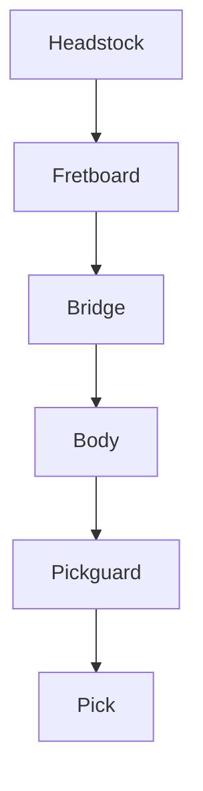

# Beginner Foundation: Guitar

## 1. Everyday Intuition & First Principles
Imagine the guitar as a magical box that turns your fingers into music. Just like how pressing different keys on a piano produces different notes, strumming and pressing strings on a guitar creates a symphony of sounds. The guitar is a versatile instrument that can play everything from gentle melodies to powerful riffs, making it a perfect choice for beginners looking to explore the world of music.

## 2. Foundational Vocabulary & Glossary
- **String:** The thin, metal or nylon wires that vibrate to produce sound. Think of them as the guitar's voice.
- **Fretboard:** The fingerboard where you press the strings to change their pitch. It's like a map that guides your fingers to the right notes.
- **Tuning Pegs:** The small knobs at the headstock used to tighten or loosen the strings to achieve the correct pitch. They're like the guitar's tuning dials.
- **Bridge:** The part of the guitar that holds the strings in place at the body. It's the anchor that keeps the strings taut.
- **Body:** The main part of the guitar that amplifies the sound. It's like the guitar's resonant chamber.
- **Pick:** A small, flat tool used to strum the strings. It's like a tiny brush that makes the strings sing.

## 3. Visual System Flow
### ASCII Diagram
```
+-------------------+
|       Headstock   |
|  Tuning Pegs      |
+-------------------+
|       Fretboard   |
+-------------------+
|       Bridge      |
+-------------------+
|       Body        |
+-------------------+
|       Pickguard   |
+-------------------+
|       Pick        |
+-------------------+
```

### Mermaid Flowchart


## 4. Common Beginner Misconceptions & Mental Traps
- **Misconception:** Playing guitar is easy and doesn't require practice. **Truth:** Like any skill, mastering the guitar takes time and dedication. Regular practice is key.
- **Misconception:** You need to learn complex chords right away. **Truth:** Start with simple chords and build up gradually. Complexity comes with time and experience.
- **Misconception:** You must have perfect pitch to play guitar. **Truth:** While it helps, you can learn to play by ear and through practice. Many great guitarists didn't start with perfect pitch.

## 5. Socratic Discussion Starters
- What do you think makes the guitar a unique instrument compared to others?
- How do you think the tension of the strings affects the sound of the guitar?
- Can you imagine a scenario where you might use a pick versus fingerpicking?
- What are some ways you can make practicing the guitar more enjoyable and less daunting?
- How do you think the shape of the guitar body influences the sound it produces?
