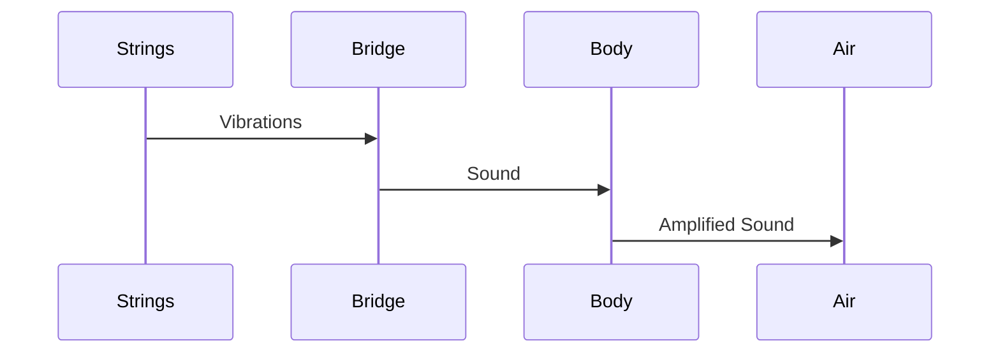

# Intermediate Foundation: Guitar
## 1. Architectural Mental Model
As we move beyond the basics of playing the guitar, it's essential to develop a deeper understanding of the instrument's architecture. This involves comprehending the guitar's components, their interactions, and how they contribute to the overall sound and performance. The architectural mental model for the guitar can be broken down into the following key components:

- **Body:** The body of the guitar is responsible for amplifying the sound produced by the strings. It can be made of various materials, such as wood, plastic, or metal, and can have different shapes and sizes, each affecting the guitar's tonal characteristics.
- **Neck:** The neck of the guitar is the part that extends from the body and holds the fingerboard. It is typically made of wood and is responsible for the guitar's sustain and intonation.
- **Fingerboard:** The fingerboard is the flat surface on the neck where the player presses the strings to produce different notes. It is usually made of wood and is marked with frets, which are metal strips that divide the fingerboard into semitone intervals.
- **Strings:** The strings are the primary source of sound on the guitar. They are typically made of metal or nylon and are stretched over the bridge and nut. The gauge and material of the strings can significantly affect the guitar's tone and playability.
- **Bridge:** The bridge is the component that transfers the vibrations of the strings to the body of the guitar. It can be made of various materials, such as wood, plastic, or metal, and can have different designs, each affecting the guitar's sound and sustain.
- **Tuners:** The tuners are the components that allow the player to adjust the tension of the strings, thereby changing their pitch. They are typically located at the headstock of the guitar and can be of various types, such as friction tuners, machine heads, or planetary tuners.

Understanding the architectural mental model of the guitar is crucial for developing a deeper appreciation of the instrument's capabilities and limitations. It also helps in making informed decisions about the design and configuration of the guitar, as well as in troubleshooting and maintaining the instrument.

## 2. Systems Taxonomy & Component Protocols
The guitar can be viewed as a system composed of various components that interact with each other to produce sound. The following taxonomy and component protocols provide a standardized framework for understanding and describing the guitar's architecture:

- **Body:** The body of the guitar can be classified into different types, such as acoustic, electric, and classical, each with its own design and materials. The body is responsible for amplifying the sound produced by the strings and can be further classified into different subcomponents, such as the top, back, and sides.
- **Neck:** The neck of the guitar can be classified into different types, such as set neck, bolt-on neck, and neck-through body, each with its own design and materials. The neck is responsible for the guitar's sustain and intonation and can be further classified into different subcomponents, such as the fretboard, truss rod, and headstock.
- **Fingerboard:** The fingerboard can be classified into different types, such as rosewood, maple, and ebony, each with its own design and materials. The fingerboard is responsible for producing different notes and can be further classified into different subcomponents, such as the frets and inlays.
- **Strings:** The strings can be classified into different types, such as steel, nickel, and phosphor bronze, each with its own design and materials. The strings are responsible for producing sound and can be further classified into different subcomponents, such as the core and winding.
- **Bridge:** The bridge can be classified into different types, such as fixed bridge, floating bridge, and tailpiece, each with its own design and materials. The bridge is responsible for transferring the vibrations of the strings to the body of the guitar and can be further classified into different subcomponents, such as the saddle and bridge pins.
- **Tuners:** The tuners can be classified into different types, such as friction tuners, machine heads, and planetary tuners, each with its own design and materials. The tuners are responsible for adjusting the tension of the strings and can be further classified into different subcomponents, such as the gears and shafts.

Understanding the systems taxonomy and component protocols of the guitar is crucial for developing a deeper appreciation of the instrument's capabilities and limitations. It also helps in making informed decisions about the design and configuration of the guitar, as well as in troubleshooting and maintaining the instrument.

## 3. Multi-Component Interaction Flow
The interaction between the components of the guitar can be described using detailed ASCII and Mermaid sequence diagrams. The following diagrams illustrate the interaction flow between the strings, bridge, and body of the guitar:

### ASCII Sequence Diagram
```
Strings --> Bridge: Vibrations
Bridge --> Body: Sound
Body --> Air: Amplified Sound
```

### Mermaid Sequence Diagram


The interaction flow between the components of the guitar is crucial for understanding how the instrument produces sound. It also helps in troubleshooting and maintaining the instrument, as well as in making informed decisions about the design and configuration of the guitar.

## 4. Architectural Trade-offs & Production Pitfalls
Developing a deeper understanding of the guitar's architecture involves making informed decisions about the design and configuration of the instrument. However, these decisions often involve trade-offs and potential pitfalls. The following are some of the key architectural trade-offs and production pitfalls to consider:

- **Body Material:** The material of the body can significantly affect the guitar's tonal characteristics. For example, a guitar with a solid wood body may produce a warmer and more resonant sound than a guitar with a plastic body. However, a solid wood body may also be more prone to warping and cracking due to changes in humidity and temperature.
- **Neck Design:** The design of the neck can significantly affect the guitar's sustain and intonation. For example, a set neck may provide better sustain and intonation than a bolt-on neck, but it may also be more difficult to replace or adjust. A neck-through body may provide the best sustain and intonation, but it may also be more expensive and difficult to manufacture.
- **Fingerboard Material:** The material of the fingerboard can significantly affect the guitar's playability and tone. For example, a rosewood fingerboard may provide a warmer and more resonant tone than a maple fingerboard, but it may also be more prone to wear and tear. An ebony fingerboard may provide a brighter and more articulate tone than a rosewood fingerboard, but it may also be more expensive and difficult to maintain.
- **String Gauge:** The gauge of the strings can significantly affect the guitar's tone and playability. For example, a lighter gauge string may provide a brighter and more articulate tone than a heavier gauge string, but it may also be more prone to bending and breaking. A heavier gauge string may provide a warmer and more resonant tone than a lighter gauge string, but it may also be more difficult to press down and may require more finger strength.
- **Bridge Design:** The design of the bridge can significantly affect the guitar's sound and sustain. For example, a fixed bridge may provide better sustain and intonation than a floating bridge, but it may also be more difficult to adjust. A floating bridge may provide more flexibility and expression, but it may also be more prone to buzzing and rattling.

Understanding the architectural trade-offs and production pitfalls of the guitar is crucial for developing a deeper appreciation of the instrument's capabilities and limitations. It also helps in making informed decisions about the design and configuration of the guitar, as well as in troubleshooting and maintaining the instrument.

## 5. Socratic Discussion Starters
The following are some Socratic discussion starters that bridge the architecture of the guitar to low-level implementation:

- **How does the material of the body affect the guitar's tonal characteristics?**
- **What are the advantages and disadvantages of different neck designs?**
- **How does the material of the fingerboard affect the guitar's playability and tone?**
- **What are the trade-offs between different string gauges?**
- **How does the design of the bridge affect the guitar's sound and sustain?**
- **How does the interaction between the components of the guitar affect its overall performance?**
- **What are some common production pitfalls to avoid when designing and configuring a guitar?**
- **How can a deeper understanding of the guitar's architecture inform the design and configuration of the instrument?**
- **How can a deeper understanding of the guitar's architecture inform the troubleshooting and maintenance of the instrument?**
- **How can a deeper understanding of the guitar's architecture inform the performance and expression of the instrument?**

These Socratic discussion starters are designed to encourage critical thinking and exploration of the guitar's architecture and its implications for performance and expression. They also provide a framework for engaging in meaningful discussions with other musicians, engineers, and practitioners.
